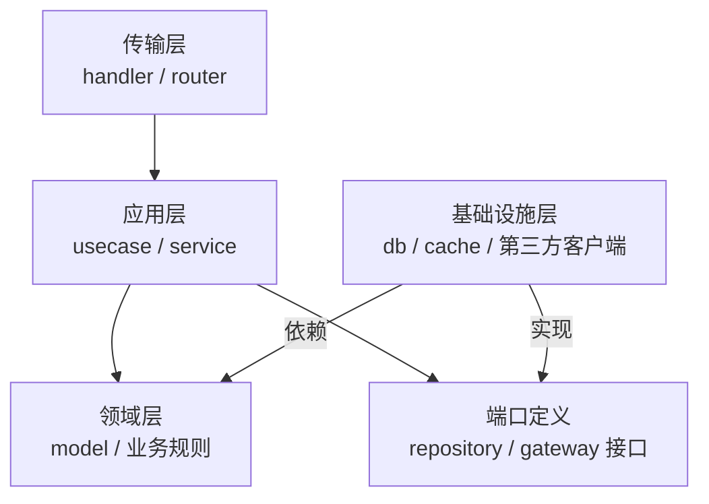

# Go 项目结构——从 Standard Layout 到 Clean Architecture

**摘要：**

Go 语言没有强制规定项目目录结构，这既是自由，也是陷阱——同一个团队里五个人可能写出五种不同风格的项目布局，让接手者无从下手。本文从"为什么需要项目结构约定"出发，梳理 Go 社区最广泛认可的 **Standard Layout**（`/cmd`、`/internal`、`/pkg` 等目录惯例），深入剖析每个目录的设计意图与边界，再介绍如何在 Standard Layout 之上引入 **Clean Architecture**（整洁架构）思想来组织业务逻辑——将 domain、usecase、repository、handler 分层，保持核心业务逻辑与框架、数据库等基础设施的解耦。最后给出从命令行工具、HTTP 微服务到 mono-repo 三种典型场景的具体目录模板和包设计决策框架。文章最后回到一个设计认知：项目结构的本质是"用物理目录表达逻辑边界"——目录名传达意图，依赖方向体现架构，包划分承载职责。好的项目结构让代码"自文档化"——开发者看目录就能理解项目的架构和职责划分，不需要读代码。

---

## 第 1 章 为什么项目结构如此重要

### 1.1 结构即沟通

代码是写给人读的，项目结构是代码的第一印象。当一个新工程师打开 `ls -la` 看到项目根目录时，他应该能在 30 秒内回答以下问题：
- 这个项目有哪些可执行程序？
- 对外暴露的库代码在哪里？
- 数据库访问层、HTTP 路由、业务逻辑分别在哪里？
- 配置和部署文件在哪里？

如果一个项目的根目录是这样的：

```
myproject/
├── api.go
├── auth.go
├── config.go
├── database.go
├── handler.go
├── main.go
├── models.go
├── utils.go
└── ...（30 个 .go 文件全平铺）
```

那么即便每个文件的代码质量都很高，这个项目仍然是难以维护的——因为它没有表达任何关于"哪些东西属于一类"的信息。文件名是所有结构信息的唯一载体，当项目增长到 100 个文件时，这种平铺结构会完全失控。

这个"平铺失控"是项目结构缺失的根本危害——文件名只能表达"这个文件是什么"，不能表达"这个文件与哪些文件相关"。目录结构提供了"分组"能力——把相关的文件放在同一目录，让"哪些文件属于一类"一目了然。这个"分组"是项目结构的核心价值——它让代码的组织方式传达架构意图。

好的项目结构应该做到：
- **自文档化（Self-documenting）**：目录名本身传达意图；
- **边界清晰**：哪些代码是公开 API，哪些是内部实现，一目了然；
- **依赖方向可见**：高层模块不依赖低层模块，依赖方向通过目录结构体现；
- **可扩展**：增加新功能不需要重构整个目录树。

### 1.2 Go 的包设计哲学

在深入目录结构之前，有必要理解 Go 的**包（package）设计哲学**，因为目录结构本质上是包的物理组织方式：

**包是封装的单元**：Go 的 `package` 是比类更粗粒度的封装单元。一个包应该围绕一个**单一的职责**设计——所有暴露在包外的类型、函数、变量共同构成这个包的 API，它们应该相互关联，共同表达一个内聚的概念。这个"单一职责"是包设计的核心原则——一个包应该只做一件事，且把这件事做好。

**包名即文档**：`package http` 里的 `Client` 不需要命名为 `HTTPClient`，因为使用方会写 `http.Client`，包名已经提供了上下文。好的包名应该简洁（单个英文词，不用下划线或驼峰），且能准确描述包的内容。这个"包名即上下文"让 Go 的 API 简洁——不需要冗余的前缀，包名本身就是命名空间。

**避免循环依赖**：Go 编译器严格禁止包之间的循环依赖。这不是限制，而是强迫开发者理清依赖关系——如果 A 包和 B 包互相依赖，说明要么它们应该合并为一个包，要么需要提取公共接口打破循环。这个"禁止循环依赖"是 Go 包设计的硬约束——它迫使开发者思考依赖方向，避免"大泥球"式的包依赖。

**`internal` 包的访问控制**：Go 1.4 引入了 `internal` 目录——`internal` 下的包只能被其父目录下的代码引用，外部无法 import。这是 Go 唯一的包级访问控制机制（比 Java 的 `protected` 和 `package-private` 更简单粗暴，但足够用）。这个"internal 访问控制"让 Go 项目可以明确区分"公开 API"和"内部实现"——`internal/` 下的代码可以自由重构，不用担心破坏外部用户。

---

## 第 2 章 Standard Layout：Go 社区的目录惯例

### 2.1 Standard Layout 的由来

[golang-standards/project-layout](https://github.com/golang-standards/project-layout) 是 GitHub 上 star 最多的 Go 项目结构参考，归纳了 Go 大型项目（Kubernetes、etcd、Prometheus 等）的共同目录约定。它不是官方标准，但已成为事实上的社区共识。

完整的 Standard Layout 如下：

```
myproject/
├── cmd/                    # 主程序入口（每个子目录对应一个可执行文件）
│   ├── server/
│   │   └── main.go
│   └── worker/
│       └── main.go
├── internal/               # 项目内部代码（外部不可 import）
│   ├── app/               # 应用初始化和组装
│   ├── config/            # 配置解析
│   ├── handler/           # HTTP/gRPC handler
│   ├── service/           # 业务逻辑
│   └── repository/        # 数据访问层
├── pkg/                    # 可被外部项目 import 的公共库
│   ├── logger/
│   └── middleware/
├── api/                    # API 定义（OpenAPI spec、proto 文件）
│   ├── openapi/
│   └── proto/
├── web/                    # Web 静态资源（HTML、CSS、JS）
├── configs/                # 配置文件模板
├── scripts/                # 构建、安装、分析脚本
├── build/                  # 打包和 CI/CD 配置
│   ├── ci/
│   └── docker/
├── deployments/            # 部署配置（Kubernetes YAML、Helm charts）
├── test/                   # 集成测试、端到端测试数据
├── docs/                   # 设计文档
├── tools/                  # 项目依赖的工具（通过 tools.go 管理）
├── vendor/                 # 依赖包（可选，通常用 go.sum 替代）
├── go.mod
├── go.sum
├── Makefile
└── README.md
```

### 2.2 核心目录详解

#### `/cmd`：可执行程序的入口

`/cmd` 下每个子目录对应一个可执行程序，子目录名即是程序名（`go build ./cmd/server` 生成 `server` 二进制）。

**关键原则：`main.go` 只做装配，不写业务逻辑**。`main.go` 应该只做：解析配置、初始化依赖（DB 连接、Logger 等）、组装应用、启动 HTTP/gRPC server、处理优雅退出信号。业务逻辑全部在 `internal/` 中。

```go
// cmd/server/main.go — 典型的装配代码
func main() {
    cfg, err := config.Load()  // 读取配置
    if err != nil {
        log.Fatal(err)
    }
    
    db, err := postgres.Connect(cfg.DatabaseURL)
    if err != nil {
        log.Fatal(err)
    }
    
    // 组装依赖（依赖注入，手动或通过 wire）
    userRepo := repository.NewUserRepository(db)
    userService := service.NewUserService(userRepo)
    userHandler := handler.NewUserHandler(userService)
    
    // 启动 HTTP 服务
    srv := server.New(cfg.Port, userHandler)
    
    // 优雅退出
    ctx, stop := signal.NotifyContext(context.Background(), os.Interrupt, syscall.SIGTERM)
    defer stop()
    
    if err := srv.Start(ctx); err != nil {
        log.Fatal(err)
    }
}
```

为什么不把 `main.go` 写得很厚？因为 `main` 包不可被测试（其他包不能 import `main`），业务逻辑放在 `main.go` 里等于无法测试。这个"main 只做装配"的原则是 Go 项目结构的第一条铁律——它让业务逻辑可测试，让装配代码与业务代码分离。装配代码（main.go）负责"把各组件连起来"，业务代码（internal/）负责"具体做什么"，两者职责清晰。

#### `/internal`：项目私有代码

`/internal` 是 Go 项目中最重要的目录。其下的所有包只能被本项目代码引用——这个限制由 Go 编译器强制，防止外部项目意外依赖内部实现细节，给重构带来障碍。

`/internal` 内部的子目录划分对应业务层次，详见第 3 章的 Clean Architecture 讨论。这个"internal 私有性"是 Go 项目结构的核心保护——它让内部实现可以自由重构，不用担心破坏外部用户。Kubernetes、etcd 等大型项目都大量使用 `/internal` 来保护实现细节。

#### `/pkg`：公共可复用库

`/pkg` 下的代码可以被外部项目 import。放入 `/pkg` 的代码应该：
- 与业务无关（通用工具、中间件、日志库等）；
- API 稳定，轻易不会破坏性修改；
- 有完善的测试和文档。

**一个常见的误区**：将所有代码都放在 `/pkg` 中，以为"万一以后别人要用"。这种过度设计会导致外部实现细节被迫稳定，增加维护成本。正确做法是：**除非已经有外部用户，否则放在 `/internal`**；确实需要对外暴露时，再移到 `/pkg`（或独立为一个新模块）。

这个"默认 internal，确有外部用户才 pkg"是 Go 项目结构的第二条铁律——它避免了"过早公开 API"的陷阱。一旦代码在 `/pkg` 中，它就成了公开 API，任何修改都可能破坏外部用户，维护成本激增。默认放 `/internal` 让代码保持"可自由重构"的状态，直到真正需要公开时才公开。

#### `/api`：接口定义

存放 API 合约文件：OpenAPI/Swagger YAML、Protocol Buffer `.proto` 文件、JSON Schema 等。这些是服务与外界沟通的契约，独立存放便于：
- 前端/客户端团队直接查阅；
- 代码生成工具（`protoc`、`oapi-codegen`）找到输入文件；
- API 变更通过 diff 一目了然。

这个"API 定义独立目录"让 API 契约与实现分离——API 契约是跨团队的协议，应该独立于实现代码。这个分离让 API 变更更透明——PR 中 `/api/` 的变更就是 API 变更，review 时可以重点关注。

---

## 第 3 章 Clean Architecture：内部分层的设计哲学

### 3.1 为什么需要分层

Standard Layout 解决了"文件放在哪个目录"的问题，但没有解决 `internal/` 内部如何组织代码——如果把所有业务代码都平铺在 `internal/` 下，同样会陷入混乱。

**Clean Architecture**（Robert C. Martin 提出，也称六边形架构、洋葱架构的变体）的核心思想是：

> **依赖方向只能从外层指向内层，内层不知道外层的存在。**

```
           ┌─────────────────────────────────┐
           │         Frameworks & Drivers     │  ← 最外层：HTTP框架、数据库驱动、消息队列
           │  ┌───────────────────────────┐   │
           │  │    Interface Adapters      │   │  ← 适配层：Handler、Repository实现、Presenter
           │  │  ┌─────────────────────┐  │   │
           │  │  │    Use Cases         │  │   │  ← 业务规则：应用服务、用例
           │  │  │  ┌───────────────┐  │  │   │
           │  │  │  │   Entities    │  │  │   │  ← 最内层：领域模型、核心业务规则
           │  │  │  └───────────────┘  │  │   │
           │  │  └─────────────────────┘  │   │
           │  └───────────────────────────┘   │
           └─────────────────────────────────┘
```

**最内层（Entities / Domain）**：纯 Go struct 和接口，代表业务的核心概念（User、Order、Product 等）及其不变的业务规则。这层代码不依赖任何第三方库，不依赖数据库、HTTP、框架——它是整个应用中最稳定、最易测试的部分。

**第二层（Use Cases / Application Service）**：编排业务流程。例如"用户注册"用例：验证邮箱格式 → 检查是否已注册 → 创建用户 → 发送欢迎邮件。这层代码通过**接口**（而非具体实现）与外部交互——它知道"需要一个 UserRepository 来存储用户"，但不知道具体是 PostgreSQL 还是 MySQL。

**第三层（Interface Adapters）**：将外层的数据格式转换为内层能理解的格式，或将内层的数据转换为外层需要的格式。HTTP Handler 把 HTTP 请求转换为用例的输入；Repository 的 PostgreSQL 实现把数据库行转换为领域对象。

**最外层（Frameworks & Drivers）**：框架、数据库驱动、第三方客户端。这层变化最频繁（换数据库、换HTTP框架），但因为它在最外层，对内层没有影响。

这个"依赖方向从外到内"是 Clean Architecture 的核心约束——它让内层（业务逻辑）不依赖外层（框架、数据库），从而让业务逻辑可以独立测试、独立演进。这个"依赖方向"是 Clean Architecture 与"传统分层架构"（Controller → Service → DAO，依赖方向从上到下）的关键区别——Clean Architecture 通过依赖倒置让依赖方向"反转"（外层依赖内层，而非内层依赖外层）。

### 3.2 在 Go 项目中落地 Clean Architecture

将上述思想映射到具体目录：

```
internal/
├── domain/                 # 最内层：领域模型（Entities）
│   ├── user.go            # User struct，业务规则方法
│   ├── order.go
│   └── errors.go          # 领域错误定义
│
├── port/                   # 接口定义（连接各层的"插座"）
│   ├── repository.go      # UserRepository 接口
│   └── service.go         # EmailService 接口（外部依赖的接口）
│
├── usecase/                # 第二层：应用业务规则（Use Cases）
│   ├── user_register.go
│   ├── user_login.go
│   └── order_create.go
│
├── adapter/                # 第三层：适配器
│   ├── handler/           # HTTP Handler（gin/echo/chi）
│   │   ├── user_handler.go
│   │   └── middleware.go
│   ├── repository/        # Repository 实现（PostgreSQL、Redis）
│   │   ├── postgres/
│   │   │   └── user_repo.go
│   │   └── redis/
│   │       └── cache_repo.go
│   └── grpc/              # gRPC 适配器
│
├── infrastructure/         # 最外层：框架和驱动
│   ├── database/          # 数据库连接池初始化
│   ├── cache/             # Redis 客户端
│   └── messaging/         # Kafka/RabbitMQ 客户端
│
└── app/                    # 应用组装（依赖注入）
    └── app.go             # 将所有层组装在一起
```

### 3.3 依赖倒置：接口是关键

Clean Architecture 在 Go 中落地的关键是**依赖倒置原则（DIP）**——高层模块（Use Case）不依赖低层模块（Repository 实现），两者都依赖抽象（接口）：

```go
// domain/user.go — 领域对象（无任何外部依赖）
type User struct {
    ID        int64
    Email     string
    Name      string
    CreatedAt time.Time
}

// 领域级别的业务规则
func (u *User) IsActive() bool {
    return u.CreatedAt.After(time.Now().Add(-365 * 24 * time.Hour))
}
```

```go
// port/repository.go — 接口定义（Use Case 所依赖的抽象）
// 注意：接口定义在"消费者"侧（use case 包），而非"实现者"侧（repository 包）
// 这是 Go 接口的惯用法：接口应该由使用者定义，实现者只需满足接口即可
type UserRepository interface {
    FindByID(ctx context.Context, id int64) (*domain.User, error)
    FindByEmail(ctx context.Context, email string) (*domain.User, error)
    Save(ctx context.Context, user *domain.User) error
}
```

```go
// usecase/user_register.go — 业务逻辑（只依赖接口）
type UserRegisterUseCase struct {
    userRepo    port.UserRepository  // 接口，不是具体实现
    emailSender port.EmailSender     // 接口
}

func (uc *UserRegisterUseCase) Execute(ctx context.Context, req RegisterRequest) (*domain.User, error) {
    // 检查邮箱是否已注册
    existing, err := uc.userRepo.FindByEmail(ctx, req.Email)
    if err != nil && !errors.Is(err, domain.ErrNotFound) {
        return nil, fmt.Errorf("check email: %w", err)
    }
    if existing != nil {
        return nil, domain.ErrEmailAlreadyExists
    }
    
    // 创建用户
    user := &domain.User{
        Email: req.Email,
        Name:  req.Name,
    }
    
    if err := uc.userRepo.Save(ctx, user); err != nil {
        return nil, fmt.Errorf("save user: %w", err)
    }
    
    // 发送欢迎邮件（接口调用，不关心具体实现是 SendGrid 还是 SMTP）
    uc.emailSender.SendWelcome(ctx, user.Email, user.Name)
    
    return user, nil
}
```

```go
// adapter/repository/postgres/user_repo.go — 具体实现（依赖数据库）
type PostgresUserRepository struct {
    db *sql.DB
}

// 实现 port.UserRepository 接口（Go 的隐式接口，无需显式声明 implements）
func (r *PostgresUserRepository) FindByEmail(ctx context.Context, email string) (*domain.User, error) {
    row := r.db.QueryRowContext(ctx, "SELECT id, email, name, created_at FROM users WHERE email = $1", email)
    
    var u domain.User
    if err := row.Scan(&u.ID, &u.Email, &u.Name, &u.CreatedAt); err != nil {
        if errors.Is(err, sql.ErrNoRows) {
            return nil, domain.ErrNotFound
        }
        return nil, err
    }
    return &u, nil
}
```

这种设计的好处：
- **Use Case 完全可测试**：测试时只需 mock `UserRepository` 接口，不需要真实数据库；
- **实现可替换**：将来把 PostgreSQL 换成 MySQL，只需要换 `adapter/repository/mysql/` 的实现，`usecase/` 代码不需要改动；
- **框架无关**：将来把 Gin 换成 Echo，只需要换 `adapter/handler/` 的代码，业务逻辑不受影响。

这个"接口由消费者定义"是 Go Clean Architecture 的核心技巧——Use Case 定义它需要的 Repository 接口，PostgreSQL 实现满足这个接口即可。这个"消费者定义接口"让 Use Case 不依赖具体实现，只依赖它自己定义的抽象——这是依赖倒置的 Go 实现方式。

---

## 第 4 章 三种典型场景的项目结构

### 4.1 命令行工具（CLI Tool）

对于简单的命令行工具，不需要完整的 Clean Architecture，Standard Layout 的简化版即可：

```
mycli/
├── cmd/
│   └── mycli/
│       └── main.go         # cobra/urfave-cli 根命令
├── internal/
│   ├── command/            # 每个子命令的实现
│   │   ├── build.go
│   │   └── deploy.go
│   └── config/             # 配置加载
├── pkg/                    # 可复用的工具库
│   └── template/
├── go.mod
├── go.sum
└── Makefile
```

CLI 工具通常不需要 domain/usecase/adapter 分层——它的"业务逻辑"就是命令处理，直接在 `internal/command/` 中实现即可。这个"按场景简化"是项目结构选择的实用主义——不是所有项目都需要完整 Clean Architecture，简单工具用简化版 Standard Layout 就够。

### 4.2 HTTP 微服务

```
user-service/
├── cmd/
│   └── server/
│       └── main.go
├── internal/
│   ├── domain/             # User, Address 等领域对象
│   ├── port/               # Repository/Service 接口
│   ├── usecase/            # 注册、登录、查询等用例
│   ├── adapter/
│   │   ├── http/           # gin/echo handler + router 注册
│   │   ├── grpc/           # gRPC server 实现
│   │   └── repo/           # postgres/redis 实现
│   ├── infrastructure/     # DB/cache/messaging 初始化
│   └── app/                # 依赖注入组装
├── api/
│   ├── openapi/
│   │   └── user.yaml       # OpenAPI 3.0 spec
│   └── proto/
│       └── user.proto
├── configs/
│   ├── config.yaml
│   └── config.local.yaml
├── deployments/
│   └── k8s/
│       ├── deployment.yaml
│       └── service.yaml
├── go.mod
└── Makefile
```

HTTP 微服务是 Clean Architecture 的典型应用场景——业务逻辑复杂 enough 值得分层，且需要可测试性（mock 数据库）。这个"微服务用完整 Clean Architecture"是中型项目的推荐结构——既保持了清晰的分层，又不会过度设计。

### 4.3 Mono-repo（多服务单仓库）

大型团队常采用 mono-repo 将多个服务放在同一个 Git 仓库中管理，便于跨服务代码复用和原子性提交：

```
company-backend/
├── services/               # 各微服务
│   ├── user-service/
│   │   ├── cmd/
│   │   ├── internal/
│   │   └── go.mod          # 每个服务有独立的 go.mod
│   ├── order-service/
│   │   ├── cmd/
│   │   ├── internal/
│   │   └── go.mod
│   └── payment-service/
│
├── shared/                 # 跨服务共享代码（独立 Go module）
│   ├── pkg/
│   │   ├── logger/
│   │   ├── tracing/
│   │   └── middleware/
│   └── go.mod
│
├── proto/                  # 全局 proto 定义
│   ├── user/
│   └── order/
│
├── scripts/                # 全局构建脚本
│   ├── build-all.sh
│   └── test-all.sh
│
└── Makefile                # 统一入口
```

Mono-repo 的关键决策：**每个服务是独立的 Go module（独立的 `go.mod`）还是共享同一个 `go.mod`**？

- **独立 `go.mod`**：服务间依赖通过版本号管理（`replace` 指令指向本地路径），构建隔离性好，但跨服务修改需要同步升级版本号；
- **共享 `go.mod`**：最简单，但所有服务必须使用相同版本的依赖，大型项目中灵活性差。

这个"独立 vs 共享 go.mod"是 mono-repo 的核心决策——独立 go.mod 让服务间解耦（各自管理依赖），但跨服务修改需要同步版本；共享 go.mod 让跨服务修改简单（一次修改所有服务生效），但所有服务绑定相同依赖版本。选择取决于团队规模和跨服务修改频率——大团队 + 频繁跨服务修改用独立 go.mod，小团队 + 少量跨服务修改用共享 go.mod。

---

## 第 5 章 包设计的实践决策

### 5.1 包的大小：多大合适

Go 没有规定包的大小，但有两个反面教材：

**过大的包（Fat Package）**：一个包承担太多职责，内部耦合高，外部 API 臃肿。典型症状：包名是宽泛的词（`util`、`common`、`helper`、`misc`）——这类包名无法精确描述包的内容，往往是各种不相关代码的垃圾桶。

**过小的包（Nano Package）**：每个文件都是一个包，包间跳转频繁，循环依赖风险高。Go 的包比 Java 的类粒度更粗，一个包完全可以有十几个源文件。

**合适的包大小判断标准**：能用一句话描述包的职责，且这句话不需要"和（and）"这个词。`package http` 负责 HTTP 客户端和服务端（这里的"和"是合理的，因为两者天然属于一个 RFC 标准）；`package userutil` 负责"用户相关的工具函数"——这个包名本身就是警告信号。

这个"一句话描述且不需要'和'"是包大小的实用判断标准——如果描述包职责需要"和"，说明包承担了多个职责，应该拆分。这个标准比"文件数量"或"代码行数"更本质——它直接检查"职责单一性"。

### 5.2 循环依赖的解决方案

Go 禁止循环依赖，但写代码时很容易无意识地引入。常见解法：

**方案一：提取公共接口**。如果 A 包依赖 B 包，同时 B 包依赖 A 包的某个类型，将该类型提取到一个新包 C，让 A 和 B 都依赖 C。

**方案二：合并包**。如果两个包彼此高度耦合（几乎每个函数都用到对方的类型），说明它们本来就应该是一个包。

**方案三：依赖反转**。A 包定义一个接口，B 包实现这个接口，A 只依赖接口不依赖 B 的具体类型。

这三个方案的选择原则是"看耦合度"——高耦合（几乎每个函数都用到对方）用合并包，低耦合（只有一两个类型相关）用提取公共包，中等耦合（一方需要另一方的某个能力）用依赖反转。这个"按耦合度选择"是循环依赖解决的实用主义——不是机械套用某个方案，而是根据实际情况选择。

### 5.3 避免 God Package（上帝包）

```go
// 反面教材：package main 里写了所有业务逻辑
// 或者 package api 里既有路由、又有业务逻辑、又有数据库访问

// 一个包同时做了三件事（违反单一职责）：
package user

func CreateUser(db *sql.DB, w http.ResponseWriter, r *http.Request) {
    // 解析 HTTP 请求
    var req CreateUserRequest
    json.NewDecoder(r.Body).Decode(&req)
    
    // 业务逻辑
    if req.Email == "" {
        http.Error(w, "email required", 400)
        return
    }
    
    // 数据库操作
    result, err := db.ExecContext(r.Context(), "INSERT INTO users ...", req.Email)
    
    // 返回 HTTP 响应
    json.NewEncoder(w).Encode(result)
}
```

这个函数把 HTTP 处理、业务验证、数据库操作混在一起——任何一层的变化都需要修改这个函数，且无法单独测试任何一层的逻辑。这是"God Function"的典型——一个函数承担了多层职责，违反单一职责原则。Clean Architecture 的分层就是避免 God Function 的方法——每层只做自己的事，通过接口协作。

---

## 第 6 章 项目结构的设计认知

### 6.1 物理目录表达逻辑边界

项目结构的本质是"用物理目录表达逻辑边界"——目录名传达意图，依赖方向体现架构，包划分承载职责。好的项目结构让代码"自文档化"——开发者看目录就能理解项目的架构和职责划分，不需要读代码。这个"物理目录表达逻辑边界"是项目结构的核心价值——它让架构可见，让职责清晰，让依赖方向明确。

### 6.2 约定优于配置

Standard Layout 是"约定优于配置"的体现——社区约定 `/cmd` 放入口、`/internal` 放私有代码、`/pkg` 放公共库，开发者遵循约定即可，不需要每次项目都重新设计目录结构。这个"约定优于配置"让 Go 项目的结构一致性高——不同项目的目录结构相似，开发者切换项目时不需要重新学习"这个项目的目录是什么意思"。

### 6.3 分层的代价与收益

Clean Architecture 的分层有代价——多层目录增加文件跳转，接口引入额外抽象，依赖注入增加装配代码。但收益更大——业务逻辑可测试、框架可替换、职责清晰。这个"分层代价 vs 收益"的权衡是项目结构选择的实用主义——简单项目用简化版 Standard Layout（低代价），复杂项目用完整 Clean Architecture（高收益）。不是所有项目都需要完整分层，按项目复杂度选择合适的结构。

---

## 第 7 章 internal 与包的可见性边界

### 7.1 internal 的语义

Go 用**命名约定**而非关键字来表达"可见性"，`internal` 是其中最有分量的一条：一个名为 `internal` 的目录，其下的包只能被**以该目录的父目录为根的子树**引用。换句话说，`project/internal/db` 可以被 `project` 下的任何包引用，却无法被 `project` 之外的模块引用——连 `import` 都会被编译器直接拒绝。它的价值在于**把"内部实现"这件事从文档约定升级成了编译期约束**：写进 `internal` 的东西，就是对外承诺"不保证兼容、可随时重构"的部分。这与"导出的符号才是公开 API"是同一思路在两个粒度上的落地——符号级用未导出（小写）表达，包级用 `internal` 表达。

### 7.2 包公开面的设计

有了 `internal`，一个模块的目录就有了三层可见性：**完全公开**（顶层包，任何外部模块可引用）、**内部公开**（`internal` 下，仅本模块内可用）、**包内私有**（未导出符号）。设计时应把这当成一种"承诺分级"——公开面越大，未来重构的自由度就越小。因此一条实用准则是：**从最小公开面起步，确有复用需求时再逐步外扩**，而不是一开始就把所有东西放在顶层。反过来，"什么都塞进 internal"也不对——若某个能力确实是对外的（如公共 SDK 的接口），把它藏起来只会逼使用户复制粘贴。

### 7.3 循环依赖的三种解法

Go 编译器**禁止包级别的循环依赖**，这不是限制，而是一道强制的边界检查——它逼着开发者把依赖关系理成一张有向无环图。当两个包互相需要对方时，有三条成熟的解法：**其一，提取接口到更小的中立包**——把双方都依赖的接口抽到一个不依赖任何一方的 `contract` 或 `port` 包里，双方都依赖它而非彼此；**其二，依赖倒置**——让"高层"定义自己需要的接口，"低层"实现它，依赖方向由"高层 → 具体低层"反转为"低层 → 接口 ← 高层"；**其三，合并包**——若两个包本就高度耦合、拆开反而导致接口泄漏，那说明它们本就是一个内聚单元，合回去即可。三种解法的选择标准是"哪个更接近真实的领域边界"，而不是"哪个看起来更时髦"。

### 7.4 用工具看清依赖图

依赖关系不应该靠印象，而应该能被看见。`go list -deps ./...` 打印某个包的全部依赖；`go list -f '{{.ImportPath}} {{.Imports}}'` 能导出成图；`go mod graph` 看模块级依赖；社区还有 `goda`、`go-import-graph` 之类把结果渲染成图形的工具。定期（比如在 CI 里）检查依赖图有两处用处：一是及早发现"底层包反向依赖了高层包"这类违反分层的边；二是发现"依赖扇出过大"的包（一个包 import 了几十个其他包，通常是职责不清的信号）。

### 7.5 让分层与包边界对齐

Clean Architecture 强调的"依赖方向指向内层"，在 Go 里靠的就是包边界。若分层只体现在目录名字上（`handler/`、`service/`、`repo/`），而 `repo` 包里却 import 了 `service`，那分层就是名义上的。对齐的做法是把"接口定义在消费方、实现在提供方"这条规则贯彻到每一个跨界：service 定义自己需要的仓储接口，repo 实现它——**接口的归属决定了依赖的方向**。这也是第 3 章"依赖倒置：接口是关键"在包级别的具体要求。

## 第 8 章 从单体到多模块的演进

### 8.1 什么时候该拆

目录结构的复杂度应当来自真实需求。拆分成多个模块（多个 `go.mod`）的合理动机只有三个：**需要独立发布**（一个库要被外部项目引用）、**清晰的团队归属边界**（不同团队改动不同模块，需要独立的版本与发布节奏）、**真实的复用需求**（同一份代码被多个项目使用）。若动机不成立，多模块只会带来版本同步、构建编排、跨模块调试的成本——许多项目"拆了又合"，根因就是当初拆分的动机其实是"看起来更专业"，而不是某个具体的工程需求。

### 8.2 go.work 与多模块开发

多模块带来的一个直接麻烦是"本地开发时如何让模块 A 引用到正在修改的模块 B"。Go 1.18 引入的 workspace 模式（`go.work`）解决了这个问题：把多个模块放进同一个 workspace，本地构建时它们互相引用的是**工作区里的版本**而非已发布版本，因此可以在一个仓库里同时改多个模块并即时联调。要注意的是 `go.work` 是**本地开发用具**——它不参与发布，`go.work` 通常不应提交（或谨慎提交），否则会影响到其他人的构建。

### 8.3 monorepo 与 multi-repo 的取舍

单仓库多模块（monorepo）与多仓库（multi-repo）是两种组织形态，取舍集中在三处：**原子变更**（monorepo 里一次提交能同时改多个模块，跨模块重构更容易；multi-repo 需要协调多个 MR）、**独立演进**（multi-repo 里模块可独立打版、独立流水线；monorepo 需要更精细的构建选择机制）、**协作成本**（monorepo 降低发现与复用成本，multi-repo 降低单仓库的规模压力）。没有普适答案——两条路线在业界都大量存在，选择取决于"跨模块变更的频率"与"模块自主性的需求"哪个更强。

### 8.4 按"变更原因"切分

无论怎么组织，包与模块的切分依据应当是**变更原因**而非技术分层。把"所有 handler"放一个包、"所有 repo"放一个包，是"按技术角色切分"；而把"订单相关的处理、仓储、模型"放在一起，则是"按业务能力切分"。前者的问题是：一个业务需求往往同时改动 handler、service、repo 三处，于是每一次业务变更都要跨三个包、牵动三个包的测试；后者则把"同因变化的东西"聚在一处，一次需求只动一个包。这与"单一职责"的判定标准是一回事——**职责的边界应当由变化的原因来划，而不是由技术手段来划**。

### 8.5 拆分的代价清单

最后把拆分要付的账列清楚，供决策时逐条对照：**版本管理**（多模块要有明确的版本与兼容策略，`replace` 与 `retract` 的使用频率会上升）、**构建复杂度**（CI 要知道"改了哪个模块、要构建哪些模块"，否则全量构建耗时暴涨）、**调试复杂度**（跨模块追踪要同时打开多个仓库或多个目录）、**发布节奏**（多个模块的发布顺序与依赖关系要被显式管理）。这四项都不是"做不到"，而是"要持续投入"——把投入算进去再决定拆不拆，比"先拆了再说"稳妥得多。

## 第 9 章 结构反模式与演进节奏

### 9.1 六种结构反模式

结构上的问题往往比代码问题更难修正，因为它牵连面大、迁移成本高。六种反模式值得提前避开。**其一，按技术分层切包**（见 8.4），导致一次需求跨多个包。**其二，God Package**——一个包承担了半数的功能，任何改动都会碰到它，任何测试都要编译它。**其三，util/common 垃圾桶**——一个包收纳了"不知道放哪儿"的所有东西，最终没有任何内聚性，且被所有人依赖。**其四，过深的目录**（`a/b/c/d/e`），层级本身不表达任何语义，只增加了引用路径的长度。**其五，命名与职责不符**——包叫 `service` 里却混着数据访问与工具函数，名字成了误导。**其六，实物与抽象混杂**——接口定义散落在各处，同一个抽象在不同包里有不同版本，依赖方向因此变得不可预测。

### 9.2 结构的可演进性

评价一个结构好不好，最实用的标准是**"下一个需求要改几个地方"**。好的结构让"同类需求改动集中在同一处"，让"新增功能以新增文件为主、修改既有文件为辅"，让"删除某功能可以整目录删掉而不留孤儿"。这三条其实都是"内聚"在工程上的具体体现。反过来说，如果一个结构让每次需求都要"改八个文件、动三个包"，那它即便名字取得再标准（`clean`、`ddd`、`hexagonal`），也没有起到结构应有的作用。

### 9.3 重构节奏

结构重构容易走向两个极端：要么"先随便写、永远不整理"，要么"一上来就追求完美分层、结果陷入瘫痪"。折中的节奏是**痛点驱动**——不为了"架构好看"而重构，而在某个具体痛点反复出现时（同一处修改总是引发连锁、某个包越来越大且测试越来越慢、新同事总在同一个地方迷路）才动手，且每次重构只解决当前这个痛点。这样积累下来，结构会朝着"问题最少"的方向演进，而不是朝着"某本架构书上的理想图"演进。

### 9.4 收束

回到本章开头的那句话——物理目录表达逻辑边界。目录结构不是装饰，它是**依赖方向的物理载体**：`internal` 把"内部"写进了编译器，包边界把"分层"写进了 import 关系，`go.work` 把"多模块"写进了本地构建。从这个角度看，讨论"项目结构"其实是在讨论"这套系统的边界究竟划在哪里、由谁守住"。而边界的价值，最终体现在它能让系统在被持续改动时，仍然保持可控。

## 第 10 章 实操：从一个服务骨架说起

### 10.1 依赖方向先定，目录后填

搭目录之前，先把"依赖方向"画出来——这是本章与第 4 章"典型场景"最大的区别，后者给的是结果（目录长什么样），这里讲的是过程（为什么这么填）。一个服务的依赖方向通常长这样：传输层（HTTP/gRPC handler）依赖应用层（用例编排），应用层依赖领域层（业务规则）与端口定义（仓储/外部服务的接口），基础设施层（数据库、第三方客户端）实现这些端口。注意箭头的方向——**基础设施不在上层，而在最外层，它依赖接口而非被接口依赖**：



这张图里，`基础设施` 依赖 `端口定义` 而不是反过来，正是依赖倒置的体现。只要这条方向定下来，目录怎么填就有了依据：接口跟着"用它的那一层"走，实现在最外层。

### 10.2 目录逐层落地

照着上图，骨架可以这样填：`cmd/<服务名>/main.go` 只做组装（读取配置、构造依赖、启动服务），不写业务；`internal/transport` 放 handler 与路由，负责协议转换；`internal/usecase` 放用例编排（一个用例一个文件或一个方法集），它定义自己需要的仓储接口；`internal/domain` 放领域模型与规则，**不 import 任何外部框架**；`internal/infra` 放仓储实现、缓存、外部客户端；`internal/config` 放配置加载。这个骨架的关键约束有三条：`domain` 是纯的（不依赖任何外部）、接口定义在 `usecase`（消费方）、`infra` 只被 `main` 引用一次（只在组装时出现）。三条都守住，分层就是实的而非名义的。

### 10.3 常见分歧的处理

实操中最常遇到两处分歧。其一是**"模型该放哪"**——数据库模型（对应表结构）与领域模型（对应业务概念）常常不是一份东西，把二者混为一谈会让"改表结构"直接冲击业务逻辑。可行的做法是：`domain` 放领域模型，`infra` 放表结构映射与转换，二者之间的转换写在 `infra` 里。其二是**"小项目要不要这么多层"**——若一个服务的业务逻辑只有几十行，全套分层是过度设计。判断标准仍是"变更频率与复杂度"：逻辑简单、变更少时，`cmd` + 一个 `internal` 包足矣；只有当业务规则开始变复杂、才开始引入领域层。

## 第 11 章 与 DDD、六边形架构的对照

### 11.1 六边形架构的核心

六边形架构（Hexagonal Architecture，又称端口-适配器）的核心思想只有一句：**让应用的核心逻辑独立于外部技术**。它把两侧的交互抽象成"端口"（应用提供的、以及应用需要的接口），再由"适配器"把具体技术（HTTP、数据库、消息队列）接到端口上。这与前一章的依赖倒置是同一件事的另一种表述——端口就是接口，适配器就是实现，箭头的方向始终指向核心。理解它能带来一个实用判断：**当一个技术选型变化时，需要改的是适配器，而不是核心。**

### 11.2 洋葱架构与 Clean Architecture

洋葱架构把系统分成同心圆，最内是领域模型、向外依次是用例、接口适配器、框架与驱动，规则是"依赖只向内"。Clean Architecture 基本是洋葱架构的整理版，把层次表述为 Entity、Use Case、Interface Adapter、Framework。三者（六边形、洋葱、Clean）在**依赖方向**上完全一致，差别主要在"层次怎么命名的表述方式"。因此在 Go 项目里落地时，不必纠结选哪一套名词——**抓住"依赖指向内层"这一条，用包边界把它表达出来**，就已经得到了它们的实质。

### 11.3 在 Go 中的落地差异

Go 与 Java/C# 在落地这些架构时有一处显著差异：**Go 没有类，也没有注解/反射式的框架粘合**。这带来的结果是"分层更朴素"——依赖注入通常在 `main` 里手工装配（或用一个轻量的生成器），不需要容器；接口是隐式实现的，因此"适配器实现端口"这件事无需显式声明 `implements`，只要方法集满足即可。这既降低了样板，也降低了"架构被框架绑定"的风险，但它要求团队对"接口定义在哪、实现在哪"有更自觉的约定——因为编译器不会替你标注这层关系。

### 11.4 一个务实的提醒

架构风格的价值在"约束"，而不是"名词"。一个项目若只是把目录改成 `domain/usecase/adapter`，却仍让 `domain` 去 import 数据库驱动，那它得到的是"看起来像 Clean Architecture"的目录，而不是可替换的核心——**这一层"看起来像"的伪装，恰恰比不做更危险**，因为它会让人误以为替换技术是便宜的，直到真的需要替换时才发现依赖已经渗透进核心。检验的方法很简单：试着把核心层的单元测试跑一遍，如果需要数据库才能跑，说明依赖方向错了。

## 第 12 章 结构的度量与团队约定

### 12.1 可度量的结构指标

结构是否健康，可以借助几项可量化的指标来判断：**包的扇入扇出**（被多少包依赖、依赖多少包——扇出过大通常是职责过宽的信号）、**依赖环**（应为零，可用工具检测）、**接口与实现的距离**（定义是不是紧跟消费方）、**新增功能所需的文件改动数**（越少越好）、**单包测试耗时**（增长往往意味着这个包在变大）。这些指标不需要精确到小数，它们的作用是**提供"变化趋势"的信号**——当某包的扇出从 5 涨到 30，就该有人去看看发生了什么。

### 12.2 评审清单

把结构相关的评审问题固化下来，可以避免"每次靠自觉"。一份简洁的清单是：这个新包的名字是否说明了它的职责？它的依赖方向是否指向内层？新增的接口是否定义在消费方？是否又往 `util` 里加东西了？这次改动有没有让某个包显著变大？这份清单不必长，几行足矣——它的价值在于让"结构"成为评审时的显式话题，而不是"只要功能对就行"。

### 12.3 结构的演进纪律

最后是纪律：**结构应当随痛点演进，而不是随潮流重置**。看到某个新架构风格流行就把目录推倒重来，是成本最高、收益最不确定的一种改动——它会让所有历史分支冲突、让所有人的肌肉记忆失效、让"熟悉的代码"一夜之间变成"陌生的代码"。更稳妥的做法是把演进拆成小步：先在新增功能上采用新结构，让新旧并存一段时间，等新结构被验证有效、且团队认可后，再逐步迁移存量。**结构的改动应当像数据库迁移一样被谨慎对待——渐进、可回退、有明确收益。**

### 12.4 收束

行文至此，可以把整篇的落点收在一处：项目结构是关于**边界**的设计——它决定了"什么可以被谁依赖""什么可以独立变化""什么变动会波及多少地方"。正因为它是边界，它就不该追求"一次设计到位"，而应当追求"每次演进都让边界更贴合真实的领域"。目录是表象，依赖方向才是实质；看一个项目的结构，先看 import，再看目录。

## 第 13 章 单仓多服务的组织结构

### 13.1 monorepo 的典型形态

当一个仓库承载多个服务与共享库时，目录通常分成三类：`services/` 放各服务的入口与私有实现（每个服务一个目录，各自独立可构建）；`libs/`（或 `pkg/`）放被多个服务复用的公共库；`tools/` 放构建脚本、代码生成器、迁移工具等。这个形态的关键在于**"服务私有"与"跨服务共享"要显式分开**——服务自己的实现放进自己的目录，一旦放进 `libs/` 就等于宣布"这是公共契约，改动要向后兼容"。把这两者混在一起，是从 monorepo 退化成一团泥的第一步。

### 13.2 构建选择：只构建受影响的部分

monorepo 最大的工程挑战是"一次提交要不要触发所有服务的构建"。全量构建在小仓库里没问题，服务一多就会把 CI 时间拖到不可接受。解决方向是**构建选择**——用依赖图算出"这次改动影响了哪些模块"，只构建这些模块及其下游。Go 工具链本身提供了一半能力（`go list -deps` 能算出依赖闭包），配合 CI 的变更检测即可拼出"受影响集合"。这件事值得在仓库规模增长到"全量构建超过几分钟"时就着手，越晚做迁移成本越高。

### 13.3 依赖收敛与边界校验

多服务仓库还有两件要守住的事。其一是**依赖版本收敛**——所有服务尽量共用同一份依赖版本，避免同一个库的多个版本在仓库里并存（这会让漏洞修复、安全升级变成"改 N 处"）。`go.work` 在本地能帮助统一，CI 侧则可用工具检查版本漂移。其二是**边界校验**——禁止"服务 A 直接 import 服务 B 的私有实现"，只允许通过 `libs/` 里的公共契约交互。这条规则可以用一个简单的静态检查实现（扫描 import 路径），但更有价值的是它背后的语义：**服务之间通过契约而非实现耦合**，这正是微服务拆分在代码层面的最低要求。

### 13.4 一个判断

单仓多服务并不适用于所有团队。它的收益（原子变更、统一依赖、复用便利）在"服务间交互频繁、需要频繁做跨服务改动"时最大；它的成本（构建编排、仓库规模、权限粒度粗）则在"服务相对独立、团队自治度高"时最刺眼。因此这条路线适合"平台型、共享逻辑多"的组织，而不一定适合"产品线彼此独立"的组织——**组织形式服务于协作方式，而非相反**。

## 第 14 章 五个高频落地问题

### 14.1 小项目要不要分层

不要一开始就分层。若一个服务的逻辑只有几百行、变更频率低，全套分层只会带来"改一处要跨三个文件"的负担。可行的门槛是：**当业务规则开始独立于传输方式变化时**（比如同一套规则要同时服务 HTTP 与定时任务），才把规则抽到独立层；**当外部依赖开始需要被替换或 mock 时**（比如要写不依赖数据库的单元测试），才引入端口定义。分层的动机永远是"变化"，不是"规范"。

### 14.2 要不要单独的数据访问层

值得，但要区分"数据访问"与"领域模型"两件事。单独一层的好处是把 SQL 与表结构的影响限制在 `infra` 内，业务层不必知道字段名。代价是多了一层转换代码。判断标准是**表结构与领域概念是否一致**：若二者高度一致（典型的 CRUD 表），映射是负担，可以直接用；若二者差异明显（领域有聚合、表是拆开的），映射就值得付出。

### 14.3 proto、migration、mock 放哪

三个具体问题，各有一条惯用答案：`.proto` 与生成的代码放在**契约所在层**（若是对外契约放顶层 `api/` 或 `proto/`，若是内部则跟随使用它的服务）；数据库迁移脚本放在 `infra` 或独立的 `migrations/`，且**与应用代码同仓同版本**（迁移与应用的一致性比"放哪"更重要）；mock 与被测代码**同包同目录**（`xxx_mock.go`），这样它与真实实现一起演进，不会因为放在别处而悄悄过期。

### 14.4 一个总原则

这些问题看似零散，其实可以用一条原则统一回答：**把"变化频率与变化原因相同的东西"放在一起，把"契约"与"实现"分开**。分层、端口、`internal`、多模块都是这条原则在不同尺度上的应用。因此遇到本文没列出的新问题，先问"这东西的变化原因是什么、它的契约属于谁"，答案通常就出来了。

## 第 15 章 把约定固化下来

### 15.1 用工具而不是文档来守约定

结构约定若只写在文档里，注定会因为"没人记得"而失效。更可靠的做法是把它变成检查：`internal` 的可见性由编译器强制（无需额外工具）；`import` 方向可以用简单的静态脚本检查（扫描"核心层是否 import 了基础设施"）；跨服务的边界可以用自定义 linter 拦住；包大小、扇出这类指标可以用脚本定期统计并输出趋势。**能自动检查的约定才是活的约定**，其余的都只是愿望。

### 15.2 文档与决策记录

工具能守"硬规则"，但守不住"为什么这么设计"。这部分需要文档，且最好是短小的**架构决策记录**（Architecture Decision Record，ADR）——每次做出一项结构决策时，用一页纸记下"当时的背景、可选项、选择了哪个、理由是什么、什么时候该重新审视"。它的价值不在于当下的记录，而在于半年后有人问"为什么这里要拆两层"时，能给出当时的依据，而不是"我们一直这样"。没有决策记录的项目，结构往往会在反复的"我觉得应该这样"中漂移。

### 15.3 新人上手路径

判断一个结构是否自明的实用测试是：**新人能不能在半小时内说清"一个新功能该加在哪个文件"**。若需要请教老人、需要翻半小时文档才能确定，说明结构没有起到导航的作用。可改善的方向有两个：一是让目录名更贴近业务语言（用 `order`、`payment` 而不是 `service`、`dao`）；二是在 `README` 或 `docs/` 里放一张"数据流图"，标出"请求从哪里进、经过哪些层、到哪里落库"。这张图对新人理解结构的价值，常常超过所有目录说明。

### 15.4 收束

回到全篇的主线：项目结构是把**边界**写进物理世界的方式——`internal` 写进编译器，`import` 方向写进包图，`go.work` 写进本地构建，ADR 写进团队的集体记忆。一套好的结构不必漂亮，它只需要满足三个要求：**能让新人快速定位、能让改动不外溢、能让替换技术不必动核心**。满足这三点的目录，比套用任何时髦架构范式的目录都更有价值——因为前者服务于每天要改动它的人，后者往往只服务于描述它的人。

还有一个可用来检验结构是否自明的信号：**git blame 的分布**。若同一个业务功能的历史改动总是散落在许多不相关的文件与目录里，说明这个功能的代码没有聚在一起——这正是"按变更原因切分"要解决的问题。

还有一条更朴素的判据：**看新人第一次提 PR 时改了几个目录**。若首次贡献就不得不横跨半个仓库，往往说明"新功能该放哪"这件事在结构上没有答案——需要补的不是文档，而是结构本身。

若首次贡献就要横跨许多目录，那么"加一个功能"的成本会随时间线性上升——这条线索比任何架构图都更早地预警了结构的退化——**结构的健康度，最终由"改动它的成本"来衡量**。

## 总结

本篇从包设计哲学出发，梳理了 Go 项目结构的两个层次：

**Standard Layout（物理目录约定）**：`/cmd` 存放各可执行程序入口（main 只做装配）；`/internal` 存放项目私有代码（编译器强制访问控制）；`/pkg` 存放可复用公共库（非必要不对外）；`/api` 存放接口定义文件。根据项目规模选择完整版或简化版。这个"物理目录约定"让项目结构自文档化，开发者看目录就能理解项目架构。

**Clean Architecture（逻辑分层约定）**：在 `internal/` 内部按照 `domain → port（接口）→ usecase → adapter → infrastructure` 的洋葱结构分层，**依赖方向只能从外到内**。核心工具是 Go 的隐式接口：Use Case 定义它所需要的 Repository 接口（消费者定义接口），具体的 PostgreSQL 实现只需满足这个接口——解耦框架与业务逻辑，让 Use Case 层完全可测试。这个"依赖倒置 + 消费者定义接口"是 Go Clean Architecture 的核心技巧。

**三个关键原则**：
- `main.go` 只做装配，不写业务（让业务可测试）；
- 除非有外部消费者，代码默认放 `internal/`（保持可重构）；
- 接口由消费者（Use Case）定义，而非生产者（Repository 实现）（依赖倒置）。

项目结构的本质是"用物理目录表达逻辑边界"——目录名传达意图，依赖方向体现架构，包划分承载职责。好的项目结构让代码"自文档化"——开发者看目录就能理解项目的架构和职责划分，不需要读代码。

下一篇介绍 Go 模块系统与依赖管理的完整机制：[[02 Go Module 与依赖管理]]。

---

## 参考资料

1. golang-standards/project-layout: https://github.com/golang-standards/project-layout——Go 社区项目结构参考。
2. Robert C. Martin,《Clean Architecture》, Pearson 2017——Clean Architecture 的原始著作。
3. Go Blog,《Organizing a Go module》: https://go.dev/doc/modules/layout——Go 官方对模块组织的建议。
4. Dave Cheney,《Practical Go: Real world advice for writing maintainable Go programs》——Go 包设计的实践建议。
5. Russell Cox,《Go & Versioning》——Go 模块系统设计的历史与原理。

---

> [!note] 思考题
> 1. 在一个包含 gRPC 服务、HTTP 网关和定时任务三种入口的 Go 项目中，`cmd/` 下有三个 `main.go`，它们共享 `internal/service` 层的业务逻辑。如果某天需要将 gRPC 服务和 HTTP 网关合并为同一个进程（减少部署复杂度），Standard Layout 的哪些目录约定会成为阻碍？你会如何调整项目结构？
> 2. `internal/` 目录利用 Go 编译器的访问限制实现了包级别的封装。但如果你的项目是一个开源框架（如 Gin），核心逻辑放在 `internal/` 下会导致外部用户无法扩展。Go 生态中的知名开源项目（如 Kubernetes、Prometheus）是如何处理"既要封装内部实现，又要暴露扩展点"这个矛盾的？
> 3. Clean Architecture 强调依赖方向从外层指向内层（Handler → UseCase → Repository）。在 Go 中用 interface 实现依赖反转时，interface 应该定义在调用方（UseCase 层）还是实现方（Repository 层）？Go 社区的惯例与 Java 社区有什么本质区别？为什么？
> 4. Standard Layout 是"约定优于配置"的体现，但 Go 官方并未强制这个结构。如果团队中有人不遵循约定（如把业务逻辑放在 `main.go` 里，或把内部代码放在 `/pkg` 中），你会如何处理？是强制约定（如 lint 规则），还是允许灵活？这个"约定 vs 灵活"的权衡在工程管理中如何决策？
