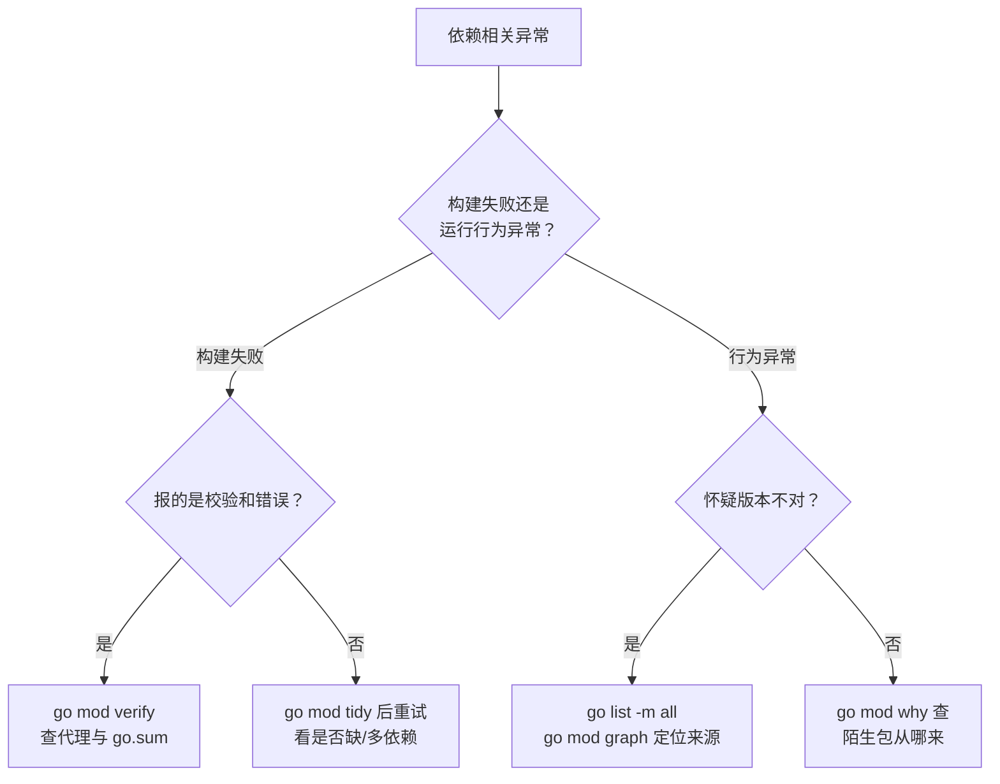

# Go Module 与依赖管理

**摘要：**

Go 的依赖管理经历了从无到有、从混乱到规范的演进历程。在 Go 1.11（2018年）引入 Go Modules 之前，Go 的依赖管理一直是社区的痛点——GOPATH 模式要求所有代码放在固定目录，无法同时依赖同一库的不同版本，`go get` 总是拉取最新代码（没有版本锁定）。Go Modules 通过 `go.mod`（声明依赖及版本）和 `go.sum`（锁定内容哈希）彻底解决了这些问题。本文深入 Go Module 的设计原理：**最小版本选择（MVS）**算法如何在多依赖项版本冲突时给出确定性结果，`go.sum` 如何防止依赖被篡改，`GOPROXY` 与 `GONOSUMCHECK` 如何在企业内网环境下工作，以及 `vendor` 模式、`replace` 指令、`retract` 指令等高级用法。文章最后回到一个设计认知：Go Module 的设计哲学是"确定性优先"——MVS 保证版本选择确定性，go.sum 保证内容确定性，checksum database 保证全局一致性。这个"确定性优先"让 Go 的构建可重现、可审计、可信赖，是 Go 工程化的基石。

---

## 第 1 章 从 GOPATH 到 Go Modules：依赖管理的演进

### 1.1 GOPATH 时代的三大痛点

Go 诞生之初（2009年），Go 的依赖管理依赖 **GOPATH** 机制：所有 Go 代码（包括依赖的第三方库）必须放在 `$GOPATH/src/` 下的指定目录，`go get` 命令直接从版本控制系统（GitHub、Bitbucket）拉取代码到 GOPATH 下。

这套机制在小规模项目中尚可运作，但在工程规模增大后暴露出三个根本性缺陷：

**痛点一：无版本锁定**。`go get github.com/some/package` 总是拉取 `master` 分支的最新 commit，没有任何版本概念。今天构建成功的代码，明天依赖库更新后可能构建失败或行为不同——构建不可重现。这个"不可重现"是 GOPATH 时代最致命的问题——你无法保证"今天的构建和明天的构建一致"，因为依赖随时可能更新。

**痛点二：无法同时依赖同一库的不同版本**。项目 A 和项目 B 都在 GOPATH 下，A 依赖 `libx v1.0`，B 依赖 `libx v2.0`，但 GOPATH 里只能有一个 `libx`——无法在同一台机器上同时开发这两个项目而不互相干扰。这个"单版本限制"让多项目开发极其痛苦——开发者不得不为每个项目维护独立的 GOPATH，或用 `dep`/`godep` 等工具模拟多版本。

**痛点三：项目必须在 GOPATH 下**。`$GOPATH/src/github.com/myorg/myproject` 这样的路径约束极不自然，不能在任意目录下创建 Go 项目。这个"路径约束"让 Go 项目的位置不自由——必须在 GOPATH 下才能编译，违反了"项目应该可以在任意位置"的直觉。

为了解决这些问题，社区出现了各种工具：`godep`（2013）、`glide`（2015）、`dep`（2016 Go 官方实验性工具）——百花齐放但也带来了碎片化，不同项目用不同工具，互不兼容。这个"工具碎片化"是 GOPATH 时代的最终状态——社区意识到问题严重，但缺乏官方统一方案，各工具各自为政。

### 1.2 Go Modules 的设计目标

Go 1.11（2018年8月）引入了 Go Modules，Go 1.16 正式将其设为默认模式，Go 1.17 进一步改进了 `go.sum` 的完整性保证。Go Modules 的设计目标：

- **版本化**：每个依赖都有精确的语义化版本号（`v1.2.3`），构建可重现；
- **去中心化但可代理**：依赖源码仍然来自各个代码托管平台（无需中央仓库），但可以通过 GOPROXY 代理缓存，提升可靠性；
- **最小权限原则**：`go.sum` 文件记录每个依赖的内容哈希，防止后续拉取时依赖被篡改（supply chain attack）；
- **可预测的版本选择**：**最小版本选择（MVS）**算法保证依赖图中的版本选择是确定性的、可理解的。

这四个目标共同指向"确定性"——版本化让版本明确，可代理让下载可靠，哈希校验让内容可信，MVS 让选择可预测。这个"确定性优先"是 Go Modules 的设计哲学，也是它超越 GOPATH 时代各种工具的根本。

---

## 第 2 章 go.mod：模块的身份证

### 2.1 go.mod 的结构

`go.mod` 是模块的核心声明文件，记录模块路径、Go 版本要求以及所有直接依赖：

```
module github.com/myorg/myservice    // 模块路径：全局唯一标识符

go 1.21                              // 最低 Go 版本要求

require (
    github.com/gin-gonic/gin v1.9.1              // 直接依赖
    github.com/google/uuid v1.4.0
    go.uber.org/zap v1.26.0
    golang.org/x/net v0.17.0
    
    // 间接依赖（indirect 注释表示非直接 import，但被直接依赖所需要）
    github.com/bytedance/sonic v1.10.2 // indirect
    github.com/go-playground/validator/v10 v10.15.5 // indirect
)

replace (
    // 将某个依赖替换为本地路径（常用于本地开发调试）
    github.com/myorg/shared => ../shared
    
    // 或替换为另一个版本/fork
    github.com/original/pkg => github.com/myfork/pkg v1.2.3
)

exclude (
    // 明确排除某个版本（通常因为该版本有严重 Bug）
    github.com/problematic/pkg v1.0.0
)
```

**模块路径的约定**：模块路径通常以代码托管平台的域名开头（`github.com/org/repo`），这不只是惯例——`go get` 和 `GOPROXY` 会根据模块路径前缀来确定从哪里下载。如果使用私有模块，需要配置 `GONOSUMCHECK` 和 `GONOSUMDB`（见第 5 章）。

**`go` 指令的语义演变**：
- Go 1.11-1.16：`go` 指令仅表示"推荐的最低 Go 版本"，不强制；
- Go 1.17+：`go` 指令开始影响语言特性可用性（如 `//go:build` 标签语法）；
- Go 1.21+：`go` 指令成为强制最低版本，如果本地 Go 版本低于 `go.mod` 中声明的版本，`go` 命令会报错。

这个"`go` 指令从建议到强制"的演变反映了 Go 对"版本确定性"的逐步加强——早期只是建议，后期成为硬约束，确保所有开发者使用兼容的 Go 版本。

### 2.2 直接依赖与间接依赖

`go.mod` 中的 `// indirect` 注释表示这个依赖不是被当前模块直接 import 的，而是被某个直接依赖所需要的。为什么要在 `go.mod` 中显式列出间接依赖？

**Go 1.17 之前**：`go.mod` 只列直接依赖，间接依赖的版本由各依赖的 `go.mod` 递归确定。问题是如果某个直接依赖没有 `go.mod`（即它仍然是 GOPATH 模式的项目），它的传递依赖就无处声明。

**Go 1.17+**：`go.mod` 会列出所有依赖（包括间接依赖），形成完整的依赖图快照。这让 `go.mod` 自包含——仅凭 `go.mod` 就能重现完整的依赖图，不需要递归读取所有依赖的 `go.mod`。代价是 `go.mod` 文件变大，但安全性和确定性大幅提升。

这个"Go 1.17 列出所有依赖"的改进是 Go Modules 的重要里程碑——它让 `go.mod` 成为"依赖图的完整快照"，不再需要递归读取其他模块的 `go.mod`。这个"自包含"让构建更可靠——即使某个依赖的 `go.mod` 被修改或删除，本地 `go.mod` 仍然有完整的依赖信息。

---

## 第 3 章 MVS：最小版本选择算法

### 3.1 为什么依赖版本选择是个难题

假设你的项目有如下依赖关系：

```
你的项目
├── A v1.2（直接依赖）
│   └── C v1.1（A 的依赖）
└── B v1.3（直接依赖）
    └── C v1.4（B 的依赖）
```

你的项目同时依赖 A（它需要 C v1.1）和 B（它需要 C v1.4）。最终应该使用 C 的哪个版本？

**npm 的解法**：每个包安装在自己的 `node_modules` 下，A 拿到 C v1.1，B 拿到 C v1.4，互不干扰。但代价是大量重复（磁盘空间）和潜在的"同一类型，不同实例"问题（A 和 B 无法通过 C 的类型互操作）。

**Rust/Cargo 的解法**：对于同一主版本（semver major）允许最多共存一个版本，跨主版本可以共存。这比 npm 保守，但仍然允许一定程度的版本重复。

**Go MVS 的解法**：选择满足所有需求的**最小版本**。

这三种解法代表了三种不同的依赖管理哲学——npm 追求"最大兼容"（允许版本重复），Rust 追求"平衡"（主版本内唯一），Go 追求"确定性"（单一版本，最小满足）。Go 的选择最保守，但也最可预测——不会有"同一类型不同实例"的问题，构建结果完全确定。

### 3.2 MVS 算法详解

**MVS（Minimum Version Selection）**的规则：对于依赖图中每个模块，选择所有 `require` 中出现的该模块的**最大版本**——但这个"最大"是在所有声明的最低版本需求中取最大，而不是"最新版本"。

听起来绕口，用例子说明：

```
你的 go.mod:
  require A v1.2
  require B v1.3

A v1.2 的 go.mod:
  require C v1.1

B v1.3 的 go.mod:
  require C v1.4
```

MVS 构建依赖图后，C 出现了两个版本需求：v1.1（来自 A）和 v1.4（来自 B）。MVS 选择 **max(v1.1, v1.4) = v1.4**。

**为什么是"最小版本"**？因为 MVS 选的 v1.4 是"能满足所有需求的最小版本"——它不会自动升级到 v1.5 或更新版本，即便 v1.5 已经发布。这保证了构建的**确定性和可重现性**：相同的 `go.mod` 永远产生相同的依赖集。

**对比"总是用最新版本"策略**：如果依赖管理工具总是升级到最新版本，那么每次运行 `go get -u` 都可能引入新版本，新版本可能有 Breaking Change，导致构建突然失败——这正是 npm 早期的噩梦（每次 `npm install` 都是一次冒险）。

**对比"锁定到第一次安装时的版本"策略**：过于保守，导致依赖永远停在旧版本，安全漏洞得不到修复。

MVS 的平衡点是：版本选择由所有 `go.mod` 中的声明共同决定，当某个依赖需要更新时（出现新的 `require C v1.5`），版本自然升级到 v1.5——但不会无缘无故升级。

这个"MVS 的平衡"是 Go 依赖管理的精髓——既不像"总是最新"那样激进（导致构建不稳定），也不像"永远锁定"那样保守（导致漏洞不修复）。版本升级由依赖声明驱动，当且仅当某个依赖真的需要新版本时才升级。这个"声明驱动的版本升级"让 Go 的依赖管理既稳定又可演进。

### 3.3 Major Version Suffix（主版本后缀）

语义化版本（semver）规定：**主版本（major version）的变更意味着 Breaking Change**，即 v1 到 v2 是不兼容的升级。Go Modules 用一个优雅的方式处理主版本升级：**主版本号 >= 2 时，模块路径必须附加主版本后缀**。

```go
// v1 的 import 路径
import "github.com/gin-gonic/gin"  // 对应 go.mod: require github.com/gin-gonic/gin v1.9.1

// v2 的 import 路径（模块路径中带 /v2）
import "github.com/some/lib/v2"   // 对应 go.mod: require github.com/some/lib/v2 v2.3.1
```

这个设计意味着：v1 和 v2 在 Go 看来是**两个完全不同的模块**，可以在同一项目中同时引用。这解决了"菱形依赖"中不同依赖需要同一库不同主版本的问题。这个"主版本后缀让不同主版本成为不同模块"是 Go 处理不兼容升级的优雅方案——通过路径区分，让 v1 和 v2 可以共存，而不是强制选择一个版本。

---

## 第 4 章 go.sum：依赖内容的密码学锁

### 4.1 go.sum 的设计动机

`go.sum` 解决的问题是**供应链安全（Supply Chain Security）**——依赖一旦确定版本，其内容就不应该改变。但如果没有额外的验证机制，以下攻击是可能的：

- 攻击者入侵了 GitHub 上的某个库的账号，悄悄修改了 `v1.2.3` 标签指向的 commit（Git tag 是可以被强制推送覆盖的）；
- 企业内网的 GOPROXY 缓存了一个被篡改的版本；
- DNS 劫持让 `go get` 从恶意服务器下载。

`go.sum` 通过记录每个依赖包的**内容哈希**来防御这类攻击：

```
github.com/gin-gonic/gin v1.9.1 h1:4idEAncQnU5cB7BezsDesDqL9sZB6n8ol1lO5DEFUFDw=
github.com/gin-gonic/gin v1.9.1/go.mod h1:hPrL7YrpYKXt5YId3A/Tnip5kqbEAP+KLuI3SUcPTeU=
```

每一行包含三个字段：
1. **模块路径 + 版本**：唯一标识一个依赖；
2. **内容标识符**（`h1:` 前缀 + Base64 编码的 SHA-256 哈希）：对于 `.zip` 包，是解压后所有文件树的哈希；对于 `go.mod`，是该文件内容的哈希；
3. 每个版本有两行记录：一行是 `.zip` 包的哈希（`h1:xxx`），一行是 `go.mod` 文件的哈希（`xxx/go.mod h1:xxx`）。

这个"内容哈希锁"让依赖一旦确定就不可篡改——任何对依赖内容的修改都会导致哈希不匹配，`go` 命令会拒绝使用。这个"密码学锁"是 Go 防御供应链攻击的核心机制。

### 4.2 go.sum 与 checksum database

仅仅有本地 `go.sum` 还不够——如果攻击者在第一次运行 `go get` 时就植入了错误的版本，`go.sum` 会记录错误的哈希，后续检查也会通过（因为与错误的哈希一致）。

Go 还维护了一个**全局公共校验数据库（checksum database）**，地址为 `sum.golang.org`（可通过 `GONOSUMCHECK` 配置绕过）。这个数据库用 Merkle 树（类似 Certificate Transparency Log）记录了每个公开模块版本的哈希，具有**仅追加（append-only）**的属性——一旦某个版本的哈希被记录，就不可被修改或删除。

`go` 命令在下载依赖时的完整校验流程：
1. 从 GOPROXY 下载模块 `.zip` 包；
2. 计算下载包的哈希值；
3. 与本地 `go.sum` 对比（如果已有记录）；
4. 向 `sum.golang.org` 查询该版本的哈希（如果是首次下载），验证一致性；
5. 将哈希写入 `go.sum`（如果是首次下载且验证通过）。

这个"本地 go.sum + 全局 checksum database"的双重校验是 Go 供应链安全的完整方案——本地 go.sum 防止"后续篡改"，全局 checksum database 防止"首次下载篡改"。两者配合，让依赖从第一次下载到后续使用都可信。

> [!warning] 生产规范：go.sum 必须提交到版本控制
> `go.sum` 文件必须提交到 Git 仓库。它是构建可重现性和安全性的保障——如果不提交，每次 `go get` 时哈希可能不一致（依赖被篡改时无法发现）。`go.mod` 是"依赖清单"，`go.sum` 是"防篡改证明"，两者缺一不可。

---

## 第 5 章 GOPROXY 与企业内网配置

### 5.1 GOPROXY 的工作原理

`GOPROXY` 环境变量指定 Go 模块代理的地址。默认值为 `https://proxy.golang.org,direct`，含义：

```
GOPROXY=https://proxy.golang.org,direct
```

- 先尝试从 `proxy.golang.org` 下载（Google 维护的公共模块代理，缓存了大量公开模块）；
- 如果代理没有该模块（返回 404 或 410），则 `direct` 表示直接从版本控制系统（VCS）下载。

多个代理地址用逗号分隔，Go 按顺序尝试。特殊值：
- `direct`：直接从 VCS 拉取（不经过代理）；
- `off`：禁止网络访问（只能使用已缓存的模块）；
- `file:///path/to/dir`：本地文件系统作为代理（离线环境）。

这个"多代理 fallback"让 GOPROXY 既能利用代理缓存（快速、可靠），又能在代理没有时回退到 VCS（完整）。这个"代理优先 + VCS 兜底"是 GOPROXY 的设计哲学——代理提供缓存和可靠性，VCS 提供完整性。

### 5.2 企业内网的标准配置

在企业内网环境中，通常需要：
1. **内部私有模块**（`github.mycompany.com/...`）不经过公共代理（安全考虑）；
2. **公开模块**通过内部镜像代理（如 [Athens](https://github.com/gomods/athens) 或 [Nexus](https://www.sonatype.com/products/nexus-repository)）下载，避免访问外网；
3. **私有模块的哈希校验**绕过 `sum.golang.org`（内部模块不在公共数据库中）。

标准的企业内网配置（通常写入 CI 环境变量或 Docker 基础镜像）：

```bash
# 先走内部代理，再走公共代理，最后直连
export GOPROXY=https://goproxy.mycompany.com,https://proxy.golang.org,direct

# 私有模块域名：不经过代理，直接从内部 Git 服务器拉取
export GONOSUMDB=github.mycompany.com,gitlab.mycompany.com

# 私有模块不做 checksum 验证（因为不在公共 checksum 数据库中）
export GONOSUMCHECK=github.mycompany.com/*,gitlab.mycompany.com/*

# 或者直接配置 GOPRIVATE（同时设置 GONOSUMDB 和 GONOPROXY）
export GOPRIVATE=github.mycompany.com,gitlab.mycompany.com
```

`GOPRIVATE` 是一个便捷变量，设置后会同时：
- 将匹配的模块路径加入 `GONOSUMDB`（不进行 checksum database 查询）；
- 将匹配的模块路径加入 `GONOPROXY`（不经过 GOPROXY，直接从 VCS 下载）。

这个"GOPRIVATE 一键配置私有模块"是企业内网的标配——私有模块不走公共代理（安全），不做公共校验（不在公共数据库）。这个"私有模块特殊处理"让 Go Modules 在企业内网中也能顺畅工作。

---

## 第 6 章 常用 go 命令与高级用法

### 6.1 依赖管理的日常命令

```bash
# 初始化模块
go mod init github.com/myorg/myproject

# 下载所有依赖（用于 CI 预热缓存）
go mod download

# 整理 go.mod：删除未使用的依赖，补充缺失的依赖
go mod tidy

# 查看当前模块的依赖图
go mod graph

# 查看为什么某个模块被引入（依赖路径）
go mod why -m github.com/some/package

# 验证本地缓存的模块是否被篡改
go mod verify

# 添加/升级依赖
go get github.com/new/package@v1.2.3    # 指定版本
go get github.com/existing/pkg@latest   # 升级到最新
go get github.com/existing/pkg@v1.2.0   # 降级

# 升级所有直接依赖到最新 minor/patch 版本（不升级 major）
go get -u ./...

# 查看可用的更新
go list -m -u all
```

`go mod tidy` 是最常用的命令——它整理 `go.mod`，删除未使用的依赖，补充缺失的依赖。这个"tidy 自动整理"让 `go.mod` 始终保持准确——开发者不需要手动维护 `go.mod`，tidy 会自动同步。这个"自动整理"是 Go Modules 易用性的关键——开发者专注于写代码，依赖管理由工具自动完成。

### 6.2 replace 指令：本地开发与 fork 修复

`replace` 指令是日常开发中非常实用的功能，主要有两个场景：

**场景一：本地多模块开发**。假设你同时在开发 `myservice` 和 `mylib`，`myservice` 依赖 `mylib`，但 `mylib` 还没发布新版本，你想在本地直接测试未发布的修改：

```
// myservice/go.mod
require github.com/myorg/mylib v0.3.0

replace github.com/myorg/mylib => ../mylib  // 指向本地路径
```

这样 `myservice` 会使用 `../mylib` 的本地代码，而不是已发布的 v0.3.0——开发完成后删除 `replace` 行并发布新版本即可。

**场景二：临时使用 fork 修复 Bug**。某个依赖有紧急 Bug，官方还没发布修复版本，你 fork 了该库并自己修复：

```
require github.com/original/lib v1.5.0

replace github.com/original/lib => github.com/myfork/lib v1.5.1-patched
```

> [!warning] 生产避坑：replace 不能被传递
> `replace` 指令**不会被传递**到依赖你模块的其他模块。如果你把含有 `replace` 的模块发布为一个库，下游使用者不会自动得到 `replace` 的效果——他们需要在自己的 `go.mod` 中再次声明 `replace`。因此 `replace` 更适合用于最终应用程序（binary），而非库。

这个"replace 不传递"是 replace 指令的重要限制——它只在当前模块生效，不会影响下游。这个"不传递"设计是为了安全——如果 replace 能传递，库作者可以悄悄替换依赖，下游不知情地使用了不同的实现。不传递让 replace 成为"本地开发工具"，而非"全局替换机制"。

### 6.3 vendor 模式：离线构建与审计

`vendor` 模式将所有依赖的源码复制到项目根目录的 `vendor/` 文件夹中，构建时直接从 `vendor/` 读取，不需要网络访问：

```bash
# 将所有依赖复制到 vendor/ 目录
go mod vendor

# 使用 vendor 构建（-mod=vendor 标志）
go build -mod=vendor ./...

# 验证 vendor/ 内容与 go.mod/go.sum 一致
go mod verify
```

**何时使用 vendor 模式**：
- **离线/受限网络环境**：CI/CD 环境不能访问外网，且没有内部代理；
- **代码审计要求**：某些合规场景要求依赖代码必须明确可见并被 code review；
- **构建速度优先**：避免每次构建都检查远程依赖（虽然 Go 模块缓存通常已经解决了这个问题）。

**vendor 的缺点**：`vendor/` 目录通常很大（几十 MB 到几百 MB），污染 Git 仓库体积；依赖更新时需要重新运行 `go mod vendor`，容易忘记同步。现代 CI 中，建议使用 `GOPROXY` + `go mod download` 的方式替代 vendor。

这个"vendor vs GOPROXY"的选择是现代 Go 项目的常见决策——GOPROXY + module cache 更轻量（不污染仓库），vendor 更可控（依赖代码可见）。大多数项目用 GOPROXY 即可，只有合规要求或离线环境才需要 vendor。

### 6.4 retract：撤回有问题的版本

Go 1.16 引入了 `retract` 指令，允许模块作者声明某些版本应该被撤回（如发现严重 Bug 或误发布）：

```
// go.mod
retract (
    v1.0.0  // 不小心发布的空版本
    [v1.1.0, v1.1.5]  // 这个范围内的版本都有严重的安全漏洞
)
```

发布带有 `retract` 的新版本后，使用者运行 `go get -u` 时会看到警告，且不会自动升级到被撤回的版本。已经使用被撤回版本的项目不会被强制降级，但会在 `go list -m -u all` 中看到警告提示。

这个"retract 撤回版本"是 Go Modules 的"后悔药"——误发布或有 Bug 的版本可以标记为撤回，使用者会收到警告。这个"软撤回"（不强制降级，只警告）是 retract 的设计哲学——尊重使用者的选择，但提供风险提示。

---

## 第 7 章 workspace 模式：多模块本地开发

### 7.1 workspace 解决的问题

Go 1.18 引入了 **workspace 模式**（`go work`），专门为"本地同时开发多个相互依赖的模块"场景设计，比 `replace` 指令更优雅：

```bash
# 在包含多个模块的目录创建 workspace
go work init ./myservice ./mylib ./shared

# 生成的 go.work 文件：
go 1.21

use (
    ./myservice
    ./mylib
    ./shared
)
```

`go.work` 中 `use` 的模块会覆盖这些模块在各自 `go.mod` 中的版本声明——工作区内的所有模块互相引用时，使用本地代码而非已发布版本。

**workspace 的优势**：
- 不需要修改各个模块的 `go.mod`（`go.work` 文件放在根目录，各模块的 `go.mod` 保持不变）；
- `go.work` 不应该提交到 Git（放入 `.gitignore`），它是纯本地开发工具；
- 切换到"正式发布模式"只需删除 `go.work` 文件或设置 `GOWORK=off`。

这个"workspace 不污染 go.mod"是它优于 replace 的核心——replace 修改 `go.mod`（有污染风险），workspace 用独立的 `go.work`（不污染）。这个"独立工作区文件"让多模块开发更干净——开发者可以自由切换"本地开发模式"（有 go.work）和"正式发布模式"（无 go.work），不影响任何 `go.mod`。

---

## 第 8 章 Go Module 的设计认知

### 8.1 确定性优先

Go Module 的设计哲学是"确定性优先"——MVS 保证版本选择确定性，go.sum 保证内容确定性，checksum database 保证全局一致性。这个"确定性优先"让 Go 的构建可重现、可审计、可信赖。这个"确定性"是 Go 工程化的基石——没有确定性，就没有可靠的 CI/CD，没有可靠的生产部署。

### 8.2 去中心化与可代理的平衡

Go Modules 保持了 Go 的"去中心化"传统——依赖源码来自各个代码托管平台，没有中央仓库（如 Maven Central、npm registry）。但同时引入了"可代理"机制——GOPROXY 让依赖下载可以通过代理缓存，提升可靠性。这个"去中心化 + 可代理"的平衡是 Go 的独特设计——既不像 Maven 那样完全中心化（依赖中央仓库），也不像 GOPATH 那样完全去中心化（直接从 VCS 拉取，不可靠）。

### 8.3 渐进式演进

Go Modules 的演进是"渐进式"的——从 Go 1.11 引入（可选），到 Go 1.16 默认，到 Go 1.17 改进 go.sum，到 Go 1.18 引入 workspace，到 Go 1.21 强化 `go` 指令。这个"渐进式演进"让社区有时间适应，避免了"一刀切"的破坏性变更。这个"渐进式演进"是 Go 工程哲学的体现——不追求一步到位，而是逐步改进，保持兼容性。

---

## 第 9 章 依赖治理：升级、漏洞与最小化

### 9.1 升级策略

依赖不会自己变新，也不会自己变安全。升级要有策略，而不是"想起才升"。三条可行的原则：**其一，先小步后大步**——把大版本升级拆成"先升到最新的小版本、跑通测试，再尝试跨大版本"，避免一次升级里同时引入大量变更；**其二，把升级常态化**——定期（如每月）做一次批量的补丁级升级，让"落后程度"始终很小，否则一旦积压到几十个大版本，升级会变成一项没人敢动的工程；**其三，升级必须带测试**——`go test ./...` 全绿只是最低线，关键依赖的升级还应有针对性的回归用例。这里有一条容易被忽略的事实：**升级的成本与"落后幅度"不成正比，而与"被跨过的破坏性变更数量"成正比**——所以早升、勤升，总成本反而更低。

### 9.2 漏洞扫描

依赖漏洞是供应链风险的主要入口。Go 官方提供了 `govulncheck`——它不只看"你依赖的版本有没有已知漏洞"，还会分析"你的代码是否真的调用了有漏洞的那个函数"，因此能大幅减少误报。把它接进 CI（或作为定期任务），并在有可达漏洞时阻断构建，是一条成本低、收益明确的防线。与之配套的是**依赖清单**：知道自己在依赖什么、每个依赖的版本与来源，是任何安全响应的前提——`go list -m all` 就是这份清单的最简形式。

### 9.3 最小依赖原则

每一个依赖都是长期负债：它带来升级成本、漏洞面、许可证约束，以及"它停止维护时怎么办"的风险。因此**能不加就不加**是一条值得坚持的原则——标准库能解决的（如 `net/http`、`encoding/json`、`errors`）不必引入第三方；一个只用了一个小功能的大库，可以考虑把那部分逻辑自己实现。判断一个依赖"值不值得"时，值得问三句：它省下的工作量有多少？它的维护活跃度如何？若它明天停止维护，替换成本有多大？

### 9.4 许可证与合规

最后是许可证。不同开源许可证（MIT、Apache-2.0、BSD、GPL 家族）对商用、修改、分发的约束不同，GPL 系的"传染性"在闭源商业项目里通常是红线。规模稍大的项目应当把许可证检查纳入 CI（社区有 `go-licenses` 等工具可以生成依赖的许可证清单），以免在上线前才发现某个传递依赖带着不可接受的许可证。这件事的特点是"平时不痛、出事很痛"，因此更适合靠自动化守住。

## 第 10 章 供应链安全与可复现构建

### 10.1 go.sum 提供的保证

`go.sum` 记录的是每个模块**内容**的哈希，而不只是版本号。它保证的是"同样的 `go.mod` 在不同机器上、不同时间下拉到的代码完全一致"——这既是可复现构建的基础，也是防篡改的手段。因此有一条纪律：**`go.sum` 必须提交、必须随 `go.mod` 一起变更，且不应被手工编辑**。若某次构建出现"checksum mismatch"，正确的处理是查清原因（版本被重发？代理被污染？），而不是删掉 `go.sum` 重来——删掉它等于主动放弃了这道防线。

### 10.2 校验数据库与信任链

Go 还提供了校验数据库（checksum database，`sum.golang.org`）——它记录公开模块的哈希，供所有使用者交叉验证：如果你的代理返回的模块哈希与校验数据库不符，构建会失败。这条信任链可能被企业内网环境切断（无法访问公网校验服务），此时的选择是：要么配置可信的内部代理与内部审计日志（保留等效的校验能力），要么通过 `GONOSUMCHECK`/`GONOSUMDB` 类设置**显式地放弃校验**（并接受因此带来的风险）。**放弃校验应当是"知情的决定"，而不是"配不通就关掉"。**

### 10.3 私有模块的鉴权

私有模块的引用需要鉴权，且鉴权信息绝不应写进代码或 `go.mod`。惯用做法是：通过环境变量提供凭证（如 Git 的凭证助手、`GOPRIVATE` 配合 SSH 或 token），并让 CI 的凭证由密钥管理系统注入。同时用 `GOPRIVATE`/`GONOPROXY` 把"哪些模块不走公共代理"声明清楚，避免私有模块名被意外地发往公共代理（那既是泄漏，也会因为查不到而构建失败）。

### 10.4 可复现构建

"可复现构建"指同样的源码在任何环境下都能产出**逐字节相同**的产物。Go 在这一项上做得相当好——`go.mod`/`go.sum` 锁定了依赖，编译本身是确定的，因此跨机器的二进制通常一致；少数破坏可复现的因素（如嵌入的时间戳、路径、`-buildvcs` 信息）可以通过 `-trimpath`、`-ldflags` 等方式消除。可复现的价值在于：你能证明"线上跑的这个二进制，就是从这份源码、这些依赖构建出来的"——这是任何审计与溯源场景的前提。

## 第 11 章 常见误用与排错实战

### 11.1 十类高频误用

依赖管理的坑大多集中在"改错了地方"。以下十类值得逐条对照。**其一，滥用 `replace`**——把 `replace` 当成"临时改依赖"的万能工具，久而久之仓库里堆满指向本地路径的替换，别人拉下来根本构建不起来；`replace` 应当只用于"本地联调"或"上游已失效的紧急修复"，且必须有清理计划。**其二，`indirect` 依赖爆炸**——`go.mod` 里出现大量 `// indirect`，说明直接依赖带了很重的传递依赖，值得审视那个直接依赖是否必要。**其三，随手用伪版本号**——`v0.0.0-20230101...` 这类伪版本是 Go 自动生成的，手工写往往写错，应当让工具生成。**其四，手工编辑 `go.sum`**——它会破坏校验链，正确做法是让 `go mod tidy` 重算。**其五，忘记 `go mod tidy`**——`go.mod` 里残留已不再使用的依赖，或缺少实际用到的依赖，构建时才发现。**其六，主版本后缀写错**——`v2` 及以上必须在模块路径里带 `/v2` 后缀，漏写会导致"版本升不上去"。**其七，`vendor` 与 `replace` 混用后不同步**——`vendor` 目录与 `go.mod` 不一致会导致构建结果难以解释。**其八，误提交 `go.work`**——它会影响他人构建，通常不应进版本库。**其九，`GOPROXY` 覆盖不当**——把 `GOPROXY` 设为 `off` 或指向不可靠的代理，会让构建在某些环境下神秘失败。**其十，依赖循环**——模块 A 依赖 B、B 又依赖 A，Go 会直接拒绝，但设计上若出现这种意图，说明模块划分本身有问题。

### 11.2 排错的四把工具

排错时，`go` 命令本身提供了足够的观测能力。`go mod why <pkg>` 回答"为什么这个包在我的依赖里"——它会打印出一条从你的代码到该包的引用链，是排查"这个陌生依赖从哪来"的首选；`go mod graph` 打印完整的模块依赖图，配合 `grep` 可以找到是谁引入了某个版本；`go mod verify` 校验已下载模块的内容是否与 `go.sum` 一致；`go list -m -u all` 列出所有可升级的依赖及其最新版本，是"例行升级"的起点。这四条命令覆盖了"从哪来、谁引入、是否被篡改、能升到哪"四类问题。

### 11.3 一张排查流程

遇到"依赖相关问题"，可以顺着下面这张图收敛：



这条流程的价值在于把"凭感觉改 go.mod"换成"按现象分流"——构建失败与行为异常是两条完全不同的路径，混在一起改往往越改越乱。

## 第 12 章 多模块与发布策略

### 12.1 多模块的版本策略

当一个仓库有多个模块时，"改了一处要发几个版本"就成了必须回答的问题。三种常见策略各有代价：**各模块独立版本**（最灵活，但要管理模块间的兼容矩阵，一个模块升版可能牵动多个下游）；**统一版本**（所有模块共用一个版本号，简单，但一次小改动也要全量发版）；**主模块带子模块**（子模块随主模块节奏，适合强耦合的一组模块）。选择依据是"模块间的耦合强度"——耦合越强，越适合统一节奏；越独立，越适合各自打版。

### 12.2 主版本升级的路径

从 v1 升到 v2 及以上时，Go 要求模块路径带上主版本后缀（`example.com/lib/v2`），这实际上强制了"不同大版本可以共存"——你的依赖里可以同时存在 `lib` 与 `lib/v2`，它们被视为两个不同的模块。这条规则的好处是**大版本升级不会因为"传递依赖还锁着旧版"而被卡住**；代价是升级时要显式改 import 路径。经验做法是：v2 目录可以与 v1 并存一段时间（用分支或目录区分），让下游有充足的迁移窗口，而不是一夜之间把 v1 的路径改掉。

### 12.3 发布纪律

发布一个库时的几条纪律：**用带注释的语义化 tag**（`v1.2.3`）；**预发布用后缀**（`v1.2.3-rc.1`，Go 会把它排在正式版之前）；**发现坏版本用 `retract`**——`retract` 的语义是"撤回"：它不会删除已发布的代码，而是让工具在选版本时避开它，并向下游提示"该版本已被作者撤回"，这是唯一正确的"处理已发布的坏版本"的方式。与之相对，**重新推送同一个版本号**是绝对要避免的——那会破坏 `go.sum` 的校验链，让所有使用者的构建出错。

### 12.4 依赖循环的规避

模块间的循环依赖（A 依赖 B、B 依赖 A）在 Go 里会被直接拒绝，但它常常以更隐蔽的形式出现：一个"公共"模块里混进了某个具体模块的代码，导致公共模块反向依赖了使用它的模块。规避的方法是**把公共模块的依赖面压到最小**——只依赖标准库与极少数基础库，任何与具体业务相关的代码都不放进去。这也解释了为什么 `util`/`common` 这类包容易出问题：它们既想被所有人用，又忍不住引入具体实现，结果把依赖图搅乱。

## 第 13 章 MVS 的深入与冲突排查

### 13.1 MVS 只升不降的语义

最小版本选择（MVS）的名字容易让人误解——它并不是"选最小的版本"，而是"**在所有依赖声明的下界里，取最大的那个**"。举例来说：若 A 要求 `lib >= 1.2`、B 要求 `lib >= 1.5`，MVS 选 1.5，因为只有它同时满足两边的下界。这个语义带来一个重要推论：**MVS 只会向上取，不会向下取**——你不能通过"某个依赖声明了低版本"来把版本降下去。

### 13.2 降级必须显式

正因如此，"降级"在 Go 里必须显式操作——把你的 `go.mod` 里那个模块的 require 直接改成想要的低版本，MVS 才会以此为下界重新求解（且前提是所有依赖的下界都不高于它）。这与 npm 的"就近优先"、Cargo 的"可并存多版本"都不同：Go 选择的是**全局单一版本 + 显式下界**的模型，好处是"依赖图简单、不容易出现多版本共存"，代价是"降级需要人为干预"。理解这点，才能在遇到"依赖版本被别人抬高了"时知道该从哪里下手。

### 13.3 依赖冲突的典型表现

依赖冲突在 Go 里的表现形式与其它语言不同——因为全局只有一份版本，冲突通常不以"运行时行为怪"的形式出现，而以三种更直接的方式暴露：**构建失败**（某个依赖的要求无法同时满足，或 API 不兼容）、**编译错误**（某处调用了在新版本里被删除的 API）、**测试失败**（行为语义在新版本里变了）。因此排查顺序是：先看错误来自哪一层（是你自己的代码，还是某个依赖的内部），再用 `go mod graph` 定位是谁把版本抬上去的，最后决定"是不是该更新自己的用法"。

### 13.4 与其他包管理器的对照

把 Go 的做法与 npm、Cargo 摆在一起看，能更清楚它的取舍。npm 允许多个版本在依赖树里并存（就近优先），因此"升级一个依赖"的影响面小，但代价是依赖树可能非常深、同一个库的多个版本同时在跑；Cargo 也允许多版本并存但要求同一依赖的两个大版本可共存；Go 则选择**全局单一版本**——这让"内存里的库版本"只有一个，行为最容易预测，也让二进制更小；代价就是"降级不自由"与"升级影响面可能较大"。哪一种更好没有定论，但理解 Go 选择背后的理由（**确定性优先**），就能理解它为什么会做出这些看似不便的设计。

## 第 14 章 把依赖治理做成流水线

### 14.1 从最小的依赖清单起步

新项目的 `go.mod` 应当从"接近空"开始，只在真正需要时逐个加入。这个习惯的价值在于它让每一个依赖的引入都是一个有意识的决定——加它的时候你会问一句"标准库能不能解决"，而若一开始就用脚手架生成了一堆依赖，这个问题就永远不会被问出来。更现实的一点是：**依赖的引入成本是当下的，移除成本是长期的**——加一个依赖只要一分钟，删一个依赖可能要花几天去替换它被用到的每一处，因此"少加"比"后删"划算得多。

### 14.2 CI 中的依赖检查

依赖健康度可以完全交给 CI 守。建议至少包含四项检查：**`go mod tidy` 后无 diff**（保证 `go.mod`/`go.sum` 与实际代码一致，杜绝"本地改了没提交"）、**`govulncheck` 无可达漏洞**（阻断带漏洞的构建）、**许可证白名单校验**（避免引入不可接受的许可证）、**`go list -m -u all` 的可升级列表**（作为提示而非阻断，让落后幅度可见）。这四项的共同特点是"成本极低、收益明确"，因此没有理由不做。

### 14.3 定期任务与应急响应

除了 CI 的每次检查，还需要两类定期任务。**例行升级**：每月一次把补丁级与小版本升级跑一遍，保持"落后幅度"在一个可控的范围内；这类升级通常不需要人工判断，跑通测试即可合入。**例行扫描**：定期重跑 `govulncheck`（漏洞数据库每天更新，昨天安全的依赖今天可能被报出漏洞），并对新出现的漏洞做影响评估——重点是"这个漏洞在我们的代码里是否可达"，而不是"有没有这个漏洞"。应急响应则要事先想清楚两件事：**若某个依赖被上游撤回或投毒，我们如何在短时间内定位所有使用点并替换？** 以及**若某个依赖突然停止维护，我们的替代方案是什么？** 这两个问题平时不痛，出事时极痛，因此更适合提前半小时准备答案。

## 第 15 章 迁移与演进问答

### 15.1 从 GOPATH 迁移

从 GOPATH 迁移到 Module 已经是一个"基本完成"的历史议题，但仍有两类遗留场景值得说明。其一，**老项目的构建报错**通常来自"没有 `go.mod` 却开了 GO111MODULE"——补一个 `go mod init` 加 `go mod tidy` 即可，注意 `tidy` 可能会拉入与旧 `vendor` 不同的版本，因此迁移后要跑全量测试。其二，**相对 import 路径**（`./pkg/...`）在 Module 模式下不再支持，必须改成完整模块路径——这类改动机械但量大，因此迁移应当安排在"业务改动较少"的窗口进行。

### 15.2 从 vendor 或其它工具迁移

从 `dep`、`glide` 等早期工具迁移到 Module，核心是"信任 `go.mod` 而不是旧工具的文件"。迁移的步骤是：先 `go mod init`、`go mod tidy`，再逐一对比新旧依赖版本是否一致（新版本可能更高，因为 MVS 会向上取），最后跑测试。若项目需要离线构建，迁移后在 CI 里执行 `go mod vendor` 并把 `vendor` 提交即可——注意 `vendor` 一旦启用，构建会优先使用它，因此它与 `go.mod` 的一致性必须由 `go mod vendor` 保证，不能手工维护。

### 15.3 从单体到多模块的迁移

把大模块拆成多个，技术上不难（新建目录、各自 `go mod init`、用 `go.work` 本地联调），难的是**拆分边界的判断**与**过渡期的管理**。可行的路径是：先"物理拆分但逻辑不变"——只把目录独立出来、分别建 `go.mod`，依赖仍照旧；观察一段时间，看这次拆分是否真的带来了"独立发布"的收益；若没有，就此打住（避免为了拆而拆）；若有，再逐步按 8.4 节的"变更原因"调整边界。**过渡期最忌一步到位**——那会让所有在途的开发分支全部冲突，也会让"拆错了"这件事变得无法回退。

### 15.4 收束

回看全篇，Go Module 的全部设计其实服务于一个目标——**确定性**。`go.mod` 声明下界、`go.sum` 锁定内容、MVS 全局单一版本、校验数据库交叉验证，这四件事合起来回答的正是"这次构建拿到的东西，和别人、和上次、和线上，是不是同一份"。它为此付出的代价是"降级不自由""升级影响面大""私有模块要多配几项"，这些都是真实的不便，但它们换来的，是工程上最难得的一种品质：**同样的输入，永远得到同样的构建结果**。

## 第 16 章 十个快速问答

**问：`go.mod` 里那条 `go 1.xx` 指令是真在选 Go 版本吗？** 它声明的是"这个模块使用的语言版本"，影响的是语言特性的启用与语义（例如 Go 1.22 的循环变量语义只有在 `go 1.22` 及以上才生效），而**不是**"用哪个版本的编译器构建"——编译器是工具链的事，由 `toolchain` 指令与本地环境共同决定。理解这层区别，才能解释"为什么升了 Go 版本，代码里的循环变量行为没变"——因为 `go.mod` 里的语言版本没跟着改。

**问：`toolchain` 指令有什么用？** 它声明"这个模块推荐使用哪个工具链版本"，当本地 Go 版本低于它时，Go 会尝试自动下载对应的工具链来构建。它的价值在于把"项目需要的最低 Go 版本"显式化，避免"在某台机器上构建失败、因为它的 Go 太旧"这类问题。

**问：为什么 `go.mod` 里有那么多 `// indirect`？** 因为它是**传递依赖**——不是你直接 import 的，而是你依赖的某个包所需要的。它出现在 `go.mod` 里是为了让版本选择可复现（MVS 需要对所有层级的依赖求解）。若 `indirect` 条目特别多，说明某个直接依赖很"重"，值得审视一下它是否必要。

**问：`+incompatible` 是什么意思？** 它标记的模块类型是"**没有采用 Go Module 语义化版本规范、但版本号已到 v2 及以上**"的模块。Go 用这个标记来表示"这个版本不保证遵守 Module 的兼容约定"，因此在选版本与升级时需要更谨慎。

**问：现在还需要设置 `GO111MODULE` 吗？** 不需要。Go 1.16 起 Module 模式已是默认且唯一模式，`GO111MODULE=auto` 这类设置已经失去意义，留着反而可能造成困惑。

**问：模块缓存在哪？为什么 CI 里要缓存它？** 默认在 `GOMODCACHE`（通常是 `$GOPATH/pkg/mod`）。它保存的是**只读**的已下载模块内容，因此 CI 里缓存它能把"每次构建都重新下载依赖"变成"命中缓存直接读"，显著缩短构建时间。注意它是只读的——这也是为什么"手工改缓存里的代码"不是可行的调试手段。

**问：如何做离线构建？** 用 `go mod vendor` 把依赖复制到 `vendor/` 并提交，构建时 Go 会优先使用 `vendor` 而不访问网络。这是"构建环境完全无外网"时的标准做法，代价是仓库体积变大、依赖变更时要记得重新 `vendor`。

**问：为什么模块路径必须与仓库地址一致？** 因为 Go 需要通过模块路径找到对应的代码仓库（除非配了代理）。模块路径是"身份标识 + 下载地址"的二合一，因此 `github.com/you/repo` 必须真的能从那个位置拉取——私有仓库要配 `GOPRIVATE` 与鉴权，否则会拉取失败。

**问：`go get` 与 `go install` 有什么区别？** `go get` 修改当前模块的依赖（会写 `go.mod`）；`go install pkg@version` 是把某个可执行文件装到 `$GOBIN`，**不修改当前模块**。装命令行工具（如 linter、代码生成器）时应当用后者，否则会把工具依赖混进你的 `go.mod`。这也是很多项目依赖里出现一堆奇怪 `indirect` 的原因。

**问：怎么判断一个依赖该不该升？** 三问：这次升级是否解决了某个具体问题（漏洞、缺陷、需要的新特性）？跳过的最坏后果是什么（安全、兼容性、未来升级成本）？升级的风险面有多大（该依赖是核心依赖还是边缘依赖、有没有破坏性变更）？三问都有了答案，升级与否就不再是"凭感觉"。

## 第 17 章 一份依赖治理清单

把全篇落到一张可逐条勾选的清单上：

| 检查项 | 期望状态 | 手段 |
| :--- | :--- | :--- |
| `go.mod` 与代码一致 | 无未提交的 `tidy` 差异 | CI 跑 `go mod tidy` 并检查 diff |
| 依赖内容未篡改 | 校验和一致 | `go.sum` 提交 + `go mod verify` |
| 无已知可达漏洞 | `govulncheck` 无输出 | CI 阻断 |
| 许可证可接受 | 全在白名单内 | `go-licenses` 检查 |
| 依赖版本收敛 | 全仓同一版本 | `go.work` + CI 版本对比 |
| 升级不落后 | 同一大版本内的最新小版本 | 月度例行升级 |
| 私有模块不走公网 | 已配 `GOPRIVATE` | 构建设计检查 |
| 工具不污染依赖 | 用 `go install pkg@version` | 评审约定 |
| 无滥用 `replace` | 每个 `replace` 有注释与清理期限 | 评审检查 |

这张表的九条覆盖了"一致性、安全性、合规、收敛、时效、隔离"六个方面。它们单独看都很琐碎，但合起来就是一句话——**依赖是会被动的资产，不维护它就会默默劣化**。

这张表的用法是"有问题时对照，而不是每次都全查"——它是一份体检项目的清单，而不是每天必做的仪式。真正需要常态化的只有三项：CI 里的 `tidy` 一致性、`govulncheck`、以及月度例行升级。**把必须常态化的压到三项，其余按需检查**，治理才不会因为负担太重而被放弃。

再补一条容易被忽略的检查项：**构建产物里不要出现"本地路径"**（如 `replace` 指向的绝对路径、`-trimpath` 未启用时嵌入的源码路径）。它既影响可复现构建，也可能在日志与 panic 里泄漏内部目录结构——把 `-trimpath` 加进构建参数，顺手解决。

可复现构建的意义还有一层：它让"线上二进制 ↔ 源码提交"之间的对应关系成为**可验证的事实**，而不是"应该是这样"。当审计或事故复盘需要确认"线上跑的是不是这份代码"时，可复现让你能拿出证据，而不是只能承诺。这一点在合规要求较高的场景里，往往比性能优化更值钱。

换句话说，依赖治理最终要交付的不是"一份干净的 `go.mod`"，而是"一次可解释、可复现、可追责的构建"。

这也是为什么"依赖管理"值得单独用一整篇来讲：它管的不是几个版本号，而是这套系统的**来源与信任**。

一句话概括：依赖管理的目标是让构建"可解释、可复现、可追责"。

## 总结

本篇完整梳理了 Go Module 的设计原理与工程实践：

**MVS 算法**是 Go 依赖管理的基石：在所有依赖声明的版本中选最大值，但不会自动升级到更新版本——"最小版本选择"保证了构建的确定性和可重现性，在依赖版本冲突时给出可预期的结果。这个"最小版本满足"既不像"总是最新"那样激进，也不像"永远锁定"那样保守。

**go.sum 与 checksum database** 构成双重防篡改机制：本地 `go.sum` 记录每个版本的内容哈希，`sum.golang.org` 提供全局不可篡改的校验账本——两者配合防御供应链攻击。`go.sum` 必须提交到 Git。这个"本地 + 全局"双重校验让依赖从首次下载到后续使用都可信。

**GOPROXY** 让企业内网环境下的依赖管理可靠可控：`GOPRIVATE` 同时配置私有模块的代理绕过和校验绕过，是企业内网场景的标准配置。这个"代理 + 私有模块特殊处理"让 Go Modules 在企业内网中顺畅工作。

**高级指令**：`replace` 用于本地多模块开发或临时 fork 修复（注意不传递性）；`retract` 用于撤回有问题版本；`go work` 是多模块本地开发的现代解法，比 `replace` 更干净（不污染 `go.mod`）。这个"replace → workspace"的演进体现了 Go 工具链的渐进式改进。

Go Module 的设计哲学是"确定性优先"——MVS 保证版本选择确定性，go.sum 保证内容确定性，checksum database 保证全局一致性。这个"确定性优先"让 Go 的构建可重现、可审计、可信赖，是 Go 工程化的基石。

下一篇深入 Go 错误处理的设计哲学：[[03 Go 错误处理哲学——从 error 到 errors.Is 与 errors.As]]。

---

## 参考资料

1. Go 文档,《Using Go Modules》: https://go.dev/blog/using-go-modules——Go Modules 的官方入门。
2. Go 文档,《Go Modules Reference》: https://go.dev/ref/mod——Go Modules 的完整参考。
3. Russ Cox,《Minimal Version Selection》: https://research.swtch.com/vgo-mvs——MVS 算法的原始论文。
4. Go 文档,《Module authentication using go.sum》: https://go.dev/ref/mod#go-sum-files——go.sum 的校验机制。
5. Russ Cox,《Go & Versioning》系列——Go 版本管理设计的历史与原理。

---

> [!note] 思考题
> 1. 当你的项目同时依赖库 A v1.2.0 和库 B v1.3.0，而 A 依赖库 C v1.1.0、B 依赖库 C v1.4.0 时，Go Module 的 MVS（最小版本选择）算法会选择 C 的哪个版本？如果 C v1.4.0 引入了一个 breaking change（尽管没有升级 major 版本），你的项目会在编译期还是运行期发现问题？MVS 与其他语言（如 npm 的 semver range）的版本选择策略有什么根本区别？
> 2. `go mod vendor` 将所有依赖复制到 `vendor/` 目录中。在 CI/CD 环境下，`go mod vendor` + `go build -mod=vendor` 与直接 `go build`（依赖 module cache）相比，构建的可重复性（reproducibility）有什么差异？在什么场景下 vendor 模式是必要的？
> 3. Go Module 的 `replace` 指令可以将远程依赖替换为本地路径。在微服务架构中，多个服务共享一个内部 SDK 库，开发阶段需要频繁修改 SDK 并在服务中测试。你会选择 `replace` 指令、Go workspace（go.work）还是发布预发布版本（v0.x.x-beta）？三种方案各有什么工程代价？
> 4. Go Module 的设计哲学是"确定性优先"——MVS、go.sum、checksum database 都服务于这个目标。但"确定性"有时与"灵活性"冲突——如 MVS 不会自动升级到最新版本（确定性高，但漏洞修复不及时）。在工程实践中，如何平衡"确定性"与"灵活性"？你会制定怎样的依赖升级策略？
