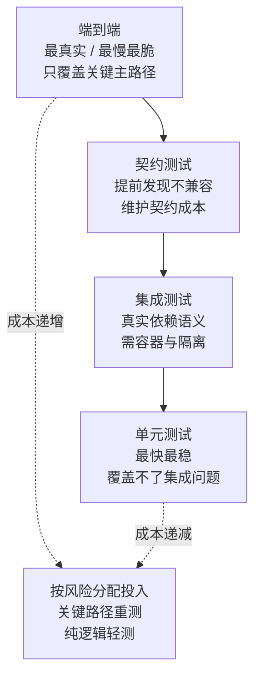

# Go 测试体系——单元测试、表驱动测试与 Mock

**摘要：**

Go 内置了完整的测试框架——`testing` 包和 `go test` 命令，无需引入外部测试框架即可编写单元测试、基准测试和示例测试。但 Go 测试生态远不止于此：**表驱动测试（Table-driven Tests）**是 Go 社区最广泛使用的测试组织模式，能以极少的代码覆盖大量边界条件；**`testify`** 库提供了流畅的断言 API，让测试代码更可读；**`gomock`** 和接口 Mock 机制让依赖隔离成为可能，是 Clean Architecture 中 Use Case 层可测试性的关键保障。本文从 Go 测试的基础设施（`_test.go` 文件、`testing.T`）出发，系统梳理表驱动测试的最佳实践、子测试（`t.Run`）的并行化、Mock 的设计哲学与 `gomock` 的使用，以及测试覆盖率、`go test` 常用标志等工程实践。文章最后回到一个设计认知：Go 测试体系的哲学是"测试是工程的一部分，不是事后补的"——`go test` 内置于工具链，`_test.go` 与生产代码同包，测试与生产代码同等重要。这个"测试即工程"让 Go 项目的测试覆盖率高、测试成本低，是 Go 工程化的核心保障。

---

## 第 1 章 Go 测试基础：testing 包与 go test

### 1.1 测试文件的约定

Go 测试代码有严格的文件命名和函数命名约定：

```
mypackage/
├── user.go          # 生产代码
├── user_test.go     # 测试代码（与生产代码同包）
└── user_external_test.go  # 黑盒测试（package usertest，不可见内部细节）
```

**文件命名**：测试文件必须以 `_test.go` 结尾，`go build` 不会将其编译进最终二进制，只有 `go test` 才会编译它们。这个"测试文件后缀约定"让测试代码与生产代码物理分离——同一个目录，不同的编译目标。`go build` 忽略 `_test.go`，`go test` 编译它们。这个"文件名区分编译目标"是 Go 测试的基础约定。

**包名的两种约定**：
- `package user`（白盒测试）：与被测代码同包，可以访问未导出的字段和函数，适合测试内部实现细节；
- `package user_test`（黑盒测试）：不同包，只能访问导出 API，模拟外部调用者视角，更贴近真实使用场景。

这个"白盒 vs 黑盒"的选择取决于测试目的——测试内部实现细节用白盒（访问未导出字段），测试公开 API 用黑盒（模拟外部视角）。大多数测试用白盒（测试内部逻辑），但有时用黑盒验证"外部用户能看到的 API 行为"。

**函数命名规则**：
```go
// 单元测试：Test 前缀 + 大写字母开头的函数名
func TestFunctionName(t *testing.T) { ... }

// 基准测试：Benchmark 前缀
func BenchmarkFunctionName(b *testing.B) { ... }

// 示例测试：Example 前缀（同时作为文档）
func ExampleFunctionName() {
    fmt.Println(FunctionName("input"))
    // Output:
    // expected output
}

// 模糊测试（Go 1.18+）：Fuzz 前缀
func FuzzFunctionName(f *testing.F) { ... }
```

这个"前缀约定"让 `go test` 能自动发现测试函数——`Test*` 是单元测试，`Benchmark*` 是基准测试，`Example*` 是示例测试，`Fuzz*` 是模糊测试。这个"前缀自动发现"让测试组织简单——不需要注册测试函数，按命名约定写就行。

### 1.2 testing.T 的核心方法

```go
func TestUserCreate(t *testing.T) {
    // t.Error/Errorf：记录失败，但测试继续执行
    if got != want {
        t.Errorf("got %v, want %v", got, want)
    }
    
    // t.Fatal/Fatalf：记录失败并立即停止当前测试函数（执行 defer 后退出）
    user, err := CreateUser(ctx, req)
    if err != nil {
        t.Fatalf("CreateUser failed: %v", err)  // 后续依赖 user 的断言都不会执行
    }
    
    // t.Log/Logf：记录日志（只在测试失败或 -v 模式下显示）
    t.Logf("created user: %+v", user)
    
    // t.Skip：跳过测试（如外部依赖不可用时）
    if os.Getenv("DATABASE_URL") == "" {
        t.Skip("DATABASE_URL not set, skipping integration test")
    }
    
    // t.Parallel：允许该测试与其他 t.Parallel() 测试并行运行
    t.Parallel()
    
    // t.Cleanup：注册清理函数（测试结束时执行，类似 defer 但绑定到测试生命周期）
    db := setupTestDB(t)
    t.Cleanup(func() { db.Close() })
}
```

**`t.Helper()`**：标记当前函数为测试辅助函数，失败时 Go 会显示调用 helper 的那行代码（而不是 helper 内部），让错误定位更准确：

```go
// 没有 t.Helper()：失败信息指向 assertEqual 内部第 X 行
// 有 t.Helper()：失败信息指向 TestXxx 中调用 assertEqual 的那行

func assertEqual(t *testing.T, got, want interface{}) {
    t.Helper()  // 关键：标记为辅助函数
    if got != want {
        t.Errorf("got %v, want %v", got, want)
    }
}
```

这个"t.Helper() 让错误定位到调用方"是测试辅助函数的关键——没有它，失败信息指向 helper 内部（不直观）；有了它，失败信息指向调用 helper 的那行（直观）。这个"Helper 标记"让自定义断言函数的错误定位与内置断言一样准确。

### 1.3 go test 常用标志

```bash
# 运行当前包的所有测试
go test ./...           # 递归运行所有包
go test ./internal/...  # 运行指定目录

# 过滤运行特定测试（支持正则）
go test -run TestUser           # 运行所有匹配 "TestUser" 的测试
go test -run TestUser/create    # 运行 TestUser 中名为 "create" 的子测试

# 详细输出（显示每个测试的 PASS/FAIL 和 t.Log 输出）
go test -v ./...

# 数据竞争检测（CI 中强烈推荐）
go test -race ./...

# 测试覆盖率
go test -cover ./...                          # 打印覆盖率百分比
go test -coverprofile=coverage.out ./...      # 生成覆盖率数据文件
go tool cover -html=coverage.out              # 在浏览器中可视化查看

# 超时控制（默认 10 分钟）
go test -timeout 30s ./...

# 基准测试（默认不运行）
go test -bench=.          # 运行所有基准测试
go test -bench=BenchmarkXxx -benchmem  # 同时显示内存分配统计

# 并行度控制
go test -parallel 4 ./...  # 最多 4 个并行测试
```

这个"标志组合"让 `go test` 灵活适应不同场景——开发时用 `-v` 看详情，CI 中用 `-race -cover` 检测竞争和覆盖率，调试时用 `-run` 过滤特定测试。这个"标志驱动"让 `go test` 既能简单运行（`go test ./...`），又能精细控制（各种标志组合）。

---

## 第 2 章 表驱动测试：Go 的测试范式

### 2.1 什么是表驱动测试，为什么是 Go 的标准范式

**表驱动测试（Table-driven Tests）** 是一种将测试用例组织为数据表（通常是 slice of struct）的测试模式：每行是一个测试用例，包含输入和期望输出；测试函数遍历表中每行，执行相同的测试逻辑。

不用表驱动时，测试一个函数的多个边界条件需要重复写大量结构相似的代码：

```go
// 不使用表驱动（冗余、难维护）
func TestAdd(t *testing.T) {
    result := Add(1, 2)
    if result != 3 {
        t.Errorf("Add(1, 2) = %d, want 3", result)
    }
    
    result = Add(-1, 1)
    if result != 0 {
        t.Errorf("Add(-1, 1) = %d, want 0", result)
    }
    
    result = Add(0, 0)
    if result != 0 {
        t.Errorf("Add(0, 0) = %d, want 0", result)
    }
    // 每增加一个用例都要写 4 行代码...
}
```

使用表驱动测试：

```go
// 表驱动测试（清晰、易扩展）
func TestAdd(t *testing.T) {
    tests := []struct {
        name string  // 测试用例名称（用于 t.Run 和错误定位）
        a, b int
        want int
    }{
        {"positive numbers", 1, 2, 3},
        {"negative and positive", -1, 1, 0},
        {"both zero", 0, 0, 0},
        {"large numbers", 1000000, 2000000, 3000000},
        {"overflow boundary", math.MaxInt64, 1, math.MinInt64},  // 边界条件
    }
    
    for _, tt := range tests {
        t.Run(tt.name, func(t *testing.T) {
            got := Add(tt.a, tt.b)
            if got != tt.want {
                t.Errorf("Add(%d, %d) = %d, want %d", tt.a, tt.b, got, tt.want)
            }
        })
    }
}
```

**表驱动测试的核心优势**：
- 添加新用例只需在表中添加一行，不需要修改测试逻辑；
- 测试用例集中在一处，边界条件一目了然，便于 code review；
- 每个用例通过 `t.Run` 独立运行，失败时精确定位到用例名；
- 可以方便地并行化（见下文）。

这个"用例集中、逻辑统一"是表驱动测试的核心价值——测试用例（数据）与测试逻辑（代码）分离，新增用例只改数据不改代码。这个"数据与逻辑分离"让测试维护成本低——新增边界条件只需加一行，不需要复制粘贴整个测试函数。

### 2.2 t.Run 子测试：独立命名与并行化

`t.Run` 为每个表中的用例创建一个**子测试（Subtest）**，子测试有独立的名称和独立的 `*testing.T`：

```go
for _, tt := range tests {
    tt := tt  // Go 1.21 之前必须做的变量捕获（防止循环变量共享）
    t.Run(tt.name, func(t *testing.T) {
        t.Parallel()  // 子测试之间并行运行（提升测试速度）
        
        got := expensiveCompute(tt.input)
        if got != tt.want {
            t.Errorf("got %v, want %v", got, tt.want)
        }
    })
}
```

**子测试的运行控制**：
```bash
# 只运行 TestAdd 中名为 "positive numbers" 的子测试
go test -run "TestAdd/positive_numbers"  # 注意：空格被转换为下划线

# 运行所有包含 "overflow" 的子测试
go test -run ".*/overflow"
```

这个"子测试独立命名"让测试失败定位精确——`go test -v` 会显示每个子测试的 PASS/FAIL，失败时知道是哪个用例挂了。这个"精确到用例的失败定位"是表驱动测试 + t.Run 的核心价值——不需要看错误消息猜"是哪个用例失败了"，子测试名直接告诉你。

### 2.3 测试夹具（Test Fixtures）

测试夹具指测试所需的初始化数据和环境。Go 提供了多种方式管理夹具：

**方式一：`TestMain` 全局夹具**

```go
// 在包级别 TestMain 中初始化和清理全局资源
func TestMain(m *testing.M) {
    // 初始化：在所有测试前运行
    db := setupTestDatabase()
    
    // 运行所有测试
    exitCode := m.Run()
    
    // 清理：在所有测试后运行
    db.Close()
    dropTestDatabase()
    
    os.Exit(exitCode)
}
```

**方式二：`t.Cleanup` 每个测试的清理**

```go
func TestUserRepository(t *testing.T) {
    // 为这个测试创建专用的数据库事务，测试结束后回滚
    tx, err := db.BeginTx(context.Background(), nil)
    require.NoError(t, err)
    t.Cleanup(func() { tx.Rollback() })  // 测试结束时自动回滚，隔离测试数据
    
    repo := NewUserRepository(tx)
    // ...
}
```

**方式三：helper 函数**

```go
// 封装通用的测试初始化逻辑
func newTestServer(t *testing.T) *httptest.Server {
    t.Helper()
    
    handler := setupHandler()
    srv := httptest.NewServer(handler)
    t.Cleanup(srv.Close)  // 测试结束时自动关闭 server
    
    return srv
}

func TestUserAPI(t *testing.T) {
    srv := newTestServer(t)
    
    resp, err := http.Get(srv.URL + "/users/1")
    // ...
}
```

这三种夹具管理方式按"作用域"分层——`TestMain` 是包级（所有测试共享），`t.Cleanup` 是测试级（单个测试专用），helper 函数是可复用的初始化逻辑。这个"分层夹具"让测试初始化既不重复（helper 复用），又隔离（t.Cleanup 每测试专用），还高效（TestMain 全局一次）。

---

## 第 3 章 testify：流畅的断言库

### 3.1 为什么需要 testify

标准库的 `testing.T` 只提供 `t.Error`、`t.Fatal` 等基础方法，没有内置断言（assertion）——每次比较都需要手写 `if got != want { t.Errorf(...) }`。`github.com/stretchr/testify` 是 Go 最流行的测试辅助库，提供：

- `assert`：失败后继续执行（底层调用 `t.Errorf`）；
- `require`：失败后立即停止（底层调用 `t.Fatalf`）；
- `mock`：Mock 支持（较少使用，通常用 `gomock`）；
- `suite`：测试套件（xUnit 风格）。

```go
import (
    "testing"
    "github.com/stretchr/testify/assert"
    "github.com/stretchr/testify/require"
)

func TestUserService_Register(t *testing.T) {
    svc := NewUserService(mockRepo)
    
    user, err := svc.Register(ctx, RegisterRequest{
        Email: "test@example.com",
        Name:  "Test User",
    })
    
    // require：如果 err != nil，立即停止（后续断言依赖 user 不为 nil）
    require.NoError(t, err)
    require.NotNil(t, user)
    
    // assert：失败后继续执行（检查多个字段）
    assert.Equal(t, "test@example.com", user.Email)
    assert.Equal(t, "Test User", user.Name)
    assert.NotEmpty(t, user.ID)
    assert.WithinDuration(t, time.Now(), user.CreatedAt, time.Second)
}
```

**`assert` vs `require` 的选择原则**：
- 后续断言依赖当前断言的结果（如需要一个非 nil 的对象来访问字段）：用 `require`；
- 各断言独立，失败后仍然有意义继续检查其他字段：用 `assert`。

这个"assert vs require"的选择是 testify 使用的核心决策——`require` 适合"前置条件"（如"创建成功才能检查字段"），`assert` 适合"独立检查"（如"检查多个字段，一个失败不影响其他"）。正确选择让测试失败信息最有用——`require` 避免后续无效断言的噪声，`assert` 一次显示所有独立失败。

### 3.2 testify 常用断言

```go
// 相等性
assert.Equal(t, expected, actual)           // 深度相等（支持 struct、slice、map）
assert.NotEqual(t, expected, actual)
assert.EqualValues(t, expected, actual)     // 允许类型不同但值相等（int32 vs int64）

// nil 检查
assert.Nil(t, err)
assert.NotNil(t, result)

// 布尔
assert.True(t, condition)
assert.False(t, condition)

// 字符串
assert.Contains(t, "hello world", "world")
assert.HasPrefix(t, "hello world", "hello")

// 数字比较
assert.Greater(t, 10, 5)
assert.GreaterOrEqual(t, 10, 10)
assert.InDelta(t, 3.14159, math.Pi, 0.001)  // 浮点数近似比较

// 集合
assert.Len(t, slice, 3)
assert.Empty(t, slice)
assert.ElementsMatch(t, []int{1, 2, 3}, []int{3, 1, 2})  // 顺序无关的相等

// 错误
assert.Error(t, err)                         // err != nil
assert.NoError(t, err)                       // err == nil
assert.ErrorIs(t, err, target)              // errors.Is(err, target)
assert.ErrorAs(t, err, &target)             // errors.As(err, &target)

// panic
assert.Panics(t, func() { dangerousFunc() })
assert.PanicsWithValue(t, "expected panic msg", func() { ... })
```

这个"断言覆盖常见场景"让 testify 成为 Go 测试的标配——相等性、nil 检查、错误检查、集合比较、panic 检测，常用断言都有。这个"断言库覆盖广"让开发者不需要手写 `if` 比较，直接用断言函数，测试代码更简洁可读。

---

## 第 4 章 Mock：依赖隔离的关键

### 4.1 为什么需要 Mock

单元测试的核心要求是**隔离（Isolation）**：测试一个函数时，不应该真正调用其依赖（数据库、外部 API、文件系统），原因：
- **速度**：真实数据库调用需要 10-100ms，Mock 调用需要 < 1µs；
- **确定性**：外部依赖可能有网络抖动、数据库状态变化，Mock 结果完全可控；
- **边界条件**：Mock 可以模拟真实环境难以复现的情况（数据库超时、返回错误等）；
- **独立性**：单元测试不应该依赖外部服务的可用性。

Go 的接口机制让 Mock 非常自然：只要被测代码通过接口而非具体类型依赖外部服务，就可以在测试时注入 Mock 实现。这个"接口让 Mock 自然"是 Go 测试的优势——Clean Architecture 中 Use Case 通过接口依赖 Repository，测试时注入 Mock Repository，不需要真实数据库。这个"接口驱动的可测试性"是 Clean Architecture 的核心价值之一。

### 4.2 手写 Mock：最简单的方式

对于简单接口，手写 Mock 是最直接的方式：

```go
// 被测代码依赖的接口
type UserRepository interface {
    FindByID(ctx context.Context, id string) (*User, error)
    Save(ctx context.Context, user *User) error
}

// 手写 Mock（测试文件中）
type mockUserRepository struct {
    findByIDFunc func(ctx context.Context, id string) (*User, error)
    saveFunc     func(ctx context.Context, user *User) error
    
    // 记录调用情况（用于验证）
    saveCalled int
    savedUsers []*User
}

func (m *mockUserRepository) FindByID(ctx context.Context, id string) (*User, error) {
    if m.findByIDFunc != nil {
        return m.findByIDFunc(ctx, id)
    }
    return nil, ErrNotFound
}

func (m *mockUserRepository) Save(ctx context.Context, user *User) error {
    m.saveCalled++
    m.savedUsers = append(m.savedUsers, user)
    if m.saveFunc != nil {
        return m.saveFunc(ctx, user)
    }
    return nil
}

// 使用手写 Mock 的测试
func TestUserService_Register_EmailDuplicate(t *testing.T) {
    // 准备：FindByID 返回一个已存在的用户（模拟邮箱重复场景）
    mockRepo := &mockUserRepository{
        findByIDFunc: nil,
    }
    mockRepo.findByIDFunc = func(ctx context.Context, id string) (*User, error) {
        return &User{Email: "test@example.com"}, nil  // 用户已存在
    }
    
    svc := NewUserService(mockRepo)
    _, err := svc.Register(ctx, RegisterRequest{Email: "test@example.com"})
    
    assert.ErrorIs(t, err, ErrEmailDuplicate)
    assert.Equal(t, 0, mockRepo.saveCalled)  // 验证 Save 没有被调用
}
```

手写 Mock 的优点是完全可控、无外部依赖；缺点是当接口方法多时，维护成本高。这个"手写 Mock 适合简单接口"是实用主义——接口只有 2-3 个方法时，手写 Mock 比引入 gomock 更快；接口有 10+ 方法时，gomock 的代码生成更高效。

### 4.3 gomock：代码生成的 Mock 框架

`go.uber.org/mock`（原 `github.com/golang/mock`，已由 Uber 接管维护）是 Go 最主流的 Mock 框架，通过代码生成自动创建 Mock 实现：

**安装与生成**：
```bash
go install go.uber.org/mock/mockgen@latest

# 方式一：源码模式（从接口定义文件生成）
mockgen -source=internal/port/repository.go -destination=internal/mocks/mock_repository.go -package=mocks

# 方式二：反射模式（指定包路径和接口名）
mockgen -destination=internal/mocks/mock_repo.go -package=mocks \
    github.com/myorg/myservice/internal/port UserRepository

# 在源文件中用 go:generate 注释，然后运行 go generate ./...
//go:generate mockgen -source=$GOFILE -destination=../mocks/mock_$GOFILE -package=mocks
```

**生成的 Mock 代码使用**：

```go
import (
    "testing"
    "go.uber.org/mock/gomock"
    "github.com/myorg/myservice/internal/mocks"
)

func TestUserService_Register(t *testing.T) {
    ctrl := gomock.NewController(t)
    // ctrl.Finish() 在测试结束时自动验证所有期望是否满足（Go 1.14+ 自动调用）
    
    mockRepo := mocks.NewMockUserRepository(ctrl)
    
    // 设置期望：FindByEmail 被调用一次，返回 ErrNotFound
    mockRepo.EXPECT().
        FindByEmail(gomock.Any(), "new@example.com").  // gomock.Any() 匹配任意 ctx
        Return(nil, ErrNotFound).
        Times(1)  // 期望恰好被调用 1 次
    
    // 设置期望：Save 被调用一次，验证参数并返回 nil
    mockRepo.EXPECT().
        Save(gomock.Any(), gomock.AssignableToTypeOf(&User{})).
        DoAndReturn(func(ctx context.Context, u *User) error {
            // 可以在这里验证传入的 user 对象
            assert.Equal(t, "new@example.com", u.Email)
            u.ID = "generated-id"  // 模拟数据库生成 ID
            return nil
        }).
        Times(1)
    
    svc := NewUserService(mockRepo)
    user, err := svc.Register(context.Background(), RegisterRequest{
        Email: "new@example.com",
        Name:  "New User",
    })
    
    require.NoError(t, err)
    assert.Equal(t, "generated-id", user.ID)
}
```

**gomock 常用 Matcher**：
```go
// 精确匹配
gomock.Eq("exact value")

// 任意值
gomock.Any()

// 类型匹配
gomock.AssignableToTypeOf(&User{})

// 自定义 Matcher
gomock.Cond(func(x interface{}) bool {
    user, ok := x.(*User)
    return ok && user.Email != ""
})

// 调用次数控制
.Times(1)       // 恰好 1 次
.AnyTimes()     // 任意次数（包括 0 次）
.MinTimes(1)    // 至少 1 次
.MaxTimes(3)    // 最多 3 次
.AtLeastOnce()  // 至少 1 次
```

这个"gomock 的期望验证"是它优于手写 Mock的核心——gomock 不仅模拟行为（Return），还验证调用（Times、参数 Matcher）。这个"行为模拟 + 调用验证"让测试更严格——不仅检查"返回值对不对"，还检查"依赖被正确调用了没有"。这个"调用验证"是 gomock 的核心价值，手写 Mock 难以做到。

### 4.4 httptest：HTTP 集成测试

`net/http/httptest` 是测试 HTTP handler 的标准工具，无需启动真实服务器：

```go
func TestUserHandler_Get(t *testing.T) {
    // 创建测试用的 HTTP server
    handler := NewUserHandler(mockService)
    srv := httptest.NewServer(handler)
    defer srv.Close()
    
    // 发送真实 HTTP 请求
    resp, err := http.Get(srv.URL + "/users/user-123")
    require.NoError(t, err)
    defer resp.Body.Close()
    
    assert.Equal(t, http.StatusOK, resp.StatusCode)
    
    var user User
    require.NoError(t, json.NewDecoder(resp.Body).Decode(&user))
    assert.Equal(t, "user-123", user.ID)
}

// 或者用 httptest.NewRecorder 直接测试 Handler 函数（更轻量）
func TestUserHandler_Get_NotFound(t *testing.T) {
    mockSvc := mocks.NewMockUserService(ctrl)
    mockSvc.EXPECT().GetUser(gomock.Any(), "nonexistent").Return(nil, ErrUserNotFound)
    
    handler := NewUserHandler(mockSvc)
    
    req := httptest.NewRequest("GET", "/users/nonexistent", nil)
    w := httptest.NewRecorder()
    
    handler.ServeHTTP(w, req)
    
    assert.Equal(t, http.StatusNotFound, w.Code)
}
```

这个"httptest 两种模式"适应不同测试需求——`NewServer` 启动真实 HTTP server（测试完整请求/响应链路），`NewRecorder` 直接调用 Handler（轻量，不启动 server）。这个"完整 vs 轻量"让 HTTP 测试既可端到端（NewServer），又可单元化（NewRecorder）。

---

## 第 5 章 测试覆盖率与 CI 集成

### 5.1 理解测试覆盖率

```bash
# 生成覆盖率报告
go test -coverprofile=coverage.out ./...
go tool cover -func=coverage.out   # 按函数显示
go tool cover -html=coverage.out   # 浏览器可视化

# 查看整体覆盖率
go test -cover ./...
# ok   github.com/myorg/myservice/internal/usecase  83.2% of statements
```

**覆盖率的正确理解**：高覆盖率不等于高质量测试——100% 覆盖率但只测试正常路径，不测试错误路径，仍然是低质量测试。覆盖率是**下限检测工具**（发现根本没有测试的代码），不是质量保证工具。这个"覆盖率是下限不是质量"是理解覆盖率的关键——覆盖率 100% 只说明"所有代码都执行过"，不说明"所有边界条件都测试过"。质量取决于测试用例的设计，不是覆盖率数字。

Go 提供了多种覆盖率模式：
- `set`（默认）：每行是否被执行过（是/否）；
- `count`：每行被执行的次数；
- `atomic`：并发安全的计数（用于并发测试的覆盖率统计）。

### 5.2 CI 中的测试最佳实践

```yaml
# GitHub Actions 示例：完整的 Go 测试 CI
name: Test

on: [push, pull_request]

jobs:
  test:
    runs-on: ubuntu-latest
    steps:
      - uses: actions/checkout@v4
      - uses: actions/setup-go@v4
        with:
          go-version: '1.21'
      
      # 验证依赖完整性
      - run: go mod verify
      
      # 代码格式检查
      - run: gofmt -l . | tee /dev/stderr | [ $(wc -l) -eq 0 ]
      
      # 静态分析
      - run: go vet ./...
      
      # 单元测试（带 race 检测和覆盖率）
      - run: go test -race -coverprofile=coverage.out -covermode=atomic ./...
      
      # 覆盖率上报（如 Codecov）
      - uses: codecov/codecov-action@v3
        with:
          files: ./coverage.out
```

这个"CI 测试流水线"是 Go 项目 CI 的标准配置——`gofmt` 检查格式，`go vet` 静态分析，`go test -race` 检测竞争，`-coverprofile` 生成覆盖率。这个"多维度检查"让 CI 既能发现格式问题（gofmt），又能发现静态问题（vet），还能发现运行时问题（test -race），最后生成覆盖率报告。这个"全维度 CI"是 Go 工程化的标配。

### 5.3 集成测试的隔离策略

集成测试（需要真实数据库、外部服务）应该与单元测试隔离：

```go
// 方案一：Build tags 隔离
//go:build integration

package repository_test

func TestUserRepository_FindByID_Integration(t *testing.T) {
    // ...
}
```

```bash
# 正常测试（跳过集成测试）
go test ./...

# 运行集成测试
go test -tags=integration ./...
```

```go
// 方案二：环境变量控制
func TestUserRepository_Integration(t *testing.T) {
    dsn := os.Getenv("TEST_DATABASE_URL")
    if dsn == "" {
        t.Skip("TEST_DATABASE_URL not set, skipping integration test")
    }
    // ...
}
```

这个"集成测试隔离"让单元测试快速运行（不依赖外部服务），集成测试在需要时单独运行。这个"分层测试"是测试策略的核心——单元测试覆盖大部分逻辑（快速、隔离），集成测试覆盖关键链路（真实环境），端到端测试覆盖完整流程（生产环境）。这个"分层"让测试既快又全。

---

## 第 6 章 Go 测试体系的设计认知

### 6.1 测试是工程的一部分

Go 测试体系的哲学是"测试是工程的一部分，不是事后补的"——`go test` 内置于工具链，`_test.go` 与生产代码同包，测试与生产代码同等重要。这个"测试即工程"让 Go 项目的测试覆盖率高、测试成本低。这个"测试即工程"与"测试是 QA 的事"形成对比——在 Go 文化中，开发者写测试是标配，不是可选。

### 6.2 内置优于外部

Go 测试框架内置在工具链中——`testing` 包、`go test` 命令、`-race` 标志、`-cover` 标志都是内置的，不需要引入外部框架。这个"内置优于外部"让 Go 测试的入门成本极低——`go test ./...` 就能运行所有测试，不需要配置 Jest/Pytest 等外部框架。这个"内置"是 Go 工具链设计的核心哲学——常用功能内置，减少外部依赖。

### 6.3 接口驱动的可测试性

Go 测试体系的可测试性来自"接口驱动设计"——被测代码通过接口依赖外部服务，测试时注入 Mock 实现。这个"接口驱动"让 Go 代码天然可测试——不需要 mock 框架的魔法（如 Python 的 mock.patch），只需要定义接口 + 注入实现。这个"接口驱动的可测试性"是 Go 测试体系与 Clean Architecture 的交汇点——Clean Architecture 的"依赖倒置"让 Use Case 通过接口依赖 Repository，测试时注入 Mock Repository，可测试性自然获得。

---

## 第 7 章 测试替身与可测性设计

### 7.1 测试替身的谱系

"Mock"常被当成所有替身的总称，但在测试理论里它是一族概念的集合，各自解决不同的问题。**Dummy**（哑对象）只是占位，用来填充参数，从不会被真正调用。**Stub**（桩）提供预设的返回值——你想让依赖返回什么，它就返回什么，用来把被测代码驱动到某条分支。**Spy**（间谍）在桩的基础上记录"被怎么调用了"，用于事后断言调用行为。**Mock**（严格模拟）则更进一步——它预设了"期望的调用"，调用不符就失败，强调的是**交互验证**。**Fake**（伪实现）是"可工作的简化实现"，比如用一个内存 map 冒充数据库。

这五个概念的实用价值在于**逼你说清"这次测试要验证什么"**：要验证的是"结果对不对"，用 stub 就够；要验证的是"该调用的下游有没有被调用、调了几次"，才需要 spy/mock。用错了替身，写出来的测试会既脆弱又与实现细节耦合——比如用严格 mock 测一个纯计算函数，任何内部重构都会让测试变红，而它本不该关心内部怎么调。

### 7.2 替身与真实实现的取舍

替身不是免费的——它替换掉了真实依赖，也就替换掉了"真实依赖的行为"。若替身的行为与真实实现不一致（俗称"假绿"），测试会给出虚假的安全感。因此选择的原则是：**能跑真实实现就跑真实实现**（用内存实现或轻量容器），只有在"真实依赖昂贵/不可控/不确定性高"时才用替身。典型的边界是：数据库和消息队列——本地容器化运行成本已经很低，值得跑真实；而第三方付费 API、外部服务——用替身或契约测试更合适。**用 fake 而非 mock 是一个常被推荐的折中**：fake 有真实的行为逻辑，能在不牺牲速度的前提下贴近真实语义。

### 7.3 可测性设计

测试写不动的根因，通常在**设计**而非测试技巧。三处最常见：**依赖直接 `new` 在函数内部**——这让依赖无法被替换，函数不可测；**依赖全局变量**——测试之间互相污染，且无法并行；**依赖具体类型而非接口**——无法注入替身。对应的设计手段就是依赖注入的最朴素的形态：**依赖从外部传入（构造函数参数或字段），并且以接口的形式**。Go 的接口是隐式实现的，因此"为可测性定义接口"几乎零成本——你不需要一个 `implements` 声明，只要让被测代码依赖一个小接口即可。

### 7.4 时间、随机与 UUID：可测性的三大杀手

有三种依赖最难测，因为它们"不确定"：**当前时间**（`time.Now()`）、**随机数**（`rand`）、**UUID/自增 ID**。它们会让"同样的输入"产生"不同的输出"，从而让断言无从下手。标准的解法是**把它们抽象成可注入的依赖**：把"取当前时间"做成一个函数字段或接口（默认用 `time.Now`，测试时注入一个固定时钟或可推进的假时钟）；随机数用固定种子的实现或注入；ID 生成器同样注入。这一步的成本很小，收益很大——**任何涉及时间与顺序的逻辑（超时、过期、排序、窗口），不做这个抽象就无法可靠地测试**。

### 7.5 Go 的便利与代价

Go 在可测性上有一项语言层面的便利：**接口隐式实现**，因此"为测试定义一个只含所需方法的窄接口"是惯用做法，不需要改动实现方。但它也带来一处代价：**若接口定义在实现方，就会让所有使用方都依赖那个宽接口**（`httptest`、`sqlmock` 的困境多源于此）。因此更符合 Go 习惯的做法是——**接口定义在消费方**（第 1 篇讲的依赖倒置），消费方只需要它真正用到的两三个方法，替身也就只需要实现这两三个方法。这让替身变得极其轻量，也让测试与实现细节解耦。

## 第 8 章 分层测试策略

### 8.1 测试金字塔与 Go 的适配

经典的测试金字塔是"大量单元、适量集成、少量端到端"，理由是"越靠底层越快越稳、越靠上层越慢越脆"。Go 的适配有一处特点：**启动成本低**（编译快、测试并发运行、容器化依赖便宜），因此集成测试的性价比在 Go 里比在其它生态里更高——不必把一切都塞进单元层。这也意味着"金字塔"在 Go 里可以更接近"钻石形"：单元与集成都充足，端到端保持少量。

### 8.2 单元测试的边界

"什么算单元"是个需要先定义的问题。可行的定义是"**一次调用所覆盖的逻辑边界内的行为**"——只要外部依赖（数据库、网络、时间）被替换掉，即使跨了几个函数，仍算单元测试；一旦连上了真实依赖，就算集成测试。把这条界限定清楚，能避免两种极端：一种是"什么都叫单元测试"（结果跑一次要连数据库），另一种是"只测单个函数"（结果组合行为无人验证）。

### 8.3 集成测试：让真实依赖可靠地就位

集成测试的难点在"如何让真实依赖可靠、可重复地就位"。当下的主流做法是用**容器化依赖**——测试启动时拉起一个数据库/消息队列容器，测完销毁；社区有 testcontainers 之类的库把它封装成几行代码。要点有三：**数据隔离**（每个测试用独立的 schema 或库，或每个测试事务回滚）、**启动开销**（尽量复用容器，只在必要时重启）、**失败可诊断**（保留容器日志，失败时能看依赖侧发生了什么）。做好了，集成测试的收益（真实语义）远大于成本。

### 8.4 契约测试

当服务依赖一个外部 API 时，"用替身"会漏掉"对端契约变了"这类风险。**契约测试**的思路是：把"对端提供什么、我们消费什么"显式记录下来（契约），并用它分别验证"对端是否仍满足契约"与"我们是否仍只消费契约内的部分"。它比端到端便宜得多（不必真的联调），又比纯替身更能提前发现不兼容。对于跨团队协作的后端服务，这是性价比很高的一层。

### 8.5 端到端与黄金文件

端到端测试验证"整条链路真的能跑"，价值在于捕捉"各层都测过但拼起来不work"的问题（如配置、序列化、路由这些"接缝处"）。它的成本也最高（慢、脆、依赖多），因此应当**少而精**——只覆盖几条最关键的主路径（如"下单"、"支付"），其余交给下层。与之相关的是**黄金文件测试**（golden file，把期望输出存成文件、比对生成结果），它特别适合"输出结构复杂、人工写断言不现实"的场景（如代码生成、渲染、序列化），要点是提供"一键更新黄金文件"的机制，避免每次格式微调都手工改。

### 8.6 各层的取舍

四层测试的成本与收益可以这样对照：单元测试快而稳、但覆盖不了集成问题；集成测试真实、但需要依赖管理与时间；契约测试提前发现不兼容、但需要维护契约；端到端最真实、但最慢最脆。合理的分配不是"各写一些"，而是**按风险分配**——关键路径与易错接缝处放重测试，稳定的纯逻辑用轻测试。**测试的投入应当与"这部分出错的代价"成正比**。

## 第 9 章 测试的工程化：并行、隔离与稳定

### 9.1 并行测试的正确使用

`t.Parallel()` 能让标记了它的测试与其兄弟测试并发执行，从而把测试套件的墙钟时间压下来。但它的前提是**隔离**——两个并行测试若共享任何可变状态（全局变量、同一个临时文件、同一个数据库），就会互相干扰，出现"单独跑通过、一起跑失败"的怪象。因此 `t.Parallel()` 不是"加上就变快"的开关，而是一个**契约**："我声明这个测试不依赖外部可变状态"。使用它的顺序是：先确保测试的隔离性（见 9.2），再逐批标记，观察是否有意外失败——一旦出现，说明隔离没做到，先修隔离。

### 9.2 测试隔离的三个维度

隔离要覆盖三个维度。**进程内状态**：全局变量、单例、`sync.Pool`、包的初始化副作用——测试之间通过它们互相污染，解法是"让被测代码不依赖全局状态"（第 7.3 节），或每个测试显式重置。**进程外状态**：环境变量（用 `t.Setenv`，它会在测试后自动恢复）、当前工作目录、临时文件（用 `t.TempDir`，它会在测试后自动清理）、网络端口（随机分配而非固定）。**外部服务**：数据库、缓存、消息队列——每个测试用独立命名空间、或在测试后回滚、或用独立的容器。三个维度都隔离了，测试才能既并行又稳定。

### 9.3 flaky 测试的治理

"flaky"（时好时坏）的测试是测试体系最大的敌人——它会训练团队无视失败，于是真正的失败也被忽略。治理的关键是**零容忍政策**：任何 flaky 测试都必须立即处理（修复或删除），而不是"重跑一次看看"。定位 flaky 的根因通常是四类之一：**时序依赖**（断言"多久内完成"，改为断言"最终完成"）、**并发未隔离**（见 9.1）、**资源竞争**（端口/文件冲突）、**外部依赖抖动**（真实服务的偶发超时）。把"重跑让它过去"当作处理手段，等于把 flaky 永久留在了套件里。

### 9.4 测试数据的管理

测试数据的组织方式有三条演进路径：**手写 fixture**（简单、明确，但重复且易过期）；**工厂函数**（用一个"构造默认值 + 按需覆盖"的函数生成测试对象，减少重复，`NewUser(WithAge(30))` 这种模式）；**随机化生成**（用随机数据跑不变量断言，即性质测试的思路）。选择依据是"被测逻辑对数据的敏感度"——对字段敏感的精细逻辑用显式 fixture，对结构不敏感的批量场景用工厂，对"任意输入都该成立"的不变量用随机化。

### 9.5 测试的可读性

测试是给人读的文档——它说明了"这段代码应该怎样表现"。三条可读性准则：**测试名说明场景与期望**（`TestWithdraw_InsufficientFunds_ReturnsError` 比 `TestWithdraw2` 好得多）；**失败信息自解释**（用带上下文的断言，失败时能直接看出"期望 X 得到 Y"，而不是一句 `assert failed`）；**一个测试一个断言主题**（可以有多个断言，但应围绕同一件事，否则失败时分不清是哪一件事坏了）。可读的测试还有一个隐藏收益——**它让失败时的定位时间大幅缩短**，而这正是测试存在的意义。

## 第 10 章 覆盖率、突变测试与质量度量

### 10.1 覆盖率的正确解读

行覆盖率回答的是"**这行代码有没有被执行过**"，它不回答"**它被验证得充分吗**"——一行代码可能被测了，但断言写错了、或者只测了其中一个分支。因此覆盖率是"必要不充分"的指标：**低覆盖率一定有问题**（大量代码从未执行），但**高覆盖率不保证质量**。把覆盖率当成目标去刷（为了数字而写无断言的测试）是典型的"指标异化"——数字上去了，保护力却下降了。

### 10.2 覆盖率作为趋势而非目标

更健康的用法是把覆盖率当**趋势**看：这次的改动是否显著拉低了整体覆盖率？新增的代码是否被覆盖？某块的覆盖率长期偏低，是不是说明它难以测试（从而暗示设计问题）？这些问题的答案比"整体有没有到 80%"更有信息量。若一定要设阈值，设置在"不低于上次"这类**相对门槛**上，比设在"绝对值 80%"上更符合它作为趋势指标的性质。

### 10.3 突变测试：检验测试本身

若想知道"测试到底有没有用"，有一个直接的实验叫**突变测试**（mutation testing）：工具自动对源码做微小的语义改动（把 `>` 改成 `>=`、删掉一个语句、翻转一个条件），然后跑测试套件——**若测试仍然全绿，说明这个突变没被检测到，即测试对这段逻辑是"瞎的"**。突变被"杀死"的比例（mutation score）因此比覆盖率更能反映测试的真实效力。它的代价是计算量大（每个突变都要跑一遍测试），因此常作为定期任务而非每次提交执行。它的价值在于把"测试写得好不好"从主观判断变成一个可测量的实验。

### 10.4 其他质量度量

除覆盖率与突变分数外，还有几项值得关注：**测试执行时间**（套件变慢会抑制人们运行它，从而降低测试的实际价值）、**测试与代码的比例与结构**（是否有大量重复的样板测试）、**失败率与重跑率**（flaky 的量化）。这些指标的共同特征是"描述测试体系本身的健康状况"，而不是"描述被测代码"——**测试体系也需要被度量，否则它会悄悄劣化而不被察觉**。

### 10.5 一张分层取舍图

把第 8 章的层次与第 10 章的成本放在一起，可以画出测试策略的取舍：



图里箭头的方向是"成本"，而右下角的判断是落点：**不是平均用力，而是按风险分配**——这既是测试策略的核心，也是"测试该写多少"这个永恒问题的答案。

## 第 11 章 测试与 CI 的分层

### 11.1 三层节奏

把测试按"什么时候跑"分成三层，是控制 CI 时间的关键。**提交前**（本地 pre-commit 或 IDE）：只跑与被改动文件相关的测试、加上格式与静态检查，目标是"秒级反馈"。**合并前**（CI 的 PR 流水线）：跑全量单元测试 + `-race` + 覆盖率检查 + 集成测试，目标是"全绿才允许合并"，时间控制在几分钟内。**发布前**（主干或预发）：跑端到端、性能回归、混沌测试，目标是"确认整体行为"，可以慢。三层的分工是"越早发现越好、越贵越晚跑"，而不是"每个阶段都跑全量"。

### 11.2 并行与缓存

CI 里的测试时间可以靠两件事压下来。**并行**：`go test ./... -p N` 让包级并行、`t.Parallel()` 让测试级并行——这要求第 9 章的隔离做到位。**缓存**：Go 的构建缓存与测试结果缓存（`go test` 会缓存未变化的包的结果）在 CI 里配置得当，能避免"每次重跑全部"。两者的共同前提是"可复现与隔离"——缓存不适用于有外部副作用的测试（如连了数据库的集成测试需要 `-count=1` 强制重跑）。

### 11.3 失败的可诊断性

CI 的价值在失败时体现。两处必须做到：**保留失败现场**——测试日志、profile（`-cpuprofile`/`-memprofile`）、集成测试的容器日志、失败时 dump 的状态；**给出可复现命令**——在失败信息里直接输出"本地如何复现这条失败"的命令行，让开发者不必自己拼装参数。把"CI 失败了但我本地复现不出来"变成常见体验，是 CI 设计上的一种失败。

## 第 12 章 十二个常见问题

**问：表驱动测试什么时候不该用？** 当每个用例的"准备与断言"差异很大时——硬塞进一张表会让表里充满 `if` 分支与可选字段，可读性反而变差。此时拆成多个独立测试更好。表驱动的适用面是"**同一套准备与断言、只有输入与期望不同**"的用例族。

**问：Mock 应该手写还是用生成器？** 方法少、调用简单的接口，手写 Mock 更直观、无额外依赖；接口方法多或需要在多处以同一方式模拟时，用 `gomock`/`mockgen` 之类的生成器更省事、也更一致。判断依据是"这个接口会被 mock 多少次、需要多复杂的调用断言"。

**问：如何测试并发代码？** 三层做法叠加：用 `-race` 跑全量（发现竞争）、用可控的同步点制造确定性交错（把偶发变必现）、用超时兜底断言（不依赖"多久完成"）。并在 CI 里加 `-count=N` 多次运行，提高触发概率。详见《Go 并发编程》专栏的相关篇章。

**问：如何测试 HTTP handler？** 用 `net/http/httptest`——`httptest.NewRecorder()` 拿到一个假的 `ResponseWriter`，构造 `http.NewRequest` 直接调用 handler，断言状态码与响应体；需要完整链路的用 `httptest.NewServer` 起一个真实服务器测真实客户端。前者快、后者真，按需选择。

**问：测试要不要连数据库？** 关键路径要连（第 8.3 节），纯逻辑不连。连的方式优先容器化、每测试独立命名空间或事务回滚。"所有测试都不连数据库"会让集成问题无人发现，"所有测试都连数据库"会让套件慢到没人跑——两者都是极端。

**问：如何测时间相关的逻辑？** 注入时钟（第 7.4 节）。若用 `time.Now()` 直接取时间，就只能在真实时间里等待，测试会又慢又脆；把"取时间"抽象出来，用假时钟推进到任意时刻，测试立刻变快且确定。

**问：基准测试算不算测试？** 算，但它测的是"性能不退化"而非"行为正确"。它的写法与注意点（避免编译器优化掉被测代码、用 benchstat 做统计比较）另有一套，应作为**性能回归**的防线接进 CI（只在关键路径上）。

**问：覆盖率要不要设门槛？** 可以设，但要设在"新增代码"或"相对不退步"上，而不是"整体绝对值 80%"。前者促使新代码被测试覆盖，后者会催生无断言的刷数字。

**问：测试命名有什么约定？** 文件名 `xxx_test.go`、函数名 `TestXxx`、子测试用 `t.Run("场景名", ...)`；场景名建议用"条件_动作_期望"的形式。包名可以是同包（`package foo`，可测未导出函数）或 `foo_test`（只测公开 API）——前者更灵活、后者更贴近真实使用。

**问：怎么组织大型项目的测试辅助代码？** 共用的 helper 放在 `internal/testutil`（用 `internal` 防止被外部引用），helper 应当接受 `*testing.T` 并在失败时用 `t.Helper()` 标记（这样失败行号指向调用处而非 helper 内部）。避免"一个巨大的 testutil 包"——按领域拆开更易维护。

**问：删除测试可以吗？** 可以，且有时应该——测"实现细节"的测试会阻碍重构，当它反复因为无关重构而变红时，就是在提示"这个测试的层次切错了"。删除前确认它覆盖的行为有其它层次的测试兜底即可。**测试也是代码，也需要维护成本意识。**

**问：测试驱动开发（TDD）在 Go 里实用吗？** 它是可选的工作方式，不是必须。它最实用的场景是"需求明确、输出可断言"的逻辑（解析、计算、状态机），此时先写测试能澄清接口设计；对"探索性的、输出尚不明确"的工作，先写测试反而会拖慢。把它当成一件趁手的工具，而非一种必须遵守的仪式。

## 第 13 章 一次测试体系改造的推演

假设接手一个"测试覆盖率 30%、CI 要跑四十分钟、失败常被无视"的仓库，如何把它改造成"提交有反馈、合并有信心"的状态？可行的顺序是分四步走，且每一步都能独立见效。

**第一步，止血。** 把 CI 里不稳定的部分先隔离出来——把集成测试拆成独立的流水线（不再阻塞每次 PR），只保留单元测试与静态检查在 PR 上跑。目标是把 PR 的反馈时间从四十分钟压到五分钟以内。**反馈时间不缩短，后面所有改进都会被"没人愿意等"消解掉**。

**第二步，还债。** 针对覆盖率最低、又是核心逻辑的那几个包，逐个补测试。补的时候不必追求"全路径覆盖"，而是优先补三类：**曾经出过 bug 的地方**（回归测试）、**分支复杂的逻辑**（条件组合）、**接缝处**（序列化、解析、边界换算）。这一步的产出不只是覆盖率，更是"哪些地方其实很难测"的清单——那份清单往往指向设计问题。

**第三步，治理 flaky。** 建立"失败即处理"的纪律，给每个 flaky 测试开单、定位根因、修复或删除。同时把 `-race` 加进 CI，把并发问题从"偶发线上故障"提前到"CI 就能拦住"。

**第四步，补上层。** 在单元与集成都稳住之后，再补关键的端到端路径与性能回归。此时的端到端测试才有意义——若下层都不稳，上层测试只会变成新的 flaky 来源。

四步的顺序体现了一个总原则：**先让测试"可信"，再让测试"全面"**。一套不可信的全面测试，比一套可信的局部测试更糟——因为它会训练团队忽略红色的信号。

## 第 14 章 四条纪律

把全篇压成四条可以长期坚持的纪律。

**其一，测试必须可信。** 一条不稳定的测试比没有测试更糟，因为它消耗的是"团队对红色信号的信任"。因此"失败即处理"应当是无例外的纪律，不允许"重跑看看"。

**其二，测试要快。** 反馈时间决定了人们跑不跑它。把 PR 流水线控制在几分钟内、把慢测试拆到独立流水线，是保护这套体系被长期使用的关键——**再好的测试，若没人愿意跑，就等于不存在**。

**其三，测试按风险分配。** 不是平均用力，而是按"出错的代价"投入：关键路径重测、接缝处重测、纯逻辑轻测。这个原则能同时回答"该测多少"与"该测哪里"两个问题。

**其四，测试是设计的一部分。** 写测试时遇到"无法测"的地方，那多半不是测试的问题，而是设计的问题——依赖硬编码、状态全局化、时间不可注入。**测试的阻力，往往是设计缺陷最先发出的信号**。反过来，为了让代码可测而做的那些调整（注入依赖、拆分接口、隔离副作用），本身就在改善设计。

这四条没有一条是技巧，全是"态度与优先级"。这也符合测试这件事的本质——它不难在"怎么写"，难在"愿不愿意一直写、一直维护"。

## 第 15 章 测试与重构

### 15.1 测试是重构的安全网

重构的定义是"**在不改变外部行为的前提下改善内部结构**"，而"不改变外部行为"这件事，只能靠测试来证明。因此测试与重构是一体两面：没有测试，重构就只能靠"小心"与"通读代码"；有测试，重构才是一门可以反复练习的手艺。这也是为什么"测试覆盖率低的代码库往往也是不敢重构的代码库"——不是因为没人想改，而是因为改了不知道有没有改坏。

### 15.2 什么测试支持重构

并非所有测试都支持重构。区分在于**测试断言的是"行为"还是"实现"**：断言"输入 X 应产出 Y"的测试，实现怎么改都能通过，是重构的安全网；而断言"内部调用了 Z 三次、按顺序调用了 A 再 B"的测试，会随实现变化而破裂，是重构的绊脚石。因此写测试时的一个自检问题是：**这个断言是在描述"对外承诺"，还是在描述"我当前的写法"？** 前者保留，后者慎用——尤其要警惕过度使用严格 mock 断言调用序列。

### 15.3 重构时测试的演进

重构过程中，测试本身也需要调整：**行为不变时，测试应当原地通过**（这正是"重构"的定义）；**若测试需要大改才能通过，说明这次改动其实改变了行为**（那它是一次功能变更，而非重构，应当分开提交）。把"重构"与"功能变更"混在同一次改动里，是让代码库难以审查的常见原因——审查者无法区分"这段改动是为了改变行为还是改善结构"。**分开提交**，能让两者各自的正确性都被独立验证。

### 15.4 收束

回到测试的定位：它不是"给代码加的额外负担"，而是**让代码可以被安全修改的前提**。一个没有测试的模块，它的行为边界是模糊的——你不知道改动它会不会破坏什么，于是只能选择"不动它"，而那些最需要重构的代码恰恰最不敢动。测试打破的就是这个僵局：**它把一个"不敢改"的黑盒，变成一个"可以改"的白盒**。从这个角度看，测试的价值不在"发现 bug"，而在"**让变更成为可能**"。

## 第 16 章 测试的四种价值

### 16.1 发现缺陷

最直观的一层价值，但它的边际效益随测试增多而递减——测到一定程度后，"再写一百个测试能发现的缺陷"已经很少。因此把测试的定位仅放在"抓 bug"上，会让投入产出比看起来越来越差。

### 16.2 支持重构

更高的一层价值，也是长期收益最大的一层——它让代码可以持续演进，而不是在一次次的"不敢改"中僵化。这一层价值难以量化，却决定了代码库的寿命。

### 16.3 表达需求

测试是**可执行的文档**：它用具体的输入输出记录了"这个函数应该怎样表现"。与注释相比，它不会过期——因为一旦行为变了，测试就会失败，逼着人更新它（或更新行为）。这对"接手陌生代码"尤其有价值：读测试比读实现更快建立正确的心智模型。

### 16.4 促进设计

测试的阻力会反向暴露设计问题（难测的代码往往难用），因此"写测试"这件事本身是一次设计审查。这一层价值最容易被忽略：**一个在设计上行之有效的接口，往往正是一个容易测试的接口**。

四层价值叠加，"测试值不值得写"这个问题的答案就不再模糊——它不只是"为了少出 bug"，更是"为了让这套代码可以被长期健康地修改"。

把四层价值排在一起，还能看出一种常见的认知偏差：很多人只认第一层（找 bug），于是在"没找到 bug"时觉得测试白写了——而实际上，后三层的收益恰恰是在"没找到 bug"时悄悄积累的。**测试的回报，大部分不体现在"这次拦住了什么"，而体现在"这套代码还能被改多久"。**

换句话说，测试体系的最终产物不是一堆绿色标记，而是一种**"敢于修改"的底气**。

一句话收束：测试是**让变更成为可能**的基础设施。

## 总结

本篇系统梳理了 Go 测试体系的完整工具链：

**`testing` 包基础**：`_test.go` 文件约定、`testing.T` 的核心方法（`t.Helper()`、`t.Cleanup()`、`t.Parallel()`）、`go test` 的常用标志（`-race`、`-cover`、`-run`）。这个"内置测试框架"让 Go 测试入门成本极低。

**表驱动测试**：Go 社区的标准测试范式——将用例组织为 struct slice，用 `t.Run` 为每个用例创建子测试（独立命名、可并行）。新增用例只需在表中添加一行，边界条件一目了然。这个"数据与逻辑分离"让测试维护成本低。

**testify**：`assert`（失败继续）vs `require`（失败停止）的选择原则；`ErrorIs`/`ErrorAs` 断言与 Go 1.13 错误包装体系无缝集成。这个"流畅断言 API"让测试代码更可读。

**Mock 策略**：接口是 Mock 的基础——被测代码通过接口依赖外部服务，测试时注入 Mock 实现。手写 Mock 适合简单接口；`gomock` 通过代码生成处理复杂接口，提供期望次数验证、参数 Matcher、`DoAndReturn` 等强大功能。这个"接口驱动的 Mock"是 Go 可测试性的核心。

**CI 最佳实践**：`-race` 标志在 CI 中始终开启；集成测试通过 build tags 或环境变量与单元测试隔离；覆盖率报告作为质量基线参考，不应追求 100%。这个"全维度 CI"是 Go 工程化的标配。

Go 测试体系的哲学是"测试是工程的一部分，不是事后补的"——`go test` 内置于工具链，`_test.go` 与生产代码同包，测试与生产代码同等重要。这个"测试即工程"让 Go 项目的测试覆盖率高、测试成本低，是 Go 工程化的核心保障。

下一篇介绍 Go 性能剖析的完整工具集：[[06 Go 性能剖析——pprof、trace 与基准测试]]。

---

## 参考资料

1. Go 文档,《Testing》: https://pkg.go.dev/testing——Go 测试包的完整文档。
2. Go Blog,《The Go Programming Language Specification - Testing》——测试的官方规范。
3. testify: https://github.com/stretchr/testify——Go 最流行的测试辅助库。
4. uber-go/mock (gomock): https://github.com/uber-go/mock——Go 主流的 Mock 框架。
5. Go Blog,《Table-driven tests》——表驱动测试的官方介绍。

---

> [!note] 思考题
> 1. Go 的 interface 使得 Mock 变得简单——只需实现相同的 interface 即可替换依赖。但如果被测函数直接调用了 `time.Now()` 或 `os.ReadFile()` 这类标准库函数（不通过 interface），你有哪些方式使其可测试？每种方式的侵入性和工程成本如何？
> 2. 表驱动测试（Table-Driven Test）是 Go 社区的标准实践。但当测试用例超过 50 个、且每个用例需要不同的 Mock 配置时，表驱动测试会变得难以维护。在什么情况下应该放弃表驱动测试，改用独立的子测试函数？Go 的 `t.Run` 嵌套有层数限制吗？
> 3. `go test -race` 使用 ThreadSanitizer 检测数据竞争。它的原理是在每次内存访问时插入检测代码。在一个包含大量 goroutine 的并发测试中，`-race` 会导致多大的性能开销（内存和 CPU）？如果 `-race` 没有报告任何竞争，能否保证代码一定没有数据竞争？为什么？
> 4. Go 测试体系的哲学是"测试是工程的一部分，不是事后补的"。但在实际项目中，很多开发者仍然"先写代码，后补测试"。你认为这种"后补测试"与"测试先行（TDD）"在工程质量上有什么本质区别？Go 的工具链设计（如 `go test` 内置、`_test.go` 同包）如何影响开发者的测试习惯？
