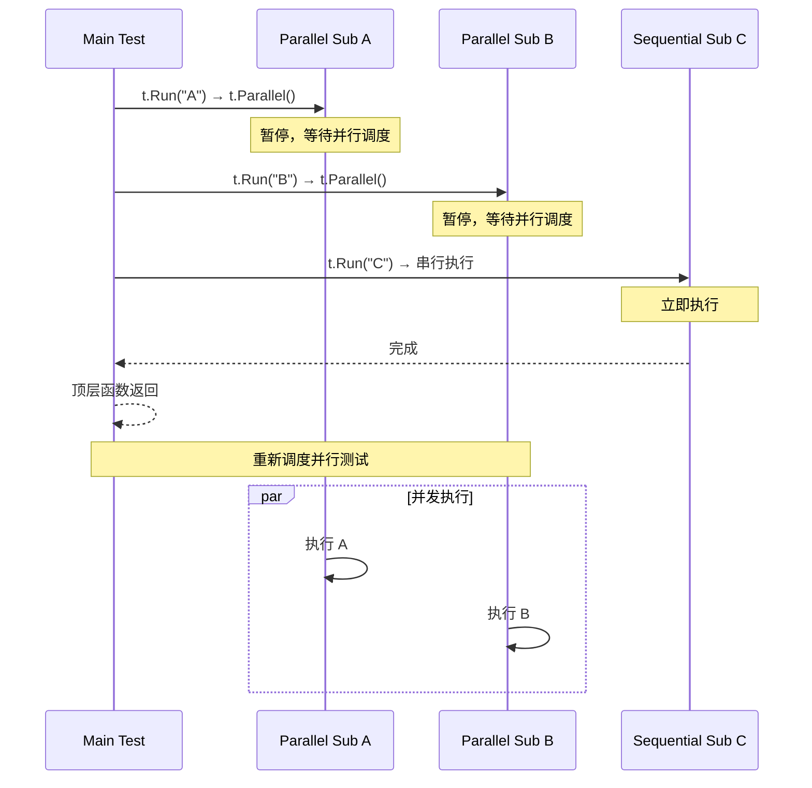
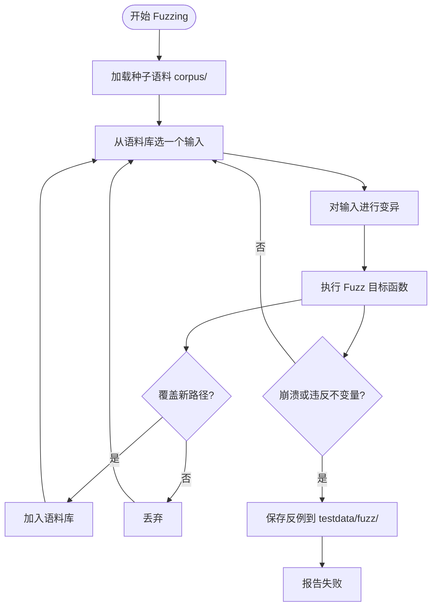

# 测试隔离理论、性质测试与模糊测试（Fuzzing）机制

**摘要：**

上一篇 [[04 Go 测试体系——单元测试、表驱动测试与 Mock]] 解决了"如何写测试"的问题——表驱动测试的组织模式、`gomock` 的依赖隔离、`testify` 的断言语法。但一个更隐蔽的问题往往在测试数量突破几百条时才暴露：**测试之间为什么会互相干扰**？某个测试在本地跑得通，到了 CI 就莫名失败；加上 `-count=2` 跑两次就崩溃；并行执行时数据竞争报错此起彼伏。这些症状的共同根因是缺乏**测试隔离（Test Isolation）**——测试对环境变量、文件系统、时间、全局状态、随机种子的隐式依赖，会在执行顺序、并行度、运行环境变化时暴露出来。本文从测试隔离的形式化约束出发，系统梳理 `t.Setenv`、`t.TempDir`、`t.Cleanup`、`testing.Short`、`t.Parallel` 的语义边界与执行顺序，然后讨论状态验证（State Verification）与行为验证（Behavior Verification）的设计取舍，再到**性质测试（Property-Based Testing）**的不变量验证模型与反例缩小（shrinking）算法，最后深入 Go 1.18+ 原生 **Coverage-guided Fuzzing** 的语料库变异、插桩覆盖、反例最小化与 cache 目录机制。文章最终落在一个工程认知：测试隔离是性质测试与 Fuzzing 的前提，而性质测试与 Fuzzing 又把测试的边界从"作者想到的例子"推向"机器能构造的反例"——三者共同构成 Go 测试体系从"验证已知"到"探索未知"的演进路径。

---

## 第 1 章 测试隔离：被忽视的正确性前提

### 1.1 什么是测试隔离

测试隔离的形式化定义很简短：**任意两个测试的执行顺序互换后，结果不变；同一测试在相同输入下重复执行任意次，结果不变**。前者叫**顺序无关性（Order Independence）**，后者叫**幂等性（Idempotency）**。两条合起来，意味着测试之间不能通过任何共享的可变状态产生耦合。

这个定义听上去理所当然，实际工程中却极难严格遵守。一个测试在调用 `os.Setenv` 修改环境变量后没有恢复，下一个依赖该环境变量的测试就会失败；一个测试在 `/tmp` 下写了临时文件没清理，另一个测试在同名路径下创建文件就会报"已存在"；一个测试依赖 `time.Now()` 的返回值，跨日运行时就可能越过某个边界条件而崩溃。这些问题的共同特征是：**测试的正确性依赖于测试运行器未声明的外部状态**。

测试隔离可以类比为化学实验的"洁净实验室"——每个实验必须在独立、受控、可复现的环境中进行。如果你在实验 A 中把催化剂洒在实验台上没清理，实验 B 的结果就会受到污染。洁净实验室不是道德要求，而是实验可复现性的物理前提。测试隔离同理：不是"良好的测试习惯"，而是"测试结论可被信任"的必要条件。

> [!info] 测试隔离的本质
> 测试隔离不是测试风格问题，而是正确性问题。一个依赖共享可变状态的测试，在单机单次运行时"看起来工作"，但在并行执行、CI 重跑、不同操作系统上都会暴露出非确定性失败——这种失败往往比生产环境的 bug 更难调试，因为它既不可复现，又难以定位。

### 1.2 Go 测试中常见的五类隐式耦合

Go 测试框架并没有在语言层面禁止测试访问全局状态，因此隔离的责任完全落在测试编写者身上。常见的五类隐式耦合为：

| 耦合类型 | 典型来源 | 失败模式 |
|---|---|---|
| **环境变量** | `os.Setenv`、`os.Getenv` | 并行测试互相覆盖；`t.Setenv` 只能在已调用 `t.Parallel` 的测试中使用（Go 1.17+） |
| **文件系统** | 硬编码 `/tmp/xxx`、当前工作目录、相对路径 | 并行测试文件名冲突；清理不彻底导致下次运行残留 |
| **时间依赖** | `time.Now()`、`time.Sleep`、时区 | 跨日、跨夏令时、CI 时区不一致时失败 |
| **全局变量 / 包级状态** | 包级 `var`、`sync.Once`、单例、全局 logger | 测试 A 修改了全局配置，测试 B 读到了被污染的值 |
| **随机数种子** | `math/rand` 全局种子、`rand.Intn` 无固定 seed | 失败用例无法复现，CI 与本地行为不一致 |

这五类耦合在测试数量少于 50 条时往往不会暴露，因为 `go test` 默认串行执行，且每次运行前进程重启会重置大部分全局状态。但一旦测试数量突破数百条、开发者启用 `t.Parallel` 加速、或者 CI 环境开始缓存测试二进制，这些隐式依赖就会以"间歇性失败（Flaky Test）"的形式爆发。Go 社区将这种测试称为 "flaky"——它在 99% 的运行时通过，却在关键时刻（发版前夜、老板巡视的 demo）失败。

Flaky test 的治理成本极高。一个间歇性失败的测试，开发者需要反复运行才能复现，复现后需要分析执行顺序、环境变量、文件系统状态等多个维度的差异。更糟的是，flaky test 会破坏团队对测试套件的信任——当测试失败时，开发者的第一反应不再是"代码有 bug"，而是"测试又 flaky 了"，然后忽略失败继续提交。这种信任 erosion 是渐进的，但一旦发生，测试套件作为"质量守门员"的作用就荡然无存。因此，测试隔离不是锦上添花的最佳实践，而是测试体系有效运转的基础设施。

### 1.3 `t.Setenv` 与 `t.TempDir`：语言内置的隔离边界

Go 1.17 引入了两个关键的隔离原语：`t.Setenv` 和 `t.TempDir`。它们的设计哲学是**让隔离成为测试生命周期的自动行为，而非测试作者的自觉行为**。

```go
func TestConfigFromEnv(t *testing.T) {
    // t.Setenv 在测试结束时自动恢复原值，无需 defer
    t.Setenv("DATABASE_URL", "postgres://localhost:5432/test")
    
    cfg, err := LoadConfig()
    if err != nil {
        t.Fatalf("LoadConfig failed: %v", err)
    }
    if cfg.DBHost != "localhost" {
        t.Errorf("got DBHost=%q, want %q", cfg.DBHost, "localhost")
    }
    // 测试结束时，DATABASE_URL 自动恢复到测试前的值（或 unset）
}

func TestFileProcessing(t *testing.T) {
    // t.TempDir 创建一个临时目录，测试结束时自动递归删除
    dir := t.TempDir()
    
    tmpFile := filepath.Join(dir, "input.txt")
    if err := os.WriteFile(tmpFile, []byte("hello"), 0644); err != nil {
        t.Fatal(err)
    }
    
    result, err := ProcessFile(tmpFile)
    // ...
    // 测试结束时，dir 及其所有内容自动删除
}
```

这两个 API 的语义有两个关键细节值得展开：

**第一，`t.Setenv` 强制要求测试不能与 `t.Parallel()` 共存**。原因很直接：环境变量是进程级全局状态，如果两个并行测试同时 `Setenv` 同一个 key，它们的结果将取决于调度顺序，违背顺序无关性。Go 运行时会在一个已并行化的测试中调用 `t.Setenv` 时直接 panic，把这种错误从"间歇性失败"升级为"确定性崩溃"——后者虽然更刺眼，但更容易修复。

**第二，`t.TempDir` 的清理发生在 `t.Cleanup` 链之后**。Go 测试的清理顺序是：测试函数返回 → 执行 `t.Cleanup` 注册的回调（LIFO 顺序）→ 删除 `t.TempDir`。这意味着在 `t.Cleanup` 回调中仍然可以访问临时目录中的文件，但临时目录删除之后就不能再访问了。这个顺序保证了清理代码不会因为依赖过早删除而失败。

### 1.4 `t.Cleanup`：LIFO 清理栈与资源生命周期

`t.Cleanup` 是 Go 1.14 引入的清理注册机制，语义等价于 `defer`，但作用域是测试的完整生命周期（包括子测试）。其核心特征是**后进先出（LIFO）**的执行顺序——最后注册的 cleanup 最先执行。

```go
func TestDatabaseIntegration(t *testing.T) {
    // 第一个注册，最后执行
    t.Cleanup(func() {
        teardownDatabase()  // 最后关闭数据库连接
    })
    
    db := setupTestDatabase(t)
    
    // 第二个注册，最先执行
    t.Cleanup(func() {
        truncateTables(db)  // 先清理数据
    })
    
    // 测试逻辑...
}
```

这个 LIFO 顺序与 `defer` 一致，符合资源分配的逆序释放原则——先分配的资源后释放。一个常见的误区是在 cleanup 中访问其他 cleanup 已经释放的资源，这在 `t.Cleanup` 中同样会出现，但因为 LIFO 顺序是确定的，调试比 `defer` 与 goroutine 混合的场景更容易。

`t.Cleanup` 与子测试的交互也值得注意：父测试注册的 cleanup 会在**所有子测试完成后**才执行，而非父测试函数返回时立即执行。这使得父测试可以在 setup 阶段注册 cleanup，而不必担心子测试还没跑完资源就被回收。

### 1.5 `t.Parallel` 的语义与执行顺序

`t.Parallel` 的语义比多数开发者想象的复杂，它的设计体现了 Go 对"显式优于隐式"原则的坚持。调用 `t.Parallel` 的测试会暂停执行，等待其他并行测试完成，直到顶层测试函数返回；然后 Go 测试运行器会重新调度这些标记为并行的测试，让它们并发执行。这个两阶段调度的原因在于 Go 测试运行器需要在串行阶段完成所有非并行测试，然后在并行阶段集中处理标记为并行的测试——这样可以避免串行测试与并行测试交错执行导致的资源竞争。

这意味着并行测试的执行顺序是**不确定的**——每次运行可能不同。这正是测试隔离重要性的放大器：如果两个并行测试共享可变状态，它们失败的模式会因运行顺序不同而不同，极难复现。



这个执行模型引出两个工程约束：

**其一**，并行测试不能依赖其他测试的执行顺序，也不能依赖当前工作目录（多个并行测试可能同时修改 cwd）。**其二**，并行测试的 setup 代码在 `t.Parallel()` 调用之前执行——这意味着如果 setup 阶段修改了全局状态，多个并行测试的 setup 会交错执行，产生竞态。正确的模式是：setup 阶段只创建测试专属资源（譬如 `t.TempDir`），`t.Parallel()` 之后再开始访问这些资源。

并行测试的调度顺序可以通过 `-parallel` 标志控制——它指定了同时运行的并行测试的最大数量，默认等于 `GOMAXPROCS`。如果一个项目有大量并行测试且它们都依赖 CPU 密集型计算，提高 `-parallel` 可能导致 CPU 争抢；如果测试主要是 I/O 密集型（譬如等待外部服务响应），提高 `-parallel` 可以显著提升测试速度。但这个参数不解决隔离问题——它只控制并发度，不控制测试之间是否共享状态。

> [!warning] 并行测试的调试陷阱
> 并行测试失败时，错误日志会与子测试的输出交错混合，难以定位具体是哪个并行测试失败。Go 1.14 引入了 `t.Name()` 在日志前缀中自动标注测试名，但在高并发度下仍然难以阅读。调试并行测试失败的有效策略是临时用 `-parallel=1` 串行化执行，把非确定性失败转化为确定性失败，再逐一排查。

Go 1.22 对并行测试做了一项重要增强：子测试的 `t.Parallel()` 现在可以在父测试仍在执行时就开始运行，而不必等待父测试函数返回。这个改变让深层嵌套的并行测试能更早开始执行，减少整体测试时间，但也要求开发者更仔细地检查 setup 代码的线程安全性——如果父测试在 `t.Run` 之间共享可变状态，子测试的提前执行可能暴露出之前隐藏的竞态。

### 1.6 `testing.Short` 与测试分层

`testing.Short()` 配合 `go test -short` 标志，提供了测试分层的轻量机制——把耗时长的集成测试、端到端测试在快速反馈模式下跳过。

```go
func TestDatabaseMigration(t *testing.T) {
    if testing.Short() {
        t.Skip("skipping database migration test in short mode")
    }
    // 耗时较长的数据库迁移测试...
}
```

这个机制与测试隔离的关系在于：**它把测试按资源依赖程度分层**。`-short` 模式下跑的测试通常只依赖内存和 CPU，不依赖外部数据库、网络服务或文件系统 fixtures；完整模式下跑的测试则可能依赖这些外部资源。分层的好处是开发者在日常迭代中用 `go test -short ./...` 快速验证核心逻辑，CI 流水线中用 `go test ./...` 跑完整套件。

测试分层的一个进阶实践是**按依赖类型分组**。Go 的 build tag 机制可以实现这一点：

```go
//go:build integration

func TestWithRealDatabase(t *testing.T) {
    // 只有显式指定 -tags=integration 时才编译
}
```

```bash
# 只跑单元测试（默认）
go test ./...

# 跑单元测试 + 集成测试
go test -tags=integration ./...
```

这种方式比 `testing.Short()` 更灵活——可以把测试按依赖类型（数据库、网络、文件系统）分组，按需运行。但它的缺点是需要维护 build tag，且 IDE 可能不识别带 tag 的测试文件。

分层本身不解决隔离问题——一个依赖外部数据库的测试，即使在 `-short` 模式下被跳过，它的存在仍然意味着开发者必须在本地或 CI 中配置数据库环境。更彻底的隔离是把外部依赖替换为 fake 或 mock，这就要进入下一章的讨论。

---

## 第 2 章 状态验证与行为验证：测试断言的两种哲学

### 2.1 两种验证的定义

测试断言（assertion）可以粗略分为两种哲学：

**状态验证（State Verification）**：检查被测对象在执行后的**状态**是否符合预期。譬如调用 `account.Deposit(100)` 后，断言 `account.Balance() == 100`。测试不关心 `Deposit` 内部调用了什么方法，只关心最终余额对不对。

**行为验证（Behavior Verification）**：检查被测对象在执行过程中**是否以预期方式与其他对象交互**。譬如断言 `emailService.Send(wasCalled=true, to="user@example.com")`。测试不关心邮件发送后产生了什么状态，只关心"发送动作是否被触发、参数是否正确"。

这两种哲学对应测试替身（Test Double）谱系中的不同角色，Gerard Meszaros 在《xUnit Test Patterns》中给出了经典分类：

| 替身类型 | 英文 | 用途 | 验证方式 |
|---|---|---|---|
| 哑元 | Dummy | 填充参数，不被使用 | 无 |
| 桩 | Stub | 提供预设返回值 | 状态验证 |
| 间谍 | Spy | 记录调用历史，也可提供返回值 | 行为验证 |
| 模拟 | Mock | 预设期望（expectation），验证调用 | 行为验证 |
| Fake | Fake | 提供简化的工作实现（如内存数据库） | 状态验证 |

这张表背后隐藏着一个设计取舍：**状态验证倾向于把被测系统看作黑盒，只检查输入输出；行为验证倾向于打开黑盒，检查内部协作是否正确**。前者更像用户视角，后者更像开发者视角。

### 2.2 状态验证的工程偏好

Go 社区的测试实践**强烈偏好状态验证**。原因有三：

**第一，状态验证对重构更友好**。如果测试只检查最终状态，那么被测函数的内部实现可以随意修改——只要输入输出不变，测试就不会失败。行为验证则相反：一旦被测函数调整了内部调用的顺序，或者把一次调用拆成两次，所有相关的 expectation 都要更新。这种测试对实现的强耦合被称为 "fragile test"——测试脆弱，不是因为代码有 bug，而是因为实现变了。

**第二，状态验证更符合 Go 的"简单"哲学**。Go 不鼓励复杂的 mock 框架——`gomock` 虽然被广泛使用，但多数 Go 开发者更倾向于手写一个简单的 fake（譬如 `map[string][]byte` 实现的内存文件系统），而不是用代码生成工具创建带 expectation 的 mock 接口。

**第三，状态验证在并发场景下更可靠**。行为验证需要记录调用历史，这本身引入共享可变状态——spy 的记录必须加锁才能在并行测试中使用。状态验证则只检查最终结果，只要最终状态是不可变快照或已正确同步的，测试结果就是确定的。

### 2.3 行为验证的不可替代场景

但行为验证并非一无是处。在某些场景下，行为验证是必要的：

**副作用（Side Effect）的验证**：当一个函数的主要作用是触发外部副作用（发 HTTP 请求、写数据库、调用第三方 API），而副作用本身不立即反映在被测对象的状态中时，只能用行为验证。譬如一个 `SendNotification` 函数，它调用 `http.Post` 后就返回了，被测对象自身没有状态变化——此时只能 mock HTTP client 并验证它是否被正确调用。

**调用顺序与次数的约束**：某些 API 对调用顺序有严格约束（譬如数据库事务的 Begin/Commit/Rollback），此时需要 mock 来验证调用序列是否符合预期。

**延迟或异步行为**：当一个函数启动 goroutine 执行异步任务，测试无法通过状态验证立即确认任务是否执行——只能 mock 依赖项并验证调用是否发生（可能需要配合 `sync.WaitGroup` 或 channel 做同步点）。

```go
// 行为验证：检查 HTTP 客户端是否被正确调用
type mockHTTPClient struct {
    requests []*http.Request
    mu       sync.Mutex
}

func (m *mockHTTPClient) Do(req *http.Request) (*http.Response, error) {
    m.mu.Lock()
    defer m.mu.Unlock()
    m.requests = append(m.requests, req)
    return &http.Response{StatusCode: 200}, nil
}

func TestSendNotification(t *testing.T) {
    client := &mockHTTPClient{}
    notifier := NewNotifier(client)
    
    err := notifier.Send("user@example.com", "hello")
    if err != nil {
        t.Fatal(err)
    }
    
    // 行为验证：检查调用次数与参数
    if len(client.requests) != 1 {
        t.Fatalf("expected 1 request, got %d", len(client.requests))
    }
    if client.requests[0].URL.String() != "https://api.example.com/notify" {
        t.Errorf("unexpected URL: %s", client.requests[0].URL)
    }
}
```

### 2.4 Fake 的工程价值

在测试替身谱系中，**Fake** 是 Go 工程实践中最被低估但价值最高的角色。Fake 是一个**可工作的、但简化的实现**——譬如内存版数据库、内存版文件系统、内存版消息队列。它与 Stub 的区别在于 Fake 有真实的行为逻辑（可以对数据做增删改查），而 Stub 只是返回预设值。

Fake 的设计哲学可以用一个比喻理解：如果 Stub 是一个"只会背答案的演员"（按剧本给出预设回答，没有理解能力），那么 Fake 是一个"简化版的真实系统"（有完整的行为逻辑，但实现更简单）。内存数据库 fake 实现了真实的 SQL 语义（INSERT、SELECT、UPDATE、DELETE），但它把数据存在内存 map 中，没有持久化、没有并发控制、没有索引优化——这些"简化"使得它足够快、足够隔离，同时又能暴露大多数业务逻辑错误。

Go 标准库提供了若干经典 Fake，它们的设计值得借鉴：

- `httptest.Server`：fake 了一个 HTTP 服务端，可以注册 handler 并监听本地端口。测试可以在不启动真实服务的情况下发送 HTTP 请求。
- `fstest.MapFS`：fake 了一个 `fs.FS` 文件系统，数据存储在 `map[string]*MapFile` 中。测试可以在不创建真实文件的情况下测试文件读取逻辑。
- `bytes.Buffer`：fake 了一个 `io.Reader`/`io.Writer`，数据存储在内存字节切片中。这是 Go 标准库中使用最广泛的 fake 之一。
- `sqlmock` 或 `pgxmock`：第三方库，fake 了 `database/sql` 的接口，可以预设 SQL 语句和返回结果。

```go
// 使用 fstest.MapFS 作为文件系统的 fake
func TestReadConfig(t *testing.T) {
    fs := fstest.MapFS{
        "config.yaml": &fstest.MapFile{
            Data: []byte("timeout: 30s\nretries: 3\n"),
        },
    }
    
    cfg, err := ReadConfig(fs, "config.yaml")
    if err != nil {
        t.Fatal(err)
    }
    // 状态验证：检查解析结果
    if cfg.Timeout != 30*time.Second {
        t.Errorf("got timeout=%v, want 30s", cfg.Timeout)
    }
}
```

这个例子里，`fstest.MapFS` 替代了真实的文件系统，测试不需要创建临时文件、不需要清理、可以并行运行——**fake 让测试隔离变得自然**。与之对比，如果用 `t.TempDir` 创建真实文件，测试仍然依赖文件系统这个外部资源，虽然 `t.TempDir` 保证了清理，但并行测试仍需注意文件名冲突。

编写自己的 Fake 时，一个常见的陷阱是**过度简化**——fake 的行为逻辑与真实系统差异太大，导致测试通过但生产环境失败。一个内存数据库 fake 如果不实现事务语义，那么依赖事务的测试就会给出虚假的通过。正确的做法是：**fake 必须实现被测代码实际依赖的所有语义**，而不必实现真实系统的全部特性。

Fake 的价值在于：**它允许状态验证覆盖原本只能用行为验证的场景**。用一个内存数据库 fake 替换真实数据库，测试可以在写入后查询验证数据是否存在——这是状态验证，而非行为验证。测试不关心你的代码是否调用了 `db.Insert`，只关心插入后 `db.Select` 能否返回正确的结果。

Go 标准库本身就提供了若干经典 fake：`httptest.Server` fake 了一个 HTTP 服务端，`fstest.MapFS` fake 了一个文件系统，`bytes.Buffer` fake 了一个 `io.Writer`。这些 fake 使得大量标准库测试可以在纯内存中完成，无需访问真实的网络、磁盘或管道。

```go
// 使用 fstest.MapFS 作为文件系统的 fake
func TestReadConfig(t *testing.T) {
    fs := fstest.MapFS{
        "config.yaml": &fstest.MapFile{
            Data: []byte("timeout: 30s\nretries: 3\n"),
        },
    }
    
    cfg, err := ReadConfig(fs, "config.yaml")
    if err != nil {
        t.Fatal(err)
    }
    // 状态验证：检查解析结果
    if cfg.Timeout != 30*time.Second {
        t.Errorf("got timeout=%v, want 30s", cfg.Timeout)
    }
}
```

这个例子里，`fstest.MapFS` 替代了真实的文件系统，测试不需要创建临时文件、不需要清理、可以并行运行——**fake 让测试隔离变得自然**。与之对比，如果用 `t.TempDir` 创建真实文件，测试仍然依赖文件系统这个外部资源，虽然 `t.TempDir` 保证了清理，但并行测试仍需注意文件名冲突。

> [!note] Fake 与 Mock 的取舍
> Fake 的价值是"可工作的简化实现"，Mock 的价值是"精确的调用验证"。当系统边界清晰、副作用可封装时，优先 Fake（状态验证）；当必须验证调用协议、顺序或次数时，才用 Mock（行为验证）。过度使用 Mock 会让测试与实现细节强耦合，重构时产生大量维护成本。

---

## 第 3 章 性质测试：从"验证例子"到"验证不变量"

### 3.1 示例测试的局限

前文讨论的测试，无论状态验证还是行为验证，都属于**示例测试（Example-Based Testing）**——测试作者提供一组具体的输入和对应的预期输出，测试运行器验证这些例子是否正确。这种方法的局限性在于：**测试的质量完全取决于测试作者能想到多少边界条件**。

一个 `Reverse(s string) string` 函数，测试作者可能写下：

```go
func TestReverse(t *testing.T) {
    cases := []struct{ in, want string }{
        {"hello", "olleh"},
        {"", ""},
        {"a", "a"},
        {"abc", "cba"},
    }
    for _, tc := range cases {
        if got := Reverse(tc.in); got != tc.want {
            t.Errorf("Reverse(%q) = %q, want %q", tc.in, got, tc.want)
        }
    }
}
```

这组测试覆盖了空串、单字符、多字符的场景，但能证明 `Reverse` 是正确的吗？不能。它只能证明"在这四个例子上，`Reverse` 返回了预期结果"。那些作者没有想到的例子——譬如 Unicode 组合字符、surrogate pair、超长字符串——可能隐藏着 bug。

这就是性质测试要解决的问题：**把测试的验证基础从"具体例子"提升到"抽象性质"**。

### 3.2 性质测试的核心思想

性质测试（Property-Based Testing）起源于 Haskell 生态的 QuickCheck（2000 年，Koen Claessen 与 John Hughes），其核心思想是：**测试作者不指定具体输入，而是定义输入的生成规则（generator）和函数必须满足的不变量（invariant）**；测试框架自动生成大量随机输入，验证不变量是否对所有输入成立；若发现违反不变量的输入，框架会**缩小（shrink）**该输入，找到满足条件的最小反例。

以 `Reverse` 函数为例，我们可以定义以下不变量：

1. **双重反转不变量**：对任意字符串 `s`，`Reverse(Reverse(s)) == s`
2. **长度不变量**：对任意字符串 `s`，`len([]rune(Reverse(s))) == len([]rune(s))`
3. **拼接反转不变量**：对任意字符串 `a, b`，`Reverse(a+b) == Reverse(b)+Reverse(a)`

```go
// 使用 testing/quick 的性质测试（Go 标准库）
func TestReverseDoubleInverse(t *testing.T) {
    err := quick.Check(func(s string) bool {
        return Reverse(Reverse(s)) == s
    }, nil)
    if err != nil {
        t.Fatal(err)
    }
}
```

`quick.Check` 默认生成 100 个随机字符串，验证每个字符串是否满足不变量。如果某个字符串违反了不变量，`quick.Check` 会返回一个错误，包含违反不变量的反例。

这个测试的覆盖能力远超示例测试——它不依赖作者能想到多少边界条件，而是让机器在广阔的输入空间中搜索反例。**示例测试是"我知道该测什么"，性质测试是"我不知道该测什么，但我知道结果必须满足什么条件"**。

性质测试的另一个重要价值在于**文档化不变量**。当开发者阅读测试代码时，示例测试告诉他"这个函数在特定输入上应该返回什么"，而性质测试告诉他"这个函数在所有输入上都必须满足什么约束"。后者更接近函数的"契约（contract）"，更接近数学意义上的"规范（specification）"。一个 `Sort` 函数的示例测试展示了几个排序结果，而它的性质测试明确声明"输出必须有序、必须是输入的重排、长度必须不变"——这些不变量合起来构成了排序函数的完整规范。

### 3.3 不变量的三种模式

性质测试的不变量通常可以归为三类：

** metamorphic 不变量（变换不变量）**：对输入做某种变换，输出的变化可以预测。譬如 `Reverse(Reverse(s)) == s`——两次反转等于原值。这类不变量最常见，也最容易构造。

**不变量保持（Invariant Preservation）**：输入的某种性质在输出中保持不变。譬如排序函数必须保持输入长度不变，反转函数必须保持字符集不变。

**参照实现（Oracle / Reference Implementation）**：对一个简单但慢的实现和一个复杂但快的实现，在相同输入上比较输出。譬如用一个 O(n²) 的朴素排序与 O(n log n) 的快速排序比较结果。

```go
// 参照实现：朴素排序 vs 快速排序
func TestSortMatchesNaive(t *testing.T) {
    err := quick.Check(func(xs []int) bool {
        naive := naiveSort(append([]int(nil), xs...))
        fast := quickSort(append([]int(nil), xs...))
        return slices.Equal(naive, fast)
    }, nil)
    if err != nil {
        t.Fatal(err)
    }
}
```

### 3.4 反例缩小（Shrinking）

性质测试发现反例后，一个关键问题是：**反例往往很大、很复杂，难以直接定位 bug**。譬如一个字符串处理函数在输入 `"hello\x00world🎉"` 时失败，但真正触发 bug 的可能是其中的 `\x00` 或 `🎉`。Shrinking 算法的作用是把大反例逐步缩小，找到触发 bug 的最小输入。

QuickCheck 的 shrinking 策略因类型而异：

| 类型 | Shrinking 策略 |
|---|---|
| 整数 | 趋向 0：`42 → 21 → 10 → 5 → 2 → 1 → 0` |
| 字符串 | 缩短长度 + 替换为简单字符：`"hello🎉" → "hello" → "hell" → "h"` |
| 切片 | 缩短 + 元素替换为零值 |
| 结构体 | 各字段独立 shrink |

shrinking 的核心约束是：**每次缩小后的输入仍然必须触发 bug**。如果缩小后的输入不再触发 bug，则回退到上一个版本继续尝试其他缩小策略。这个过程的输出是**局部最小的反例**——不保证全局最小，但在实践中足够接近。

Go 标准库的 `testing/quick` 包对 shrinking 的支持有限，只提供了基本的 shrink 能力。第三方库如 `quicktest` 和 `rapid` 提供了更丰富的 generator 组合器和更强的 shrinking。但从 Go 1.18 开始，Go 引入了原生的 Fuzzing 机制，它用另一种方式解决了反例收敛问题。

### 3.5 性质测试的 Generator 设计

性质测试的核心挑战之一是**设计合适的 generator**——它必须能生成足够多样化的输入，同时避免生成大量无效输入。一个"生成任意字符串"的 generator 在测试 JSON 解析器时会产生大量无效 JSON，这些输入会立即被解析器拒绝，无法触达深层解析逻辑。

更有效的 generator 设计策略包括：

**结构化生成（Structured Generation）**：不生成随机字节，而是生成符合目标格式结构的输入。譬如测试 JSON 解析器时，可以生成合法的 JSON 对象树，然后序列化为字节切片。这样每个输入都是合法的 JSON，能触达解析器的深层逻辑。

**组合子生成（Combinator-based Generation）**：从简单的 generator 组合出复杂的 generator。譬如 `gen.String()` 生成任意字符串，`gen.Slice(gen.Int())` 生成整数切片，`gen.OneOf(gen.Int(), gen.String())` 生成整数或字符串。Haskell 的 QuickCheck 提供了丰富的组合子库，Go 的 `testing/quick` 支持有限，需要开发者自己实现。

**边界偏向生成（Edge-case-biased Generation）**：在随机生成中偏向边界值。譬如生成整数时，除了完全随机的值，还以一定概率生成 0、1、-1、最大值、最小值。这些边界值更容易触发 off-by-one 错误、整数溢出等常见 bug。

```go
// 边界偏向的整数 generator
func edgeCaseIntGenerator(rand *rand.Rand) int {
    if rand.Float64() < 0.3 {
        // 30% 概率生成边界值
        edges := []int{0, 1, -1, math.MaxInt, math.MinInt, 100, -100}
        return edges[rand.Intn(len(edges))]
    }
    // 70% 概率生成随机值
    return rand.Int()
}
```

### 3.6 性质测试在 Go 中的实践局限

Go 标准库的 `testing/quick` 包从 Go 1.14 就有了，但社区使用率远低于 Haskell 的 QuickCheck。原因有几个：

**第一，generator 组合能力弱**。`testing/quick` 的 `Generator` 接口只提供了基本的随机生成，缺乏组合子（譬如"生成一个合法的 JSON 字符串"、"生成一个非空的有序切片"）。开发者需要自己实现复杂的 generator，成本较高。

**第二，shrinking 支持弱**。`testing/quick` 的 shrinking 只处理基本类型，自定义类型的 shrinking 需要实现 `Reduce` 方法，门槛较高。

**第三，Go 1.18+ 的原生 Fuzzing 提供了更强的反例发现能力**。Fuzzing 不仅覆盖随机生成的输入，还通过**覆盖率引导**智能地探索代码路径，发现人类和纯随机都难以触及的边界条件。

**第四，文化因素**。Go 社区对"简单"的偏好使得多数开发者更愿意写表驱动测试，而不是学习性质测试的新范式。性质测试需要抽象思维（定义不变量），而表驱动测试只需要具体例子——前者的心智负担更高。

---

## 第 4 章 Coverage-guided Fuzzing：机器驱动的测试探索

### 4.1 从性质测试到 Fuzzing

性质测试和 Fuzzing 的共同目标是**自动发现程序的反例**，但实现路径不同。性质测试依赖测试作者定义不变量，框架在生成器空间中随机搜索违反不变量的输入；Fuzzing 依赖**覆盖率引导（Coverage-guided）**，通过插桩监控每次执行的代码路径，智能地变异输入以探索新路径。

Fuzzing 的历史比多数 Go 开发者以为的悠久得多。1989 年，Barton Miller 在威斯康星大学麦迪逊分校用随机输入测试 Unix 工具，发现约 25% 的工具存在崩溃或挂起——这就是 Fuzzing 的起源。此后三十年，Fuzzing 从纯随机模糊测试演进为覆盖率引导的智能模糊测试，代表性工作包括 AFL（2013，Michal Zalewski）、libFuzzer（2015，LLVM 生态）、Syzkaller（2015，Google，内核 Fuzzing）。

Go 1.18（2022 年 3 月）引入了原生的 coverage-guided fuzzing 支持，集成在 `testing` 包和 `go test` 命令中。这使 Go 成为第一个在标准工具链中内置 Fuzzing 的主流语言——不需要安装外部工具，不需要学习新语法，只需要在 `_test.go` 文件中写一个 `FuzzXxx` 函数。

### 4.2 `FuzzXxx` 的语法与语义

Fuzz 测试函数的签名有严格约束：

```go
func FuzzParseJSON(f *testing.F) {
    // 1. 添加种子语料（seed corpus）
    f.Add([]byte(`{"name": "Alice"}`))
    f.Add([]byte(`{}`))
    f.Add([]byte(`{"nested": {"key": "value"}}`))
    
    // 2. 定义 fuzz target
    f.Fuzz(func(t *testing.T, data []byte) {
        var result map[string]interface{}
        err := json.Unmarshal(data, &result)
        if err != nil {
            return  // 解析失败不是 bug，只是无效输入
        }
        // 不变量：如果解析成功，RoundTrip 应该保持等价
        reEncoded, err := json.Marshal(result)
        if err != nil {
            t.Fatalf("Marshal failed after successful Unmarshal: %v", err)
        }
        var roundTrip map[string]interface{}
        if err := json.Unmarshal(reEncoded, &roundTrip); err != nil {
            t.Fatalf("RoundTrip failed: %v", err)
        }
    })
}
```

这个例子中有几个关键约束值得展开：

**第一，`f.Add` 的参数类型决定了 `f.Fuzz` 回调函数的参数类型**。`f.Add([]byte(...))` 表示种子语料是字节切片，`f.Fuzz` 回调的第一个参数必须是 `*testing.T`，第二个参数必须是 `[]byte`。这个类型约束在编译时检查。

**第二，Fuzz 目标函数必须对无效输入有容忍度**。Fuzzing 会生成大量语法错误的输入（譬如不合法的 JSON），测试必须优雅地处理这些输入——要么 `return` 跳过，要么忽略错误。只有当程序出现 panic、hang 或违反不变量时，才应该调用 `t.Fatal` 或 `t.Error`。

**第三，种子语料（seed corpus）是起点，不是全部**。`f.Add` 添加的输入是 Fuzzing 的起点——Fuzzing 引擎会在这些种子的基础上进行变异（mutation），生成新的输入以探索更多代码路径。

### 4.3 语料库变异与覆盖率引导

Fuzzing 引擎的核心算法可以简述为：**维护一个语料库（corpus），每次从语料库中选一个输入，对其进行随机变异，执行 fuzz 目标函数，监控代码覆盖率；如果变异后的输入触达了新代码路径，将其加入语料库**。



这个算法的关键在于**覆盖率插桩（Coverage Instrumentation）**。Go 的 Fuzzing 引擎在编译测试二进制时插入覆盖率追踪代码——每次执行一条分支（if/switch/select 的每个 case），都会更新一个全局的覆盖率 bitmap。Fuzzing 引擎比较执行前后的 bitmap，判断是否触达了新路径。

覆盖率引导的意义在于：**它让 Fuzzing 从纯随机搜索变成有方向的探索**。纯随机 Fuzzing 在复杂输入空间中的命中率极低——一个 100 字节的 JSON 输入，随机变异几乎不可能触达深层嵌套的解析逻辑。覆盖率引导则能识别"这个变异虽然失败了，但触达了一个新分支"，将其保留到语料库中，作为后续变异的基础。

变异策略（Mutation Strategy）是 Fuzzing 引擎的核心。Go 的 Fuzzing 引擎使用多种变异操作：

| 变异操作 | 说明 | 适用场景 |
|---|---|---|
| 字节翻转 | 随机翻转一个或多个位 | 触发边界条件、特殊字符处理 |
| 字节替换 | 将字节替换为特殊值（0x00、0xFF、ASCII 等） | 触发空值处理、极端值处理 |
| 字节插入 | 在随机位置插入一个或多个字节 | 测试长度处理、缓冲区边界 |
| 字节删除 | 删除随机位置的字节 | 测试截断处理、不完整输入 |
| 块复制 | 将一段字节复制到另一位置 | 测试重复结构处理 |
| 字典替换 | 用预定义的有意义值替换（如 "null"、"true"、"{}"） | 结构化输入（JSON、XML） |

Go 的 Fuzzing 引擎会自动从种子语料中提取高频出现的字节序列作为字典，后续变异时优先使用这些"有意义的值"。这个机制对结构化输入（如 JSON、HTTP 请求）特别有效——它能保留关键字（如 `"name"`、`"value"`），同时变异值部分，从而更容易触达解析器的深层逻辑。

### 4.4 Fuzzing 的性能与资源控制

Fuzzing 是一个资源密集型操作，需要仔细控制以避免耗尽系统资源。Go 的 Fuzzing 引擎提供了多个控制参数：

**`-fuzztime`**：限制 Fuzzing 的持续时间或执行次数。`-fuzztime=30s` 表示最多运行 30 秒，`-fuzztime=10000x` 表示最多执行 10000 次。在 CI 中必须设置此参数，否则 Fuzzing 会无限运行。

**`-fuzzmem`**：限制 Fuzzing 使用的内存量（Go 1.23+ 引入）。默认值是 1GB，超过此限制 Fuzzing 引擎会暂停并清理缓存。这个参数防止 Fuzzing 引擎因为维护过大的语料库而耗尽内存。

**`GOMAXPROCS`**：Fuzzing 引擎默认使用所有可用的 CPU 核心。在共享 CI 机器上，可能需要通过 `GOMAXPROCS=2` 限制 Fuzzing 使用的核心数，避免影响其他任务。

一个常见的工程实践是**分层 Fuzzing**：开发者在本地短时间 Fuzzing（`-fuzztime=10s`）快速验证新增的 fuzz 目标，CI 中每天跑一次长时间 Fuzzing（`-fuzztime=300s`），专门的 Fuzzing 集群（如果有）可以持续运行数小时甚至数天。

### 4.4 语料库的存储与复用

Go 的 Fuzzing 机制将语料库分为两层：

**种子语料（Seed Corpus）**：存储在 `testdata/fuzz/FuzzXxx/` 目录下，每个文件是一个输入。这些文件会被提交到 Git 仓库，成为测试的一部分。`f.Add` 添加的种子也会自动写入这个目录。

**缓存语料（Cache Corpus）**：存储在 `$GOCACHE/fuzz/` 目录下，包含 Fuzzing 过程中发现的高覆盖率输入。这些文件不会被提交到 Git，每次 Fuzzing 运行会复用之前的缓存，避免重复探索已经发现的路径。

```
testdata/
└── fuzz/
    └── FuzzParseJSON/
        ├── a1b2c3d4e5f6...    # 种子 1
        ├── f6e5d4c3b2a1...    # 种子 2
        └── ...
```

这个双层设计有几个工程价值：

**第一，种子语料可版本控制**。开发者可以审查、编辑、删除种子语料，就像审查测试代码一样。新增的种子会随 Git 提交，所有开发者共享同一份起点。

**第二，缓存语料跨运行复用**。Fuzzing 中断后重启，不需要从头开始——缓存中的高覆盖率输入会被重新加载，Fuzzing 引擎从中继续探索。

**第三，反例自动持久化**。当 Fuzzing 发现一个导致失败的输入时，它会自动将该输入写入 `testdata/fuzz/FuzzXxx/` 目录，同时执行**反例最小化（Minimization）**——通过逐步删减输入中的字节，找到触发失败的最小输入。这个最小化反例会被保存为新的种子文件，确保后续测试（即使不使用 `-fuzz` 标志）也会覆盖这个反例。

### 4.5 反例最小化（Minimization）

Go 的 Fuzzing 引擎在发现反例后，会自动执行最小化，过程类似于 QuickCheck 的 shrinking，但针对字节级输入：

1. **删除字节**：尝试逐个删除输入中的字节，看是否仍然触发失败
2. **替换字节**：尝试将字节替换为简单值（`0x00`、`0x41` 等）
3. **重组结构**：对于结构化输入（如 JSON），尝试删除字段、简化值

最小化的输出是一个**局部最小的反例**——删掉任何一个字节都不会再触发失败。这个最小反例被保存为种子文件，后续 `go test` 运行（不带 `-fuzz`）会作为普通测试用例执行，确保这个 bug 被固定（pinned）下来。

### 4.6 `go test -fuzz` 的用法与边界

运行 Fuzz 测试的命令是 `go test -fuzz=FuzzXxx`，其中参数是 fuzz 函数名的正则匹配：

```bash
# 持续 Fuzzing，直到手动停止（Ctrl+C）
go test -fuzz=FuzzParseJSON

# Fuzzing 最多 30 秒
go test -fuzz=FuzzParseJSON -fuzztime=30s

# Fuzzing 最多 10000 次执行
go test -fuzz=FuzzParseJSON -fuzztime=10000x

# 限制 Fuzzing 使用的内存（默认 1GB）
go test -fuzz=FuzzParseJSON -fuzzmem=200MB
```

几个关键的边界与约束：

**第一，Fuzzing 默认无限运行，必须显式设置 `-fuzztime` 或手动中断**。在 CI 中不设置 `-fuzztime` 会导致流水线挂起。

**第二，Fuzzing 只在主测试二进制中运行**，不支持 `-race` 标志。如果需要在 Fuzzing 时检测数据竞争，必须分两步：先 `go test -fuzz=... -fuzztime=30s` 发现反例，再 `go test -race -run=FuzzParseJSON` 用保存的反例跑 race detector。

**第三，Fuzzing 不支持 `t.Parallel`**。Fuzz 目标函数由 Fuzzing 引擎串行调度（虽然引擎内部可能使用 goroutine，但语义上是串行的），测试作者不需要也不能在 fuzz 目标中调用 `t.Parallel`。

**第四，Fuzzing 的发现能力受限于覆盖率插桩的粒度**。Go 的覆盖率插桩以基本块（basic block）为单位，对于依赖特定输入格式（如加密算法、压缩算法）的深层路径，纯覆盖率引导可能难以触达。这类场景需要更高级的 Fuzzing 技术（如基于语法的 Fuzzing、基于符号执行的 Fuzzing），目前不在 Go 标准工具链的支持范围内。

### 4.7 Fuzzing 与性质测试的关系

Fuzzing 与性质测试的关系可以这样理解：**性质测试是"先定义不变量，再搜索反例"，Fuzzing 是"先探索代码路径，再验证不变量"**。两者的目标一致——自动发现程序的反例；但方法不同——性质测试从不变量出发，Fuzzing 从覆盖率出发。

这个区别可以用一个比喻理解：性质测试像是一个知道"密码必须满足什么规则"的破解者（譬如"至少 8 位、包含大小写和数字"），他在规则空间中随机尝试；Fuzzing 像是一个不知道规则、但能看到"保险箱的哪个转盘被转动了"的破解者，他根据反馈调整策略。两者的结合是最强的——既知道规则，又能看到反馈。

在实践中，两者可以结合使用。一个 fuzz 目标函数可以同时验证多个不变量：

```go
func FuzzRoundTrip(f *testing.F) {
    f.Add("hello")
    f.Add("世界")
    
    f.Fuzz(func(t *testing.T, s string) {
        // 不变量 1：编码后解码等于原值
        encoded := encode(s)
        decoded, ok := decode(encoded)
        if !ok {
            t.Fatalf("decode failed for %q", s)
        }
        if decoded != s {
            t.Fatalf("roundtrip mismatch: got %q, want %q", decoded, s)
        }
        
        // 不变量 2：编码长度不小于原值（如果是压缩，则可以不满足）
        if len(encoded) < len(s) {
            // 这不是 bug，只是注释说明
        }
    })
}
```

### 4.8 Fuzzing 的实战案例：发现标准库 Bug

Go 的原生 Fuzzing 在发布后不久就发现了标准库中的多个真实 bug。一个典型案例是 `encoding/json` 的解析器 bug——Fuzzing 发现了一个特定的 UTF-8 字节序列，它能让解析器进入无限循环。这个 bug 在多年的生产使用中从未被发现，因为触发它需要特定的字节组合，人工测试几乎不可能想到。

另一个案例是 `archive/zip` 的解析器 bug——Fuzzing 发现了一个精心构造的 ZIP 文件，它能让解析器读取超出文件边界的内存。这是一个潜在的内存安全问题，可能导致信息泄漏或崩溃。

这些案例说明了 Fuzzing 的价值：**它能发现人类思维盲区的 bug**。开发者在写测试时，往往基于"正常使用场景"设计输入；Fuzzing 引擎没有这个限制，它会尝试所有可能的输入，包括那些人类认为"不可能出现"的边界情况。但 Fuzzing 也有局限——它只能发现"会导致崩溃或违反不变量"的 bug，不能发现"逻辑错误"（譬如排序算法实现错误但没有崩溃）。

---

## 第 5 章 三者的工程协同：隔离、性质与模糊的权衡

### 5.1 测试隔离是后两者的前提

行文至此，三者的关系已经清晰：**测试隔离是性质测试与 Fuzzing 的前提**。一个依赖全局状态的测试，在单次执行时可能工作，但在 Fuzzing 引擎反复执行数千次时必然失败——不是因为被测代码有 bug，而是因为全局状态被之前的执行污染了。

同理，性质测试通常需要对同一个函数执行数百上千次，如果每次执行都依赖外部环境（数据库、网络、文件系统），测试的成本和脆弱性都会不可接受。测试隔离通过 `t.TempDir`、`t.Setenv`、Fake 等手段，把被测函数与外部环境解耦，使得大规模重复执行成为可能。

### 5.2 三者的适用场景取舍

| 方法 | 适用场景 | 不适用场景 | 发现反例的能力 |
|---|---|---|---|
| 示例测试（表驱动） | 已知边界条件、业务规则验证 | 输入空间巨大、边界未知 | 低——只能覆盖作者想到的例子 |
| 性质测试 | 有明确数学不变量的函数（编解码、转换、排序） | 副作用密集的业务逻辑 | 中——依赖不变量的完备性 |
| Fuzzing | 解析器、序列化、协议处理、加密 | 高层业务逻辑、UI 交互 | 高——覆盖率引导的智能搜索 |

这三者不是替代关系，而是**互补关系**。一个成熟的测试套件通常以示例测试为主（覆盖已知业务规则），以性质测试为辅（覆盖有数学不变量的核心函数），以 Fuzzing 为补充（覆盖解析、序列化等输入密集模块）。

一个实用的决策框架是：**先问"这个函数的输入空间有多大"**。如果输入空间有限（譬如一个枚举类型只有 5 个值），示例测试足够；如果输入空间无限但有明确不变量（譬如字符串反转），用性质测试；如果输入空间无限且没有明确不变量，但包含复杂解析逻辑（譬如 JSON 解析器），用 Fuzzing。

另一个决策维度是**测试的可维护性**。示例测试最易读、最易维护——开发者可以一眼看出测试在验证什么。性质测试需要理解不变量的数学含义，维护成本中等。Fuzzing 的维护成本最高——fuzz 目标函数需要仔细设计，种子语料需要管理，反例需要分析和最小化。因此，只有在示例测试和性质测试不足以覆盖的场景下，才引入 Fuzzing。

### 5.3 工程落地的渐进路径

对于现有 Go 项目，引入这三种方法的渐进路径可以是：

**第一步：修复测试隔离问题**。扫描测试代码中的 `os.Setenv`、硬编码临时路径、包级全局变量，用 `t.Setenv`、`t.TempDir`、`t.Cleanup` 替换。这一步的收益最大——它不仅为后续的 Fuzzing 铺路，还能立即减少 CI 中的 flaky test。一个实用的检测方法是：用 `go test -count=100 -parallel=10 ./...` 跑 100 次，观察是否有间歇性失败。如果有，大概率是隔离问题。

另一个实用的检测方法是使用 Go 的 `-shuffle` 标志（Go 1.22+）：`go test -shuffle=on ./...` 会随机打乱测试执行顺序。如果打乱顺序后测试失败，说明测试之间存在隐式依赖。

**第二步：在核心纯函数上引入性质测试**。寻找那些有明确输入输出映射的函数——编解码、序列化、数学运算、字符串处理——用 `testing/quick` 或第三方库（`rapid`）写性质测试。`rapid` 是一个值得推荐的第三方库，它提供了比 `testing/quick` 更丰富的 generator 组合器和更强的 shrinking 能力，API 设计更接近 Haskell 的 QuickCheck。

```go
// 使用 rapid 库的性质测试示例
import "pgregory.net/rapid"

func TestSortIsIdempotent(t *testing.T) {
    rapid.Check(t, func(t *rapid.T) {
        // 生成随机整数切片
        xs := rapid.SliceOf(rapid.Int()).Draw("xs")
        
        // 排序两次
        sorted1 := append([]int(nil), xs...)
        sort.Ints(sorted1)
        sorted2 := append([]int(nil), sorted1...)
        sort.Ints(sorted2)
        
        // 不变量：排序两次等于排序一次
        if !slices.Equal(sorted1, sorted2) {
            t.Errorf("sort not idempotent: %v vs %v", sorted1, sorted2)
        }
    })
}
```

**第三步：在解析器与序列化器上启用 Fuzzing**。JSON 解析器、URL 解析器、自定义协议解析器——这些模块输入空间巨大、边界条件复杂、错误处理密集，是 Fuzzing 的最佳目标。写 `FuzzXxx` 函数，在 CI 中每天跑一次 `-fuzztime=60s`。一个经验法则是：**如果一个函数接受 `[]byte` 或 `string` 作为输入，并且包含复杂的解析逻辑，它就是 Fuzzing 的好目标**。

### 5.4 代价与局限

但三种方法的引入都有代价，工程决策的核心在于**权衡收益与成本**：

**测试隔离的代价**是性能——`t.TempDir` 的创建和清理、Fake 的内存占用、每次测试独立 setup 的开销，都会让测试套件变慢。这是一个经典的权衡：**隔离性 vs 速度**。在多数项目中，隔离性的收益远大于速度损失，但对于超大型项目（数千条测试），完全隔离可能导致测试时间从分钟级膨胀到十分钟级。一个折中方案是**分层隔离**：单元测试完全隔离（纯内存，无外部依赖），集成测试部分隔离（使用 fake 替代部分依赖，但保留某些真实依赖如数据库）。

**性质测试的代价**是学习成本——定义不变量需要数学思维，写 generator 需要了解类型系统的边界。不是所有开发者都习惯这种测试方式，团队推广需要培训成本。另一个代价是**不变量的维护**——当被测函数的语义变化时，相关的不变量也需要更新。如果不变量定义错误（遗漏了某些应该检查的性质，或定义了错误的性质），性质测试会给出虚假的通过或虚假的失败。

**Fuzzing 的代价**是计算资源与误报——Fuzzing 需要 CPU 时间，大规模 Fuzzing 需要专用的 CI 资源；Fuzzing 发现的某些"反例"可能只是测试代码本身的 bug（不变量定义错误），而非被测代码的 bug。另一个代价是**反例分析的复杂性**——Fuzzing 发现的反例可能是高度压缩、混淆的字节序列，需要人工分析才能理解为什么它触发了 bug。一个实用的技巧是：把反例添加到种子语料中，然后用调试器单步执行，观察程序在哪一行偏离了预期行为。

### 5.5 结尾：从"验证已知"到"探索未知"

由此可见，测试隔离、性质测试与 Fuzzing 构成了 Go 测试体系的一条演进主线：**测试隔离解决了"测试本身的可信性"，性质测试解决了"测试覆盖的抽象性"，Fuzzing 解决了"测试探索的智能性"**。三者合起来，把测试的边界从"验证作者想到的例子"推向"验证机器能构造的反例"。

但这并不意味着所有项目都需要三者兼备。示例测试仍然是大多数业务逻辑的最佳选择——它直观、可读、易维护。性质测试与 Fuzzing 是特定场景的补充工具，适用于有明确不变量或输入空间巨大的模块。工程决策的核心在于：**根据模块的特性选择合适的测试策略，而不是追求测试方法的"先进性"**。一个用表驱动测试覆盖了所有边界条件的模块，比一个强行用 Fuzzing 测试业务逻辑的模块更有价值。

因地制宜地选用合适的测试策略，让测试的成本与收益相匹配——这大概才是 Go "simple is better" 哲学在测试领域的最佳注脚。

从测试隔离到性质测试再到 Fuzzing，我们看到了一条清晰的演进路径：**测试的可信性 → 测试的抽象性 → 测试的智能性**。每一步都建立在前一步的基础上——没有测试隔离，性质测试和 Fuzzing 的大规模重复执行就不可能；没有性质测试的不变量思维，Fuzzing 就不知道什么是"反例"；没有 Fuzzing 的覆盖率引导，性质测试的随机搜索就难以触达深层代码路径。这三者共同构成了 Go 测试体系从"验证已知"到"探索未知"的完整能力图谱。

---

## 参考资料

1. Meszaros, G. (2007). *xUnit Test Patterns: Refactoring Test Code*. Addison-Wesley.
2. Claessen, K., & Hughes, J. (2000). QuickCheck: A Lightweight Tool for Random Testing of Haskell Programs. *ICFP 2000*.
3. Zalewski, M. (2014). American Fuzzy Lop. https://lcamtuf.coredump.cx/afl/
4. Go Team. (2022). Go 1.18 Release Notes — Fuzzing. https://go.dev/doc/go1.18#fuzzing
5. Miller, B. et al. (1990). An Empirical Study of the Reliability of UNIX Utilities. *Communications of the ACM*, 33(12).
6. Go Team. (2026). testing package — Setenv, TempDir, Cleanup. https://pkg.go.dev/testing

---

> [!note] 思考题
> 1. `t.Setenv` 为什么要求测试不能与 `t.Parallel()` 共存？如果 Go 实现了 per-test 的线程局部存储（Thread-Local Storage），能否解除这个限制？
> 2. 在什么场景下，行为验证（Mock）比状态验证（Fake）更合适？能否举出一个 Fake 无法替代 Mock 的例子？
> 3. 性质测试的不变量定义如果不完备（遗漏了某些应该检查的性质），会导致什么问题？这与示例测试的"作者想不到的边界"有何异同？
> 4. Go 的 Fuzzing 机制为什么不支持 `-race`？如果要在 Fuzzing 过程中检测数据竞争，应该如何设计工作流？
> 5. 对于一个依赖外部数据库的集成测试，测试隔离要求用什么手段实现？Fake、`t.TempDir` 和 Docker-based test fixture 各自的适用边界是什么？
> 6. 如果一个 Fuzz 目标函数运行很慢（每次执行需要 100ms），Fuzzing 引擎在 30 秒内只能执行 300 次。这种场景下应该如何优化？可以考虑减少种子大小、简化 fuzz 目标、或者用更快的单元测试覆盖大部分场景，只把最关键的解析逻辑留给 Fuzzing。
