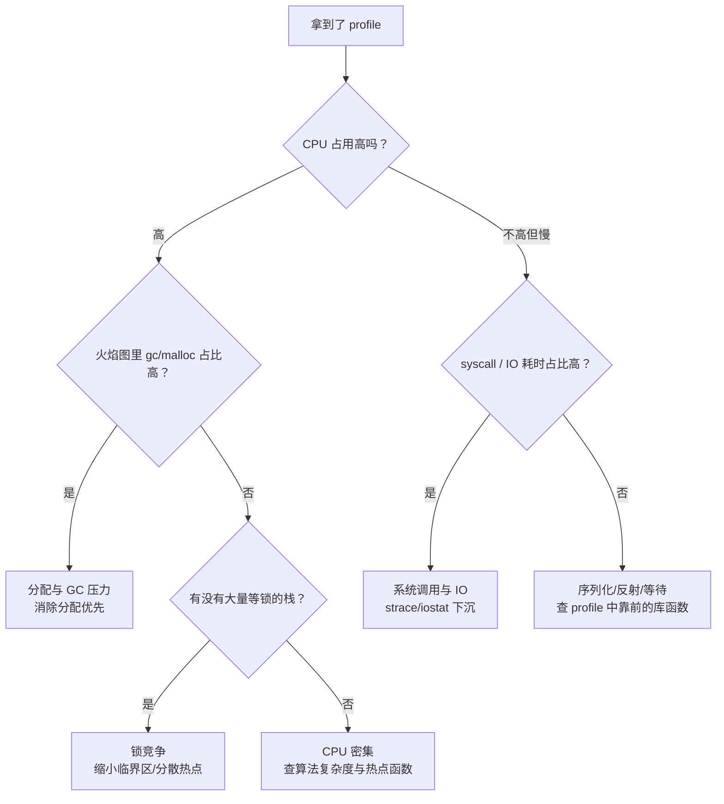

# Go 性能剖析——pprof、trace 与基准测试

**摘要：**

性能优化的第一原则是"不要猜测，要测量"。Go 提供了完整的性能剖析工具链：`go test -bench` 用于微基准测试（量化函数级别的性能）；`runtime/pprof` 和 `net/http/pprof` 用于 CPU、内存、Goroutine 等多维度的运行时剖析；`runtime/trace` 用于以微秒级精度记录调度事件、GC 事件和系统调用，诊断延迟问题。三者针对不同的性能问题层次：Benchmark 回答"这个函数有多快"，pprof 回答"CPU/内存消耗在哪里"，trace 回答"为什么这个请求的延迟高"。本文从工具原理出发，系统讲解每种工具的使用方法、输出解读，以及火焰图（Flame Graph）分析、堆对象分析、Goroutine 调度分析的实战技巧，形成完整的 Go 性能问题诊断方法论。文章最后回到一个设计认知：Go 性能剖析的哲学是"测量驱动优化"——先测量找瓶颈，再优化改代码，最后测量验证效果。这个"测量驱动"让性能优化有据可依，避免"凭直觉优化"的盲目性，是 Go 工程化性能管理的核心方法。

---

## 第 1 章 基准测试：量化性能的基线

### 1.1 什么是基准测试，为什么需要它

**基准测试（Benchmark）** 是对一段代码在重复执行下的性能度量——测量单次执行的时间、内存分配次数和分配字节数。没有基准测试的性能优化是盲目的：你无法知道"优化前"的精确数字，也无法量化优化带来的收益，更无法防止性能退化（performance regression）。

基准测试解决了以下问题：
- **比较多个实现方案**：字符串拼接用 `+`、`strings.Builder`、`bytes.Buffer` 哪个快？
- **量化优化效果**："减少内存分配"后，究竟快了多少？
- **防止性能退化**：将基准测试加入 CI，代码变更后自动检测性能变化。

这个"基准测试是性能优化的基线"是性能工程的第一原则——没有基准数字，优化就是猜测。基准测试提供"优化前"的数字，让优化效果可量化、可验证。这个"量化基线"是性能优化的起点，也是防止退化的护栏。

### 1.2 编写基准测试

基准测试函数以 `Benchmark` 前缀命名，接受 `*testing.B` 参数：

```go
// string_bench_test.go
package stringutil_test

import (
    "strings"
    "testing"
)

// 被测：字符串拼接的五种方式
func BenchmarkConcatPlus(b *testing.B) {
    for i := 0; i < b.N; i++ {  // b.N 由框架自动调整，确保测试运行足够长时间
        s := ""
        for j := 0; j < 100; j++ {
            s += "hello"  // + 拼接
        }
        _ = s  // 防止编译器优化掉结果
    }
}

func BenchmarkConcatBuilder(b *testing.B) {
    for i := 0; i < b.N; i++ {
        var sb strings.Builder
        sb.Grow(500)  // 预分配
        for j := 0; j < 100; j++ {
            sb.WriteString("hello")
        }
        _ = sb.String()
    }
}

// 带内存分配统计的基准测试
func BenchmarkJSONMarshal(b *testing.B) {
    data := prepareTestData()
    b.ResetTimer()  // 不计入 prepareTestData 的时间
    
    for i := 0; i < b.N; i++ {
        result, err := json.Marshal(data)
        if err != nil {
            b.Fatal(err)
        }
        _ = result
    }
}

// 子基准测试：测试不同规模的输入
func BenchmarkSort(b *testing.B) {
    for _, size := range []int{10, 100, 1000, 10000} {
        b.Run(fmt.Sprintf("size-%d", size), func(b *testing.B) {
            data := generateRandomSlice(size)
            b.ResetTimer()
            for i := 0; i < b.N; i++ {
                sort.Ints(data)
            }
        })
    }
}
```

这个"b.N 自动调整"是基准测试的核心机制——框架先试小 N（如 1），如果运行时间太短，增大 N，直到运行时间足够长（默认 1 秒）。这个"自动调整 N"让基准测试结果稳定——无论函数快慢，框架都能找到合适的 N 让总运行时间足够长，减少计时误差。

`b.ResetTimer()` 是基准测试的重要技巧——初始化代码（如 `prepareTestData`）不应该计入基准时间。`ResetTimer` 在初始化后调用，让计时只包含被测循环。这个"ResetTimer 排除初始化"让基准测试只测量被测逻辑，不包含准备工作。

### 1.3 运行和解读基准测试输出

```bash
# 运行所有基准测试（-bench=. 匹配所有）
go test -bench=. -benchmem ./...

# 只运行特定基准测试
go test -bench=BenchmarkConcat -benchmem

# 控制运行时间（默认每个 benchmark 运行 1 秒）
go test -bench=. -benchtime=5s      # 运行 5 秒
go test -bench=. -benchtime=1000x  # 运行 1000 次（不是时间而是次数）

# 多次运行取平均（减少噪音）
go test -bench=. -count=5

# 输出 CPU profile（同时做性能剖析）
go test -bench=. -cpuprofile=cpu.out
go test -bench=. -memprofile=mem.out
```

**输出解读**：

```
BenchmarkConcatPlus-8         50000    24532 ns/op    53248 B/op    99 allocs/op
BenchmarkConcatBuilder-8    2000000      756 ns/op     1024 B/op     2 allocs/op
```

各列含义：
- `BenchmarkConcatPlus-8`：`-8` 表示 GOMAXPROCS=8（8 核）；
- `50000`：`b.N` 的最终值，即执行了 50000 次；
- `24532 ns/op`：每次操作的平均时间（纳秒）；
- `53248 B/op`：每次操作平均分配的字节数（需要 `-benchmem`）；
- `99 allocs/op`：每次操作平均的堆内存分配次数（需要 `-benchmem`）。

对比结果：`strings.Builder` 比 `+` 快约 32 倍（24532 vs 756 ns），内存分配从 99 次降到 2 次——这个量化数据清晰地说明了为什么在循环中应该用 `strings.Builder`。这个"量化对比"是基准测试的核心价值——不是"感觉 Builder 更快"，而是"Builder 快 32 倍，分配少 98%"。有数字才能决策，有数字才能验证。

### 1.4 benchstat：统计分析工具

单次 benchmark 结果有噪音，`golang.org/x/perf/cmd/benchstat` 能对多次运行结果做统计分析：

```bash
# 运行多次，保存结果
go test -bench=. -count=10 > before.txt

# 优化代码后再次运行
go test -bench=. -count=10 > after.txt

# 比较差异（自动计算统计显著性）
benchstat before.txt after.txt
```

输出示例：
```
name           old time/op    new time/op    delta
ConcatPlus-8     24.5µs ± 2%    24.3µs ± 1%    ~  (p=0.421)  # 无显著差异
ConcatBuilder-8   756ns ± 1%     312ns ± 2%  -58.7%  (p=0.000)  # 显著提升 59%
```

`p` 值表示统计显著性：`p < 0.05` 通常认为差异显著，`~` 表示差异不显著（可能是噪音）。这个"统计显著性"是 benchstat 的核心价值——单次 benchmark 有噪音（系统负载、GC 时机等），`benchstat` 通过多次运行 + 统计分析，区分"真实改进"和"随机噪音"。这个"统计显著性分析"让性能优化结论可靠——不会把噪音误认为改进。

---

## 第 2 章 pprof：运行时性能剖析

### 2.1 pprof 的工作原理

**pprof（Program Profiling）** 是 Go 内置的运行时剖析工具，支持多种剖析类型：

| Profile 类型 | 含义 | 适用场景 |
| --- | --- | --- |
| `cpu` | CPU 时间消耗分布（采样方式）| CPU 密集型问题 |
| `heap` | 当前存活的堆对象（采样）| 内存泄漏、高内存占用 |
| `allocs` | 所有历史堆分配（采样）| 频繁分配导致的 GC 压力 |
| `goroutine` | 所有 Goroutine 的调用栈 | Goroutine 泄漏、死锁 |
| `block` | Goroutine 阻塞在同步原语的时间 | 锁争用、channel 阻塞 |
| `mutex` | Mutex 争用情况 | 锁热点识别 |
| `threadcreate` | 触发 OS 线程创建的调用栈 | cgo 或系统调用分析 |

**CPU profile 的采样机制**：Go 运行时每 10ms 发出一个 SIGPROF 信号，收到信号时记录当前所有 Goroutine 的调用栈。分析 CPU profile 本质是分析"哪些函数出现在调用栈样本中的频率最高"——频率越高，说明 CPU 时间花在这里越多。采样间隔是 10ms，适合分析 > 100ms 的函数，对很快的函数（< 1ms）可能无法精确捕获。

这个"10ms 采样"是 CPU profile 的根本局限——它只能发现"长时间占用 CPU"的函数，无法发现"高频但单次极短"的函数。对于后者，需要用 trace（微秒级精度）或自定义计时。这个"采样精度限制"是选择工具时的重要考量——CPU 问题用 pprof，延迟问题用 trace。

### 2.2 在服务中暴露 pprof 端点

```go
import (
    _ "net/http/pprof"  // 副作用 import：自动注册 /debug/pprof/ 路由
    "net/http"
)

func main() {
    // 生产服务中，pprof 端点应该绑定到内部端口，不对外暴露
    go http.ListenAndServe(":6060", nil)  // pprof 专用端口
    
    // 主服务
    http.ListenAndServe(":8080", appHandler)
}
```

导入 `net/http/pprof` 后，`/debug/pprof/` 下自动注册以下端点：
- `/debug/pprof/`：概览页面
- `/debug/pprof/cpu`：CPU profile（需要 `?seconds=N` 参数）
- `/debug/pprof/heap`：堆内存 profile
- `/debug/pprof/goroutine`：所有 Goroutine 调用栈
- `/debug/pprof/block`：阻塞 profile
- `/debug/pprof/mutex`：Mutex 争用 profile

这个"副作用 import"是 Go pprof 的独特设计——`import _ "net/http/pprof"` 不直接使用包，但包的 `init()` 函数会自动注册路由到 `DefaultServeMux`。这个"副作用注册"让 pprof 集成极简——一行 import 就开启所有端点。但要注意生产环境的安全——pprof 端点应该绑定内部端口，不对外暴露（防止信息泄露和 DoS）。

### 2.3 采集和分析 CPU Profile

```bash
# 方法一：从运行中的服务采集 30 秒的 CPU profile
go tool pprof http://localhost:6060/debug/pprof/profile?seconds=30

# 方法二：从基准测试生成 CPU profile
go test -bench=BenchmarkHeavyFunc -cpuprofile=cpu.out
go tool pprof cpu.out

# 进入 pprof 交互模式后的常用命令：

# top：显示 CPU 时间消耗最多的函数（默认按 flat 排序）
(pprof) top10
      flat  flat%   sum%        cum   cum%
    29.50s 55.09%  55.09%    29.50s 55.09%  runtime.memmove
     4.17s  7.78%  62.87%     4.17s  7.78%  runtime.mallocgc
     3.48s  6.50%  69.37%     7.61s 14.21%  encoding/json.Marshal
     ...

# flat：函数本身消耗的 CPU 时间（不含调用的子函数）
# cum：函数及其所有子函数消耗的 CPU 时间之和
```

**flat vs cum 的解读**：
- 高 `flat` + 低 `cum`：函数本身就是瓶颈（计算密集型），如紧密循环、哈希计算；
- 低 `flat` + 高 `cum`：函数本身很快，但它调用的某个子函数很慢——需要进一步 `list` 这个函数看它调用了什么。

这个"flat vs cum"是 pprof 分析的核心概念——flat 是"函数自身消耗"，cum 是"函数及其调用链消耗"。两者配合定位瓶颈——高 flat 说明"这个函数本身慢"，高 cum 说明"这个函数调用的东西慢"。这个"flat + cum 双维度"让瓶颈定位精确——既知道"谁慢"，又知道"慢在哪里"。

```bash
# list：显示特定函数的源码级注释（每行的 CPU 消耗）
(pprof) list encoding/json.Marshal

# web：在浏览器中以调用图形式可视化（需要 graphviz）
(pprof) web

# 生成火焰图（flamegraph）
go tool pprof -http=:8081 cpu.out  # 在浏览器中打开，包含交互式火焰图
```

### 2.4 火焰图：最直观的 CPU 分析工具

**火焰图（Flame Graph）**是由 Brendan Gregg 发明的性能可视化方式，`go tool pprof -http=:8081` 内置了交互式火焰图（View → Flame Graph）。

读图方法：
- **X 轴**：不代表时间，代表 CPU 时间的百分比——某个函数的宽度越大，CPU 时间越多；
- **Y 轴**：调用栈深度，底部是调用栈底（`main`），顶部是正在执行的函数；
- **颜色**：通常按包名分色，无特别意义；
- **优化目标**：找"最宽的平顶"——宽（消耗大量 CPU）且上面没有更多调用栈（是实际执行的函数，而非只是入口）。

这个"找最宽平顶"是火焰图分析的实用技巧——平顶（顶部没有更多调用）说明"这个函数是实际执行点"，宽说明"消耗大量 CPU"。优化这个平顶函数能获得最大收益。这个"视觉化定位瓶颈"让性能分析直观——一眼看出"CPU 时间花在哪里"，比看 top 命令的数字更直观。

### 2.5 内存 Profile 分析

```bash
# 采集堆内存 profile（查看当前存活对象）
go tool pprof http://localhost:6060/debug/pprof/heap

# 采集分配 profile（查看历史所有分配）
go tool pprof http://localhost:6060/debug/pprof/allocs
```

内存 profile 中的四种视图（通过 `-alloc_space`、`-alloc_objects`、`-inuse_space`、`-inuse_objects` 切换）：

```bash
# 内存视图选择
(pprof) -inuse_space   # 当前存活内存的大小（用于找内存泄漏）
(pprof) -inuse_objects # 当前存活对象的数量
(pprof) -alloc_space   # 历史总分配大小（用于找 GC 热点）
(pprof) -alloc_objects # 历史总分配次数（找频繁分配）

# 示例：找内存泄漏（inuse_space 持续增长的函数）
(pprof) top10 -inuse_space
```

这个"inuse vs alloc 四视图"是内存分析的核心——`inuse` 看"当前存活的"（找泄漏），`alloc` 看"历史分配的"（找 GC 压力）。`_space` 看字节数（大小），`_objects` 看对象数（频率）。这个"四视图"让内存问题分类诊断——泄漏用 `inuse_space`，GC 压力用 `alloc_objects`，各有对应工具。

**内存泄漏诊断实战**：如果服务内存持续增长，可以在不同时间点采集两个 heap profile，然后对比：

```bash
# 时间点1
curl -o heap1.pb.gz http://localhost:6060/debug/pprof/heap

# 等待 10 分钟
# 时间点2
curl -o heap2.pb.gz http://localhost:6060/debug/pprof/heap

# 对比（差值为正的是新增的内存占用）
go tool pprof -diff_base=heap1.pb.gz heap2.pb.gz
(pprof) top -inuse_space
```

这个"diff profile"是内存泄漏诊断的关键方法——单次 profile 只看"当前有多少"，diff profile 看"增长了多少"。泄漏的本质是"持续增长"，diff 能精确显示"哪些函数的内存增长了"。这个"diff 定位泄漏"比单次分析更可靠——直接显示增长来源，不需要猜测。

---

## 第 3 章 go trace：调度级别的精细分析

### 3.1 pprof 的局限与 trace 的价值

pprof 采样频率是 10ms，对于单个请求的延迟分析（如 P99 延迟 50ms）分辨率不够。此外，pprof 告诉你"哪些函数消耗了 CPU"，但不能回答：
- 某个 Goroutine 在等待什么？（被调度器 park 了，不占 CPU，但也不在运行）
- GC 暂停发生在什么时候，持续多久？
- 某个请求在哪个阶段卡住了？

`runtime/trace` 以微秒级精度记录以下事件：
- Goroutine 的创建、运行、阻塞、唤醒；
- GC 各阶段（mark start、mark done、sweep）；
- 系统调用的开始和结束；
- Heap 大小的变化；
- P（逻辑处理器）的状态变化。

这个"pprof 看 CPU，trace 看延迟"是工具选择的核心区分——pprof 采样 10ms，适合"CPU 消耗"问题；trace 微秒级，适合"延迟"问题。延迟问题往往不是"CPU 不够"，而是"等待"（等锁、等 GC、等调度），pprof 看不到"等待"（等待时不占 CPU），trace 能看到"等待"（记录 Goroutine 状态变化）。这个"trace 看 wait"是它诊断延迟的独特价值。

### 3.2 采集和分析 trace

```go
// 程序中采集 trace
import "runtime/trace"

func main() {
    f, _ := os.Create("trace.out")
    defer f.Close()
    
    trace.Start(f)
    defer trace.Stop()
    
    // ... 执行被测逻辑 ...
}
```

```bash
# 从运行中的服务采集 5 秒的 trace
curl http://localhost:6060/debug/pprof/trace?seconds=5 -o trace.out

# 从测试采集 trace
go test -trace=trace.out ./...

# 在浏览器中分析 trace
go tool trace trace.out
```

`go tool trace` 打开一个 Web 界面，包含以下视图：

**View trace（时间轴视图）**：最重要的视图，横轴是时间，纵轴是各 Goroutine 和 P。每个 Goroutine 的状态变化（运行/阻塞/等待网络 IO/等待 GC）一目了然。

**Goroutine analysis**：列出所有 Goroutine，按"执行时间"、"阻塞时间"、"调度延迟"等维度排序，快速找出异常的 Goroutine。

**Network blocking profile / Sync blocking profile**：分别展示网络 IO 阻塞和同步原语（Mutex/Channel）阻塞的情况——这两个是高延迟的常见来源。

这个"View trace 时间轴"是 trace 的核心视图——它把"时间 × Goroutine × 状态"可视化，让延迟原因一目了然。看到某个 Goroutine 长时间"阻塞"，就知道是"等什么"导致的延迟。这个"时间轴可视化"让延迟诊断从"猜"变成"看"——直接看到 Goroutine 在哪个时间段阻塞了，阻塞原因是什么。

### 3.3 用 trace 诊断延迟抖动的典型案例

**案例：某个 RPC 调用的 P99 延迟远高于 P50**

步骤：
1. 采集一段包含高延迟请求的 trace；
2. 在 View trace 中找到高延迟请求对应的 Goroutine（可以通过 `trace.NewTask` 标注）；
3. 查看该 Goroutine 的时间线，找出长时间非运行状态的段——通常是：
   - 等待 Mutex（`sync.Mutex.Lock` 导致的阻塞）；
   - 等待 GC（GC 扫描期间 Goroutine 被暂停）；
   - 调度延迟（P 全忙，Goroutine 在 run queue 中等待被调度）。

```go
// 使用 trace.Task 和 trace.Region 标注关键代码段，便于在 trace 中定位
import "runtime/trace"

func handleRequest(ctx context.Context, req *Request) {
    ctx, task := trace.NewTask(ctx, "handleRequest")
    defer task.End()
    
    trace.WithRegion(ctx, "validateRequest", func() {
        validateRequest(req)
    })
    
    trace.WithRegion(ctx, "fetchData", func() {
        fetchData(ctx, req)
    })
}
```

这个"trace.Task + trace.Region 标注"是 trace 使用的高级技巧——给关键代码段打标签，在 View trace 中能精确定位"这个请求的 Goroutine 在哪里"。没有标注，trace 中 Goroutine 匿名，难以对应到具体请求；有标注，trace 中显示"handleRequest"任务，直接找到。这个"标注定位"让 trace 分析从"找 Goroutine"变成"找任务"，效率大幅提升。

---

## 第 4 章 性能优化实战：常见瓶颈与解法

### 4.1 减少堆内存分配

频繁的堆内存分配是 Go 服务 CPU 和延迟问题的常见根源——每次分配都需要调用内存分配器（[[03 Go 内存分配器——mcache、mcentral 与 mheap]]），每个分配出去的对象最终都需要 GC 扫描和回收。减少分配是性能优化的最高回报方向。

**技巧一：预分配 slice 容量**

```go
// 慢：append 触发多次扩容和重新分配
var results []Result
for _, item := range items {
    results = append(results, process(item))
}

// 快：一次分配足够容量
results := make([]Result, 0, len(items))
for _, item := range items {
    results = append(results, process(item))
}
```

**技巧二：复用对象（sync.Pool）**

```go
var bufPool = &sync.Pool{
    New: func() any { return make([]byte, 0, 4096) },
}

func processRequest(data []byte) {
    buf := bufPool.Get().([]byte)
    buf = buf[:0]
    defer bufPool.Put(buf)
    
    buf = append(buf, data...)
    // ... 使用 buf ...
}
```

**技巧三：避免接口装箱（Interface Boxing）**

```go
// 装箱：将 int 赋值给 interface{}，触发堆分配
var x interface{} = 42  // 在堆上分配一个 int

// 避免不必要的 interface 转换
// 如果函数签名只需要 int，不要用 interface{}
func processInt(v int) { ... }           // 不分配
func processAny(v interface{}) { ... }   // 可能分配（取决于 v 的类型）
```

这个"减少分配是最高回报优化"是 Go 性能优化的核心经验——Go 的 GC 让"分配"代价高（每个对象都要扫描），减少分配直接降低 GC 压力和分配器开销。这个"减分配 > 优化算法 > 微优化"的优先级是 Go 性能优化的实用指南——先减分配（最大收益），再优化算法（中等收益），最后才考虑微优化（最小收益）。

### 4.2 逃逸分析：理解变量分配在栈还是堆

```bash
# 查看逃逸分析结果
go build -gcflags='-m -m' ./...

# 输出示例：
# ./main.go:15:6: moved to heap: user     ← user 逃逸到堆
# ./main.go:22:14: &Config{} does not escape  ← 没有逃逸，在栈上
```

导致变量逃逸到堆的常见原因：
- 函数返回了指向局部变量的指针；
- 变量被赋值给接口类型；
- 变量被传递给接受 `interface{}` 参数的函数（如 `fmt.Println`）；
- 在闭包中使用外部变量（捕获变量）；
- 变量大小在编译时不确定（如动态大小的 slice）。

这个"逃逸分析"是理解 Go 内存分配的关键——栈分配廉价（函数返回自动回收），堆分配昂贵（需要 GC）。逃逸分析决定"变量在栈还是堆"，理解逃逸规则能帮助写出"少堆分配"的代码。这个"逃逸分析"是 Go 性能优化的底层知识——知道"什么导致逃逸"，才能避免不必要的堆分配。

### 4.3 字符串与 []byte 的零拷贝转换

```go
// 正常转换：有内存拷贝
s := string(byteSlice)    // 分配新的字符串，拷贝数据
b := []byte(str)          // 分配新的 slice，拷贝数据

// 零拷贝转换（unsafe，仅在性能关键路径且确保生命周期安全时使用）
// Go 1.20 引入了官方的零拷贝转换：
s := unsafe.String(&b[0], len(b))  // []byte → string，零拷贝
b := unsafe.Slice(unsafe.StringData(s), len(s))  // string → []byte，零拷贝

// 注意：零拷贝转换后，不能修改原始 []byte（字符串是不可变的）
```

这个"零拷贝转换"是性能极致优化的手段——正常转换有内存拷贝（O(n)），零拷贝转换无拷贝（O(1)）。但 `unsafe` 有风险（生命周期、可变性），只在性能关键路径且确保安全时使用。这个"unsafe 零拷贝"是 Go 性能优化的"核武器"——威力大但风险高，谨慎使用。

---

## 第 5 章 性能剖析的工程化实践

### 5.1 Continuous Profiling（持续性能剖析）

生产问题往往只在特定流量模式下出现，无法在本地复现。**持续性能剖析（Continuous Profiling）** 是一种在生产环境中以低开销持续采集 profile 并存储历史的实践——当性能问题出现时，可以查看对应时间段的 profile 进行事后分析。

工具选择：
- **Pyroscope**（开源）：Go 应用直接集成 SDK，持续推送 CPU/内存 profile；
- **Google Cloud Profiler**（GCP 托管）：托管服务，直接集成；
- **Grafana Phlare**（开源，Grafana Stack 的 profiling 组件）。

```go
// 集成 Pyroscope（开源持续性能剖析）
import "github.com/grafana/pyroscope-go"

func main() {
    pyroscope.Start(pyroscope.Config{
        ApplicationName: "my-service",
        ServerAddress:   "http://pyroscope:4040",
        ProfileTypes: []pyroscope.ProfileType{
            pyroscope.ProfileCPU,
            pyroscope.ProfileAllocObjects,
            pyroscope.ProfileAllocSpace,
            pyroscope.ProfileInuseObjects,
            pyroscope.ProfileInuseSpace,
        },
    })
    // ...
}
```

这个"持续性能剖析"是生产性能管理的现代实践——不是"出问题再 profile"，而是"持续 profile，出问题查历史"。这个"持续采集 + 历史查询"让生产性能问题可事后分析——即使问题已经过去，也能查看当时的 profile。这个"持续剖析"是性能可观测性的重要组成，与监控、日志、追踪并列。

### 5.2 性能问题的诊断决策树

```
服务出现性能问题
    │
    ├─ CPU 使用率高？
    │      ├─ 采集 CPU profile → 找 top flat 函数
    │      ├─ 查火焰图 → 找最宽平顶
    │      └─ 常见原因：序列化/反序列化、regex、哈希计算、GC（check alloc profile）
    │
    ├─ 内存持续增长？
    │      ├─ 采集两个时间点的 heap profile，diff 对比
    │      ├─ 查 inuse_space top → 找持续增长的分配点
    │      └─ 常见原因：Goroutine 泄漏（goroutine profile）、全局缓存无上限
    │
    ├─ GC 频繁 / GC 时间长？
    │      ├─ GODEBUG=gctrace=1 观察 GC 触发频率和耗时
    │      ├─ 采集 allocs profile → 找频繁分配点（减少分配 = 减少 GC 频率）
    │      └─ 调整 GOGC（增大 = GC 触发更晚 = 更少 GC 次数，但每次更慢）
    │
    └─ 延迟高（P99 >> P50）？
           ├─ 采集 trace → View trace 找 Goroutine 阻塞原因
           ├─ 采集 block profile → 找锁阻塞热点
           └─ 常见原因：锁争用、GC 暂停、调度延迟（P 不够）
```

这个"诊断决策树"是性能问题排查的实用框架——按"症状"（CPU 高/内存涨/GC 频繁/延迟高）分类，每类有对应的工具和常见原因。这个"症状 → 工具 → 原因"的决策树让性能排查有章法——不是"乱试工具"，而是"按症状选工具"。

### 5.3 性能优化的方法论原则

**原则一：先度量，再优化**。不要凭直觉优化，先用 pprof 找到真正的瓶颈——80% 的 CPU 时间通常集中在 20% 的代码上。

**原则二：一次只改一处**。每次优化后都重新运行 benchmark，量化改动的效果。同时改多处时，无法判断哪个改动带来了收益、哪个引入了退化。

**原则三：警惕微优化**。在没有 profile 数据支撑的情况下，手动内联函数、避免 defer 等"微优化"往往收效甚微，还会损害代码可读性——Go 编译器已经很聪明了。

**原则四：可读性是性能的朋友**。清晰的代码更容易被编译器优化（内联、逃逸分析），而复杂的"手动优化"有时反而阻碍了编译器优化。只有 profile 数据明确指向某段代码时，才考虑牺牲可读性换性能。

这四个原则共同指向"测量驱动优化"——先测量（原则一），逐个验证（原则二），避免微优化（原则三），保持可读性（原则四）。这个"测量驱动"是 Go 性能优化的方法论核心——不是"凭感觉优化"，而是"数据驱动优化"。

---

## 第 6 章 Go 性能剖析的设计认知

### 6.1 测量驱动优化

Go 性能剖析的哲学是"测量驱动优化"——先测量找瓶颈，再优化改代码，最后测量验证效果。这个"测量驱动"让性能优化有据可依，避免"凭直觉优化"的盲目性。这个"测量驱动"与"猜测驱动"形成对比——猜测优化往往优化了不是瓶颈的代码，浪费精力且无效果；测量优化直接定位瓶颈，改一处见效。

### 6.2 工具分层

Go 性能工具是"分层"的——Benchmark 量化函数性能，pprof 定位 CPU/内存热点，trace 诊断延迟问题。这个"分层"让不同问题用不同工具——函数性能用 Benchmark，CPU/内存用 pprof，延迟用 trace。这个"工具分层"让性能排查有章法——按问题类型选工具，不是"一个工具解决所有问题"。

### 6.3 内置优于外部

Go 性能工具大部分内置在工具链中——`go test -bench`、`go tool pprof`、`go tool trace` 都是内置的，不需要引入外部框架。这个"内置优于外部"让性能剖析入门成本极低——`go test -bench` 就能基准测试，`go tool pprof` 就能剖析，不需要配置外部工具。这个"内置"是 Go 工具链设计的核心哲学——常用功能内置，减少外部依赖。

---

## 第 7 章 从剖析到优化的闭环

### 7.1 假设—度量—验证

性能优化最容易变成"凭感觉改代码"——改了、好像快了、合了。可靠的流程是一个闭环：**先提出假设**（"瓶颈在序列化"），**再用度量验证假设**（火焰图里序列化占比多少），**改一处**，**再度量对比**（benchstat 或线上指标），确认有效才继续。这个闭环里最关键的是"一次只改一处"——同时改三处，即使变快了也不知道是哪一处的功劳，而其中可能有两处是无效甚至有害的。

### 7.2 优化的 ROI

优化要按 ROI 排序，而不是按"哪里看起来不顺眼"。ROI 的三个输入是：**占比**（这一块占总耗时的比例）、**可优化空间**（理论上能降到多少）、**改动成本**（涉及多少代码、多少风险）。一个占 5% 耗时、可优化 90% 的模块，最多省下 4.5%；而一个占 60%、只能优化 20% 的模块，能省下 12%——**先优化占比最大的那处**，几乎总是对的。这条原则还有一个推论：**若某处占比很小，即使它"看起来很笨"，也不值得动**——性能上的洁癖往往是在浪费时间。

### 7.3 几个常见的错觉

经验里最常误导判断的几个错觉值得一提。**"加了缓存就快了"**——若瓶颈不在计算而在 IO 或锁，缓存毫无帮助，还可能引入一致性成本。**"并发一定更快"**——若任务是纯计算且已跑满 CPU，加并发只会增加调度开销。**"代码更短就更快"**——可读性优化与性能优化经常方向相反，短代码可能在分配上更贵。**"机器更贵就更快"**——若瓶颈是单核性能或锁竞争，加机器无济于事，甚至因为跨 NUMA 而更慢。这些错觉的共同解法仍然是同一条：**先度量，再下结论**。

### 7.4 优化与可读性的取舍

性能优化常常以牺牲可读性为代价（更复杂的控制流、更少的分层、更"聪明"的写法）。因此一个实用的准则是：**只有当收益可量化、且足够抵消可读性损失时才做**——把 3% 的耗时换成一段没人看得懂的代码，通常是亏的。更好的做法是把优化集中在少数关键路径上（用注释说明"为什么这么写"），其余部分保持直白。**"大部分代码为可读性服务、少数热点为性能服务"，是可持续的取舍。**

## 第 8 章 典型瓶颈的深描

### 8.1 分配与 GC 压力

Go 程序最常见的性能问题不是"CPU 忙"，而是"**GC 忙**"——分配速率高，GC 就频繁触发，表现为 CPU 被 GC 占用、延迟出现抖动。识别信号是：CPU profile 里 `runtime.gc*` 与 `runtime.mallocgc` 占比高、`GODEBUG=gctrace=1` 显示 GC 频繁、heap profile 显示分配集中在少数几处。应对手段按代价从低到高：消除不必要的分配（预分配 slice、复用 buffer、避免隐式装箱）、用 `sync.Pool` 复用临时对象、调整 `GOGC` 或 `GOMEMLIMIT`。**注意顺序**——调参数是最后一步，先消除分配才是治本。

### 8.2 锁竞争与伪共享

当并发程序"加核不加速"时，锁竞争是首要嫌疑。识别信号是：mutex profile 显示某把锁的争用时间长、block profile 显示大量时间花在等锁、trace 里能看到 Goroutine 排队。常见根因有三类：**锁的粒度太粗**（把一个慢操作圈进了临界区）、**锁的争用点集中**（所有请求都过同一个计数器）、**伪共享**（两个不相关的变量落在同一个缓存行，被不同核反复同步）。前两类的解法是"缩小临界区、分散热点"（如按 key 分片计数），第三类靠填充（padding）或对齐。

### 8.3 系统调用与 IO

当程序大部分时间在"等"而不是"算"时，要下沉到系统调用层。识别工具是 `strace`（系统调用计数与耗时）、`iostat`（磁盘）、`ss`/`netstat`（网络），以及 pprof 的 syscall 相关栈。典型问题包括：**读文件用小块导致系统调用暴涨**（改大缓冲或用 `bufio`）、**频繁的小写入**（合并成批量写）、**忘记复用连接**（每次重建 TCP）。这类问题的特征是"CPU 不忙但慢"，因为时间花在了内核与等待上。

### 8.4 序列化与反射

序列化常在火焰图里占据意外高的比例，原因是它同时踩中两个成本点：**反射**（`encoding/json` 需要反射遍历字段）与**分配**（每次编解码都产生大量临时对象）。识别信号是 JSON/反射相关函数在 profile 里靠前。应对路径是"按需升级"：先用结构体标签与预分配缓解；若仍不够，换成代码生成的序列化器（避免反射）；最后才是换协议（如 Protobuf）。**反射的代价在热路径上尤其明显，而序列化往往正是热路径。**

### 8.5 CPU 密集与算法复杂度

有一种性能问题与 Go 无关——**算法复杂度选错了**。在优化任何实现细节之前，先确认算法本身没有数量级的改进空间：一个 O(n²) 的循环，无论怎么微调都比不上换成一个 O(n) 的写法。识别信号是"耗时随输入规模呈超线性增长"——跑几组不同规模的基准，看耗时增长的曲线。这条提醒之所以重要，是因为**实现层面的优化最多带来常数倍提升，而算法层面的优化可能是数量级的**。

### 8.6 一张瓶颈分流图

把上面五类瓶颈与它们的识别信号对应起来，可以在拿到 profile 后快速分流：



这张图的用法是"从上往下问、每一步二分"，而不是"把所有工具都用一遍"。**分流的意义在于把排查从"到处看"变成"按信号走"。**

## 第 9 章 GC 与内存调优

### 9.1 先理解 GC 的两个目标

Go 的 GC 同时追求两个目标：**低停顿**（STW 时间通常在亚毫秒级）与**可预测性**。这两个目标决定了它的调优空间——你调的是"**多久跑一次 GC**"与"**允许堆涨到多大**"，而不是"用什么算法"。理解这一点能避免很多无效尝试：既然 GC 的停顿已经被压得很低，那么"GC 导致延迟抖动"的根因通常是**分配速率太高导致 GC 太频繁**，而不是 GC 本身慢。

### 9.2 GOGC 与 GOMEMLIMIT

两个关键旋钮各有分工。`GOGC` 控制"堆增长多少后触发 GC"（默认 100 表示堆翻倍就触发），调大它能减少 GC 频率，代价是内存占用更高。`GOMEMLIMIT`（Go 1.19+）设一个**软内存上限**——当逼近这个上限时，GC 会更积极，从而避免 OOM，但不会硬性阻止超过。二者配合的惯用姿势是：**用 `GOMEMLIMIT` 设一个略低于容器内存限制的值**（留出余量给非堆内存），再用 `GOGC` 调频率。这个组合在容器化环境下尤其有用——它把"内存被 OOM Killer 杀掉"变成"GC 更积极、性能下降但活着"。

### 9.3 调参的顺序

调参应当是最后一步，而不是第一步。正确的顺序是：**先消除不必要的分配**（预分配、复用、避免装箱），**再评估 Pool 化的收益**（对高频临时对象），**最后才动 GOGC/GOMEMLIMIT**。原因很直接——分配是"因"，GC 是"果"；治果不治因，只会让内存占用上升而分配速率依旧。若跳过前两步直接调参，往往会看到"GC 频率降了、内存涨了、吞吐没变"。

### 9.4 内存问题的两种形态

内存相关问题有两种截然不同的形态，诊断路径也不同。**其一，内存持续增长**（泄漏）——堆 profile 显示某个对象数量只增不减，需要定位"谁还在持有它"（常见于全局 map 未清理、缓存无淘汰、Goroutine 泄漏携带的引用）；**其二，内存周期性起伏**（正常的 GC 曲线）——若峰值稳定、随 GC 回落，那是设计内的行为，不必干预。把"曲线起伏"当成"泄漏"去排查，是常见的时间浪费；区分二者的关键是**看长期趋势**，而不是看瞬时值。

## 第 10 章 性能回归的防线

### 10.1 基准测试进 CI

性能问题最怕"悄悄退化"——某次重构让一个热点函数慢了 30%，没人发现，直到线上容量吃紧。防线是在 CI 里对**关键路径**跑基准测试并做**统计比较**（用 benchstat 对比基线），超过阈值（如变慢 10%）就标记出来。要点有三：只覆盖关键路径（全量基准会拖慢 CI 且噪音大）；用足够的 `-count` 降低噪音（单次运行的结果没有统计意义）；把基线固定下来（否则"变化"无从判断）。

### 10.2 分配计数作为哨兵

`-benchmem` 给出的"每操作分配次数"是一个非常敏感的哨兵——它比耗时更稳定、更少受机器环境影响。因此一条实用做法是：**在关键路径上，把"零分配"或"固定分配次数"作为断言**，一旦某次改动引入了新的分配就失败。这比"耗时变慢"更早、更可靠地捕捉到退化，因为分配是确定的，而耗时是有噪声的。

### 10.3 线上性能的可观测

CI 只能覆盖"用基准能表达的"部分，线上的真实性能还要靠持续可观测。三样东西缺一不可：**持续性能剖析**（定期采集 CPU/heap profile 并留存，出问题时能和历史对比）、**关键指标的趋势**（延迟分位、GC 频率、分配速率的长期曲线）、**变更与指标的关联**（把发布事件标在指标图上，一眼看出"哪次发布之后变慢了"）。它们的共同价值是**把"性能突变"从"某天用户抱怨"变成"发布后指标立刻可见"**。

### 10.4 一条纪律

性能回归的防线能否运转，取决于一条纪律：**性能是被测量的，不是被假设的**。任何"这应该更快"的判断，都应当有基准或指标作为依据；任何"这次改动应该没影响性能"的判断，也应当被基准验证——**没影响**本身就是一个需要证明的结论。把性能当成与正确性同等的、需要被验证的属性，是这套防线成立的前提。

## 第 11 章 十个常见问题

**问：pprof 采样会不会影响线上性能？** 采样本身开销很低（CPU profile 默认每秒采样 100 次），通常可以常开；但 profile 的**导出与存储**可能带来 IO 与存储压力，因此更推荐"低采样率常开 + 按需提高"或"持续剖析平台做聚合"。让 pprof 端点常驻的价值在于——出问题时不必重启或临时开启。

**问：火焰图那么宽，该看哪里？** 看"**宽且没有下层**"的部分——宽代表耗时占比高，没有下层代表它是叶子（真正在干活）。同时要找"自己的代码"（而不是 runtime 或库的内部）——若宽处全是库函数，说明问题在用库的方式（如每次都新建对象），而不是库本身。

**问：benchmark 结果每次都不同，怎么办？** 这正是需要 benchstat 的原因——单次结果不可用，必须多次运行做统计比较。此外要减少环境噪音（关掉其它负载、固定 CPU 亲和性、用足够的 `-benchtime`）。**若两组结果在统计上不可区分，就不要声称"更快了"。**

**问：为什么我的优化在 benchmark 上有效、线上却无效？** 三个常见原因：benchmark 的负载与线上不同（数据规模、并发度、数据分布）；线上瓶颈不在你优化的那处（比如你优化了 CPU，实际瓶颈是锁或 IO）；benchmark 有测量偏差（如缓存效应、编译器优化）。因此**线下优化必须由线上指标确认**，不能止步于 benchmark。

**问：trace 采集多久合适？** trace 文件很大（每秒可能几十 MB），因此采集时长要短（几秒到几十秒），且应当在"问题重现时"采集。它的定位是"短时精细观察"，而不是"长期监控"——长期监控该用指标与持续 profile。

**问：什么时候该用 pprof 的 `-diff_base`？** 当你想看"两次采集之间**新增**的热点"时——它把两次 profile 相减，只呈现变化部分。这在"发布前后对比""优化前后对比"时非常有用，能避免被不变的部分干扰。

**问：分配速率高但 GC 停顿时长没问题，要不要管？** 要看代价落在哪里。分配速率高的代价是 GC 更频繁地占用 CPU（吞吐下降）与更高的内存占用——若这两者都不构成问题，可以不优化；若 CPU 被 GC 占掉可观比例，就该动。**判据仍然是"代价是否可观测"，而不是"分配次数看起来很多"。**

**问：怎么优化锁竞争又不牺牲正确性？** 三条方向：缩小临界区（把 IO、计算移出锁外）、分散热点（按 key 分片，每片一把锁）、减少共享（用不可变对象或 Copy-on-Write 让读路径无需锁）。三条都不改变正确性，只改变争用形态。

**问：GC 参数该不该调？** 默认值对绝大多数程序是合适的。值得调的两种情形：容器内存受限时用 `GOMEMLIMIT` 防止 OOM；分配极少的批处理程序可适当调大 GOGC 减少 GC 次数。**调参前先确认"分配已优化到位"，否则是在给一个漏水的桶加滤网。**

**问：性能剖析最该避免什么？** 避免"**没有基线就做优化**"与"**没有对比就宣布成功**"。前者让优化失去方向，后者让优化无法验证。二者都指向同一件事：**性能工作的核心不是写更快的代码，而是建立"可比较"的能力**。

## 第 12 章 一次性能优化的完整推演

给一个具体场景，把全篇串起来。假设一个 Go 服务的 P99 延迟在高峰期升高，容量看起来还没跑满。

**第一步，先分清是"CPU 问题"还是"等待问题"。** 看 CPU 使用率——若 CPU 很高，走 CPU 剖析；若 CPU 不高但延迟高，走阻塞与 IO 分析。这个判断决定了后续所有工具的选择，也是最容易跳过、却最省时间的一步。

**假设结果是 CPU 高。** 抓 CPU profile 看火焰图：若 gc/malloc 占比高，转向"分配优化"（消除分配、复用 buffer）；若是某个业务函数宽而深，转向"算法与实现优化"；若有大量等锁的栈，转向"锁竞争"。三条路径对应三类根因，各自有明确的下一步。

**假设结果是 CPU 不高。** 用 block profile 与 trace 看等待：若大量时间在等锁，是锁竞争；若在等 IO（syscall、网络读写），是 IO 问题（查连接复用、批量化、超时设置）；若在等 channel，是上下游速度不匹配（查背压与队列）。trace 在这里尤其有用，因为它能直接展示"哪一段时间里 Goroutine 都在做什么"。

**第二步，改一处，再度量。** 找到瓶颈后只改一处，用基准或线上指标确认效果。若有效，继续（可能还有第二个瓶颈）；若无效，说明假设错了——回到第一步重新判断。这个循环可能要走两三遍，每遍都把范围收窄。

**第三步，加防线。** 优化生效后，把它固化下来——把关键路径的基准接进 CI，把相关的指标接进监控，并写清楚"这次改了什么、为什么有效"。这一步常被跳过，于是几个月后一次无关的重构又把性能改了回去，而无人察觉。

**这段推演的落点**：性能工作看起来是"技术活"，实际上是一种**方法论**——**先判断性质、再按性质选工具、改一处验一处、最后固化防线**。工具会变，方法论不变；掌握方法论的人，换一套工具依然能定位问题。

## 第 13 章 与其它工具链的配合

### 13.1 与 Linux perf、eBPF 的分工

pprof 看的是"Go 程序自己的视角"——它由运行时采样，因此只能看到 Go 世界里的栈。当问题出在 Go 调用之外（内核态耗时、GC 之外的线程活动、页错误、跨进程行为），就需要下沉到 Linux 侧：`perf` 提供系统级的采样（能同时覆盖用户态与内核态），eBPF 提供更低开销的内核观测（系统调用、网络、调度延迟）。两者的分工很清楚：**pprof 回答"我的代码在做什么"，perf/eBPF 回答"机器在做什么"**。当 pprof 显示"CPU 不高但就是慢"时，正是该轮到后者。

### 13.2 持续性能剖析

一次性的 profile 有个先天不足——它是"事发当时的快照"，而性能问题往往发生在你没空采集的那一刻。**持续性能剖析**（Continuous Profiling）的思路是：把不常开的低采样率 profile **常态采集并留存**，于是任何一次性能突变都能回溯到"当时的火焰图是什么样"。它的价值在回顾性排查上无可替代——问题发生时不必"现场抓取"，历史数据已经在了。这也呼应了前面那句：让 pprof 端点常驻，比出问题时临时开启更可靠。

### 13.3 与追踪、指标的关系

性能剖析、追踪、指标是三种不同粒度、不同用途的观测手段。**指标**回答"有没有变慢、变慢了多少"（趋势与阈值，成本最低）；**追踪**回答"哪一次请求的哪一跳慢"（单次请求的全链路，能定位到具体的下游与阶段）；**剖析**回答"这段慢的代码具体在干什么"（函数级与行级的分布）。三者的使用顺序通常是"指标报警 → 追踪定位到哪一跳 → 剖析看清那一跳内部"。**跳过任何一环，都会让定位变慢**——只有指标会知道"慢了"却不知"哪里慢"，只有剖析则不知道"是否值得优化"。

### 13.4 团队内的性能文化

最后一点不在工具，而在文化。性能要成为一件被持续关注的事，需要三样东西落地：**关键路径的基准进 CI**（让退化在合并前被发现）、**线上指标的可见性**（让每个人都看得到自己服务的延迟与资源曲线）、**变更与指标的关联**（发布事件标在图上，让"这次发布带来了什么"一目了然）。三者具备之后，性能就不再是"某个人的专项"，而成为"所有人的日常"——**这正是防御性能退化最有效的方式**。

## 第 14 章 优化的边界与六个反例

### 14.1 不该优化的三种情况

有三类情况，最理性的动作是"不优化"。**其一，还没确认瓶颈在哪**——没有 profile 支撑的优化是在猜，十次里可能有九次改错了地方。**其二，优化收益低于维护成本**——为省 2% 的耗时引入一段复杂代码，长期看是亏的（这一段代码会在后续每一次维护中收利息）。**其三，问题在规模而非实现**——若瓶颈是"数据量本身太大"，优化的方向是改架构（分片、批处理、异步化），而不是在现有实现上抠常数。判断三种情况的共同前提仍然是"先度量"。

### 14.2 六个反例

**其一，为了 benchmark 而优化。** 把微基准跑得飞快，线上毫无变化——因为基准的负载与线上不同（第 11 章）。

**其二，过早优化。** 在功能还没稳定、需求还会大变时就深度调优，等需求一变，优化全部作废。正确的顺序是先让它正确、再让它清晰、最后才让它快——**性能是最后一个关卡，不是第一个**。

**其三，以"看起来高效"代替"实测高效"。** 诸如"用数组比用 map 快""避免接口调用"这类直觉，在很多场景下确实成立，但在你的具体负载里未必——**通用直觉适用于"不知道该测什么"的时候，不适用于"已经有工具可以测"的时候**。

**其四，优化了没有被调用的代码。** 火焰图里根本没有的函数，优化它纯属自娱——这类问题在"凭印象找热点"时最常见。

**其五，用并发掩盖性能问题。** 单线程慢就加并发，看似吞吐上去了，实则单次请求更慢、资源占用更高、错误处理更复杂——**并发是吞吐的手段，不是延迟的手段**。

**其六，优化后不加护栏。** 优化完就完，没有基准与指标守护，于是下一次无关重构悄悄把性能改了回去，而无人知晓（第 10 章）。

### 14.3 收束

回到本篇的主线：性能工作是一门**测量驱动**的手艺。它的全部方法论可以压缩成四句话——**先确认瓶颈在哪（度量）、按 ROI 排序（取舍）、改一处验一处（闭环）、把结果固化下来（防线）**。工具会随版本更替，方法不会；掌握了方法，即使用不熟悉的工具，也能一步步把问题收敛。反过来说，**离开测量的"优化"，无论动机多么正当，本质上都是在赌**——而工程上不该把可控的事情交给运气。

再补一张"信号—根因"对照表，供拿到 profile 时快速索引：

| 看到的信号 | 最可能的根因 | 先查什么 |
| :--- | :--- | :--- |
| CPU 高、gc/malloc 靠前 | 分配速率过高 | heap profile 的分配点 |
| CPU 高、某个业务函数宽且深 | 算法或实现热点 | 该函数的复杂度与调用次数 |
| CPU 不高、等锁栈多 | 锁竞争 | mutex/block profile |
| CPU 不高、syscall 占比高 | IO 或系统调用频繁 | strace、缓冲与批量化 |
| 延迟抖动、平均值正常 | GC 或调度抖动 | trace 时间线 |
| 内存持续增长 | 泄漏 | heap profile 的对象增长 |

这张表不追求穷尽，只求"看到信号能立刻有个方向"——**排查的效率，一半来自"从正确的假设出发"**。

## 第 15 章 三条收束判断

**判断一：慢是可测量的，因此"感觉慢"不算问题描述。** 一个可以被处理的问题，必须带上"多慢、在什么条件下、对比什么基线"这三个要素。缺少它们，任何讨论都会在"我觉得还行"与"我觉得很慢"之间打转。

**判断二：优化是有代价的，因此"更快"不等于"更好"。** 每一处优化都在可读性、复杂度、维护成本上留下痕迹；只有当收益明确、且足以抵偿这些痕迹时，优化才是净收益。**"不优化"同样是一个需要论证的决定**，它需要"经过评估，收益不足以抵消成本"作为依据。

**判断三：性能是要守的，因此"优化过"不等于"一直快着"。** 没有护栏的优化会随时间流失——新代码引入分配、无关重构打破内联、依赖升级改变行为。把关键路径的基准与线上指标做成常态，才是让"已经快了"这件事保持下去的唯一办法。

三条判断合起来，是这一篇的全部立场：**性能不是一次性的战役，而是一项持续的工程纪律。**

还有一处容易被忘掉的收尾：**把这次的结论写下来**。瓶颈是什么、为什么它是瓶颈、改了什么、收益多少、用什么数据验证的——这份记录的价值在下一次遇到相似问题时体现，也在"半年后有人问'这里为什么这么写'"时体现。**性能工作里最贵的不是时间，而是重复得出同一个结论。**

最后补一句关于"经验沉淀"的提醒：把每次排查的路径（从哪个信号入手、排除了什么、最后定位到什么）记成简短的复盘，半年后这些记录会比任何工具文档都更贴合你们的系统——**工具是通用的，而"我们这套系统上什么信号意味着什么"是独有的。**

这些记录积累下来，就是团队自己的一本"性能排查手册"——它比任何通用文档都更贴近这套系统的真实脾气。

## 总结

本篇构建了完整的 Go 性能剖析工具链：

**基准测试**：`go test -bench` 是性能度量的基线工具，`-benchmem` 同时显示内存分配统计，`benchstat` 对多次运行结果做统计显著性分析——防止把噪音误认为优化效果。这个"量化基线"是性能优化的起点。

**pprof**：`net/http/pprof` 暴露多种运行时 profile；CPU profile 通过采样定位 CPU 热点（火焰图是最直观的分析方式）；heap/allocs profile 定位内存分配热点和泄漏；`-diff_base` 对比两个时间点找内存增长来源。这个"多维剖析"让 CPU 和内存问题都有对应工具。

**go trace**：以微秒级精度记录调度和 GC 事件，View trace 时间轴视图直接展示 Goroutine 阻塞原因——是 pprof 无法诊断的延迟问题（锁争用、GC 暂停、调度延迟）的首选工具。这个"调度级分析"让延迟问题可诊断。

**优化方向**：减少堆分配（预分配 slice、sync.Pool 复用对象、避免 interface boxing）是最高回报的优化方向；逃逸分析（`-gcflags='-m'`）帮助理解变量分配位置；持续性能剖析（Pyroscope/Phlare）让生产性能问题可事后分析。这个"减分配优先"是 Go 性能优化的核心经验。

Go 性能剖析的哲学是"测量驱动优化"——先测量找瓶颈，再优化改代码，最后测量验证效果。这个"测量驱动"让性能优化有据可依，避免"凭直觉优化"的盲目性，是 Go 工程化性能管理的核心方法。

下一篇介绍 Go 编译与链接的完整过程：[[08 Go 编译与链接——从源码到二进制]]。

---

## 参考资料

1. Go Blog,《Profiling Go Programs》: https://go.dev/blog/profiling-go-programs——Go 性能剖析的官方教程。
2. Go 文档,《runtime/pprof》: https://pkg.go.dev/runtime/pprof——pprof 包的完整文档。
3. Go 文档,《runtime/trace》: https://pkg.go.dev/runtime/trace——trace 包的完整文档。
4. Brendan Gregg,《The Flame Graph》: https://queue.acm.org/detail.cfm?id=2927301——火焰图的发明者介绍。
5. `golang.org/x/perf/cmd/benchstat`——基准测试统计分析工具。

---

> [!note] 思考题
> 1. `go tool pprof` 的 CPU Profile 采用每秒 100 次的采样频率。如果一个函数的每次执行耗时只有 1μs（远小于 10ms 的采样间隔），它在 CPU Profile 中可能完全不出现。这种情况下你如何定位这类"高频但单次极短"的热点函数？`runtime/trace` 和 CPU Profile 的适用场景有什么本质差异？
> 2. 在编写 benchmark 时，`b.N` 由 testing 框架自动调整以获得稳定结果。但如果被测函数内部有缓存（如 sync.Pool 或 mmap），随着 `b.N` 增大，后续迭代会命中缓存导致结果偏快。这种"预热效应"会导致 benchmark 结果失真吗？你如何在 benchmark 中控制这种变量？
> 3. `pprof` 的堆内存 Profile 显示的是"当前活跃的分配"还是"累计分配总量"？如果你在 Profile 中看到某个函数分配了 500MB 内存，但 `runtime.MemStats.HeapInuse` 只有 100MB，可能的原因是什么？`-alloc_space` 和 `-inuse_space` 两种视图分别适用于排查什么类型的内存问题？
> 4. Go 性能剖析的哲学是"测量驱动优化"，但有些优化需要"直觉驱动"——如选择算法时，O(n log n) 的排序通常优于 O(n²) 的排序，不需要测量就知道。在什么情况下应该"测量驱动"，什么情况下应该"直觉驱动"？这两种方法在性能优化中如何配合？
