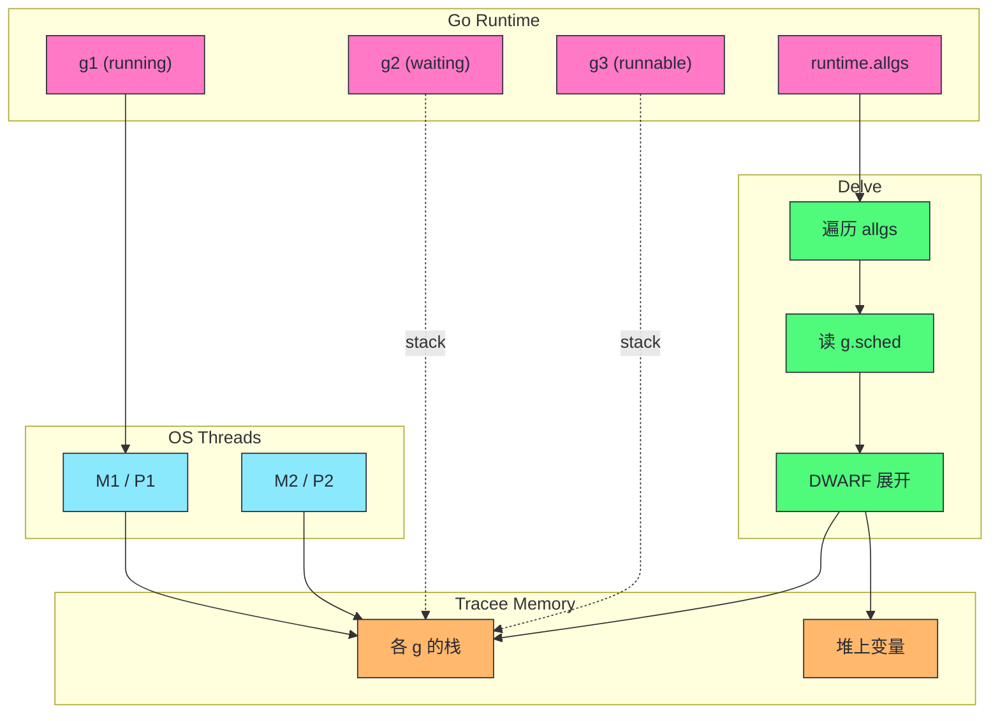

# 源码级调试底层原理——Delve (dlv) 与 ptrace 机制

**摘要：**

源码级调试器是开发者在二进制世界与源代码之间架起的一座桥梁——每一次 `break main.go:42` 的落下、每一次 `next` 与 `step` 的推进、每一次变量值的检视，背后都是一整套操作系统原语、二进制元信息格式与语言运行时协议协同工作的结果。Go 生态中的主角 Delve（dlv）并非凭空出现，它站在 Linux `ptrace` 系统调用、DWARF 调试信息格式与 Go 自身 runtime 元数据的交汇处，把"让正在奔跑的进程停下来并如实汇报现场"这件原本极其底层的事情，包装成开发者熟悉的命令行交互。本文从 ptrace 的四个核心操作（`PTRACE_ATTACH`、`PTRACE_PEEKTEXT`、`PTRACE_CONT` 以及信号传递）出发，拆解软中断 `INT 3`（`0xCC`）如何被注入到代码段、命中后又如何被透明恢复；继而进入 Delve 如何解读 Go 编译器写入的 DWARF（`.debug_info`、`.debug_line`、`.debug_ranges`），以及它如何借助 Go runtime 的 Goroutine 结构体重构出跨越系统线程的调用栈；最后回到生产环境的现实边界——Attach 对被调试进程性能的影响、`dlv` 与 `gdb` 在 Go 场景下的差异、core dump 分析的适用范围，以及为什么源码调试器在生产环境永远只能是例外而非常态。文章最终回到一个工程认知：调试器的价值不在于它能"看透"多少底层，而在于它能把多少底层信息**以语言原生语义**呈现给开发者，这一层抽象的选择本身就是一种权衡。

---

## 第 1 章 ptrace——调试器的操作系统原语

### 1.1 调试这件事，本质上是"受控的非法入侵"

要让一个程序在运行到某一行时停下来，并把当时的寄存器、栈帧、变量值统统交出来，这件事从操作系统的视角看，本质上是允许一个外部进程（调试器）去窥视、修改另一个进程（被调试者）的地址空间与执行流。Linux 内核对此的默认态度是拒绝的——进程之间的地址空间彼此隔离，这正是现代操作系统的基本安全契约。要打破这层隔离，必须有一个显式的、受控的、可审计的授权接口，这个接口就是 `ptrace`（process trace）。

`ptrace` 的系统调用签名自 Linux 4.20 之后稳定为四参形式：

```c
long ptrace(int request, pid_t pid, void *addr, void *data);
```

第一个参数 `request` 决定动作类型，第二个参数是被追踪进程的线程 ID（注意是线程级而非进程级，这一点在 Goroutine 调度场景下意义重大），后两个参数的含义依 request 而变，可以表示目标地址、写入数据，或者干脆为 `NULL`。整个调试器与被调试进程之间的对话——附着、读内存、写内存、单步、继续、等待信号——全部通过这一个 syscall 的几十个 request code 来完成。

不妨把 ptrace 想象成一位严格的**档案管理员**：开发者（访客）要想阅读或修改某位在押人员（tracee）的生活细节，必须填写标准申请单（request code），由管理员（内核）逐条审核后执行；访客不得绕过窗口私自接触在押人员，管理员也不会主动透露未被询问的内容。这套契约保证了调试行为是显式、受控、可审计的，同时也意味着——调试器的全部能力上限，都被 ptrace 暴露出的原语所框定。

### 1.2 Attach 与 Detach：建立与解除追踪关系

调试会话的起点是 `PTRACE_ATTACH` 或更新的 `PTRACE_SEIZE`。前者是传统接口，它向目标线程发送 `SIGSTOP`，强制其停下并把控制权交给调用者；后者是 2011 年 Linux 3.4 引入的改进版本，它附着但**不**立即发送 `SIGSTOP`，允许调试器在 tracee 真正停下之前先声明自己希望截获哪些信号和事件。Delve 在较新的内核上优先使用 `PTRACE_SEIZE`，原因后文会回到。

一旦 attach 成功，调试器调用 `waitpid`（或其 epoll 变体）等待内核通知 tracee 已经停止。停止的原因可能是：收到了 `SIGSTOP`、命中了被插入的断点、调用了 `raise` 主动产生信号，或者进入了系统调用入口/出口。调试器通过 `waitpid` 的 status 字段（`WIFSTOPPED`、`WSTOPSIG`、`>>8` 后的 ptrace event code）来区分这些情况，并据此决定下一步动作。

```go
// Delve 中简化的 attach 流程（pkg/proc/native/ptrace_linux.go）
func attach(pid int) error {
    _, _, e := syscall.RawSyscall6(
        syscall.SYS_PTRACE,
        uintptr(PTRACE_SEIZE),
        uintptr(pid),
        0, 0, 0, 0,
    )
    if e != 0 { return e }
    // 等待 tracee 真正停下来
    syscall.Wait4(pid, &status, __WALL, nil)
    return nil
}
```

detach 是 attach 的逆操作：`PTRACE_DETACH` 让内核撤销追踪关系，tracee 恢复到普通进程的状态继续运行。值得注意的是，detach 时调试器可以选择让 tracee 从当前的停止点继续，也可以让它维持在一个特定的信号上——这个细节在 Delve 处理 Goroutine 调度断点时会被反复用到。

### 1.3 PEEK 与 POKE：读写 tracee 的地址空间

附着成功后，调试器要读寄存器、读内存、改内存，全部靠 `PTRACE_PEEK*` 与 `PTRACE_POKE*` 系列：

| 请求 | 作用 | 典型用途 |
|---|---|---|
| `PTRACE_PEEKUSER` | 读 tracee 的 user 区（含通用寄存器） | 读取 RIP、RSP、RBP 以重建调用栈 |
| `PTRACE_PEEKTEXT` | 读 tracee 代码段的一个 word | 取出原指令，准备替换为 `0xCC` |
| `PTRACE_PEEKDATA` | 读 tracee 数据段 | 读取变量值、字符串内容 |
| `PTRACE_POKEUSER` | 写 tracee 的 user 区 | 修改 RIP 实现跳转，修改 RSP 用于栈操作 |
| `PTRACE_POKETEXT` | 写 tracee 代码段 | 注入 `0xCC` 软中断 |
| `PTRACE_GETREGSET` | 批量读寄存器（含 AVX/FP） | 一次性取回完整寄存器现场 |

`PEEK` 与 `POKE` 的最小单位是一个 `long`（在 x86_64 上是 8 字节），这意味着调试器要读取一个结构体，必须按 word 循环多次；要写入一个字节，必须先读出整个 word，替换其中对应字节，再写回。这种粒度的原始性，是 ptrace 作为底层原语的直接体现——它把"如何解释这块内存"的负担完全丢给了调试器，而调试器要回答"这个地址上的变量叫什么、是什么类型"，就必须再引入另一层元信息，这就是 DWARF。

### 1.4 CONT、SINGLE_STEP 与信号传递

让 tracee 继续运行的请求是 `PTRACE_CONT`，它接受一个信号参数：如果 tracee 是因收到某个信号而停止的（譬如 `SIGSEGV`），调试器可以选择把这个信号透传回 tracee（传原信号值），也可以选择吞掉它（传 0）。这种"信号拦截与转发"的能力，是调试器能实现"条件断点"与"忽略特定信号"的基石。

单步执行靠 `PTRACE_SINGLESTEP`：内核在恢复 tracee 运行前，把 x86 的 `TF`（Trap Flag）标志位置 1，CPU 每执行完一条指令就会触发 `#DB`（Debug Exception），内核再把 tracee 停下并把控制权交回调试器。如此反复，就形成了源码级"next line"的视觉效果——但请注意，这是**指令级**单步，源码级单步需要调试器结合 DWARF 的 line table 来判断"当前指令对应的是哪一行源码"，并在跨越到下一行时再停下来。这一层抽象的叠加，正是调试器作为"中间翻译层"的核心职责。

> [!info] ptrace 的代价：一次 syscall 一次事件
> ptrace 的设计是"事件通知"模型——tracee 每发生一次值得报告的事件（syscall 进出、信号、断点命中），都要停下，通知调试器，等待调试器下指令。这意味着调试会话中的每一次动作，都是一次完整的内核↔调试器↔tracee 上下文切换。没有"批量汇报"这种优化，原语的颗粒度从一开始就决定了调试会话的延迟下界。

### 1.5 ptrace-stop 的多种状态

tracee 被 ptrace 停下后，并非处于一个统一的"暂停态"，而是有多种具体原因，调试器必须逐一分辨：

- **signal-delivery-stop**：tracee 收到一个信号（`SIGSTOP`、`SIGTRAP`、`SIGSEGV` 等），内核停下它并通知调试器。这是最常见的停下原因，也是 `WSTOPSIG` 直接反映的信号编号。
- **group-stop**：当进程的所有线程都被停下（譬如收到 `SIGSTOP` 或 `SIGTSTP`），称为 group-stop，调试器在多线程场景下需要特别注意这种整体性停止。
- **ptrace-event-stop**：tracee 发生了特定事件（fork、vfork、clone、exec、exit），内核在这些时刻会停下 tracee 并让调试器有机会检查新产生的子进程或即将退出的状态。Delve 用这一机制实现"调试子进程"与"进程退出清理"。
- **breakpoint-stop**：命中了被注入的 `0xCC` 断点，本质上是 `SIGTRAP` 的一种特例，调试器通过 RIP 回推一个字节来定位断点位置。

这些状态的区分在单线程下相对简单，在多线程下则复杂得多——当一个线程在 signal-delivery-stop 时，其他线程可能仍在运行，调试器必须决定是"整体停住所有线程"还是"只处理当前线程并让其他线程继续"。Delve 的策略是前者：attach 时停下所有线程，每次事件处理后也只恢复触发事件的那一个线程，其余线程继续保持停止状态。这种"全停"策略牺牲了并发性能，但极大简化了状态管理，对于调试会话来说是合理的取舍。

### 1.6 Yama 与 ptrace_scope：安全层的再加固

ptrace 如此强大，自然也成为攻击者喜欢的跳板。Linux 自 3.4 起通过 Yama 安全模块引入 `/proc/sys/kernel/yama/ptrace_scope`，默认值为 1，限制只能 ptrace 自己的子进程；设为 0 则允许任意进程间的 ptrace（传统行为）。容器环境、seccomp 策略、AppArmor/SELinux 进一步收紧了这一能力——在大多数现代部署里，调试器需要 CAP_SYS_PTRACE capability 或者 privileged 模式才能 attach。这也是为什么容器里运行 `dlv attach` 常常失败的第一原因：不是 Delve 本身的问题，而是底层的安全策略不允许。

---

## 第 2 章 断点注入——`0xCC` 的短暂一生

### 2.1 软中断的本质

在 x86 指令集里，`INT 3` 是一条专门用于调试的单字节指令，机器码是 `0xCC`。与通用中断指令 `INT n`（两字节，`CD n`）不同，`INT 3` 被 CPU 特殊处理——它会触发一个精确异常（precise exception），异常现场里的 RIP 指向 `0xCC` **之后**的那条指令，这使得恢复执行时不需要做任何 RIP 回退。这条指令被设计出来，就是为了在不破坏周围字节对齐的前提下，能在任意代码位置插入一个"地雷"。

调试器注入断点的过程可以用四步概括：

1. 用 `PTRACE_PEEKTEXT` 读出目标地址处的 8 字节（含目标指令）；
2. 把目标地址上的那一字节替换为 `0xCC`；
3. 用 `PTRACE_POKETEXT` 把修改后的 8 字节写回；
4. 用 `PTRACE_CONT` 恢复 tracee 运行，等待它踩中这枚地雷。

当 tracee 执行到 `0xCC`，CPU 触发 `SIGTRAP`，内核停下 tracee 并把控制权交给调试器。调试器收到通知后，需要做一件容易被忽略、但极其关键的事：**把原指令字节恢复回去**。如果不恢复，下次 `CONT` 时 tracee 还会停在同一位置（RIP 指向 `0xCC` 之后，而那里的内容已经是被改过的下一条指令了），整个调试就陷入死循环。

### 2.2 命中后的透明恢复

恢复过程实际上要更细致一些。由于 tracee 的 RIP 已经停在 `0xCC` 之后，调试器必须先把 RIP **回退一个字节**，让它重新指向被替换掉的那条原指令；再把该字节恢复为原值；然后有两种选择：

- 直接 `CONT`，但下一次执行还会路过这里，必须再临时替换为 `0xCC`——这种"持久断点"的做法开销较大；
- 用 `PTRACE_SINGLESTEP` 先执行一次原指令，等单步结束（RIP 已经越过该指令）后，再把该位置重新替换为 `0xCC`——这是大多数调试器的做法，Delve 亦如此。

```
tracee 命中断点 → 调试器收到 SIGTRAP
                → PEEK 原字节、恢复为原指令
                → POKE 回去、RIP 回退一字节
                → SINGLESTEP（执行一条原指令）
                → POKE 回去、把该位置重新写回 0xCC
                → CONT
```

这整套动作对用户完全透明——用户在 IDE 或 dlv 命令行里只看到"断点命中，停在第 N 行"，并不知道调试器在背后做了这几次 peek/poke/单步。这种透明性是调试器的设计美德，但也是有代价的：每一次命中都是一次完整的 syscall 往返，这也是为什么在高频率命中的场景下（譬如循环体内的断点），调试体验会急剧恶化。

> [!note] 条件断点的真相
> "条件断点"在大多数调试器中的实现，并非在 CPU 层面实现条件判断——它实际上是"无条件断点 + 命中后由调试器求值条件表达式 + 不满足则立刻 CONT"。这意味着条件断点的开销等于"每次命中 + 调试器求值"，在循环里频繁命中但条件很少为真的场景下，性能会明显劣于把条件判断写在代码里自己判断。这个事实常常被用户忽略，导致他们写出"性能断崖"式的调试会话。

### 2.3 硬件断点的另一条路

软件断点的"改代码段"有一个无法规避的副作用：被调试进程的代码段被修改了，这会破坏代码签名、触发 SELinux、在与 ASLR 或只读段交互时制造额外麻烦。x86 提供了 4 个调试寄存器（`DR0`–`DR3`），可以配置为硬件断点或硬件观察点（watchpoint），命中时产生 `#DB` 异常而不需要修改内存。调试器通过 `PTRACE_POKEUSER` 写入这些寄存器即可。

硬件断点数量有限（4 个），且跨线程生效时需要每个线程都设置一遍（因为调试寄存器是 per-thread 的），这使得它在 Go 这种动辄几十上百个 M（OS thread）的运行时面前捉襟见肘。Delve 的默认策略仍然是软件断点，仅在用户显式请求 watchpoint 时才使用硬件寄存器。

### 2.4 多线程下的断点同步

一个常被忽略的问题是：当进程有多个 OS 线程时，在某一个线程的代码段里插入 `0xCC`，这个修改对其它线程是可见的——因为同一份代码段被所有线程通过相同的虚拟地址映射共享。这意味着调试器在一个线程上设置断点，其他线程在执行到同一条指令时也会停下。这种行为在大多数情况下符合预期（用户本来就希望断点在该代码位置生效），但在某些特殊场景下会造成麻烦，譬如只想让某个特定 Goroutine 命中断点、而其他 Goroutine 继续运行。Delve 通过 `-per-g` 标志（goroutine-specific breakpoint）支持这种细粒度控制——实现上，是在断点命中时检查当前线程对应的 Goroutine ID 是否匹配，不匹配则立刻恢复该线程并 CONT。

### 2.5 fork 与 exec 场景下的调试器应对

在类 Unix 环境下，新进程由 `fork` 创建（复制父进程地址空间），随后通常 `exec` 一个新程序（替换为新镜像）。调试器在跟踪这种"一生二"的事件时，面临一个抉择：是否自动跟踪新产生的子进程？

ptrace 通过 ptrace-event-stop（`PTRACE_O_TRACEFORK`、`PTRACE_O_TRACEVFORK`、`PTRACE_O_TRACECLONE` 等选项）让调试器在子进程创建时停下，并告知新进程的 PID。调试器可以选择：对新进程也 `PTRACE_ATTACH`（从而形成"调试器跟踪一个进程树"的局面），或者放任它自由运行。gdb 的 `set follow-fork-mode child/parent` 就是这个抉择的用户态体现。

对于 Go 程序而言，这个机制在两种场景下变得重要：

- **CGO 程序调用 fork**：某些 C 库（譬如一些老的数据库驱动）会在内部 `fork` 子进程，调试器需要决定是否跟进。
- **测试框架的子进程管理**：`go test` 在运行测试时会启动子进程执行测试二进制，调试测试时需要调试器能"跟着走"到子进程里去。

Delve 默认的策略是通过 `PTRACE_O_TRACECLONE` 跟踪 Go runtime 创建的 OS 线程（因为 Go 的 runtime 通过 clone 系统调用创建新的 M），但对于 `fork` 创建的独立进程，调试器则放手让它独立运行。这种"区分线程 clone 与进程 fork"的策略，是 Go 调试器必须精确处理的细节。

---

## 第 3 章 DWARF——二进制里的"源代码地图"

### 3.1 调试信息的来源与格式

二进制本身只有符号地址与机器指令，它不知道"0x401234 这个地址对应的是 `handler.go` 第 42 行的变量 `user`"。要让调试器能给出这样的回答，编译器必须在生成二进制时同时写出一份元数据——这就是 **DWARF**（Debugging With Attributed Record Formats，一个从 1980 年代 BSD Unix 演进至今的标准）。

Go 编译器（gc）默认在生成二进制时嵌入 DWARF 信息（可通过 `-w` 链接器标志剥离），主要包括以下几节：

| Section | 内容 | 调试器用途 |
|---|---|---|
| `.debug_info` | 每个函数、变量、类型的"描述条目"（DIE） | 列出变量、重建类型信息 |
| `.debug_line` | 指令地址 ↔ 源码行号的映射表 | 实现源码级单步、行号显示 |
| `.debug_ranges` | 函数与变量的地址范围（处理非连续区域） | 判断变量是否在当前作用域 |
| `.debug_loc` | 变量在运行时的位置描述（寄存器/栈偏移/寄存器迁移） | 读取变量值 |
| `.debug_frame` | 调用栈展开信息（CFI） | 重建调用栈 |
| `.debug_str` | 字符串表，被其他 section 引用 | 存放名称、类型名等 |

一个关键的认知是：DWARF 是一份**静态的、编译期的**地图，它描述的是"如果程序按编译器预期的方式运行，变量 X 应该在哪里"。一旦运行时发生偏离——譬如 Goroutine 的栈被复制、变量被逃逸到堆、函数被内联——静态地图与动态现实之间就会出现缝隙，弥合这道缝隙正是 Delve 相较于通用调试器的核心价值所在。

### 3.2 Go 对 DWARF 的特殊扩展

Go 在标准 DWARF 之外，还向二进制里写入了若干 runtime 能识别的元信息，使得调试器可以与 runtime 协作：

- **`runtime.g` 的偏移信息**：编译器把 Goroutine 结构体（`g`）的关键字段偏移写入 DWARF，调试器可以通过当前线程的 TLS（Thread Local Storage）找到当前 `g`，进而拿到 `g.goid`（Goroutine ID）、`g.sched`（保存的调度寄存器）等。
- **栈协程的调度现场**：当一个 Goroutine 被 park 住（譬如在 channel 上阻塞），它的寄存器被保存到 `g.sched` 里，调试器可以从这个结构里恢复出"这个 Goroutine 此刻在做什么函数、位于哪一行"——这就是 Delve 能在 `goroutines` 列表里显示所有 Goroutine 调用栈的原理。
- **类型描述符的链接**：每个 Go 类型的 `_type` 结构在二进制里有稳定的地址，调试器可以从一个 `interface{}` 的 `_type` 指针出发，解析出实际类型，进而按类型布局读取数据。

这些扩展使得 Delve 能做到 gdb 做不到的事情——譬如列出所有 Goroutine、按 Goroutine 切换、读取被逃逸到堆上的变量的正确值。gdb 通过 `runtime-gdb.py` 脚本也能获得一部分类似能力，但这些脚本依赖 Go runtime 暴露的若干全局符号，Go 版本演进时经常失效；Delve 则由 Go 团队直接维护，与 runtime 的结构变更同步演进。

### 3.3 `.debug_line` 与源码级单步

源码级单步的实现，本质上是在 `.debug_line` 里做一次"地址到行号"的查找。`.debug_line` 是一张按地址排序的表，每一条记录形如 `(address, file, line, column, is_stmt, ...)`，调试器维护一个状态机，随着地址的推进更新行号。当用户按下 `next`，调试器 SINGLESTEP 一次，读新 RIP，查 line table，如果行号变了，就停下；如果行号没变（还在同一行，譬如一行 C 里有多条指令），继续单步。

Go 编译器在 line table 里还会为函数序言（prologue）与尾声（epilogue）做特殊标记，使得调试器能跳过那些与用户源码无关的指令——譬如函数开头把参数从寄存器搬到栈上的那段代码，不应该让用户单步时"走进"。这个细节在调试体验上看起来微不足道，但正是这类细节让 Delve 的行为符合用户对"Go 源码调试"的预期。

### 3.4 寄存器 ABI 与参数定位

Go 在 1.17 版本引入了基于寄存器的调用规约（register-based ABI），函数参数不再全部通过栈传递，而是优先使用 CPU 寄存器。这一变化对调试器读取局部变量带来了新的挑战：调试器必须根据 DWARF 中变量的 location list，知道"这个变量在这个代码区间里住在哪个寄存器，出了这个区间后搬到哪个栈位置"。寄存器 ABI 使得读取函数参数的第一步必须查 location list，而不是简单的"相对于 RBP 的偏移"。Delve 在这一块的处理与 Go 编译器紧密绑定，每个 Go 版本的 ABI 微调都需要 Delve 同步跟进——这也是为什么 Delve 对 Go 版本有最低要求，且不建议把新版本的 Delve 用于旧版本的 Go 二进制，反之亦然。

> [!note] 寄存器 ABI 给调试带来的连锁影响
> 在旧版基于栈的调用规约下，调试器读取函数参数几乎是机械化操作：RBP 减去固定偏移就是参数位置。新版基于寄存器的调用规约下，调试器必须维护一张"此刻参数住在哪个寄存器、何时搬到了哪个栈槽"的动态映射。这张映射由编译器生成、写入 DWARF，调试器只是它的解释者——一旦编译器调整了寄存器分配策略，调试器就必须跟上。这种"调试器永远慢编译器半步"的追赶关系，是 Delve 维护成本的主要来源之一。

### 3.5 `.debug_info` 与类型的重建

`.debug_info` 里存放着每个变量、函数、类型的"描述条目"（DIE, Debugging Information Entry）。每一个 DIE 都是一组属性（tag、name、type、location、...），它们组合起来描述了"这个源码对象在二进制里的形态"。调试器读取一个变量值时，实际上是在做如下链条的解析：

1. 找到当前函数的 DIE → 
2. 在该函数的子 DIE 里找目标变量 → 
3. 拿到变量的 `DW_AT_type` 属性，指向另一个类型的 DIE → 
4. 类型的 DIE 描述它是 int、struct、slice、map，以及它的布局（大小、字段偏移、元素类型） → 
5. 根据 `DW_AT_location` 知道这个变量的字节在内存哪里 → 
6. 按布局从内存读出字节，按类型解释成用户可阅读的形式。

这条链条对简单类型（int、string）是直接的，对复杂类型（slice、map、channel、interface）则需要递归解析——譬如一个 `map[string]*User` 变量，调试器要先解析出它是一个 map，找到它的 `hmap` 结构，再顺着桶数组的指针读出每个桶，再对每个键值对解析为 string 与 `*User` 指针，最后跟随指针读出 User 结构体字段。这种"类型的递归重建"是 Delve 代码中相当复杂的一块，也是为什么 `print` 一个深层嵌套的数据结构在 Goroutine 栈复制后仍然正确——调试器每次都是重新从类型描述符出发，而不是依赖缓存的地址。

---

## 第 4 章 Goroutine 与多线程——调试器的噩梦

### 4.1 调度器与调试器的结构性冲突

Go 的 M:N 调度让"线程"与"执行单元"之间的对应关系变得极其松散。一个 Goroutine 在它的生命周期里可能在多个 OS thread 之间漂移（尤其是在发生系统调用阻塞、handoff、stealing 之后）；同一个 OS thread 在不同时刻承载的可能是完全不同的 Goroutine。这对调试器提出了一个根本性的问题：**用户期望的"当前执行位置"，究竟是指 OS thread 的当前 RIP，还是指用户正在关心的那个 Goroutine 的当前逻辑位置？**

Delve 的选择是后者——它以 Goroutine 为第一公民。`dlv` 的 `goroutine` 命令可以列出所有 Goroutine（包括处于 `_Grunning`、`_Grunnable`、`_Gsyscall`、`_Gwaiting` 等各种状态的），`goroutine <id>` 可以把"当前视角"切换到指定 Goroutine，此后 `bt`、`print`、`next` 都是围绕这个 Goroutine 进行的。这种设计的背后，是调试器对 Go runtime 结构的大量读取：它通过遍历 runtime 的全局 `allgs` 切片拿到所有 `g`，再通过每个 `g` 的 `g.sched` 恢复出该 Goroutine 上次被切换走时的寄存器现场，结合 DWARF 展开出调用栈。



这种"以 Goroutine 为中心"的视角，是 gdb 在调试 Go 时最让开发者不满的地方——gdb 默认视角是 OS thread，`thread apply all bt` 给出的是每个 M 的调用栈，里面充斥着 `runtime.mstart`、`runtime.mcall`、`runtime.systemstack` 这类调度框架的栈帧，真正写业务逻辑的 Goroutine 调用栈反而被淹没在调度噪音里。

### 4.2 栈复制与变量地址的飘移

Go 的 Goroutine 栈是**可增长的**——它从一个几百 KB 的小栈起步，在栈空间不足时由 runtime 分配一块更大的新栈，把旧栈的内容整体复制过去，并更新所有指向旧栈上变量的指针（这一过程称为 stack copy 与 stack pointer rewrite）。这对调试器意味着：调试器在前一刻读到 `&x == 0xc0000a2f10`，下一次再读时 `x` 可能已经被搬到 `0xc000100f10`，原来的地址已经无效。

更糟的是，调试器本身不能在栈复制进行中去做 peek——它只能通过 ptrace 停下来整个进程，拿到的是一个一致性的快照。因此 Delve 的做法是：每次进程停下后，重新从 `g` 结构里读取当前栈指针，再结合 DWARF 的 location list 计算变量此刻的位置。这也是为什么在 Delve 里对同一个局部变量反复 `print` 是安全的，但把某个地址保存下来跨 step 使用是脆弱的。

> [!warning] Goroutine 栈地址不要跨 step 使用
> `print &x` 拿到的地址只对当前暂停快照有效。一旦 `CONT` 或 `NEXT`，runtime 可能触发栈复制，变量的物理地址就会变化。调试器在每次停下时重新解析，所以 `print x` 仍能得到正确的最新值，但 `p (*int)(0xc0000a2f10)` 这种硬编码地址在跨 step 后很可能指向无效或无关的内存。

### 4.3 内联函数与栈帧重组

Go 1.9 之后内联（inlining）变得越来越激进。一个被内联的函数在源码里看起来是独立的调用，但在二进制里它的代码已经被拼接进了调用者，没有自己的栈帧。DWARF 通过 `.debug_info` 中的 `DW_TAG_inlined_subroutine` 标记来描述这种情况，并给出"inlined 进去的代码对应的原始源码范围"。

调试器重建调用栈时，必须把这种"inlined 出来的伪栈帧"插到真实栈帧之间，给用户一种"函数确实被调用了"的错觉——这是一种有益的错觉，因为它符合源码语义。Delve 对 inlined 栈帧的 `bt` 显示，与真实栈帧用不同样式区分，但 `frame N` 切换时仍然可以进入 inlined 函数的上下文，`print` 也能读到 inlined 函数的局部变量——前提是这些变量没被优化掉（开启 `-N -l` 关闭优化时更可靠）。

### 4.4 Goroutine 泄漏的定位

调试器在排查 Goroutine 泄漏（Goroutine leak）时有一套独特的套路：先 `goroutines` 列出全量，按状态过滤出 `_Gwaiting`，再逐个 `bt` 看它们停在哪个 channel 或哪个锁上。这种全局视野是 pprof 的 `goroutine` profile 给不了的——pprof 给出的是"统计分布"，调试器给出的是"精确现场"。二者互补，而非替代。

### 4.5 与 [[Golang/Go并发编程/01 Goroutine 与 GMP 调度器|GMP 调度器]] 的交互陷阱

调试器在 attach 之后停下所有 OS 线程，这相当于把整个 GMP 调度器冻结了。在这种冻结状态下，runtime 内部的若干不变式被破坏——譬如正在 handoff 的 P 处于中间状态，正在 steal 工作的 M 还没把 victim P 的 runnext 提交回去。调试器在停下状态下读到的 runtime 数据结构可能是**不一致**的——这正是 Delve 在 attach 后会做一系列"状态修复"的原因，它会检查每个 `g`、`m`、`p` 的状态，必要时跳过那些处于中间态的结构，避免给出错误的 Goroutine 列表或调用栈。

这种"调试器 vs runtime 一致性"的博弈，本质上是 ptrace 的"全停"语义与 Go runtime 的"渐进式并发"语义之间的结构性冲突。runtime 的设计假设是"任何时刻都有一些线程在跑"，调试器打破了这个假设，必须自己处理由此产生的数据不一致。这也是为什么 Delve 的开发者常常强调"debugger 看到的是 runtime 的一个快照，但快照可能不是完全一致的快照"。

### 4.6 调试器与 race detector 的共存

Go 的 race detector（`-race` 标志）通过编译期插桩与运行时影子内存（shadow memory）检测数据竞争。当程序以 `-race` 编译时，二进制里会多出大量的 runtime 检查代码，这些代码本身会产生额外的内存访问与同步操作。在调试这种程序时，调试器需要意识到：用户看到的"这一行"在二进制里实际上对应着一大段 race 检查代码，单步时可能走进 race 检查的内部函数（`runtime.racewriterange` 之类）而非业务代码。

Delve 通过识别这些 runtime 内部函数并把它们标记为"非用户代码"，使得 `next` 能跳过它们，`bt` 时把它们折叠到背景里。不过这种处理并不完美——开启 race detector 后，调试体验通常会比不带 race 的版本略差，栈更深、单步次数更多、变量列表里混入了更多临时变量。这也是为什么在生产排障时，通常建议在**不带 race** 的二进制上进行调试，把 race 检测作为独立的诊断手段使用。

---

## 第 5 章 Delve 的工程实现

### 5.1 架构分层

Delve 的代码结构分为几层：最底层的 `pkg/proc/native` 封装了 ptrace（Linux）与 Mach-O/task port（macOS）与 Win32 Debug API（Windows）的具体差异；中间的 `pkg/proc` 是语言无关的调试抽象（Breakpoint、Thread、Process、Variable）；再上面的 `pkg/proc/core` 处理 core dump 的离线分析；最上面是 `service/` 与 `terminal/`，前者实现 DAP（Debug Adapter Protocol，VS Code 等 IDE 使用）与 RPC 接口，后者是 `dlv` CLI 的命令解析。

这种分层带来一个实用好处：同一份 Delve 代码可以调试正在运行的进程（native live process）、调试 core dump（core）、调试测试进程（test），也可以 attach 到已经在跑的进程（attach）——差别只在底层 backend 的实现，上层语义保持一致。

### 5.2 dlv 与 gdb 的差异

虽然 gdb 通过 Go 团队提供的 Python 脚本也能调试 Go 程序，但二者在实践中的体验差异相当显著：

| 维度 | Delve | gdb + runtime-gdb.py |
|---|---|---|
| 维护方 | Go 团队直接维护 | 社区脚本，Go 团队不承诺兼容 |
| Goroutine 视角 | 原生第一公民 | 通过 python 脚本从 `allgs` 拼 |
| 内联栈帧 | 原生支持 | 不完整 |
| 并发断点 | `break -per-g goroutineID` | 不支持 |
| DAP / IDE 集成 | 原生支持 | 需额外适配器 |
| cgo 互操作 | 能进入 C 代码（部分） | 更强（毕竟是 C/C++ 调试器） |
| core dump 分析 | 支持 | 支持 |
| 跨平台 | Linux / macOS / Windows / FreeBSD | 主要 Linux |

对于纯 Go 项目，Delve 几乎是唯一合理的选择；对于 CGO 密集、需要深入 C 层定位的项目，gdb 仍然是更有力的工具——这也是为什么 Go 团队同时维护两套支持。这种"主力 + 备用"的组合，与 [[10 Go 代码规范与常见陷阱]] 中提到的"工具选型因地制宜"思路一脉相承。

### 5.3 Attach 对性能的影响

`PTRACE_ATTACH` 会让目标线程立即停下，`PTRACE_CONT` 后目标线程才能恢复运行——但恢复后，每一次 syscall 的进出、每一次信号的触发，都会让内核再次停下目标线程并通知调试器。这种"每事件一次上下文切换"的代价，在普通调试会话里不显著（因为开发者本来就希望进程慢下来），但在以下场景会变成真实的问题：

- **Attach 到高吞吐服务**：即使没有任何断点，ptrace 附着期间每个 syscall 的开销都会增加几倍，服务的 QPS 可能下降一到两个数量级。这与 [[06 Go 性能剖析——pprof、trace 与基准测试]] 中讨论的"观测者效应"一脉相承——任何观测手段都会改变被观测系统的行为，调试器尤甚。
- **Attach 到有多 Goroutine 阻塞的进程**：Delve 在 attach 时会停下所有 thread，遍历所有 Goroutine 重建状态；这个初始化阶段对 Goroutine 数量庞大的进程（数万以上）可能持续数秒到数十秒，这段时间内进程是完全冻结的。
- **长时间挂接**：调试器进程如果被 OOM kill 或与 tracee 的连接断开，tracee 可能停留在 STOP 状态无法恢复，表现为"业务进程莫名卡死"。

这些影响使得在生产环境使用 `dlv attach` 必须极其谨慎——通常只建议在**预发环境**进行 attach 调试，或者在业务低峰期、配合服务降级一起做。

### 5.4 Delve 的典型会话与使用模式

了解 Delve 的几种典型会话模式，对理解它的工程取舍很有帮助：

**`dlv debug`**：最常用模式，调试器直接启动 `go build` 出的二进制并接管其生命周期。调试器退出时，被调试进程也一同退出。这是日常开发中最自然的模式——调试器与被调试进程共生死。

**`dlv test`**：调试 `go test` 的测试二进制。调试器会启动测试可执行文件并停在 `main`（或指定的断点），允许开发者调试测试用例本身。这种模式对排查"某个测试为什么失败"特别有用，可以逐步推进测试代码，检视每一步的状态。

**`dlv attach <pid>`**：附加到已经在运行的进程。调试器退出时，被调试进程继续运行。这种模式适合"生产环境短时诊断"——但要承担前文提到的性能与稳定性代价。

**`dlv core <binary> <core>`**：离线分析 core dump。调试器不启动任何进程，只读取静态快照。适合事后分析崩溃。

每种模式在 Delve 内部都对应一个不同的 backend 实现（`native`、`core`），但上层的命令语义完全一致——这种"模式无关的命令层"设计，让用户在切换模式时几乎零学习成本，也让 Delve 的代码复用度保持在较高水平。

一个常被忽视的细节是：`dlv debug` 与 `dlv test` 在启动时会自动设置 `GOMAXPROCS=1`（在某些旧版本中），目的是把所有 Goroutine 限制在单个 OS 线程上执行，避免多核并发对调试状态的干扰。这种"降并发换调试简单性"的策略，体现了调试器面对 Go 并发模型时的务实取舍——开发者调试时通常只关心逻辑正确性，而不是并发性能。

### 5.5 IDE 集成与 DAP 协议

现代 IDE 调试体验几乎都通过 **DAP**（Debug Adapter Protocol，由 VS Code 提出）实现。Delve 在 `service/dap` 包里实现了完整的 DAP 服务端，VS Code、GoLand、Neovim 等编辑器通过 JSON-RPC 与 Delve 通信，把"断点、单步、变量检视"等用户动作翻译成 Delve 内部命令。这种"协议隔离"的设计让 Delve 不必关心具体编辑器的差异，也意味着任何实现了 DAP 客户端的编辑器都能接入 Delve。

DAP 的引入也带来了一些限制：DAP 协议本身对"并发调试"（同时调试多个进程、多个 Goroutine 视角）的支持有限，某些 Delve 特有的命令（譬如 `goroutines -filtered`）在 IDE 里没有直接对应的 UI，需要通过"调试控制台"以 raw 命令方式调用。这种"协议能力 < 工具能力"的落差，是 IDE 集成调试器时常见的体验折损。

另一个常被忽视的细节是 **DAP 的会话生命周期**：IDE 启动调试会话时，DAP 客户端与 Delve 服务端之间要通过一系列握手消息（`initialize`、`launch`、`configurationDone`）完成状态同步。IDE 关闭调试会话时，要通过 `disconnect` 消息通知 Delve 清理——但如果 IDE 异常退出（崩溃、kill），Delve 进程未必能及时收到 `disconnect`，这时 Delve 必须能检测到客户端断连并自行清理，否则就会留下一个无主的 Delve 进程继续 ptrace 着目标进程，造成"目标进程看起来卡住"的假象。Delve 在较新的版本里引入了心跳与超时清理机制来应对这种情况，但这类"异常路径"在 IDE 调试体验中仍然时有出现，是工程实践里需要留意的细节。

---

## 第 6 章 Core Dump 与离线分析

### 6.1 core dump 的价值定位

当进程崩溃（panic、SIGSEGV、runtime throw）或运维主动 `gcore <pid>` 时，内核会把进程的完整地址空间、寄存器状态、文件描述符表等写入一个 core 文件。这个文件是一个**静态快照**——它保留了崩溃那一刻的全部现场，但没有"继续运行"的可能。对调试器而言，分析 core 与分析一个停住的 live process 在逻辑上等价，都是读内存、读寄存器、查 DWARF，只是 core 不需要 ptrace、不需要目标进程还活着。

Delve 通过 `dlv core <binary> <core>` 进入离线分析模式。此时所有 ptrace 写操作（`POKE`、`CONT`、`SINGLESTEP`）都不可用，但读取操作——`bt`、`print`、`goroutines`、`list`——都可以进行。这种"只读回放"在事后分析崩溃问题时特别有价值，因为它对业务没有任何运行时影响：core 可以在另一台机器上打开，慢慢排查，不必在生产现场操作。

### 6.2 Go runtime 写入 core 的附加信息

Go 程序在 panic 或 fatal 时，runtime 会在 core 文件里额外写入若干段（称为 "note" section），包括 panic 信息、当前 Goroutine 的完整栈、所有 Goroutine 的栈（`goroutine dump`）、以及运行时的若干统计。这些信息使得 Delve 在分析 Go core 时，能直接给出"是什么 panic"、"是哪个 Goroutine 出的问题"、"其它 Goroutine 当时在做什么"——这些在 C/C++ 的 core 里是拿不到的。

runtime 写入 core 的信息包括：

- **panic 消息与堆栈**：相当于把终端里看到的那段 panic 输出固化进了 core 文件，事后分析时可以直接从 core 里还原。
- **当前 Goroutine 的全部栈帧**：包括每一帧的局部变量位置（基于 DWARF），使得调试器能在 core 里 `print` 出当时的变量值。
- **所有 Goroutine 的栈**：这是排查 Goroutine 泄漏与死锁的关键——崩溃时所有 Goroutine 在做什么，core 里都记录得清清楚楚。
- **runtime 的若干全局状态**：譬如 `memstats`（内存分配统计）、`sched`（调度器状态）、`ncgocall` / `ncgoback`（CGO 调用计数），这些信息在排查内存泄漏与 CGO 相关问题时很有价值。

这种"runtime 主动把诊断信息塞进 core"的设计，体现了 Go 团队对"诊断能力"的重视——调试不应该只发生在 live process 上，崩溃后的尸体同样蕴含着丰富的信息。这种设计的代价是 core 文件体积更大、runtime 需要维护这些诊断数据的结构，但换来的"事后诊断深度"是大多数其他语言不具备的。

### 6.3 core dump 的局限

core dump 分析虽强，但也有其局限：

- **时间切片限制**：core 只是一张快照，它能告诉你"崩溃那一刻"的状态，但不能告诉你"崩溃之前发生了什么"。要还原崩溃前的状态序列，必须依赖日志、metrics、trace 等其他信号源。
- **DWARF 完整性依赖**：如果二进制在部署前剥离了 DWARF，core 分析会退化到"只能看到符号地址、看不到变量名"的裸状态。因此即便生产部署用 stripped binary，也建议**同时保留一份带 DWARF 的同版本二进制**，用于事后 core 分析。
- **core 文件体积**：Go 程序的 core 常常很大（几百 MB 到几 GB），因为 runtime 的堆通常占用大量内存。传输与存储这些 core 文件本身就是一道工程问题，很多团队会配置"core 文件自动上传到对象存储、保留 N 天后清理"的流水线。

```bash
# 典型流程
$ go build -o server ./cmd/server      # 默认含 DWARF
$ ./server                             # 运行中 panic
# 或主动生成 core
$ gcore $(pgrep server)
# 事后分析
$ dlv core ./server ./core.12345
(dlv) bt
(dlv) goroutines
(dlv) frame 5
(dlv) print err
```

值得注意的是，为了减小二进制体积，生产部署时常用 `-ldflags="-w -s"` 剥离 DWARF 与符号表；这样做出的二进制**无法被 Delve 有效调试**——DWARF 缺失意味着调试器拿不到变量名、类型、源码行号，只能退回到裸的符号地址。这是一个经典的"体积 vs 可调试性"权衡，后文回到。

---

## 第 7 章 生产环境调试的安全边界

### 7.1 为什么源码调试器不属于生产

源码调试器的能力边界，与生产环境的要求之间，存在几道难以弥合的裂缝：

1. **性能代价**：ptrace 的事件通知机制让每一次 syscall 都变慢，这对高 QPS 服务是不可接受的。即使没有断点，附着本身的开销已经改变了系统的时序特性——这正是观测者效应的调试器版本。
2. **一致性代价**：调试器停下进程的瞬间，整个进程的所有线程都被冻结——包括正在持有锁的线程、正在写磁盘的线程、正在发心跳的线程。如果停的时间过长，会导致下游超时、租约失效、集群脑裂。
3. **安全边界**：`ptrace` 本身是 Linux 上被严格管控的能力——`yama.ptrace_scope` 默认限制只能 attach 子进程，生产环境进一步通过 seccomp、AppArmor、SELinux 限制 ptrace 的使用。一个能任意 ptrace 别的进程的进程，本质上拥有窥视和修改那个进程任意内存的能力，这打破了最小权限原则。

因此，生产环境的排障工具箱里，源码调试器的位置应该被**观测性工具**取代：`pprof`（CPU/heap/goroutine profile）、`trace`（执行 trace）、结构化日志、metrics、分布式 tracing。这些工具的共同特征是**非侵入**——它们不改变被观测进程的执行流，不通过 ptrace 控制它，而是由 runtime 主动暴露信息。Delve 与 pprof 的关系，可以用"急诊手术 vs 体检报告"来类比：前者能在术中直接看到病变并处理，但每一次下刀都有代价；后者提供的是非侵入的全身扫描，适合日常监控与趋势发现。

这种认知也呼应了 [[Golang/Go运行时进阶与底层机制/00 专栏导览|Go 运行时进阶与底层机制]] 中反复出现的主题：runtime 在安全与可控之间不断寻找平衡点，调试器与 runtime 的协作也是如此。

### 7.2 什么时候还是得用 dlv

尽管有上述限制，某些场景下生产环境仍然绕不开 Delve：

- **难以复现的数据相关 bug**：只在线上特定数据下出现，本地无法构造；通过 attach + 条件断点 + 特定 Goroutine 调试，可以精准定位。
- **runtime 行为异常**：譬如怀疑 Goroutine 泄漏、scheduler 异常、stack 损坏——这些问题的诊断信息超出了 pprof 能给出的粒度。
- **安全事件调查**：需要查看被攻击进程在某一时刻的内存内容（密钥是否被覆盖、注入代码在哪里）。

即便如此，生产环境的 dlv 操作也应该遵循"最小侵入、最短时间、可回滚"的原则：attach 前先做好服务降级与流量切换，attach 后尽快拿到需要的信息就 detach，detach 后确认进程恢复正常响应。

### 7.3 容器环境下的调试挑战

容器（Docker、Kubernetes Pod）进一步收紧了 ptrace 的可用性。容器通过 namespace 隔离进程 ID 空间，通过 seccomp 限制可用系统调用——默认 seccomp profile 通常允许 ptrace，但 `yama.ptrace_scope` 仍然生效，且需要调试器与目标进程位于同一 PID namespace 内（或者调试器有 `CAP_SYS_PTRACE`）。这意味着：

- **本地 `dlv attach` 到容器内进程**：必须 `nsenter` 进入容器的 PID namespace，或者通过 `kubectl debug`（Kubernetes 1.18+）注入一个调试容器，调试容器与目标容器共享 PID namespace。
- **调试 distroless 镜像**：distroless 镜像不带 bash、不带 dlv，需要在构建时把 Delve 二进制打入镜像（仅 debug tag），或者用 ephemeral debug container 把调试工具动态注入。
- **跨节点调试**：Pod 漂移、多副本、节点隔离——这些问题让"attach 到某个具体 PID"变得异常复杂，往往需要先从日志、metrics、pprof 定位到具体 Pod，再 attach。

这些工程复杂度使得容器化时代的调试，越来越倾向于"非侵入 + 远程 + 异步"：通过 pprof 与 trace 获取运行时信息，通过 core dump 离线分析崩溃，通过结构化日志重建事件时间线。源码级调试退居二线，仅在"非它不可"的场景出场。这种转向，与 [[08 Go 编译与链接——从源码到二进制]] 中讨论的"二进制产物应该包含什么信息"紧密相连——生产镜像剥离 DWARF 的决定，实际上已经提前宣告了源码调试在这个镜像上的不可用。

---

## 第 8 章 权衡——调试器设计的几个取舍

行文至此，可以回到几个贯穿全文的设计权衡：

**原语 vs 抽象**：ptrace 提供的是极薄的原语（peek/poke/cont/step），调试器必须在其上构建一整套语义——行号、变量名、类型、调用栈。这层抽象越厚，用户体验越好，但维护成本越高、对 runtime 内部细节的依赖越深。Delve 选择了"厚抽象"路线，使得它能给出 Go 原生的调试体验，代价是与 runtime 的结构紧密耦合，每个 Go 大版本都可能要同步演进。

**侵入 vs 非侵入**：ptrace 的本质是侵入——它改变了被调试进程的观察面（每个 syscall 都变慢）与控制面（可以随时冻结它）。pprof、trace、metrics 则是非侵入的。调试器选择了侵入以换取"看透一切"的能力，观测工具选择了非侵入以保留"不改变系统行为"的纯净性。两者之间没有高下，只有适用场景的差异。

**通用 vs 专用**：gdb 是通用调试器，通过插件机制支持 Go；Delve 是 Go 专用调试器，对 Goroutine、内联、栈复制有原生理解。通用意味着覆盖面广但深度有限，专用意味着深度足够但适用面窄。对 Go 开发者而言，日常开发用 Delve，遇到 CGO 与跨语言问题时切换到 gdb——这种"主力 + 备用"的组合，比"只掌握一种工具"更符合工程实践的现实。

**可调试 vs 可部署**：DWARF 信息让二进制变得巨大（常常数倍于代码本身），生产部署为了启动速度与镜像体积常常剥离它。这迫使团队在构建流水线上保留"调试版"与"发布版"两个产物，并在需要诊断时能迅速切换到调试版重新现。这个看似简单的工程取舍，背后是"二进制应该为谁服务"这一根本问题——为部署环境服务，还是为诊断环境服务？答案是**两者都服务，但通过不同的产物**。正如 [[08 Go 编译与链接——从源码到二进制]] 中讨论的 `-ldflags="-w -s"` 取舍，编译期注入的信息直接决定了调试期可用的能力——"二进制体积"与"可调试性"是同一枚硬币的两面。

**调试体验 vs 运行时真实性**：关闭内联（`-l`）与关闭优化（`-N`）能显著改善调试体验——变量不容易被优化掉、调用栈更贴近源码、单步行为更可预期——但这样做出的二进制在性能上与生产版本有显著差异。这意味着调试时观察到的"运行时行为"，可能与生产环境里的真实行为存在差距（譬如某个被内联的函数在调试版里没有内联，其栈帧与局部变量的布局与生产版完全不同）。这种"为了可调试而牺牲真实性"的取舍，是每一个使用调试器的开发者都应该意识到的认知陷阱——调试器看到的是"编译器为调试而妥协的现实"，不是"生产环境里运行的现实"。

由此可见，源码级调试从来不是一项孤立的技术，它是操作系统原语、二进制元信息格式、语言 runtime 设计三者交汇的产物。Delve 在这个交汇点上做出的每一个取舍——以 Goroutine 为第一公民、厚抽象绑定 runtime、ptrace 注入的透明恢复——都映射到开发者在命令行里看到的那一次"断点命中"背后。理解了这些底层机制，再回到日常的 `dlv debug`、`break`、`next`、`print`，便不再只是操作一组命令，而是在操纵一整套协同工作的系统原语。这种认知，正是工程实践与工具使用之间的分水岭——而调试器与 runtime、观测工具之间的取舍，最终都归结为"在何种程度上愿意以侵入换洞察"这一永恒的工程命题。

### 8.2 给实践者的几条朴素建议

从上述权衡中，可以提炼出几条适用于日常工作的朴素建议：

- **默认用 Delve，CGO 难题上 gdb**：纯 Go 项目不必在两者之间犹豫；只有当问题跨越 Go 与 C 的边界时，才考虑 gdb。
- **调试二进制 ≠ 生产二进制**：开发阶段用默认构建（含 DWARF），生产部署用 stripped binary；保留同版本带 DWARF 的二进制用于 core 分析。
- **attach 慎重，prefer core**：生产环境优先收集 core + pprof + 日志，事后用 `dlv core` 离线分析；attach 只作为"非它不可"的最后手段。
- **理解调试器看到的不是真相**：调试器看到的是"编译期为调试妥协后 + runtime 在停下快照里呈现"的现实，不是生产环境的真实运行状态。关闭内联与优化能改善体验，但会让运行时行为偏离生产。
- **变量地址不要跨 step 引用**：Goroutine 栈复制会让地址失效，调试器每次 `print` 都重新解析，但硬编码的地址不会。
- **容器调试先解决 namespace**：`dlv attach` 在容器环境里常常失败，不是因为 Delve 有问题，而是因为 ptrace 跨 namespace 受限。用 `kubectl debug` 或 `nsenter` 先解决隔离问题，再考虑调试本身。
- **调试会话也要可观测**：调试本身也是一种"对被调试系统的观测"，它改变了被调试系统的行为。把"调试会话期间"纳入可观测范围（记录调试持续时间、attach 次数、断点命中频次），可以帮助团队评估调试对生产系统的真实影响，并为未来的调试策略提供数据支撑。

这些建议的共同主题是——**调试器是一个受控的、侵入式的、与 runtime 紧密耦合的观测工具**，它的能力与局限都来自这种定位。把它当成"最后的手段"而非"第一反应"，才是成熟的工程实践态度。

归根结底，调试器、观测工具、日志系统共同构成了开发者理解运行中系统的三双眼睛。它们各自付出不同的代价，给出不同清晰度的画面——没有哪一双眼睛能看到全部真相，但三者拼在一起，足以让开发者在复杂系统面前保持足够的判断力。

---

## 参考资料

1. Linux man-pages project. `ptrace(2)` — system call manual. https://man7.org/linux/man-pages/man2/ptrace.2.html
2. Delve 官方文档. GitHub. https://github.com/go-delve/delve/tree/master/Documentation
3. The DWARF Debugging Information Format, Version 5. https://dwarfstd.org/dwarf5.php
4. Go team. "Generators and debugging information in Go". Go blog, 2017.
5. Dmitry Vyukov. "Delve: the Go debugger". GopherCon EU, 2018.
6. Ian Lance Taylor. "Introduction to the Go compiler". https://www.airs.com/blog/archives/456
7. Eli Bendersky. "Poisoning memory with breakpoints". https://eli.thegreenplace.net
8. Go team. "Runtime Hacking". Go source, `src/runtime/` 相关注释与文档.

---

> [!note] 思考题
> 1. 如果让你设计一个调试器用于没有 `ptrace` 的嵌入式 OS，你会用什么替代原语？它的代价会落在哪里？
> 2. Go runtime 的栈复制机制对调试器读取变量值有何影响？为什么 `&x` 的地址在两次 step 之间可能变化？
> 3. 在高吞吐生产服务上，attach 调试会引起哪些连锁故障？请用"冻结时间 × 持有锁的线程"这个维度展开分析。
> 4. 内联函数让 DWARF 中的栈帧信息变得更复杂。如果关闭内联（`-l`），调试体验会变好还是变差？从"信息完整度"和"运行时行为真实度"两个角度分别讨论。
> 5. 为什么 Go 团队既维护 Delve 又保留 gdb 脚本支持？这两种调试器各自的能力边界在哪里？
> 6. 寄存器 ABI 下，调试器读取函数参数的第一步为什么不能沿用传统的"RBP 偏移"方法？这种变化对调试器的维护带来什么影响？
> 7. 容器环境里的 `dlv attach` 为什么常常失败？请从 namespace 隔离、seccomp profile、`yama.ptrace_scope` 三个角度分别解释，并给出至少两种绕过方案。
> 8. 对比 Delve 与 pprof 在排查 Goroutine 泄漏时的差异：两者给出的信息颗粒度有何不同？为什么说它们是互补而非替代的关系？
