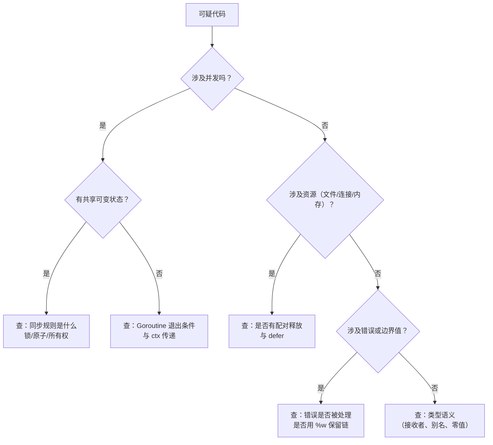

# Go 代码规范与常见陷阱

**摘要：**

Go 是一门高度重视一致性的语言——`gofmt` 强制统一代码格式，几乎消灭了格式相关的代码 review 争论；官方文档《Effective Go》和 Google 的《Go Style Guide》提供了命名、包设计、错误处理等方面的惯用法（idioms）指导。然而，Go 的简洁语法之下隐藏着不少陷阱：`nil` 接口的非直觉行为、`defer` 的参数求值时机、`for range` 的变量共享（Go 1.22 之前）、`append` 的隐式共享底层数组、`map` 的迭代顺序不确定性——这些陷阱在代码 review 时很难发现，却在生产中造成难以复现的 Bug。本文从两个维度构建 Go 工程师的代码质量工具箱：一是规范层面（`gofmt`/`goimports`/`golangci-lint` 的配置与使用），二是陷阱层面（逐一剖析每个陷阱的根本原因与防御写法），帮助团队建立防止低质量代码进入 main 分支的自动化防线。文章最后回到一个设计认知：Go 代码规范的哲学是"工具强制一致性"——gofmt 强制格式一致，golangci-lint 强制惯用法一致，自动化防线强制质量一致。这个"工具强制一致性"让 Go 团队的代码风格统一、质量可控，是 Go 工程化的核心保障。

---

## 第 1 章 Go 代码格式化：从争论到共识

### 1.1 gofmt：终结格式之争

**格式争论是所有编程语言团队的通病**：花括号是否另起一行？缩进用 Tab 还是空格？操作符两侧是否加空格？每个工程师都有自己的"正确答案"，且往往充满激情。

Go 的解法是激进的：`gofmt` 是官方强制的代码格式化工具，**其输出被定义为唯一正确的格式**。没有配置选项，不能自定义风格——这不是偷懒，而是刻意的设计：

> "Gofmt's style is no one's favorite, yet gofmt is everyone's favorite."
> ——Rob Pike

格式统一带来的收益超出预期：
- **消除格式相关的 code review 评论**：99% 的格式问题由工具自动修复，review 者可以把注意力集中在逻辑和设计上；
- **跨项目一致性**：任何 Go 项目打开都是熟悉的格式，降低了阅读成本；
- **工具友好**：统一格式让 IDE 重构、自动补全、AST 分析工具更容易实现。

```bash
# 格式化单个文件（修改原文件）
gofmt -w file.go

# 格式化整个项目
gofmt -w .

# 只检查是否需要格式化（CI 中使用）
gofmt -l .  # 输出需要格式化的文件列表，如果有输出则 CI 失败
```

这个"gofmt 强制格式统一"是 Go 工程化的独特设计——其他语言（Python 的 PEP8、Java 的 Google Style）也有风格指南，但通常是"建议"而非"强制"；Go 的 gofmt 是"强制"——没有配置选项，输出就是唯一正确格式。这个"强制统一"消除了格式争论，让团队精力集中在逻辑而非格式上。这个"工具强制格式"是 Go 工程哲学的体现——能用工具解决的，就不靠人工约定。

### 1.2 goimports：格式化 + 自动管理 import

`goimports`（`golang.org/x/tools/cmd/goimports`）在 `gofmt` 基础上额外管理 `import` 块：自动删除未使用的 import，自动添加缺少的 import（通过分析本地包路径和 GOPATH 推断）。

```bash
go install golang.org/x/tools/cmd/goimports@latest

# 格式化并整理 import
goimports -w .
```

`goimports` 的 import 排序规则（符合 Go 社区约定）：
1. 标准库包；
2. 第三方包；
3. 本项目内部包（基于模块路径判断）。

各组之间用空行分隔：

```go
import (
    "context"          // 第一组：标准库
    "fmt"
    "time"

    "github.com/gin-gonic/gin"  // 第二组：第三方库
    "go.uber.org/zap"

    "github.com/myorg/myservice/internal/domain"  // 第三组：内部包
    "github.com/myorg/myservice/internal/port"
)
```

这个"import 分组"让依赖来源清晰——标准库、第三方、内部包一目了然。这个"分组可视化"让代码 review 时能快速判断"这个依赖来自哪里"，也帮助发现"意外引入的第三方依赖"（如本该用标准库却引入了第三方）。这个"import 分组"是 Go 代码组织的惯例，goimports 自动执行。

---

## 第 2 章 静态分析：golangci-lint

### 2.1 为什么需要 linter

`gofmt` 只处理格式，不检查逻辑问题。Go 的 `go vet` 内置了一些基础检查（如错误的 `printf` 格式字符串、错误的 `copy` 参数），但覆盖范围有限。**`golangci-lint`** 是 Go 生态中最主流的 linter 聚合工具，集成了数十个静态分析器：

```bash
# 安装
go install github.com/golangci/golangci-lint/cmd/golangci-lint@latest

# 运行（使用 .golangci.yml 配置）
golangci-lint run ./...

# 只运行指定 linter
golangci-lint run --enable=errcheck,govet ./...
```

这个"golangci-lint 聚合多个 linter"是 Go 静态分析的标准工具——不需要单独运行 errcheck、govet、staticcheck，golangci-lint 一次性运行所有。这个"聚合"让静态分析简单——一个命令、一个配置文件，覆盖所有检查。这个"聚合 linter"是 Go 工程化的标配。

### 2.2 推荐的 .golangci.yml 配置

```yaml
# .golangci.yml — 放在项目根目录
linters:
  enable:
    - errcheck        # 检查未处理的 error 返回值
    - govet           # go vet 的所有检查
    - staticcheck     # 包含大量常见错误检查（staticcheck.io）
    - gosimple        # 建议使用更简洁的写法
    - ineffassign     # 检查赋值后从未使用的变量
    - unused          # 检查未使用的代码
    - gofmt           # 格式检查（配合 CI）
    - goimports       # import 顺序检查
    - misspell        # 拼写检查
    - gocritic        # 代码风格建议
    - noctx           # 检查 HTTP 请求未传递 context
    - bodyclose       # 检查 HTTP response body 未关闭
    - sqlcloserows    # 检查 sql.Rows 未关闭
    - exhaustive      # 检查 switch 未覆盖所有枚举值

linters-settings:
  errcheck:
    check-type-assertions: true  # 也检查类型断言的 ok 返回值

  govet:
    enable-all: true

issues:
  exclude-rules:
    # 测试文件不检查某些 lint
    - path: _test\.go
      linters:
        - errcheck
        - gocritic
```

### 2.3 关键 linter 的价值说明

**`errcheck`**：Go 中未处理的 error 是最常见的 Bug 来源之一。`errcheck` 会检查所有返回 `error` 的函数调用是否都有 `if err != nil` 处理——包括 `os.Close()`、`rows.Scan()` 等容易被忽略的地方。这个"errcheck 检查未处理 error"是 Go 静态分析的核心——Go 的显式错误处理要求每个 error 都被处理，但开发者容易忽略（特别是 `defer file.Close()` 这种"看起来不重要"的调用）。errcheck 强制每个 error 都被处理，防止"悄悄忽略的错误"导致生产问题。

**`bodyclose`**：HTTP 客户端的 `resp.Body` 必须关闭，否则底层 TCP 连接不会被释放回连接池，导致连接泄漏。这是 Go 新手最容易犯的错误之一：

```go
// 错误：resp.Body 未关闭
resp, err := http.Get(url)
if err != nil {
    return err
}
data, _ := io.ReadAll(resp.Body)  // bodyclose linter 会警告

// 正确
resp, err := http.Get(url)
if err != nil {
    return err
}
defer resp.Body.Close()  // 关键！
data, _ := io.ReadAll(resp.Body)
```

这个"bodyclose 检查 HTTP body 关闭"是 HTTP 客户端代码的必备 linter——resp.Body 不关闭会导致连接泄漏，在高并发场景下耗尽连接池。bodyclose 静态检查这个常见错误，防止生产事故。

**`sqlcloserows`**：`sql.Rows` 不关闭会导致数据库连接被占用，连接池耗尽：

```go
rows, err := db.QueryContext(ctx, "SELECT ...")
if err != nil {
    return err
}
defer rows.Close()  // 必须！sqlcloserows linter 检查此处
```

这个"sqlcloserows 检查 SQL rows 关闭"与 bodyclose 类似——资源不关闭导致泄漏，linter 静态检查防止。这个"资源关闭 linter"是 Go 静态分析的重要组成——HTTP body、SQL rows、file handle 等资源都需要关闭，linter 自动检查。

---

## 第 3 章 命名规范

### 3.1 变量与函数命名

**Go 使用驼峰命名（camelCase）**，不使用下划线（Python 风格）或全大写（常量在 Java 中常见）：

```go
// 正确
userID := "user-123"
maxRetries := 3
func GetUserByEmail(email string) (*User, error) { ... }

// 错误（Go 社区不接受的风格）
user_id := "user-123"        // 下划线
MAX_RETRIES := 3             // 全大写常量
func get_user_by_email() {}  // 下划线函数名
```

**缩写词的处理**：全大写或全小写，而不是首字母大写：

```go
// 正确
userID   // ID 全大写
apiURL   // URL 全大写
xmlParser  // xml 全小写（小写开头）
HTTPClient // HTTP 全大写（大写开头）

// 错误
userId   // id 应该是 ID
apiUrl   // url 应该是 URL
xmlParser // 可以，但 XMLParser 也对
```

这个"缩写词全大写或全小写"是 Go 命名的独特约定——`userID` 而非 `userId`，`HTTPClient` 而非 `HttpClient`。这个"缩写词规则"让缩写词在代码中识别度高——`ID`、`URL`、`HTTP` 全大写一眼看出是缩写词，不会与普通单词混淆。这个"缩写词大写"是 Go 命名规范的细节，但影响代码一致性。

**变量名长度与作用域匹配**：短名用于短作用域，长名用于长作用域。这是 Go 与 Java 命名风格最大的区别之一：

```go
// 短作用域：单字母或短缩写完全合理
for i, v := range items { ... }
if err := doSomething(); err != nil { ... }
func (r *repo) findUser(id string) { ... }  // r 是方法接收者，短名合理

// 长作用域：需要清晰的名字
type UserRepository struct {
    connectionPool *sql.DB  // 清晰的字段名
    cacheClient    *redis.Client
}
```

这个"变量名长度匹配作用域"是 Go 命名的实用哲学——短作用域用短名（如循环变量 `i`、错误变量 `err`），长作用域用长名（如结构体字段 `connectionPool`）。这个"长度匹配"让代码简洁而不失清晰——短作用域短名不冗余，长作用域长名够明确。这个"作用域驱动命名"是 Go 命名风格的核心。

### 3.2 接口命名：单方法接口用 -er 后缀

Go 提倡小接口——单方法接口是 Go 中最优雅的抽象单元。单方法接口的命名约定是方法名 + `-er` 后缀：

```go
// 标准库的惯例
type Reader interface { Read(p []byte) (n int, err error) }
type Writer interface { Write(p []byte) (n int, err error) }
type Closer interface { Close() error }
type Stringer interface { String() string }
type Handler interface { ServeHTTP(ResponseWriter, *Request) }

// 自定义接口
type Authenticator interface { Authenticate(ctx context.Context, token string) (*User, error) }
type EventPublisher interface { Publish(ctx context.Context, event Event) error }
```

这个"-er 后缀"是 Go 单方法接口的命名约定——`Reader`、`Writer`、`Closer` 都是方法名 + er。这个"-er 约定"让接口名简洁且语义清晰——看到 `-er` 后缀就知道是单方法接口，接口名本身就是方法名的"执行者"。这个"-er 命名"是 Go 接口设计的惯用法，标准库和社区都遵循。

多方法接口的命名应该描述接口的角色，而不是堆砌方法名：

```go
// 好：角色清晰
type UserRepository interface {
    FindByID(ctx context.Context, id string) (*User, error)
    FindByEmail(ctx context.Context, email string) (*User, error)
    Save(ctx context.Context, user *User) error
    Delete(ctx context.Context, id string) error
}

// 差：Interface 后缀毫无信息量
type UserInterface interface { ... }  // Interface 后缀是反模式
```

这个"多方法接口描述角色"是 Go 接口命名的原则——`UserRepository` 描述角色（用户仓库），`UserInterface` 毫无信息量（所有接口都是 interface）。这个"角色命名"让接口名有业务语义，而非技术语义。这个"避免 Interface 后缀"是 Go 命名规范的共识——`Interface` 后缀是冗余的（Go 的 interface 关键字已经说明是接口），应该用角色名替代。

---

## 第 4 章 常见陷阱精析

### 4.1 陷阱一：nil 接口 ≠ 含 nil 值的接口

这是 Go 中最令新手困惑的陷阱，也是实际生产代码中偶尔出现的微妙 Bug：

```go
type MyError struct{ msg string }
func (e *MyError) Error() string { return e.msg }

// 返回 *MyError 类型的 nil，而非 error 接口的 nil
func doSomething(fail bool) error {
    var err *MyError  // err 的值是 nil，但类型是 *MyError
    if fail {
        err = &MyError{"something failed"}
    }
    return err  // 危险！返回的是一个"类型为 *MyError、值为 nil"的接口值
}

func main() {
    err := doSomething(false)
    if err != nil {
        fmt.Println("got error:", err)  // 这行会执行！err != nil 为 true！
    }
}
```

**根本原因**：Go 的接口值由两个字段组成——`(type, value)`。一个"nil 接口"是 `(nil, nil)` 两个字段都是 nil。而上面的 `err` 是 `(*MyError, nil)`——类型字段不为 nil，所以接口值不为 nil，即使其内部的指针是 nil。

```
nil 接口:       (type=nil,     value=nil)   → err == nil: true
含nil指针的接口: (type=*MyError, value=nil) → err == nil: false  ← 反直觉！
```

**修复：在 error 接口边界，避免返回具体类型的 nil 指针**：

```go
// 正确写法一：直接返回 nil（类型为 error 的 nil，即 (nil, nil)）
func doSomething(fail bool) error {
    if fail {
        return &MyError{"something failed"}
    }
    return nil  // 明确返回 nil，而非具体类型变量
}

// 正确写法二：如果逻辑复杂，在最后返回前做类型转换
func doSomething(fail bool) error {
    var myErr *MyError
    if fail {
        myErr = &MyError{"something failed"}
    }
    if myErr != nil {
        return myErr  // 只有非 nil 时才返回
    }
    return nil
}
```

> [!warning] 生产避坑：接口边界的 nil 检查
> 永远不要返回一个可能为 nil 的具体类型变量给接口类型——始终在返回前检查，非 nil 才返回，否则直接 `return nil`。这个问题常见于将 `*MyError` 类型的变量在多个 if 分支中有条件赋值，最后统一返回的模式。

这个"nil 接口陷阱"是 Go 接口设计的副作用——接口值是 (type, value) 二元组，type 非 nil 时接口非 nil，即使 value 是 nil。这个"二元组语义"让"nil 具体类型变量赋给接口"产生非 nil 接口，反直觉。这个"接口 nil 陷阱"是 Go 最著名的陷阱之一，理解 (type, value) 二元组是避免的关键。

### 4.2 陷阱二：defer 的参数立即求值

`defer` 语句的参数在 `defer` **声明时**就被求值，而不是在 `defer` 执行时：

```go
func logElapsed(name string) {
    start := time.Now()
    defer fmt.Println(name, "took", time.Since(start))  // 陷阱！
    // time.Since(start) 在 defer 声明时就被求值
    // 此时 start 刚被赋值，elapsed 几乎是 0
    
    doExpensiveWork()
    // defer 执行时，name 和 elapsed（已求值为接近 0 的值）被打印
    // 实际输出：logElapsed took 0s（不是实际耗时）
}

// 正确：使用闭包延迟求值
func logElapsed(name string) {
    start := time.Now()
    defer func() {
        fmt.Println(name, "took", time.Since(start))  // 闭包：time.Since(start) 在执行时求值
    }()
    
    doExpensiveWork()
}
```

**规则**：`defer f(arg1, arg2)` 中，`f`、`arg1`、`arg2` 的求值发生在 `defer` 语句被执行的时刻，而不是 `defer` 函数被调用的时刻。使用无参闭包 `defer func() { ... }()` 可以延迟到执行时求值。这个"defer 参数立即求值"是 defer 的常见陷阱——`defer fmt.Println(time.Now())` 打印的是 defer 声明时的时间，不是函数返回时的时间。用闭包 `defer func() { fmt.Println(time.Now()) }()` 才能打印返回时的时间。这个"立即求值 vs 闭包延迟"是 defer 使用的核心区分。

### 4.3 陷阱三：for range 循环变量共享（Go 1.21 及之前）

**Go 1.22 已修复此问题**，但在老代码库或旧版本中仍然是高频 Bug：

```go
// Go 1.21 及之前：所有 goroutine 共享循环变量 v
for _, v := range items {
    go func() {
        fmt.Println(v)  // 打印的几乎都是 items 最后一个元素的值
    }()
}

// 修复方案：通过参数传值（创建新变量）
for _, v := range items {
    v := v  // 创建新的局部变量（shadow），每次循环独立
    go func() {
        fmt.Println(v)
    }()
}

// 或通过函数参数传入
for _, v := range items {
    go func(val Item) {
        fmt.Println(val)
    }(v)  // v 在这里求值并传入
}
```

**Go 1.22 的行为变化**：每次迭代创建新的循环变量，不再共享，上述问题自动消失。但如果项目使用 Go 1.21 及之前的版本（`go.mod` 中 `go 1.21` 或更低），仍需手动处理。这个"循环变量共享"是 Go 1.22 之前最著名的陷阱——所有迭代共享同一个循环变量，goroutine 捕获后几乎都打印最后一个值。Go 1.22 修复此问题，但旧代码仍需注意。这个"循环变量共享"是 Go 并发编程的经典陷阱，理解变量作用域是避免的关键。

### 4.4 陷阱四：append 的隐式底层数组共享

```go
// 陷阱：从同一个底层数组派生的两个 slice 共享数据
original := []int{1, 2, 3, 4, 5}
a := original[:3]  // [1, 2, 3]，len=3, cap=5（共享 original 的底层数组）
b := original[2:]  // [3, 4, 5]，与 original 共享底层数组

a = append(a, 99)  // a 的 len(3) < cap(5)，不触发扩容
// append 直接修改了底层数组的第 4 个元素！
// 此时 original = [1, 2, 3, 99, 5]，b = [3, 99, 5]
fmt.Println(original)  // [1 2 3 99 5]  ← 被悄悄修改了！
fmt.Println(b)         // [3 99 5]       ← 也被修改了！
```

**根本原因**：`a = original[:3]` 创建的 slice 头部引用了 original 的底层数组，且 `cap=5`（原始容量），`append` 在 `len < cap` 时直接在底层数组上写入，影响所有共享该底层数组的 slice。

**修复：使用三索引切片（three-index slice）限制 cap，或使用 copy**：

```go
// 方案一：三索引切片限制 cap（Go 1.2+）
a := original[:3:3]  // 第三个参数限制 cap=3，append 时会强制分配新数组
a = append(a, 99)    // 触发扩容，a 和 original 不再共享底层数组

// 方案二：显式复制
a := make([]int, 3)
copy(a, original[:3])  // a 有独立的底层数组
a = append(a, 99)      // 安全
```

这个"append 隐式共享底层数组"是 slice 的常见陷阱——slice 是引用类型，append 在 len < cap 时不扩容，直接修改底层数组，影响所有共享该数组的 slice。这个"隐式共享"让 append 的副作用难以察觉——你以为 append 只改 a，实际上 original 和 b 都被改了。三索引切片 `[:3:3]` 限制 cap，强制 append 扩容，避免共享。这个"三索引切片"是避免 append 陷阱的标准方法。

### 4.5 陷阱五：map 的迭代顺序不确定

```go
// Go 刻意将 map 迭代顺序随机化（每次运行可能不同）
m := map[string]int{"a": 1, "b": 2, "c": 3}
for k, v := range m {
    fmt.Printf("%s: %d\n", k, v)  // 每次输出顺序都可能不同！
}
```

Go 从 1.0 起就刻意随机化 map 迭代顺序，原因是防止开发者依赖"恰好有序"的行为（这在其他语言的 hash map 实现中曾导致跨版本行为不一致）。这个"map 迭代随机化"是 Go 的刻意设计——防止开发者依赖"恰好有序"的偶然行为，这种依赖在其他语言中曾导致跨版本 Bug（map 实现变化导致顺序变化）。Go 从 1.0 起随机化，强制开发者不依赖顺序，避免了这类 Bug。这个"随机化防依赖"是 Go 的前瞻性设计。

**如果需要确定性顺序，必须显式排序**：

```go
// 需要按 key 排序输出 map
keys := make([]string, 0, len(m))
for k := range m {
    keys = append(keys, k)
}
sort.Strings(keys)

for _, k := range keys {
    fmt.Printf("%s: %d\n", k, m[k])
}
```

### 4.6 陷阱六：time.After 在循环中的泄漏

前面并发章节提到过，这里作为规范性提醒重申：

```go
// 危险：每次循环都创建新的 timer，之前的 timer 在 5s 内不会 GC
for {
    select {
    case msg := <-ch:
        process(msg)
    case <-time.After(5 * time.Second):  // 每次循环新建 timer！
        return
    }
}

// 正确：在循环外创建 timer 并复用
timer := time.NewTimer(5 * time.Second)
defer timer.Stop()
for {
    select {
    case msg := <-ch:
        if !timer.Reset(5 * time.Second) {
            <-timer.C  // drain channel if Stop returned false
        }
        process(msg)
    case <-timer.C:
        return
    }
}
```

这个"time.After 循环泄漏"是 select + time.After 的常见陷阱——`time.After` 每次调用创建新 timer，旧 timer 在到期前不会被 GC，循环中频繁调用会积累大量未到期 timer，造成内存泄漏。这个"timer 泄漏"在高频循环中尤其严重——每秒循环 1000 次，5 秒内积累 5000 个 timer。用 `time.NewTimer` + `Reset` 复用单个 timer，避免泄漏。这个"复用 timer"是 select + timeout 的正确写法。

### 4.7 陷阱七：值接收者 vs 指针接收者的混用

```go
type Counter struct{ count int }

// 值接收者：修改的是副本，不影响原对象
func (c Counter) IncrementWrong() {
    c.count++  // 修改的是 c 的副本，原 Counter 不变
}

// 指针接收者：修改原对象
func (c *Counter) Increment() {
    c.count++
}

// 陷阱：接口调用时的行为差异
type Incrementer interface{ Increment() }

var c Counter
var i Incrementer = &c  // 正确：*Counter 实现了接口（因为方法集包含指针接收者方法）
var j Incrementer = c   // 编译错误：Counter（非指针）的方法集不包含指针接收者方法
```

**判断规则**：
- 方法需要修改接收者的状态 → **指针接收者**；
- 接收者是大结构体，复制代价高 → **指针接收者**；
- 接收者是小的值类型（int、string、time.Time），方法只读 → **值接收者**；
- **一个类型的所有方法应该统一使用同一种接收者类型**，混用会让方法集的判断变得复杂。

这个"接收者类型混用"是 Go 方法定义的常见问题——值接收者修改副本（不影响原对象），指针接收者修改原对象。混用导致方法集不一致（值类型的方法集不含指针接收者方法），接口实现判断复杂。这个"统一接收者类型"是 Go 方法定义的原则——一个类型要么全用值接收者，要么全用指针接收者，不混用。

---

## 第 5 章 代码质量的自动化防线

### 5.1 pre-commit hook：本地自动化检查

```bash
# .git/hooks/pre-commit（chmod +x）
#!/bin/sh

# 格式检查
if [ -n "$(gofmt -l .)" ]; then
    echo "Go files must be formatted. Run 'gofmt -w .' first."
    exit 1
fi

# 运行 go vet
go vet ./... || exit 1

# 运行 golangci-lint（快速模式，只检查修改的文件）
golangci-lint run --fast ./... || exit 1
```

或使用 `pre-commit` 框架统一管理：

```yaml
# .pre-commit-config.yaml
repos:
  - repo: https://github.com/dnephin/pre-commit-golang
    rev: v0.5.1
    hooks:
      - id: go-fmt
      - id: go-vet
      - id: golangci-lint
```

这个"pre-commit hook 本地检查"是代码质量的第一道防线——在 commit 前自动运行 gofmt、go vet、golangci-lint，不通过的代码无法 commit。这个"本地防线"让问题在 commit 前被发现，不进入仓库。这个"pre-commit 自动化"是 Go 工程化的标配，防止低质量代码进入仓库。

### 5.2 CI 中的完整代码质量检查

```yaml
# .github/workflows/lint.yml
name: Lint

on: [push, pull_request]

jobs:
  lint:
    runs-on: ubuntu-latest
    steps:
      - uses: actions/checkout@v4
      - uses: actions/setup-go@v4
        with:
          go-version: '1.21'
          cache: true

      # 格式检查
      - name: Check formatting
        run: |
          if [ -n "$(gofmt -l .)" ]; then
            gofmt -d .
            exit 1
          fi

      # golangci-lint（使用 action，自动缓存）
      - uses: golangci/golangci-lint-action@v3
        with:
          version: latest
          args: --timeout=5m

      # 构建检查（确保代码能编译）
      - run: go build ./...

      # 测试（带 race 检测）
      - run: go test -race ./...
```

这个"CI 完整质量检查"是代码质量的第二道防线——gofmt 检查格式，golangci-lint 静态分析，go build 确保编译，go test -race 检测竞争。这个"CI 多维度检查"让低质量代码无法通过 CI，不进入 main 分支。这个"CI 自动化防线"是 Go 工程化的核心保障，与 pre-commit 形成"本地 + CI"双重防线。

---

## 第 6 章 Go 代码规范的设计认知

### 6.1 工具强制一致性

Go 代码规范的哲学是"工具强制一致性"——gofmt 强制格式一致，golangci-lint 强制惯用法一致，自动化防线强制质量一致。这个"工具强制一致性"让 Go 团队的代码风格统一、质量可控。这个"工具强制"与"人工约定"形成对比——其他语言靠人工约定风格（如 Python 的 PEP8 是建议），Go 靠工具强制（gofmt 无配置选项）。这个"工具强制"让一致性不依赖人的自觉，而依赖工具的强制。

### 6.2 惯法优于个性

Go 重视惯用法（idioms）——《Effective Go》文档定义了 Go 的惯用法，社区遵循这些惯法。这个"惯法优于个性"让 Go 代码风格统一——大家都用同样的方式写代码，而不是各自发挥个性。这个"惯法优先"让 Go 代码跨项目可读性高——任何 Go 项目打开都是熟悉的风格，降低了阅读成本。这个"惯法优于个性"是 Go 工程哲学的体现——一致性比个性更重要。

### 6.3 自动化防线

Go 代码质量的保障靠"自动化防线"——pre-commit hook（本地）+ CI（远程）双重防线，gofmt + golangci-lint + go vet + go test -race 多维度检查。这个"自动化防线"让低质量代码无法进入仓库，质量保障不依赖人的自觉。这个"自动化防线"是 Go 工程化的核心保障——工具自动检查，人不需要记住所有规范，工具强制执行。

---

## 第 7 章 并发与资源类陷阱补遗

第 4 章讲的七个陷阱偏语言语义，而工程里另一半事故来自"并发与资源"——它们的共同特征是**不报错、只在特定时序下显形**。

### 7.1 Context 相关陷阱

两处高频误用。**其一，忘记 `defer cancel()`**——`WithCancel`/`WithTimeout` 创建的子 Context 不调用 `cancel`，会让父节点一直持有对它的引用，是典型的 Context 泄漏（详见《Go 并发编程》相关篇章）。**其二，用 `context.Background()` 覆盖上游预算**——在下游调用处重新起一个独立超时，会丢掉上游的 deadline，让"整条链路的预算"失效。正确做法是把上游 `ctx` 直接传下去，或以其为父派生更紧的超时。

### 7.2 WaitGroup 的时序陷阱

`sync.WaitGroup` 有一条硬性要求：**`Add` 必须在 `Wait` 之前完成**。若在 `Wait` 已经阻塞之后、由另一个 Goroutine 调用 `Add`，可能触发"计数器为 0 时被唤醒并返回、后续的 Goroutine 却没人等"的竞态。因此惯用写法是"**在启动 Goroutine 之前 `Add`**"（通常在主 Goroutine 里、`go` 语句之前完成 `Add(1)`），而 `Done` 放在 Goroutine 内用 `defer` 调用。另一个常见错误是把同一个 `WaitGroup` 复用于多批任务而不检查"上一批是否已 `Wait` 完"。

### 7.3 共享容器的并发访问

`slice`、`map`、`bytes.Buffer` 都不是并发安全的。两处最容易出事：**多个 Goroutine `append` 同一个切片**（扩容时的底层数组替换会让写入丢失，甚至读到脏数据）、**一个 Goroutine 遍历 map、另一个写**（会直接触发运行时检测并 panic）。修正方式不是"给每个操作加锁"，而是先想清楚**所有权**——数据应当归某一个 Goroutine 所有，跨 Goroutine 传递用 channel 移交，而不是共享同一份结构。

### 7.4 锁的粒度与死锁

锁相关的两类问题：**粒度过粗**（把 I/O、网络调用圈进临界区，导致并发退化）与**加锁顺序不一致**（A 先锁 1 再锁 2、B 先锁 2 再锁 1，形成循环等待）。前者靠"临界区只放必要的内存操作"来改善；后者靠"**为所有锁约定一个全局顺序**"来根治。此外还有一处易漏：**`defer mu.Unlock()` 写在 `mu.Lock()` 之前**（或忘记 `Unlock`），会让锁永久持有——用 `defer` 紧跟在 `Lock` 之后是必须养成的习惯。

### 7.5 资源未释放

三类资源最容易泄漏：**文件**（忘记 `Close`）、**数据库连接与行游标**（`Rows` 忘记 `Close`，连接无法归还）、**HTTP 响应体**（忘记读尽或关闭，连接无法复用）。它们的共同修法是"**拿到资源后立刻 `defer` 释放**"，且对于"读尽才可复用"的类型（如 HTTP Body），还要保证把内容读完或显式丢弃。资源泄漏的特点是"平时不报错、压力上来才暴露"，因此更适合靠规约而非事后排查。

### 7.6 Goroutine 泄漏

第 6 类陷阱是 Goroutine 泄漏——起了一个 Goroutine 却没有让它停下来的路径。最常见的成因是"**channel 无人关闭/无人接收**"，其次是"**Goroutine 内的耗时操作没有超时**"。防线的核心是"每个 Goroutine 都要能回答'它在什么条件下退出'"，并把这条问题写进评审清单（见第 8 章）。检测手段有 `runtime.NumGoroutine()` 的趋势监控与 pprof 的 goroutine profile（详见《Go 并发编程》）。

## 第 8 章 团队规约与评审清单

### 8.1 规约要写成"做什么/不做什么"

规范若写成"要注意并发安全""要优雅处理错误"这类表述，等于没写——因为它们不可检查、也不可执行。有效的规约应当能翻译成**一条可判定的检查**：不是"注意资源释放"，而是"**每个 `Open`/`Query`/`NewClient` 之后必须紧跟 `defer Close()`**"；不是"注意取消"，而是"**每个长任务函数必须接受 `ctx` 并在循环内 `select ctx.Done()`**"。**能被工具或评审逐条打勾的规约，才是活的规约。**

### 8.2 与 Go 风格一致的几条约定

几条与 Go 惯用法一致的约定值得明确写下来：**错误只记录一次（在边界）**；**接口定义在消费方**；**包名短小、不用下划线、不用复数**；**导出符号必须有注释、注释以符号名开头**；**避免 `util`/`common` 作为包名**；**测试与实现同包或 `xxx_test` 包，helper 放 `internal/testutil`**。这些约定大多是 Go 社区已有共识，把它们显式化，能减少"每个人按自己习惯来"的摩擦。

### 8.3 一份评审清单

把前面几章收成一张可逐条打勾的表：

| 类别 | 检查问题 |
| :--- | :--- |
| 并发 | 每个 Goroutine 的退出条件是什么？共享状态谁来守？ |
| 资源 | 每个资源是否有配对的释放？是否有 `defer`？ |
| 取消 | 长任务是否监听 `ctx`？是否沿链路传递？ |
| 错误 | 是否只在边界记录？是否用 `%w` 保留链？ |
| 接口 | 是否定义在消费方？是否只含被用到的方法？ |
| 测试 | 是否覆盖了失败路径与边界？是否可并行？ |
| 命名 | 是否与职责一致？是否避免了 `util`？ |

清单不必长，重点是**在评审时真的逐条问**——一份被使用的短清单，胜过一份被忽略的长文档。

### 8.4 用工具承载约定

最后，把能自动化的约定交给工具：格式化用 `gofmt`/`goimports`（CI 里检查无 diff）、静态检查用 `go vet` 与 `golangci-lint`、并发问题用 `-race`、依赖问题用 `tidy` 校验与 `govulncheck`、注释与命名可用专门的 linter 规则。这样做的意义不只是"省人力"，更是**把约定从"靠记忆"变成"靠流水线"**——人总会忘，流水线不会。

## 第 9 章 静态分析的进阶用法

### 9.1 静态检查的四类分工

静态工具并非一类东西，按"检查什么"可以分成四组。**格式化**（gofmt、goimports）——只管排版与 import，不判断对错，是零争议的一层。**语法与语义检查**（go vet）——检测"几乎肯定是错的"写法，如格式串与参数不匹配、锁被复制、错误的 `printf`。**风格与惯用法检查**（staticcheck、revive）——检测"虽然能跑但不该这么写"的问题，如未使用的变量、冗余的代码、可疑的比较。**安全与依赖检查**（gosec、govulncheck）——检测潜在漏洞与已知漏洞依赖。四层各有侧重，**应当全上，而不是只挑一层**。

### 9.2 几个值得特别说明的 linter

**staticcheck** 是覆盖面最广、误报率较低的一组检查，很多"看起来没问题但实际有隐患"的写法（如 `errors.Is` 用法错误、无用的类型断言、可疑的 nil 判断）都靠它发现。**errcheck** 强制检查"是否有错误被忽略"，是治理"错误静默"最直接的工具。**revive** 是 `golint` 的现代替代，提供可配置的风格规则。**gosec** 面向安全（如弱随机数、SQL 拼接、文件权限过宽）。**govulncheck** 见《Go Module 与依赖管理》。它们的共同价值是**把"评审时容易漏掉的东西"变成"机器每次都检查的东西"**。

### 9.3 抑制告警的纪律

linter 一旦引入，必然会遇到"这条告警其实可以接受"的情况，于是出现 `//nolint` 注释。抑制本身没问题，问题在于**滥用**：一旦 `//nolint` 随处可见，linter 就形同虚设。可行的纪律有三条：**抑制必须带原因**（`//nolint:errcheck // 该错误已在上游统一处理`）、**抑制应当逐条而非逐文件**（避免整文件关闭）、**定期审查抑制注释**（把它们当成一笔需要偿还的技术债）。把"抑制"当成"标记待处理"，而不是"让它闭嘴"，这条纪律才有意义。

### 9.4 从零引入 linter 的路径

给一个"从来没做过静态检查"的仓库引入 linter，容易犯的错是"一次开满所有规则、结果几千个告警、团队直接放弃"。更可行的路径是：**先只开格式化与 `go vet`**（几乎零告警、无争议），**再加几个高价值的规则**（如 `errcheck` 关闭大部分误报的例外、`staticcheck` 的核心检查），**先在 CI 里以警告形式呈现**（不阻断），**等存量清理得差不多再转为阻断**。整个过程的关键是**让团队始终"能处理完眼前的告警"**——一旦积压到无法处理，再怎么强调"重视质量"也不会有人去修。

## 第 10 章 陷阱速查与决策图

### 10.1 十类陷阱速查表

把本篇与相关篇章讨论过的陷阱收成一张速查表：

| 陷阱 | 典型症状 | 一句话修法 |
| :--- | :--- | :--- |
| nil 接口 ≠ 含 nil 的接口 | `err != nil` 判不出空 | 直接返回接口类型的 nil |
| defer 参数立即求值 | defer 里拿到旧值 | 用闭包包裹或用具名返回值 |
| 循环变量共享（1.21 及前） | 并发里取到同一个值 | 循环内复制或升 Go 1.22 |
| append 共享底层数组 | 改一处影响另一处 | 需要独立就 `slices.Clone` |
| map 迭代顺序随机 | 依赖顺序的代码偶发错 | 需要有序就先排序 |
| `time.After` 循环泄漏 | 内存缓慢增长 | 复用 `Timer` 或 `ctx` |
| 值/指针接收者混用 | 方法集不满足接口 | 同类方法统一接收者 |
| 忘记 `defer cancel()` | Context 泄漏 | 创建后立即 defer |
| `Rows`/`Body` 未读尽 | 连接池耗尽 | 读尽或显式关闭 |
| Goroutine 无退出条件 | 数量只增不减 | 明确退出分支 |

这张表的用法是"症状 → 修法"的快速索引；真正要记的不是表本身，而是它背后那条主线——**大多数陷阱的根因都是"某个隐含的共享或时序假设不成立"**。

### 10.2 一张决策图

把"发现可疑代码 → 该查什么"的路径画出来，可以在评审与自查时加快判断：



这张图的落点与第 8 章的清单一致：**先分类（并发/资源/错误/语义），再针对性检查**。分类的价值在于——盲目通读一遍代码很难发现问题，而带着一个具体问题去读，往往一眼就能看出。

## 第 11 章 一次代码质量治理的推演

假设接手一个"没有格式化约定、没有 linter、代码风格各行其是、评审只看功能对不对"的仓库，如何建立质量防线？可行的顺序有四步。

**第一步，格式化一刀切。** 对全仓跑一次 `gofmt -w`，把它做成一次"只改格式、不改逻辑"的独立提交——这样审查者可以安心跳过，也避免它与真正的改动混在一起。之后在 CI 里检查"格式化后无 diff"，从此格式不再需要讨论。这一步的价值超乎预期：**它消除了最大量的、最低价值的评审争论。**

**第二步，引入最小 linter 集。** 先上 `go vet`（几乎无争议）与 `errcheck`（治理错误忽略），并把存量告警清理到零。这一步最容易卡在"告警太多"——所以关键技巧是**分批清理、每批都让 CI 保持绿色**，而不是一次清空。

**第三步，补并发与资源检查。** 加 `-race` 到测试流水线、加 `staticcheck` 的核心规则、加针对 `defer Close` 与 `defer cancel` 的自定义检查（若社区没有现成的，用简单的 AST 脚本也能做）。这一步针对的是"不报错但危险"的那一类问题——它们的价值不在美观，而在避免线上事故。

**第四步，把约定写进评审清单。** 工具能守的交给工具，工具守不住的（如"接口该定义在消费方"、"包名是否有职责"）写进评审清单，并在 code review 中真的逐条问。**清单要短**——超过十条就没人会认真看完。

四步的共性在于"**每次只推进一小步、且始终保持仓库可维护**"。质量治理最常见的失败方式不是"做得不够"，而是"一次想做太多、结果半途而废，反而留下一堆半开状态"。

## 第 12 章 十个常见问题

**问：Go 有官方风格指南吗？** 没有一份强制性的官方文档，但有一组事实标准：`gofmt` 的输出（格式）、`Effective Go` 与 `Go Code Review Comments`（惯用法）、`go vet` 与 `staticcheck` 的默认规则（写法）。把这些当"事实标准"用，比寻找一份"权威规范"更实际——**Go 的风格观是"工具化的共识"，而不是"文档化的教条"**。

**问：接口应该定义在实现方还是消费方？** 消费方。实现方定义接口，会迫使所有使用者依赖那个（通常过宽的）接口，也让"只为测试定义窄接口"变得别扭。定义在消费方的另一个好处是——**接口的大小由使用需求决定**，而不是由实现能力决定。

**问：什么时候不该用接口？** 当只有一个实现、且没有测试替身或替换需求时，直接依赖具体类型更简单——**接口的价值在"多态"与"解耦"，若二者都不需要，接口只是多余的间接层**（Go 的接口是隐式的，所以"后来需要了再加"成本很低，不必提前抽象）。

**问：错误消息的格式有约定吗？** 有两条务实的约定：**不加句号结尾、不大写开头**（便于拼接被包装的多层消息）；**描述"做了什么失败"，而非只描述错误本身**（`读取配置: ...` 比 `...` 更有信息量）。至于是否带堆栈，取决于是否需要——Go 的标准做法是"包装时加语境，不加堆栈"。

**问：包名怎么取？** 短、小写、无下划线、无复数、有意义（`order` 而非 `orders` 包，或 `util` 这类无意义名）。一个实用的检验是"**读 import 语句时，这个名字能不能提示它的职责**"——`import "x/store"` 比 `import "x/common"` 好得多。

**问：注释应该写什么？** 写"**为什么**"，而不是"**是什么**"（代码本身已经说明是什么）。导出符号的注释以符号名开头（Go 文档工具依赖这个约定）。此外，注释应当解释那些"看起来很怪但其实有意为之"的地方——那正是后来人最容易改错的地方。

**问：什么时候该拆函数？** 拆分的依据应当是"**这段逻辑有一个可命名的独立职责**"，而不是"函数超过 N 行"。行数是信号不是规则——一个 100 行的线性流程若没有可提取的子职责，拆开反而增加跳跃成本；而一个 20 行的函数若混了三件事，就该拆。

**问：`panic` 在库里能出现吗？** 只在"**调用者明显用错了、且无法用错误表达**"时（如 `regexp.MustCompile` 之于 `Compile`）。库中的正常失败路径一律返回错误——**让库 panic，是把"库的用法问题"变成"调用方的崩溃"**，这对调用方极不友好。

**问：`init()` 该用吗？** 少用。它的问题在于"隐式的执行时机"与"难以测试"——副作用分散在多个 `init` 里，会让程序行为难以推理。它适合的场景很窄：真正需要"包被导入时自动注册"的机制（如驱动注册）。其余情况，用显式的构造函数更好。

**问：规范该由谁来定？** 由"**能被执行的部分**"来定——能自动检查的写进 linter 配置（工具负责），不能自动检查的写进简短的评审清单（人负责）。**任何只写在文档里、不与工具或评审挂钩的规范，最终都会失效**。

## 第 13 章 收束

回看全篇，代码规范与陷阱这两件事，其实是一件事的两面——**规范是"事前把话说清楚"，陷阱是"事后发现在哪里没说清楚"**。它们共同指向同一个目标：让"这套代码能被安全地修改"。

也因此，规范的价值不在"整齐好看"，而在**降低协作与维护的边际成本**：格式统一了，评审就不必讨论格式；错误处理约定明确了，就不必逐次争论怎么包装；陷阱清单建起来了，新人就不会把老坑再踩一遍。这些收益都不体现在某一次提交里，而体现在"这个仓库三年后还能不能痛快地改"。

这条线也解释了为什么"用工具承载约定"比"靠人记住约定"可靠——**工具不会疲劳、不会忘记、不会因为赶进度而放水**。把能自动化的交给工具，把剩余的压到一张能被真正使用的短清单上，这就是全部的方法。

## 第 14 章 六个治理反模式

质量治理本身也会走入反模式，它们的特点是"看起来在推进质量，实际在消耗信任"。

**其一，把规范写成口号。** "代码要清晰""要注意并发安全"这类表述无法执行、无法检查，最终只是文件里的一段装饰。判别方法是**试着把它翻译成一条可打勾的检查**——翻译不出来，就说明它不是规范，而是愿望。

**其二，一次开满所有规则。** 上来就把 linter 的规则全打开，几千条告警无人处理，团队很快学会"绕过它"。正确做法是循序渐进（第 9.4 节）——**让告警数量始终处于"能处理完"的范围内**。

**其三，用 linter 刷指标。** 为了让"告警数为零"而大量加 `//nolint`，或用抑制代替修复——指标好看了，问题还在。抑制应当被当作"标记待处理"，并定期审查（第 9.3 节）。

**其四，规范与工具不一致。** 文档要求 A、linter 检查 B、团队实际做 C，三者不一致时，规范就失去了权威——**唯一被执行的规则才有权威，文档只是它的说明书**。因此"改规范"的第一动作应当是"改工具配置"。

**其五，只管新代码不管存量。** 只对新提交施加检查，存量代码永久豁免——结果是仓库里长期并存两套标准，新人读老代码学到的是旧习惯。更有效的做法是"**设一个存量清退计划**"（如按目录分批清理、或对改动过的文件强制符合新规），让标准逐步统一。

**其六，把规范当考核。** 若把"告警数""覆盖率"直接与个人绩效挂钩，就会催生"为指标而指标"的行为——写无断言的测试、加无意义的抑制。**指标可以衡量趋势，不适合作为对人的评价**；把它用作"健康度信号"，比用作"考核工具"更接近它的本意。

这六个反模式有一个共同的解药：**让规范"可执行、可完成、可验证"**。做不到这三点，再多规范也不会改变任何一行代码的写法。

## 第 15 章 一份可落地的规范文档结构

规范文档常写成"长篇大论却无人使用"，问题多半出在结构上。一个好用且会被真正引用的结构，只需四节。

**第一节：工具与命令。** 只写"怎么执行检查"——`gofmt`、`go vet`、`golangci-lint run`、`go test -race` 各自怎么跑、CI 里跑哪些。这一节是**可执行的事实**，读者照做即可，无争议。

**第二节：约定条目。** 按类别（命名、错误、接口、并发、资源、测试）列出条目，每条写成"做法 + 一句理由 + 一条反例"。例如"错误只在边界记录——避免同一错误被打印多次，反例：每层都 `log.Error` 后继续向上返回"。**理由与反例是关键**——没有它们，条目会退化成教条，而人会本能地抗拒自己不理解的规则。

**第三节：评审清单。** 把无法自动检查的条目压成一张短表（第 8.3 节），供 code review 时逐条对照。这一节是"人肉执行"的部分，因此必须短。

**第四节：演进记录。** 记录"这条规范是什么时候加的、为什么加、有没有争议"。它的价值在于让规范可以被质疑与修订——**一条能被追溯来由的规则，才会被认为是可以讨论的，而不是不可动摇的**。

四节之中，第一节与第三节是"执行载体"，第二节是"知识"，第四节是"历史"。缺了执行载体，文档就成了摆设；缺了知识与历史，条目就失去说服力。

### 15.1 与工具配置的映射

文档里的每一条可自动检查的约定，都应当在工具配置里有一处对应。可以维护一张"约定 → 检查手段"的映射表：

| 约定 | 检查手段 |
| :--- | :--- |
| 格式统一 | CI 跑 `gofmt -l` 检查无输出 |
| 错误不被忽略 | `errcheck` |
| 惯用法正确 | `staticcheck` |
| 无数据竞争 | `go test -race` |
| 依赖无漏洞 | `govulncheck` |
| 注释完整 | `revive`/`golint` 类规则 |

这张表的意义在于**让"规范"与"执行"一一对应**——凡是表上有的，机器会守；凡是表上没有的，靠评审清单。二者合起来，才是完整的防线。

### 15.2 存量与新人的处理

规范落地有两处现实难题。**存量代码**：不要指望一次清理干净，可行的做法是"对改动过的文件强制符合新规"（改动即修复），并给关键目录设清理计划。**新人上手**：最好的老师不是文档，而是"第一个 PR 的评审"——因此评审清单值得单独讲给新人，并在他第一次提交时逐条对照一遍。**规范的传递靠示范，而不是靠阅读**。

### 15.3 收束

全篇写到这里，可以把"代码规范"这件事的本质说透：它是一套**降低协作成本的机制**——把可以自动化的交给工具，把剩余的压到一张短清单，把规范本身做成可执行、可追溯、可修订的东西。而"常见陷阱"清单则是这套机制的**输入**：每一条陷阱，都是从"某个隐含假设被打破"的教训里提炼出来的，它提醒后来人"这里曾经有人摔过"。

两者合起来回答的仍是同一个问题——**这套代码，能不能在被持续修改的同时保持可靠**。规范让"改对"成为默认，陷阱清单让"改错"更容易被发现，这正是它们全部的、也是足够的价值。

### 15.4 一条检验标准

判断一套规范是否真的在起作用，不必看文档写得多完整，只需看两件事：**新人第一次提交时，被指出的问题是否大多来自那张评审清单**（说明清单在真实使用）；**CI 里因规范失败而拦截的提交占比是否稳定**（说明工具在真实守门）。若两者都接近零，要么是团队已经做得很好，要么是规范形同虚设——**这两种情况的区别，用"最近一次规范拦截了什么"一问就能分辨。**

规范的生命力在于"被使用"，而不在于"被写下来"。这也解释了为什么本章反复强调"可执行、可完成、可验证"——它们是"被使用"的三个必要条件。

### 15.5 一份最小规范示例

把本章的结论落成一份可以直接拿去用的最小规范，全文不超过一页：

```
一、工具（CI 必跑）
  - gofmt -l .              # 无输出
  - go vet ./...            # 无告警
  - golangci-lint run       # 配置见 .golangci.yml
  - go test -race ./...     # 全绿

二、约定（评审逐条对照）
  1. 错误只在边界记录一次；包装一律用 %w
  2. 接口定义在消费方，只含被用到的方法
  3. 每个资源（文件/连接/游标）必须有配对的 defer 释放
  4. 每个长任务必须接受 ctx 并在阻塞点监听 Done()
  5. 包名短小有意义，禁止 util/common/pkg 等无职责名
  6. 导出符号必须有注释，注释以符号名开头

三、变更
  - 新增约定须同时更新工具配置或评审清单
  - 抑制类注释（//nolint）必须带原因，并纳入定期审查
```

这份规范的价值在于它**可执行**——每一条要么对应一条命令，要么对应一个评审动作。它不解释"为什么这么规定"（那部分在正文里），只规定"做什么"，因此足够短，能被人真正用起来。团队可以根据自己的痛点增减条目，但**格式与工具那两块建议保持原样**——它们是零争议、纯收益的部分。

### 15.6 一条补充：规范的"最小充分"原则

规范最容易犯的错是"求全"——想把所有好习惯都写进去，结果写成长篇，反而没人读。更有效的取向是**最小充分**：只把"最容易出错、且出错代价最大"的那几条写下来，其余交给工具默认与常识。判断一条该不该进规范，可以问三个问题：**它是否频繁被踩？后果是否严重？是否能被检查？** 三问都"是"，它就该进规范；有一问是"否"，它更适合留在"经验"里，而不是"制度"里。

这条原则也解释了本章为什么反复强调"短"——**一份被记住并执行的短规范，其价值远超一份被收藏却从未打开的完整规范**。规范的作用是设定底线，而不是穷举所有正确写法；底线之上，交给判断力与代码评审去处理。

最后补一条心态上的提醒：规范的目的是"减少争论与踩坑"，而不是"证明谁更懂 Go"。当一条规则在某次评审里引发了激烈讨论，正确的动作往往是**回到它的理由**——若理由站得住，就把它写得更清楚；若理由站不住，就该把它删掉。**一条能被质疑并修订的规范，才会被真正尊重。**

这也回到了本章最先说的那句话——规范是事前把话说清楚，陷阱是事后发现哪里没说清楚。两者的目标一致：让改动这件事，始终是**安全的、可预期的**。

若要用一句话概括这一整篇：**把能交给机器判断的都交给机器，把人有限的注意力留给那些真正需要判断的地方**——这也是所有工程规范共同的、也是唯一的核心逻辑。

还有一点值得记住：规范的收益是缓慢释放的，它的成本却是一次性投入——因此"值不值得做"这个问题，应当在以年为单位的尺度上回答，而不是看当下这一周。

## 总结

本篇构建了 Go 代码质量的完整防线：

**工具链**：`gofmt`/`goimports` 消灭格式争论（CI 中强制检查）；`golangci-lint` 聚合数十个静态分析器，关键 linter：`errcheck`（未处理的 error）、`bodyclose`（HTTP body 未关闭）、`sqlcloserows`（SQL rows 未关闭）、`staticcheck`（多类常见错误）。这个"工具链"让格式和惯法自动化检查。

**命名规范**：驼峰命名，缩写词全大写或全小写（`userID` 非 `userId`），接口名 `-er` 后缀（单方法），变量名长度匹配作用域长度。这个"命名规范"让代码风格统一。

**七个高频陷阱**：
1. **nil 接口**：含 nil 指针的接口 ≠ nil 接口——接口边界始终返回 `nil` 而非 nil 具体类型；
2. **defer 参数求值**：参数在声明时求值——需要延迟求值时用无参闭包；
3. **for range 变量共享**：Go 1.22 前需要 `v := v` 或参数传值；
4. **append 底层数组共享**：`original[:3]` 的 cap 仍指向原数组——用三索引切片或 copy 隔离；
5. **map 迭代顺序不确定**：需要确定性顺序必须显式 sort；
6. **time.After 循环泄漏**：循环外用 `time.NewTimer` + `Reset` 替代；
7. **接收者类型混用**：一个类型统一使用值接收者或指针接收者。

这七个陷阱是 Go 编程的高频问题，理解根本原因（接口二元组、defer 求值时机、循环变量作用域、slice 底层数组共享、map 随机化、timer 生命周期、方法集规则）是避免的关键。

**自动化防线**：pre-commit hook（本地）+ CI（远程）双重防线，gofmt + golangci-lint + go vet + go test -race 多维度检查。这个"自动化防线"让低质量代码无法进入仓库。

Go 代码规范的哲学是"工具强制一致性"——gofmt 强制格式一致，golangci-lint 强制惯用法一致，自动化防线强制质量一致。这个"工具强制一致性"让 Go 团队的代码风格统一、质量可控，是 Go 工程化的核心保障。

至此，Go 工程实践系列全部完成。整个 Go 专栏（Go语言核心 10 篇 + Go并发编程 8 篇 + Go工程实践 7 篇，共 25 篇）已全部创作完毕。

---

## 参考资料

1. Go 官方文档,《Effective Go》: https://go.dev/doc/effective_go——Go 惯用法的官方指南。
2. Google,《Go Style Guide》: https://google.github.io/styleguide/go/——Google 的 Go 风格指南。
3. golangci-lint 文档: https://golangci-lint.run/——golangci-lint 的完整文档。
4. Go Blog,《Errors are values》: https://go.dev/blog/errors-are-values——错误处理的官方观点。
5. Dave Cheney,《Practical Go》: https://dave.cheney.net/practical-go——Go 实用编程建议。

---

> [!note] 思考题
> 1. Go 的 `range` 循环中，循环变量是复用的（Go 1.22 之前）。经典陷阱是在 goroutine 中捕获循环变量导致闭包引用同一个变量。Go 1.22 改变了这个行为（每次迭代创建新变量）。这个语义变更是否可能导致已有代码的行为改变？Go 团队如何保证向后兼容性？
> 2. `defer` 语句的参数在 `defer` 声明时求值，而不是在函数返回时求值。`defer fmt.Println(time.Now())` 打印的是声明时的时间还是函数返回时的时间？如果改成 `defer func() { fmt.Println(time.Now()) }()`，行为会有什么不同？在 `for` 循环中使用 `defer` 会导致什么问题？
> 3. `nil` slice（`var s []int`）和空 slice（`s := []int{}`）在 `len()` 和 `append()` 的行为上完全一致，但在 JSON 序列化时会产生不同的结果（`null` vs `[]`）。在设计 API 响应结构体时，你会选择哪种初始化方式？为什么 Go 没有像 Kotlin 的 `?` 那样的 nil safety 语法？
> 4. Go 代码规范的哲学是"工具强制一致性"——gofmt 强制格式，golangci-lint 强制惯用法。但有些开发者认为"工具强制"限制了个性表达。你认为"工具强制一致性"和"开发者个性表达"之间应该如何平衡？在什么场景下应该允许"例外"（如生成的代码、性能关键路径）？
