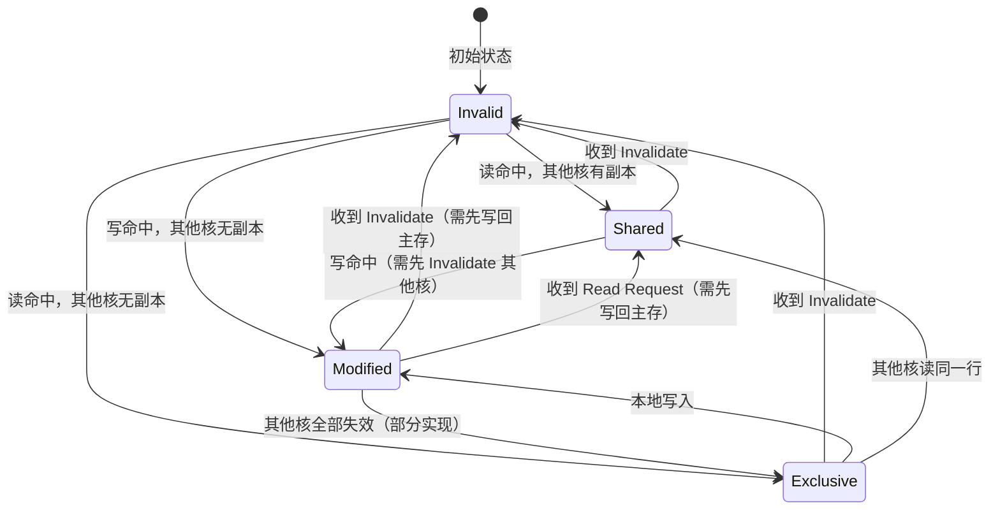
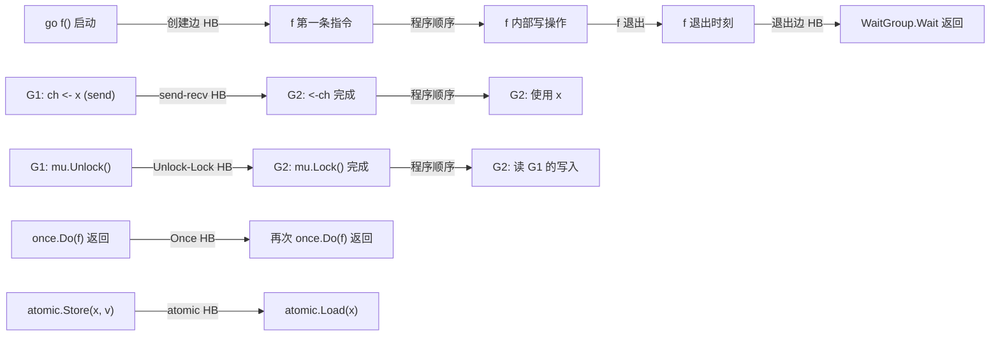
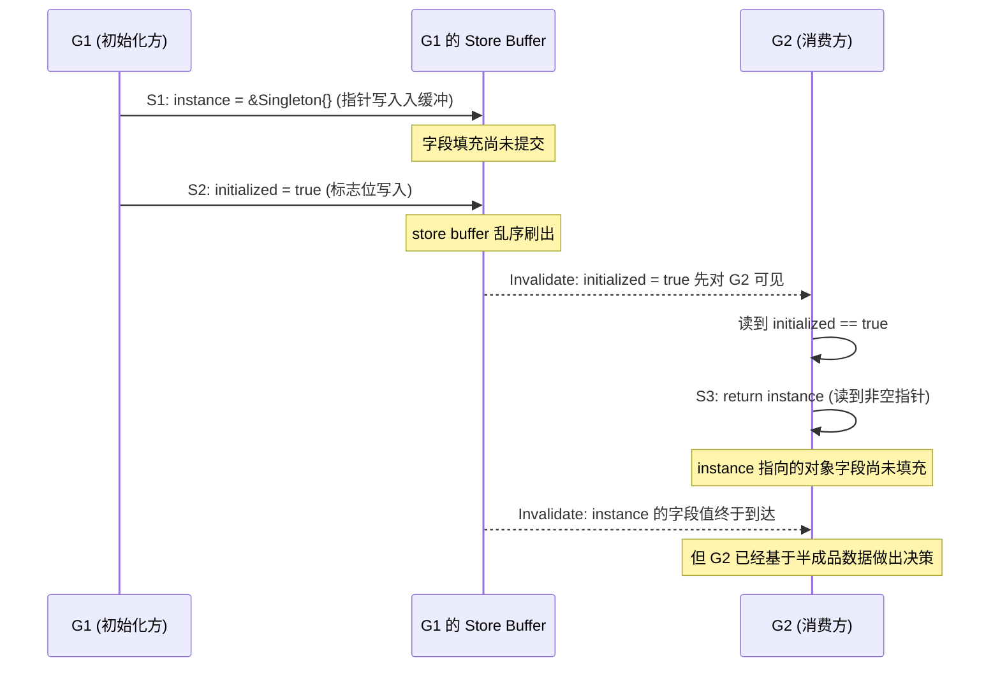

# Go 内存模型深入——可见性、Happens-Before 与数据安全发布

**摘要：**

并发程序最容易被误解的，并不是"怎么写出并行"，而是"写下去的东西，别人什么时候能看见"。一个 Goroutine 把 `initialized = true` 写下去，另一个 Goroutine 读到这个标志时，就一定能读到它前面那一串配置数据吗？直觉说"应该可以"，硬件和编译器却说"未必"——前者因为多级缓存的一致性传播存在延迟，后者因为在"as-if"规则下允许把指令重新排序。Go 在 2015 年首次发布内存模型，并于 2022 年进行了一次范围更大的修订，把原本只覆盖 Channel 与 Mutex 的 Happens-Before 偏序体系，扩展到 Goroutine 创建与退出、`sync.Once`、`sync/atomic` 等更多同步场景，为"谁在什么时候能看见什么"这一类问题给出一套可推理的形式化答案。

本文从 CPU 的 MESI 协议、store buffer、invalidate queue 这三道物理关卡出发，说明可见性问题为何是硬件层面的客观存在，而不是语言设计的无病呻吟；继而把 Go 内存模型中的 Happens-Before 偏序体系完整铺开，把 Goroutine 创建与退出、Channel 通信、Mutex 锁、`sync.Once`、`sync/atomic` 的同步边逐一画出来；再以双重检查锁定（DCL）这个经典反例，展示缺少 Happens-Before 边时程序如何"看起来正确，但在某一次 GC 之后、某一次 CPU 微码更新之后突然出错"；最后给出 data race 的精确定义与 `go build -race` 的取舍边界。行文试图抵达一个结论：**内存模型不是把硬件的事实告诉程序员，而是把这些事实抽象成可推理的偏序**——这正是它作为一门并发语言最不可或缺的一块拼图。

---

## 第 1 章 从硬件到编译器——为什么"看见"是个问题

### 1.1 硬件层面的可见性：三道物理关卡

讨论内存模型之前，先把 CPU 内部那条从"写入一个变量"到"别的核真正读到"的通路拆开看。现代多核处理器为了把每条指令的执行时间压到亚纳秒级，在核心与主存之间加入了至少三级缓冲结构，而每一级都会引入可见性延迟。

第一道关卡是**多级缓存（Cache）的副本一致性**。每个核心私有的 L1、L2 缓存会保存主存中若干缓存行（cache line，x86 上通常是 64 字节）的副本。核心 A 把变量 `x` 写入自己的 L1 缓存时，核心 B 的 L1 里可能还保留着 `x` 的旧值——为了让 B 看到新值，缓存子系统需要借助**MESI 协议**（Modified / Exclusive / Shared / Invalid）在核心之间广播失效消息。一条失效消息从 A 的缓存控制器出发，穿过片上互联（ring bus 或 mesh），到达 B 的缓存控制器，再把 B 的对应缓存行标记为 Invalid，整个过程通常需要几十到几百个 CPU 周期。也就是说，A 写完 `x` 之后，B 在一段时间内**仍然能读到旧值**，这不是 bug，而是物理规律。

第二道关卡是**存储缓冲（Store Buffer）**。即便缓存一致性协议运行得再快，也赶不上现代 CPU 流水线每周期写一条指令的速度。为了不因为等待远端缓存行的 Invalid 应答而让流水线停顿，每个核心在 L1 缓存前面又加了一层 store buffer：核心 A 写入 `x` 时，先把这条写入暂存在自己的 store buffer，立即继续执行下一条指令；等到缓存一致性协议把 A 的 L1 里 `x` 的缓存行升级为 Modified 状态（或者拿到 Exclusive 权限），store buffer 里的值才真正"提交"到 L1。这带来一个副作用：在 store buffer 尚未刷出的那一小段窗口里，A 自己再读 `x` 能拿到最新值（因为 CPU 有 store forwarding 机制），但 B 读 `x` 还是旧值——**写入对别的核心尚未可见**。

第三道关卡是**失效队列（Invalidate Queue）**。为了进一步加速，B 收到 A 发来的 Invalidate 消息时，并不立刻处理，而是把消息塞进一个有界队列，等到 B 自己真的需要读那条缓存行时，才从队列里取出消息并执行失效。这就让可见性延迟再叠加一层：A 已经写入、store buffer 已经刷出、A 的 L1 已经是 Modified 状态，但 B 的 invalidate queue 里那条消息还没被处理，B 读到的是队列生效之前的旧副本。

MESI 协议本身是一个四状态的状态机，每个缓存行在任意时刻处于其中一种状态，状态之间的转换由缓存控制器之间的消息驱动：



**Modified** 表示本核独占且已修改，写回主存前其他核不能读；**Exclusive** 表示本核独占但与主存一致；**Shared** 表示多核共享且与主存一致；**Invalid** 表示该缓存行不可用。一次写入要经历 Invalid → Modified 或 Shared → Modified 的转换，期间需要广播 Invalidate 消息、等待其他核应答——这就是可见性延迟的形式化来源。

把 MESI 的状态转换与 store buffer、invalidate queue 结合起来，可以得出一个关键的工程推论：**同一个 CPU 架构上，可见性延迟的下限取决于 store buffer 的刷出速度，上限取决于 invalidate queue 的积压深度**。在 x86 上，由于 TSO（Total Store Order）内存模型的存在，store buffer 必须对同一地址的读写保持顺序——也就是说，对同一个变量 `x` 的写入，即使在 store buffer 里，对其它核心的可见性顺序也是确定的；但不同地址的写入，在 store buffer 里的相对顺序可以任意调整。这就解释了为什么 x86 程序员常常觉得"可见性问题不明显"——TSO 帮他们挡掉了一大半乱序场景。但在 ARM、POWER、RISC-V 这类弱内存模型架构上，store buffer 对不同地址的写入顺序完全无约束，可见性问题会显著放大。

这三道关卡叠在一起，构成了一个并不让人舒服的结论：**一个核心的写入，并不是在一条 CPU 指令执行之后就对其它核心可见**。什么时候可见、可见到哪一个版本，取决于缓存一致性协议的推进、store buffer 的刷出时机、invalidate queue 的消费时机——而这三者在用户态代码看来几乎是不可控的。

> [!note] 一个工程比喻
> 可以把这三道关卡想象成一座城市里三家快递公司的接力：A 写下一封快递（store buffer），交给发件城市的中转站（L1 缓存），中转站要把"这封信作废"的通知送到收件城市的中转站（MESI Invalidate 消息），收件城市的中转站再塞进本地邮差的待办筐（invalidate queue），邮差最终上门把旧报纸收走，换上新报纸。任何一个环节积压，收件人看到的就还是旧报纸——而程序员平时写的那句 `x = 1`，在硬件眼里只是"把一封信交给第一家快递公司"，至于它什么时候到收件人手里，不归程序员管。

### 1.2 编译器的"善意谎言"：指令重排与 as-if 规则

如果只有硬件层面的乱序，事情还算可控——毕竟多数 CPU 在单核心内会保证"程序顺序可见性"（program order），只要核心自己不把自己骗过去，多线程之间靠锁或者内存屏障就能协调。但现代编译器会在另一个维度引入新的乱序：**它在把源码翻译成机器码时，为了榨取更高的指令级并行度，会调整指令的执行顺序**。

编译器的行为受一条铁律约束，叫做 **as-if 规则**：任何变换，只要在单线程的可观察语义上与源代码等价，编译器就有权执行。这条规则看似温和，实则给了编译器巨大的自由度。考虑下面这段单线程代码：

```go
x = 1       // S1
y = 2       // S2
print(x)    // S3
```

如果编译器判断 `y` 与 `x` 之间没有数据依赖（`y` 的写入不影响 `print(x)` 的结果），它可以合法地把 S2 调到 S1 之前执行。在单线程里，这个调整完全不会被发现——`print(x)` 依然打印 1，as-if 规则得到满足。

一旦这段代码被放进多线程上下文，问题就来了：另一个 Goroutine 可能在 S1 与 S2 之间读取 `y`，原本期望 `y == 0`，却读到 `y == 2`。在 as-if 规则下，编译器**没有义务**顾及这种跨线程的观察视角——它只对自己正在编译的这一条执行流负责。Go 的编译器在 SSA（Static Single Assignment）后端会做大量的指令调度、寄存器分配、死代码消除，只要单线程语义不变，它就可以把语句重排。

硬件层面的乱序执行（out-of-order execution）与编译器层面的指令重排，是两种独立的、叠加的乱序来源。前者发生在 CPU 内部，由分支预测、保留站、重排序缓冲区（ROB）驱动；后者发生在编译期，由优化 pass 驱动。二者都遵循同一个哲学：**在不改变单线程可观察行为的前提下，尽可能提升性能**。

把编译器和 CPU 的乱序放在一起看，可以得出一个更让人不安的结论：**同一段源码，从"程序员写下去的顺序"到"别的 Goroutine 真正能看到的顺序"，中间至少经历两次独立的、可能互相叠加的重排**。第一次是编译器把源码翻译成机器码时做的重排，第二次是 CPU 在执行机器码时做的重排。这两次重排各自独立，可能把同一个写入朝同一个方向推两次，也可能把它们朝相反的方向拉——程序员无法预测，也无法通过阅读源码判断。

这正是为什么"直觉上正确"的并发代码需要一套形式化的工具来审视。硬件乱序、编译器乱序、缓存一致性传播延迟——这三者叠加后的可见性行为，远超出人脑直接推理的能力范围。Go 内存模型（以及 C++、Java、Rust 的内存模型）的出现，本质上是承认了"人脑无法直接推理硬件行为"这一事实，转而提供一个**抽象层**：把硬件的复杂行为，抽象成一套可推理的偏序关系，让程序员只需要在这个抽象层上做判断，而不必关心硬件究竟做了什么。

> [!info] 一个工程比喻
> 编译器就像一个极其能干的秘书，老板（程序员）写了一份工作备忘录，秘书在执行时自作主张地把几件不相关的事情调换了顺序——老板自己看不出来，因为只有老板会看整份备忘录；但老板的同事（其它线程）如果也在看这份备忘录的某些局部，就会撞见"怎么这件事还没做，那件事已经做了"的尴尬场面。as-if 规则就是公司对秘书的授权边界：只要老板看不出问题，秘书可以任意调整。

这里值得补充一点：**编译器的重排与 CPU 的重排，作用在不同层次的"程序"上**。编译器的重排作用在"源码 → 机器码"这一层，它看到的是一整段函数体，可以自由调度不同语句对应的机器指令；CPU 的重排作用在"机器码 → 实际执行"这一层，它看到的是一条条已经翻译好的机器指令，可以通过保留站、重排序缓冲区在运行时动态调整执行顺序。两层重排各自独立，互不知情——编译器不知道 CPU 会怎么重排，CPU 也不知道编译器已经做过哪些重排。这种"两层各自优化"的设计，是性能得以持续提升的关键，但也是并发程序正确性难以推理的根源。

### 1.3 不这样会怎样：一个 counter 的教训

为了把硬件与编译器的双重乱序具体化，看一个最小反例。设两个 Goroutine G1 与 G2 共享三个普通变量 `data`、`ready`、`result`，初始全为 0：

```go
// G1
data = 42        // S1
ready = true     // S2

// G2
for !ready {     // S3
    // spin
}
print(data)      // S4
```

直觉上，G2 既然看到 `ready == true`，那么 `data == 42` 一定已经写入。但这个推理在三个层面都站不住：

- **编译器层面**：G1 中 S1 与 S2 没有数据依赖，编译器可能把 S2 调到 S1 之前。此时 G2 看到 `ready == true` 时，`data` 还没写入，打印出 0。
- **CPU 层面**：即便编译器保留了顺序，CPU 的 store buffer 也会让 S2 先于 S1 对 G2 可见——G2 的核先收到 `ready = true` 的写入传播，但 `data = 42` 还在 G1 的 store buffer 里排队。
- **缓存层面**：`data` 与 `ready` 如果恰好落在不同的缓存行，它们的一致性传播互相独立，到达 G2 的顺序完全可能颠倒。

这段代码就是经典的**数据竞争（data race）**。修复它需要一种能让 G2 "确定 S1 在 S2 之前对 G2 可见"的机制——在 Go 里，这种机制就是 Happens-Before 偏序。

值得强调的是，这段代码在 x86 机器上大概率跑得"看起来正确"，因为 x86 的 TSO 内存模型禁止 store-store 重排——S1 与 S2 的相对顺序在硬件层面被保留；但这段代码一旦搬到 ARM 服务器（譬如 AWS Graviton 或 Ampere Altra），就可能偶发性地让 G2 打印出 0。这不是"换了 CPU 才有 bug"，而是"换了一个更忠实反映硬件乱序能力的 CPU，把原本就被允许的 bug 暴露了出来"——x86 的 TSO 只是恰好把这类 bug 隐藏了数十年，让程序员误以为"程序顺序可见性"是理所应当的。Go 内存模型的存在，正是为了让这种跨架构的正确性不依赖"某个特定 CPU 的仁慈"，而是建立在可证明的 HB 边之上。

### 1.4 编译器重排的工程证据

如果认为"编译器重排"只是理论上的可能性，可以看一个真实的例子。考虑下面这段 Go 代码：

```go
var x, y int

func init() {
    x = 1     // S1
    y = 2     // S2
}

func reader() {
    for y == 0 {
        // spin
    }
    if x == 0 {
        println("unexpected")   // 这一行能跑到吗？
    }
}
```

在源码层面，S1 先于 S2，`x` 必然在 `y` 之前被赋值；读者 Goroutine 看到 `y != 0` 时，`x` 理应已经等于 1。但 Go 的 SSA 后端在做寄存器分配和指令调度时，可能判断 S1 与 S2 没有数据依赖（两者写的是不同变量），从而把 S2 提前——或者在 CPU 的 store buffer 里，S2 先于 S1 刷出。无论哪种机制，读者 Goroutine 都可能在 `x == 0` 的分支里打印出 "unexpected"。

这段代码跑 `go build -race` 会立刻报警——但即使不开 race detector，在某些 ARM 机器上它也会随机触发 "unexpected" 分支。这就是为什么"看起来顺序正确"的并发代码，必须经过内存模型的审视才敢说是正确的。

---

## 第 2 章 Go 内存模型——Happens-Before 偏序体系

### 2.1 Happens-Before 的定义与意义

**Happens-Before**（以下简称 HB）是 Leslie Lamport 在 1978 年的论文《Time, Clocks, and the Ordering of Events in a Distributed System》中提出的偏序关系，被后来几乎所有语言的内存模型借用来描述并发事件之间的可见性保证。在 Go 的内存模型中，HB 用一条简洁的规则把"写入"与"读取"串起来：

> 如果事件 A happens-before 事件 B，那么 A 在 A 之后执行的所有**内存写入**，对 B 而言都是**可见的**。

反过来，如果 A 与 B 之间**不存在** HB 关系，也**不存在** B HB A——即 A 与 B 是**并发（concurrent）**的——那么 A 的写入对 B 是否可见就是**未定义**的：可能看得见，可能看不见，可能看见一半。Go 内存模型的全部努力，就是在各种同步原语上定义出足够多的 HB 边，让程序员能够推理出"A 的写入对 B 可见"。

HB 关系有两条基本性质：

- **传递性**：若 A HB B，B HB C，则 A HB C。
- **非对称性**：若 A HB B，则 B 不能 HB A。

这意味着 HB 构成一个**偏序集（partial order）**，而不是全序。多数并发事件在 Go 程序里是并发的——它们之间没有 HB 关系；只有那些被同步原语明确串联起来的事件，才会形成 HB 链。

2022 年修订的 Go 内存模型（Go 1.19 同步生效）把这套偏序体系扩展到更大范围。修订前的版本主要描述 Channel 与 Mutex 的同步语义，对 Goroutine 创建、退出、`sync.Once`、`sync/atomic` 只字未提或者含糊其辞；修订后，所有这些场景都有了精确的 HB 描述，并且与 C++、Java、Rust 的内存模型在概念上对齐——这意味着跨语言互操作时，程序员可以用同一套心智模型思考问题。

把上述几类 HB 边画到一张图上，可以看到它们如何交织成一个偏序网络——每个同步事件是一个节点，每条 HB 边是一个箭头，传递性把零散的箭头连成长链：



这张图的关键观察是：**程序顺序（program order）本身也贡献 HB 边**——同一个 Goroutine 内的语句，按代码顺序形成 HB 链；同步原语只是把不同 Goroutine 的 HB 链串联起来。没有同步原语时，每条 Goroutine 是孤立的 HB 链；有了同步原语，这些链才开始交叉连通。Go 的调度器（见 [[01 Goroutine 与 GMP 调度器]]）在切换 Goroutine 时不会隐式地建立任何 HB 边——这是很多人容易忽略的：Goroutine 的调度切换只是执行权的转移，不构成同步事件。

### 2.2 Goroutine 创建与退出的 HB 边

2022 版内存模型新增的两条最基础的 HB 边，与 Goroutine 的生命周期直接相关：

- **创建边**：`go f()` 这条语句中，`go` 关键字**启动 Goroutine 的时刻** happens-before **f 开始执行的第一条指令**。这条规则保证的是：父 Goroutine 在 `go f()` 之前写下的所有变量，子 Goroutine 在第一条指令处都能看到。
- **退出边**：Goroutine f **退出的时刻** happens-before **任何观察到 f 已退出的同步事件**——譬如 `sync.WaitGroup` 的 `Wait()` 返回，或者与 f 关联的 Channel 被关闭后读端的零值接收。这条规则保证的是：f 在退出前写下的所有变量，对等待它结束的那一方可见。

这两条边看似显然，实际上填补了一个长期空缺。修订之前，程序员只能靠"Channel 传数据"或者"Mutex 锁一下"这种间接手段来获得 HB；修订之后，`go` 本身就是一个同步点。这带来一个直接的工程推论：

```go
config := loadConfig()   // 父 Goroutine 写入
go func() {
    use(config)          // 子 Goroutine 读取——HB 由"go"关键字保证
}()
```

这段代码是安全的——`loadConfig()` 的写入 happens-before 子 Goroutine 的第一条指令，`config` 的全部内容对子 Goroutine 可见。若没有这条 HB 边，父 Goroutine 写入的 `config` 字段可能还在 store buffer 里，子 Goroutine 读到的是一个半初始化对象。

退出边的工程价值同样不可忽视。一个常见的模式是：主 Goroutine 启动一组 worker，用 `sync.WaitGroup` 等待它们全部完成后再收集结果。在 2022 版内存模型下，每个 worker 的写入 happens-before worker 退出，worker 退出 happens-before `wg.Wait()` 返回，因此 worker 的所有写入对 `wg.Wait()` 之后的主 Goroutine 都可见。这条规则让"并发计算 + 汇总结果"这种经典模式有了形式化的正确性保证。修订之前，程序员需要自己在 `wg.Wait()` 之后再套一层 Channel 通信或者 Mutex 锁才能获得同样的 HB 边，既繁琐又容易遗漏。

不过这两条边有一个常被误解的边界：**HB 边只在 `go` 启动那一刻和 Goroutine 退出那一刻建立，中间过程不提供额外保证**。换句话说，如果父 Goroutine 在 `go f()` 之后又修改了某个变量，这个修改对 f 不一定可见——因为 f 已经开始执行，父 Goroutine 后续的写入不再受创建边的保护。如果父子之间需要持续的可见性传递，就必须借助 Channel、Mutex 或者 atomic 这类显式同步手段。

### 2.3 Channel 通信的 HB

Channel 是 Go 并发模型中最具表达力的同步手段，它同时承载了数据流与控制流——关于 Channel 的阻塞唤醒机制与底层环形缓冲，参见 [[03 Channel 的底层结构与阻塞唤醒机制]]。Go 内存模型为 Channel 通信定义了一组清晰的 HB 规则：

- **发送-接收边**：第 k 次 `send`（`ch <- x`）happens-before **第 k 次 `receive`（`<-ch`）完成**。这条边把一次 send 的全部写入，对接收端可见。
- **关闭-接收边**：`close(ch)` happens-before **接收端读到零值**。换句话说，关闭操作之前的所有写入，对读到零值的那个 Goroutine 都可见。
- **无缓冲 Channel 的特殊规则**：无缓冲 Channel 上，一次 `send` happens-before **对应的 `receive` 开始**——也就是说，发送端开始阻塞、直到接收端就绪，这一段时间里发送端在 send 之前的所有写入，都必须对接收端可见。这条规则比缓冲 Channel 更强，因为它要求 send 的可见性在 receive 开始之前就要落实，而不是在 receive 完成时。
- **容量为 C 的缓冲 Channel**：第 (k+C) 次 `receive` happens-before **第 k 次 `send` 完成**。这条看似反直觉的规则，对应的是缓冲 Channel 的"满则阻塞"语义：当 send 成功时，前面至少有 C 次 receive 已经完成，因此那 C 次 receive 的写入对这次 send 可见。

用一个容量为 3 的缓冲 Channel 来具体化这条规则：G1 连续发送 m1、m2、m3 三条消息，Channel 已满；G1 想发送第 4 条消息 m4 时被阻塞，直到 G2 接收 m1（第 1 次 receive）之后 m4 才能发送成功。内存模型说：第 1 次 receive happens-before 第 4 次 send 完成——也就是说，G2 接收 m1 之前的所有写入，对 G1 成功发送 m4 之后都可见。这条规则反映的是缓冲 Channel 的"流控"语义：发送方在满队列时被接收方的消费速率所约束，这种约束在内存模型里也被形式化为一条 HB 边。

把这几条规则放到工程里，就是 Channel 作为同步媒介的全部能力：

```go
ch := make(chan Config)

go func() {
    cfg := buildConfig()   // S1
    ch <- cfg              // S2：send
}()

cfg := <-ch                // S3：receive
use(cfg)                   // S4
```

S1 happens-before S2（程序顺序），S2 happens-before S3（send-receive 边），S3 happens-before S4（程序顺序）。由 HB 的传递性，S1 happens-before S4，`buildConfig()` 的全部写入对 `use(cfg)` 可见。

> [!warning] 一个常见的误用
> 用 Channel 传数据时，很多 Goroutine 习惯"发完就忘"，不再关心接收端有没有读到。这种用法在功能上没问题，但在内存模型上意味着：发送端后续的写入**不再**对接收端可见，因为 HB 只延伸到"第 k 次 receive 完成"为止。如果发送端在 send 之后立刻修改了 `cfg` 的某个字段，而接收端在 receive 之后才读这个字段，这就构成 data race。

### 2.4 锁同步：Mutex 与 RWMutex

`sync.Mutex` 在内存模型里对应一条简洁的 HB 边：**第 n 次 `Unlock` happens-before 第 m 次 `Lock` 完成，其中 m > n**。换句话说，同一把锁的任何一次 unlock，对之后任意一次 lock 都是可见的——无论中间隔了多少次 lock-unlock 循环。关于 Mutex 内部 state 字段与 sema 信号量的协作机制，参见 [[05 sync 包——Mutex、RWMutex 与 WaitGroup 的实现]]。

这条规则的工程意义在于：Mutex 不仅仅是"互斥"，它还是"可见性传递器"。Goroutine A 在持有锁期间写下的变量，在 A 释放锁之后，对任何拿到这把锁的 Goroutine B 都可见。B 拿锁的动作，相当于把 A 之前所有的写入一次性拉取到自己的可见范围内。从硬件角度看，`Unlock` 的实现里会包含一条**释放屏障（release barrier）**——它把锁内所有写入刷出 store buffer 并对其它核心可见；`Lock` 的实现里会包含一条**获取屏障（acquire barrier）**——它把 invalidate queue 消费干净，确保后续读到的都是最新值。这两条硬件屏障，正是 Unlock-Lock HB 边的物理基础。

`sync.RWMutex` 在 HB 体系里的规则稍微复杂一些：

- 任意一次 `RLock` happens-before **与之配对的 `RUnlock`**（读写锁内部的读者计数同步）。
- 第 n 次 `Unlock`（写锁释放）happens-before **第 m 次 `RLock`（读锁获取）完成**，m > n。
- 第 n 次 `RUnlock` happens-before **第 m 次 `Lock`（写锁获取）完成**，m > n。

把 RWMutex 放进 HB 体系里，就能理解为什么"读端拿到锁之后能看到写端最近的写入"——因为写端的 Unlock 对读端的 RLock 有 HB 边。

### 2.5 sync.Once 的 HB

`sync.Once` 在 Go 里常用于"延迟到第一次使用时才初始化"的场景。内存模型为它定义了一条精准的 HB 边：

> **`f` 在 `once.Do(f)` 中返回** happens-before **任何其它 `once.Do(f)` 返回**。

这条边保证的是：第一个调用 `once.Do(f)` 的 Goroutine 在 `f` 内部写下的所有变量，对任何后续调用 `once.Do(f)` 的 Goroutine 都可见——无论后续调用是等待了初始化完成，还是直接命中了"已经初始化"的快速路径。

这条规则解决了一个过去容易踩坑的场景：

```go
var once sync.Once
var config *Config

// G1
once.Do(func() {
    config = loadConfig()   // S1
})

// G2
once.Do(func() {
    // 什么都不做，只是触发初始化检查
})
use(config)                 // S2
```

在 2022 版内存模型下，S1 happens-before G2 的 `once.Do` 返回，S2 在 G2 的 `once.Do` 之后，因此 S1 happens-before S2，`config` 对 G2 可见。修订前，这段代码的可见性保证是含糊的——`sync.Once` 的文档只说"只执行一次"，没说可见性。

`sync.Once` 的底层实现值得单独说一下。它内部有一个 `done` 字段（`uint32` 类型，表示是否已经初始化过）和一把 `Mutex`。快速路径（已经初始化）只是对 `done` 的一次 atomic Load，不拿锁；慢路径（首次初始化）才加锁。这条 HB 边在硬件上对应的是：慢路径在初始化完成后会对 `done` 做一次 atomic Store（带 release 语义），快速路径会对 `done` 做一次 atomic Load（带 acquire 语义）——这两次原子操作之间构成 HB 边，把初始化内的所有写入对快速路径可见。这个实现细节解释了一个常见的性能观察：`sync.Once` 在快速路径上的开销与一次 atomic Load 相当（几十纳秒），只有在首次调用时才有 Mutex 的开销——这也是为什么它被大量用于单例、全局配置、惰性初始化等场景。

不过 `sync.Once` 有一个常被误解的边界：**它只保证 `f` 的执行对所有后续的 `once.Do(f)` 调用可见，不保证 `f` 执行过程中途的中间状态可见**。如果 G1 正在执行 `f`、`f` 还没返回，G2 此时也调用 `once.Do(f)`，G2 会被阻塞在 `once.Do` 内部的 Mutex 上，直到 G1 的 `f` 完整执行完毕并释放锁。这是符合预期的"等待初始化完成"语义，但某些工程师误以为 `sync.Once` 能让"初始化过程中途"的写入对其他 Goroutine 可见——这是错的。HB 边只有在 `f` 返回之后才建立，初始化中的中间状态对任何其它 Goroutine 都不可见。

> [!info] 一个工程比喻
> `sync.Once` 就像一个办公室的公用白板：第一个走进来的人把关键信息写上去，后面进来的人哪怕不重新抄一遍，也能看见白板上已经写好的内容。HB 边保证的是"写白板的动作"对"后来看白板的人"可见，而不是"后来看白板的人必须等第一个人写完"——实际上后者可能进来的时候第一个人已经写完了，他只要看一眼白板，就能获得完整信息。

### 2.6 sync/atomic 的顺序语义

`sync/atomic` 包提供了一组可以在不加锁的前提下，对单个变量进行原子读写的原语。2022 版内存模型为 atomic 操作定义了两类 HB 边：

- **原子写-读边**：对同一个 `atomic.Value`、`atomic.Pointer[T]`、`atomic.Int32` 等类型的第 n 次 `Store` happens-before **第 m 次 `Load` 完成**，m ≥ n。这条边与 Channel、Mutex 的 HB 边类似，保证的是"写入对之后的读取可见"。
- **swap / compare-and-swap 的边**：`Swap` 与 `CompareAndSwap` 既是读又是写，它们对后续的 `Load` 也有 HB 边——第 n 次 `Swap` / `CAS` 成功 happens-before 第 m 次 `Load` 完成，m > n。

atomic 操作有一个重要的语义细节：它们只保证**针对同一个原子变量的读写顺序**，不保证跨变量的顺序。下面这段代码是两个独立 atomic 变量的写入：

```go
var data atomic.Int32
var ready atomic.Bool

// G1
data.Store(42)        // S1
ready.Store(true)     // S2

// G2
for !ready.Load() {   // S3
    // spin
}
print(data.Load())    // S4
```

这段代码是安全的——S1 happens-before S2（程序顺序），S2 happens-before S3（atomic 写-读边），S3 happens-before S4（程序顺序），传递后 S1 happens-before S4。但如果把 `data` 与 `ready` 改成普通变量，这段代码就会退化成 §1.3 里的 data race，因为普通变量之间没有 HB 边。

atomic 操作在 Go 里还有一个额外的硬件语义：它们在所有架构上都会编译成**带内存屏障（memory barrier / fence）的原子指令**——x86 上是 `lock` 前缀，ARM 上是 `ldar` / `stlr` 这类带 acquire / release 语义的指令。这些硬件屏障会强制刷出 store buffer、强制消费 invalidate queue，从而在物理层面把 HB 边落地。换句话说，atomic 的 HB 边不是编译器凭空构造的，而是有硬件层面的保证作为基础。

需要注意的是，Go 的 `sync/atomic` 在 Go 1.19 之前只提供针对基本类型的原子操作（`atomic.LoadInt32`、`atomic.StorePointer` 等），从 Go 1.19 起新增了泛型化的 `atomic.Int32`、`atomic.Pointer[T]`、`atomic.Bool` 等类型，并配套明确了它们的内存模型语义——在此之前，这些类型的 HB 行为在规范层面是含糊的。关于 atomic 与 sync.Map、sync.Pool 的协作与性能取舍，参见 [[10 sync.Map、sync.Pool 与原子操作]]。

---

## 第 3 章 双重检查锁定——伪正确性的陷阱

### 3.1 DCL 的代码形态

**双重检查锁定（Double-Checked Locking，DCL）**是一种试图"既避免每次访问都加锁，又保证延迟初始化正确性"的惯用法，在很多语言里都出现过。用 Go 写出来大致是这个样子：

```go
var instance *Singleton
var initialized bool
var mu sync.Mutex

func GetInstance() *Singleton {
    if !initialized {            // 第一次检查：无锁快速路径
        mu.Lock()
        defer mu.Unlock()
        if !initialized {        // 第二次检查：持锁慢路径
            instance = &Singleton{...}   // S1
            initialized = true           // S2
        }
    }
    return instance              // S3
}
```

初看上去这段代码无懈可击：第一次检查走无锁快速路径，命中缓存时直接返回；未命中时才加锁走慢路径，第二次检查避免重复初始化。很多工程团队在代码审查时都会放过这种写法——它"看起来"是正确。

### 3.2 为什么伪正确：缺少 HB 时部分构造对象

但 DCL 在几乎所有允许指令重排的内存模型里都是错的，Go 也不例外。错误的关键在于：**S3 对 `instance` 的读取，与 S1 对 `instance` 的写入之间，没有 HB 边**。

考虑下面这个执行时序：

1. G1 进入慢路径，持有锁，执行 S1 开始分配 `Singleton` 对象。
2. 编译器或者 CPU 把 S1 的写入分成两步：先给 `instance` 分配内存并把指针写下来，再填充 `Singleton` 的字段。也就是说，`instance` 这个指针**在字段填充完成之前**就已经可见了。
3. S2 把 `initialized` 设为 true。
4. G2 此时进入 `GetInstance()`，第一次检查读到 `initialized == true`，跳过锁，直接走 S3 返回 `instance`。
5. G2 拿到的 `instance` 是一个**字段尚未填充**的半成品对象。

这个"字段尚未填充"的窗口，在单核 CPU 上不会出现（因为单核内程序顺序可见性），在多核 CPU 上则完全依赖编译器是否重排、CPU 是否乱序、缓存一致性协议是否在那一刻传播到位。它可能运行了三年都没出问题，直到某次编译器升级、某次 CPU 微码更新、某次 GC 调整了对象布局，突然崩溃。用一张时序图可以看清 DCL 错误的执行路径：



这张图里最致命的瞬间是"store buffer 乱序刷出"那一行——`initialized = true` 的写入先于 `instance` 字段的写入到达 G2 的缓存，让 G2 在 `instance` 的对象内容还未就位时就看到了"已初始化"的标志。这正是 HB 边缺失导致的部分构造对象可见性反例——关于这类并发陷阱的更多案例，参见 [[11 并发陷阱与调试——Goroutine 泄漏、死锁与 Race Detector]]。

> [!warning] 一个工程比喻
> DCL 的伪正确性，就像一栋还没装修完就发钥匙的房子：开发商（G1）先把门牌号挂上（`instance = &Singleton{...}` 的指针赋值），再慢慢装修内部（填充字段）；但钥匙（`initialized == true`）在装修完之前就发出去了。第一位住户（G2）拿到钥匙开门一看，墙是毛坯的，水管还没接——不是住户的错，也不是开发商偷工减料，而是发钥匙的动作和装修完成的动作之间，缺少一道"装修完毕才发钥匙"的强制顺序。HB 边就是这道强制顺序。

### 3.3 安全发布的充要条件

要修复 DCL，需要让 S1 对 S3 之间建立 HB 边。在 Go 里，可用的手段有三条：

- **让 `initialized` 成为 atomic 变量**。`initialized.Store(true)` 与 `initialized.Load()` 之间有 HB 边，而 S1 在程序顺序上先于 `initialized.Store(true)`，S3 在程序顺序上后于 `initialized.Load()`，传递后 S1 happens-before S3。这是最干净的方案。
- **让 `instance` 本身成为 atomic 变量**。`instance.Store(&Singleton{...})` 与 `instance.Load()` 之间有 HB 边，同时 atomic Store 自带 release 语义，会把 `Singleton` 字段填充的写入一起发布出去。
- **让 `instance` 通过 Channel 发布**。Channel 的 send-receive HB 边会把整个 `Singleton` 对象（含字段）对接收端可见——这就是为什么 Go 社区常说"Channel 是安全发布（Safe Publication）的推荐手段"。

**安全发布的充要条件**可以总结成一句话：**发布方的写入事件 happens-before 消费方读到该写入的事件**。HB 边是这条条件的充分必要条件，不多不少——任何缺少 HB 边的"发布"都只是"可能看得见"，而不是"一定看得见"。

```go
// 方案一：atomic bool 作屏障
var initialized atomic.Bool
var instance *Singleton

func GetInstance() *Singleton {
    if !initialized.Load() {
        // ... lock, init, initialized.Store(true)
    }
    return instance
}

// 方案二：atomic pointer
var instance atomic.Pointer[Singleton]

func GetInstance() *Singleton {
    if instance.Load() == nil {
        // ... lock, instance.Store(&Singleton{...})
    }
    return instance.Load()
}
```

两种方案在性能上差异很小——atomic 的 Load 在无竞争时只是一条带 acquire 语义的读指令，比 Mutex 的 Lock/Unlock 便宜得多；但 atomic 只能保护单个变量，如果发布的不止一个指针，而是一组关联字段，就必须用 atomic struct、atomic Value 或者 Channel，不能再拆成多个独立 atomic。

从工程实践看，Go 社区对"如何安全发布一个对象"有相对稳定的偏好：

- **简单对象、单字段初始化**：用 `sync.Once`，代码最清晰，HB 边由 Go runtime 提供，不需要自己操心。
- **需要频繁读、偶尔写的配置对象**：用 `atomic.Pointer[T]` 持有指向配置对象的指针，写端整体构造新对象后原子地替换指针，读端永远看到完整的新对象或旧的完整对象，不会出现中间状态。
- **多生产者多消费者的复杂场景**：用 Channel 传递指针，Channel 的 send-receive HB 边自然覆盖到整个对象的可见性——这也是 Go 社区常说"不要通过共享内存来通信，而要通过通信来共享内存"的内存模型依据。

这三种方案在性能上的差异在绝大多数场景里可以忽略；真正的差异在于心智模型——`sync.Once` 是"我只需要初始化一次"的语义，`atomic.Pointer` 是"我需要一个总是可见完整对象的变量"的语义，Channel 是"我需要用消息传递来串联两个 Goroutine"的语义。选哪种，取决于工程意图，而不是性能数字。

---

## 第 4 章 data race 的精确定义与 race detector

### 4.1 data race 的精确定义

很多程序员对 **data race** 的理解停留在"两个线程同时写同一个变量，结果错了"。这个理解在 Go 的内存模型框架下是不准确的。data race 的精确定义是：

> **两个对同一内存位置的访问，至少其中一个是写入，且它们之间没有 Happens-Before 边，那么这两个访问构成 data race。**

注意定义里的几个关键点：

- **两个都是读取不构成 data race**。多个 Goroutine 同时读同一个变量是安全的——只要没人写，就没有可见性问题。
- **data race 不是"结果错误"的同义词**。即使两个并发访问"碰巧"得到了"正确"结果，它们仍然是 data race——因为缺少 HB 边意味着结果的正确性是**偶然的**，不是**保证的**。
- **data race 是程序的属性，不是执行结果的属性**。同一段代码在某些执行里看起来没问题，在另一次执行里崩溃，都不改变"data race 存在"的事实。

这个定义与 C++、Java、Rust 内存模型中的 data race 定义在语义上一致——这也是 2022 版 Go 内存模型修订时刻意对齐的部分。它把 data race 从"看起来错了"这种模糊判断，提升为"有或者没有 HB 边"这种可形式化验证的判断。

### 4.2 race detector 的原理与取舍

Go 在 1.1 引入了 **race detector**，通过 `go run -race` 或者 `go build -race` 开启。它的工作原理是**在编译时给每一次内存访问插桩**，在运行时记录每个 Goroutine 对每个变量的访问，并检查是否存在 HB 边；若检测到两个并发访问之间没有 HB 边，就报告一个 data race。

race detector 的实现基于两个核心技术：

- **ThreadSanitizer（TSan） Runtime**：这是一套由 LLVM 社区开发的通用 data race 检测框架，Go 的 race detector 在 runtime 层集成了 TSan。每次内存访问时，TSan 会维护一个"向量时钟（vector clock）"——每个 Goroutine 一组时间戳，记录它对各个同步事件的了解程度。两次访问之间是否有 HB 边，等价于它们的向量时钟是否可比。具体而言，每个 Goroutine g 维护一个向量 `VC[g]`，向量长度等于系统中 Goroutine 的总数；每次同步事件（send、receive、Lock、Unlock、go、WaitGroup.Done 等）发生时，涉及的 Goroutine 会把各自的向量做 max-merge，再把对应位置加 1。一次内存访问被记录为 `(g, VC[g], stack)` 三元组；检测 race 时，TSan 比较两次访问的向量时钟：若一个向量小于等于另一个（每个分量都不大于），说明存在 HB 边，不构成 race；否则构成 race。
- **插桩开销**：每次内存访问多出几条指令用于更新向量时钟，内存使用量也会显著增加（每个被跟踪的变量需要保存历史访问记录）。典型情况下，开启 race detector 会让程序的内存使用增加 5-10 倍，运行速度降低 2-20 倍。Go 运行时本身（见 [[Golang/Go运行时进阶与底层机制/00 专栏导览|Go 运行时进阶与底层机制]]）对 race detector 也做了配套适配：Goroutine 的调度、channel 的阻塞唤醒、sync 原语的 park/unpark，都会在 TSan 层面对应的回调里更新向量时钟，从而让 Go 特有的同步原语也能被正确建模。

这种开销决定了 race detector 的使用取舍：

| 场景 | 建议 | 原因 |
|---|---|---|
| 单元测试 | **必开** `-race` | 单元测试覆盖率高时，能在 CI 阶段捕获绝大多数 data race，代价可接受 |
| 集成测试 / 端到端测试 | 视资源情况开启 | 开销较大，建议在 nightly build 或专门的压力测试环境跑 |
| 生产环境 | **不开**，或只灰度极小比例 | 内存与 CPU 的额外开销在生产负载下可能不可接受 |
| Benchmark | 不开 | 测出来的数字不反映真实生产性能 |

race detector 还有一个重要限制：它只能检测**执行到的路径**上的 data race。如果某个 data race 只在特定的并发时序下才会暴露，而测试没有覆盖到时序，race detector 就不会报出来。换句话说，**race detector 报告"没发现 race"不等于"没有 race"**——它是运行时检测，不是静态证明。

### 4.3 边界与反例

race detector 有几个常被忽视的边界：

- **它不报告"潜在 race"**。即使代码里存在两个并发访问，只要程序的实际执行中这两个访问没有被同时触发，race detector 就不会报警。
- **它对"benign race"也会报警**。有些 data race 在工程上是有意为之的——譬如统计计数器的近似累加，即使多个 Goroutine 同时写入同一个 counter，业务上也能接受计数误差。race detector 不知道这种业务语义，照样报警。这类情况通常用 `//nolint` 或者通过改用 atomic 来消除。
- **它不替代正确性证明**。race detector 只能告诉你"这段代码在跑这些测试时没发生 data race"，不能告诉你"这段代码在所有可能的执行下都没有 data race"。后者需要形式化验证或者人工推理。

一个常被引用的反例是下面的"延迟初始化 + 重入"：

```go
var cache map[string]string

func initCacheOnce() {
    if cache != nil {        // 无锁读
        return
    }
    mu.Lock()
    defer mu.Unlock()
    if cache == nil {
        cache = loadCache()  // 写入
    }
}
```

即使 `loadCache()` 的写入发生在锁内，**`cache != nil` 这一次无锁读与 `cache = loadCache()` 之间没有 HB 边**——因为 HB 边只存在于"Unlock"与"Lock"之间，而 `cache != nil` 这一次读发生在任何 Lock 之前。race detector 会在这里报警，而且这个报警是正确的——G2 可能在 G1 写入 `cache` 的中途读到 `cache` 的中间状态（map 内部指针已赋值，但 bucket 数组尚未就位），随后对这个半成品 map 的访问直接 panic。

修复办法与 §3.3 一致：让 `cache` 成为一个 atomic pointer，或者用 `sync.Once`，让 HB 边覆盖到无锁快速路径。

另一个值得辨析的边界是**benign data race 与 UB（undefined behavior）的关系**。在 C/C++ 里，data race 直接等同于未定义行为——编译器可以基于"没有 data race"这个假设做激进优化，一旦出现 race，整个程序的行为都不再可信。Go 在这点上比 C/C++ 宽容：data race 在 Go 里**不是**未定义行为，它只是"结果不可预测"。具体表现为：race detector 会报警，但程序不会像 C++ 那样因为 race 而出现"恶魔从鼻孔飞出"（nasal demons）式的诡异行为。Go 的实现保证每一次单独读或单独写都是原子的（至少不会读到半条机器字），但多个变量之间的相对顺序不保证。这种"race 不是 UB"的设计，让 Go 程序在存在 race 时仍能继续运行（虽然结果可能不对），给调试留下了机会窗口——但绝不应该因此放松对 race 的警惕。

还有一个常被忽略的场景是**只读发布后的并发读**。如果把一个对象的指针通过 atomic 发布，之后多个 Goroutine 并发读取这个指针，这是安全的——多个并发读取不构成 race。但如果发布之后，某个 Goroutine 仍然修改了这个对象的字段，那就又构成了 data race：发布方的写入 happens-before 消费方的读取，但消费方读取**之后**的写入，不在 HB 边的覆盖范围内。这条边界的本质是：**HB 边只能保证"发布前写入对消费方可见"，不能保证"发布后写入对消费方可见"**。一旦发布完成，对象就应当被视为只读——如果要继续修改，就必须重新走同步通道。

---

## 第 5 章 权衡取舍——内存模型作为抽象层

行文至此，可以把 Go 内存模型的角色做一个定位：**它不是把硬件的事实告诉程序员，而是把这些事实抽象成一套可推理的偏序**。

这个定位背后，是一组精心选择的权衡。

第一层权衡是**抽象强度与硬件开销之间的折中**。一个理论上"最强"的内存模型，是**顺序一致性（Sequential Consistency）**——它要求所有 Goroutine 看到的所有操作都按某个全局顺序执行，等价于禁止一切硬件与编译器乱序。这种模型最易于程序员推理，但代价是禁止 CPU 乱序、禁止编译器优化、禁止 store buffer，在多核上性能会回到单核水平。Go 没有选择这条路径，而是选了一个"够用"的偏序：只要求同步点之间有 HB 边，同步点之外允许一切乱序。这把硬件的优化空间保留了下来，同时给程序员提供了可推理的边界。

第二层权衡是**表达力与心智负担之间的折中**。C++ 的内存模型提供了 `memory_order_relaxed`、`memory_order_consume`、`memory_order_acquire`、`memory_order_release`、`memory_order_acq_rel`、`memory_order_seq_cst` 六种原子操作语义，精确到每一条硬件屏障；Go 只提供了 `sync/atomic` 这一档，默认就是 acquire-release 语义，不暴露更细粒度的控制。这种简化让 Go 程序员不需要理解六种 memory order 的细微差别，但也意味着某些极致优化的无锁算法无法在 Go 里以最理想的方式实现——这是一个有意的取舍：**牺牲极端性能的上限，换取绝大多数工程场景下的心智简化**。

第三层权衡是**静态保证与运行时检测之间的折中**。Rust 选择了一条静态证明的路径——编译器在编译期就能证明一段代码没有 data race，否则拒绝编译；Go 选择了运行时检测——编译器不阻止 data race，但提供 race detector 在运行时发现它们。两种路径背后是不同的哲学：Rust 相信"编译器能证明的就不必运行时再查"，Go 相信"大多数 data race 在测试阶段就能抓到，不必让所有代码承担静态证明的复杂度"。从工程结果看，两种路径都在各自的服务场景里工作良好——Rust 更适合对安全性要求极致的系统级代码，Go 更适合对开发效率与迭代速度有更高要求的网络服务。

第四层权衡是**语言内存模型与硬件内存模型之间的对应关系**。Go 的 HB 边在 x86 上几乎免费——x86 的 TSO（Total Store Order）内存模型本来就保证了大多数程序顺序可见性，Go 的 HB 边在 x86 上通常只需要一条普通的 store 指令；但在 ARM 上，Go 的 HB 边需要显式插入 `dmb`（Data Memory Barrier）指令，因为 ARM 的弱内存模型允许更大幅度的乱序。这种架构差异意味着：同一段 Go 代码，在 x86 上"看起来没问题"但在 ARM 上暴露 data race 的可能性更大——这也是为什么在 CI 里跑 ARM 架构测试，对 Go 项目而言是一笔划算的投资。

| 内存模型层级 | 抽象强度 | 硬件开销 | 程序员心智负担 | 代表 |
|---|---|---|---|---|
| 顺序一致性（SC） | 最强，所有操作全局全序 | 最高，禁止一切乱序 | 最低，可以按代码顺序推理 | Go goroutine 的语义抽象 |
|_acquire-release（AR）_ | 中等，只在同步点有偏序 | 中等，只在屏障处插入 fence | 中等，需要识别同步点 | Go / C++ default atomic / Java volatile |
| 弱内存模型（Relaxed） | 最弱，只有原子性 | 最低，几乎不插 fence | 最高，需要理解每条硬件屏障 | C++ relaxed / ARM 原生 |

第五层权衡是**内存模型规范的完整性与演进节奏**。2015 年的 Go 内存模型（Go 1.5）只描述了 Channel、Mutex、`go` 语句和 `sync.Once` 的部分语义，对 `sync/atomic` 几乎只字未提，对 Goroutine 退出的 HB 边也没有明确说法。直到 2022 年（Go 1.19），由 Dmitri Vyukov、Ian Lance Taylor、Keith Randall 等人主导的修订案才把 `sync/atomic` 的 HB 边、`sync.Once` 的完整语义、Goroutine 退出的 HB 边全部补齐。这七年的空白期意味着：所有 2015-2022 年之间依赖 `sync/atomic` 写的无锁代码，在规范层面都是"行为未定义但实际可用"的状态——这既是对内存模型修订难度的反映，也是对"规范永远滞后于实现"这一工程现实的注脚。

> [!note] 一个工程比喻
> 内存模型之于并发程序，犹如交通法规之于城市交通。法规不需要规定每一辆车的行驶轨迹（那是顺序一致性的理想），只需要在红绿灯路口给出明确的通行顺序（HB 边），在路段上允许车辆自由超车（硬件与编译器的优化空间）。法规越宽松，通行效率越高，但司机需要判断的场面也越多；法规越严格，司机越省心，但整个城市的通行速度会慢下来。Go 的选择是：在"大多数司机不需要判断"的场景下给出明确规则，在"老司机想飙车"的场景下保留少量赛道（`sync/atomic` 与 `unsafe`），但绝不要求每个司机都懂赛车工程。

由此可得到一个落点：**并发程序的正确性，从来不是"写下去就能看见"这种直觉能担保的**。它需要一套形式化的偏序——内存模型——把"谁在什么时候能看见什么"这个问题，从"靠运气"变成"靠推理"。Go 在 2022 年修订的内存模型，把这套偏序从 Channel 与 Mutex 扩展到 Goroutine 创建、退出、`sync.Once`、`sync/atomic`，让程序员在多数常见同步场景里都能用同一套 HB 推理，而不必在脑子里同时维护硬件乱序、编译器乱序、语言规范三套互相牵制的模型。这大概就是内存模型作为"抽象层"最大的价值——它不是把复杂性消除，而是把复杂性归拢到一个地方，让程序员只需要在一个维度上做判断。

行文至此，可以把整条论述串成一个闭环：硬件的 MESI 协议、store buffer、invalidate queue 制造了可见性问题，编译器的 as-if 重排让这个问题从"延迟"升级到"顺序都可能颠倒"，而 Go 内存模型用 Happens-Before 偏序把这些物理与编译层面的复杂性一次性封装起来，提供了一套"只要建立 HB 边，就能保证可见性"的推理工具。DCL 的反例说明，没有 HB 边的"看似正确"代码，实际上是把正确性交给了硬件的偶然行为；data race 的精确定义则把"正确与否"的判断，从"结果看起来对不对"提升为"有没有 HB 边"——这是一个从经验主义到形式化方法的跃迁。

最终，一个并发程序的正确性，不在于它跑了多少次没出错，而在于它能不能在内存模型的框架下，被一条条 HB 边串成可证明的链。**写并发代码，本质上是在写一张偏序图——每一条同步原语是一条边，每一个写入是节点上的标签，而内存模型，是检验这张图是否连通的判定器。**

---

## 参考资料

1. The Go Memory Model, 2022 Revision. Go authors, 2022. https://go.dev/ref/mem
2. Adve, S. V., & Boehm, H. J. (2010). Memory Models: A Case for Rethinking Parallel Languages and Hardware. *Communications of the ACM*, 53(8), 90-101.
3. Lamport, L. (1978). Time, Clocks, and the Ordering of Events in a Distributed System. *Communications of the ACM*, 21(7), 558-565.
4. Boehm, H. J., & Adve, S. V. (2008). Foundations of the C++ Concurrency Memory Model. *PLDI 2008*.
5. McKenney, P. (2015). *Memory Models: Why, How, and Wherefore*. Linux Foundation archives.
6. Go race detector documentation. https://go.dev/doc/articles/race_detector
7. Maruyama, K. (2022). Proposal: Go Memory Model Revision. Go issue #50650.

---

> [!note] 思考题
> 1. 在 §1.3 的反例中，如果把 `data` 与 `ready` 放在同一个 struct 里并整体赋值，能否消除 data race？请从缓存行对齐与写入原子性两个角度分析。
> 2. 为什么 Go 内存模型选择把 `sync.Once` 的 HB 边定义在"两次 `Do` 返回之间"，而不是"`f` 内部第一条指令 happens-before 第二次 `Do` 的第一条指令"？哪种定义对工程更友好？
> 3. 如果一段代码在 x86 上跑 race detector 没报警，在 ARM64 上报警了，最可能的原因是什么？从硬件内存模型角度给出解释。
> 4. `sync/atomic` 的 `Swap` 操作，既读又写——它应该对后续的 `Load` 有 HB 边，还是对后续的 `Store` 也有 HB 边？请从 HB 的传递性与反身性推理。
> 5. 在 §4.3 的"延迟初始化 + 重入"反例中，如果把 `cache != nil` 改为 `atomic.LoadPointer(&cache) != nil`，是否彻底消除了 data race？还需要哪些配套修改？
