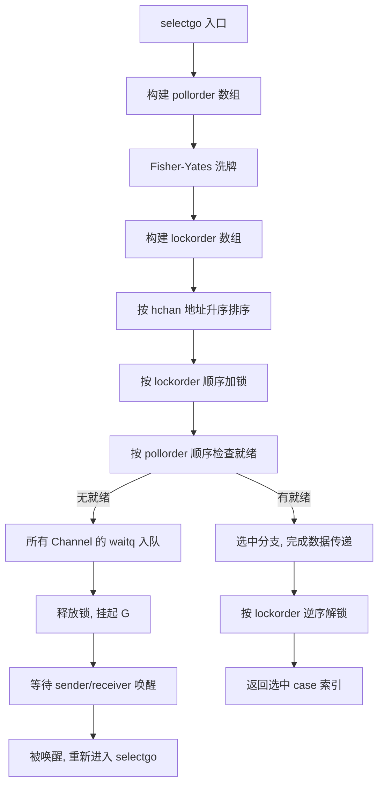

# select 的调度理论、状态屏蔽与优先级控制

**摘要：**

如果说 Channel 是 Goroutine 之间传递消息的管道，那么 `select` 就是站在若干根管道交汇处的那位交通指挥员——它让一个 Goroutine 能够同时等待多个 Channel 事件，而不是被某一根管道永远占据。`select` 语句在 Go 1.0（2009 年）便已存在，但其运行时实现直到 Go 1.9、Go 1.14 才陆续完善出今天看到的两阶段选择算法、pollorder 乱序打散与 lockorder 按地址排序的精密协作。本文从「为什么不能顺序判断多根 Channel」这一朴素问题出发，沿着 `runtime.selectgo` 的执行路径，拆解 **pollorder 打散公平性** 与 **lockorder 排序防死锁** 这两条看似矛盾却必须同时满足的约束；讨论 nil channel 如何被用作「分支屏蔽」的动态状态机开关；剖析已关闭 Channel 引发的忙循环（Busy Loop）本质；最后构建 `select` 的优先级形式化方案，并指出 `select{}` 永久阻塞在死锁检测中的特殊位置。回答的两个核心问题是：**select 如何在公平、无死锁、可屏蔽三个维度上同时取得工程可行解**，以及 **select 的哪些「看似古怪」的行为其实都源自同一套调度理论的必然结果**。本文是 [[Golang/Go并发编程/00 专栏导览|Go 并发编程]] 专栏中连接 Channel 阻塞语义与 GMP 调度协作的枢纽章节——它把前两章的所有概念拉到同一个语句里，形成了完整的闭环。

---

## 第 1 章 多路等待的第一性难题

### 1.1 从单根 Channel 到多根 Channel 的困境

在 [[03 Channel 的底层结构与阻塞唤醒机制]] 中我们已经看到，`<-ch` 这个看似简单的接收操作，底层需要经历「入队 waitq → 挂起 G → 等待 sender 唤醒」的完整流程。当程序只需要等待一根 Channel 时，这个流程无可指摘：Goroutine 阻塞，sender 到来时被唤醒，继续执行。但现实中的并发程序几乎从不只等一根管道。

考虑一个网关服务的主循环：它需要同时监听客户端请求的 Channel、上游超时信号、取消信号（参见 [[07 Context 的设计与取消传播机制]]）以及定时器。最朴素的写法是顺序判断——先查请求、再查超时、再查取消。这种写法在第一个分支就绪时立即返回，看起来没有问题；但它隐含了一个致命假设：**先判断的分支永远优先于后判断的分支**。当请求 Channel 持续有流量涌入时，超时与取消信号将被无限期推迟，形成事实上的饥饿。

这正是 `select` 出现要解决的问题：**让多根 Channel 的等待在同一抽象层上公平竞争，而不是由源码书写顺序决定谁先被服务**。`select` 将「轮询多个 Channel 并选择其一就绪」这件事从应用层下沉到运行时，由调度器统一做公平性裁决。

### 1.2 没有 select 会怎样：轮询的三种失败模式

没有 `select` 之前，工程师只能用循环加轮询手动组合多个 Channel，而这几乎必然落入三种失败模式之一。

**失败模式一：阻塞在某根管道上**。`req := <-reqCh` 一旦阻塞，timeoutCh 上已经准备好的超时信号就永远无法被读到，程序失去了「任意一路就绪即响应」的能力。

**失败模式二：忙轮询耗尽 CPU**。为了避免阻塞，只能用非阻塞 try-read 加 `sleep` 的组合（在没有 select 的语言里），CPU 被空转消耗，延迟与吞吐量双双塌陷。

**失败模式三：顺序判断引入优先级偏置**。即便语言提供了 `if ready(ch1)` 之类的非阻塞查询，按源码顺序判断会让 ch1 永远优先于 ch2，高流量分支吞掉调度权，低流量分支饥饿。

`select` 的价值在于：**它把「多路等待」这个复合操作变成一个原子语义**——要么其中一路就绪并完成数据传递，要么全部挂起等待，要么走 `default` 立即返回。这三态语义把应用层从轮询陷阱中解放出来。

### 1.3 select 的三种运行形态

`select` 在所有代码路径上，最终只呈现三种形态，对应运行时三条完全不同的执行路径：

**形态一：单 case 阻塞接收或发送**。当 `select` 只有一个 case 时，编译器会将其优化为普通的 channel 操作，不走 `selectgo` 路径。这是最简单的退化情形——`select { case <-ch: }` 与 `<-ch` 在运行时完全等价。

**形态二：多 case 无 `default`**。所有分支都未就绪时，当前 Goroutine 被挂起，进入睡眠状态；任意一个分支就绪时被唤醒。这是 `select` 最常见的形态，也是 `runtime.selectgo` 的核心路径。

**形态三：带 `default` 的非阻塞 `select`**。所有分支都未就绪时立即执行 `default` 分支，不会挂起 Goroutine。这种形态的运行时路径比前两种短得多——不需要进入 waitq，也不需要调度器介入。

这三种形态的统一视角是：**`select` 是一个条件多路分派器，`default` 只是「无任何条件满足」时的兜底分支**。

### 1.4 select 的历史演进锚点

`select` 的语言语义自 Go 1.0 以来基本稳定，但其运行时实现经历了几次重要的演进。Go 1.0 到 Go 1.8 期间，`selectgo` 采用一种较为简单的「加锁后顺序扫描」方案，在高并发场景下存在可观察的公平性问题——当多个 case 同时就绪时，源码中靠前的 case 总是更容易被选中。Go 1.9 开始引入 pollorder 数组与 Fisher-Yates 洗牌，从根本上解决了这种偏置。与此同时，lockorder 按地址排序的加锁策略也被引入，取代了之前依赖「调用方小心加锁顺序」的脆弱约定。

这两次演进共同构成了现代 `select` 的工程基础：**公平性通过随机化实现，防死锁通过确定化加锁顺序实现**。两者看似目标冲突（一个要随机，一个要确定），却通过「两阶段分离」的精巧设计同时满足——这是 Go 运行时在并发原语设计中反复出现的「分治」思路。

---

## 第 2 章 selectgo 的两阶段：公平性与防死锁的并行约束

### 2.1 一个看似简单的算法，为什么需要两个阶段

`select` 的运行时入口是 `runtime.selectgo`。当多个 case 同时就绪时，运行时必须从中选出一个执行。选择算法要同时满足两条性质：

- **公平性**：长期运行下，每个就绪分支被选中的概率应当接近均等，不能因源码位置偏袒某一路。
- **无死锁**：`select` 需要锁住所有涉及的 Channel 的 hchan 互斥锁才能安全地检查状态与完成发送/接收。如果两个 Goroutine 分别执行 `select { case a <- ... case b <- ... }` 和 `select { case b <- ... case a <- ... }`，一个按 (a, b) 顺序加锁、另一个按 (b, a) 顺序加锁，经典的锁序反转死锁立即出现。

公平性要求**随机化**，防死锁要求**确定化的加锁顺序**。这两条约束在同一个算法中彼此拉扯，Go 的解法是把 `selectgo` 拆成两个阶段：**pollorder 处理公平性，lockorder 处理加锁顺序**，两个阶段分别处理各自关心的问题，互不干扰。

### 2.2 pollorder：用 Fisher-Yates 打散就绪顺序

第一阶段的目标是把所有 case 的索引打乱，使得「同时就绪时选哪个」不再由 case 在源码中的位置决定。Go 运行时对 pollorder 数组做 **Fisher-Yates 洗牌**——一种线性时间、原地完成、且每个排列等概率的经典随机置换算法。随机源来自当前 G 的随机数种子（`randuint32`），每个 Goroutine 一个独立种子，避免了全局锁竞争。

打散完成后，运行时按洗牌后的顺序遍历 case，遇到第一个就绪的分支即选中。对于只读操作的「检查就绪性」阶段，此时还不需要持有 Channel 的锁；但对于后续要真正完成数据传递的阶段，就必须持锁了。

> [!info] 为什么是 Fisher-Yates 而不是其他洗牌
> 一个常见的替代方案是「对每个位置生成一个随机索引然后交换」，这种写法看似简单，但它产生的置换**不是等概率的**——`n^n` 种随机序列映射到 `n!` 种置换，必然产生偏置。Fisher-Yates 的巧妙之处在于：第 i 步从 `[i, n)` 中均匀采样一个位置与 i 交换，共 n-1 步，恰好产生 `n!` 种等概率排列。Go 的运行时实现严格遵循这一算法，没有偷懒。

### 2.3 lockorder：按 hchan 地址排序消除死锁

第二阶段的约束来自锁。一次 `select` 可能涉及多个 Channel，运行时必须同时持有这些 Channel 的 hchan 互斥锁才能原子地完成操作。多把锁的获取顺序如果不一致，锁序反转死锁就在眼前。

Go 的解法简单而有力：**把所有涉及的 hchan 指针按地址升序排序**，然后按排序后的顺序依次加锁。由于地址是全局唯一且全序的，任何两个 `select` 语句只要涉及同一组 Channel，无论 case 书写顺序如何，加锁顺序都完全一致。这就从结构上消除了锁序反转的可能性——不需要程序员记住「按某种约定顺序加锁」，运行时自己保证。

这个技巧并非 Go 独创。在操作系统内核中，对多个页表项、多个 inode、多个 buffer 加锁时，「按地址排序」是常见的防死锁惯用法。Go 把它移植到用户态的 Channel 调度上，与语言层面的 `select` 语法形成了一次精妙的对接。

> [!info] 一个工程直觉
> 把 pollorder 想象成洗牌——决定「先看谁」；把 lockorder 想象成编号——决定「先锁谁」。两者解决的是完全不同的问题，却必须分别做好。洗牌带来的公平性不破坏锁序，因为锁序由地址决定而不是由洗牌结果决定。这是 `selectgo` 设计中最精妙的分工。



### 2.4 同时就绪的「随机选择」与长期公平性

Fisher-Yates 洗牌的等概率性质保证了：只要多个分支同时就绪，每个分支被选中的概率是 `1/k`（k 为同时就绪分支数）。长期运行下，这等同于一种**均匀分布的分支调度**。需要注意的是，这种公平性是「条件公平」——只在「多分支同时就绪」的语义下成立。如果某个分支持续比其它分支更早就绪（譬如请求流量远高于超时信号），那么它被选中的次数自然会更多——这是符合业务语义的，不属于偏置。

> [!note] 为什么不用轮询（Round-Robin）
> 轮询同样能实现长期公平，但它需要在 Goroutine 级别维护一个「上一次选中的索引」状态。Go 运行时选择在每次 `selectgo` 内部独立洗牌，而不是跨调用维护状态，原因在于：Goroutine 可能被挂起、恢复、甚至在极端场景下被迁移，维护跨调用的轮询索引会与 [[01 Goroutine 与 GMP 调度器]] 中描述的调度器状态机发生耦合。每次独立洗牌是用「无状态」换取「可组合性」——这个取舍与 Go 调度器整体上倾向于「简单无状态、应用层按需构造」的哲学一脉相承。

### 2.5 selectgo 源码的关键数据结构

`selectgo` 的输入是一组 `scase` 结构（每个 case 对应一个）和一个 `*sudog` 列表。`scase` 记录了该 case 的类型（send/recv）、关联的 Channel 指针、数据指针（发送时是要发送的值的地址，接收时是接收缓冲的地址）以及 case 在源码中的位置。`selectgo` 的返回值是选中的 case 索引，调用方据此跳转到对应的 case 代码块。

值得注意的是，`selectgo` 在整个执行过程中可能会多次被唤醒——当多个 sender/receiver 并发地尝试与当前 Goroutine 通信时，当前 Goroutine 可能被多次 `goready`（唤醒），但只有第一个真正完成数据传递的通信会生效，其他的会被取消。这种「多唤醒但只一个生效」的设计是为了在高并发场景下减少不必要的阻塞，但也意味着 `selectgo` 必须有足够的幂等性来应对被多次唤醒的边界情况。

编译器在处理 `select` 语句时，会先把源码层面的 case 列表转换为一个 `scase` 数组，然后在运行时调用 `selectgo`。对于小 case 数（通常 ≤ 4-6 个），编译器可能走**优化路径**——跳过完整的 `selectgo` 调用，直接内联一个简化版的等待逻辑。这种优化的判断标准由编译器内部的启发式规则决定，对程序员来说是透明的，但在 benchmark 中可能观察到 case 数跨越某个阈值后延迟出现非线性的跳变——这通常就是「从内联优化路径切换到完整 selectgo 路径」的标志。

---

## 第 3 章 nil Channel 的分支屏蔽：动态状态机的零成本开关

### 3.1 nil channel 的语义：永远不就绪

Go 对 nil channel 的接收和发送有一个明确的语义规定：**对 nil channel 的操作永远阻塞**。在 `select` 语句的上下文中，这条规定被巧妙地转化为一种分支屏蔽（Branch Disabling）机制——当一个 case 的 Channel 为 nil 时，该分支永远不会被选中，等同于从本次 `select` 中临时移除。

这不是一个边角特性，而是 `select` 状态机化应用的基石。通过动态地将某个 Channel 赋值为 nil 或非 nil，程序可以在运行时开启或关闭 `select` 中的某一路输入，而**不需要重写整个 `select` 结构**。这种「用 Channel 本身的值来表达分支是否激活」的惯用法，在其他语言中通常需要显式的状态机框架才能实现。

### 3.2 一个典型应用：条件性关闭的多路消费者

考虑一个从上游拉取数据并写入两个下游的场景。当其中一个下游处理完成时，我们希望能够「关闭」对应的写入分支，而保持另一个分支继续工作，同时仍能从上游继续读。

```go
var in, out1, out2 chan Item
// ... 初始化
for in != nil || out1 != nil || out2 != nil {
    select {
    case item, ok := <-in:
        if !ok {
            in = nil    // 上游关闭，屏蔽读分支
            continue
        }
        // 派发给 still-active 的下游
    case out1 <- item:
        // 写入成功
    case out2 <- item:
        // 写入成功
    }
}
```

这段代码的精妙之处在于：当 `in` 被关闭并被置为 nil 后，`select` 中的读分支自动失效，循环仍然可以继续服务两个 out Channel；随着 out1、out2 陆续完成，它们也可以各自被置为 nil，直到三个 Channel 全部 nil，循环自然退出。整套状态机没有用 if-else 显式刻画状态，而是靠 nil 屏蔽「让 `select` 自己表达哪些状态还活着」。

循环条件 `in != nil || out1 != nil || out2 != nil` 与 `select` 内部的 nil 屏蔽配合，构成了一种声明式的状态机描述：**「我还关心哪些事件」这件事由 Channel 变量的 nil/non-nil 状态直接表达**，而不是由一个 `switch state` 来间接刻画。

### 3.3 为什么不用 close 替代 nil 屏蔽

一个自然的疑问是：为什么不直接 `close(out1)` 来关闭下游，而要费劲地把 Channel 变量置为 nil？原因在于**关闭一个 Channel 的语义是「广播结束信号」，而不是「我不想再往它写了」**。对一个已关闭的 Channel 执行发送会 **panic**。在上面的例子中，out1 和 out2 可能由其他 Goroutine 拥有并负责关闭，当前消费者无权单方面关闭它们；它只能表达「我自己不再参与这一路」，这正是 nil 赋值所表达的语义。

另一个常见场景是超时屏蔽：

```go
var timeoutCh <-chan time.Time
if deadline, ok := ctx.Deadline(); ok {
    timer := time.NewTimer(time.Until(deadline))
    defer timer.Stop()
    timeoutCh = timer.C
}
// 如果 ctx 没有 deadline，timeoutCh 为 nil，select 自动屏蔽超时分支
select {
case req := <-reqCh:
    handle(req)
case <-timeoutCh:
    handleTimeout()
}
```

当上下文没有截止时间时，timeoutCh 保持 nil，超时分支自动从 `select` 中消失，而不需要写两个版本的 `select` 语句。这种「可选分支」的表达方式在 API 设计中极为常见——它让调用方可以用同一个 `select` 结构应对不同的上下文配置。

### 3.4 屏蔽的代价：nil 赋值的作用域

使用 nil 屏蔽时必须小心变量的作用域。如果 Channel 变量被某个闭包捕获，那么对它的 nil 赋值会影响所有引用该变量的闭包；如果多个 Goroutine 并发地读写同一个 Channel 变量，则必须用同步机制保护这个变量本身。Channel 本身是并发安全的，但**指向 Channel 的变量不是**——这一点在复杂的状态机场景中容易被忽视。

另一个常被忽视的细节是：**nil 屏蔽是在 `selectgo` 入口处按值传递 Channel 指针**，而不是引用。也就是说，当一次 `selectgo` 开始执行时，它拿到的所有 Channel 指针已经固定；即便在 `selectgo` 执行期间外部修改了 Channel 变量，也不会影响本次 `selectgo` 的判断。只有下一次进入 `selectgo`（譬如循环的下一次迭代）才会看到新的 nil 状态。这一点的工程含义是：**nil 屏蔽不能用来中断当前正在执行的 `select` 阻塞**——如果 Goroutine 已经阻塞在 `selectgo` 内等待某个 Channel，从外部把该 Channel 变量置为 nil 并不会让 Goroutine 提前返回；只有向 Channel 发送数据才能真正唤醒它。

### 3.5 屏蔽机制与其他并发原语的对比

nil channel 的分支屏蔽是 Go 特有的惯用法，在主流并发语言中没有直接对应物。Erlang 的 `receive` 没有「禁用某个分支」的内建机制，要实现同样的效果需要显式的状态判断包裹每个 receive 子句；Java 的 NIO `Selector` 可以 `cancel()` 单个 `SelectionKey`，语义上接近但需要显式调用；Rust 的 `tokio::select!` 宏可以用 `biased` 加条件表达式实现，但每次进入 select 都要重新求值条件。Go 的方案优雅之处在于：**它把「这个分支是否激活」的状态直接编码在 Channel 变量的值中**，不需要额外的 API、额外的条件判断、额外的状态字段——一个 nil 赋值就是「关闭这一路」的完整表达。

---

## 第 4 章 已关闭 Channel 与忙循环：永远就绪的陷阱

### 4.1 关闭 Channel 的「永远可读」语义

[[03 Channel 的底层结构与阻塞唤醒机制]] 中讨论过，对已关闭 Channel 的接收操作会**立即返回该 Channel 元素类型的零值**，且不会阻塞。这个语义在单次接收场景下是合理的——它让接收方能够检测到关闭事件并作出响应。但当这个语义被放进 `select` 的循环中时，它就变成了一颗定时炸弹。

### 4.2 忙循环的形成机制

考虑如下写法：

```go
ch := make(chan int)
close(ch)
for {
    select {
    case v := <-ch:
        process(v)
    case <-time.After(time.Second):
        doPeriodicWork()
    }
}
```

`ch` 已经关闭，`case v := <-ch` 会立即返回零值且不阻塞。这意味着每次循环迭代中，这个分支**始终就绪**——而 `select` 在多分支就绪时虽然会随机选择，但由于 `ch` 分支在每一次循环中都处于就绪状态，它被选中的期望频率远高于每秒仅就绪一次的 `time.After` 分支。实际观察到的行为是：`process(0)` 被疯狂调用，CPU 占用瞬间飙升到 100%，`doPeriodicWork` 几乎永远得不到执行。

这种错误模式叫做**忙循环（Busy Loop）**，它的本质是：**一个永远就绪的分支破坏了 `select` 其他分支的调度权**。从调度理论的角度看，这类似于一个优先级最高的线程从不主动让出 CPU，但在此处甚至不需要优先级——只需要「永远就绪」就足以独占调度权。

> [!warning] 一个直观的类比
> 设想一个自助餐厅只开了一个「已关闭」的打饭窗口（窗口永远有饭，因为饭是零值），另一个「定时开放」的甜品窗口每分钟开一次。顾客（`select` 循环）每次进来都被引导到那个永远有饭的窗口，甜品窗口永远没人排队。这就是忙循环在 `select` 中的现实写照——永远就绪的分支像一个不知疲倦的服务员，把所有顾客都招呼走了。

### 4.3 正确的关闭处理模式

检测 Channel 关闭的正确姿势不是让它留在 `select` 里持续触发，而是**在检测到的瞬间改变 `select` 的形态**：

```go
for ch != nil {
    select {
    case v, ok := <-ch:
        if !ok {
            ch = nil   // 关闭后立即屏蔽该分支
            handleClosed()
            continue
        }
        process(v)
    case <-time.After(time.Second):
        doPeriodicWork()
    }
}
```

`ok` 为 false 时将 `ch` 置为 nil，下一次 `select` 中该分支自动消失。这与上一章的分支屏蔽机制是一脉相承的——**nil 是 `select` 表达「这一路已经结束」的唯一正确方式**，而不是让它继续以零值的形式反复触发。

### 4.4 忙循环的另一种形式：无 default 的永久 for-select

还有一种不那么明显但仍然有害的忙循环形式：**`for-select` 不带任何阻塞点，也不带 `default`，但所有 Channel 都是 nil**。此时每次循环 `select` 都不会阻塞（所有分支永远不就绪），但因为没有 `default`，Go 运行时会**让 Goroutine 永久阻塞**在 `selectgo` 内——这不是忙循环，而是预期的阻塞行为。然而如果此时所有分支都是已关闭的 Channel（而非 nil），就回到了 4.2 的忙循环场景。区分「nil channel 的永久阻塞」与「closed channel 的永久就绪」，是理解 `select` 语义的关键。

---

## 第 5 章 发送分支与接收分支的对偶性

### 5.1 select 不只是接收

前述章节中的例子几乎都是接收分支（`case <-ch`），但 `select` 同样支持发送分支（`case ch <- value`）。接收与发送在 `select` 中具有完全的对偶性——它们都参与 pollorder 洗牌、都进入 lockorder 排序、都在所有分支未就绪时一同入队 waitq。发送分支的「就绪」条件是「存在一个接收者已经在等待」或者「Channel 的缓冲区有空位」，与接收分支的「存在一个发送者」或「缓冲区非空」形成镜像。

这种对偶性让 `select` 能够优雅地表达「向多个接收者广播，谁先来就给谁」或「从多个发送者中接收最先到达的数据」等模式。在实现上，发送分支与接收分支的唯一区别在于 `scase` 结构中的 `kind` 字段（`caseSend` vs `caseRecv`）以及后续数据传递的方向。

### 5.2 同时存在发送与接收分支时的锁序

当一个 `select` 同时包含发送和接收分支时，lockorder 排序的范围包括所有涉及的 hchan——无论是发送目标的 Channel 还是接收来源的 Channel。这进一步体现了「按地址排序」这个简单规则的普适性：不需要区分发送与接收，不需要分别处理，只需要把所有 hchan 指针放进同一个数组排序即可。

但这里有一个工程上的微妙点：**同时包含发送与接收分支的 `select` 更容易触发锁竞争**。因为每个 sender 都会锁接收方的 hchan，每个 receiver 都会锁发送方的 hchan，当一个 Goroutine 在 `select` 中同时扮演 sender 和 receiver 时，它持有的锁集合会更大，与其他 Goroutine 的锁冲突概率也更高。在性能敏感的场景下，如果可能，应当尽量拆分 `select`，让一个 Goroutine 只扮演单一角色。

### 5.3 select 与 channel 关闭的交互语义

一个常被误解的场景是：**对已关闭 Channel 执行发送分支会发生什么**？答案是 panic——即便这个分支在 `select` 中，即便这个分支最终可能不被选中。Go 运行时在 `selectgo` 开始执行前就会检查所有发送分支的目标 Channel 状态，一旦发现有已关闭的 Channel，立即 panic，而不是等到该分支被选中时才 panic。

这一点的语义是：**`select` 不会帮你「屏蔽」对已关闭 Channel 的发送**。如果你不确定某个 Channel 是否已被关闭，必须在进入 `select` 之前自己维护这个状态（通常通过一个 `closed bool` 变量配合互斥锁，或者通过 nil 屏蔽——把已关闭 Channel 的引用置为 nil 比保留其引用更安全）。

### 5.4 select 与 GMP 调度器的协作点

`select` 不是独立于调度器之外的语言结构——它与 GMP 调度器有着深度的协作（参见 [[01 Goroutine 与 GMP 调度器]]）。当一个 `select` 的所有分支都未就绪时，执行 `selectgo` 的 Goroutine 会被放入所有相关 Channel 的 waitq，然后**主动让出 P**。这个「让出」动作不是简单的 sleep，而是把 G 的状态从 `_Grunning` 切换到 `_Gwaiting`，并将 P 交还给调度器去运行下一个 G。

当某个 Channel 上有对应的 sender 或 receiver 到来时，运行时会从 waitq 中取出等待的 G，调用 `goready` 将其重新放入运行队列。此时 G 的状态从 `_Gwaiting` 切换回 `_Grunnable`，等待 P 再次拾取它。值得注意的是：**重新进入运行时后，G 会再次调用 `selectgo`**——因为在这段等待期间可能有多个 sender 同时尝试与这个 G 通信，`selectgo` 需要重新走一遍两阶段算法，决定最终与哪个 sender/receiver 完成数据传递。

这种「挂起 → 唤醒 → 重新 selectgo」的循环意味着：一次 `select` 语句在源码中看起来是一次控制流转移，在运行时却可能经历多次 `selectgo` 调用。这种复杂性被语言层面完美地隐藏了，但对性能敏感的工程师来说，理解这一点对解释「为什么高竞争场景下 select 会成为热点」至关重要。

---

## 第 6 章 default 分支：非阻塞语义与轮询模式

### 6.1 default 的语义：立即返回的安全阀

`default` 分支的存在让 `select` 从「阻塞等待」切换到「轮询探测」模式。当所有 Channel 分支都未就绪时，带有 `default` 的 `select` 不会挂起当前 Goroutine，而是立即执行 `default` 分支并继续后续控制流。这个语义使得 `select` 可以表达「尝试做某事，做不成就算了」的非阻塞意图。

一个典型用法是**非阻塞发送**：

```go
select {
case ch <- item:
    // 发送成功
default:
    // Channel 满了，丢弃或走降级路径
    drop(item)
}
```

这种写法在事件循环、日志丢弃、背压（Backpressure）降级等场景中极为常见——它让发送方不会因接收方处理不过来而被无限期阻塞。对应的，**非阻塞接收**同样常见：

```go
select {
case item := <-ch:
    process(item)
default:
    // Channel 空，用缓存的旧值或默认值
    useCachedValue()
}
```

### 6.2 default 在轮询模式中的位置

`default` 分支与 `for-select` 循环结合可以构建一种**主动轮询**模式：定期检查多个 Channel 是否有事件，没有就立即继续做其他工作。这种模式在 GUI 事件循环、游戏主循环中很常见。

```go
for {
    select {
    case ev := <-eventCh:
        handleEvent(ev)
    case <-quitCh:
        return
    default:
        doGameLogic()
        time.Sleep(16 * time.Millisecond) // 帧率控制
    }
}
```

但这里存在一个微妙的权衡：`default` 加 `time.Sleep` 的组合本质上是一种**协作式轮询**，它把「等待事件」的责任从运行时转移到了应用层——应用层必须自己决定「睡多久」。睡得太短 CPU 浪费，睡得太长事件响应延迟。相比之下，不带 `default` 的 `select` 由运行时负责「精确等待 + 任意一路就绪即唤醒」，效率更高。因此 `default` 应当仅在「确实需要非阻塞语义」时使用，而不是作为一种通用的事件处理手段。

### 6.3 default 的优先级问题

一个常被忽略的事实是：**`default` 分支只有在所有 Channel 分支都未就绪时才会被执行**。即便 `default` 写在 `select` 的第一个 case，它也不会在有 Channel 就绪时抢跑。这个性质保证了 `default` 不会破坏 `select` 的公平性——它只是一个「保底选项」，永远不会优先于任何就绪的 Channel 分支。

这一点的运行时实现也很直观：`selectgo` 在检查所有 Channel 的就绪性时，`default` case 根本不在「需要等待的 Channel」集合里。只有当所有 Channel 都未就绪时，才会走到 `selectgo` 返回「无就绪分支，走 default」的特殊返回值路径。

### 6.4 default 与 `time.After` 的语义边界

一个常被混淆的问题是：带 `default` 的 `select` 与带 `time.After` 的 `select` 有什么本质区别？前者是「**立即**返回，不等待任何事件」，后者是「**等到超时为止**，期间任意 Channel 就绪都可中断」。两者在表面上都是「不想永远阻塞」，但底层机制完全不同：

- `default` 路径不会让 Goroutine 进入睡眠，它会持续占用 P 的本地运行队列，对调度器来说是「 runnable」状态。
- `time.After` 路径会让 Goroutine 真正阻塞在 `selectgo` 内，直到超时或任意 Channel 就绪才被唤醒，对调度器来说是「waiting」状态。

在高并发场景下，错误地把 `default + sleep` 当作 `time.After` 使用，会让大量 Goroutine 处于「反复唤醒、检查、再睡眠」的无效循环中，浪费调度资源。

---

## 第 7 章 优先级 select 的形式化构建

### 7.1 Go 故意不做优先级

Go 的 `select` 在语言层面**刻意不提供优先级机制**——所有 case 地位平等，同时就绪时由运行时随机选择。这是与 Erlang 的 `receive`（按子句顺序匹配）等语言的一个显著差异。Go 的设计哲学是：`select` 是「多路公平等待」的抽象，一旦引入优先级，这个抽象就变得不纯——它从「公平的多路复用」滑向「带偏置的条件分发」，复杂度和出错概率都会上升。

但现实业务中确实存在「某路输入更重要」的场景。与其让语言承担优先级语义的复杂性，Go 选择把这种需求下放给应用层，让工程师用组合原语自己构建优先级。

### 7.2 两层嵌套 select：优先级构建的经典模式

最经典的优先级 `select` 构建是用两层嵌套实现「高优先级分支优先尝试，低优先级分支在高层级无事件时才服务」：

```go
for {
    // 第一层：只服务高优先级
    select {
    case urgent := <-urgentCh:
        handleUrgent(urgent)
        continue    // 处理完高优先级，继续下一轮循环
    default:
        // 高优先级无事件， fall through 到第二层
    }

    // 第二层：公平服务所有分支
    select {
    case urgent := <-urgentCh:
        handleUrgent(urgent)
    case normal := <-normalCh:
        handleNormal(normal)
    case <-ctx.Done():
        return
    }
}
```

第一层 `select` 带 `default` 实现「非阻塞探测」——如果 urgentCh 有事件就立即处理并 `continue` 回到循环顶部，再次优先探测；只有 urgentCh 没事件时才会落到第二层公平 `select`，等待任意一路就绪。

这种结构的优点是意图清晰、易于扩展（加第三层即可实现三级优先级）；缺点是当高优先级 Channel 持续有流量时，低优先级 Channel 事实上被饿死——这正是优先级调度固有的权衡。

### 7.3 优先级构建的「双检查」必要性

上面代码的第二层 `select` 中**再次包含了 `case urgent := <-urgentCh`**，这不是冗余。原因在于：当第一层 `select` 走到 `default` 时，urgentCh 确实无事件；但第二层 `select` 是**阻塞等待**，在它等待期间 urgentCh 可能随时就绪。如果第二层不包含 urgentCh 的分支，那么 urgentCh 的事件就必须等到 normalCh 或 ctx 触发后才能被处理，这违反了「高优先级」的语义。

换句话说：**第一层负责「立即抢占」，第二层负责「等待期间公平但含高优先级」**，两层配合才能保证高优先级既不被延迟也不被饿死。

### 7.4 优先级构建的性能成本

两层嵌套 `select` 的成本是：每次循环至少走一次 `selectgo`（第一层的非阻塞探测）。当高优先级 Channel 经常就绪时，大多数循环在第一层就返回，第二层根本不会被执行，此时开销只是「一次无事的 `selectgo` 调用」。但 `selectgo` 即便没有进入 waitq，仍然需要分配 pollorder 与 lockorder 数组、对涉及的 hchan 加锁（即使只是短暂持锁检查就绪性）、洗牌。

在对延迟敏感的场景下，可以考虑把高优先级 Channel 做成**非阻塞接收**的形式（`select { case v := <-urgentCh: return v; default: return nil, false }`），并用一个单独的标志位或 `atomic.Bool` 来短路常见路径，避免每次循环都进入 `selectgo`。这种优化在高吞吐量的网络服务器中是有意义的，但在普通的业务逻辑中通常不必。

### 7.5 优先级构建的公平性分析

引入优先级后，低优先级分支的实际触发频率取决于高优先级分支的就绪概率。假设 urgentCh 每秒平均就绪 100 次，normalCh 每秒平均就绪 10 次，那么 low 分支在第一层就被抢占的概率大约是 `100/(100+10+1) ≈ 90%`——也就是说，low 分支只有约 10% 的机会被执行。这种偏置在业务上是可接受的（urgent 确实更重要），但在工程上必须有清晰的监控：如果 urgent 的就绪频率因 bug 异常升高，low 分支可能被事实饿死，而这种饿死在普通的「功能正常」测试中不会被发现。

一个实用的缓解策略是**给低优先级分支加超时保底**：在第二层 `select` 中引入 `time.After`，让低优先级分支即便在高优先级持续就绪时也能周期性地得到服务。这本质上是在优先级之上叠加了一个「最小服务保证」，是工程上权衡公平与效率的常见做法。

### 7.6 带超时的 select 与优先级组合

优先级构建常与超时结合，形成「高优先级 + 普通优先级 + 超时」的三段式：

```go
select {
case urgent := <-urgentCh:
    handleUrgent(urgent)
default:
    select {
    case normal := <-normalCh:
        handleNormal(normal)
    case <-time.After(100 * time.Millisecond):
        handleTimeout()
    }
}
```

这里的关键是：**超时只在低优先级分支上生效**。如果 urgentCh 一直有事件，超时永远不会触发——这是优先级语义的必然结果，也是使用优先级 `select` 时必须清楚的边界条件。

### 7.7 for-select 里 break 的陷阱

`for-select` 循环中有一个几乎每位 Go 开发者都会踩的坑：**裸的 `break` 只跳出 `select`，不跳出 `for`**。

```go
for {
    select {
    case <-ch:
        break    // 只跳出 select，继续 for 循环的下一次迭代
    case <-quitCh:
        break    // 同样只跳出 select
    }
}
```

要真正退出 `for` 循环，必须使用带标签的 break 或者 `return`：

```go
loop:
    for {
        select {
        case <-ch:
            // 继续循环
        case <-quitCh:
            break loop    // 跳出 labeled for 循环
        }
    }
```

这个陷阱的根源在于 Go 的 `break` 语义与 switch 语句的绑定——`break` 默认跳出最近的 `for/switch/select`，而 `select` 嵌在 `for` 内时，它比 `for` 更近，所以 `break` 命中 `select` 而不是 `for`。这并非设计缺陷，而是 `break` 的一致语义在嵌套结构中的自然结果，但它确实要求开发者在写 `for-select` 时保持清醒。`return` 是更稳健的选择——在大多数主循环场景中，退出 select 就意味着退出整个 Goroutine，直接用 `return` 既简洁又不会踩 label 的坑。

---

## 第 8 章 `select{}` 永久阻塞：死锁检测的特殊位置

### 8.1 一条奇怪的语句

`select{}` 是一个没有任何 case 的 `select` 语句。它既没有 Channel 分支，也没有 `default`，语义上等同于「永远阻塞当前 Goroutine」。这条语句的实际用途极其有限——几乎没有人会在生产代码里写一个故意永远阻塞的 `select`。但它却有一个重要的理论角色：**它揭示了 Go 运行时的死锁检测机制**。

当主 Goroutine（main Goroutine）执行到 `select{}` 时，运行时会检测到「所有 Goroutine 都在阻塞，且没有任何能够继续执行的路径」，进而触发 `fatal error: all goroutines are asleep - deadlock!`。这个错误是 Go 运行时少数几个在编译期之外捕获程序结构错误的机制之一。

### 8.2 死锁检测的实现原理

Go 的死锁检测并不复杂，但足够有效：当调度器发现**所有 P 上的运行队列为空，且所有 G 都处于等待状态（Gwaiting / Gchanrecv / Gchansend / Gselect 等）**，即判定为死锁。`select{}` 触发了这个条件——它让执行它的 G 永远处于等待状态，如果此时没有其他可运行的 G，死锁就被检测到。

需要注意的是，死锁检测只在**没有活跃 Goroutine** 时触发。如果还有一个后台 Goroutine 在运行（譬如一个泄漏的定时器 Goroutine），即使主逻辑已经卡死在 `select{}` 上，运行时也不会报 deadlock——因为从调度器的视角，还有 G 在跑，系统没有「完全停摆」。这是死锁检测的一个盲区：**它只能检测「整体死锁」，不能检测「部分死锁」**。

### 8.3 `select{}` 与其他「永远阻塞」写法的对比

Go 中有几种常见的「永久阻塞」写法，它们的语义和运行时行为各有差异：

| 写法 |  Goroutine 状态 | 是否触发死锁检测 | 典型场景 |
|---|---|---|---|
| `select{}` | Gselect（永久等待）| 是（无其他 G 时）| 测试、教学、占位 |
| `<-make(chan struct{})` | Gchanrecv（永久等待）| 是（无其他 G 时）| 主 Goroutine 等待信号 |
| `for {}` | Grunning（永久运行）| 否（它在运行，不算 asleep）| 计算密集死循环 |
| `time.Sleep(time.Duration(math.MaxInt64))` | Gsleep（超长睡眠）| 是（无其他 G 时，调度器会发现无可运行任务）| 罕见 |

`for {}` 是一个反直觉的反例：它事实上也是一个「卡死」的程序，但因为 Goroutine 状态是运行中而不是等待中，死锁检测不会触发——它会持续占用一个 P 对应的 M，如果 GOMAXPROCS=1，整个程序的所有其他 Goroutine 都会被饿死，但运行时不会报 deadlock。这种「活着的死锁」比 `select{}` 式的「死去的死锁」更难排查。

### 8.4 `select{}` 的少数正当用途

`select{}` 在测试和教学场景中有少量正当用途：

- **保持 main Goroutine 存活**：在某些测试场景中，希望 main Goroutine 不退出以便让其他 Goroutine 继续运行（尽管这种用法通常可以被 `sync.WaitGroup` 替代）。
- **演示死锁检测**：作为 Go 运行时死锁检测机制的最小复现用例。
- **占位符**：在代码生成或模板中作为占位，等待后续填充 case 分支。
- **信号等待的替代**：在 `main` 函数中等待操作系统信号时，`select{}` 比 `for {}` 更优，因为它释放 CPU 而不是占用 CPU（尽管实际场景中应当使用 `signal.Notify` 而非永久阻塞）。

---

## 第 9 章 timer select 与动态 channel 构建

### 9.1 `time.After` 与 `time.NewTimer` 的差异

`select` 与定时器的组合是 Go 并发编程中最常见的模式之一。`time.After(d)` 返回一个在 d 时间后会收到一个值的 Channel，它本质上是 `time.NewTimer(d).C` 的语法糖，但**隐藏了 Timer 对象本身**——这意味着使用 `time.After` 时无法在超时发生前 Stop 掉 Timer，Timer 会一直存活到触发为止。

在 `for-select` 循环中反复使用 `time.After` 是一个常见的性能陷阱：

```go
for {
    select {
    case req := <-reqCh:
        handle(req)
    case <-time.After(5 * time.Second):
        timeout()
    }
}
```

每次循环迭代都会创建一个新的 Timer，如果 reqCh 流量很高，大量未触发的 Timer 会在内存中堆积，直到它们各自到期才被回收。这种「Timer 泄漏」在短期运行的程序中不明显，但在长期运行的服务端程序中会导致可观的内存压力。

正确的做法是复用 Timer：

```go
timer := time.NewTimer(5 * time.Second)
defer timer.Stop()
for {
    timer.Reset(5 * time.Second)
    select {
    case req := <-reqCh:
        handle(req)
    case <-timer.C:
        timeout()
    }
}
```

`Reset` 让 Timer 重新计时，且不会分配新的 Timer 对象——这对长期运行的高吞吐量服务来说，是显著的资源优化。

### 9.2 动态 channel 构建：select 的元编程

`select` 语句的 case 数量在编译期就固定了，但在某些场景下，需要等待的 Channel 集合是动态的——譬如一个代理服务需要同时监听 N 个后端连接，N 在运行时才能确定。此时标准的 `select` 语句无法胜任，必须使用 `reflect.Select` 构建动态的 `select`。

`reflect.Select` 接受一个 `[]reflect.SelectCase` 切片，每个元素描述一个 case 的方向（Send/Recv）、Channel 值和数据值。它在运行时的行为与编译期 `select` 完全一致，包括 pollorder 洗牌、lockorder 排序、waitq 入队等，只是 case 集合由切片而非源码语法给出。

```go
cases := make([]reflect.SelectCase, len(backends))
for i, b := range backends {
    cases[i] = reflect.SelectCase{
        Dir:  reflect.SelectRecv,
        Chan: reflect.ValueOf(b.responseCh),
    }
}
chosen, value, ok := reflect.Select(cases)
// chosen 是选中的 case 索引，value 是接收到的值，ok 表明 channel 是否关闭
```

反射版 `select` 的性能比原生 `select` 慢一个数量级（因为涉及反射调用、运行时类型检查和动态内存分配），因此只在确实需要动态 case 集合时使用。对于固定数量但数量较多的 case，更好的做法通常是代码生成——在编译期生成对应数量的 case 分支。

---

## 第 10 章 高级 select 模式与常见陷阱

### 10.1 带恢复能力的 worker pool select

在 Worker Pool 模式中（参见 [[Golang/Go并发编程/08 Go 并发模式——Pipeline、Fan-out Fan-in 与 Worker Pool]]），`select` 经常被用来实现「从任务队列取任务 → 执行 → 返回结果」的主循环。一个进阶的写法是让 worker 能够感知上游的取消信号，并在 worker 自身 panic 时通过 `recover` 捕获错误，继续服务下一个任务而不让 pool 整体崩溃：

```go
func worker(id int, tasks <-chan Task, results chan<- Result) {
    for task := range tasks {
        func() {
            defer func() {
                if r := recover(); r != nil {
                    results <- Result{Err: fmt.Errorf("worker %d panic: %v", id, r)}
                }
            }()
            results <- task.Do()
        }()
    }
}
```

这里的 `select` 隐含在 `for range` 的语义中（`for range` 在 channel 上阻塞等待），但 panic 处理与结果发送的组合，要求对 channel 的生命周期有精确的控制。

### 10.2 select 与 context 的深度集成

在实际的生产代码中，几乎所有带超时或取消需求的 `select` 都应当与 `context.Context` 配合（参见 [[07 Context 的设计与取消传播机制]]）。一个典型的「RPC 客户端」模式：

```go
func DoRPC(ctx context.Context, req Request) (Response, error) {
    respCh := make(chan Response, 1)
    go func() {
        respCh <- actualCall(req)
    }()

    select {
    case resp := <-respCh:
        return resp, nil
    case <-ctx.Done():
        return Response{}, ctx.Err()
    }
}
```

这里有一个常被忽视的细节：如果 `ctx` 先于 `respCh` 触发，`actualCall` 的 Goroutine 仍在运行——它会一直阻塞在向 `respCh` 发送的地方，直到 `respCh` 被垃圾回收（当 `respCh` 没有任何 receiver 时，send 会永久阻塞，最终该 Goroutine 泄漏）。正确的做法是给 `respCh` 一个容量为 1 的缓冲（如上例），让发送方在接收方离开后仍能完成发送并退出。这个「缓冲 Channel 兜底防泄漏」的技巧，是 `select` 与 Context 集成时的重要工程惯例。

### 10.3 陷阱：在 select 中使用带缓冲 channel 的误解

一个常见的误解是：带缓冲的 Channel 在 `select` 中「更容易被选中」，因为它不需要等待 receiver。这个说法部分正确，但不够精确。`select` 的就绪性判断是二元的——要么就绪（发送方存在或缓冲区有空间），要么不就绪。缓冲满的 Channel 在 `select` 中表现与无缓冲 Channel 完全一致；缓冲未满的 Channel 则会立即被识别为就绪，从而在 `selectgo` 的第一阶段就被选中，不需要进入 waitq。

这种「立即就绪」的特性在某些场景下是期望的（譬如非阻塞发送降级），在另一些场景下则是陷阱——它可能让 `select` 失去等待其他分支的能力，变成「只要缓冲有空位就立刻发送，完全无视其他分支」。工程师在引入缓冲 Channel 到 `select` 之前，应当明确问自己：**「我是否真的希望这个分支永远优先于其他分支？」** 如果答案是否定的，那么应当使用无缓冲 Channel，或者显式构建优先级 `select`。

### 10.4 select 与 time.Ticker 的协作

与 `time.Timer` 不同，`time.Ticker` 会持续按固定间隔向 Channel 发送时间值。在 `for-select` 循环中使用 Ticker 是一种常见的心跳/周期任务模式：

```go
ticker := time.NewTicker(10 * time.Second)
defer ticker.Stop()
for {
    select {
    case <-ticker.C:
        heartbeat()
    case req := <-reqCh:
        handle(req)
    case <-ctx.Done():
        return
    }
}
```

Ticker 与 Timer 的关键区别是：Ticker 不会停止，必须显式调用 `Stop()`，否则 Ticker 的 Goroutine（运行时内部）会持续尝试向 `ticker.C` 发送，如果没人接收，Ticker 对象本身以及它引用的资源都无法被回收。另一个微妙点是：**在 `select` 中如果 Ticker 分支长时间未被选中（因为其他分支持续就绪），Ticker 的内部 Channel 会堆积未读的时间值**——对于带缓冲的 Ticker（Go 1.23+ 默认行为可能改变），这种堆积可能导致后续的发送被丢弃，从而让心跳间隔的实际观测值偏离预期。这是使用 Ticker 时必须清楚的边界条件。

---

## 第 11 章 权衡：伪随机公平以确定性换取防饥饿

### 11.1 三种可选的公平性策略

回到本章最初的公平性问题，其实 `select` 的实现至少有三种可选策略：

| 策略 | 实现方式 | 公平性 | 状态开销 | 确定性 |
|---|---|---|---|---|
| **源码顺序** | 按 case 书写顺序选第一个就绪 | 无（先写优先） | 无 | 完全确定 |
| **轮询（Round-Robin）** | 维护「上次选中索引」状态 | 长期公平 | 每 Goroutine 一份状态 | 确定周期内可预测 |
| **Fisher-Yates 洗牌**（Go 实际选择） | 每次进入 selectgo 独立洗牌 | 长期公平 | 无跨调用状态 | 单次不可预测 |

Go 选择了第三种，本质上是用「单次结果的不可确定性」换取「无需跨调用维护状态」的简洁性。这种选择与 Go 整体哲学一致：**让运行时保持简单、无状态，把复杂性留给应用层按需构造**。

### 11.2 伪随机公平的代价

这种设计的代价是**不可复现性**——同样的输入序列在不同运行中可能产生不同的分支选择，给调试带来一定困难。在高并发、高频率的 `select` 场景中，伪随机洗牌的 CPU 开销虽然很小（每次 `selectgo` 多几次随机数生成和数组置换），但在极致性能场景下也可能成为可观测的成本。

不过，这种代价在工程上是可以接受的：调试不可复现性问题可以通过 race detector、trace 工具（参见 [[Golang/Go工程实践/06 Go 性能剖析——pprof、trace 与基准测试]]）以及日志补全来缓解；而伪随机洗牌的 CPU 开销，相比 `selectgo` 整体流程（涉及多把锁的获取与释放、waitq 操作、Goroutine 挂起唤醒）几乎可以忽略。

### 11.3 因地制宜的优先级构建

`select` 故意不做优先级这一选择，意味着需要优先级的场景必须由应用层自己构建。第 7 章给出的两层嵌套模式是通用解法，但在具体业务中需要清醒评估：**引入优先级就引入了饥饿的可能性**。高优先级分支持续就绪时，低优先级分支会被事实饿死——这与「伪随机公平」的默认语义形成了有趣的对照：默认语义下没有分支会被结构性饿死（除非 nil 屏蔽或关闭造成），而一旦应用层主动引入优先级，结构性饥饿就成了必须面对的副作用。

由此可见，`select` 的设计取舍可以用一句话概括：**它以牺牲确定性换取防饥饿，以牺牲表达力换取组合性**。需要优先级时，用两层嵌套构造；需要动态屏蔽时，用 nil channel 表达；需要非阻塞探测时，用 `default` 分支。这套组合原语覆盖了绝大多数并发场景，而不需要语言本身承担一个「带优先级、带超时、带条件守卫」的复杂 `select`——后者在 Erlang 中确实存在，但它的代价是语言规范与运行时实现的显著复杂化。Go 选择了「简单原语 + 应用层组合」这条路，与它在接口、错误处理、泛型等维度上的取舍一脉相承。

### 11.4 与其他语言的横向对比

将 Go 的 `select` 与其他并发语言的原语对比，可以更清晰地看到 Go 的设计取向：

| 维度 | Go `select` | Erlang `receive` | Java `Selector` (NIO) | Rust `tokio::select!` |
|---|---|---|---|---|
| 公平性 | Fisher-Yates 伪随机公平 | 按子句顺序（源码顺序优先）| 就绪集由内核 epoll 返回，无语言层公平保证 | 伪随机（tokio 实现）|
| 优先级 | 语言不提供，需应用层构建 | 语言不提供，但源码顺序事实上构成优先级 | 由 `SelectionKey` 的就绪位图表达，无优先级概念 | `biased` 修饰符显式声明优先级 |
| 超时集成 | 通过 `time.After` Channel 组合 | `after` 内建语法 | `select(timeout)` 内建 | `tokio::time::timeout` 组合 |
| 动态 case 数 | `reflect.Select`（运行时反射）| `receive` 语法固定 | 内建支持动态注册/注销 | 宏展开，case 数编译期固定 |
| 取消集成 | `context.Context` Channel | 进程间消息 | 中断（Interrupt）机制 | `CancellationToken` |

这张表中最值得玩味的是 Rust 的 `tokio::select!`——它同时提供了「默认伪随机公平」与 `biased` 修饰符两种模式，让程序员在需要时显式声明优先级。这种「两种模式并存」的设计比 Go 的「语言不提供，应用层构建」更灵活，但也更复杂——每个 `select!` 宏调用都要决定用哪种模式。Go 的选择是**让所有 `select` 都保持同一种语义**，代价是需要优先级的场景必须多写几行嵌套代码，收益是整个语言规范与运行时实现的一致性与简洁性。

### 11.5 select 的设计哲学：简单原语的复利

回顾整个 `select` 的机制，一个清晰的主线浮现出来：**Go 选择了少数几个语义清晰、边界明确的原语，然后信任应用层能用它们组合出复杂的并发控制逻辑**。nil channel 的分支屏蔽、`default` 的非阻塞探测、Channel 关闭的零值返回——这些看似独立的特性，在 `select` 的框架下互相咬合，构成了一套表达力惊人的组合工具。

这种「简单原语 + 应用组合」的哲学在 Go 中不是孤例：`error` 接口只有一个 `Error() string` 方法，没有层次化异常，没有 checked exception，但配合 `errors.Is`、`errors.As`、`fmt.Errorf` 的 `%w` 动词，足以表达从底层到顶层的完整错误链；`interface{}`（以及 Go 1.18 后的泛型）用最少的语法支撑了从容器库到依赖注入框架的广阔生态。`select` 沿袭了同样的思路：语言只承诺「公平地等待多个 Channel」，至于「哪个更重要」、「哪个该被屏蔽」、「超时怎么算」，都留给程序员用 Channel 本身的值与结构来表达。

这种取舍不是没有代价。对比 Erlang 的内建超时、Rust 的 biased 修饰符，Go 的应用层构建确实需要更多的代码量与更深的运行时理解。但对于长期维护的服务端程序来说，「代码量大但语义清晰」往往比「代码量小但语义隐晦」更可持续——这正是 Go 在工程实践层面反复验证的经验。

---

## 参考资料

1. The Go Authors. "Go Runtime Source: select.go." Go Programming Language Source Code, https://github.com/golang/go/blob/master/src/runtime/select.go.
2. Roberto Clunie. "Go select statement." Go Blog, 2023.
3. Dmitry Vyukov. "Go 1.14+ Preemptive Scheduler Design." GopherCon Russia, 2020.
4. The Go Authors. "The Go Memory Model." https://go.dev/ref/mem, 2022 revision.
5. Bryan Mills. "Concurrency in Go: Patterns and Anti-Patterns." GopherCon 2023.

---

> [!note] 思考题
> 1. 为什么 `selectgo` 要拆成 pollorder 与 lockorder 两个阶段？如果只用 lockorder 排序后顺序检查就绪性，会有什么问题？
> 2. 在一个长期运行的 `for-select` 循环中，如果一个 Channel 被关闭但未被置为 nil，会发生什么？如何用本章讨论的机制修复？
> 3. 用两层嵌套 `select` 构建三级优先级（urgent / normal / low），并分析当 urgent 与 normal 同时持续就绪时，low 分支的实际触发频率。
> 4. `select{}` 触发死锁检测的条件是什么？如果有一个 `time.After(1 * time.Hour)` 的 Goroutine 在跑，`select{}` 还会触发 deadlock 吗？为什么？
> 5. 试设计一个基于 `select` 的状态机，能从「运行态」切换到「暂停态」（屏蔽所有输入），再切换到「恢复态」（重新启用输入），最后到「终止态」（退出循环）。
> 6. `time.After` 在 `for-select` 循环中为什么会导致 Timer 泄漏？如何正确复用 Timer？
