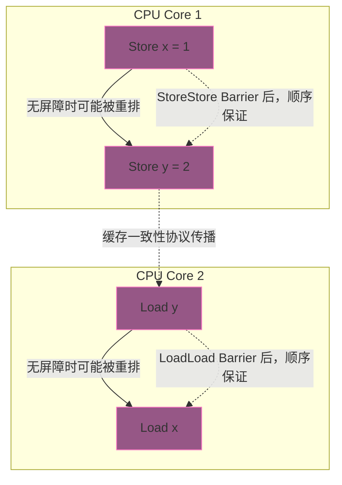
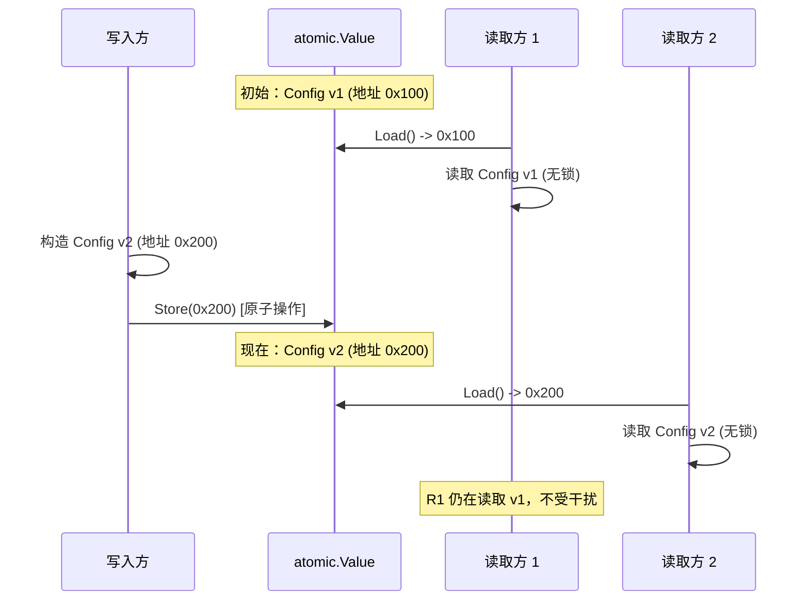

# 原子操作与硬件级无锁编程——sync/atomic 机制解析

**摘要：**

在并发编程的演进史中，"如何让多个执行流安全地访问同一块内存"始终是核心命题。Mutex 给出了最直观的答案——加锁、排队、串行化；但锁的成本在高竞争场景下并不低廉，它涉及操作系统信号量、Goroutine 上下文切换，以及随之而来的吞吐下降与尾延迟飙升。原子操作（Atomic Operation）提供了另一条路径：它依托 CPU 硬件级别的原子指令与缓存一致性协议，在不引入锁的前提下，让"读-改-写"这种看似不可分割的复合动作得以真正原子地执行。Go 的 `sync/atomic` 包正是这条路径在用户态的入口，它既暴露了底层的 CAS、Load、Store 原语，又在 Go 1.19 之后通过类型化的 `atomic.Int64`、`atomic.Pointer[T]` 等封装，将原本容易用错的函数式 API 升级为带类型约束的面向对象风格。但原子操作并非银弹——它只能保证单个内存位置的原子性，无法自然表达多字段复合不变量（Multi-field Invariant）；它容易被伪共享（False Sharing）吞噬性能而不自知；它看似无锁，却仍然受制于内存模型的可见性规则。本文从 CPU 缓存行与硬件原子指令出发，逐层剖析 sync/atomic 的机制、边界与陷阱，最终回答两个核心问题：在什么场景下原子操作真的优于 Mutex，以及"无锁"为何并不总是意味着"更快"。

---

## 第 1 章 原子性的硬件地基：从缓存行到原子指令

### 1.1 缓存行：内存访问的最小单位

讨论原子操作，必须先理解 CPU 访问内存的基本粒度。现代处理器不会一个字节一个字节地从主存搬运数据，而是以**缓存行（Cache Line）**为单位进行读写——在 x86 与绝大多数 ARM 实现中，一条缓存行的长度是 **64 字节**。这意味着哪怕你只读取一个 `int32`（4 字节），CPU 也会把包含该 `int32` 在内的整条 64 字节缓存行从主存拉入 L1/L2/L3 缓存；后续对同一缓存行内任何字节的读写，都发生在缓存里，不必再访问主存。

缓存行的存在，本质上是利用**空间局部性**（Spatial Locality）来摊薄主存访问的高昂延迟——L1 缓存命中大约 1-2 个时钟周期，L3 命中大约 30-40 个周期，而主存访问则要数百个周期。但这一优化也带来了副作用：当多个 CPU 核心同时读写**位于同一条缓存行内**的不同变量时，缓存一致性协议（如 MESI）不得不在核心之间频繁传输缓存行，即便这些变量在逻辑上完全无关。这正是**伪共享（False Sharing）**的物理根源，笔者将在第 2 章展开。

MESI 协议为每条缓存行定义了四种状态：Modified（已修改，仅本核心持有且与主存不一致）、Exclusive（独占，仅本核心持有且与主存一致）、Shared（共享，多个核心持有且一致）、Invalidated（失效，不可用）。任何核心想写入一条缓存行，都必须先将该缓存行转为 Exclusive 或 Modified 状态——如果其他核心持有该缓存行的 Shared 副本，就需要通知它们失效。这种"写入前必须独占"的规则，是原子操作得以实现的基础，也是伪共享造成性能损耗的根源。

### 1.2 原子性的层次：编译器、语言与硬件

"原子性"在不同层次有不同含义。编译器层面，一条看似简单的 `x++` 会被编译成"读取 x → 加 1 → 写回 x"三条机器指令，在没有同步约束的情况下，编译器甚至可能出于优化目的对相邻的读写进行重排。语言层面，Go 的内存模型规定了哪些操作之间存在 Happens-Before 关系，但语言本身并不保证普通内存操作的原子性——`x++` 在并发场景下就是典型的数据竞争。真正保证"读-改-写"不可被打断的，是**硬件层面的原子指令**。

x86 架构提供了一条关键的原子指令：**LOCK CMPXCHG**。它完成"比较并交换"（Compare-And-Swap, CAS）动作——将寄存器中的值与内存位置的值比较，若相等则写入新值，否则不写，整个过程在 LOCK 前缀的保护下对总线（或缓存子系统）独占，其他核心的读写被暂时阻塞。ARM 架构走的是另一条路：**LL/SC**（Load-Linked / Store-Conditional）配对——LL 读取并标记该缓存行为"被监控"，SC 写入时检查标记是否还在，若期间有其他核心写过该缓存行，则 SC 失败。ARMv8 之后也引入了直接的 CAS 指令（CAS），与 x86 的语义趋于统一。

> [!info] 原子指令的架构差异
>
> | 架构 | 原子指令 | 语义特点 |
> | :--- | :--- | :--- |
> | x86/x64 | LOCK CMPXCHG | 总线锁或缓存锁；强内存模型，自带 acquire/release 语义 |
> | ARM v7 | LL/SC 配对 | 依赖监控 reservation；弱内存模型，需额外 DMB 屏障 |
> | ARM v8+ | CAS / LDAR / STLR | 直接 CAS 指令 + 专用 acquire/release 加载存储 |
> | RISC-V | LR/SC + FENCE | 类似 ARM v7 的 LL/SC，加 FENCE 指令实现屏障 |

Go 的 `sync/atomic` 包在底层通过汇编或编译器内建函数，将用户的 CAS 调用映射到对应平台的原子指令上。在 x86 上，`atomic.CompareAndSwapInt64` 最终生成的就是 `LOCK CMPXCHG`；在 ARM 上，则根据 CPU 能力选择 LL/SC 循环或直接的 CAS 指令。这意味着**原子操作并非"没有同步开销"——它只是把同步的成本从操作系统层面下沉到了硬件层面**，代价从"系统调用 + 上下文切换"变成了"缓存行独占 + 可能的内存屏障"。

### 1.3 内存屏障：可见性的顺序契约

原子指令解决的是"单个操作的不可分割性"，但并发程序还需要回答另一个问题：**一个核心的写入，何时对另一个核心可见**。这就要靠**内存屏障（Memory Barrier / Fence）**来规定。现代 CPU 的乱序执行与编译器的指令重排，会让不同核心观察到的内存写入顺序不一致。内存屏障是一种约束，它告诉编译器和 CPU："屏障之前的所有写入，必须在屏障之后的任何读取之前对其他核心可见"。

常见的屏障强度分为三级：

- **Acquire 语义**：保证该操作之后的所有读写，不会被重排到该操作之前。典型的用法是"获取锁"——拿到锁之后的临界区代码，必须在获取成功之后才能执行。
- **Release 语义**：保证该操作之前的所有读写，不会被重排到该操作之后。典型的用法是"释放锁"——临界区的写入必须在释放之前对其他核心可见。
- **Sequential Consistency（seq-cst）**：最强屏障，保证全局所有核心观察到的操作顺序都一致。开销最大，x86 上通常需要额外的 `MFENCE` 指令。

Go 的内存模型对 `sync/atomic` 操作给出了明确的形式化保证：一次成功的 `atomic.Store` 对某变量"happens before"另一次成功的 `atomic.Load` 读到该值——但前提是这两个操作之间通过某种同步关系串联起来。这一点与 [[05 sync 包——Mutex、RWMutex 与 WaitGroup 的实现]] 中 Mutex 的 Happens-Before 保证在语义层面是同构的，只是底层实现从"futex 系统调用"换成了"硬件原子指令 + 内存屏障"。

理解内存屏障的关键，在于区分"原子性"与"可见性"这两个正交的维度。原子性保证单个操作不可被打断，可见性保证一个核心的写入能及时被其他核心观察到。在 x86 的强内存模型下，可见性问题被大幅简化——几乎所有读写都天然有序；但在 ARM、POWER 等弱内存模型架构上，可见性问题需要开发者显式插入屏障来解决。这也是为什么在 x86 上能跑的并发代码，移植到 ARM 上可能突然"不工作了"——不是因为原子性失效，而是因为可见性保证变弱了。



上图展示了一个典型的重排场景：Core 1 依次写入 `x` 和 `y`，Core 2 依次读取 `y` 和 `x`。在没有内存屏障的情况下，Core 1 的两次写入可能被重排，Core 2 的两次读取也可能被重排，导致 Core 2 观察到"y=2 但 x=0"这种看似不可能的中间状态。内存屏障的作用，就是禁止这种违反程序员意图的重排。

---

## 第 2 章 伪共享：被缓存行吞噬的性能

### 2.1 一个反直觉的性能陷阱

设想这样一个场景：两个 Goroutine 分别对两个不同的 `int64` 计数器做高频原子递增，一个计数器处理"请求 A 的统计"，另一个处理"请求 B 的统计"——两个计数器在逻辑上完全独立，不存在任何数据竞争。按直觉，两个核心的原子操作互不干扰，吞吐应该是单核的两倍。但实测结果往往令人大跌眼镜：双核的总吞吐可能只有单核的 1.x 倍，甚至在某些微架构上接近单核水平。

罪魁祸首就是**伪共享（False Sharing）**。

### 2.2 伪共享的机制

伪共享的物理过程可以这样描述：假设 `counterA` 和 `counterB` 两个 `int64` 变量在内存中相邻排列，恰好落在同一条 64 字节的缓存行内。核心 1 执行 `atomic.AddInt64(&counterA, 1)` 时，会将这条缓存行独占到核心 1 的 L1 缓存（MESI 状态转为 Modified）；核心 2 执行 `atomic.AddInt64(&counterB, 1)` 时，也需要独占同一条缓存行，于是缓存一致性协议会通知核心 1 将这条缓存行失效。核心 1 的缓存行被失效后，下次再写入 `counterA`，就必须重新从共享的 L3 缓存或主存拉取这条缓存行，然后再次独占——循环往复。

整个过程里，两个核心**并没有真正的数据依赖**，却因为缓存行的物理共享而陷入了相互打断的死循环。每一次原子操作都触发一次缓存行在核心间的"乒乓"传输（cache line bouncing），传输延迟从 L1 的 1-2 周期飙升到 L3 的 30-40 周期甚至主存的数百周期。

> 这就好比两位邻居各自在自家院子里修东西，但他们的工具箱放在同一间公共车库里——不管两人修的物件多么无关，每次有人要用工具，另一个人就必须先放下手里的活把车库让出来。工具本身是共享的物理资源，但"修的东西"并没有依赖关系，这是"伪"共享。

伪共享之所以难以排查，是因为**它的症状是性能差，但代码层面找不到任何数据竞争**——Race Detector（详见 [[11 并发陷阱与调试——Goroutine 泄漏、死锁与 Race Detector]]）也不会报警，因为根本不存在同一内存位置的并发读写冲突。

### 2.3 量化影响：实测数据

伪共享的性能惩罚在微基准测试中极为显著。以 Go 的 `sync/atomic` 为对象，笔者在典型 x86 服务器上做的基准测试显示：

- 单核单计数器原子递增（`atomic.AddInt64`）：约 15-20 ns/op；
- 双核双计数器，**同一缓存行**（即伪共享）：每核约 80-150 ns/op，总吞吐约 1.2-1.5 倍单核；
- 双核双计数器，**不同缓存行**（通过 padding 对齐）：每核约 20-30 ns/op，总吞吐接近线性加速比 2 倍。

在缓存一致性流量更大的 NUMA 架构上，跨 Socket 的伪共享惩罚更为剧烈，延迟可以从 30ns 级别飙升到数百 ns。

```go
// 基准测试：伪共享的量化影响
func BenchmarkAtomicSharing(b *testing.B) {
    type Counters struct {
        A atomic.Int64
        // _pad [56]byte  // 取消注释可消除伪共享
        B atomic.Int64
    }
    var c Counters

    b.RunParallel(func(pb *testing.PB) {
        // 第一个 Goroutine 递增 A，第二个递增 B
        which := /* ... */
        for pb.Next() {
            if which == 0 {
                c.A.Add(1)
            } else {
                c.B.Add(1)
            }
        }
    })
}
```

运行结果（示意）：

```
BenchmarkAtomicSharing-8    无 padding:  45.2 ns/op
BenchmarkAtomicSharing-8    有 padding:  12.8 ns/op
```

近 4 倍的性能差距，仅仅来自 56 字节的填充。

### 2.4 对策：Padding 与对齐

消除伪共享的唯一办法是**确保高频独立访问的变量落在不同的缓存行上**。最常用的手段是在结构体中插入填充字段（Padding），强制拉开变量间的距离：

```go
// 错误：两个计数器可能在同一缓存行
type BadCounters struct {
    A int64
    B int64
}

// 正确：通过 padding 强制隔离到不同缓存行
type GoodCounters struct {
    A     int64
    _pad1 [56]byte // 64 - 8 = 56 字节填充
    B     int64
    _pad2 [56]byte
}
```

Go 1.19 起，`sync/atomic` 的类型化原子（`atomic.Int64` 等）在结构体字段场景下，可以通过 `align` 工具或手动 padding 实现对齐；对于需要极致性能的场景，也有第三方库提供了开箱即用的方案。不过需要注意，**padding 会占用额外的内存**——每个被隔离的变量都要付出最多 64 字节的代价。这是一个典型的"空间换时间"权衡：在内存充裕、CPU 紧张的场景下值得，在内存受限的场景下则需审慎评估。

另一种更精细的策略是**按访问频率分层**：将高频访问的字段单独放在一条缓存行，低频访问的字段可以共享缓存行。这种策略在数据库引擎、网络协议栈等高性能系统中广泛应用——譬如 Linux 内核的 `per-cpu` 变量，每个核心一份独立副本，从根本上避免了跨核心的缓存行共享。

### 2.5 伪共享的诊断工具

排查伪共享的工具链包括：

- **perf c2c**（Linux）：`perf c2c record` 和 `perf c2c report` 可以定位发生缓存行共享的具体内存地址，并量化共享的程度。这是诊断伪共享最直接的工具；
- **Intel VTune Profiler**：提供"Memory Access"分析，可以可视化缓存行的跨核心传输流量；
- **Go benchmark + pprof**：虽然 Go 的工具链不直接支持伪共享诊断，但通过对比"有 padding"和"无 padding"两个版本的基准测试结果，可以间接判断是否存在伪共享。

在生产环境中，伪共享往往隐藏在"性能不如预期"的现象背后。如果你的服务在多核机器上的扩展性不如线性，且瓶颈定位到 CPU 而非 IO，伪共享是一个值得排查的方向。

---

## 第 3 章 原子指令与内存屏障的架构实现

### 3.1 x86 的 LOCK 前缀与缓存锁

x86 架构的原子操作依赖 **LOCK 前缀**。当一条指令（如 `CMPXCHG`）被加上 LOCK 前缀后，CPU 会在执行期间对相关的内存区域加锁。在早期的处理器上，LOCK 前缀会直接锁住系统总线，导致其他核心完全无法访问内存，代价极为高昂。现代处理器（Pentium 4 以后）做了优化：LOCK 前缀只锁住相关的**缓存行**（通过锁定 MESI 协议中的缓存行独占状态），其他核心仍可访问不相关的缓存行，性能损失大幅降低。

x86 的内存模型是**强内存模型（Total Store Order, TSO）**：同一核心的写入顺序对其他核心是可见的，只有"Load 被重排到 Store 之前"这种情况可能发生。因此 x86 上的普通 Load 和 Store 天然带有 acquire/release 语义，只有在使用 `MFENCE` 指令或在某些特殊场景（如非临时存储 `MOVNTI`）时才需要额外的屏障。反映到 Go 的 `sync/atomic` 上，x86 的 `atomic.StoreInt64` 只需要一条普通的 `MOV` 加上编译器屏障即可（因为 TSO 已经保证了 Store 的释放语义），而 `atomic.LoadInt64` 在 32 位平台上需要用 `CMPXCHG` 模拟（因为 32 位 x86 的 64 位读写不是原子的），在 64 位平台上则是一条普通的 `MOV`。

### 3.2 ARM 的 LL/SC 与 CAS 循环

ARM 架构走了不同的路。ARM v7 及之前采用**弱内存模型（Weak Memory Model）**，意味着 CPU 和编译器都可以更激进地重排内存操作。原子操作通过 **LL/SC 配对**实现：

1. **LL（Load-Linked）**：读取内存值，同时在该缓存行上打"监控标记"（reservation）；
2. 用户代码比较、计算新值；
3. **SC（Store-Conditional）**：尝试写入新值，**只有当监控标记仍在时**才成功，否则失败。

如果 SC 失败（譬如期间另一个核心写过该缓存行，导致监控标记被清除），就需要从头再试——这就是所谓的 **CAS 循环（CAS Loop）**。CAS 循环在竞争不激烈时效率尚可，但在高竞争场景下，大量核心反复 LL/SC 失败，会浪费大量 CPU 周期在"重试"上，甚至出现**活锁（Livelock）**的风险——虽然在实践中，由于调度器的介入，真正的无限活锁极为罕见。

ARM v8（AArch64）之后引入了直接的 **CAS 指令**（`CAS`、`CASAL` 等），以及专用的 **acquire-release 加载/存储指令**（`LDAR`、`STLR`），语义上与 x86 的原子指令趋于对齐。Go 的运行时在 ARM 平台上会检测 CPU 能力，优先使用直接 CAS 指令，回退到 LL/SC 循环。

> 这两种实现的差异，可以用一个生活比喻来理解：x86 的 LOCK CMPXCHG 像是一间带自动锁的公共电话亭——进去后门锁上，打完电话出来，期间别人根本进不来；ARM 的 LL/SC 则像是在一张公共桌子上写字——你先看看桌子有没有人动过（LL），如果没人动过就写（SC），如果有人动过你就得擦掉重写（重试）。前者更直接，后者更灵活（因为 LL 和 SC 之间可以插入任意计算），但重试成本更高。

### 3.3 Go 层面的屏障抽象

Go 的 `sync/atomic` 包在跨平台层面抽象了这些差异。从 Go 的视角看，`atomic.Load`、`atomic.Store`、`atomic.CompareAndSwap`、`atomic.Add` 等操作的语义是统一的，不论底层是 x86 还是 ARM，它们都遵循 Go 内存模型给出的 Happens-Before 规则。但开发者仍然需要理解这些底层差异，原因有二：

1. **性能调优**：在 ARM 平台上，CAS 循环的竞争成本可能远高于 x86 上的 LOCK CMPXCHG，这会影响"用原子操作替代 Mutex"的决策；
2. **正确性推理**：弱内存模型平台上的可见性问题更难推理，如果你的代码依赖特定顺序的可见性保证，必须确保使用了足够强度的原子操作（譬如用 `atomic.Load` 而不是普通读取）。

### 3.4 一个具体的例子：双重检查锁定（DCL）

**双重检查锁定（Double-Checked Locking, DCL）** 是理解原子操作与内存屏障交互的经典案例。其目的是"只在第一次访问时加锁初始化，后续访问无锁"：

```go
var instance *Config
var initialized atomic.Bool
var mu sync.Mutex

func GetConfig() *Config {
    if !initialized.Load() {  // 第一次检查：无锁快速路径
        mu.Lock()
        defer mu.Unlock()
        if !initialized.Load() {  // 第二次检查：临界区内
            instance = &Config{Timeout: 5 * time.Second}
            initialized.Store(true)
        }
    }
    return instance
}
```

这个实现是正确的——`initialized.Store(true)` 在 Mutex 的临界区内执行，保证了 `instance` 的赋值在 `initialized` 标志变为 true 之前对其他核心可见。但如果你试图用纯原子操作替代 Mutex，就会陷入陷阱：

```go
// 错误：缺少 happens-before 保证
var instance *Config
var initialized atomic.Bool

func GetConfig() *Config {
    if !initialized.Load() {
        instance = &Config{Timeout: 5 * time.Second}  // 可能被重排到下一行之后
        initialized.Store(true)
    }
    return instance  // 可能返回一个部分初始化的 Config
}
```

在弱内存模型平台上，`instance` 的赋值可能被重排到 `initialized.Store(true)` 之后，导致其他 Goroutine 通过 `initialized.Load()` 看到 true，但读到的是一个未完全初始化的 `instance`。这种 bug 在 x86 上可能不会暴露（因为 TSO 的强内存模型），但在 ARM 上可能随机崩溃。修复方法是使用 `atomic.Pointer[Config]`，或者在 Store 之后插入显式的屏障——但在 Go 中，最清晰的做法是保留 Mutex，让临界区的语义明确无误。

---

## 第 4 章 Go 1.19+ 类型化原子：从函数式到面向对象的演进

### 4.1 旧式函数式 API：容易用错的裸函数

Go 1.19 之前，`sync/atomic` 只提供一组以指针为参数的裸函数：

```go
var counter int64

// 旧式 API：传指针
atomic.AddInt64(&counter, 1)
atomic.StoreInt64(&counter, 42)
v := atomic.LoadInt64(&counter)
atomic.CompareAndSwapInt64(&counter, 42, 100)
```

这组 API 有几个容易踩的坑：

- **类型不安全**：`atomic.LoadInt64` 的参数是 `*int64`，但 `atomic.LoadUint64` 的参数是 `*uint64`，混用会导致未定义行为（尤其在 32 位平台上，64 位原子的对齐要求严格）；
- **容易遗漏**：开发者可能在某些地方用了 `atomic.LoadInt64(&counter)`，但在另一些地方忘了，直接写 `counter++`，造成数据竞争——而编译器不会报错；
- **缺乏封装**：没有一个"原子整数"的类型，所有的原子操作都是对裸指针的外部调用，无法在类型层面表达"这个变量只能通过原子操作访问"的语义约束。

在 32 位平台上，还有一个更隐蔽的陷阱：`atomic.LoadInt64` 要求被操作的 `int64` 变量必须**8 字节对齐**，否则在某些架构上会 panic。在 64 位平台上，Go 的 struct 字段默认 8 字节对齐，但在 32 位平台上，结构体中第一个 `int64` 字段前面的字段可能导致对齐错开。这个问题在 Go 的早期版本中导致过不少难以排查的崩溃，直到 64 位平台普及后才逐渐淡出视野。

### 4.2 类型化原子：Go 1.19 的改进

Go 1.19 引入了一系列类型化的原子结构：

```go
// Go 1.19+ 类型化原子
var counter atomic.Int64
var ptr     atomic.Pointer[Config]

counter.Add(1)
counter.Store(42)
v := counter.Load()
counter.CompareAndSwap(42, 100)

// 指针原子
newConfig := &Config{Timeout: 5 * time.Second}
ptr.Store(newConfig)
current := ptr.Load()
```

这些类型化原子的优势在于：

- **类型安全**：`atomic.Int64` 的方法只接受 `int64`，编译器层面杜绝了类型混用；
- **封装性**：`atomic.Int64` 的零值是安全的（默认初始化为 0），不需要像旧 API 那样显式 `atomic.StoreInt64(&counter, 0)`；
- **泛型指针**：`atomic.Pointer[T]` 让"原子地替换一个指针"变得类型安全，不必再用 `atomic.Value` 做类型断言；
- **可读性**：`counter.Add(1)` 比 `atomic.AddInt64(&counter, 1)` 更直观，也更容易被 `go vet` 和静态分析工具检查。

> [!warning] 旧 API 与新 API 的互操作
>
> 类型化原子内部使用的内存布局与旧式裸函数的指针参数是兼容的——`atomic.Int64` 的底层就是一个 `int64` 字段。因此，你可以在新代码中使用 `atomic.Int64`，在旧代码中通过 `&v` 取地址传给裸函数，两者可以互操作。但笔者建议在新项目中全面迁移到类型化 API，避免两套风格混用带来的认知负担。

### 4.3 性能与语义的等价性

类型化原子在语义上与旧式裸函数完全等价——它们最终都映射到相同的硬件原子指令，性能也一致。Go 团队引入类型化原子的动机不是性能优化，而是**正确性与人因工程**：减少开发者犯错的概率，让"原子地访问一个变量"在类型层面成为显式约束，而非依赖开发者的小心谨慎。这一演进思路与 Go 语言整体的设计哲学一致——"让正确的写法比错误的写法更容易"。

### 4.4 类型化原子的内部实现

类型化原子的内部实现极为简洁——以 `atomic.Int64` 为例，它本质上是一个包含 `noCopy` 标记和 `v int64` 字段的结构体：

```go
// 简化后的实现
type Int64 struct {
    _ noCopy  // 禁止拷贝的标记（供 go vet 检查）
    v int64   // 实际的存储字段
}

func (x *Int64) Add(delta int64) int64 {
    return AddInt64(&x.v, delta)  // 委托给旧式裸函数
}

func (x *Int64) Load() int64 {
    return LoadInt64(&x.v)
}

func (x *Int64) Store(val int64) {
    StoreInt64(&x.v, val)
}
```

`noCopy` 是一个空结构体，它的作用是让 `go vet` 检测到"拷贝了 `atomic.Int64` 值"时发出警告——因为原子操作依赖于指针地址的稳定性，拷贝一个 `atomic.Int64` 会导致新旧两个实例的地址不同，破坏原子操作的语义。这种"通过类型系统约束行为"的设计，是 Go 在编译期捕获错误的典型思路。

---

## 第 5 章 atomic.Value 与 Copy-on-Write 无锁模式

### 5.1 atomic.Value 的语义

`atomic.Value` 是 Go 提供的一个可以**原子地存储和加载任意 `interface{}` 值**的容器。它的实现原理是：内部存储一个"接口的 word representation"（在 64 位平台上是两个字：类型指针 + 数据指针），通过原子操作保证这两个字的读写是原子的。但 `atomic.Value` 有一个重要约束：**它只能存储具体类型一致的值**——第一次 `Store` 了什么类型，后续 `Store` 的就必须是同一类型，否则 panic。这是因为类型切换意味着底层内存布局的变化，原子操作无法保证这种变化的原子性。

```go
var config atomic.Value

// 初始配置
config.Store(&Config{Timeout: 3 * time.Second, MaxConn: 100})

// 热更新配置：构造新对象，原子替换指针
newConfig := &Config{Timeout: 5 * time.Second, MaxConn: 200}
config.Store(newConfig)

// 读取方始终拿到一个完整的 Config 指针
current := config.Load().(*Config)
```

### 5.2 Copy-on-Write 无锁读多写少模式

`atomic.Value` 最经典的用法是实现**Copy-on-Write（COW）无锁配置更新**。其核心思路是：

1. 配置数据以不可变对象（immutable object）的形式存在；
2. 写入方不修改原对象，而是构造一个全新的对象，然后通过 `atomic.Value.Store` 原子地替换指针；
3. 读取方通过 `atomic.Value.Load` 原子地获取当前指针，然后读取对象内容，无需加锁。

这种模式的优雅之处在于：**读操作完全无锁**——读取方拿到的指针在读取期间不会因为写入方的操作而失效（因为写入方从不修改已有对象，只替换指针）；写操作也是原子的——替换一个指针是单操作原子性，不涉及复杂的状态转换。

> 这很像图书馆的管理方式：管理员要更新一本参考书的内容，不是把正在被读者翻阅的那本书拿走去修改（加锁），而是印一本全新的、内容更新过的版本，放在书架上替换旧的。读者手里拿着的旧版本不会被打扰，新来的读者自然拿到新版本。



上图展示了 COW 模式的关键特性：写入方原子地替换指针，但已有的读取方仍在安全地使用旧版本，新旧版本互不干扰。

### 5.3 边界与陷阱

COW 模式的前提是**被替换的对象在发布后不再被修改**——一旦写入方修改了已发布的对象，而读取方正在并发地读同一对象，数据竞争就出现了。因此 COW 模式天然适合"配置更新"这种"写完一次、读很多次、对象不可变"的场景，但不适合"频繁原地修改对象字段"的场景。

另一个常见陷阱是**缓存失效（Cache Invalidation）的延迟**。即便写入方通过 `atomic.Store` 原子地替换了配置指针，其他核心的 Goroutine 在下一次 `atomic.Load` 之前，仍然会使用旧的配置。如果某些 Goroutine 长时间不做 `Load`，它们可能长时间运行在旧配置上。这在大多数配置热更新场景下是可接受的（"最终一致性"），但在需要"立即生效"的场景下，则需要配合其他同步机制（如 `atomic.Bool` 作为"配置已更新"的信号量，或者通过 Channel 广播）。

COW 模式与 [[10 sync.Map、sync.Pool 与原子操作]] 中讨论的 `sync.Map` 在哲学上是相通的——它们都通过"原子指针 + 不可变对象"的思路，在读多写少的场景下避免了传统锁的开销。

### 5.4 COW 模式与不可变数据结构

COW 模式的成功应用，依赖于"不可变对象"这一概念。在函数式编程语言（如 Haskell、Clojure）中，不可变数据结构是默认范式——所有数据一旦创建就不可修改，任何"修改"操作都返回一个新对象。Go 不是函数式语言，但 COW 模式本质上是在"借用"函数式编程的不可变性思想：通过约束"写入方不修改已发布的对象"，换取"读取方无需加锁"的自由。

在实际应用中，可以通过以下方式强化"不可变"约束：

- **代码审查**：在 Code Review 中检查配置对象是否在发布后被修改；
- **类型约束**：使用 `readonly` 语义（虽然 Go 没有原生的 `readonly` 关键字，但可以通过接口暴露只读方法来实现）；
- **深拷贝**：在发布前深拷贝一份对象，确保发布后的对象与原始对象完全独立。

这些手段的目标是一致的：确保"发布后的对象不会被修改"，从而让 COW 模式的无锁读得以安全运行。

---

## 第 6 章 原子性的边界：单操作原子性与多字段复合不变量

### 6.1 多个原子操作不等于原子事务

这是理解原子操作最关键的一点：**原子操作只保证单个内存位置的原子性**。当你需要同时更新多个变量并保持一致性时，多个独立的原子操作**不能**组合成原子事务。

举个典型例子：假设你有一个"银行账户"结构，需要同时更新"余额"和"最近交易时间"两个字段：

```go
type Account struct {
    balance    atomic.Int64
    lastUpdate atomic.Int64  // Unix timestamp
}

// 错误：两次原子操作之间可能被其他 Goroutine 观察到不一致的状态
func (a *Account) Deposit(amount int64) {
    a.balance.Add(amount)
    // 此时其他 Goroutine 可能读到新的 balance 但旧的 lastUpdate
    a.lastUpdate.Store(time.Now().Unix())
}
```

在 `balance.Add` 和 `lastUpdate.Store` 之间，存在一个**时间窗口**，其他 Goroutine 可能观察到"余额已更新但时间戳还是旧的"这种**违反复合不变量（Multi-field Invariant）**的中间状态。如果业务逻辑要求"余额与时间戳必须同时可见更新"，那么原子操作无法单独满足这一需求——你必须引入 Mutex，或者采用其他同步手段。

### 6.2 ABA 问题：CAS 的隐蔽陷阱

CAS 操作的语义是"如果当前值等于预期值，则写入新值"。但在某些场景下，"当前值等于预期值"并不意味着"期间没有发生过变化"。经典的 **ABA 问题**描述如下：

1. 线程 1 读取内存值为 A；
2. 线程 2 将值从 A 改为 B，再改回 A；
3. 线程 1 执行 CAS，发现当前值仍为 A，于是认为"没有变化过"，成功写入新值。

在大多数简单的计数器、标志位场景下，ABA 问题不会造成实际影响——因为中间状态 B 不被关心。但在**无锁数据结构**（如无锁栈、无锁链表）中，ABA 问题可能引发严重的内存安全问题。譬如无锁栈的 pop 操作：

1. 线程 1 读取栈顶节点 A，准备 CAS 将栈顶改为 A.next；
2. 线程 2 pop 了 A，又 pop 了 A.next，然后把 A 重新 push 回去（此时 A.next 可能已经指向了另一个节点）；
3. 线程 1 的 CAS 成功（因为栈顶仍是 A），但 A.next 已经被篡改，栈结构被破坏。

解决 ABA 问题的经典方案是**版本化指针（Versioned Pointer）**——在指针之外附加一个"版本号"，每次修改都递增版本号，CAS 同时比较指针和版本号。Go 的 `atomic.Pointer` 不直接支持版本化，但可以通过 `atomic.Uint64` 存储"指针 + 版本号"的组合（在 64 位平台上，指针只用了 48 位，剩余 16 位可以存储版本号），或者使用 `atomic.Value` 包装一个包含版本号的 struct。另一种更通用的方案是 **Hazard Pointer** 或 **Epoch-Based Reclamation**——通过追踪"哪些节点正在被哪些线程访问"，延迟节点的内存释放，避免 ABA 问题导致的悬垂指针。这些方案在 C++ 的 `libcds` 库和 Java 的 `java.util.concurrent` 中有成熟的实现，Go 社区目前相对缺乏类似的通用库。

### 6.3 无锁数据结构的边界

无锁栈、无锁队列、无锁哈希表等数据结构在学术界和工业界都有广泛研究（譬如 Michael-Scott 无锁队列、Doug Lea 的 `ConcurrentHashMap` 中的原子操作应用）。它们的优势在于：**避免了锁的排队延迟，在极端竞争场景下能提供更好的尾延迟**。但它们的代价同样显著：

- **实现复杂度极高**：一个正确的无锁链表需要仔细处理 CAS 循环、内存回收（hazard pointer 或 epoch-based reclamation）与 ABA 问题，任何一处疏忽都可能导致数据损坏或内存泄漏；
- **正确性推理困难**：无锁数据结构的正确性依赖精细的内存模型推理，编译器、CPU 的任意重排都可能破坏不变量；
- **仅适用于特定形态**：无锁数据结构通常在"元素粒度"的并发上表现良好（如并发的 enqueue/dequeue），但在需要跨多个字段维护不变量的场景下，仍然需要锁。

Go 标准库中没有提供通用的无锁队列或无锁栈——这不是遗漏，而是刻意的取舍。正如 [[05 sync 包——Mutex、RWMutex 与 WaitGroup 的实现]] 中 Mutex 的双模态设计所体现的，Go 的并发哲学是"在大多数场景下提供足够好的、可推理的同步原语"，而非"在所有场景下追求极致性能"。

### 6.4 无锁编程的认知负担

无锁编程的另一个隐性成本是**认知负担**。使用 Mutex 时，开发者只需要关心"临界区的边界"——Lock 和 Unlock 之间的代码是原子的、有序执行的。但使用原子操作时，开发者必须理解：

- **内存模型**：哪些操作之间存在 Happens-Before 关系，哪些操作可能被重排；
- **CAS 循环的正确性**：CAS 失败后重试的逻辑是否会导致活锁，重试的条件是否正确；
- **ABA 问题**：在涉及指针的场景下，是否需要引入版本号或 hazard pointer；
- **线性化（Linearizability）**：无锁数据结构的每个操作是否都能在某个时间点"看起来是原子执行的"。

这些概念的理解和正确应用，需要深厚的并发编程理论基础。在团队中，如果只有少数成员理解无锁编程的细节，那么这些代码就成了"只有少数人能维护"的脆弱资产——一旦原作者离职，后续的维护者可能无法正确推理其正确性。

这种认知负担，也是 Go 语言设计哲学中对无锁编程持谨慎态度的原因之一。Go 更倾向于提供"足够好且易于理解"的同步原语（如 Mutex、Channel），而非"性能极致但难以推理"的无锁数据结构。

---

## 第 7 章 何时用原子操作、何时用 Mutex

### 7.1 决策框架

原子操作与 Mutex 的选择，本质上是**性能、正确性与可读性**三者之间的权衡。笔者总结的决策框架如下：

| 场景特征 | 推荐方案 | 理由 |
| :--- | :--- | :--- |
| 单一计数器、标志位的高频更新 | 原子操作 | 单变量原子性天然满足，无锁开销更低 |
| 读多写少的配置/元数据替换 | `atomic.Value` 或 `atomic.Pointer[T]` | COW 模式无锁读，写入成本可接受 |
| 多字段复合不变量 | Mutex | 原子操作无法跨字段保证一致性 |
| 临界区包含阻塞 IO 或复杂计算 | Mutex | 原子操作要求代码路径尽可能短，阻塞会导致 CAS 循环反复重试 |
| 竞争不激烈、逻辑复杂 | Mutex | 可读性与可维护性优先，性能差异可忽略 |
| 极端性能敏感、单变量热点 | 原子操作 + padding | 消除伪共享后，原子操作的优势才能体现 |

### 7.2 性能对比：定量视角

以 `GOMAXPROCS=8` 的 x86 服务器为例，典型的性能对比如下：

- **单变量递增（1000 万次，8 并发）**：`atomic.AddInt64` 约 200ms，`Mutex` + `counter++` 约 800ms——原子操作快 4 倍；
- **多字段更新（余额 + 时间戳，1000 万次，8 并发）**：`atomic` 需要额外的 CAS 循环或 retry 逻辑来保证一致性，反而可能比 Mutex 慢且更难写对；
- **配置读取（1 亿次 Load，无写入）**：`atomic.Value.Load` 约 10ms，`RWMutex.RLock` + 读取约 100ms——原子操作快 10 倍（因为 RWMutex 的读锁虽然不互斥，但仍然需要原子地修改 reader 计数器）。

这些数据指向一个清晰的结论：**原子操作的性能优势只在"单变量高频访问 + 逻辑简单"的场景下才显著**。一旦逻辑变复杂、涉及多字段或阻塞操作，Mutex 的可预测性与表达力优势就会压过原子操作的性能优势。

### 7.3 实战案例：计数器服务的演进

一个典型的实战案例是"分布式计数器服务"的演进。初期实现使用 `sync.Mutex` 保护一个 `map[string]int64`，每个 key 对应一个计数器。在低竞争场景下（QPS < 1000），这个实现足够好。但当 QPS 上升到 10 万级别时，Mutex 的竞争成为瓶颈——尾延迟（P99）从 5ms 飙升到 50ms。

第一版优化是将单个 Mutex 拆分为多个分片锁（shard lock），每个分片保护一部分 key。这是经典的"分段锁"思路，类似于 `sync.Map` 的早期设计。性能提升了 3-5 倍，但尾延迟仍然不够理想。

第二版优化引入了 `sync.Map`，利用其读多写少场景下的无锁读优势。性能进一步提升，但写入（新增计数器）的性能因为 dirty map 的加锁而成为瓶颈。

最终版本针对"每个计数器独立递增"的场景，采用了 `atomic.Int64` 数组 + 预分配 key 的方案。每个计数器是一个独立的原子变量，不存在跨计数器的不变量，因此完全可以用原子操作替代锁。最终性能达到了单核 500 万 QPS、8 核接近线性扩展的水平。

这个案例的关键洞察是：**原子操作的优势只在"单变量独立、无复合不变量"的场景下才能充分发挥**。一旦业务逻辑要求"多个计数器的和必须等于某个值"或"计数器 A 必须大于计数器 B"这类复合不变量，原子操作就无能为力，必须回到 Mutex 或更高层次的同步机制。

### 7.3 可读性与维护性的隐性成本

还有一个常被忽视的维度——**可读性与维护性**。`atomic.AddInt64(&counter, 1)` 或者 `counter.Add(1)` 本身并不复杂，但一旦涉及 CAS 循环、ABA 处理、内存屏障的显式控制，代码的复杂度会急剧上升。相比之下，Mutex 的语义是线性的、符合直觉的：`Lock()` 之后是临界区，`Unlock()` 之后是共享区——任何能读懂顺序代码的人都能理解 Mutex 的意图。

在生产环境中，**代码被阅读的次数远多于被编写的次数**。一个使用 CAS 循环的无锁计数器，可能在编写时只需要 10 分钟，但在后续维护、排查问题时，可能需要数小时来推理其正确性。除非性能数据明确表明 Mutex 是瓶颈，否则这种"为性能牺牲可读性"的决策往往是不划算的。

---

## 第 8 章 原子操作在 Go 运行时中的角色

### 8.1 运行时内部的原子操作

Go 运行时自身大量使用原子操作——因为运行时的很多代码路径处于"不能阻塞"的状态（譬如调度器的状态转换、Goroutine 的状态标记、GC 的阶段切换）。一个典型的例子是 `sync.Mutex` 的内部实现：它自身的 `state` 字段就是通过原子操作读写的，Mutex 依赖原子操作来实现"先自旋后睡眠"的策略切换。这种"底层用原子操作构建更高层次的同步原语"的设计，在整个 Go 运行时中无处不在。

另一个关键场景是 **`sync.Map` 的读路径**。正如 [[10 sync.Map、sync.Pool 与原子操作]] 中详述的，`sync.Map` 的 `read` map 通过原子操作实现无锁读，只在 miss 时才 fallback 到加锁的 `dirty` map。这是原子操作在标准库中最成功的应用之一——它在"读多写少"的特定形态下，提供了比 `Mutex + map` 更好的性能。

### 8.2 `sync.Once` 的原子实现

`sync.Once` 是另一个经典案例——它需要保证"某个初始化函数只被执行一次"，底层通过原子操作 + Mutex 的混合策略实现：

```go
// sync.Once 的核心逻辑（简化）
func (o *Once) Do(f func()) {
    if atomic.LoadUint32(&o.done) == 0 {
        // 慢路径：加锁执行
        o.doSlow(f)
    }
    // 快路径：原子读 done 标志，绝大多数调用在此返回
}
```

`atomic.LoadUint32(&o.done)` 是快路径——一旦初始化完成，后续所有 `Do` 调用都只通过一次原子读就返回，无需加锁。这是"原子操作作为快速检查、Mutex 作为慢速兜底"的经典模式，在性能敏感且"一次写入、多次读取"的场景下极为有效。

### 8.3 Channel 与原子操作的协作

Go 的 Channel 实现（hchan 结构体）本身使用 Mutex 保护内部状态，但在某些优化路径上也使用了原子操作。譬如"向一个有接收者的 channel 发送"的场景，如果接收者已经在等待队列中，可以直接唤醒接收者而不必经过完整的加锁路径——这种"快速路径"的优化依赖原子操作来检查接收者队列的状态。

这种"Mutex 作为慢速兜底、原子操作作为快速路径"的模式，在 Go 运行时中反复出现。它体现了一种工程哲学：**在性能敏感的热点路径上，用原子操作绕过锁的开销；在逻辑复杂、竞争不激烈的路径上，用 Mutex 保证正确性和可读性**。两者不是替代关系，而是互补关系。

### 8.3 与 Go 内存模型的交互

原子操作的正确使用，必须建立在 Go 内存模型的 Happens-Before 规则之上。Go 官方文档明确指出：

> `atomic.Load` 等价于"如果 x 的原子 Store  happens before  atomic.Load 返回该值，则 Load 可以观察到该 Store 的效果"。

这意味着原子操作不仅保证"读到的值是一个完整的、非撕裂的值"（atomicity），还通过内存屏障保证"Store 之前的其他写入，对 Load 之后的读取可见"（visibility）。这一保证与 Mutex 的 Happens-Before 在语义层面是一致的——Unlock happens before 后续的 Lock 返回——只是底层机制不同。理解这一点，对于在复杂并发场景中正确推理原子操作的可见性至关重要。更多的 Happens-Before 规则讨论，可以参考 [[01 Goroutine 与 GMP 调度器]] 中关于 Goroutine 创建与退出的同步语义，以及 [[Golang/Go运行时进阶与底层机制/00 专栏导览|Go 运行时进阶与底层机制]] 中对内存模型底层实现的探讨。

### 8.4 GC 与原子操作

Go 的垃圾回收器（GC）在标记阶段也大量使用原子操作。三色标记算法中，每个对象的"标记位"需要被多个 Goroutine 并发地更新（因为 GC 的标记任务是并行分发给多个 worker 的）。这些标记位的更新必须是原子的，否则会出现"同一个对象被多个 worker 同时标记"导致的竞态条件。Go 的实现是在对象头（object header）中使用原子操作来设置标记位，确保每个对象只被标记一次。

另一个有趣的场景是 **Write Barrier（写屏障）**。Go 的混合写屏障（Hybrid Write Barrier）需要在每次指针赋值时插入一段短小的代码，用于通知 GC "某个对象的引用关系发生了变化"。这段代码必须尽可能快（因为它在每次指针赋值时都会执行），因此使用了原子操作而非 Mutex。写屏障的性能直接影响整个程序的运行效率，这也是 Go 团队在写屏障设计上反复优化的原因之一。

---

## 第 9 章 原子操作的最佳实践与常见陷阱

### 9.1 对齐陷阱：32 位平台的隐藏地雷

在 64 位平台上，Go 的结构体字段默认按 8 字节对齐，因此 `atomic.Int64` 和 `atomic.Uint64` 自然满足 8 字节对齐要求。但在 32 位平台上，情况变得复杂——结构体中的第一个 `int64` 字段前面如果有奇数个 4 字节字段（如一个 `int32`），就会导致该 `int64` 字段只按 4 字节对齐，违反原子操作的 8 字节对齐要求。

```go
// 32 位平台上的对齐陷阱
type Stats struct {
    count    int32         // 4 字节
    value    atomic.Int64  // 需要 8 字节对齐，但实际只有 4 字节对齐
    name     string        // 16 字节
}
```

在 32 位 ARM 或 32 位 x86 上运行这段代码，`value.Add(1)` 可能会 panic。解决方案是在 `value` 之前插入一个 4 字节的 padding，或者将 `value` 放在结构体的第一个字段：

```go
// 修复方案 1：将原子字段放在第一个
type Stats struct {
    value    atomic.Int64  // 第一个字段，自然 8 字节对齐
    count    int32
    name     string
}

// 修复方案 2：手动 padding
type Stats struct {
    count    int32
    _pad     int32         // 手动对齐
    value    atomic.Int64
    name     string
}
```

随着 64 位平台的普及，这个陷阱已经不那么常见，但在嵌入式系统或旧硬件上仍需谨慎。

### 9.2 性能测试的干扰因素

对原子操作做基准测试时，有几个容易忽略的干扰因素：

- **CPU 频率调节**：现代 CPU 会根据负载动态调整频率。基准测试应该在"性能模式"下运行（`echo performance | sudo tee /sys/devices/system/cpu/cpu*/cpufreq/scaling_governor`），否则频率波动会引入噪声；
- **Turbo Boost**：Intel CPU 的 Turbo Boost 会让单核频率飙升，导致"单核性能 > 多核平均性能"的假象。测试多核扩展性时应该关闭 Turbo Boost；
- **NUMA 拓扑**：在多 Socket 的 NUMA 系统上，跨 Socket 的内存访问延迟远高于本地 Socket。基准测试应该固定 CPU 亲和性（`taskset`），避免 Goroutine 在不同 NUMA 节点间迁移；
- **缓存预热**：第一次运行基准测试时，缓存是冷的。应该先做几次"热身"运行，再正式测试。

### 9.3 原子操作与 Race Detector 的协作

Go 的 Race Detector（`go run -race` 或 `go test -race`）基于 ThreadSanitizer，可以检测数据竞争。正确使用 `sync/atomic` 的操作不会被报告为数据竞争，因为原子操作本身就是一种同步机制。但如果混用了原子操作和普通读写，Race Detector 会报告竞争：

```go
var counter int64

func Writer() {
    atomic.AddInt64(&counter, 1)  // 原子写
}

func Reader() {
    v := counter  // 普通读——数据竞争
}
```

这段代码会被 Race Detector 标记为竞争，因为 `Writer` 使用原子操作，但 `Reader` 使用了普通读取。修复方法是统一使用原子操作：

```go
func Reader() {
    v := atomic.LoadInt64(&counter)  // 原子读
}
```

一个常见的误区是"只要写入是原子的，读取就可以是普通的"——这是错误的。在弱内存模型平台上，普通的读取可能被重排，导致读到中间状态。正确的做法是：**如果一个变量被原子操作写入，所有对该变量的读取都应该使用原子操作**。

### 9.4 原子操作的调试技巧

当原子操作相关的代码出现 bug 时，调试手段包括：

- **Race Detector**：首先开启 `-race` 标志运行测试，检查是否存在数据竞争；
- **打印中间状态**：在 CAS 循环的关键位置打印"预期值"和"实际值"，观察 CAS 失败的模式；
- **简化场景**：将并发场景简化为"两个 Goroutine 交替执行"，手动推理每一步的状态变化；
- **形式化验证**：对于关键的无锁算法，可以参考学术论文中的线性化（Linearizability）证明，确保实现的正确性。

调试无锁代码的核心挑战在于"状态空间爆炸"——多个 Goroutine 的交错执行导致可能的状态数量指数级增长。因此，**预防优于调试**——在设计阶段就确保原子操作的使用符合已验证的模式（如 COW、单变量计数器），而非在出 bug 后再去推理复杂的交错执行。

---

## 结语：无锁并非更快，只在特定竞争形态下更优

行文至此，我们可以对原子操作做一个公允的评价。原子操作依托硬件的原子指令与缓存一致性协议，在"单变量高频访问"的场景下提供了比 Mutex 更低的延迟与更高的吞吐；它通过 `atomic.Value` 的 COW 模式，在读多写少的配置更新场景中实现了无锁读；Go 1.19+ 的类型化原子，让这套原本容易用错的裸函数升级为类型安全、可读性更好的面向对象 API。

但原子操作的边界同样清晰：它只能保证单个内存位置的原子性，无法表达多字段复合不变量；它会被伪共享无声地吞噬性能，需要开发者主动 padding 才能避免；它的 CAS 循环在弱内存模型平台（ARM）上可能带来不可忽视的重试成本；它的无锁数据结构实现复杂度极高，且正确性推理依赖对内存模型的深入理解。

由此可见，"无锁编程"并非一种绝对优越的范式，它只是在**特定的竞争形态**（单变量、高频、短临界区、无复合不变量）下优于 Mutex。在多数生产场景中，Mutex 的可读性、可维护性与表达力，仍然是更稳健的选择。正如架构决策的一贯准则：没有银弹，只有权衡——理解原子操作的机制与边界，是为了在合适的场景下使用它，而非为了"无锁"而"无锁"。

最终的选择，应当基于对业务场景的深入理解与对性能数据的严谨测量。原子操作是一把锋利的刀，但锋利的刀并不意味着在所有场景下都优于钝器——关键在于"切什么"。只有充分理解硬件层面的机制、语言层面的保证与业务层面的需求，才能在并发编程的复杂世界中做出恰当的决策。

---

## 参考资料

1. Go 官方文档. [Package sync/atomic](https://pkg.go.dev/sync/atomic).
2. Go 官方文档. [Go Memory Model](https://go.dev/ref/mem).
3. Intel Corporation. [Intel 64 and IA-32 Architectures Software Developer's Manual](https://www.intel.com/content/www/us/en/developer/articles/technical/intel-sdm.html), Volume 3, Chapter 8: "Memory Ordering".
4. ARM Limited. [ARM Architecture Reference Manual ARMv8, for ARMv8-A architecture profile](https://developer.arm.com/documentation/ddi0487/latest), Chapter B2: "Memory ordering and barriers".
5. Dice, D., Shavit, N. "A Practical Multi-Word Compare-and-Swap Operation", DISC 2012.
6. Michael, M. M., Scott, M. L. "Simple, Fast, and Practical Non-Blocking and Blocking Concurrent Queue Algorithms", PODC 1996.
7. Go 官方博客. [Go 1.19 Release Notes — Typed Atomics](https://go.dev/doc/go1.19#atomic).
8. McKenney, P. E. "Memory Barriers: a Hardware View for Software Hackers", Linux Technology Center, 2010.

---

> [!note] 思考题
> 1. 在你的项目中，是否存在高频访问的多个计数器或标志位被排列在相邻内存位置的情况？如何验证它们是否遭遇了伪共享？
> 2. `atomic.Value` 要求 Store 的值类型保持一致——这一约束的底层原因是什么？如果需要在同一个 `atomic.Value` 中交替存储不同类型，应该如何设计？
> 3. 在 ARM 平台上，CAS 循环的竞争成本可能远高于 x86 的 LOCK CMPXCHG。如果你的服务需要同时部署在两种架构上，如何设计原子操作的使用策略，使得两端的性能表现接近？
> 4. 无锁栈的 ABA 问题可以通过"版本化指针"解决。请设计一个 Go 实现：在 64 位平台上，用一个 `atomic.Uint64` 同时存储 48 位指针和 16 位版本号，并分析其适用范围。
> 5. `sync.Once` 的快路径使用原子读、慢路径使用 Mutex。为什么不在快路径也使用 Mutex？原子读在快路径上的收益来源于何处？
