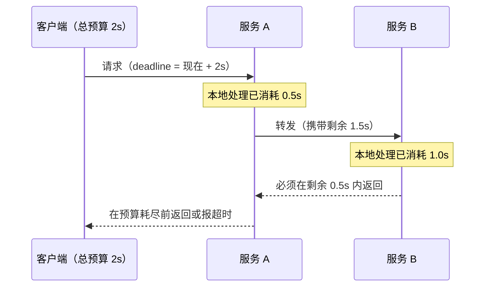
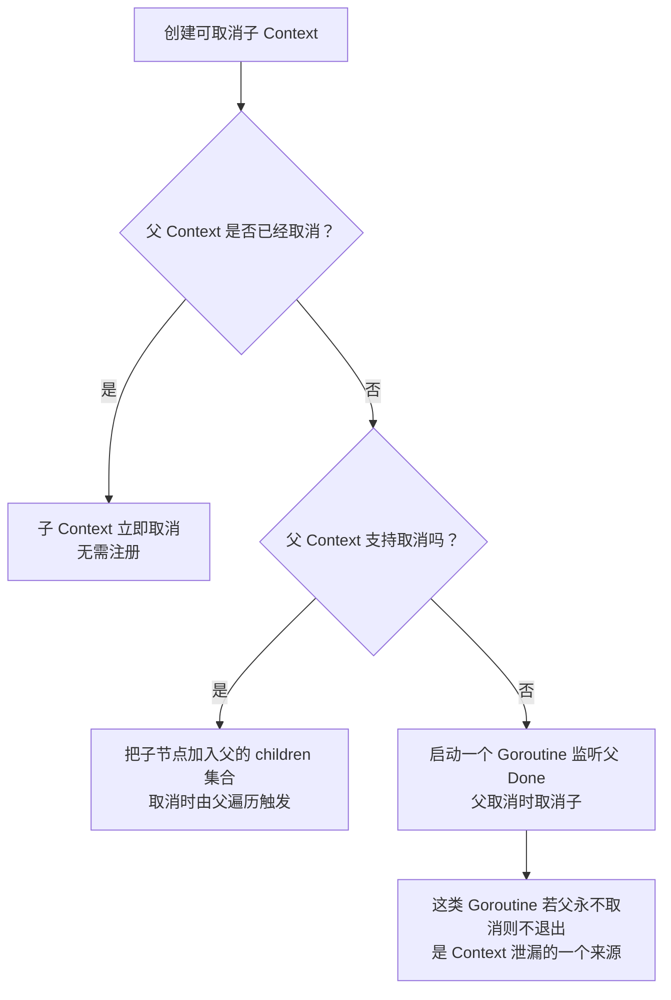

# Context 的设计与取消传播机制

**摘要：**

`context` 包是 Go 并发编程中"跨 Goroutine 通信"的标准解法，自 Go 1.7（2016 年）纳入标准库以来，迅速成为每个 Go 服务端程序必不可少的基础设施。它解决了一个看似简单却极其实用的问题：**当一个请求需要同时启动多个子 Goroutine 协作处理，如何在请求超时、客户端取消或服务主动终止时，可靠地通知并取消所有这些子 Goroutine？** 本文从"没有 context 时如何处理取消"的痛点出发，逐步推导 context 的树形传播设计，深入剖析四种 context 实现（`emptyCtx`、`cancelCtx`、`timerCtx`、`valueCtx`）的内存结构，以及 Go 1.21 对 `cancelCtx` 子节点管理方式的重大重构。最后梳理 context 的工程最佳实践与典型反模式。文章最后回到一个设计认知：context 是"用树形结构建模请求生命周期"的典范——它把"请求取消传播"这个看似需要全局协调的问题，用"父子注册 + 递归取消"的树形结构优雅解决，是 Go 标准库中"数据结构驱动设计"的典型例子。

---

## 第 1 章 没有 context 时的取消问题

### 1.1 多 Goroutine 协作的取消困境

考虑一个典型的微服务处理链路：用户发起一个搜索请求，服务端需要同时调用三个下游服务（用户服务、商品服务、广告服务），将结果聚合后返回。整个请求有 500ms 的超时限制：

```go
// 没有 context 时的实现
func handleSearch(w http.ResponseWriter, r *http.Request) {
    userCh := make(chan *User, 1)
    itemCh := make(chan *Item, 1)
    adCh   := make(chan *Ad, 1)
    
    go fetchUser(userCh)   // Goroutine 1
    go fetchItems(itemCh)  // Goroutine 2
    go fetchAds(adCh)      // Goroutine 3
    
    // 等待三个结果...
    // 问题：如果客户端在 100ms 时断开连接，这三个 Goroutine 还在继续执行
    // 浪费资源，甚至可能对下游服务产生不必要的压力
}
```

**问题一：如何检测客户端已断开**？HTTP 服务器的 `r.Context()` 会在客户端断开时被取消，但子 Goroutine 不知道这件事。如果没有统一的取消传播机制，子 Goroutine 只能盲目执行到底，即使客户端已经离开，结果也无人在等。

**问题二：如何传播取消信号**？需要一种机制让父 Goroutine 通知所有子 Goroutine"停止工作，请求已取消"。这个"通知"必须可靠——不能漏掉任何一个子 Goroutine，否则就是资源泄漏。

**问题三：如何传播超时**？整个请求有 500ms 超时，但每个子调用可能有自己的超时需求（如用户服务 200ms、商品服务 300ms）。需要一种机制让"总超时"和"子超时"协调——子超时不能超过总超时，且总超时触发时所有子超时也应触发。

**没有 context 时的土方案**：

```go
// 用 done channel 手动传递取消信号
type searchCtx struct {
    done    chan struct{}
    timeout time.Duration
    // ...还需要传递用户 ID、trace ID 等元数据
}

func handleSearch(userID string) {
    ctx := &searchCtx{
        done:    make(chan struct{}),
        timeout: 500 * time.Millisecond,
    }
    go time.AfterFunc(ctx.timeout, func() {
        close(ctx.done)
    })
    
    // 每个子 Goroutine 都需要接受这个自定义的 ctx 类型
    go fetchUser(ctx, userID)
    go fetchItems(ctx, userID)
}

func fetchUser(ctx *searchCtx, userID string) {
    select {
    case <-ctx.done:
        return  // 取消了
    case result := <-doFetch(userID):
        // 处理结果
    }
}
```

这个方案功能上可以工作，但有三个问题：
1. 每个项目（甚至每个服务）都有自己的"ctx"类型，不统一，无法跨库复用——A 库的 ctx 类型与 B 库的 ctx 类型不兼容，跨库调用时需要转换；
2. 需要手动管理 done channel 的关闭——忘记 close 会导致子 Goroutine 永远阻塞，重复 close 会 panic；
3. 元数据（trace ID、用户 ID）需要在 ctx 中显式定义每个字段，无法动态扩展——每加一个元数据都要修改 struct 定义，破坏兼容性。

`context` 包正是为了标准化这套机制而设计的——它提供了一个统一的接口、统一的取消传播机制、统一的键值存储，让所有 Go 库都能互操作。

### 1.2 context 的三个核心功能

Go 的 `context.Context` 接口提供了三个功能：

```go
type Context interface {
    // 功能一：取消信号 — 当 context 被取消时，Done() 返回的 channel 会被关闭
    Done() <-chan struct{}
    
    // 功能二：截止时间 — 返回 context 的截止时间（如果有的话）
    Deadline() (deadline time.Time, ok bool)
    
    // 功能三：错误原因 — context 被取消的原因
    // context.Canceled（主动取消）或 context.DeadlineExceeded（超时）
    Err() error
    
    // 功能四：键值存储 — 在 context 树中携带请求级别的元数据
    Value(key any) any
}
```

这四个方法对应 context 的四个职责：取消信号（Done）、截止时间（Deadline）、错误原因（Err）、键值存储（Value）。前三个都围绕"取消"这个核心功能，第四个是附加的元数据传递能力。这个"取消为主，元数据为辅"的设计反映了 context 的核心定位——它是"请求生命周期管理"工具，不是"通用键值存储"。

`context` 包提供了四个创建函数：

```go
// 根 context（不会被取消，用作所有 context 树的根）
ctx := context.Background()  // 正常根节点
ctx := context.TODO()        // 占位用，表示"待实现 context 传递"

// 可取消 context
ctx, cancel := context.WithCancel(parent)
defer cancel()  // 必须调用 cancel，否则 ctx 及其资源不会被释放

// 带超时的 context（超时后自动取消）
ctx, cancel := context.WithTimeout(parent, 5*time.Second)
defer cancel()

// 带截止时间的 context
deadline := time.Now().Add(5 * time.Second)
ctx, cancel := context.WithDeadline(parent, deadline)
defer cancel()

// 携带键值的 context
ctx = context.WithValue(parent, keyType{}, "value")
```

所有创建函数（除 Background/TODO 外）都接受一个 `parent` 参数——这是 context 树形结构的基础，每个新 context 都有一个父 context，取消信号从父向子传播。

---

## 第 2 章 context 的树形结构与取消传播

### 2.1 context 树：父子关系与传播

context 的关键设计是**树形结构（Context Tree）**：每个新创建的 context 都有一个父 context，形成一棵树。**取消信号从父节点向所有子节点传播**——父被取消时，其所有子孙都会被取消；但子被取消时，父不受影响。

这个"父取消传播到子，子取消不影响父"的设计是 context 树的核心语义——它符合"请求生命周期"的直觉：请求（父）取消时，所有子任务（子）都应该取消；但某个子任务完成或取消时，不影响其他子任务或整个请求。

```
一个典型的 context 树（HTTP 请求处理）：

context.Background()
    └── WithCancel（HTTP server 为每个请求创建，请求结束时取消）
             └── WithTimeout(500ms)（设置整个请求的超时）
                      ├── WithValue(traceID, "abc123")（携带 trace ID）
                      │         ├── fetchUser 的 context（子 Goroutine 1）
                      │         └── fetchItems 的 context（子 Goroutine 2）
                      └── fetchAds 的 context（子 Goroutine 3）

当 WithTimeout 的 context 超时时：
- fetchUser、fetchItems、fetchAds 的 context 全部被取消
- 这些 Goroutine 通过 select <-ctx.Done() 感知到取消并退出
```

```go
func handleSearch(w http.ResponseWriter, r *http.Request) {
    // r.Context() 在客户端断开时自动取消
    ctx, cancel := context.WithTimeout(r.Context(), 500*time.Millisecond)
    defer cancel()
    
    // 携带 trace ID
    ctx = context.WithValue(ctx, traceIDKey{}, generateTraceID())
    
    var wg sync.WaitGroup
    results := make(chan interface{}, 3)
    
    for _, fetch := range []func(context.Context) interface{}{
        fetchUser, fetchItems, fetchAds,
    } {
        wg.Add(1)
        go func(f func(context.Context) interface{}) {
            defer wg.Done()
            result := f(ctx)  // 传入同一个 ctx
            results <- result
        }(fetch)
    }
    
    wg.Wait()
    close(results)
    // 聚合结果...
}

func fetchUser(ctx context.Context) interface{} {
    req, _ := http.NewRequestWithContext(ctx, "GET", "http://user-service/...", nil)
    resp, err := http.DefaultClient.Do(req)
    if err != nil {
        if ctx.Err() != nil {
            // ctx 已取消，是预期的错误
            return nil
        }
        // 真正的网络错误
        return nil
    }
    // ...
}
```

`http.NewRequestWithContext` 将 context 传递给 HTTP 客户端——当 context 取消时，正在进行的 HTTP 请求会被中止（底层的 TCP 连接会被关闭）。这是 context 与标准库深度集成的体现——标准库的 I/O 操作（HTTP、数据库、RPC）都支持 context，context 取消时会自动中止 I/O。

### 2.2 取消传播的链式注册机制

context 树的取消传播不是轮询（不是每个子 context 定期检查父是否取消），而是**事件驱动的链式注册**：创建子 context 时，子 context 将自己注册到父 context 的"子节点列表"中；父被取消时，遍历子节点列表，逐一取消所有子节点。

这个"事件驱动而非轮询"的设计是 context 高效的关键——轮询会浪费 CPU（定期检查父状态），事件驱动只在取消时触发（无取消时零开销）。这与 Channel 的"阻塞唤醒"机制类似——等待者阻塞在 `<-ctx.Done()`，取消时 close channel 一次性唤醒所有等待者。

```go
// context/context.go（Go 1.20，简化）
// cancelCtx 是可取消 context 的核心实现
type cancelCtx struct {
    Context                        // 嵌入父 context
    mu       sync.Mutex            // 保护以下字段
    done     atomic.Value          // chan struct{}（懒初始化，首次 Done() 调用时创建）
    children map[canceler]struct{} // 已注册的子节点（cancelCtx 或 timerCtx）
    err      error                 // 取消原因（nil 表示未取消）
    cause    error                 // Go 1.20 新增：WithCancelCause 的原因
}
```

**子 context 的注册**（`propagateCancel` 函数）：

```go
// 创建子 context 时调用
func propagateCancel(parent Context, child canceler) {
    done := parent.Done()
    if done == nil {
        return  // 父 context 不可取消（如 Background），无需注册
    }
    
    select {
    case <-done:
        // 父已经被取消，直接取消子
        child.cancel(false, parent.Err(), Cause(parent))
        return
    default:
    }
    
    // 找到父 context 链中最近的 *cancelCtx
    if p, ok := parentCancelCtx(parent); ok {
        p.mu.Lock()
        if p.err != nil {
            // 父已取消，直接取消子
            child.cancel(false, p.err, p.cause)
        } else {
            // 将子 context 注册到父的 children map 中
            if p.children == nil {
                p.children = make(map[canceler]struct{})
            }
            p.children[child] = struct{}{}
        }
        p.mu.Unlock()
    } else {
        // 父 context 不是标准的 cancelCtx（如自定义 Context 实现）
        // 用 goroutine 监听父的 Done channel
        go func() {
            select {
            case <-parent.Done():
                child.cancel(false, parent.Err(), Cause(parent))
            case <-child.Done():
            }
        }()
    }
}
```

`propagateCancel` 的三个分支反映了 context 的鲁棒性设计：
1. 父不可取消（Background）→ 无需注册，子也不会被父取消；
2. 父是标准 cancelCtx → 注册到父的 children map（高效，O(1) 注册）；
3. 父是自定义 Context → 启动 Goroutine 监听父的 Done channel（兼容，但有 Goroutine 开销）。

第三个分支的"启动 Goroutine 监听"是兼容自定义 Context 实现的兜底方案——如果用户实现了自己的 Context 类型（不基于 cancelCtx），propagateCancel 无法将其注册到 children map，只能用 Goroutine 监听。这个兜底方案保证了 context 能与任何 Context 实现互操作，但代价是额外的 Goroutine 开销。

**取消的执行**（`cancelCtx.cancel` 方法）：

```go
func (c *cancelCtx) cancel(removeFromParent bool, err, cause error) {
    c.mu.Lock()
    if c.err != nil {
        c.mu.Unlock()
        return  // 已经取消了
    }
    c.err = err
    c.cause = cause
    
    // 关闭 done channel（所有在 select <-ctx.Done() 等待的 Goroutine 都会被唤醒）
    d, _ := c.done.Load().(chan struct{})
    if d == nil {
        c.done.Store(closedchan)  // 复用一个全局已关闭的 channel
    } else {
        close(d)
    }
    
    // 递归取消所有子节点
    for child := range c.children {
        child.cancel(false, err, cause)
    }
    c.children = nil  // 释放 children map
    c.mu.Unlock()
    
    if removeFromParent {
        removeChild(c.Context, c)  // 从父节点的 children 中移除自己
    }
}
```

`cancel` 的"关闭 done channel + 递归取消子节点"是取消传播的核心——close channel 一次性唤醒所有等待者（广播），递归取消让取消信号沿树传播。这个"close 广播 + 递归"的设计让取消操作的时间复杂度是 O(子树大小)——取消一个有 N 个子孙的 context，需要 N 次递归调用。

`closedchan` 是一个全局的已关闭 channel——如果 done channel 还没创建（懒初始化），直接复用 closedchan 作为 done，避免分配新 channel。这个"复用全局已关闭 channel"的优化让"从未被 Done() 调用但被 cancel 的 context"不需要分配 channel。

---

## 第 3 章 四种 context 实现的内部结构

### 3.1 emptyCtx：Background 和 TODO 的实现

```go
// context.Background() 和 context.TODO() 都返回 emptyCtx
type emptyCtx struct{}

func (emptyCtx) Deadline() (deadline time.Time, ok bool) { return }
func (emptyCtx) Done() <-chan struct{}                    { return nil }
func (emptyCtx) Err() error                              { return nil }
func (emptyCtx) Value(key any) any                       { return nil }
```

`Done()` 返回 nil——对 nil channel 的接收操作**永远阻塞**（不会被关闭），因此 `select <-ctx.Done()` 对 `Background()` 永远不会触发。这正是"根 context 永不取消"语义的实现方式——用 nil channel 的"永远阻塞"特性表达"永不取消"。

`Background()` 和 `TODO()` 在实现上完全相同（都是 emptyCtx），区别只在语义——`Background()` 表示"这是有意的根 context"（如 main 函数、初始化代码），`TODO()` 表示"这里应该传递 context 但还没实现"（占位用，提示开发者后续补充）。这个"语义区分但实现相同"的设计让代码意图更清晰，同时不增加运行时开销。

### 3.2 cancelCtx：可取消 context

如上节所述，`cancelCtx` 是最核心的实现，包含：
- 懒初始化的 done channel（`atomic.Value`，首次调用 `Done()` 时创建）；
- 子节点注册 map（`children map[canceler]struct{}`）；
- 取消错误（`err error`）。

**懒初始化的原因**：大多数 context 在其整个生命周期内从未被任何 Goroutine 等待（`Done()` 从未被调用）——例如，如果请求在超时前就正常完成了，context 会被 `cancel()` 直接关闭，没有人监听。懒初始化避免了为这些 context 提前分配 channel 的开销。这是"按需分配"的优化——只为真正需要监听的 context 分配 channel，不为"创建后立即取消"的 context 浪费内存。

### 3.3 timerCtx：带超时/截止时间的 context

```go
// timerCtx 嵌入 cancelCtx，额外持有一个定时器
type timerCtx struct {
    cancelCtx
    timer    *time.Timer  // 超时定时器（到期时自动调用 cancel）
    deadline time.Time    // 截止时间
}

func (c *timerCtx) Deadline() (deadline time.Time, ok bool) {
    return c.deadline, true
}

// WithDeadline/WithTimeout 的实现
func WithDeadline(parent Context, d time.Time) (Context, CancelFunc) {
    // 如果父 context 的截止时间更早，直接用 WithCancel（timerCtx 无意义）
    if cur, ok := parent.Deadline(); ok && cur.Before(d) {
        return WithCancel(parent)
    }
    
    c := &timerCtx{
        deadline: d,
    }
    c.cancelCtx.propagateCancel(parent, c)
    
    dur := time.Until(d)
    if dur <= 0 {
        c.cancel(true, DeadlineExceeded, nil)  // 已过期
        return c, func() { c.cancel(false, Canceled, nil) }
    }
    
    c.mu.Lock()
    defer c.mu.Unlock()
    if c.err == nil {
        // 设置定时器，超时时自动取消
        c.timer = time.AfterFunc(dur, func() {
            c.cancel(true, DeadlineExceeded, nil)
        })
    }
    return c, func() { c.cancel(true, Canceled, nil) }
}
```

`timerCtx` 通过嵌入 `cancelCtx` 复用了取消传播机制，额外只加了一个 `timer` 和 `deadline`。这个"嵌入复用"是 Go 组合优于继承的体现——timerCtx 不是 cancelCtx 的子类，而是"cancelCtx + 定时器"的组合。

**关键细节**：`WithDeadline` 会检查父 context 的截止时间是否更早——如果父的截止时间更早，那子 context 设置更晚的截止时间是没有意义的（父被取消时子也会被取消），直接退化为 `WithCancel`，避免创建不必要的定时器。这个"父截止时间更早则退化"的优化避免了无意义的定时器创建——如果父 3 秒后取消，子设 5 秒超时，子的定时器永远不会触发（父先取消了），创建它是浪费。

### 3.4 valueCtx：携带键值对的 context

```go
type valueCtx struct {
    Context    // 嵌入父 context
    key, val any
}

func (c *valueCtx) Value(key any) any {
    if c.key == key {
        return c.val
    }
    return value(c.Context, key)  // 向上查找父 context
}
```

`valueCtx` **不支持取消**（它只是在父 context 的基础上附加一个 key-value 对），取消信号的传播完全依赖父链。这个"取消与元数据分离"的设计让 valueCtx 极其轻量——它只是一个"key-value 包装层"，不引入额外的取消机制。

`Value()` 的查找是**沿 context 链向上遍历**——从当前 context 到根，逐一检查每个 valueCtx 节点的 key 是否匹配。这是**线性查找**，时间复杂度为 O(depth)，其中 depth 是 context 树的深度。

**这意味着 context 链不应该过深**：如果一条请求处理链路中连续调用了 20 次 `WithValue`，每次 `Value` 查找最坏情况需要遍历 20 个节点。实践中，一次请求的 `WithValue` 调用一般不超过 5-10 次（traceID、userID、requestID 等请求级元数据）。

这个"线性查找"是 valueCtx 的性能边界——它不适合存储大量键值对（应该用 map），只适合存储少量请求级元数据。如果需要存储大量数据，应该用 `WithValue` 传递一个 map 引用，而不是多次调用 `WithValue`。

---

## 第 4 章 Go 1.21 对 cancelCtx 的重构

### 4.1 旧实现的问题

Go 1.21 之前，`cancelCtx` 的 `children` 字段是 `map[canceler]struct{}`，其中 `canceler` 是接口类型：

```go
// Go 1.20 及之前
type cancelCtx struct {
    // ...
    children map[canceler]struct{}  // key 是接口，触发动态分配
}
```

这个设计有性能问题：将 `*cancelCtx` 存入 `map[canceler]struct{}` 时，需要将指针装箱为接口（Interface Boxing），产生堆分配；高并发下 `mu.Lock/Unlock` 成为热点。接口装箱的堆分配在高并发场景下会增加 GC 压力——每次创建子 context 都可能触发一次小对象分配。

### 4.2 Go 1.21 的改进

Go 1.21 将 `children` 字段的类型改为 `map[*cancelCtx]struct{}`（具体类型而非接口），避免了接口装箱：

同时引入了更细粒度的锁（针对特定场景）和对 `propagateCancel` 的优化，减少了不必要的 goroutine 启动（之前对非标准 context 的处理会启动一个 goroutine 监听父的取消）。

这个重构体现了 Go 团队对性能的持续关注——即使是标准库的核心组件，也会在发现性能瓶颈后重构。Go 1.21 的 context 优化让高并发场景下的 context 创建开销降低，减少了 GC 压力。

---

## 第 5 章 context 的工程最佳实践

### 5.1 context 应该作为函数第一个参数传入

这是 Go 社区的统一约定：

```go
// 正确：ctx 是函数的第一个参数
func FetchUser(ctx context.Context, userID string) (*User, error) {
    // ...
}

// 错误：ctx 放在中间或最后
func FetchUser(userID string, ctx context.Context) (*User, error) {
    // 违反惯例，工具链和代码审查难以识别
}

// 错误：将 ctx 存在 struct 中
type UserService struct {
    ctx context.Context  // 不应该这样做
}
```

**为什么 context 不应该存在 struct 中**？context 是请求级别的（per-request），而 struct 通常是更长生命周期的对象。如果将 ctx 存入 struct，这个 ctx 的取消时间与 struct 的生命周期不一致，可能导致：ctx 已取消但 struct 还在使用，或者 struct 还没用完但 ctx 因为请求结束被取消。这个"生命周期不匹配"是将 ctx 存入 struct 的根本问题——struct 可能跨多个请求复用，但 ctx 是单请求的。

### 5.2 context.WithValue 的键类型最佳实践

`WithValue` 的 key 应该使用**私有的自定义类型**，而不是 `string` 或内置类型，防止不同包之间的 key 冲突：

```go
// 错误：使用 string 作为 key
ctx = context.WithValue(ctx, "traceID", "abc123")
// 任何包都可以用相同的 string 访问或覆盖这个值

// 正确：使用私有类型作为 key
type traceIDKey struct{}  // 私有类型，其他包无法构造这个类型的值

ctx = context.WithValue(ctx, traceIDKey{}, "abc123")

// 获取时
func GetTraceID(ctx context.Context) string {
    v, _ := ctx.Value(traceIDKey{}).(string)
    return v
}
```

使用私有类型作为 key 的好处：只有定义这个类型的包才能访问对应的 value，实现了 context value 的访问控制——其他包无法"偷看"你存入的值。这个"用类型系统实现访问控制"是 Go 的典型技巧——零成本的类型定义就能实现命名空间隔离。

### 5.3 cancel 函数必须被调用

`WithCancel`、`WithTimeout`、`WithDeadline` 返回的 `cancel` 函数必须被调用，否则会产生资源泄漏——子 context 会一直注册在父 context 的 `children` map 中，直到父被取消：

```go
// 错误：忘记调用 cancel
func handleRequest(parent context.Context) {
    ctx, _ := context.WithTimeout(parent, 5*time.Second)
    // 如果请求在 5s 内完成，ctx 不会被手动取消
    // ctx 仍然注册在 parent 的 children 中，直到 parent 被取消
    doWork(ctx)
}

// 正确：defer cancel()
func handleRequest(parent context.Context) {
    ctx, cancel := context.WithTimeout(parent, 5*time.Second)
    defer cancel()  // 无论如何都会调用
    doWork(ctx)
}
```

`defer cancel()` 是惯用法：即使函数提前 return 或 panic，cancel 也会被执行。这个"defer cancel"的惯用法是 context 使用最重要的规则——不调用 cancel 会导致 context 树中的节点无法被清理，长期运行的服务会积累大量"僵尸 context"，造成内存泄漏。

### 5.4 检查 ctx.Err() 而非 ctx.Done()

在函数内部检查 context 是否已取消时，两种方式都可以，但有细微区别：

```go
// 方式一：非阻塞检查（适合计算循环中）
func longCompute(ctx context.Context) error {
    for i := 0; i < 1000000; i++ {
        select {
        case <-ctx.Done():
            return ctx.Err()  // 返回取消原因
        default:
        }
        doStep(i)
    }
    return nil
}

// 方式二：直接检查 Err（更简洁，适合非 select 场景）
func longCompute(ctx context.Context) error {
    for i := 0; i < 1000000; i++ {
        if err := ctx.Err(); err != nil {
            return err
        }
        doStep(i)
    }
    return nil
}
```

`ctx.Err()` 返回 `nil`（未取消）、`context.Canceled`（被 cancel 函数取消）或 `context.DeadlineExceeded`（超时），调用方可以根据不同原因做不同处理。`ctx.Err()` 比 `select <-ctx.Done()` 更简洁，且能区分取消原因——在计算循环中定期检查 `ctx.Err()` 是响应取消的标准模式。

### 5.5 向下游传递 context：包装错误而非直接返回 ctx.Err()

```go
func fetchFromDB(ctx context.Context, id string) (*Record, error) {
    row, err := db.QueryRowContext(ctx, "SELECT ...", id)
    if err != nil {
        if errors.Is(err, context.Canceled) || errors.Is(err, context.DeadlineExceeded) {
            // 上游取消，直接透传（或包装后传递）
            return nil, fmt.Errorf("fetchFromDB canceled: %w", err)
        }
        return nil, fmt.Errorf("fetchFromDB query error: %w", err)
    }
    // ...
}
```

"包装错误而非直接返回 ctx.Err()"让错误链保留了"哪里取消的"信息——直接返回 `ctx.Err()` 只知道"被取消了"，包装后能知道"在 fetchFromDB 中被取消了"，便于排查。这个"错误包装保留上下文"是 Go 错误处理的最佳实践。

---

## 第 6 章 context 的常见反模式

### 6.1 反模式一：context.Background() 作为"万能根"

```go
// 错误：在请求处理中硬编码 context.Background()
func handleRequest(r *http.Request) {
    ctx := context.Background()  // 丢失了请求的取消信号！
    fetchUser(ctx, r.UserID)
}

// 正确：从请求的 context 派生
func handleRequest(r *http.Request) {
    ctx := r.Context()  // 已包含请求的取消信号
    ctx, cancel := context.WithTimeout(ctx, 5*time.Second)
    defer cancel()
    fetchUser(ctx, r.UserID)
}
```

这个反模式的危害是"丢失取消传播"——用 `Background()` 创建的 ctx 永不取消，即使客户端断开，子 Goroutine 也会继续执行，浪费资源。这个错误在内部服务中尤其常见——开发者觉得"内部服务不会有客户端断开"，但内部服务也可能因为上游超时而需要取消。

### 6.2 反模式二：用 context 传递大量数据（滥用 WithValue）

```go
// 错误：用 context 传递业务数据
ctx = context.WithValue(ctx, "userProfile", userProfile)  // 业务对象不应在 context 中
ctx = context.WithValue(ctx, "queryParams", queryParams)  // 函数参数应作为函数参数传递

// 正确：context 只传递请求级元数据
ctx = context.WithValue(ctx, traceIDKey{}, traceID)     // 追踪 ID
ctx = context.WithValue(ctx, authTokenKey{}, authToken)  // 认证令牌（跨层携带）
```

**context.Value 的正确使用边界**：只用于**横切关注点（Cross-cutting Concerns）**——那些对多个层级都有意义但又不应该出现在函数签名中的信息，如：请求追踪 ID（traceID）、认证令牌、A/B 测试标记等。业务数据（用户 Profile、查询参数）应通过函数参数显式传递。

这个"只传横切关注点"的边界是 context.Value 的核心使用原则——滥用 WithValue 会让 context 变成"全局变量袋"，破坏类型安全和代码可读性。业务数据应该通过函数参数显式传递（类型安全、可追溯），只有"跨层但不需要每个函数都显式传递"的元数据才适合用 context.Value。

### 6.3 反模式三：忽略 context 取消，继续执行

```go
// 错误：收到取消信号后继续执行
func processRequest(ctx context.Context) error {
    data, err := fetchData(ctx)
    if err != nil {
        // ctx 已取消，但还在继续处理！
        // data 可能是 nil 或不完整的，继续处理会 panic 或产生错误结果
        processData(data)
    }
    return err
}

// 正确：ctx 取消后立即返回
func processRequest(ctx context.Context) error {
    data, err := fetchData(ctx)
    if err != nil {
        return fmt.Errorf("fetchData: %w", err)  // 直接返回错误
    }
    // 再次检查，防止 fetchData 完成后 ctx 恰好被取消
    if ctx.Err() != nil {
        return ctx.Err()
    }
    return processData(ctx, data)
}
```

"忽略取消继续执行"的危害是"处理不完整数据"——ctx 取消后，fetchData 可能返回不完整的数据或 nil，继续处理会 panic 或产生错误结果。正确的做法是"ctx 取消后立即返回"，不继续处理。

---

## 第 7 章 context 设计的认知启示

### 7.1 用树形结构建模请求生命周期

context 是"用树形结构建模请求生命周期"的典范——它把"请求取消传播"这个看似需要全局协调的问题，用"父子注册 + 递归取消"的树形结构优雅解决。每个请求是一棵 context 树，根是 Background 或 HTTP server 的 ctx，子节点是 WithTimeout/WithCancel/WithValue 派生的 ctx。取消信号沿树从父向子传播，自然且高效。

这个"树形结构建模生命周期"的设计在工程中广泛出现——如 React 的组件树（父组件卸载时子组件也卸载）、Kubernetes 的资源树（删除 namespace 时删除其中所有资源）。树形结构是表达"层级生命周期"的自然方式——父的生命周期包含子的生命周期，父结束时子也结束。

### 7.2 数据结构驱动设计

context 的设计是"数据结构驱动设计"的典型例子——先定义数据结构（cancelCtx 的 children map、valueCtx 的链式查找），再围绕数据结构实现操作（cancel 的递归、Value 的向上查找）。这个"数据结构优先"的设计让 context 的实现简洁且高效——数据结构本身决定了操作的时间复杂度，不需要额外的协调机制。

这与"算法驱动设计"形成对比——算法驱动设计先定义算法，再为算法设计数据结构。context 是数据结构驱动——先有"树形结构 + children map"的数据结构，再有"递归取消"的算法。这个"数据结构驱动"的设计风格在 Go 标准库中常见——如 sync.Map 的双 map 结构、Channel 的环形缓冲区，都是先有数据结构再有算法。

### 7.3 接口与实现分离

context 包将"接口"（Context interface）与"实现"（emptyCtx、cancelCtx、timerCtx、valueCtx）分离——用户通过接口使用 context，不需要知道具体实现类型。这个"接口与实现分离"让 context 包可以在不破坏用户代码的情况下重构内部实现（如 Go 1.21 的 cancelCtx 重构）。

这个"接口与实现分离"是 Go 标准库的通用设计模式——如 `io.Reader` 接口与各种 Reader 实现（FileReader、BufferReader、NetworkReader）分离。用户面向接口编程，实现可以自由替换。这是 Go"组合优于继承"哲学的体现——接口定义行为，实现提供具体逻辑，两者解耦。

---

## 第 8 章 跨进程传递：超时预算与 deadline 的物理边界

### 8.1 超时是预算，不是常量

前几章讨论的取消都发生在单个进程内部——父 Context 取消，子 Context 跟着取消。但当请求跨进程流转时，取消要穿过网络边界，这时"超时"的性质发生了变化：它从一个"本地的等待上限"变成了一份"要随请求一起旅行的预算"。

譬如一个面向用户的接口承诺 2 秒返回，这 2 秒是整条调用链共享的总预算，而不是每一跳各自拥有的 2 秒。若链路是客户端、网关、服务 A、服务 B 四段，且每段都各设 2 秒超时，那么最坏情况下用户要等约 8 秒——预算被逐跳放大，承诺便形同虚设。这是分布式超时最容易犯的错误：**把"总预算"误当成"单跳上限"**。理解这一点，才能理解为什么 Go 的 Context 把 deadline 设计成一个"绝对时刻"而非"相对时长"——绝对时刻可以原样传给下游，相对时长每传一跳就会被重新计时。

### 8.2 deadline 如何被搬到对端

Context 本身不可序列化，跨进程传的是它的 deadline。gRPC 的做法是在每次调用时计算"距离 deadline 还剩多久"，把它编码进请求头 `grpc-timeout`；HTTP 的客户端（如 `net/http`）则通过 `Request.Context()` 与 `Cancel` 字段把取消信号绑定到连接的关闭上。对端收到后，用剩余时长重建一个带超时的 Context，于是预算就跟着请求走完了一整条链路。

下图画出了 2 秒预算在四段链路中的消耗与传递：



请注意两个容易被忽略的事实：其一，跨进程真正能传的是 **deadline**，"为什么取消"这一语义传不过去，对端只知道"时间不多了"，不知道是因为用户断开还是上游自己放弃；其二，取消信号跨进程只能靠连接断开或协议层的显式帧（如 HTTP/2 的 `RST_STREAM`）来传达，链路中间任何一个代理不透传这个信号，取消就会在该处"断线"。

### 8.3 剩余时间才是下游应得的预算

实践中一个高频错误是这样写下游调用：

```go
func (s *Service) Handle(ctx context.Context) error {
    // 反例：用 Background 重新起一个独立的 10 秒预算
    downCtx, cancel := context.WithTimeout(context.Background(), 10*time.Second)
    defer cancel()
    return s.downstream.Call(downCtx)
}
```

这段代码在功能上"能跑"，但它丢弃了上游的 deadline——即使上游只剩 200 毫秒，下游仍会固执地等满 10 秒，用户早已超时离开，而这条调用链还在继续消耗资源。正确的做法是把上游的 `ctx` 直接传下去，让下游天然继承剩余预算：

```go
// 正例：直接继承上游预算，不做重置
func (s *Service) Handle(ctx context.Context) error {
    return s.downstream.Call(ctx)
}

// 需要为下游设置一个更小的上限时，取两者中更紧的那个
func (s *Service) HandleWithCap(ctx context.Context) error {
    downCtx, cancel := context.WithTimeout(ctx, 800*time.Millisecond)
    defer cancel()
    return s.downstream.Call(downCtx)
}
```

`WithTimeout(ctx, d)` 取的是"父 deadline 与 `now+d` 中更早的那个"，因此把父 `ctx` 作为第一个参数，就自动实现了"预算不放大"。这也回应了本章开头的那句话：**绝对时刻可以传递，相对时长必须收敛**。

### 8.4 预算分配的经验法则

预算在链路上怎么分，有几条值得记住的经验。第一，要给返回路径留时间——请求发出去之后，响应还要走回来，若把预算吃到只剩最后一毫秒才发请求，返回路径上任何一个慢点都会导致超时；实践中的粗口径是"下游预算不比上游剩余预算的 80% 更宽松"。第二，读操作与写操作的预算逻辑不同——读操作可以快速失败重试，写操作往往不能，因为重试会带来重复提交，写路径的预算应当更宽、重试应当更保守。第三，重试同样消耗预算，`ctx` 的 deadline 不会因为重试而重置，所谓"重试 3 次"如果每次都花满预算，用户侧看到的就是三倍的等待——**重试必须在预算内重试**，这是容错设计与超时设计必须一起考虑的原因。

### 8.5 边界与反例

最后是几处边界。其一，若 deadline 已经过期，`ctx.Err()` 会立即返回 `context.DeadlineExceeded`，此时再发起调用只会得到一个立刻失败的请求——这其实是好事，它把"注定超时的调用"提前掐死，避免浪费；但若代码里写的是"先建连接再检查 ctx"，就可能白建一次连接。其二，跨进程传的 deadline 依赖两端机器时钟的相对一致，时钟漂移会让"剩余时间"算得不准，因此残留的误差必须靠本地的 `ctx` 兜底，不能完全信任对端传来的时长。其三，中间代理如果缓冲了请求（常见于消息队列），deadline 在排队期间会持续消耗，等到真正被消费时可能已经过期——**异步链路必须重新审视预算语义**，否则会得到"消息总是超时"的困惑。

## 第 9 章 递归取消的复杂度与实践反例

### 9.1 取消传播的复杂度

`cancelCtx` 用一个 `children` 集合记录所有子节点，取消时遍历这个集合并逐个取消。因此一次取消的时间复杂度是 **O(子树节点数)**，而不是 O(1)。在正常的请求生命周期里，这个子树通常只有几个到几十个节点，代价可以忽略；但在两类场景下它会放大：一是"一个根 Context 派生上万个长期存活的子 Context"（譬如把 Background 当作全局根，为每个连接派生一个长期 Context），二是"极深的 Context 链"（每一层 WithValue 或 WithCancel 都加一层）。前者让取消变成一次遍历上万节点的操作，后者让取消变成一次长递归。

这与第 2 章的树形模型是一个硬币的两面：树形结构带来了"取消一次、全树生效"的便利，也意味着取消的成本与树的规模成正比。工程上的应对很简单——**让 Context 的生命周期与请求对齐**，请求结束就 `cancel()`，不要派生生命周期超过请求的 Context。

### 9.2 cancel 的幂等性与并发语义

`cancel()` 被设计成幂等的：第一次调用负责真正的清理与传播，后续调用直接返回，不会重复取消、不会 panic。这一点在多处代码都可能触发取消时尤其重要——譬如超时定时器与手动取消同时发生，两者都会调用 `cancel()`，但只有一个生效。与之配套的是 `CancelFunc` 的并发安全性：它本身可以从多个 Goroutine 同时调用，无需额外加锁。理解这两点后，`defer cancel()` 就可以放心地写在函数入口处，不必担心"重复取消"。

### 9.3 WithValue 的链式查找代价

`valueCtx` 的查找是沿父链逐层向上去找匹配的 key，因此 `ctx.Value(k)` 的时间复杂度是 O(链深)。当 Context 链被反复 `WithValue` 拉长时（常见于中间件层层注入——认证层塞一个、限流层塞一个、追踪层再塞一个），每次取值都变成一次线性扫描。单次开销依旧很小，但如果它在热路径上被高频调用（如每处理一条数据就取一次 Trace ID），累积起来就不可忽略。应对方式是把要在热路径上反复读取的值在进入热路径前取出、放到局部变量里，而不是每次访问都回到链上去找。

### 9.4 Context 与资源生命周期的耦合

Context 的价值不只体现在 Goroutine 之间，更体现在它与外部资源生命周期的耦合上：`database/sql` 的 `QueryContext` 会在 `ctx` 取消时终止查询并释放连接，`net/http` 的请求会随 Context 取消而中断，各类消息客户端也普遍接受 `ctx`。这意味着**把 Context 传到位，就等于把"取消"这条信号接进了所有外部资源**——这是它比"手动设几个超时变量"更彻底的地方。反过来，若某个下游调用没有接受 `ctx`（老版本的库很常见），取消就会在该处断掉，形成"上层已取消、下层还在跑"的资源泄漏。

### 9.5 反例集

下面几类写法在实践中反复出现，值得逐一记住：

- **把 Context 存进 struct 字段**：Context 应与请求而非对象绑定，存进 struct 会让它的生命周期脱离请求，取消时机不可控；
- **用 Context 传业务参数**：`WithValue` 的定位是传递"请求范围的元数据"（Trace ID、认证主体），把用户列表、分页参数塞进去会让数据流变得隐式、难以追踪，也让函数签名失去了表达力；
- **在 Goroutine 内忽略 ctx**：`go func() { ... }()` 若不在函数体内监听 `ctx.Done()`，外部取消对它无效，这个 Goroutine 会一直跑到自然结束；
- **忘记调用 cancel**：`WithCancel`/`WithTimeout` 返回的 `cancel` 不调用，会一直占用父节点的 `children` 引用，导致父 Context 无法被回收——这是最隐蔽的 Context 泄漏。

> [!warning] 一个容易被忽略的泄漏
> `context.WithTimeout` 返回的 `cancel` 即使超时已经触发，也必须被调用。超时只解决了"什么时候取消"，不解决"什么时候把这个子节点从父节点上摘掉"。若只依赖超时而不 `defer cancel()`，父 Context 的 `children` 会一直挂着一个已失效的子节点，直到父 Context 本身被回收。

## 第 10 章 真实系统中的四种用法与实现细节

### 10.1 四种典型用法模式

把前九章的机制收拢，Context 在真实系统里的用法基本落在四种模式上。

**其一，请求取消**：HTTP handler 拿到的 `Request.Context()` 在客户端断开时被取消，只要把 `ctx` 一路传下去，整条调用链就会随请求终止——这是最基础也最常被忽略的一种用法，忽略它的表现就是"客户端走了，服务端还在算"。

**其二，超时预算**：通过 `WithTimeout`/`WithDeadline` 为一次操作设定上限，并把这个上限沿链路传递，正如第 8 章所述，它天然契合分布式超时。

**其三，生命周期绑定**：服务的根 Context 通常从 `signal.NotifyContext` 派生（监听 SIGTERM/SIGINT），所有长期运行的后台任务都挂在这棵树上——收到停机信号时，根 Context 取消，所有后台任务随之收敛，这是优雅停机能"一次通知、全树响应"的原因。

**其四，值传递**：在请求范围内携带 Trace ID、认证主体、限流键等元数据；这些数据的共同特征是"请求级"且"被多个中间件共享"，而不是业务参数。

### 10.2 Go 1.21 之后的 cause 与 AfterFunc

Go 1.21 给 Context 补了两块拼图。一是 `context.WithCancelCause` 与 `context.Cause`——取消时可以携带一个"原因"错误，下游用 `Cause(ctx)` 取回这个原因。它弥补了第 8 章提到的缺口：跨层传播时，"为什么取消"此前只能靠 `ctx.Err()` 得到一个笼统的 `context.Canceled`，有了 cause 之后，取消的语义可以一路带到最外层。二是 `context.AfterFunc`——注册一个在 Context 被取消时执行的函数，它把"取消后要做的清理"从轮询 `Done()` 变成了回调注册，避免了为等取消而额外起一个 Goroutine 的常见写法。

```go
// 用 cause 携带取消原因，外层可据此区分"用户主动取消"与"内部错误"
ctx, cancel := context.WithCancelCause(parent)
defer cancel(nil)
if err := load(); err != nil {
    cancel(fmt.Errorf("加载配置失败: %w", err))
}
// 后续：if errors.Is(context.Cause(ctx), errConfigLoad) { ... }
```

### 10.3 errgroup 与 Context 的协作

`errgroup.WithContext(parent)` 返回的组会在**任意一个成员返回错误时取消派生的 Context**，其余成员若尊重 `ctx` 便会自动退出。这与 `sync.WaitGroup` 有着本质区别：`WaitGroup` 只负责"等齐"，不负责"提前终止"；`errgroup` 在此之上加了一条取消的边，把"一个失败、全体收敛"的模式固化了。理解这条边，也就理解了为什么 errgroup 常与 `ctx` 一起出现在扇出场景中——它不是"带错误收集的 WaitGroup"，而是"带取消传播的 WaitGroup"。

### 10.4 与 Java、Python 取消机制的对照

不同语言对"取消"的建模方式很不一样。Java 用 `Future.cancel` 或 `Thread.interrupt`——取消是一个作用在**线程**上的动作，靠中断标志位实现；Python 的 `asyncio` 用 `CancelledError` 异常注入到协程中，取消是一次**异常**；Rust 的 `Future` 在 `drop` 时被丢弃，取消是**析构**的副产品。

Go 的选择是把取消做成一个**显式的、可传递的值**：`ctx` 必须被当作参数一层层传下去，谁能取消、谁该响应取消，在函数签名里就写清楚了。这个选择的代价是样板代码（几乎每个跨层函数都要带一个 `ctx` 参数），收益是取消的路径完全显式——没有隐式的线程中断，没有异常穿越栈帧的意外，也没有"析构即取消"这种对析构语义的额外要求。这是"显式优于隐式"这条 Go 设计信条在并发控制上的又一次体现。

### 10.5 两处必须澄清的能力边界

第一，**Context 不能杀死 Goroutine**。`cancel()` 做的是"关掉一个 channel"，它只是通知；真正要停下来的 Goroutine 必须自己监听 `Done()` 并主动退出。若有代码不检查 `ctx`，取消对它无效——这也解释了为什么"传了 ctx"并不等于"一定会停"。

第二，**Context 无法中断正在执行的 C 函数或阻塞式系统调用**。`cgo` 调用、某些不支持中断的老式阻塞调用在执行期间不理会取消信号，只能等它自然返回。因此对这类调用，超时只能在"调用之外"生效——这也是把不可中断的长调用放进独立 Goroutine、由外层 `ctx` 超时后丢弃结果的模式存在的原因。

## 第 11 章 实现细节、测试与使用清单

### 11.1 Done channel 的惰性创建

`cancelCtx` 的 `done` 字段是一个 `atomic.Value`，它的 channel 只在**第一次有人调用 `Done()` 时**才被创建。这个惰性设计有明确的目的：很多 Context 从不被任何人等待取消（它们只是被创建、传递、随请求结束而释放），为它们提前分配一个 channel 纯属浪费。惰性创建把这份开销推迟到"真的有人关心取消"的时刻。理解这一点，也能解释为什么 `Done()` 的返回值只能用于 `select` 接收，而**不能**用来做 `== nil` 之外的判断——同一个 `cancelCtx` 前后两次 `Done()` 返回的必须是同一个 channel，这正是 `atomic.Value` 要保证的。

### 11.2 propagateCancel 的三种情形

当创建一个可取消的子 Context 时，运行时会调用 `propagateCancel` 把它挂到父节点上，具体分三种情形处理——这三种情形恰好覆盖了父子关系的全部可能：



第二种情形是最常见的：父是可取消的，子只需注册进父的 `children`，取消时被父遍历触发，没有额外 Goroutine。第三种情形出现在父不可取消时（如 `context.Background()`），此时为了能响应"父被取消"，只能额外起一个 Goroutine 去 `select` 父的 `Done()`——而如果父是永远不会取消的 `Background()`，这个 Goroutine 会一直等到子被取消为止，这是它必须被 `cancel()` 的原因之一。

### 11.3 性能开销的量化

Context 本身很轻——`valueCtx` 只是"父指针 + 键 + 值"三个字段，`cancelCtx` 也只是"父指针 + 锁 + 子集合 + done"。单次取值、单次取消的开销都在纳秒量级，绝大多数场景下无需为它做优化。真正会显形的开销只有两处：一是第 9.3 节讲的 `WithValue` 链式查找，链越长越慢；二是取消时遍历 `children` 集合，子节点越多越慢。两者都不是 Context 实现的问题，而是"用得不对"的问题——**把 Context 链保持得短、把子树保持得小**，开销自然就低。

### 11.4 如何测试取消行为

测试取消最容易踩的坑是"用真实时间等超时"，测试会因为等待而变慢、变脆。更稳的做法有三类：其一，用**极短的超时**（几毫秒）配合"断言收到 `ctx.Err() == DeadlineExceeded`"，而不是断言"耗时接近阈值"；其二，对依赖时间的逻辑，把"取当前时间"抽象成一个可注入的函数或接口，测试时用假时钟推进；其三，测试"取消是否传播"时，用一个 `select` 分别监听子 `Done()` 与一个 `time.After` 兜底，若在兜底超时前收到子 `Done()` 即说明传播生效：

```go
func TestCancelPropagates(t *testing.T) {
    parent, cancel := context.WithCancel(context.Background())
    child, childCancel := context.WithCancel(parent)
    defer childCancel()

    cancel() // 取消父
    select {
    case <-child.Done():
        // 传播生效
    case <-time.After(time.Second):
        t.Fatal("取消未传播到子 Context")
    }
}
```

这段测试不依赖任何具体的时长阈值，只依赖"能不能等到"，因此既快又稳。

### 11.5 一份可执行的 Context 使用清单

把全篇的结论压缩成一份清单，供写代码时逐条核对：

| 检查项 | 做法 | 反例 |
| :--- | :--- | :--- |
| 是否作为第一个参数 | `func Do(ctx context.Context, ...)` | 放在参数列表中间或末尾 |
| 是否存进 struct | 每次调用显式传入 | 作为字段长期持有 |
| 是否调用 cancel | 入口处 `defer cancel()` | 只依赖超时、忘记调用 |
| 是否传值给下游 | 直接传上游 `ctx` | 用 `Background()` 重新计时 |
| 是否监听取消 | 循环/长任务内 `select ctx.Done()` | 起了 Goroutine 却不管 `ctx` |
| WithValue 的键 | 使用私有类型作 key | 用字符串作 key 造成冲突 |
| WithValue 的内容 | 只放请求级元数据 | 放业务参数、大对象 |
| 取消的响应粒度 | 在安全的检查点退出 | 中途强杀导致状态不一致 |

清单的最后一行的意思是：取消是"协作式"的，收到 `ctx.Done()` 的代码应当选择在"状态一致"的位置退出——比如一次数据库事务结束后、一批写入提交完成后，而不是写到一半就丢掉，否则会留下不一致的中间状态。这一点在写路径上尤其重要：**取消是允许的，但取消不能破坏不变量**。

## 第 12 章 Context 与追踪、日志、指标的联动

### 12.1 Trace ID 为什么挂在 Context 上

分布式追踪（Distributed Tracing）的跨度（Span）之所以用 Context 承载，是因为 Span 的作用域恰好就是"一次请求"——这与 Context 的语义完全重合。OpenTelemetry 的实现把当前 Span 存进 Context，下游要开子 Span 时从 `ctx` 取出父 Span，于是这棵 Span 树自然与调用链对齐。用 Context 承载追踪上下文还有一个隐含收益：Context 沿调用链传递的路径，正好就是"追踪信息应该传递的路径"，框架不需要再额外发明一套传播机制。

### 12.2 日志中的请求标识

结构化日志最常见的一项字段是请求 ID（Request ID），它的来源同样是 Context。惯用做法是在入口中间件里把 ID 写进 `ctx`，再在需要打日志的地方取出。更彻底的做法是把带 ID 的 logger 本身放进 Context，让下游的日志自动带上这个字段——这避免了"每处日志都手动拼一个 ID"的重复。这里要提醒的是第 9.3 节讲过的那条代价：如果热路径上每条日志都从 Context 链里取一次 ID，链越深越慢；合理的折中是在进入热点逻辑前把 ID 取出来放到局部变量里。

### 12.3 取消与超时的可观测

取消了、超时了，如果没有指标，就只剩"用户抱怨变慢"这一个信号。值得埋点的有三类：一是**超时率**（`DeadlineExceeded` 的出现比例），它直接反映预算是宽还是紧；二是**取消来源分布**（客户端断开、上游取消、本地主动取消），它区分"外部因素"与"内部放弃"；三是**超时发生在哪一跳**，跨服务场景下这一项决定了要不要重新分配预算。这三类指标放在一起看，才能回答"这次变慢是链路设计问题还是下游质量退化"。

### 12.4 一个容易被忽略的追踪反例

用 Context 承载 Span 时要小心一个反例：把 Span 放进 `ctx` 之后，如果忘记在函数返回前 `span.End()`，Span 的时长会被无限拉长，追踪系统里就会出现"跨度时长异常"的怪象。更隐蔽的是**在 Goroutine 之间复用同一个 `ctx`**——若父子 Goroutine 共享同一个 Span，两者的耗时会被记进同一个跨度，追踪数据会失真。正确做法是每进入一个新的并发分支，就从 `ctx` 派生一个子 Span，而不是复用父的那个。

## 第 13 章 五个高频追问

**问题一：Context 为什么设计成接口而不是具体类型？** 因为调用方只应依赖"能拿到 deadline、能等到取消、能取值"这组能力，而不应依赖某一种实现。做成接口后，任何满足方法集的类型都能作为 Context 使用，测试里可以塞一个只实现几个方法的假对象，框架也可以提供自己的实现——这正是 Go"面向接口编程"在标准库里的样本。

**问题二：WithValue 的 key 为什么推荐用自定义类型？** 因为 `ctx.Value` 的匹配是"按 key 相等"做的，若用字符串作 key，两个互不知情的库很可能用了同一个字符串（譬如都用 `"userID"`），后写的会覆盖先写的，前者的取值就变成了脏数据。用未导出的自定义类型作 key，天然把命名空间隔离开，跨包冲突不再可能。这也是标准库文档里明确写的建议。

**问题三：取消能保证清理完成吗？** 不能。`cancel()` 只做两件事——关闭 `Done()`、递归通知子节点；它不等待任何清理逻辑跑完。清理的顺序仍然是"谁申请谁释放"：文件要 `defer Close`、事务要 `defer Rollback`、临时资源要 `defer Remove`。把取消当成"会自动收拾残局"是一个常见误解，取消与清理是两件事，前者通知、后者执行。

**问题四：为什么 Go 不提供"强制杀死 Goroutine"的能力？** 因为 Go 的并发模型是协作式的，Goroutine 共享内存、没有独立的地址空间。强杀一个正在写共享状态的 Goroutine，会把它持有的锁、正在修改的切片、写到一半的缓冲区留在不一致的状态上——这比不杀更危险。Context 因此选择了"通知 + 自愿退出"：由代码自己在安全的检查点收手，才能保证不变量不被破坏。这也解释了为什么"收到取消就立刻返回"有时是错的——正确做法是"在下一个安全点退出"。

**问题五：Context 树的深度有上限吗？** 没有硬性上限，但代价会随深度增长：取消是一次沿 `children` 集合的递归传播，取值是一次沿父链的线性查找。可行的做法不是给深度设限，而是从设计上让 Context 的规模与请求对齐——请求范围内的链通常只有几层，一旦发现某条链变成几十上百层（往往是把 `Background()` 当全局根、为每个长生命周期对象派生 Context 所致），需要反思的就已是结构而非实现。

**问题六：为什么 Context 是不可变的？** 因为可变会立刻引入数据竞争——同一个 Context 会被任意多个 Goroutine 同时持有，任何"修改已有节点"的操作都要加锁，而加锁的代价会摊到每一次取值上。不可变则让"同时持有"天然安全，`WithValue`、`WithCancel` 返回的都是新节点，原节点不受影响。这带来一种值语义的直觉：把 Context 传给别人，不必担心对方会篡改它；同时也带来一个约束：每次追加信息都要新建一层，链因此只能加长、不能改写——这正是前面反复强调"保持链短"的根本原因。

**问题七：跨进程的取消可靠吗？** 不可靠。取消信号要么依赖连接断开，要么依赖协议层的显式帧，链路上任何一个代理不透传这个信号，取消就会在那里断掉。因此"对端一定会收到取消"是一个不应被依赖的假设。更稳的兜底是让 deadline 比期望值略紧：取消负责"尽快收敛"，超时负责"保底收敛"，两者分工协作，而不是指望取消独自完成跨进程的收敛。

**问题八：Context、errgroup、singleflight 是什么关系？** 它们是"取消"这一主题的三个层次。Context 提供取消的原语——一个可传递、可派生、可监听的信号；errgroup 在 Context 之上提供编排——"首错即取消、等齐所有成员"；singleflight 则提供"并发去重"——把同一时刻对同一后端的重复请求合并为一次。三者常被组合使用：用 errgroup 扇出，用 singleflight 合并对同一后端的并发请求，用同一个 `ctx` 贯穿始终，于是"取消"这条信号从最外层的请求一路贯到最内层的重复请求消除，链路中任何一处收手，其余各处都能感知。

**问题九：为什么标准库不提供"带取消的 WaitGroup"？** 因为取消与"等齐"是两种不同的收敛目标——取消要的是"尽快少做事"，等齐要的是"一件不落"，把两者压进同一个原语，会强迫使用者在"提前返回"与"等齐所有"之间二选一。标准库于是选择各司其职：`WaitGroup` 只管等齐，取消交给 `Context`，两者按需组合；而 `errgroup` 恰好是这种组合的一个现成封装。

## 总结

本篇完整剖析了 `context` 包的设计动机与实现机制：

**树形传播设计**：context 形成树形结构，父被取消时，通过 `children map` 递归取消所有子孙。子 context 创建时（`propagateCancel`）注册到父的 children 中；父 `cancel()` 时关闭 done channel 并遍历 children 递归取消——这是事件驱动的，不是轮询。这个"事件驱动 + 递归取消"的设计让取消操作高效且可靠。

**四种实现**：`emptyCtx`（Background/TODO，Done() 返回 nil，永不取消）、`cancelCtx`（核心，done channel + children map）、`timerCtx`（嵌入 cancelCtx，额外有定时器，超时自动 cancel）、`valueCtx`（附加 key-value，Value() 沿链向上线性查找）。四种实现通过嵌入复用，timerCtx 嵌入 cancelCtx，valueCtx 嵌入父 context。

**核心工程实践**：
- ctx 作为函数第一个参数，不存入 struct（生命周期不匹配）；
- `WithValue` 的 key 用私有类型（访问控制，防止 key 冲突）；
- cancel 函数必须通过 `defer cancel()` 调用（防泄漏，清理 children 注册）；
- context 只携带横切关注点元数据，不传递业务数据（保持类型安全和可读性）；
- 下游函数收到错误后应检查 `ctx.Err()` 区分取消还是真实错误。

context 是"用树形结构建模请求生命周期"的典范——它把"请求取消传播"这个看似需要全局协调的问题，用"父子注册 + 递归取消"的树形结构优雅解决。这个"数据结构驱动设计"的风格在 Go 标准库中广泛出现，是 Go 工程美学的体现。

下一篇介绍 Go 并发编程的三种经典模式：[[08 Go 并发模式——Pipeline、Fan-out Fan-in 与 Worker Pool]]。

---

## 参考资料

1. Go Blog,《Go Concurrency Patterns: Context》: https://go.dev/blog/context——Go 官方博客对 context 设计的阐述。
2. context 包源码：`context/context.go`——context 的完整实现。
3. Sameer Ajmani,《Advanced Go Concurrency Patterns》, Google I/O 2013——context 的高级用法讲解。
4. Go 1.21 Release Notes: context 优化——cancelCtx 重构的说明。
5. Go 1.20 Release Notes: WithCancelCause——cause 功能的引入。

---

> [!note] 思考题
> 1. `context.WithCancel` 返回的子 Context 在父 Context 被取消时也会被取消。这种传播是如何实现的——子 Context 是轮询父 Context 的状态，还是父 Context 主动通知子 Context？如果一个父 Context 有 10000 个子 Context，取消操作的时间复杂度是什么？
> 2. 在 gRPC 拦截器中，Context 会携带 deadline 信息跨进程传播。如果客户端设置了 5 秒超时，但服务端在第 3 秒调用了另一个 gRPC 服务——这个下游调用的 deadline 是剩余的 2 秒还是另一个独立的超时？如果你希望下游调用有独立的超时（比如 10 秒），该怎么处理？直接 `context.WithTimeout(context.Background(), 10*time.Second)` 会有什么问题？
> 3. Context 被设计为不可变（只能创建新的子 Context）。`context.WithValue` 用于在调用链中传递请求级数据（如 Trace ID）。但如果滥用 `WithValue` 传递业务参数（如用户 ID、权限列表），会导致什么问题？Go 社区中关于 Context 应该传递哪些数据存在什么共识？
> 4. context 的取消传播是"事件驱动 + 递归取消"——父 cancel 时递归取消所有子节点。如果 context 树非常深（如 100 层），取消操作会递归 100 次。这个递归是否会栈溢出？Go 运行时是否对 context 树深度有上限？如果需要支持"超深 context 树"，应该如何设计取消传播机制？
