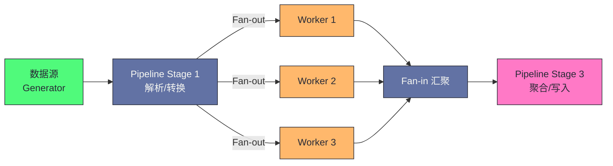
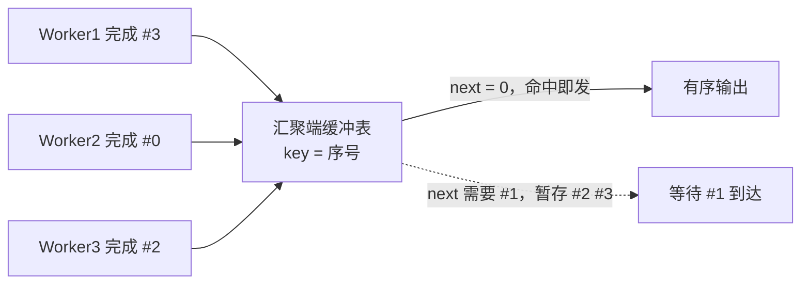
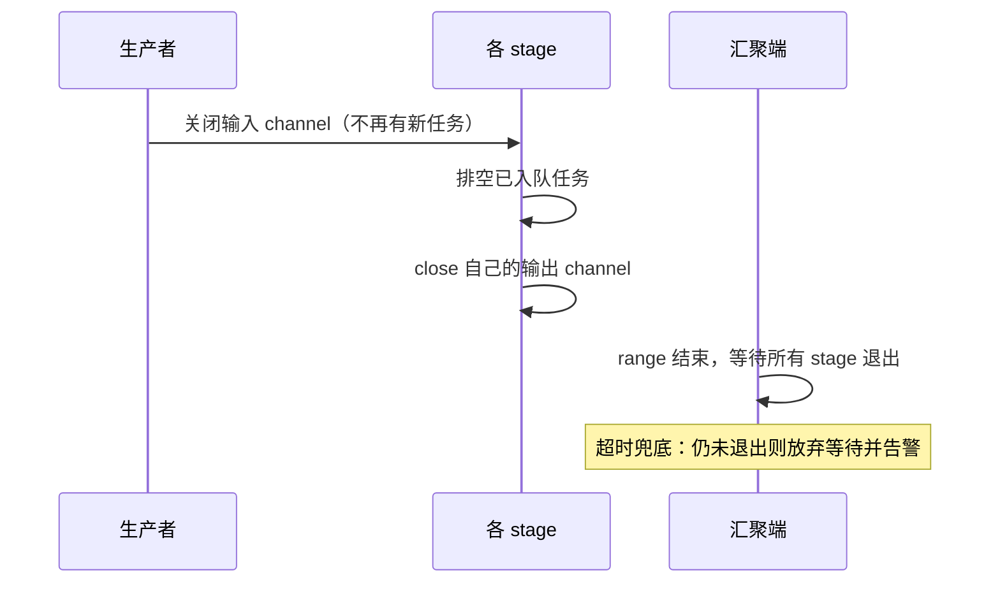

# Go 并发模式——Pipeline、Fan-out Fan-in 与 Worker Pool

**摘要：**

Go 的并发原语（Goroutine + Channel + context）是构建高并发系统的积木，但如何将这些积木组合成正确、高效、可维护的并发程序，需要遵循经过实践验证的**并发模式（Concurrency Patterns）**。本文聚焦三种最重要的 Go 并发模式：**Pipeline**（流水线，将数据处理分解为多个串联阶段）、**Fan-out / Fan-in**（扇出/扇入，将单一任务流分发到多个并发 Worker，再汇聚结果）、以及 **Worker Pool**（工作池，控制最大并发度，防止资源耗尽）。这三种模式不是孤立的——它们通常组合使用，构成完整的数据处理流水线。本文对每种模式都从"为什么需要它"出发，给出完整的、带取消支持的生产级实现，并分析每种模式的适用边界和常见陷阱。文章最后回到一个设计认知：这三种模式都体现了"用并发结构表达数据流"的工程哲学——Pipeline 表达"串行数据流"，Fan-out/Fan-in 表达"并行数据流"，Worker Pool 表达"受控并发数据流"。理解这些模式的核心不是记住代码模板，而是理解"数据如何在并发 Goroutine 之间流动"。

---

## 第 1 章 Pipeline：流水线模式

### 1.1 什么是 Pipeline，解决什么问题

**Pipeline（流水线）**是一种将数据处理分解为多个**串联阶段**（Stage）的并发模式，每个阶段从输入 channel 读取数据，处理后写入输出 channel，下一个阶段再从这个输出 channel 读取。

不用 Pipeline 时，数据处理通常是串行的：

```go
// 串行处理：每个步骤必须等上一步全部完成
data := readAllFiles(paths)    // 先全部读完
parsed := parseAll(data)       // 再全部解析
results := processAll(parsed)  // 再全部处理
writeAll(results)              // 再全部写入
```

这种串行方式的问题：**各阶段之间没有重叠**——读文件时解析器空闲，解析时处理器空闲。如果数据量大，每个阶段都需要等待上一阶段完全完成才能开始，总时间是各阶段时间之和。这是"批处理"模式——每个阶段处理完整批数据后，才传递给下一阶段，阶段间无并行。

Pipeline 的思路是：每个阶段独立运行，只要第一阶段产出了一个数据，第二阶段就可以立即开始处理它，不需要等第一阶段处理完所有数据——**各阶段流水线式重叠执行**，整体吞吐量大幅提升：

```
串行方式（耗时 = T1 + T2 + T3）：
阶段1: [读读读读读]
阶段2:             [解解解解解]
阶段3:                         [处处处处处]

Pipeline 方式（耗时 ≈ max(T1, T2, T3) + 启动延迟）：
阶段1: [读读读读读]
阶段2:   [解解解解解]   ← 第1个数据读完就开始解析
阶段3:     [处处处处处] ← 第1个数据解析完就开始处理
```

这个"流水线重叠"是 Pipeline 性能提升的核心——各阶段并行执行，总时间从"各阶段之和"降到"最慢阶段 + 启动延迟"。这与 CPU 的指令流水线（Instruction Pipeline）原理相同——将处理分解为多个阶段，让阶段重叠执行，提升吞吐量。

### 1.2 Pipeline 的基本实现

每个 Pipeline 阶段是一个函数，接收一个 `<-chan T`（输入），返回一个 `<-chan T`（输出）：

```go
// 阶段一：生成数字序列
func generate(ctx context.Context, nums ...int) <-chan int {
    out := make(chan int, len(nums))
    go func() {
        defer close(out)
        for _, n := range nums {
            select {
            case <-ctx.Done():
                return
            case out <- n:
            }
        }
    }()
    return out
}

// 阶段二：对数字求平方
func square(ctx context.Context, in <-chan int) <-chan int {
    out := make(chan int)
    go func() {
        defer close(out)
        for n := range in {
            select {
            case <-ctx.Done():
                return
            case out <- n * n:
            }
        }
    }()
    return out
}

// 阶段三：过滤偶数
func filterEven(ctx context.Context, in <-chan int) <-chan int {
    out := make(chan int)
    go func() {
        defer close(out)
        for n := range in {
            if n%2 == 0 {
                select {
                case <-ctx.Done():
                    return
                case out <- n:
                }
            }
        }
    }()
    return out
}

// 组合 Pipeline：生成 → 平方 → 过滤
func main() {
    ctx, cancel := context.WithCancel(context.Background())
    defer cancel()
    
    c := generate(ctx, 1, 2, 3, 4, 5)
    sq := square(ctx, c)
    filtered := filterEven(ctx, sq)
    
    for v := range filtered {
        fmt.Println(v)  // 4, 16
    }
}
```

每个阶段函数的签名是 `func(ctx, <-chan T) <-chan U`——接收输入 channel，返回输出 channel。这个统一的签名让阶段可以任意组合——一个阶段的输出是下一个阶段的输入，像水管一样串联。这个"统一签名的可组合性"是 Pipeline 模式的核心——只要签名一致，阶段可以任意组合、替换、重用。

### 1.3 Pipeline 的关键设计原则

**原则一：每个阶段函数由 goroutine 驱动，输出 channel 在 goroutine 返回时关闭**

```go
func stage(ctx context.Context, in <-chan T) <-chan U {
    out := make(chan U)
    go func() {
        defer close(out)  // goroutine 退出时关闭输出 channel，通知下游
        for v := range in {  // 当 in 被关闭时，range 自动退出
            select {
            case <-ctx.Done():
                return  // 取消信号，退出
            case out <- process(v):
            }
        }
    }()
    return out
}
```

`defer close(out)` 是关键——它向下游发出"本阶段已完成，不会再有数据"的信号，让下游的 `for range` 能够正常退出，避免 Goroutine 泄漏。这个"close 通知完成"是 Channel 的核心用法——close 不只是关闭 channel，更是"广播完成信号"给所有接收者。

**原则二：context 传播取消信号**

每个阶段都接收 `context.Context`，在 `select` 中同时监听 `ctx.Done()` 和 channel 操作。当上游取消或超时时，所有阶段的 goroutine 都能及时退出。这个"ctx 贯穿所有阶段"是生产级 Pipeline 的必备——没有 ctx 的 Pipeline 在取消时会泄漏 Goroutine（上游阻塞在发送，下游已退出）。

**原则三：合理使用缓冲 channel 控制背压**

无缓冲 channel 实现严格的背压（backpressure）：下游处理慢时，上游会被阻塞，不会产生无限积压。有缓冲 channel 提供一定的缓冲，让上下游速度不匹配时有一定的缓冲空间。根据具体场景选择：
- 各阶段速度均匀：无缓冲或小缓冲；
- 某阶段有突发性（bursty）：适当增大缓冲；
- 不能让上游无限快（防止 OOM）：保持小缓冲，依靠背压自然限速。

"背压"是 Pipeline 设计的关键概念——下游处理慢时，必须通过某种机制"压住"上游，防止上游无限生产导致内存耗尽。Channel 的"发送阻塞"天然实现了背压——下游不接收，上游就阻塞，不会无限积压。这个"用 Channel 阻塞实现背压"是 Go 并发设计的优雅之处——不需要额外的流量控制机制，Channel 本身就是背压工具。

---

## 第 2 章 Fan-out / Fan-in：扇出扇入模式

### 2.1 什么是 Fan-out / Fan-in

**Fan-out（扇出）**：将一个输入 channel 的任务分发给多个并发 Worker，让多个 Goroutine 同时处理——适合处理耗时较长（如 I/O 密集型、CPU 密集型）的任务，通过并行来缩短总时间。

**Fan-in（扇入）**：将多个输入 channel 的结果合并到一个输出 channel——适合汇聚多个并发 Worker 的结果。

Fan-out 和 Fan-in 通常搭配使用，构成"并发处理 + 结果汇聚"的完整模式：

```
单一任务流 →  Fan-out（分发）  → Worker1
                               → Worker2   →  Fan-in（汇聚）  → 单一结果流
                               → Worker3
```

Fan-out/Fan-in 解决的是"单一数据流的并行处理"问题——Pipeline 是串行流水线（每个阶段一个 Goroutine），Fan-out/Fan-in 是并行流水线（某个阶段多个 Goroutine 并行）。这个"串行 + 并行"的组合让 Pipeline 的瓶颈阶段可以通过 Fan-out 加速——如果某个阶段是瓶颈，启动多个 Worker 并行处理该阶段，提升整体吞吐量。

### 2.2 Fan-out 实现

```go
// fanOut 将 in 中的任务分发给 n 个并发 Worker，每个 Worker 应用 process 函数
func fanOut[T, U any](
    ctx context.Context,
    in <-chan T,
    n int,
    process func(context.Context, T) U,
) []<-chan U {
    outputs := make([]<-chan U, n)
    for i := 0; i < n; i++ {
        outputs[i] = workerStage(ctx, in, process)
    }
    return outputs
}

// workerStage 是 Fan-out 中的单个 Worker
func workerStage[T, U any](
    ctx context.Context,
    in <-chan T,  // 注意：多个 Worker 共享同一个输入 channel
    process func(context.Context, T) U,
) <-chan U {
    out := make(chan U)
    go func() {
        defer close(out)
        for v := range in {
            select {
            case <-ctx.Done():
                return
            case out <- process(ctx, v):
            }
        }
    }()
    return out
}
```

**多个 Worker 共享同一个输入 channel**：这是 Fan-out 的精髓——多个 Goroutine 从同一个 channel 接收，channel 本身保证了互斥（每个任务只被一个 Worker 取到）。Go 的 channel 是"竞争安全"的，多个 Goroutine 并发 `range` 同一个 channel 完全合法，运行时会保证每个数据只被一个 Goroutine 接收。

这个"共享输入 channel 实现任务分发"是 Fan-out 的核心技巧——不需要中央调度器，channel 的"竞争接收"天然实现了任务分发。每个 Worker 从 channel 取任务是互斥的（channel 保证），但处理任务是并行的（各 Worker 独立执行）。这个"互斥取 + 并行处理"的模式让 Fan-out 既正确（无重复处理）又高效（并行执行）。

### 2.3 Fan-in 实现

```go
// fanIn 将多个输入 channel 的数据合并到一个输出 channel
func fanIn[T any](ctx context.Context, channels ...<-chan T) <-chan T {
    merged := make(chan T)
    var wg sync.WaitGroup
    
    // 为每个输入 channel 启动一个 goroutine 转发数据
    forward := func(ch <-chan T) {
        defer wg.Done()
        for v := range ch {
            select {
            case <-ctx.Done():
                return
            case merged <- v:
            }
        }
    }
    
    wg.Add(len(channels))
    for _, ch := range channels {
        go forward(ch)
    }
    
    // 等所有输入 channel 都关闭后，关闭输出 channel
    go func() {
        wg.Wait()
        close(merged)
    }()
    
    return merged
}
```

Fan-in 的关键设计是"WaitGroup 保证只关闭一次输出 channel"——每个输入 channel 的转发 Goroutine 完成后 `wg.Done()`，所有转发 Goroutine 完成后（即所有输入 channel 都关闭了），主 Goroutine `close(merged)`。这个"WaitGroup 统一关闭"避免了"多个 Goroutine 同时 close 导致 panic"的陷阱。

### 2.4 完整的 Fan-out / Fan-in 示例：并发图片处理

```go
// 场景：批量处理图片（读取 → 并发压缩 → 汇聚 → 保存）

type ImageJob struct {
    Path string
    Data []byte
}

type ImageResult struct {
    Path       string
    Compressed []byte
    Err        error
}

// 阶段一：读取文件（生成任务）
func loadImages(ctx context.Context, paths []string) <-chan ImageJob {
    out := make(chan ImageJob)
    go func() {
        defer close(out)
        for _, p := range paths {
            data, err := os.ReadFile(p)
            if err != nil {
                continue  // 读取失败跳过
            }
            select {
            case <-ctx.Done():
                return
            case out <- ImageJob{Path: p, Data: data}:
            }
        }
    }()
    return out
}

// 阶段二（Worker）：压缩图片（CPU 密集型，Fan-out）
func compressImage(ctx context.Context, job ImageJob) ImageResult {
    compressed, err := compress(job.Data)  // 假设这是耗时操作
    return ImageResult{Path: job.Path, Compressed: compressed, Err: err}
}

// 阶段三：保存结果
func saveResults(ctx context.Context, results <-chan ImageResult) {
    for r := range results {
        if r.Err != nil {
            log.Printf("failed to compress %s: %v", r.Path, r.Err)
            continue
        }
        os.WriteFile(r.Path+".compressed", r.Compressed, 0644)
    }
}

func processImages(paths []string) {
    ctx, cancel := context.WithTimeout(context.Background(), 60*time.Second)
    defer cancel()
    
    // 阶段一：加载图片
    jobs := loadImages(ctx, paths)
    
    // 阶段二：Fan-out 到 N 个并发 Worker（N = CPU 核数）
    n := runtime.NumCPU()
    workerOutputs := fanOut(ctx, jobs, n, compressImage)
    
    // 阶段三：Fan-in 汇聚结果
    results := fanIn(ctx, workerOutputs...)
    
    // 阶段四：保存
    saveResults(ctx, results)
}
```

**为什么 Fan-out 的数量选 CPU 核数**？对于 CPU 密集型任务（如图片压缩），Worker 数超过 CPU 核数不会提升吞吐（反而因为上下文切换开销略有下降）；对于 I/O 密集型任务（如网络请求），Worker 数可以远大于 CPU 核数（Goroutine 阻塞等待 I/O 时不占 CPU）。这个"CPU 密集型 = CPU 核数，I/O 密集型 = CPU 核数 × 倍数"是 Worker 数量选择的通用原则。

---

## 第 3 章 Worker Pool：控制并发度

### 3.1 为什么需要 Worker Pool

Fan-out 模式中，如果任务数量非常大（如 10 万个），直接启动 10 万个 Worker Goroutine 是不合理的：
- 每个 Goroutine 需要初始栈内存（约 2-8KB），10 万个就是 200MB-800MB；
- 过多的 Goroutine 导致调度器压力增大；
- 如果任务涉及下游资源（数据库连接、HTTP 连接），并发数过高会压垮下游。

**Worker Pool（工作池）** 的思想：预先创建固定数量的 Worker Goroutine，任务提交到任务队列，Worker 从队列取任务执行——**并发度上限是固定的，不随任务数量增加**：

```
任务生产者 → [任务队列 Channel] → Worker1
                                → Worker2
                                → Worker3  (固定 3 个 Worker)
                                ...
```

Worker Pool 与 Fan-out 的区别：Fan-out 是"每个任务一个 Goroutine"（Goroutine 数 = 任务数），Worker Pool 是"固定 Goroutine 数，任务排队"（Goroutine 数 = Worker 数）。Worker Pool 适合"任务数远大于合理并发数"的场景——如 10 万个 URL 爬取，合理并发数是 100（防止压垮下游），用 Worker Pool 固定 100 个 Worker，10 万个任务排队执行。

### 3.2 基础 Worker Pool 实现

```go
type Task func()

// WorkerPool 创建并管理一个固定大小的 Worker 池
type WorkerPool struct {
    tasks   chan Task
    wg      sync.WaitGroup
    ctx     context.Context
    cancel  context.CancelFunc
}

func NewWorkerPool(ctx context.Context, workerCount int, queueSize int) *WorkerPool {
    poolCtx, cancel := context.WithCancel(ctx)
    p := &WorkerPool{
        tasks:  make(chan Task, queueSize),
        ctx:    poolCtx,
        cancel: cancel,
    }
    
    // 启动固定数量的 Worker
    for i := 0; i < workerCount; i++ {
        p.wg.Add(1)
        go p.worker()
    }
    
    return p
}

func (p *WorkerPool) worker() {
    defer p.wg.Done()
    for {
        select {
        case task, ok := <-p.tasks:
            if !ok {
                return  // tasks channel 已关闭，退出
            }
            task()  // 执行任务
        case <-p.ctx.Done():
            return  // 上下文取消，退出
        }
    }
}

// Submit 提交任务（如果队列满，会阻塞直到有空位或 ctx 取消）
func (p *WorkerPool) Submit(ctx context.Context, task Task) error {
    select {
    case p.tasks <- task:
        return nil
    case <-ctx.Done():
        return ctx.Err()
    case <-p.ctx.Done():
        return p.ctx.Err()
    }
}

// Shutdown 关闭 Worker Pool，等待所有任务完成
func (p *WorkerPool) Shutdown() {
    close(p.tasks)  // 关闭任务队列，Worker 处理完剩余任务后退出
    p.wg.Wait()     // 等待所有 Worker 退出
}

// ForceShutdown 强制停止（不等待任务完成）
func (p *WorkerPool) ForceShutdown() {
    p.cancel()  // 取消 ctx，Worker 的 select 会触发 ctx.Done()
    p.wg.Wait()
}
```

Worker Pool 的"Shutdown vs ForceShutdown"区分是生产级设计——Shutdown 是"优雅关闭"（等待队列中的任务完成），ForceShutdown 是"强制关闭"（立即停止，不等待任务）。这个"优雅 vs 强制"的区分在服务关闭场景中很重要——收到 SIGTERM 时用 Shutdown（让任务完成），收到 SIGKILL 时用 ForceShutdown（立即停止）。

### 3.3 带结果收集的 Worker Pool

实际生产中，任务通常需要返回结果：

```go
type Job[T, R any] struct {
    Input  T
    Result chan<- Result[R]
}

type Result[R any] struct {
    Value R
    Err   error
}

// 带泛型的有结果 Worker Pool
func ProcessAll[T, R any](
    ctx context.Context,
    inputs []T,
    workerCount int,
    process func(context.Context, T) (R, error),
) ([]R, error) {
    jobs := make(chan T, len(inputs))
    results := make(chan Result[R], len(inputs))
    
    // 启动 Workers
    var wg sync.WaitGroup
    for i := 0; i < workerCount; i++ {
        wg.Add(1)
        go func() {
            defer wg.Done()
            for input := range jobs {
                v, err := process(ctx, input)
                select {
                case results <- Result[R]{Value: v, Err: err}:
                case <-ctx.Done():
                    return
                }
            }
        }()
    }
    
    // 提交所有任务
    for _, input := range inputs {
        select {
        case jobs <- input:
        case <-ctx.Done():
            close(jobs)
            return nil, ctx.Err()
        }
    }
    close(jobs)
    
    // 等待所有 Worker 完成，关闭结果 channel
    go func() {
        wg.Wait()
        close(results)
    }()
    
    // 收集结果
    var collected []R
    for r := range results {
        if r.Err != nil {
            return collected, r.Err  // 遇到错误立即返回（或根据需求收集所有错误）
        }
        collected = append(collected, r.Value)
    }
    return collected, nil
}
```

### 3.4 信号量：最轻量的并发度控制

对于简单的"限制最大并发数"需求，不必建完整的 Worker Pool，用**有缓冲 channel 作为信号量**更简洁：

```go
// semaphore 是一个有缓冲 channel，容量 = 最大并发数
type Semaphore chan struct{}

func NewSemaphore(n int) Semaphore {
    return make(Semaphore, n)
}

func (s Semaphore) Acquire(ctx context.Context) error {
    select {
    case s <- struct{}{}:
        return nil
    case <-ctx.Done():
        return ctx.Err()
    }
}

func (s Semaphore) Release() {
    <-s
}

// 使用信号量限制并发：最多 10 个 Goroutine 同时执行
sem := NewSemaphore(10)
var wg sync.WaitGroup

for _, url := range urls {
    wg.Add(1)
    go func(u string) {
        defer wg.Done()
        if err := sem.Acquire(ctx); err != nil {
            return
        }
        defer sem.Release()
        fetchURL(ctx, u)
    }(url)
}

wg.Wait()
```

**信号量 vs Worker Pool 的选择**：
- 信号量：每个任务仍然创建一个独立的 Goroutine，只是并发数有上限。适合任务数量不算太多（千级以下）或任务本身时间差异很大的场景；
- Worker Pool：固定数量的 Goroutine 复用，更适合大量任务（万级以上）、Goroutine 创建成本敏感的场景。

信号量的"有缓冲 channel 作为并发计数器"是 Go 的经典技巧——channel 的容量就是并发上限，发送占槽位（Acquire），接收释放槽位（Release）。这个"用 channel 实现信号量"的设计展示了 Go 并发原语的灵活性——channel 不只是数据通道，还可以作为计数信号量、互斥锁、事件广播等多种同步原语。

---

## 第 4 章 模式组合：完整的并发数据处理系统

### 4.1 三种模式的组合架构

三种模式通常不是孤立使用的，而是层层嵌套、相互组合：



这个组合架构是"Pipeline + Fan-out/Fan-in"的典型结构——Pipeline 提供串行流水线，Fan-out/Fan-in 在瓶颈阶段提供并行加速。这种"串行为骨架，并行为加速"的组合是高并发数据处理系统的常见架构——如 MapReduce（Map 是 Fan-out，Reduce 是 Fan-in，整体是 Pipeline）、流处理系统（Kafka Streams、Flink）都采用类似结构。

### 4.2 生产级完整示例：批量 URL 爬取与处理

```go
// 场景：批量爬取 URL，解析 HTML，提取标题，存入数据库
// Pipeline：读取 URL → Fan-out 并发抓取 → Fan-in 汇聚 → 解析 → 批量写入 DB

type URLTask struct {
    URL string
}

type FetchResult struct {
    URL  string
    HTML string
    Err  error
}

type ParsedResult struct {
    URL   string
    Title string
}

// 阶段一：生成 URL 任务流
func generateURLs(ctx context.Context, urls []string) <-chan URLTask {
    out := make(chan URLTask, 100)
    go func() {
        defer close(out)
        for _, u := range urls {
            select {
            case out <- URLTask{URL: u}:
            case <-ctx.Done():
                return
            }
        }
    }()
    return out
}

// 阶段二（Worker）：抓取 HTML（I/O 密集型）
func fetchHTML(ctx context.Context, task URLTask) FetchResult {
    req, _ := http.NewRequestWithContext(ctx, "GET", task.URL, nil)
    resp, err := http.DefaultClient.Do(req)
    if err != nil {
        return FetchResult{URL: task.URL, Err: err}
    }
    defer resp.Body.Close()
    body, _ := io.ReadAll(resp.Body)
    return FetchResult{URL: task.URL, HTML: string(body)}
}

// 阶段三：解析 HTML，提取标题
func parseTitle(ctx context.Context, in <-chan FetchResult) <-chan ParsedResult {
    out := make(chan ParsedResult, 50)
    go func() {
        defer close(out)
        for r := range in {
            if r.Err != nil {
                log.Printf("fetch error: %s: %v", r.URL, r.Err)
                continue
            }
            title := extractTitle(r.HTML)
            select {
            case out <- ParsedResult{URL: r.URL, Title: title}:
            case <-ctx.Done():
                return
            }
        }
    }()
    return out
}

// 阶段四：批量写入数据库（批量写比单条写高效得多）
func batchWrite(ctx context.Context, in <-chan ParsedResult, batchSize int) error {
    batch := make([]ParsedResult, 0, batchSize)
    for {
        select {
        case r, ok := <-in:
            if !ok {
                // channel 关闭，写入剩余数据
                if len(batch) > 0 {
                    return writeToDB(ctx, batch)
                }
                return nil
            }
            batch = append(batch, r)
            if len(batch) >= batchSize {
                if err := writeToDB(ctx, batch); err != nil {
                    return err
                }
                batch = batch[:0]
            }
        case <-ctx.Done():
            return ctx.Err()
        }
    }
}

// 整合：完整的并发爬取 Pipeline
func crawlAndProcess(ctx context.Context, urls []string) error {
    ctx, cancel := context.WithTimeout(ctx, 5*time.Minute)
    defer cancel()
    
    // 阶段一：生成任务
    tasks := generateURLs(ctx, urls)
    
    // 阶段二：Fan-out（I/O 密集，Worker 数 = CPU×4）
    workerCount := runtime.NumCPU() * 4
    fetchOutputs := fanOut(ctx, tasks, workerCount, fetchHTML)
    
    // 阶段三：Fan-in 汇聚
    fetched := fanIn(ctx, fetchOutputs...)
    
    // 阶段四：Pipeline 解析
    parsed := parseTitle(ctx, fetched)
    
    // 阶段五：批量写入 DB
    return batchWrite(ctx, parsed, 100)
}
```

这个完整示例展示了"Pipeline + Fan-out/Fan-in + 批量写入"的组合——每个阶段都有明确职责，通过 channel 连接，ctx 贯穿全程。这种"分阶段 + 并行 + 批量"的架构是高并发数据处理系统的典型设计——分阶段让职责清晰，并行让吞吐量高，批量让 I/O 高效。

---

## 第 5 章 并发模式的常见陷阱

### 5.1 陷阱一：Goroutine 泄漏——channel 未关闭导致 Goroutine 永久阻塞

```go
// 错误：下游提前退出，上游 Goroutine 永久阻塞
func badPipeline(ctx context.Context) {
    out := make(chan int)
    go func() {
        // 上游 Goroutine 尝试发送，但没人接收
        for i := 0; i < 100; i++ {
            out <- i  // 如果下游已退出，这里永久阻塞 → Goroutine 泄漏
        }
        close(out)
    }()
    
    // 只取前 5 个就退出
    for i := 0; i < 5; i++ {
        fmt.Println(<-out)
    }
    // 这里退出后，上游 Goroutine 永远阻塞在 out <- i
}

// 正确：用 ctx 通知上游退出
func goodPipeline(ctx context.Context) {
    ctx, cancel := context.WithCancel(ctx)
    defer cancel()  // 函数退出时取消 ctx，上游 Goroutine 会感知到并退出
    
    out := make(chan int)
    go func() {
        defer close(out)
        for i := 0; i < 100; i++ {
            select {
            case out <- i:
            case <-ctx.Done():
                return  // ctx 取消，退出 Goroutine
            }
        }
    }()
    
    for i := 0; i < 5; i++ {
        fmt.Println(<-out)
    }
    // defer cancel() 执行，上游 Goroutine 通过 ctx.Done() 退出
}
```

Goroutine 泄漏是 Go 并发编程最常见的陷阱——下游退出后，上游 Goroutine 阻塞在发送（无人接收）或接收（无人发送），永远无法退出。这个泄漏的 Goroutine 会持续占用内存（栈 + 引用的变量），长期运行的服务会因泄漏积累而 OOM。解决方案是"ctx 贯穿所有 Goroutine"——下游退出时取消 ctx，上游通过 `select <-ctx.Done()` 感知并退出。

### 5.2 陷阱二：关闭多次 channel 导致 panic

```go
// 错误：多个 Goroutine 可能都尝试 close(out)
func badFanIn(channels ...<-chan int) <-chan int {
    out := make(chan int)
    for _, ch := range channels {
        go func(c <-chan int) {
            for v := range c {
                out <- v
            }
            close(out)  // 危险！多个 Goroutine 都会执行到这里
        }(ch)
    }
    return out
}

// 正确：用 sync.WaitGroup 确保只关闭一次
func goodFanIn(channels ...<-chan int) <-chan int {
    out := make(chan int)
    var wg sync.WaitGroup
    for _, ch := range channels {
        wg.Add(1)
        go func(c <-chan int) {
            defer wg.Done()
            for v := range c {
                out <- v
            }
        }(ch)
    }
    go func() {
        wg.Wait()
        close(out)  // 所有输入 channel 都关闭后，统一关闭输出 channel
    }()
    return out
}
```

"close 已关闭的 channel 会 panic"是 Go 的硬性约束——必须保证 close 只调用一次。WaitGroup 是"统一关闭"的标准模式——所有转发 Goroutine 完成后（`wg.Wait()` 返回），主 Goroutine 统一 close 输出 channel。这个"WaitGroup 保证单次 close"是 Fan-in 的标准实现模式。

### 5.3 陷阱三：任务队列无限积压——缺乏背压

```go
// 危险：无限缓冲，任务可能积压到 OOM
func badSubmit(tasks []Task) {
    ch := make(chan Task, 1000000)  // 巨大的缓冲
    // 如果 Worker 处理速度 < 提交速度，会持续积压直到 OOM
    for _, t := range tasks {
        ch <- t
    }
}

// 正确：有限缓冲 + 背压（或用 ctx 实现提交超时）
func goodSubmit(ctx context.Context, pool *WorkerPool, tasks []Task) error {
    for _, t := range tasks {
        task := t
        // Submit 在队列满时阻塞，实现自然背压
        if err := pool.Submit(ctx, func() { task.Execute() }); err != nil {
            return fmt.Errorf("submit canceled: %w", err)
        }
    }
    return nil
}
```

**背压（Backpressure）**是分布式系统和并发程序设计中的重要概念：当下游处理速度跟不上上游生产速度时，下游应该向上游施加压力（阻塞上游），而不是无限积压。有限缓冲的 channel 是 Go 中实现背压的天然机制。

这个"背压"概念在流处理系统中尤为重要——Kafka、Reactive Streams 等系统都有背压机制。Go 的 channel 天然支持背压（发送阻塞），这是 Go 并发设计的优势——不需要额外的背压框架，channel 本身就是背压工具。但要注意"大缓冲 = 无背压"——缓冲太大时，上游可以持续生产直到缓冲满，失去了背压的保护。

---

## 第 6 章 并发模式的设计认知

### 6.1 用并发结构表达数据流

这三种模式都体现了"用并发结构表达数据流"的工程哲学——Pipeline 表达"串行数据流"（数据依次通过各阶段），Fan-out/Fan-in 表达"并行数据流"（数据分发到多个 Worker 再汇聚），Worker Pool 表达"受控并发数据流"（数据排队，固定 Worker 处理）。这些模式不是"算法"，而是"数据流结构"——用 channel 和 Goroutine 的组合表达数据如何在并发单元之间流动。

这个"用结构表达数据流"是 Go 并发编程的核心思维——不是"如何用锁保护共享状态"，而是"数据如何流动"。这个思维转变是从"共享内存并发"到"CSP 并发"的关键——共享内存并发关注"状态保护"，CSP 并发关注"数据流动"。

### 6.2 模式组合优于单一模式

三种模式不是互斥的，而是组合使用的——Pipeline 提供骨架，Fan-out/Fan-in 在瓶颈阶段加速，Worker Pool 控制并发度。这个"模式组合"是 Go 并发编程的实践智慧——真实系统通常不是单一模式，而是多种模式的组合。理解每种模式的适用场景和组合方式，比记住单一模式的代码模板更重要。

### 6.3 取消传播是生产级必需

所有模式的生产级实现都必须支持 context 取消——没有 ctx 的模式在取消时会泄漏 Goroutine。这个"ctx 贯穿所有模式"是 Go 1.7 之后并发编程的标准——context 不只是"超时控制"，更是"Goroutine 生命周期管理"的基础。任何不处理 ctx 的并发模式都是"玩具实现"，不能用于生产。

---

## 第 7 章 顺序保持与结果归并

### 7.1 并行天然打乱顺序

Fan-out 之后，多个 Worker 从同一个输入 channel 取任务，谁先取到、谁先算完，取决于调度与任务本身的耗时。因此**汇聚（Fan-in）出来的结果顺序，与输入顺序没有任何保证**。前面几章的例子——并发处理图片、并发抓取 URL——都不在意顺序，所以这个性质一直没被强调。但只要任务之间存在"顺序语义"，它就会立刻显形：把处理结果按顺序写进一个文件、按下标回填一个切片、把变更按提交顺序发给下游，一旦顺序被打乱，轻则结果错乱，重则状态不一致。

### 7.2 什么时候顺序无关

先划清边界：当任务彼此独立、且最终结果是"集合"而非"序列"时，顺序无关。三类典型：其一，结果是**集合语义**（一批图片的缩略图，谁先完成都行）；其二，结果是**聚合值**（总数、最大值、平均耗时，顺序不影响运算）；其三，任务是**幂等的独立操作**（各自写各自的分片）。判断准则很简单：**把结果按任意顺序重排一遍，语义是否变化**。不变，就没有保序的必要。

### 7.3 顺序必须保时怎么办

顺序一旦有语义，就必须显式保序。两种成熟做法各有适用面。

第一种是**序号标记 + 缓冲重排**：给每个任务附上一个序号，Worker 计算完后把"序号 + 结果"送入汇聚端，汇聚端维护一个缓冲，只按 0、1、2……的顺序往外发，尚未轮到的结果先在缓冲里等。下面这张图描述了它的核心——汇聚端不是"来一个发一个"，而是"轮到谁发谁"：



第二种是**分片保序**：按某个 key（如用户 ID）把任务路由到固定的 Worker，同一个 key 的任务永远由同一个 Worker 顺序处理，不同 key 之间并行。它保的是"同一 key 内的顺序"，而不是全局顺序——在"同一实体的变更必须有序、不同实体互不相关"的场景里（消息按会话有序、订单按用户有序），这种保序粒度往往恰好合适，代价也比全局重排小得多。

### 7.4 保序的代价

保序不是免费的。缓冲重排要占用内存（缓冲窗口越大，内存越高），更麻烦的是**队头阻塞（Head-of-line Blocking）**：如果序号 1 的任务特别慢，它后面的 2、3、4 都算完了也只能在缓冲里干等，整个流水线的有效吞吐被最慢的一个任务拖住。这与第 1 章讲的"流水线吞吐由最慢的 stage 决定"是同一件事，只是这次的最慢者来自任务的个体差异，而不是 stage 的结构。工程上的应对是给缓冲设一个上限：超过上限时要么阻塞上游（把压力传回去），要么丢弃并报错——上限的存在让"慢任务拖垮整个流水线"退化为"可控的背压"。

## 第 8 章 生产级健壮性

前面几章的实现都是"教学版"，它们在正常路径上是对的，但在异常路径上往往脆弱。真正上线要额外补四件事：panic 隔离、错误传播、背压与取消、优雅关闭。

### 8.1 panic 隔离：一个 Worker 崩溃不能拖垮整池

如果 Worker 里发生 panic 而没有 `recover`，整个进程会崩溃——一个畸形输入就能让所有 Worker 一起倒下。因此**每个任务边界都要有 recover**，把 panic 转换成 error 送回汇聚端：

```go
func safeRun(job Job) (err error) {
    defer func() {
        if r := recover(); r != nil {
            // 把 panic 转成普通错误，附加堆栈便于定位
            err = fmt.Errorf("任务 %v panic: %v\n%s", job.ID, r, debug.Stack())
        }
    }()
    return job.Do()
}
```

这里有一个取舍需要明说：recover 的位置应当在"单个任务"的粒度上，而不是"整个 Worker 的生命周期"上。若在 Worker 循环外 recover，一次 panic 会让这个 Worker 退出，池里少一个消费者；在任务粒度 recover，则这个 Worker 能继续处理后续任务——**从"崩溃恢复"变成"任务失败"**，这是更符合预期的语义。

### 8.2 错误传播与首错截断

并发任务的错误处理有两种语义：**全量收集**（等所有任务结束，把失败的都报出来）与**首错截断**（一有失败就取消其余，尽快返回）。前者适合"批处理校验"，后者适合"请求链路"，因为链路上游已经超时离开，继续算完其余任务纯属浪费。`errgroup` 默认给的是首错语义，`g.Go` 里第一个返回的非 nil 错误被记住，同时派生的 Context 被取消，仍在跑的任务若尊重 `ctx` 就会尽快退出。理解这一点，也就理解了为什么 `errgroup` 的返回值只有一个 error——它刻意不表达"多个失败"这层信息，因为首错语义下"其余失败"已不重要。若确实需要全量，就用 `errors.Join` 或自己的收集器，而不是硬套 `errgroup`。

### 8.3 背压：有界队列是唯一可靠的背压

第 5.3 节已经点出"无界队列会隐性泄漏"，这里把它讲透。背压（Backpressure）的本质是"下游处理不过来时，让上游慢下来"。在 Go 里实现背压只有一个可靠手段——**有界的 channel**：缓冲区满了之后，发送方自然被阻塞，压力沿着 channel 反向传回去。无界队列（或不断增长的 slice）只是把"处理不过来"这件事暂时藏起来，代价是内存持续增长，最终以 OOM 收场，且在此之前系统早已进入了高延迟的雪崩区。

面对"上游不能阻塞"的场景（譬如 HTTP 入站请求不能因为内部队列满而挂住），有三条应对，且都必须显式选择：**阻塞**（最简单，但把压力给了上游）、**丢弃**（丢弃最旧或最新的任务，并计数告警）、**降级**（返回一个廉价的兜底结果）。三条路各有代价，没有一条是"无成本"的；真正的错误是无界队列——它看起来同时避开了三者的代价，实际上把代价推迟成了一次不可控的崩溃。

### 8.4 超时与取消：给每条流水线一个 ctx

一条生产级流水线应当接受一个 `ctx`，让整条链路可被外部取消。做法是把 `ctx` 传进每个 stage，在 `select` 中同时监听输入与 `ctx.Done()`：

```go
func stage(ctx context.Context, in <-chan int) <-chan int {
    out := make(chan int)
    go func() {
        defer close(out)
        for {
            select {
            case <-ctx.Done():
                return
            case v, ok := <-in:
                if !ok {
                    return
                }
                select {
                case out <- process(v):
                case <-ctx.Done():
                    return
                }
            }
        }
    }()
    return out
}
```

注意内层的第二个 `select`：它在"向外写"时同样监听 `ctx.Done()`，否则当下游不再消费时，这个 stage 会在写出的那一步永久阻塞，`ctx` 取消也救不了它。这个双 `select` 结构是流水线 stage 的模板——**每一处可能阻塞的地方都要能被取消打断**。

### 8.5 优雅关闭：让流水线可停止

流水线的停止有一个固定的顺序，做反了会丢数据或死锁：先**停止生产**（关闭最上游的输入 channel，不再有新任务进入），再**排空**（让已入队的任务被处理完，各 stage 自然关闭自己的输出），最后**等待**（在汇聚端等所有 stage 退出），并给整个过程一个超时兜底——若某 stage 卡住，超时后放弃等待并记录，而不是无限期地僵在那里：



顺序里最关键的是"先关输入、再排空"——若跳过排空直接取消，队列里尚未处理的任务会被丢掉；若先等待再关闭，生产者还在往里塞，`range` 永远不会结束。**关闭的顺序本身就是语义，不是可以随意调换的步骤。**

## 第 9 章 反例、选型与复杂性预算

### 9.1 八个反复出现的反例

模式本身没有错，出错的是"用了不对的模式"。以下八类反例在实践中反复出现，值得逐条对照。

**其一，把 Worker Pool 当线程池用。** 线程池的直觉是"提交任务、池子代为执行"，于是有人把"每个请求起一个长任务"塞进 Worker Pool——结果长任务占满了有限的 Worker，短任务只能在队列里排队，池子失去了"控制并发"的意义，反而成了瓶颈。Worker Pool 的适用面是**同质、短时、数量多**的任务，长任务要么单独限流，要么用独立的池。

**其二，用无界队列做缓冲。** 第 8.3 节已详述，这里只再强调一次结论：无界队列不是"没有背压"，而是"把背压推迟成一次 OOM"。

**其三，忘记关闭 channel。** 生产端结束却不 `close`，消费端的 `for range` 会永久阻塞等待下一个值——这是最常见的 Goroutine 泄漏来源。规矩很简单：**谁写谁关**，且只由唯一的写者关闭。

**其四，在 Worker 内部再无限起 Goroutine。** 一个 Worker 收到任务后 `go func(){...}()` 而不做任何限制，等于把"受控并发"又退回了"不受控并发"——池子的上限被绕过，压力重新变得不可预测。若确实需要二级并发，也该用第二个有界的池。

**其五，多个 Worker 写同一块共享状态而不加锁。** 汇聚多路结果时图省事直接 `append` 到一个共享 slice，就会触发数据竞争（`append` 扩容时对底层数组的写不是原子的）。正确做法是每个 Worker 写自己的结果，最后由汇聚端统一合并。

**其六，用 channel 传递大对象。** channel 传递的是值，传一个几 MB 的结构体意味着一次完整复制，加上 GC 扫描的压力。应当传指针、ID 或索引，让接收方按需取数据。

**其七，过度流水化。** 把一段本可一次遍历完成的计算硬拆成五个 stage，每个 stage 都要一次 channel 收发与 Goroutine 切换，同步开销超过了并行带来的收益。流水线的价值在于"各级耗时差异大、且能重叠"，若各级都极快，拆开反而更慢。

**其八，取消传播只做了一半。** 上游的 `ctx` 能被取消，但下游某个 stage 不监听 `ctx`，于是"取消"在这条链上断掉——表现为"客户端已经走了，后台还在算"。检查方式是顺着链走一遍，**每一处可能阻塞的地方都应当有 `ctx.Done()` 的分支**。

### 9.2 什么时候不该并行

并行不是默认选项。以下情形里，串行往往比并行更合适。

任务本身**极短**时，并行的同步开销（起 Goroutine、channel 收发、调度切换）可能远大于计算本身——把一个耗时 100 纳秒的函数并行处理，话语上"快 N 倍"，实测却更慢。任务之间有**强依赖**时（后一步需要前一步的结果），并行无从谈起，只能流水化。当任务需要**频繁修改同一份共享状态**时，为并行所加的锁会让并行退化成串行，还额外背上了锁的开销与死锁风险。当**可观测性与可调试性要求很高**时，串行代码的调用栈清晰、错误传播直接，并行代码的失败往往分散在多个 Goroutine 里，定位成本显著上升——这不是"做不到"，而是"划不划算"。

### 9.3 选型矩阵

把本章与前面几章的结论收拢成一张对照表，供按目标选型：

| 目标 | 推荐模式 | 关键工具 |
| :--- | :--- | :--- |
| 分阶段变换、流式处理 | Pipeline | `channel` + Goroutine |
| 控制并发度、复用执行体 | Worker Pool / 信号量 | 有界 `channel` / 带缓冲信号量 |
| 并行后汇聚结果 | Fan-out / Fan-in | `channel` + `sync.WaitGroup` |
| 首错即取消、等齐成员 | errgroup | `golang.org/x/sync/errgroup` |
| 并发请求去重 | singleflight | `golang.org/x/sync/singleflight` |
| 保序汇聚 | 序号重排 / 分片路由 | 缓冲表 / 按 key 分片 |

选型的顺序也有讲究：**先确定是否需要保序、是否需要背压、是否需要取消**，这三个问题的答案能把候选模式圈定到一两个，剩下的才是实现细节。

### 9.4 复杂性预算

最后回到一条纪律。并发是软件复杂度的最大来源之一——它把"代码按书写顺序执行"这个最基本的心智模型打碎了，代之以"多段执行流交错、次序由调度器决定"。因此合理的顺序是**先写出正确的串行版本，测量出瓶颈，再在瓶颈处引入并行**；而不是一开始就假设"并发一定更快"。

> [!info] 一条可执行的纪律
> 任何一次"把串行改成并行"的改动，都应当带有三个证据——改动前的**度量数据**、改动所针对的**具体瓶颈**、改动后的**度量对比**。若三者缺一，这次并发化大概率是在为复杂度买单，而不是为性能买单。

## 第 10 章 模式的可观测性、压测与工具库

### 10.1 并发系统该看哪些指标

一条并发的流水线跑起来之后，"快不快"不能靠体感。几个维度缺一不可：**吞吐**（单位时间处理的任务数）反映整体能力；**延迟分位**（P50、P99、P999）反映用户体验，其中 P99 尤其重要——平均值会掩盖长尾，而长尾恰恰是并发系统最典型的病征；**队列深度**（每个 channel 中待处理的任务数）反映是否已经开始积压；**Worker 利用率**（忙碌时间/总时间）反映并发度设置是否合理；**Goroutine 数**则是一个"体检指标"，用于发现泄漏。这五项里，前两项是结果，后三项是因——出问题时要看的是因，而不是反复盯结果。

### 10.2 队列深度是最灵敏的指标

在所有指标中，**队列深度往往最先变化**。延迟要等到队列满、任务开始等待才会上升，而队列深度在积压刚出现时就会开始爬升。它因此是最好的"早期预警"。这里有一个反直觉的推论：**无界队列之所以危险，恰恰因为它让队列深度这个指标失去了意义**——深度可以无限增长，不会触发任何阈值，于是预警机制彻底失效。一个有界队列的价值，除了背压本身，还在于它让"队列深度/容量"成为一个有物理上限、可设阈值的健康指标。

### 10.3 用 Goroutine 数监控泄漏

Goroutine 泄漏的特点是"悄无声息"——程序不报错，只是内存与调度开销缓慢增长。可用的手段有两个：其一是定期采样 `runtime.NumGoroutine()`，观察它的长期趋势，若在流量平稳期仍持续上升，几乎可以断定存在泄漏；其二是抓取 `pprof` 的 goroutine profile（`/debug/pprof/goroutine?debug=2`），它会把每个 Goroutine 的调用栈打出来，同一个栈出现成百上千次的位置就是泄漏点。前者用于"发现"，后者用于"定位"，两者配合，是排查泄漏的标准路径。

### 10.4 压测并发流水线的方法

压测不是"打到跑不动为止"，而是**逐步加压、找拐点**。从低负载开始，逐步提高输入速率，同时记录吞吐与 P99：在拐点之前，吞吐随输入线性上升、P99 平稳；越过拐点之后，吞吐不再增长而 P99 陡增——这个拐点就是系统的实际容量。拐点前是"资源有余"，拐点后是"队列在积压"。此外要区分 **CPU 密集**与 **I/O 密集**两类任务：CPU 密集的任务，并发度超过核数只会增加调度开销；I/O 密集的任务，并发度可以远高于核数，因为大部分时间在等 I/O。把这两类混在同一个池里，池的参数永远调不对。

### 10.5 现成的工具库与"要不要引入"

标准库之外，社区已有若干成熟封装：`golang.org/x/sync/errgroup`（首错取消）、`x/sync/semaphore`（带权重的信号量）、`x/sync/singleflight`（并发去重）、`panjf2000/ants`（带复用的 Goroutine 池）、`sourcegraph/conc`（更易读的并发编排）。选择的原则是**先看标准库与 x/sync 能否满足**——它们维护成本最低、语义最稳；只有在"需要 Goroutine 复用以压低分配"或"需要更复杂的编排语法"时，才有理由引入第三方库。引入的代价是额外的依赖、额外的抽象层，以及团队需要掌握的第二套心智模型。

### 10.6 内存与 GC 的影响

并发模式的开销不只体现在同步上，还体现在内存上。每个 Goroutine 的初始栈约 2KB，十万个 Goroutine 就是 200MB 起步；`make(chan T, N)` 的缓冲区会一次性分配 N 个元素的空间，缓冲区开得大，内存占用就高；当短命 Goroutine 被频繁创建时，栈与相关对象的分配会给 GC 带来压力。因此有两处值得优化：其一，若任务极短且数量极大，考虑**批量处理**（一次处理一批而非一个），把 Goroutine 的数量降下来；其二，若每次任务都要分配临时对象，考虑用对象池复用（详见下一篇关于 `sync.Pool` 的讨论）。

### 10.7 一段真实故障推演

把前面所有机制串成一次故障：某服务用无界队列做任务的接收缓冲（反例二）。上游流量短时上涨，队列开始积压但没有任何告警（10.2 的推论）；积压让任务的处理延迟上升，上游等不到响应，触发了超时重试（第 8.2 节的放大效应）；重试带来更多请求，队列涨得更快，内存随之攀升；最终进程 OOM 重启，或进入高延迟的雪崩区。这段链条里有三个可以打断它的位置：**把无界队列换成有界队列**（让背压回到上游，而不是让它消失）、**在入口限流**（把超出处理能力的流量挡在门外）、**上游重试加指数退避与抖动**（避免重试形成同步的流量尖峰）。三者任一做对，链条就断；三者都缺，故障几乎必然发生。这也是为什么并发模式从来不是"代码写法"问题——它决定了系统面对过载时的行为形态。

## 第 11 章 五个经典变体、迭代器与测试

### 11.1 or-done：把取消合并进任意 channel

现实中的麻烦常来自"别人给的 channel 不理会 `ctx`"——某个第三方库返回一个 channel，但它不参与取消。or-done 模式的作用是把任意 channel 包一层，让它在 `ctx` 取消时也能被"打断"：

```go
func orDone(ctx context.Context, in <-chan int) <-chan int {
    out := make(chan int)
    go func() {
        defer close(out)
        for {
            select {
            case <-ctx.Done():
                return
            case v, ok := <-in:
                if !ok {
                    return
                }
                select {
                case out <- v:
                case <-ctx.Done():
                    return
                }
            }
        }
    }()
    return out
}
```

结构上它和第 8.4 节的 stage 模板同源——两种状态（等输入、写输出）都要能被 `ctx` 打断。差别只在它不改变数据，只负责"接管取消"。

### 11.2 tee：把一个流复制成两路

tee 模式把同一份输入同时送给两个消费者，对应 `os/exec` 里 `io.TeeReader` 的语义——一边处理，一边旁路留档。它的实现要点是**两路都必须被消费**，否则其中一路的写会阻塞整条流：

```go
func tee(ctx context.Context, in <-chan int) (<-chan int, <-chan int) {
    a, b := make(chan int), make(chan int)
    go func() {
        defer close(a)
        defer close(b)
        for v := range in {
            for i := 0; i < 2; i++ {
                select {
                case a <- v:
                    i++
                case b <- v:
                    i++
                case <-ctx.Done():
                    return
                }
            }
        }
    }()
    return a, b
}
```

它的典型用途是"处理 + 审计"或"主链路 + 影子流量"，代价是任何一路慢，都会拖慢另一路。

### 11.3 bridge：把 channel 的 channel 展平

当上游按"批"产生数据时，常常得到一个 `chan <-chan T`——每一批是一个子 channel。bridge 模式把它展平成单一的 `<-chan T`，让下游当作一个连续的流来消费。分页拉取、分片读取、日志分段，都是它的用武之地。实现上是两层循环：外层取子 channel，内层把子 channel 里的元素逐个转发到输出 channel，并尊重 `ctx`。

### 11.4 merge：多路汇聚为一路

merge 是 Fan-in 的通用形式——把任意多个输入 channel 汇聚成一个输出 channel。它比第 2 章的 Fan-in 更通用之处在于"输入数量不必固定"，代价是要自己管理"何时关闭输出"（所有输入都关闭后）。若还要求**有序输出**（多个输入按某种优先级交错），就需要在每次选择时对当前各路的队首做一次比较，实现复杂度与开销都显著上升——这是 7.3 节"保序有代价"的又一例证。

### 11.5 Go 1.23 迭代函数与并发的关系

Go 1.23 引入的 `iter.Seq` 提供的是**拉取式**的序列抽象——调用方通过 `range` 主动向迭代器要下一个值；而 channel 是**推送式**——生产者主动把值推给消费者。这一对差异决定了它们各自的适用面：纯粹的"遍历"（无并发、无阻塞等待）用迭代器更轻——不创建 Goroutine、不涉及 channel 的关闭与等待；而一旦涉及"生产者与消费者并发推进"，channel 仍是更自然的载体。二者是互补而非替代关系：并发数据流的骨架依旧是 Pipeline 与 Fan-out/Fan-in，迭代器则适合那些"链式变换一个已有集合"的场景。

### 11.6 如何测试并发流水线

并发的测试要避开"依赖时序"的陷阱，成熟的套路有三类。**其一，功能测试配 `-race`**（并在 CI 中加 `-shuffle=on` 打乱测试顺序），把数据竞争与顺序依赖暴露出来。**其二，确定性测试**：用一个可控的阻塞点（如一个受控的 channel）制造固定的交错——先让 A 走到某处停住，再放 B 走，从而把"偶发"变成"必现"。**其三，泄漏测试**：在测试开始与结束时各采一次 Goroutine 的调用栈，若结束时多出了未退出的 Goroutine，即判定泄漏（社区有 goleak 这类工具实现该比对）。三类测试的共同原则是——**断言只依赖"最终能等到"，不依赖"多久能等到"**；凡是以"等待固定时长后断言状态"写成的并发测试，都是不稳定的。

## 第 12 章 模式在真实工程中的形态

### 12.1 标准库与框架里的模式投影

本专栏讨论的模式并不是"教学玩具"，标准库与主流框架里到处是它们的投影，只是被包进了更具体的外壳。`net/http` 的 Server 对每个连接起一个 Goroutine——那是"任务即 Goroutine"的最朴素形态；`database/sql` 的连接池用一个空闲队列加一个等待队列管理连接——那是 Worker Pool 的资源版；gRPC 的流式接口把请求与响应做成双向的 channel 序列——那是 Pipeline 的协议化表达。看清这层投影有一个实际好处：当你在框架里遇到"队列满了怎么办""连接为什么不够用"这类问题时，可以直接借用在模式层已经想清楚的结论，而不必从零推理。

### 12.2 背压与限流的分工

两个容易混为一谈的概念需要划清：**背压是被动的反馈**——下游处理不过来，压力自然沿 channel 回传到上游，它描述的是"系统的内部状态"；**限流是主动的设闸**——在入口按预设速率放行，它描述的是"对外承诺的容量"。两者互补而非重复：限流决定"每秒允许进入多少"，背压决定"进入之后系统如何自保"。只有限流而无背压，超出的请求会在系统内部堆积；只有背压而无限流，压力虽然回传了，但伤害已经发生在内部（Goroutine 被阻塞、内存被占用）。健全的做法是两者都有——入口设闸，内部有界。

### 12.3 从模式到团队规范

模式要变成日常，必须落成可执行、可检查的规范。三条约束力最强、也最容易检查的规则是：

| 规则 | 具体表述 | 检查方式 |
| :--- | :--- | :--- |
| 关闭者唯一 | 每个 channel 必须有且只有一个明确的关闭者，且由写者关闭 | 代码评审 + 约定"谁写谁关" |
| 长任务可取消 | 任何可能长期运行的函数都必须接受 `ctx` 并监听 `Done()` | `contextcheck` 等 linter |
| 队列有界 | 所有作为队列的 channel 必须显式指定容量，禁止默认的无界积压 | `make(chan T)` 无容量需说明理由 |

这三条之所以值得固化成规范，是因为它们对应的三类 bug——Goroutine 泄漏、取消失效、内存暴涨——恰恰是并发系统里最难在测试阶段发现、也最难在生产上定位的。

### 12.4 收束：并发的经济账

行文至此，可以把全篇压缩成一笔经济账。并发带来的收益是"缩短墙钟时间"，代价是三类成本：**同步成本**（channel 收发、Goroutine 切换、锁）、**复杂度成本**（顺序不再直观、bug 更难复现与定位）、**运维成本**（需要新的指标、新的告警、新的容量判断）。只有当收益明确大于这三项之和时，并行才是划算的。绝大多数"并行之后更慢"的案例，亏的都不是 CPU，而是没有把这三项成本算进去。

## 第 13 章 三个进阶议题

### 13.1 限制并发的三种写法

限制并发度有三种常见写法，取舍各不相同。**固定 Worker 数**是最常见的一种——起 N 个常驻 Goroutine 从队列取任务，任务排队等待空闲 Worker，优点是 Goroutine 数量稳定、分配开销集中在启动阶段，缺点是任务若长短不一，长任务会占住 Worker 造成排队。**信号量**（带缓冲 channel 作令牌）为每个任务起一个 Goroutine，但进入前先取一个令牌——它不要求任务同质，适合"任务数有限、生命周期短"的场景，代价是任务多时 Goroutine 数量仍会上升。**无限起 Goroutine** 最省事，但把并发度的控制权完全交了出去，只在"任务总数本就可控"时才可用。三者的共同点是"有明确的并发上限"，区别只在"上限以 Worker 数还是以令牌数表达"。

### 13.2 Worker Pool 与令牌桶的分工

一个常见的误解是"有了 Worker Pool 就不需要限流"。两者的度量对象根本不同：**Worker Pool 限制的是并发度**（此刻有多少个任务在同时执行），**令牌桶限制的是速率**（每秒允许多少个任务启动）。它们既不能互相替代，也不能互相覆盖——Worker Pool 挡不住"任务极短、请求极频"造成的 CPU 饱和，令牌桶也挡不住"任务极长、逐步堆积"造成的队列膨胀。当流量是"高频短任务"与"低频长任务"混杂时，正确的做法是两者一起上：令牌桶在入口处限制进入速率，Worker Pool 在内部限制同时执行数。

### 13.3 何时该用锁，而不是 channel

"用 channel 代替锁"是被过度推崇的一句话。channel 的强项在于**传递所有权与事件**——数据从一个执行体移交给另一个；而锁的强项在于**保护一小段共享状态的读写**。判断依据可以归结为一个问题：**这次操作是在"传递数据"还是在"原地修改共享状态"**。若是前者，channel 更自然；若是后者——尤其是对多个字段做复合更新、要保持一段不变量——锁是更直接、也更不容易出错的选择。用 channel 去模拟一把锁，往往要在"谁持有、何时释放"上耗费大量心思，最终得到的是一段更难读、也更容易死锁的代码。工具没有高下，只有适配与否。

### 13.4 一点工程判断

最后补一句判断：并发模式的选择最终常常落在"可读性"上。能让人一眼看懂"数据从哪里来、到哪里去、失败如何传播、取消如何生效"的写法，即使不是理论上的最优解，在团队协作中也往往是更合适的那一个。可维护性是并发系统里最容易被低估的一项成本——它不在性能报告里，却决定了这套代码能被安全地改动多久。因此当两种写法性能相近时，选更容易读、更容易推理的那一种，几乎总是对的——并发本身的复杂度已经足够高，不必再主动往上加；反过来说，凡是为了追求某种理论上的优雅而让数据流变得隐晦的写法，都值得多想一步：它到底换来了什么，又让后来的人多付了什么。

## 总结

本篇系统梳理了 Go 并发编程中最重要的三种模式及其组合用法：

**Pipeline（流水线）**：将数据处理分解为多个串联阶段，每个阶段由独立 Goroutine 驱动，通过 channel 连接。各阶段并行执行，使得总吞吐量接近瓶颈阶段的吞吐量（而非各阶段的总和）。关键设计：每个阶段函数返回 output channel，`defer close(out)` 通知下游，`ctx.Done()` 处理取消。这个"串行流水线"是数据处理的基础结构。

**Fan-out / Fan-in**：多个 Worker Goroutine 共享同一个输入 channel（Fan-out，Channel 保证互斥分发），多个 Worker 的输出通过 `sync.WaitGroup` 汇聚到单一输出 channel（Fan-in）。Worker 数量：CPU 密集型取 NumCPU，I/O 密集型可取 NumCPU × 倍数。这个"并行加速瓶颈阶段"是提升 Pipeline 吞吐量的关键手段。

**Worker Pool**：固定数量的 Worker Goroutine 从任务队列 channel 取任务，控制最大并发度。有限缓冲的任务队列实现背压，防止 OOM。信号量（有缓冲 channel）是 Worker Pool 的轻量替代，适合任务数量适中的场景。这个"受控并发"是处理大量任务的正确方式——不无限创建 Goroutine，而是固定并发度。

**三大陷阱**：Goroutine 泄漏（下游退出但上游无人接收，用 ctx 取消解决）；多次关闭 channel（用 WaitGroup 保证单次关闭）；无限积压（保持有限缓冲，依靠背压限速）。这些陷阱的根源都是"未正确处理取消和背压"——生产级并发模式必须处理这两个问题。

这三种模式都体现了"用并发结构表达数据流"的工程哲学——Pipeline 表达"串行数据流"，Fan-out/Fan-in 表达"并行数据流"，Worker Pool 表达"受控并发数据流"。理解这些模式的核心不是记住代码模板，而是理解"数据如何在并发 Goroutine 之间流动"。

下一篇深入并发陷阱的诊断与调试工具：[[11 并发陷阱与调试——Goroutine 泄漏、死锁与 Race Detector]]。

---

## 参考资料

1. Go Blog,《Go Concurrency Patterns: Pipelines and cancellation》: https://go.dev/blog/pipelines——Go 官方博客对 Pipeline 模式的讲解。
2. Sameer Ajmani,《Advanced Go Concurrency Patterns》, Google I/O 2013——Go 并发模式的高级用法。
3. Katherine Cox-Buday,《Concurrency in Go》, O'Reilly 2017——Go 并发编程的系统性讲解。
4. Go Blog,《Go Concurrency Patterns: Context》: https://go.dev/blog/context——context 与并发模式的结合。
5. Reactive Streams 规范——背压概念的标准定义。

---

> [!note] 思考题
> 1. 在 Pipeline 模式中，每个 stage 是一个独立的 goroutine，通过 channel 连接。如果 Pipeline 有 5 个 stage，每个 stage 的处理速度不同（stage 3 最慢），整个 Pipeline 的吞吐量由最慢的 stage 决定。你有哪些方式提升 stage 3 的吞吐量？增加 channel 的缓冲区大小能解决这个问题吗？
> 2. Fan-out 模式中，多个 Worker 共享同一个输入 channel。如果某个 Worker 处理任务时 panic 了，会发生什么？其他 Worker 还能继续从输入 channel 取任务吗？如何让 Worker Pool 在某个 Worker panic 时仍然健壮（不丢失任务，不阻塞其他 Worker）？
> 3. Worker Pool 的任务队列是有缓冲 channel。如果任务生产速度远大于 Worker 消费速度，队列会满，Submit 会阻塞。这种"背压"是好事还是坏事？在什么场景下背压是必需的，什么场景下需要避免背压（如不能阻塞客户端请求）？
> 4. Pipeline + Fan-out/Fan-in 的组合架构中，如果 Fan-in 阶段汇聚后的数据顺序与 Fan-out 前的顺序不同（因为各 Worker 处理速度不同），这是问题吗？在什么场景下顺序重要（如有序日志处理），什么场景下顺序不重要（如独立 URL 爬取）？如果需要保持顺序，应该如何修改 Fan-out/Fan-in 的实现？
