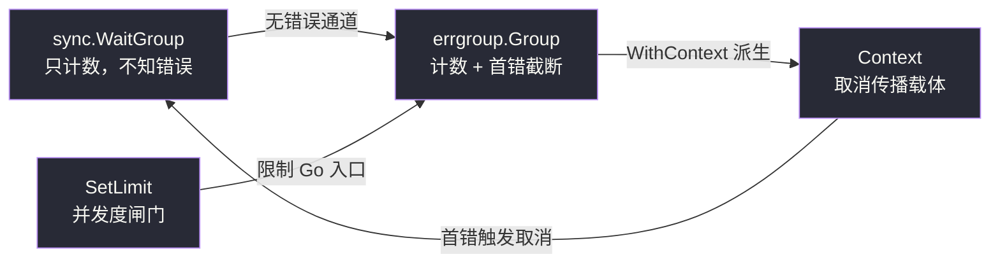
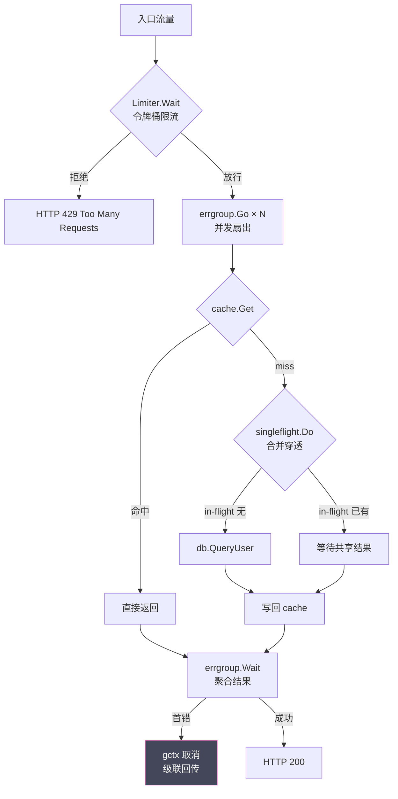

# 高级并发协作与背压流控——errgroup、singleflight 与令牌桶

**摘要：**

Go 的并发原语在基础层已经足够完备——goroutine、channel、[[03 Channel 的底层结构与阻塞唤醒机制]] 中剖析过的阻塞唤醒机制，再加上 [[07 Context 的设计与取消传播机制]] 里的取消传播，足以拼出绝大多数并发程序。但当系统从「几个 goroutine 协作」扩张到「成百上千个请求并行扇出、聚合、再回压」时，仅仅有原语是不够的。无界 channel 会在流量尖峰时把内存吃到 OOM；`sync.WaitGroup` 不会传递错误，也不会因为一个子任务的失败去取消其余还在飞行的任务；同一份热 key 在缓存失效的瞬间会同时击穿到几百个下游查询；而任何没有节流的入口，最终都会被上游的突发流量压垮。

本文聚焦 Go 生态中用于解决这些**高级协作与流控**问题的三组工具：`golang.org/x/sync/errgroup` 负责把「并发扇出 + 首错取消 + 并发度限流」封装成一个可组合的单元；`golang.org/x/sync/singleflight` 负责把瞬时重复请求合并成一次真实调用，从而守住缓存击穿这条防线；`golang.org/x/time/rate` 则给出令牌桶（Token Bucket）的严谨实现，让限流从拍脑袋的 `time.Sleep` 升级为有数学模型支撑的背压传递。三者并不互斥，反而常常在同一链路里协同出现——入口用 Limiter 挡洪峰，中间层用 singleflight 合并穿透，末端用 errgroup 并发扇出并聚合结果。行文将依次拆开这三组工具的机制、适用边界与常见误区，并在末尾讨论它们组合使用时需要权衡的取舍。

---

## 第 1 章 背压与有界缓冲——从 CSP 重新理解「流控」

### 1.1 CSP 模型中「队列」的两种命运

Tony Hoare 在 1978 年提出 CSP（Communicating Sequential Processes）时，把进程间通信看作一种**同步 rendezvous**：发送方和接收方必须同时准备好，数据才能交接。这种理想化的同步在真实系统里几乎不可能始终成立——生产者的节拍和消费者的节拍永远存在相位差。于是工程师引入**缓冲 channel** 作为两者的解耦层，相当于在两端之间摆了一排货架，生产方不必等到消费方伸手才放下货物。

缓冲的好处立竿见影：吞吐上升、毛刺被吸收、两端的速率差异被平滑掉。但缓冲也带来一个容易被忽视的副作用——**它把「速率不匹配」这个问题从显式的阻塞，转化成了隐式的队列增长**。只要生产方长期快于消费方，队列就会单调膨胀；在 Go 里，一个无界增长的 `[]T` 切片或者一个容量设得过大的 channel，最终都会以 OOM 的方式提醒设计者：队列并没有真的消失，它只是把代价推迟到了内存账单上。

### 1.2 背压（Backpressure）的传递方向

在讨论背压的具体机制之前，不妨先思考一个更基础的问题：**为什么需要背压**？答案藏在系统动力学的一个基本事实里——任何处理节点的容量都是有限的，而输入流量的波动范围几乎是无限的。当一个有限容量的节点遭遇超过其处理能力的输入时，它必须做出选择：要么把多余的输入丢弃（loss），要么把多余的输入缓存起来（buffering）。丢弃会损失数据，缓存会延迟反馈——而背压就是后者在工程上的具体体现：**与其把暂时处理不过来的数据堆在仓库里让仓库膨胀，不如让上游放慢脚步，让数据在源头上延迟产生**。

这种思路和控制论里的负反馈是同构的：系统的输出被用来调节输入，从而让整个系统稳定在某个平衡点附近。在 Go 的 CSP 模型里，这个「输出调节输入」的载体就是有界 channel 的满阻塞语义——当 channel 满了，下游处理不过来的事实通过 send 阻塞传递给上游，上游被迫降速，最终整个链路稳定在「瓶颈环节的处理速率」这个平衡点上。

所谓**背压（Backpressure）**，是指下游的拥堵沿着链路向上游反向传播，迫使上游降速的物理机制。它和水管里的反作用力是同一个意象——下游阀门关小，压力波沿着管道向上游传播，最终影响到水源的出水速率。在 Go 的 CSP 模型里，背压的载体就是**有界 channel**：当 channel 已满时，下一次 send 操作会阻塞发送方的 goroutine，而这个阻塞会沿着调用栈往回传染——只要上游也是同一个 channel 的发送者，整条链路就会一步步慢下来，直到最源头的生产者也被迫停下。

这正是 [[08 Go 并发模式——Pipeline、Fan-out Fan-in 与 Worker Pool]] 里反复强调的「有界队列让反压沿链路回传」的力学原理。没有有界 channel，就没有反压；没有反压，系统的内存就成为了事实上的「无限缓冲」，而无限缓冲在长期运行的服务里是一个伪命题。

> [!info] 一个贴切的比喻
> 把整条数据流水线想象成一座连锁咖啡馆：门店（worker）做咖啡的速度决定了出杯量，柜台（channel）能摆放的杯子数是有限；当柜台堆满时，收银员就不得不暂停接单，队伍自然向门口蔓延，门口的保安最后也只能限制新顾客入场。这整套「柜台满 → 暂停接单 → 限制入场」就是背压传递；如果把柜台换成一个无限大的仓库，仓库本身不会报警，但房租（内存）会一直涨到公司破产。

### 1.3 无界队列的隐性成本

许多语言的标准库里提供了无界队列（Java 的 `LinkedBlockingQueue`、Python 的 `queue.Queue` 不设 `maxsize`、Node 的事件循环队列天然无界），它们在短时间批处理场景下工作良好，但在长期服务进程里往往会演化成**隐性内存泄漏**——泄漏的源头不是某一块忘记释放的内存，而是「生产速率长期高于消费速率」这种结构性失衡。Go 的 channel 虽然本身是有界的（创建时指定 capacity），但实践中大量代码用 `make(chan T)` 创建容量为零的无缓冲 channel，或者在 fan-out 场景下用切片累积结果，本质上又回到了无界队列的老路。

这也是为什么 Go 社区反复强调「**给每个 channel 一个明确的容量**」：这不是性能调优的细节，而是 CSP 模型在工程上能够长期稳定运行的前提。有了有界，背压才有锚点；有了背压，整条链路的速率才能被下游决定，而不是被上游的突发决定。

### 1.4 背压失效的两种典型场景

即使设计了有界 channel，背压也可能在两种场景下失效：

**场景一：fan-out 时把结果往切片里 append**。典型的代码长这样：起 N 个 goroutine，每个往同一个 `[]Result` 里 append，主 goroutine 用 WaitGroup 等待。切片 append 在并发下需要 mutex 保护，但即便加了锁，切片本身也是无界的——N 有多大，切片就长到多大。这种写法表面上用了 CSP 模型（goroutine 并发），实质上却退化成共享内存并发 + 无界累积的双重陷阱。正确的做法是让每个 goroutine 往一个**有界的结果 channel** 里发送，由单独一个 consumer 从 channel 里读取——channel 的容量成为背压的锚点，当 consumer 处理不过来时，channel 满，goroutine 阻塞，背压回传。

**场景二：多个 producer 共享一个 channel 但 consumer 过慢**。当 N 个 producer 并发写入同一个 channel，而 consumer 的处理速率远低于 N × 生产速率时，channel 很快被打满，所有 producer 都阻塞。这本身是背压正常工作的表现——**但如果 channel 的 consumer 不是下游服务的真实处理，而是另一个内存缓冲（譬如把 channel 里的数据 append 到一个 buffer 里），那么背压就只是被转移到了 buffer 上，并没有真正作用到最终的瓶颈点**。这种「伪背压」在流式处理链路里非常常见，排查时需要画出数据流的真实走向，找到那个真正处理最慢的环节。

---

## 第 2 章 errgroup：把「并发扇出 + 首错截断 + 并发度限流」装进一个箱子

### 2.1 `sync.WaitGroup` 解决不了的事

[[05 sync 包——Mutex、RWMutex 与 WaitGroup 的实现]] 里详细拆解过 `sync.WaitGroup` 的实现：它只负责计数和等待，对「子任务做了什么、成功还是失败」毫不知情。当我们需要 fan-out N 个并发请求，然后 fan-in 聚合结果时，`WaitGroup` 只能告诉我们「都结束了」，却无法回答「有没有出错」「哪个先出错」「要不要把其余还在飞行的请求取消掉」。

实践中最常见的补救方式是：在 worker 里把 error 写进一个共享的 `chan error`，外面再用一个 select 监听。但这样写下来，代码立刻膨胀——你要处理「第一个 err 到达后怎么取消其余 goroutine」「怎么等待所有 goroutine 真正退出避免泄漏」「怎么让已取消的 goroutine 不再把错误往 channel 里塞」等一系列边角问题。这段样板代码在 Google 内部显然也被写烦了，于是 Rob Pike 在 `golang.org/x/sync` 里给出了 `errgroup` 这个精巧的封装。

### 2.2 errgroup 的最小 API 面

`errgroup.Group` 只有三个真正需要掌握的方法：

- **`Go(f func() error)`**：起一个 goroutine 执行 f，并把它的 error 交给 group 记录。group 只**保留第一个返回的非 nil error**，后续的 err 被丢弃（但 goroutine 仍然会执行完毕）。
- **`Wait() error`**：阻塞到所有 Go 起的 goroutine 结束，返回那个「首错」。一旦 Wait 返回，group 就不能再被复用。
- **`WithContext(ctx context.Context) (*errgroup.Group, context.Context)`**：派生一个绑定到 group 生命周期的 ctx——只要 Wait 返回（无论成功还是失败），或者首错出现，这个 ctx 就会被取消。

这三件套组合起来，恰好回答了前面 `WaitGroup` 无法回答的三个问题：错误怎么聚合、什么时候取消、怎么避免泄漏。

```go
g, ctx := errgroup.WithContext(context.Background())
for _, url := range urls {
    u := url
    g.Go(func() error {
        req, _ := http.NewRequestWithContext(ctx, "GET", u, nil)
        resp, err := http.DefaultClient.Do(req)
        if err != nil {
            return err // 首错会让 ctx 被取消，其余 goroutine 的 Request 也会失败
        }
        defer resp.Body.Close()
        return save(resp)
    })
}
if err := g.Wait(); err != nil {
    return err
}
```

### 2.3 首错截断的语义取舍

errgroup 选择「只记第一个 err」并非偶然，而是一个明确的工程取舍。**在 fan-out 的语义里，调用方通常只关心「有没有失败」以及「第一个失败原因是什么」**——典型譬如并发拉取多路数据源，只要任何一路失败，整个请求就要回滚。如果 group 把所有 err 都攒起来，调用方就得再写一层「错误合并策略」，而这在 90% 的场景里只是把 `err1` 拼成 `multierror` 再拆出来看。

不过这个取舍也意味着：如果你的 fan-out 语义是「尽量收集所有结果，失败的部分降级处理」，errgroup 就不太合适——它会把后续错误悄悄吞掉，让排查变得困难。这种场景下更应该回到 `WaitGroup` + `[]error` 自建聚合，或者用 `x/sync` 里配套的 `SetLimit` 配合 `errgroup` 做并发度控制，但在 worker 内部自己把所有 err 收集到线程安全的容器里。

### 2.4 `SetLimit` 与并发度闸门

Go 1.20 为 errgroup 引入了 `SetLimit(n int)`，允许在 group 上设置同时运行的 goroutine 上限。超过上限的 `Go` 调用会阻塞，直到有 goroutine 退出。这相当于在 WaitGroup 的「全放出去」语义上加了一道闸门——它既不改变错误的聚合方式，也不改变 ctx 的派生关系，只纯粹控制**并发度**。

`SetLimit` 的典型使用场景包括：

1. **保护下游资源**。譬如数据库连接池只有 50 个连接，即使上游有 500 个并发请求，也要把真正进入 db 查询的并发度限制在 50。这时 `g.SetLimit(50)` 就能让多余的请求在入口处排队，而不是全部冲进 db 然后阻塞在连接池获取上。后者虽然结果也是排队，但每个请求都会起一个 goroutine，造成不必要的 goroutine 堆积。
2. **控制扇出规模**。一个聚合接口要调用 100 个下游服务，但你不想真的同时发起 100 个 RPC，而是希望「每次最多 10 个在飞行」。SetLimit(10) 就实现了这个语义——它和 fan-out 的组合非常自然。
3. **与 Context 超时配合**。`SetLimit(n)` + `gctx` 的超时设置，可以表达「最多并发 n 个，总时间不超过 T」的复合约束——这在批处理任务里非常常见。

> [!warning] 一个容易被忽略的死锁陷阱
> 如果 `SetLimit(1)` 后，某个正在运行的 goroutine 又试图在同一个 group 里 `Go` 一个子任务并 `Wait`，就形成了经典的「工作队列阻塞在工作队列上」的死锁。`SetLimit` 的阻塞是在 `Go` 调用处发生的，而不是在 `Wait` 处——所以一旦父 goroutine 自己也被计入 limit，它就没法前进到 `Wait` 去释放计数。

### 2.5 源码视角：errgroup 是怎么做到首错截断的

翻开 `golang.org/x/sync/errgroup` 的源码（以 Go 1.22 为基准），`Group` 的核心结构异常简洁：

```go
type Group struct {
    cancel func()        // WithContext 派生出的 cancel
    wg     sync.WaitGroup // 内部仍然依赖 WaitGroup 做计数
    err    error         // 首错
    errOnce sync.Once    // 保证 err 只被写入一次
    sem     semaphore     // SetLimit 引入的信号量
}
```

几个值得玩味的实现细节：

1. **`errOnce` 保证首错语义的原子性**。多个 goroutine 并发返回错误时，只有第一个到达 `errOnce.Do` 内部的赋值会生效；后续的 `Do` 调用会立刻返回，不会再触碰 `err` 字段。这比用 `sync.Mutex` + `if err == nil` 的双检检查更简洁，也更不容易出错。
2. **cancel 的触发时机**。当首错被写入，`errOnce.Do` 内部紧接着会调用 `cancel()`——这就是 errgroup 实现「首错 → ctx 取消」的链条。注意 cancel 只在 `WithContext` 派生出来的 group 上有意义；如果只是 `new(errgroup.Group)`，cancel 字段是 nil，这段逻辑会被跳过。
3. **`sem` 的阻塞位置**。SetLimit 通过一个带容量的 channel 实现信号量：`Go` 方法在进入 wg.Add 之前先向 sem 发送，goroutine 退出时从 sem 接收。这个设计决定了阻塞发生在 `Go` 的调用处——也就是父 goroutine 试图提交新任务的瞬间，而不是子 goroutine 内部。这是理解 2.4 节那个死锁陷阱的关键。

### 2.6 与 WaitGroup、Context 的关系图谱

下图给出了 errgroup、WaitGroup 与 Context 三者在「错误传播」和「取消传播」两个维度上的能力对比：



从这张图可以直观看出：errgroup 本质上是 `WaitGroup + 首错 channel + 可选 ctx 派生` 的三合一封装；它不替代 Context，而是成为 Context 取消信号的一个**生产者**——当首错出现，errgroup 负责调用 cancel 把信号沿 ctx 树传下去。

---

## 第 3 章 singleflight：合并瞬时重复请求的那道闸门

### 3.1 缓存击穿的本质

缓存击穿（Cache Stampede）是后端系统里一个老生常谈的问题：某个被高频访问的 key 在缓存里失效的瞬间，成百上千个并发请求同时发现 miss，于是一起涌向后端的数据库或远程服务。数据库平时只需应对个位数的真实查询，此刻却收到了几百份语义完全一样的 SQL——如果这些查询真的都被执行，轻则响应时间毛刺，重则数据库被瞬间打挂。

问题的本质在于：**这些并发请求在语义上是等价的，但在执行上是独立的**。任何一个成熟的工程体系里，面对「等价的重复工作」，第一反应都应该是**合并**——正如一个办公楼里一百个人都要叫同一班电梯，合理的做法是让他们坐同一趟，而不是派一百趟电梯。

### 3.2 singleflight 的最小 API 面

`golang.org/x/sync/singleflight` 的 API 面小得几乎不像 Go 标准生态里的产物：

- **`Do(key string, fn func() (interface{}, error)) (v interface{}, shared bool, err error)`**：用 key 标识一次调用。如果当前没有同 key 的调用在执行，fn 会被执行，调用方拿到结果；如果已经有同 key 的调用在飞行中，后来者会**阻塞等待**第一个调用的结果，不执行 fn。返回值里的 `shared` 布尔标识当前调用方是不是「搭了别人便车」的那个。
- **`DoChan(key string, fn func() (interface{}, error)) <-chan Result`**：异步版本的 Do，返回一个 channel，结果通过 channel 传递——适合在 select 里使用，或者需要 Context 配合取消的场景。
- **`Forget(key string)`**：把某个 key 从 in-flight map 里抹掉，让下一次同 key 的 Do 真正执行 fn，而不是继续等待上一次的结果。

```go
var group singleflight.Group

val, shared, err := group.Do(userKey, func() (interface{}, error) {
    return db.QueryUser(ctx, userKey)
})
if err != nil {
    return err
}
// shared == true 表示这次结果是从别人那里共享来的
cache.Set(userKey, val, ttl)
```

### 3.3 错误与 panic 的广播边界

singleflight 有几个不那么显然却非常重要的语义，必须在生产代码里小心对待：

1. **错误会被广播给所有等待者**。如果 fn 返回 err，所有因同 key 阻塞的 Do 调用都会拿到同一个 err——即使其中有部分调用方在自己的上下文里其实可以容忍失败。这是一个强耦合：你必须保证 fn 的错误语义对所有潜在等待者都是合理的。
2. **panic 也会被广播**。singleflight 内部对 fn 做了 `recover`，如果 fn panic，所有等待者都会以 panic 的形式收到这次失败——这一点和 errgroup 不同，errgroup 里某个 goroutine 的 panic 不会自动传染给其他 goroutine（它只会被 runtime 当作 goroutine crash 处理）。singleflight 选择把 panic 视作「这次调用整体失败」，并把失败广播给所有人。
3. **fn 返回的 value 是共享引用**。如果 fn 返回的是一个指针、切片或 map，所有等待者拿到的都是同一个底层数据结构。如果其中任何一方修改了它，其他方的数据也会被污染。这是**共享结果的内存放大风险**最隐蔽的一种形态——编译期没有任何信号，只有并发读写的 race 在运行时悄悄爆发。

> [!note] 一个贴切的比喻
> singleflight 像极了写字楼里的那块「拼车白板」：要去同一个方向的人把名字写上去，第一个人是司机，后面的人都是乘客；这趟车出了事故（err），所有人一起承担；司机如果开车时 panic 了，整车人都得下车；而车里拉的货物（返回的 value）如果被某个乘客打开翻了翻，其他乘客到家打开时可能发现东西被动过了。

### 3.4 Forget 的适用场景

`Forget` 看起来是个小方法，但在缓存场景里非常关键：当一次 Do 调用失败、或者拿到的结果不适合写入缓存（譬如数据库返回「无记录」这种语义，不能当作「可缓存的空值」），你需要让下一次同 key 的 Do 重新发起真实查询，而不是继续返回上一次的失败结果。如果没有 Forget，singleflight 的行为会变成「一次失败，永久共享失败」——这显然不是我们想要的。

实践中常见的组合模式是：

```go
val, _, err := group.Do(key, func() (interface{}, error) {
    v, err := loadFromDB(key)
    if err != nil {
        group.Forget(key) // 失败就立即放开，让下次重试
        return nil, err
    }
    return v, nil
})
```

另一个容易被忽视的 Forget 使用场景是**长时间运行的 fn**。如果 fn 的执行时间可能很长（譬如调用下游的慢接口），而你又希望新来的请求不要无限制地等待这一次的结果，可以考虑在 fn 启动后立刻 Forget——这样新请求会起一个新的 fn 而不是继续等待。这种「每次请求独立执行，但同 key 共享结果缓存」的模式在某些场景下比严格的 singleflight 更合适，但代价是下游的负载不会被合并。这是一种工程上的权衡：**合并度 vs. 新鲜度**。

### 3.5 源码视角：singleflight 的 call 状态机

singleflight 的内部结构同样值得拆开来看。它的核心是一个 `call` struct，代表一次 in-flight 的调用：

```go
type call struct {
    wg  sync.WaitGroup  // 用于让后来的等待者阻塞等待结果
    val interface{}     // fn 的返回值
    err error           // fn 返回的 err
    vals interface{}    // DoChan 专用，通过 channel 返回
}

type Group struct {
    mu sync.Mutex
    m  map[string]*call // _lazy_ 初始化的 in-flight map
}
```

当一个请求到来：
1. 加锁查询 `m[key]`。如果已有 call 在飞行中，释放锁，对该 call 的 wg 做 `wg.Add(1)` 然后 `wg.Wait()`。
2. 如果 key 不在 map 里，创建一个新的 call，插入 map，释放锁，然后**真正执行 fn**。
3. fn 返回后，把结果写入 call.val/err，调用 `wg.Done()` 唤醒所有等待者，然后再次加锁从 map 里删除这个 call（Forget 的语义）。

几个隐含的语义陷阱：

- **fn 的执行是在 map 锁外进行的**，这是关键——如果 fn 在 map 锁内执行，所有其他 key 的 Do 调用都会被阻塞，完全失去并发性。Go 团队在实现上非常小心地把临界区压缩到「查 map / 写 map」这两个最小动作上。
- **`wg.Add(1)` 在锁外做，`wg.Wait()` 也在锁外做**——这意味着等待者必须先 Add 再 Wait，否则可能漏掉 Done 信号。这个顺序保证了即使 fn 在等待者 Add 之前就已经完成，Done 也能被正确计数（WaitGroup 的语义保证 Done 在 Add 之后调用是合法的）。
- **panic 的 recover 发生在 fn 执行完毕后**，recover 的结果会以 err 的形式写入 call，于是所有等待者都通过 err 收到这次 panic——这是 3.3 节提到的「panic 广播」的实现机制。

### 3.6 singleflight 的适用边界

singleflight 不是万能的。它最适合**读侧的瞬时合并**，而对以下场景不合适：

- **写操作的合并**：写操作通常要求幂等性和精确一次语义，singleflight 的「共享一次」会破坏这些语义。
- **key 空间极大、重复率极低**：singleflight 的 in-flight map 是按 key 区分的，如果每个请求的 key 都不一样，它就退化成普通的并发执行，没有任何合并收益，反而多了一层锁开销。
- **需要 per-request Context 取消**：singleflight 的 fn 不接受 Context，调用方的 ctx 和 fn 内部的 ctx 是解耦的。如果调用方被取消，fn 不会感知——这是 singleflight 长期被诟病的一个点，社区已经有多个 proposal 讨论给它加上 Context 支持，但截至目前仍未合入主线。

---

## 第 4 章 令牌桶与漏桶——限流算法的两种数学模型

### 4.1 为什么需要数学模型

入口限流（Rate Limiting）是任何暴露在网络面前的服务都必须具备的能力。最朴素的实现是「每处理一个请求 sleep 一会儿」，或者「用一个计数器记录每秒请求数，超过阈值就拒绝」。前者在负载波动时表现极差——sleep 是刚性的，它无法区分「过去 100ms 已经来了 50 个请求」还是「过去 100ms 一个都没来」；后者（固定窗口计数器）则在窗口边界存在「双倍突发」的漏洞——0.99 秒时来了一波，1.00 秒时又来一波，短短几十毫秒内就涌入两倍的「每秒配额」。

工程上成熟的限流算法主要有两种：**令牌桶（Token Bucket）**和**漏桶（Leaky Bucket）**。二者名字相近，但数学模型和适用场景截然不同。

### 4.2 漏桶（Leaky Bucket）：刚性的平滑器

漏桶的意象非常直观：一个底部有小孔的桶，水从上面以任意速率注入，但只能以**固定速率**从底部小孔流出。无论注入多猛，出口速率永远恒定；注入太快，桶就溢出来——溢出的部分就是被丢弃的请求。

漏桶的数学模型因此是一个**整形器（Shaper）**：它把任何不规则的入流，强行整形成固定的出流。在网络上，这种模型对应 ATM 论坛早期定义的 Generic Cell Rate Algorithm（GCRA）的一种实现形式。漏桶适合那些**下游资源严格恒定**的场景——譬如数据库连接池只有 50 个连接，无论上游来多少请求，下游每秒真正能处理的量就是固定的，那么漏桶就是最匹配的限流模型。

### 4.3 令牌桶（Token Bucket）：允许突发的弹性策略

令牌桶的意象稍微复杂一点：一个桶以**恒定速率**往里放令牌（譬如每秒放 100 个），每个请求进来时必须从桶里拿走一个令牌才能被处理；如果桶里没有令牌，请求就被拒绝或者阻塞等待。桶有容量上限，满了之后新放进来的令牌就会被丢弃。

令牌桶的数学模型因此是一个**计量器（Meter）**：它限制的是「单位时间内的平均速率」，但**允许突发**——只要桶里有积攒的令牌，一瞬间把桶掏空也是被允许的。这种模型更适合那些「下游能短时承受突发、但长期平均必须受控」的场景——譬如一个 Web API 允许你一秒内瞬间打过来 100 个请求，但一分钟内的总请求数不能超过 2000。

> [!info] 一个贴切的比喻
> 漏桶像酒店自助餐的出菜口——无论外面排了多长的队，厨师每分钟只端出 10 盘菜，这是刚性平滑；令牌桶像游乐场的快速通道——每小时发放 100 张快速通行证，你可以一秒内把攒了一上午的通行证全用掉立刻冲进去，但用完之后就只能老老实实排队等新的令牌慢慢发放。

### 4.4 数学模型的对比

| 维度 | 漏桶（Leaky Bucket） | 令牌桶（Token Bucket） |
|---|---|---|
| 出流形态 | 严格恒定速率 | 平均速率受控，允许突发 |
| 桶的角色 | 缓冲注入的不规则 | 缓冲发放的令牌 |
| 溢出含义 | 桶满则丢弃注入的水 | 桶满则丢弃新发的令牌 |
| 适合场景 | 下游资源严格恒定 | 下游可短时承压 |
| 实现复杂度 | 中等（需维护出流定时器） | 较低（只需记录令牌数与上次填充时间） |
| 典型标准 | ATM GCRA | Linux `tc tbf`、`golang.org/x/time/rate` |

### 4.5 令牌桶的数学公式

令牌桶的核心状态只有两个：`tokens`（当前令牌数）和 `lastTime`（上次填充时间）。每次请求到来时，先根据时间差补充令牌：

```
elapsed = now - lastTime
tokens = min(capacity, tokens + elapsed * rate)
```

然后判断 `tokens >= 1`：是则扣除一个令牌、放行请求；否则拒绝或阻塞。这个算法的状态空间小到可以放进一个 struct 里，也因此成为 Go `x/time/rate` 包的基础模型。

### 4.6 两种算法的适用光谱

令牌桶与漏桶的选择并不是非此即彼，而更像是一个光谱上的两个端点：

**极端刚性的场景**——譬如写入一个吞吐量严格固定的数据库、向一个固定带宽的链路灌数据——越靠近漏桶端越合适，因为下游根本不能承受任何突发。

**极端弹性的场景**——譬如一个有缓存层、能短时承压、但长期需要被保护的 API——越靠近令牌桶端越合适，因为突发能力让用户体验更好，而长期的平均速率受控保证了系统的可持续性。

绝大多数真实系统落在这两端之间。实践中常见的做法是：**用令牌桶做入口限流（允许短时突发），用漏桶做出口整形（保证下游恒定）**——二者串联，既有弹性又有稳定性。这种组合在云原生网关（如 Envoy、APISIX）的限流配置里非常常见，配置者可以根据不同路由的下游承压能力，灵活地在光谱上选取不同的位置。

### 4.7 GCRA：令牌桶的「另一种表述」

值得额外一提的是 GCRA（Generic Cell Rate Algorithm），它和令牌桶在数学上是等价的，只是观察的角度不同。令牌桶从「令牌积累」的角度出发——桶里有多少令牌，就能放行多少请求；GCRA 则从「时间窗口」的角度出发——每个请求被标记一个理论到达时间（Theoretical Arrival Time, TAT），只有当当前时间超过 TAT 才允许放行，否则计算需要等待的时间。

ATM 论坛在 1990 年代初期定义流量合约时采用的就是 GCRA，因为它的数学性质更容易做形式化验证。后来 Linux 的 `tc tbf`（Token Bucket Filter）和 `tc tbf` 的变体 `tc cake` 都基于令牌桶模型实现，而 Go 的 `x/time/rate` 在实现层面更接近令牌桶的直观模型，但在 API 设计上吸收了 GCRA 的「预先承诺」语义（Reservation 机制本质上就是 TAT 的具象化）。

### 4.8 与滑动窗口计数器的对比

工程上还有一种介于朴素固定窗口与成熟限流算法之间的方案：**滑动窗口计数器（Sliding Window Counter）**。它把一分钟切成 6 个 10 秒的子窗口，每个子窗口单独计数；计算「当前一分钟请求数」时，把当前子窗口的计数加上前 5 个子窗口的计数（必要时按当前子窗口已流逝的时间加权）。这种方案避免了固定窗口在边界处的双倍突发漏洞，同时又比令牌桶简单得多——它不需要维护任何连续状态的浮点数，只需要几个整数计数器。

不过滑动窗口计数器的本质仍然是「计数」，它没有令牌桶那种「预先承诺」的能力，也没有漏桶那种「严格整形」的能力。它在「计数准确性」和「算法简洁性」之间找到了一个中间地带，适合那些「不需要严格限流、只要大致防止突发」的场景。

---

## 第 5 章 `golang.org/x/time/rate`：把令牌桶装进 Context

### 5.1 Limiter 的最小 API 面

`rate.Limiter` 是 Go 生态里对令牌桶最权威的参考实现。它的三个核心方法分别对应三种不同的限流语义：

- **`Allow() bool`**：非阻塞地询问「现在能不能处理一个请求」。等价于 `Reserve().OK()` 的快捷写法。适合「不能等，只能拒绝」的入口限流。
- **`Wait(ctx context.Context) error`**：阻塞直到拿到令牌，或者 ctx 被取消。这是**把限流器接入 Context 体系**的关键——调用方可以设置超时，避免无限阻塞。
- **`Reserve() *Reservation`**：返回一个 Reservation 对象，告诉调用方「你需要等多久才能拿到令牌」。适合需要精确知道等待时间、或者需要把等待成本转嫁给调用方的场景（譬如 HTTP 响应里返回 `Retry-After` 头）。

```go
lim := rate.NewLimiter(100, 200) // 每秒补充 100 个令牌，桶容量 200
if err := lim.Wait(ctx); err != nil {
    return err // ctx 被取消，或者超时
}
// 拿到令牌，处理请求
```

### 5.2 `Wait`、`Allow`、`Reserve` 的语义分工

三个方法的差别表面上只是「阻塞 vs 非阻塞 vs 返回预留」，但它们背后的工程取舍值得展开：

**Allow** 是最廉价的，它不分配任何对象，适合在极高频路径上使用——譬如一个每秒百万次调用的热路径上，你不希望每次请求都分配一个 Reservation 对象给 GC 增加负担。

**Wait** 是最常用的，它内部先调用 Reserve，然后 sleep 对应的时间。如果 sleep 期间 ctx 被取消，Wait 返回 `ctx.Err()`，令牌会被归还（这一点很重要——如果 Wait 不归还令牌，取消就会造成「令牌黑洞」，让 Limiter 的实际速率越来越慢）。

**Reserve** 是最灵活的，它把「拿到令牌的时间点」显式返回给调用方。典型用法是在 HTTP 中间件里：

```go
r := lim.Reserve()
if !r.OK() {
    // 请求太大，单个请求需要的令牌数超过了桶容量
    return http.StatusUnprocessableEntity
}
delay := r.Delay()
if delay > maxAcceptableDelay {
    // 等待时间过长，直接拒绝
    return http.StatusTooManyRequests
}
time.Sleep(delay)
```

### 5.3 源码视角：Limiter 的 reserveN 算法

`rate.Limiter` 的核心是 `reserveN(now, n)` 方法——所有公开 API（Allow、Wait、Reserve）最终都汇聚到这里。它的实现比表面看上去要精巧：

```go
type Limiter struct {
    mu     sync.Mutex
    limit  float64   // 每秒补充的令牌数（rate）
    burst  int       // 桶容量
    tokens float64   // 当前令牌数
    last   time.Time // 上次填充时间
    lastEvent time.Time // 最后一次（包括未来的）令牌分发时间
}
```

`reserveN` 的计算过程分三步：

1. **补齐令牌**。`tokens = min(burst, tokens + elapsed * limit)`——时间流逝中自动补充，但不超过 burst。
2. **计算可分发时间**。如果当前 tokens 足够，立刻分发，`lastEvent = now`；如果不够，需要等到未来某个时间点才能分发，`lastEvent = lastEvent + n/limit`。
3. **返回 Reservation**。Reservation 里记录了 `timeToAct = lastEvent`，调用方（Wait）据此 sleep。

这个算法有两个不那么显然的性质：

**性质一：`lastEvent` 记录的是「最后一次令牌分发的时间」，包括未来承诺但尚未兑现的**。这意味着如果多个 goroutine 同时请求，每个请求的 lastEvent 都在上一个请求的基础上往后推——即便当前 tokens 为 0，第 N 个请求依然能拿到一个「未来 N 秒后才能兑现」的 Reservation。这种设计让 Limiter 天然支持「预先承诺」的语义，也让 Wait 的语义变得公平——每个请求都按到达顺序拿到自己应得的时间槽。

**性质二：burst 决定了单次 Reserve 能请求的最大令牌数**。如果 `n > burst`，`reserveN` 直接返回 `!OK`，对应 5.1 节提到的 `Reserve().OK() == false` 的情况。这不是「桶里没有令牌」的失败，而是「这次请求本身就超出了桶能容纳的极限」——属于不可修复的失败。

### 5.4 与 time.Ticker 的对比

一个常见的疑问是：为什么不直接用 `time.Ticker` 做限流？Ticker 是一个固定节拍器，它在时间轴上打出一串等间隔的 tick，每次 tick 对应一个「令牌」。看上去和令牌桶是一回事，实则不然：

- **Ticker 不允许突发**。即便过去 10 秒都没人用，第 11 秒也只能等下一个 tick 到来。令牌桶则能把积攒的 10 秒配额一瞬间用完。
- **Ticker 无法动态调速**。`Reset` 方法在 Go 1.15 之前都不存在，且即便有了，它也只是重新设定下一次 tick 的时间，不能改变稳态速率。
- **Ticker 的 tick 不能被「提前消费」或「归还」**。Limiter 的 Reservation 机制允许调用方在意识到等待过久时放弃（放弃 Reservation），而 Ticker 已经发出的 tick 无法回收。

因此 Ticker 适合「严格等间隔执行某任务」（譬如定时采样指标），而 Limiter 适合「平滑但允许突发的流量整形」。两者的语义边界并不重叠。

### 5.5 Context 与 Limiter 的协同

`Wait(ctx)` 的设计体现了 Go 自 1.7 以来围绕 Context 建立的可取消抽象。一个经常被忽略的细节是：**Limiter 本身没有「关闭」的概念**。一旦创建，它就可以一直被使用；如果想要动态调整速率，只能调用 `SetRate` 修改参数，或者干脆丢弃旧 Limiter 创建新的。这意味着 Limiter 的生命周期应该由外部管理——通常作为 server 的字段，跟随 server 一起启停。

另一个容易被忽视的边界是 `Burst` 的语义。`Burst` 是桶容量的整数表示（默认至少为 1），它决定了**单次能突发多少个请求**。如果希望完全禁止突发、让出流严格平滑，需要把 Burst 设为 1——但这也就把令牌桶退化成了漏桶的一种近似实现。

### 5.4 分布式限流的边界

`rate.Limiter` 是进程内的限流器，它假设所有请求都经过同一个 Limiter 实例。但在多实例部署里，每个进程有自己的 Limiter，整机的限流能力是 `单机限流 × 实例数`。这种**进程内限流**无法做到真正的全局公平——某一台实例如果恰好承载了更多流量，它的 Limiter 会更频繁地拒绝请求，而另一台实例的 Limiter 可能还很宽裕。

真正的全局限流需要借助外部存储（Redis + Lua 脚本、etcd 的 lease 机制、专门的限流服务），而外部存储又带来了一致性与延迟的权衡。实践中最常见的折中是：**进程内 Limiter 挡住绝大多数流量，外部限流作为兜底保护**。这种双层结构和本文讨论的「errgroup + singleflight + Limiter」三层组合，在方法论上是一致的——每一层守住自己的边界，不要指望某一层包揽所有责任。

---

## 第 6 章 组合使用——一条完整链路上的三级防线

让我们把前面三组工具放到一条真实的链路里。假设一个 API 网关要查询三位用户的信息，每个用户信息要先查本地缓存，miss 时查数据库：

1. **入口层**：`rate.Limiter.Wait(ctx)` 挡住超过配额的流量。
2. **缓存穿透层**：`singleflight.Group.Do(key, ...)` 合并同 key 的穿透查询。
3. **扇出聚合层**：`errgroup.WithContext(ctx)` 并发查询三位用户，首错触发整体取消。

```go
var (
    limiter  = rate.NewLimiter(1000, 2000)
    sfGroup  singleflight.Group
)

func handle(ctx context.Context, userIDs []string) ([]*User, error) {
    if err := limiter.Wait(ctx); err != nil {
        return nil, err
    }

    g, gctx := errgroup.WithContext(ctx)
    results := make([]*User, len(userIDs))
    for i, id := range userIDs {
        i, id := i, id
        g.Go(func() error {
            u, err := loadUser(gctx, id)
            if err != nil {
                return err // 首错触发 gctx 取消，其余 goroutine 的 loadUser 也会感知
            }
            results[i] = u
            return nil
        })
    }
    if err := g.Wait(); err != nil {
        return nil, err
    }
    return results, nil
}

func loadUser(ctx context.Context, id string) (*User, error) {
    if u := cache.Get(id); u != nil {
        return u, nil
    }
    val, _, err := sfGroup.Do(id, func() (interface{}, error) {
        return db.QueryUser(ctx, id)
    })
    if err != nil {
        return nil, err
    }
    u := val.(*User)
    cache.Set(id, u, time.Minute)
    return u, nil
}
```

这条链路上，**每一层都有自己明确的职责边界**：Limiter 不知道下游有多少实例，它只负责「入口总速率不超配额」；singleflight 不知道 Limiter 的存在，它只负责「同 key 的穿透查询合并成一次」；errgroup 不知道 singleflight 的存在，它只负责「并发扇出的生命周期与错误聚合」。三者通过 Context 串联：入口的 ctx 派生出 errgroup 的 gctx，gctx 又穿透到 singleflight 的 fn 里——任何一层失败，取消信号都会沿着 ctx 树回传到所有还在飞行的工作。



这张图把三级防线的协同关系具象化了：从入口到最终响应，每一个节点都是一个可能的「阻塞点」或「失败点」，而背压与取消信号正是在这些节点之间沿着调用栈反向传播。

### 6.1 链路可观测性的代价

### 6.1 链路可观测性的代价

三级防线的另一面是**可观测性的碎片化**。Limiter 等待的耗时、singleflight 的合并命中率、errgroup 的首错触发频率——这三个信号分别藏在三个工具的源码里，没有统一的入口。如果不显式地在每一层加 metrics 暴露，故障发生时很难判断瓶颈到底在哪一层：

- 入口延迟上升，是 Limiter 在 sleep，还是 singleflight 等待合并，还是 errgroup 的某个扇出子任务慢？
- 错误率上升，是 Limiter 拒绝了请求（应当调整配额），还是 errgroup 的首错截断（应当排查下游），还是 singleflight 的 fn 失败被广播（应当检查缓存命中率）？

实践上常见的做法是：每一层在返回结果的同时，往 trace 里写一个 span，span 的 tag 里带上有意义的业务信息——Limiter 带上 `delay_ms` 和 `allowed`，singleflight 带上 `shared` 布尔，errgroup 带上子任务数量与首错信息。没有这套可观测基建，三级防线在故障定位时会从「三道保险」变成「三团迷雾」。

### 6.2 背压的跨语言对比

值得一提的是，背压与流控并不是 Go 的专利。Reactive Streams 规范（Java/Scala 生态）在 2014 年就定义了 `Publisher-Subscriber` 之间的背压协议，Project Reactor 和 Akka Streams 都实现了基于 demand pull 的流控；Node 11 之后引入的 `stream.pipeline` 也内建了 backpressure 感知；Python 的 asyncio 通过 `transport.write` 的 `is_reading/pausing` 把 TCP 层面的读写背压暴露给了用户层。Go 的独特之处在于：它的 CSP 模型让背压天然可以通过有界 channel 传递，而不需要额外的协议约定——**语言层已经把其他语言里需要框架层实现的背压机制，下沉成了原语的一部分**。这一点在组合使用 `rate.Limiter` + `errgroup` + `singleflight` 时尤其明显：三者的 API 都很小，但它们之间的组合威力来自于对「取消/阻塞/共享」这三种基础语义的一致设计。

这种语言与框架的分层方式，也解释了为什么 Go 生态里的限流与并发协作工具往往看起来「过于简单」——它们把复杂性推给了语言原语，自己只负责把语义组合起来。对于习惯了 Java Reactive Streams 或 Node.js async/await 生态的工程师来说，这种设计初看可能觉得简陋，但一旦习惯了，就会发现它的认知负担其实更低：channel 就是 channel，阻塞就是阻塞，取消就是 ctx.Done() 的信号——所有语义都已经被语言层的运行时打磨过无数次，不需要在每一层框架里重新发明一遍。

---

## 第 7 章 边界、反例与常见误区

### 7.1 errgroup 不是万能的任务调度器

errgroup 的 Wait 只能被调用一次，调用后 group 即失效——它不是可以反复提交任务的线程池。如果你需要「持续运行的 worker pool」，应该回到 [[08 Go 并发模式——Pipeline、Fan-out Fan-in 与 Worker Pool]] 里讨论的固定 worker 模型，或者使用第三方库如 `gammazero/workerpool`。

### 7.2 singleflight 在写路径上是危险的

singleflight 的「合并」语义对读操作是优化，对写操作就是灾难——两个并发 `POST /transfer` 如果 key 都是用户 ID，被合并成一次调用意味着另一笔转账被悄悄丢弃。写路径上的幂等性必须通过**业务层的幂等 key**或**数据库层的唯一约束**来保证，而不是寄希望于 singleflight。

### 7.3 Limiter 的 Burst 不等于「安全阈值」

很多团队把 Burst 设得很大，认为「桶大一点能扛住突发」。但 Burst 的物理含义是「允许一瞬间通过的请求数」——如果下游的真实承压能力只有 100 QPS，把 Burst 设成 10000 就意味着「在 Limiter 刚启动的那一瞬间，10000 个请求可能同时涌向下游」。Burst 的合理取值应该和下游的**短时承压能力**对齐，而不是和上游的峰值流量对齐。

### 7.4 取消不等于「已经完成的工作被撤销」

errgroup 的 ctx 被取消后，已经在下游执行完毕的工作不会被回滚——ctx 只是一个「请不要开始新工作」的信号。如果某个 goroutine 已经发起了数据库写入，取消并不能让这笔写入消失。这一点在 [[07 Context 的设计与取消传播机制]] 中已经反复强调：Context 是协作式的，不是强制式的。

> [!warning] 关于 goroutine 泄漏
> 上述三组工具都用得不当时，都可能造成 goroutine 泄漏——errgroup 的 Go 起了但 Wait 没被调用、singleflight 的 DoChan 拿到的 channel 没人接收、Limiter 的 Wait 在已经取消的 ctx 上被阻塞但 goroutine 没退出。这些场景在 [[11 并发陷阱与调试——Goroutine 泄漏、死锁与 Race Detector]] 中都有对应的案例与检测方法，建议交叉阅读。

### 7.5 singleflight 的内存放大：一个反直觉的陷阱

singleflight 的「共享结果」语义在某些场景下会演化成**内存放大**问题。假设一个 fn 从数据库查出一个 1MB 的大对象，然后有 100 个请求等待并拿到了这个对象——表面上每个请求都只持有 1MB，但实际上这 100 个请求可能各自把这个大对象 deep copy 一份（或者更隐蔽地，把它嵌入到一个更大的响应结构里序列化出去），瞬间在内存里留下 100MB 的痕迹。

更隐蔽的是「共享引用」的情况：如果 100 个 goroutine 都持有同一个指针，并且都试图修改它，race 检测器会立刻报警；但如果只是读取，而其中一方不小心修改了某个字段，其他 99 方都会看到脏数据——而且这种污染只在并发下才出现，单元测试几乎不可能覆盖。

应对策略有两个：一是**fn 返回不可变对象**（immutable struct，或者把 mutable 字段用 unexported 隐藏）；二是**每个请求拿到共享结果后，立刻做自己的 deep copy**。前者更符合 Go 的惯用法，后者则在无法修改 fn 返回值类型的场景下使用。无论哪种，都需要在引入 singleflight 时就意识到：**共享结果是有成本的，这个成本在并发度上升时会线性甚至超线性放大**。

### 7.6 rate.Limiter 在高并发下的 mutex 竞争

rate.Limiter 内部用一把 `sync.Mutex` 保护所有状态。在单核 goroutine 调用的场景下完全没问题，但在数万并发的入口，这把锁可能成为热点。`pprof` 的 mutex profile 在这种场景下会显示 Limiter 的 Reserve 方法占用大量等待时间。

社区对此的常见应对是**分片（sharding）**：创建 N 个 Limiter，每个请求按 `hash(requestID) % N` 落到其中一个分片上。这样相当于把单点速率 `R` 拆成 `N` 个分片，每个分片的速率是 `R/N`，桶容量是 `burst/N`。从统计上看，分片后的整体行为接近原来的 Limiter，但单个分片的 mutex 竞争大幅减少——因为并发请求被均匀打散到了 N 把锁上。

这种分片思路并不是 Go 特有的——Java 的 `LongAdder` 也是类似的思路：把单一的原子计数器打散成 per-CPU 的多个单元，写入时只触及自己的分片，读取时再聚合。背后的原理是同一个：**当共享状态成为瓶颈时，用空间换时间，用最终一致性换瞬时性能**。

---

## 第 8 章 权衡与取舍

行文至此，三组工具的机制与适用边界都已经摊开。但在真实系统里，它们从来不是孤立存在的——任何选型背后都有需要权衡的取舍：

**errgroup vs. 自建 WaitGroup + channel 聚合**：errgroup 赢在简洁与语义明确，但在「需要所有错误」「需要自定义聚合策略」「需要复用 group」等场景下，它反而会变成束缚。工程的判断点在于：你的 fan-out 语义是不是真的「首错截断」？如果是，errgroup 是毫无疑问的首选；如果不是，自建方案虽然代码多，但语义更贴合。

**singleflight vs. 分布式锁**：singleflight 是进程内的合并，延迟低、无外部依赖，但只能挡住同一实例上的重复请求。如果你的服务有多实例、且缓存击穿可能造成严重后果，应该考虑 Redis 的 `SETNX` 分布式锁，或者在网关层做请求合并。singleflight 与分布式锁并不互斥——前者挡住单机内的重复，后者挡住跨实例的重复。

**进程内 Limiter vs. 全局限流**：前文已经讨论过，进程内 Limiter 在多实例场景下只是「大致公平」。真正严格的全局限流必须依赖外部一致性存储，而这又会引入额外的延迟和单点风险。多数互联网服务的实践是「**进程内挡住 95% 的异常流量，全局兜底挡住 5% 的极端情况**」——这种分层设计背后的逻辑，和本文讨论的三级防线是同构的。

最终，背压、合并、限流这三件事，本质上都指向同一个工程命题：**如何让系统的速率由最慢的那一环决定，而不是由最快的那一环决定**。CSP 里的有界 channel 通过阻塞传递背压，errgroup 通过首错 ctx 传递取消，singleflight 通过 key 合并传递等价性，令牌桶通过令牌发放速率传递容量约束——它们都是同一个命题在不同层次上的具体化。理解这一点，比记住任何一组 API 都更重要。

### 8.1 性能视角：抽象的成本

这些高级工具并非没有成本。errgroup 的每次 Go 调用都会 wg.Add，Wait 调用会 wg.Wait——这比裸起 goroutine 多了一层同步原语开销。singleflight 的每次 Do 都要加锁查 map、等待 wg.Wait——即使 key 不重复，这个开销也在。rate.Limiter 的每次 Reserve 都要加锁更新 tokens 与 lastEvent。

在绝大多数业务场景下，这些开销相对于网络 IO 完全可以忽略。但在极端高频的路径上（譬如每秒千万次的内存计算、每秒百万次的缓存查询），这些同步原语的累加开销可能会成为热点。Go 团队对此给出的建议一贯是：**先 profiling，再优化**——用 `pprof` 的 mutex profile 看看这些锁是否真的在热点上，如果不在，就不用担心；如果在，再考虑 per-CPU 分片（sharding）等更复杂的方案。这种「**先测量，再优化**」的工程态度，本身也是一种权衡取舍。

### 8.2 测试视角：如何为这三层写测试

三层防线的测试策略各有不同。Limiter 最容易测试——构造一个固定速率的 Limiter，连续调用 Allow 或 Wait，验证返回是否符合预期速率，这是纯粹的数学验证，不依赖任何外部状态。errgroup 的测试稍微复杂一些，需要用 context 超时、故意返回错误的 fn、以及 SetLimit 的边界情况来构造各种场景，验证「首错」「取消传播」「并发度」三个语义是否都正确。singleflight 的测试则需要多个 goroutine 同时对同一 key 调用 Do，验证只有一个 fn 真正被执行，其他 goroutine 都拿到了共享结果——这类测试通常要用到 `sync/atomic` 来计数 fn 的执行次数。

三层集成测试的关键在于**故障注入**：通过 mock 某一层的行为（譬如让 Limiter 直接返回错误、让 singleflight 的 fn panic、让 errgroup 的子任务超时），验证整个链路是否能正确传播故障而不出现死锁或泄漏。Go 的 `testing` 包加上 `context.WithTimeout` 和 `runtime.Gosched()`，足以覆盖绝大多数边界场景。

### 8.3 组合的拓扑：不是所有场景都需要三级

最后值得强调的是：**并非所有服务都需要三级防线全开**。一个简单的内部 API，流量平稳、下游资源固定，可能只需要一个 `rate.Limiter` 就够了；一个读多写少的缓存服务，singleflight 可能是最有价值的一层；一个复杂的聚合网关，errgroup 的价值才真正凸显。

过度设计的代价和欠设计的代价是对称的——前者浪费了实现复杂度与认知负担，后者浪费了故障时的排查时间与用户的耐心。因地制宜地选用合适的组合，才是架构者真正要做的工作。

---

## 参考资料

1. Robbins, B. (2018). *golang.org/x/sync/errgroup* 文档与源码. Go Authors.
2. Google. (2019). *golang.org/x/sync/singleflight* 文档与源码. Go Authors.
3. Google. (2021). *golang.org/x/time/rate* 文档与源码. Go Authors.
4. Hoare, C. A. R. (1978). *Communicating Sequential Processes*. Communications of the ACM, 21(8), 666-677.
5. Turner, J. (1986). *Two approaches to traffic modelling using the Leaky Bucket algorithm*. ICCC.
6. 周志明. (2021). *凤凰架构：构建可靠的大型分布式系统*. 第 8 章「服务治理」.
7. Go Team. (2022). *Go 1.20 Release Notes* —— errgroup.SetLimit 引入.

---

> [!note] 思考题
> 1. errgroup 的 `SetLimit(1)` 在什么情况下会退化成串行执行？它和直接写串行代码相比，性能与错误语义上有什么差异？
> 2. singleflight 的 fn 如果返回一个指向切片的指针，等待的多个 goroutine 拿到的会是同一份数据吗？这种共享在什么场景下是性能优化，什么场景下是 race 的温床？
> 3. `rate.Limiter` 的 Burst 设为 1 时，它和漏桶在行为上有什么异同？在哪些场景下这种「退化」反而是期望的行为？
> 4. 三级防线里，如果 singleflight 层失效（譬如 key 设计不当导致合并率极低），上游的 Limiter 和下游的 errgroup 会受到怎样的冲击？如何设计降级策略？
