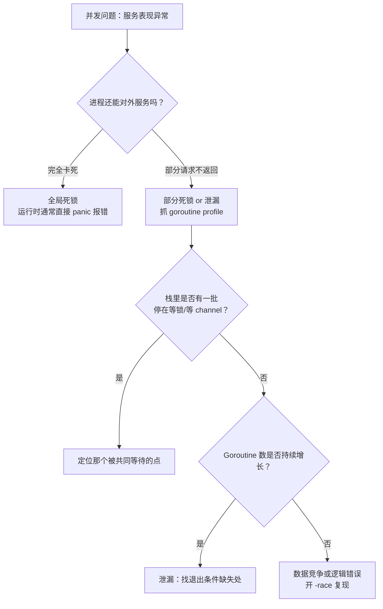

# 并发陷阱与调试——Goroutine 泄漏、死锁与 Race Detector

**摘要：**

Go 的并发模型让编写高并发程序变得相对简单，但也带来了一类独特的、在串行程序中不存在的 Bug：Goroutine 泄漏、死锁、数据竞争。这三类 Bug 有一个共同特点——**它们在代码 review 和普通测试中极难发现**，却在生产环境中往往造成严重后果（内存持续增长、服务卡死、数据损坏）。本文系统梳理这三类问题的产生根源、识别方式与修复策略，重点介绍 Go 工具链提供的三大诊断武器：`go tool pprof`（通过 goroutine profile 定位泄漏）、`runtime` 死锁检测器（内置，panic 告警）以及 `-race` 竞争检测器（编译期插桩，运行时检测）。掌握这些工具和防御性编程模式，是 Go 并发程序从"能跑"到"可信赖"的关键跨越。文章最后回到一个设计认知：并发 Bug 的根源都是"同步缺失"——Goroutine 泄漏是"缺少退出同步"，死锁是"同步顺序错误"，数据竞争是"缺少数据访问同步"。理解这个"同步"主线，才能从根本上看清并发 Bug 的本质，而不是机械记忆每种 Bug 的修复模式。

---

## 第 1 章 Goroutine 泄漏：最常见也最隐蔽的并发 Bug

### 1.1 什么是 Goroutine 泄漏

**Goroutine 泄漏（Goroutine Leak）** 是指一个 Goroutine 启动后，由于某种原因永远无法退出——它既不执行任何有用的工作，也无法被 GC 回收（GC 不会回收存活的 Goroutine），导致 Goroutine 数量随着程序运行时间持续增长，占用的内存（至少每个 Goroutine 的栈，约 2KB 起步）也持续增长。

在生产环境中，Goroutine 泄漏往往表现为：
- 服务的内存使用量随运行时间缓慢但持续增长（即使流量平稳）；
- `runtime.NumGoroutine()` 返回的数字持续增大；
- 通过 `pprof` 的 goroutine profile 发现大量 Goroutine 阻塞在同一个位置。

**Goroutine 泄漏不会立刻崩溃服务**——这正是它危险的地方。它通常是一个长期慢性问题，直到内存耗尽才暴露，而此时排查现场已经很困难了。这个"慢性病"特性让 Goroutine 泄漏比 panic 更难发现——panic 是"急性病"（立即崩溃，现场清晰），泄漏是"慢性病"（缓慢恶化，现场模糊）。

### 1.2 泄漏原因一：channel 操作永久阻塞

最常见的泄漏原因是 Goroutine 阻塞在一个永远不会被操作的 channel 上：

**场景一：发送方泄漏（没有接收者）**

```go
// 错误示例：启动 goroutine 发送，但接收者提前退出
func processRequest(ctx context.Context) *Result {
    resultCh := make(chan *Result)  // 无缓冲 channel
    
    go func() {
        result := doExpensiveWork()
        resultCh <- result  // 如果接收者已经退出，这里永久阻塞
    }()
    
    select {
    case result := <-resultCh:
        return result
    case <-ctx.Done():
        return nil  // ctx 超时，函数返回了，但 goroutine 仍然阻塞在 resultCh <- result
    }
}
```

函数因为 `ctx.Done()` 返回后，`resultCh` 这个 channel 没有任何接收者了，但那个 goroutine 还阻塞在 `resultCh <- result` 这行——它永远无法退出，发生泄漏。

这个泄漏模式的根源是"发送方不知道接收者已离开"——无缓冲 channel 的发送需要接收者在场，接收者离开后发送方永久阻塞。解决方案是"让发送方也能感知取消"——用有缓冲 channel（发送不阻塞）或 ctx（发送方监听取消）。

**修复方案：使用有缓冲 channel，或通过 ctx 通知 goroutine 退出**

```go
// 方案一：使用有缓冲 channel（容量 >= 可能的发送次数）
func processRequest(ctx context.Context) *Result {
    resultCh := make(chan *Result, 1)  // 有缓冲，goroutine 可以发送后退出
    
    go func() {
        result := doExpensiveWork()
        select {
        case resultCh <- result:
        default:  // 如果没人接收（接收者已超时退出），直接丢弃，goroutine 正常退出
        }
    }()
    
    select {
    case result := <-resultCh:
        return result
    case <-ctx.Done():
        return nil
    }
}

// 方案二：goroutine 内部监听 ctx，允许提前退出
func processRequest(ctx context.Context) *Result {
    resultCh := make(chan *Result, 1)
    
    go func() {
        result := doExpensiveWork()  // 假设这个函数不支持 ctx，只能等它完成
        select {
        case resultCh <- result:
        case <-ctx.Done():  // ctx 已取消，放弃发送，退出
        }
    }()
    
    select {
    case result := <-resultCh:
        return result
    case <-ctx.Done():
        return nil
    }
}
```

**场景二：接收方泄漏（没有发送者，channel 永远不关闭）**

```go
// 错误示例：goroutine 等待一个永远不会关闭的 channel
func startMonitor() {
    events := getEventChannel()  // 假设 events 从某个外部来源获取
    
    go func() {
        for event := range events {  // 如果 events 永远不关闭，这个 goroutine 永远不退出
            processEvent(event)
        }
    }()
    // 这里没有办法停止这个 goroutine
}
```

**修复：始终提供退出机制**

```go
func startMonitor(ctx context.Context) {
    events := getEventChannel()
    
    go func() {
        for {
            select {
            case event, ok := <-events:
                if !ok {
                    return  // channel 关闭，正常退出
                }
                processEvent(event)
            case <-ctx.Done():
                return  // ctx 取消，退出
            }
        }
    }()
}
```

### 1.3 泄漏原因二：sync.WaitGroup 或 sync.Mutex 永久阻塞

```go
// 错误：wg.Done() 没有被调用（panic 路径遗漏）
func process(wg *sync.WaitGroup, data []byte) {
    defer wg.Done()
    if len(data) == 0 {
        return  // 早返回，wg.Done() 通过 defer 正确调用
    }
    result := parse(data)
    if result == nil {
        panic("unexpected nil result")  // panic 时 defer 会执行，wg.Done() 会被调用
        // 但如果是 return 而没有 defer：
    }
}

// 更危险的错误：条件分支中忘记调用 Done
func processWrong(wg *sync.WaitGroup, data []byte) {
    wg.Add(1)
    go func() {
        if len(data) == 0 {
            return  // 忘记调用 wg.Done()！wg.Wait() 会永远阻塞
        }
        defer wg.Done()
        parse(data)
    }()
}
```

**黄金规则**：`wg.Add(1)` 之后，`wg.Done()` 必须通过 `defer` 调用，确保所有代码路径（包括 panic 恢复）都能执行到。这个"defer Done"的规则是 WaitGroup 使用的最重要约定——任何不用 defer 的 Done 调用都可能因为遗漏路径导致泄漏。

### 1.4 泄漏原因三：HTTP Server 请求处理 Goroutine 泄漏

```go
// 危险模式：在 HTTP handler 中启动 goroutine，但没有等待或取消机制
func handler(w http.ResponseWriter, r *http.Request) {
    go func() {
        // 这个 goroutine 与 request 的生命周期解绑了
        // 即使客户端断开连接，这个 goroutine 仍然运行
        result := callDownstream()
        log.Println(result)
    }()
    w.WriteHeader(http.StatusAccepted)
}

// 正确：将 r.Context() 传递给 goroutine，客户端断开时 goroutine 自动退出
func handler(w http.ResponseWriter, r *http.Request) {
    ctx := r.Context()
    go func() {
        result, err := callDownstreamWithCtx(ctx)
        if err != nil {
            if ctx.Err() != nil {
                return  // 客户端已断开，正常退出
            }
            log.Printf("downstream error: %v", err)
        }
        log.Println(result)
    }()
    w.WriteHeader(http.StatusAccepted)
}
```

这个"HTTP handler 中启动 Goroutine"的泄漏模式在生产中很常见——开发者想在请求处理中异步执行某些操作（如日志、统计），但不传递 ctx，导致客户端断开后 Goroutine 仍在运行。正确做法是"任何从 HTTP 请求派生的 Goroutine 都必须接收 r.Context()"——客户端断开时 ctx 取消，Goroutine 感知并退出。

### 1.5 如何检测 Goroutine 泄漏

**方法一：pprof goroutine profile**

```go
import _ "net/http/pprof"

func main() {
    go http.ListenAndServe(":6060", nil)  // 开启 pprof 端点
    // ...
}
```

访问 `http://localhost:6060/debug/pprof/goroutine?debug=2` 可以看到所有 Goroutine 的调用栈。泄漏的 Goroutine 通常会有大量重复的相同调用栈，且阻塞在同一个位置。

```bash
# 命令行查看 goroutine 数量和调用栈
go tool pprof http://localhost:6060/debug/pprof/goroutine

# 在 pprof 交互界面中：
(pprof) top       # 按 goroutine 数量排序，找出最多的阻塞点
(pprof) traces    # 查看所有 goroutine 调用栈
(pprof) list main.handler  # 查看具体函数的 goroutine 情况
```

**方法二：测试中使用 goleak 库**

[`go.uber.org/goleak`](https://github.com/uber-go/goleak) 是 Uber 开源的 Goroutine 泄漏检测库，可以在单元测试中使用：

```go
import "go.uber.org/goleak"

func TestNoGoroutineLeak(t *testing.T) {
    defer goleak.VerifyNone(t)  // 测试结束时检查是否有新增的泄漏 goroutine
    
    // 执行可能泄漏的代码
    processRequest(context.Background())
}
```

goleak 的"测试结束时检查"是预防泄漏的早期屏障——如果某个测试用例的代码泄漏了 Goroutine，goleak 会在测试结束时报告，让泄漏在开发阶段就暴露，而不是等到生产环境。这个"测试期检测"是预防泄漏的最佳实践——比 pprof 的"生产期检测"更早发现问题。

**方法三：runtime.NumGoroutine() 监控**

```go
// 简单的 goroutine 数量监控
func monitorGoroutines() {
    for {
        time.Sleep(10 * time.Second)
        n := runtime.NumGoroutine()
        log.Printf("goroutine count: %d", n)
        if n > 10000 {
            log.Printf("WARNING: possible goroutine leak!")
        }
    }
}
```

这个"NumGoroutine 监控"是生产环境的最简单泄漏检测——不需要 pprof，只需要定期记录 Goroutine 数量。如果数量持续增长且不回落，就是泄漏的信号。这个监控应该作为生产服务的标配——与内存监控、CPU 监控同等重要。

---

## 第 2 章 死锁：程序完全卡死的并发 Bug

### 2.1 什么是死锁，以及 Go 的内置检测

**死锁（Deadlock）** 是指两个或多个 Goroutine 相互等待对方释放资源，导致所有这些 Goroutine 都永远无法继续执行：

```
Goroutine A 持有 Lock1，等待 Lock2
Goroutine B 持有 Lock2，等待 Lock1
→ A 和 B 互相等待，永远无法继续
```

**Go 运行时内置死锁检测器**：当**所有** Goroutine 都处于阻塞状态时（没有任何 Goroutine 在运行），Go 运行时会检测到这种情况并 panic：

```
fatal error: all goroutines are asleep - deadlock!

goroutine 1 [chan receive]:
main.main()
    /tmp/sandbox/main.go:10 +0x40

goroutine 2 [chan send]:
main.producer()
    /tmp/sandbox/main.go:20 +0x60
```

**注意限制**：Go 的死锁检测只能检测"全局死锁"（所有 Goroutine 都阻塞）。如果只有部分 Goroutine 死锁，但还有其他 Goroutine 在正常运行（如 HTTP server 的主 Goroutine），运行时不会检测到，服务会继续运行但某些请求永久卡住——这更像是一种**局部死锁（Partial Deadlock）**，需要通过 pprof 发现。

这个"只检测全局死锁"的限制是 Go 死锁检测器的根本局限——它无法发现生产环境中最常见的"局部死锁"。生产服务通常有 HTTP server、定时任务等长期运行的 Goroutine，即使部分请求 Goroutine 死锁，主 Goroutine 仍在运行，运行时不会触发死锁检测。因此，生产环境的死锁排查必须依赖 pprof，不能依赖运行时检测。

### 2.2 死锁原因一：Mutex 加锁顺序不一致

```go
var (
    mu1 sync.Mutex
    mu2 sync.Mutex
)

// Goroutine A：先锁 mu1，再锁 mu2
func funcA() {
    mu1.Lock()
    defer mu1.Unlock()
    time.Sleep(1 * time.Millisecond)  // 模拟处理时间
    mu2.Lock()
    defer mu2.Unlock()
    // ...
}

// Goroutine B：先锁 mu2，再锁 mu1（顺序与 A 相反！）
func funcB() {
    mu2.Lock()
    defer mu2.Unlock()
    time.Sleep(1 * time.Millisecond)
    mu1.Lock()
    defer mu1.Unlock()
    // ...
}

// 当 A 和 B 并发执行时：
// A 拿到 mu1，B 拿到 mu2
// A 等待 mu2（被 B 持有），B 等待 mu1（被 A 持有）
// → 死锁
```

**修复：全局统一加锁顺序**。对于需要同时持有多把锁的操作，在整个代码库中规定一个固定的加锁顺序（如按锁的地址、名字或枚举值排序），所有代码都遵循这个顺序。

"加锁顺序不一致"是死锁的经典原因——两个 Goroutine 以相反顺序获取同一组锁，形成"循环等待"（死锁的必要条件）。解决方案是"全局统一加锁顺序"——所有代码都按相同顺序获取锁，避免循环等待。这个"统一加锁顺序"是数据库事务、操作系统等并发系统的通用死锁预防策略。

### 2.3 死锁原因二：Mutex 不可重入

```go
type Cache struct {
    mu    sync.Mutex
    items map[string]string
}

func (c *Cache) Get(key string) string {
    c.mu.Lock()
    defer c.mu.Unlock()
    return c.items[key]
}

func (c *Cache) GetOrSet(key, defaultVal string) string {
    c.mu.Lock()
    defer c.mu.Unlock()
    
    val := c.Get(key)  // 错误！Get 内部也会 c.mu.Lock()，但 mu 已被持有
    // → 死锁：同一个 Goroutine 再次尝试获取已持有的 Mutex
    
    if val == "" {
        c.items[key] = defaultVal
        return defaultVal
    }
    return val
}
```

Go 的 `Mutex` 是**不可重入（Non-reentrant）**的——同一个 Goroutine 再次对已持有的 `Mutex` 调用 `Lock()` 会永久阻塞（不像 Java 的 `synchronized` 会重入）。这是刻意的设计：不可重入锁迫使开发者明确区分"需要锁保护的公共方法"和"不需要锁的内部方法"。

**修复：拆分内部实现**

```go
// 内部方法（加了 Locked 后缀，调用方必须已持有锁）
func (c *Cache) getLocked(key string) string {
    return c.items[key]
}

func (c *Cache) Get(key string) string {
    c.mu.Lock()
    defer c.mu.Unlock()
    return c.getLocked(key)
}

func (c *Cache) GetOrSet(key, defaultVal string) string {
    c.mu.Lock()
    defer c.mu.Unlock()
    
    val := c.getLocked(key)  // 调用内部方法，不再加锁
    if val == "" {
        c.items[key] = defaultVal
        return defaultVal
    }
    return val
}
```

这个"拆分 Locked 内部方法"是 Go 处理"不可重入锁"的标准模式——公共方法加锁后调用内部方法，内部方法不加锁（假设调用方已持有锁）。这个模式让"锁的边界"清晰——公共方法是"加锁边界"，内部方法是"已锁区间"。

### 2.4 死锁原因三：channel 操作死锁

```go
// 错误一：向无缓冲 channel 发送，但没有 goroutine 在接收
func deadlock1() {
    ch := make(chan int)
    ch <- 1  // 阻塞：没有接收者
    <-ch
}

// 错误二：所有 goroutine 都在等待彼此
func deadlock2() {
    ch1 := make(chan int)
    ch2 := make(chan int)
    
    go func() {
        <-ch1   // 等待 ch1 有数据
        ch2 <- 1
    }()
    
    go func() {
        <-ch2   // 等待 ch2 有数据
        ch1 <- 1
    }()
    
    // 两个 goroutine 互相等待，主 goroutine 也没有做任何事
    // 如果主 goroutine 最终 Wait，会触发全局死锁检测
}
```

channel 死锁与 Mutex 死锁的本质相同——"循环等待"。两个 Goroutine 通过 channel 互相等待，形成循环，无法继续。解决方案是"打破循环"——让某个 Goroutine 先发送或接收，不依赖对方。

### 2.5 局部死锁的 pprof 诊断

```bash
# 当某些请求卡住，但服务未崩溃时：
# 1. 查看阻塞 profile
go tool pprof http://localhost:6060/debug/pprof/block

# 2. 查看 mutex profile（需要先开启）
# 代码中：runtime.SetMutexProfileFraction(1)
go tool pprof http://localhost:6060/debug/pprof/mutex

# 3. 直接查看所有 goroutine 调用栈，找出阻塞在 Lock/chan 的 goroutine
curl http://localhost:6060/debug/pprof/goroutine?debug=2 | grep -A 5 "sync.Mutex"
```

局部死锁的 pprof 诊断思路是"找阻塞在锁/channel 上的 Goroutine"——如果大量 Goroutine 阻塞在同一个 `sync.Mutex.Lock()`，且持锁的 Goroutine 也在阻塞，就是死锁。block profile 和 mutex profile 是诊断局部死锁的核心工具——它们记录了"哪些 Goroutine 在哪里阻塞了多久"。

---

## 第 3 章 数据竞争：最难发现的并发 Bug

### 3.1 什么是数据竞争，为什么如此危险

**数据竞争（Data Race）** 是指两个或多个 Goroutine 在没有同步的情况下并发访问同一块内存，且至少有一个访问是写操作。

数据竞争的危险性在于其行为是**完全不可预期的（Undefined Behavior）**：
- 有时表现正常（恰好没有并发冲突）；
- 有时产生错误的计算结果（写丢失）；
- 有时导致 panic（访问了被并发修改为非法状态的数据结构）；
- 有时在特定硬件或操作系统上才触发。

这使得数据竞争的 Bug 极难复现和调试——测试环境完全正常，生产环境偶发崩溃，而两者代码完全相同。这个"不可复现性"是数据竞争最危险的特征——你不能通过"重现 bug"来定位，必须通过"代码审查 + race detector"来预防。

**典型场景**：

```go
// 场景一：共享计数器（最简单的数据竞争）
var counter int

func increment() {
    counter++  // 不是原子操作！load + add + store 三步，可能被其他 goroutine 打断
}

// 场景二：map 并发读写（会 panic！）
var m = map[string]int{}

go func() { m["a"] = 1 }()
go func() { fmt.Println(m["a"]) }()
// Go 1.6+ 的 map 对并发读写有检测，会触发 panic: concurrent map read and write

// 场景三：slice 并发 append（最隐蔽）
var results []int

for i := 0; i < 10; i++ {
    go func(n int) {
        results = append(results, n)  // append 可能修改底层数组指针，并发写 slice header
    }(i)
}
```

slice 并发 append 是最隐蔽的数据竞争——`append` 可能触发扩容（底层数组指针改变），多个 Goroutine 并发 append 可能导致数据丢失、重复或 panic。这个"slice append 不是并发安全"是 Go 并发编程的常见陷阱——slice 看起来像"可变数组"，但它的 header（指针、长度、容量）不是原子更新的，并发 append 会破坏 header 一致性。

### 3.2 Race Detector：Go 的编译期插桩检测器

Go 工具链内置了 **Race Detector**（竞争检测器），只需在编译或测试时加 `-race` 标志：

```bash
# 运行测试时开启 race 检测（推荐 CI 中始终开启）
go test -race ./...

# 运行程序时开启 race 检测
go run -race main.go

# 构建时开启（生产不推荐，有性能开销）
go build -race -o myapp .
```

**Race Detector 的工作原理**：编译时在每个内存访问（读和写）前后插入**影子内存（Shadow Memory）**更新指令，记录"哪个 Goroutine 在何时访问了这个内存地址"。运行时，当检测到两个访问之间没有同步关系（happens-before 关系）且至少有一个是写，就报告竞争：

```
==================
WARNING: DATA RACE
Write at 0x00c000126010 by goroutine 7:
  main.increment()
      /tmp/race.go:10 +0x3e

Previous write at 0x00c000126010 by goroutine 6:
  main.increment()
      /tmp/race.go:10 +0x3e

Goroutine 7 (running) created at:
  main.main()
      /tmp/race.go:20 +0xa0

Goroutine 6 (running) created at:
  main.main()
      /tmp/race.go:20 +0xa0
==================
```

Race Detector 的输出非常精确：告诉你哪两个 Goroutine、在哪一行代码上发生了冲突，定位 Bug 的效率极高。这个"精确到行"的报告是 race detector 的核心价值——不需要人工分析"哪里可能有竞争"，工具直接告诉你"哪里有竞争"。

**Race Detector 的性能开销**：约 5-10 倍的 CPU 开销，2-3 倍内存开销——因此不适合在生产环境中长期开启，但：
- **所有 CI 测试都应该开启 `-race`**；
- **代码 review 阶段**，可以在本地对可疑代码用 `-race` 验证；
- **性能测试**不应开启（会影响 benchmark 结果）。

"CI 中始终开启 -race"是预防数据竞争的最有效手段——虽然 race detector 有性能开销，但 CI 环境不在乎性能，只在乎正确性。让 race detector 在 CI 中持续运行，能在开发阶段就发现数据竞争，避免其进入生产。

### 3.3 常见数据竞争的修复方法

**修复方案一：使用原子操作（适合简单计数器）**

```go
// 竞争的计数器
var counter int64

// 修复：使用原子操作
var counter atomic.Int64

func increment() {
    counter.Add(1)
}
```

**修复方案二：使用 Mutex 保护**

```go
var (
    mu      sync.Mutex
    results []int
)

for i := 0; i < 10; i++ {
    go func(n int) {
        mu.Lock()
        results = append(results, n)
        mu.Unlock()
    }(i)
}
```

**修复方案三：通过 channel 传递所有权（CSP 模式）**

```go
// 不共享状态，通过 channel 传递数据
resultCh := make(chan int, 10)

for i := 0; i < 10; i++ {
    go func(n int) {
        resultCh <- n  // 发送后，n 的所有权转移给接收者
    }(i)
}

var results []int
for i := 0; i < 10; i++ {
    results = append(results, <-resultCh)
}
```

**修复方案四：局部变量避免共享**

```go
// 最好的情况：根本不共享状态
func processItems(items []Item) []Result {
    results := make([]Result, len(items))
    var wg sync.WaitGroup
    
    for i, item := range items {
        wg.Add(1)
        go func(idx int, it Item) {
            defer wg.Done()
            results[idx] = process(it)  // 每个 goroutine 写不同的 results[idx]，不竞争
        }(i, item)
    }
    
    wg.Wait()
    return results
}
```

"局部变量避免共享"是数据竞争的最佳修复——根本不共享状态，自然没有竞争。这个"预分配结果 slice + 每个 Goroutine 写不同索引"的模式是 Go 并发编程的常见技巧——通过"不同索引"避免共享，比"加锁保护共享"更高效。

---

## 第 4 章 其他常见并发陷阱

### 4.1 陷阱：循环变量捕获

Go 1.22 之前，`for range` 循环中启动的 Goroutine 会共享循环变量（`i` 和 `v` 在循环结束时指向最后一个值）：

```go
// Go 1.21 及之前的经典陷阱
for i, v := range items {
    go func() {
        // i 和 v 是对循环变量的引用，所有 goroutine 共享同一个 i 和 v
        // 循环结束时，所有 goroutine 看到的 i 都是 len(items)-1
        fmt.Println(i, v)  // 打印的几乎都是最后一个值
    }()
}

// 修复方案（Go 1.21 及之前）：通过参数传递，创建新的局部变量
for i, v := range items {
    i, v := i, v  // 创建新的局部变量
    go func() {
        fmt.Println(i, v)  // 每个 goroutine 有自己的 i 和 v
    }()
}

// 或者
for i, v := range items {
    go func(idx int, val Item) {
        fmt.Println(idx, val)
    }(i, v)  // 通过参数传值
}
```

**Go 1.22 的修复**：从 Go 1.22 起，`for range` 循环的每次迭代都会创建新的循环变量（行为与直觉一致），这个陷阱不再存在——但读老代码时仍需注意。

这个"循环变量捕获"陷阱是 Go 1.22 之前最常见的并发 bug 之一——无数开发者在 `for range` 中启动 Goroutine 时踩坑。Go 1.22 的修复让循环变量行为符合直觉，消除了这个陷阱，但历史代码仍需注意。

### 4.2 陷阱：time.After 的 Goroutine 泄漏

```go
// 危险：在循环中使用 time.After，每次调用都创建一个 timer，直到超时才 GC
func processWithTimeout(ch <-chan int) {
    for {
        select {
        case v := <-ch:
            process(v)
        case <-time.After(5 * time.Second):  // 每次循环都创建一个新 timer！
            // 如果 ch 一直有数据，之前的 timer 在 5s 内不会被 GC
            // 每次循环都积累一个 timer，高频调用时大量 timer 堆积
            return
        }
    }
}

// 正确：在循环外创建 timer，或使用 time.NewTimer + Reset
func processWithTimeout(ch <-chan int) {
    timer := time.NewTimer(5 * time.Second)
    defer timer.Stop()
    
    for {
        select {
        case v := <-ch:
            timer.Reset(5 * time.Second)  // 重置而非重新创建
            process(v)
        case <-timer.C:
            return
        }
    }
}
```

`time.After` 的泄漏源于"每次调用创建新 Timer"——Timer 在超时前不会被 GC（因为它在 runtime 的 timer 堆中）。在循环中使用 `time.After`，每次循环都创建一个新 Timer，之前的 Timer 还没超时（5 秒内），会堆积大量未触发的 Timer。解决方案是"循环外创建 Timer + Reset 重置"——复用同一个 Timer，避免堆积。

### 4.3 陷阱：select 在 nil channel 上的行为

```go
// nil channel 上的 send/recv 永远阻塞
// 在 select 中，对 nil channel 的 case 永远不会被选中——可以利用这个特性

func merge(a, b <-chan int) <-chan int {
    out := make(chan int)
    go func() {
        defer close(out)
        for a != nil || b != nil {
            select {
            case v, ok := <-a:
                if !ok {
                    a = nil  // a 已关闭，将 a 设为 nil，select 不再监听 a
                    continue
                }
                out <- v
            case v, ok := <-b:
                if !ok {
                    b = nil  // b 已关闭
                    continue
                }
                out <- v
            }
        }
    }()
    return out
}
```

将已关闭的 channel 设为 `nil` 后，`select` 的对应 case 永远不会触发（nil channel 永远阻塞）——这是一个优雅的技巧，避免了 close 后的 channel 被反复读取到零值。这个"nil channel 禁用 case"的技巧在多路合并、优先级 select 等场景中广泛使用。

---

## 第 5 章 并发调试工具总览

### 5.1 工具选择矩阵

| 问题类型 | 检测工具 | 使用时机 |
| --- | --- | --- |
| Goroutine 泄漏 | `pprof /goroutine` | 线上问题排查、压测后检查 |
| Goroutine 泄漏（测试） | `goleak` 库 | 单元/集成测试 |
| 全局死锁 | Go 运行时内置（自动 panic）| 开发调试 |
| 局部死锁/卡死 | `pprof /block`、`/mutex` | 线上问题排查 |
| 数据竞争 | `go test -race` / `go run -race` | CI 阶段、开发阶段 |
| 竞争条件（逻辑 bug）| 代码审查 + 单元测试 | 开发阶段 |
| 性能瓶颈（锁争用）| `pprof /mutex` | 性能优化阶段 |

这个工具矩阵的核心原则是"工具与时机匹配"——不同问题在不同阶段用不同工具。开发阶段用 race detector 和 goleak（早期发现问题），生产阶段用 pprof（排查已发生的问题）。这个"分层检测"策略让并发 bug 在各个阶段都有对应的发现手段。

### 5.2 开启 block profile 和 mutex profile

```go
import "runtime"

func init() {
    // 开启阻塞 profile（记录 goroutine 阻塞在 channel 和 select 的情况）
    runtime.SetBlockProfileRate(1)  // 1 = 每次阻塞都记录；大值 = 采样
    
    // 开启 mutex 争用 profile（记录 mutex 锁争用情况）
    runtime.SetMutexProfileFraction(1)  // 1 = 每次都记录；大值 = 采样
}
```

**pprof 的使用流程**：

```bash
# 步骤一：采集 goroutine profile
go tool pprof http://localhost:6060/debug/pprof/goroutine

# 步骤二：在 pprof 交互界面分析
(pprof) top10           # 显示占用最多的 10 个调用栈
(pprof) web             # 在浏览器中查看调用图（需要 graphviz）
(pprof) list funcName   # 显示特定函数的源码级别分析

# 步骤三：对比两个时间点的 profile（用于确认 goroutine 泄漏）
curl -o before.pb.gz http://localhost:6060/debug/pprof/goroutine
# 等待一段时间...
curl -o after.pb.gz http://localhost:6060/debug/pprof/goroutine
go tool pprof -diff_base=before.pb.gz after.pb.gz
```

"对比两个时间点的 profile"是确认 Goroutine 泄漏的关键方法——如果两个时间点之间 Goroutine 数量持续增长，且增长的都是同一个调用栈，就是泄漏。这个"diff profile"方法比单次 profile 更可靠——单次 profile 只能看到"当前有多少 Goroutine"，diff profile 能看到"增长了多少"。

---

## 第 6 章 并发 Bug 的"同步"主线

### 6.1 三类 Bug 的共同根源：同步缺失

三类并发 Bug 的根源都是"同步缺失"——Goroutine 泄漏是"缺少退出同步"（Goroutine 不知道何时该退出），死锁是"同步顺序错误"（锁的获取顺序不一致），数据竞争是"缺少数据访问同步"（读写没有互斥保护）。理解这个"同步"主线，才能从根本上看清并发 Bug 的本质，而不是机械记忆每种 Bug 的修复模式。

### 6.2 同步的三个维度

"同步"在并发编程中有三个维度：
- **生命周期同步**：Goroutine 何时启动、何时退出（ctx、WaitGroup）；
- **执行顺序同步**：多个 Goroutine 的执行顺序（锁的获取顺序、channel 的发送/接收顺序）；
- **数据访问同步**：共享数据的读写互斥（Mutex、原子操作、channel 所有权转移）。

三类 Bug 分别对应这三个维度的缺失——Goroutine 泄漏是"生命周期同步"缺失，死锁是"执行顺序同步"错误，数据竞争是"数据访问同步"缺失。理解这三个维度，才能系统性地预防并发 Bug——不是"出现 bug 再修"，而是"从设计阶段就考虑三个维度的同步"。

### 6.3 防御性并发编程

预防并发 Bug 的最佳策略是"防御性并发编程"——在设计阶段就考虑同步，而不是等 bug 出现再修。具体实践：
- 每个 Goroutine 都有明确的退出条件（ctx 或 channel close）；
- 多锁场景统一加锁顺序；
- 共享数据用 Mutex 或原子操作保护，或通过 channel 转移所有权；
- CI 中始终开启 `-race`；
- 测试中使用 goleak 检测泄漏。

这个"防御性并发编程"是 Go 并发编程从"能跑"到"可信赖"的关键——不是"写完再测"，而是"设计时就预防"。

---

## 第 7 章 数据竞争的高级形态与修复范式

前面第 3 章讲的数据竞争，例子多是"两个 Goroutine 读写同一个变量"。但在真实代码里，竞争往往更隐蔽——它藏在一组字段之间、藏在"先检查后使用"的窗口里、藏在"遍历的同时修改"里。这一章把这几类高级形态逐个拆开。

### 7.1 复合不变量的竞争

最容易被漏掉的一类竞争是**跨字段的一致性**。设想一个连接池，它维护三个计数：`size`（总连接数）、`idle`（空闲连接数）、`active`（使用中连接数），它们之间必须满足 `size == idle + active`。如果每个计数都用独立的原子操作更新，那么在两次更新之间就会存在一个短暂的窗口——`size` 已经加了、`active` 还没加——任何在这个窗口里读到这三个数的代码，都会看到一个"数学上不成立"的状态。单人测试几乎不可能撞上这个窗口；一旦并发上来，它就变成了偶发且难以复现的"数据看起来不对"。

修复方式有两种，取舍很清晰：**用一把锁把整组字段圈进临界区**，读方与写方都在锁内，保证任何时刻读到的都是自洽的一组值；或者**把整组字段打包成一个不可变对象**，用一次原子指针替换来"发布"新版本（即第 10 篇讨论的 Copy-on-Write）。二者都遵循同一条原则：**不变量跨越几个字段，就用能一次性保护这几个字段的手段**，而不是给每个字段各配一个原子操作。

### 7.2 发布与初始化竞争

第二类隐蔽竞争是**懒初始化**。下面这段单例写法看起来天经地义，实际在并发下是错的：

```go
var instance *Service

func Get() *Service {
    if instance == nil {          // 检查
        instance = newService()   // 使用之间没有同步
    }
    return instance
}
```

两个 Goroutine 可能同时通过 `if` 检查，各自创建一个实例，于是"单例"变成了两个，且其中一个被后来的赋值覆盖、成为孤儿。更糟的是，即使只有一次赋值，若 `newService()` 的初始化步骤存在顺序依赖，另一个 Goroutine 也可能读到"指针已赋值、字段尚未初始化"的半成品——这正是第 2 篇讨论的内存模型里双重检查锁定的伪正确性问题。

正确的写法是用 `sync.Once`（或 `sync.OnceValue`）：

```go
var (
    once     sync.Once
    instance *Service
)

func Get() *Service {
    once.Do(func() { instance = newService() })
    return instance
}
```

`sync.Once` 提供了"只有一个 Goroutine 执行、其余等待、执行完成后所有 Goroutine 都能看到完整结果"的三重保证，恰好覆盖了上面两个问题。判断一段懒初始化是否安全，只需问一句：**"检查"与"赋值"之间，有没有同步？**

### 7.3 迭代与修改并发

第三类是**边遍历边修改**。Go 的 `map` 有一个宽松之处：在**同一个** Goroutine 内，`range` 过程中删除元素是允许的（新增则可能导致某些元素被漏掉或重复）。但这个"宽松"仅限单 Goroutine——一旦另一个 Goroutine 在遍历期间写同一个 map，结果不是漏掉元素那么简单，而是直接触发运行时检测并 panic（`concurrent map iteration and map write`）。因此"遍历时修改"的安全边界是：**可以单 Goroutine 内边遍历边删，但绝不能让另一个 Goroutine 参与**。

切片的对应陷阱不同：`append` 可能复用或重建底层数组，若与此同时有另一个 Goroutine 持有旧切片的视图并在读，它读到的可能是"旧数组"，也可能是"新数组正在被写"的中间态。修复方式是"先复制再遍历"或"用锁把读写圈起来"——没有第三种便宜的办法。

### 7.4 关闭与写入竞争

第四类是**关闭与写入的竞争**。向一个已关闭的 channel 发送会立刻 panic，而从已关闭的 channel 接收则永远返回零值——两个方向的语义不对称，因此"谁来关闭"必须由协议规定清楚。安全的规矩只有一条：**由唯一的写者关闭，且关闭前确保没有其他写者**。若存在多个写者，要么在上层用一把锁串行化它们、要么引入一个"停止信号"channel 让所有写者先退出、再由协调者关闭数据 channel。反过来，"读方关闭 channel"是最常见的错误——因为读方无法知道是否还有写者在路上。

### 7.5 修复范式一览

把四类竞争的修复手段归纳，其实只有四种范式，遇到任何竞争都可以先套用：

| 范式 | 做法 | 适用 |
| :--- | :--- | :--- |
| 互斥 | 用 `Mutex` 或 `RWMutex` 圈住临界区 | 跨字段不变量、有读有写 |
| 原子 | 用 `sync/atomic` 做单变量操作 | 计数、标志位 |
| 所有权转移 | 用 channel 把数据交给单一所有者 | 数据在生产消费之间流动 |
| 不可变 | 发布后不再修改，用整体替换代替原地改 | 配置、快照、只读共享 |

这四者不是互斥的，一段代码里常常同时用上两三种。选择的核心判据仍然回到那条主线：**你打算维护哪一条不变量，就用能一次性守住它的那个手段**。

## 第 8 章 泄漏与死锁的系统化定位

### 8.1 泄漏的四个根因

前面第 1 章按"原因"列举了泄漏，这里换一个角度——按"阻塞在哪里"归因，因为定位泄漏时找的正是"这个 Goroutine 卡在哪一行"。四个根因覆盖了绝大多数情况：**其一，卡在 channel 收发**（发送无人接收、接收无人发送、`for range` 永不结束）；**其二，卡在同步原语**（等一把永远不释放的锁、等一个永远不调用的 `Done`）；**其三，卡在无超时的 I/O**（网络读写、数据库查询没有 deadline，对端不响应就永远等下去）；**其四，卡在无退出条件的循环**（`for {}` 里没有检查取消或关闭信号）。定位时的顺序也很自然：抓 profile、看栈顶那一行、对照这四类判断是哪一种。

### 8.2 死锁的四个必要条件在 Go 里的映射

死锁的经典理论给出四个必要条件——互斥、持有并等待、不可剥夺、循环等待。把它们映射到 Go 的语境，会看到两处特有的形态。**Mutex 死锁**几乎总是"循环等待"的变体：A 持锁 L1 等 L2，B 持锁 L2 等 L1，只要所有加锁都遵守同一个全局顺序，循环就无法形成——这是"统一加锁顺序"能根治多数互斥死锁的原因。**channel 死锁**则对应"持有并等待"：一个 Goroutine 已经把值发给了某个 channel（持有），又在等另一个 channel（等待），而对方恰好相反；无缓冲 channel 的"发送与接收必须同时在场"让这种等待格外容易形成。

### 8.3 部分死锁的定位

Go 运行时只会检测"**所有** Goroutine 都阻塞"这一种全局死锁，此时 panic 出 `all goroutines are asleep`。但在服务端，几乎不会发生"所有 Goroutine 都阻塞"——HTTP 监听协程还在等新连接，于是运行时永远不会报错，而真正的问题只体现为"某些请求永远不返回"。这种**部分死锁**要靠人来定位，路径有三条：抓 `goroutine profile` 看是否有一批栈都停在"等同一把锁"或"等同一个 channel"；观察**连接状态**是否有一批连接长期处于活跃但不完成；结合**超时日志**看是否有请求落在某个固定的、永远超时的下游调用上。三条线索交叉，通常就能圈定那个"大家都卡在上面"的点。

### 8.4 从现象到堆栈的排查路径

把排查压缩成一条可复用的路径：**先分层判性质**（是泄漏、死锁还是竞争，看的是"进程是否还能对外服务"）；**再取运行时证据**（`goroutine profile` 看分布、`block profile` 看阻塞点、`mutex profile` 看争用、`trace` 看时序）；**然后对齐代码**（把栈顶平台函数映射回自己的代码行）；**最后才是改**。这条路径的价值在于它把"凭直觉猜"换成了"用证据收窄"——并发 bug 的最贵成本往往不是修复，而是定位，而定位的效率取决于证据链是否完整。

> [!warning] 一个反直觉的观察
> 泄漏与死锁在被发现时，往往已经运行了几小时甚至几天。它们不会让程序立刻报错，只会让资源缓慢流失。因此"上线后一切正常"不能作为并发代码正确的证据——**短时间的正常，只是这些 bug 尚未积累到显形的程度**。

## 第 9 章 从测试到生产的防御体系

定位能力再强，也应当把防线提前。并发 bug 的最佳处理时机不是"线上发现后抢救"，而是"提交前拦住"。这一章按时间顺序，把静态、动态、运行时三道防线串起来。

### 9.1 静态防线：让工具在提交前拦住

第一道防线是工具，成本最低、收益最直接。`go vet` 自带的 `loopclosure` 检查能拦住循环变量捕获（虽然 Go 1.22 之后这类误用大幅减少，但旧代码仍需要它），`lostcancel` 检查能拦住"创建了可取消 Context 却忘记调用 cancel"。在它之上，`staticcheck` 与 `golangci-lint` 提供了更细的并发相关规则——检测未使用的 channel、可疑的 Goroutine 启动、`sync` 零值复制等。这些检查应当**接进 CI**，而不是停在"文档里建议开启"。一个务实的门槛是：CI 中同时跑 `go vet ./...`、`golangci-lint run` 与 `go test -race ./...`，三道全绿才允许合并——这条门槛能拦掉相当大比例的并发误用。

### 9.2 动态防线：让问题在预发暴露

第二道防线是测试。并发的 bug 天然具有"偶发"特征，因此测试的关键是**提高触发概率**。三件事最有效：其一，**全量测试开 `-race`**——它做的是运行时插桩，能发现"实际发生了但恰好没造成错误结果"的竞争，这是任何断言都测不出来的；其二，**加 `-count` 多次运行**——把偶发的交错重复足够多次，让低概率路径有机会出现；其三，**压测与混沌注入**——在预发环境用远高于生产的并发度施压，并主动注入延迟、超时、进程被杀等扰动，观察系统是否会出现泄漏、死锁或在恢复后留下脏状态。压测的意义不只是"看吞吐上限"，更是"把并发路径都走一遍"。

### 9.3 运行时防线：让生产可观测

第三道防线在生产环境，解决的是"线上已经出问题、但看不见"的困境。三样东西缺一不可：**Goroutine 数的基线告警**——给正常水位设一个阈值（比如基线的两倍），一旦持续超过就告警，它能在泄漏显形为 OOM 之前很久就发出信号；**常开的 block profile 与 mutex profile**——它们是"死锁/争用"的直接证据源，但默认不开启、只在故障时打开往往来不及，可行做法是低采样率常开；**受保护的 pprof 端点**——pprof 本身可能暴露敏感信息，因此要挂在内部端口或加鉴权，但**不能因为怕暴露就彻底关掉**，否则出问题时手里没有可用的取证手段。此外，取消与超时也应当有指标（第 7 篇已详述），否则"取消有没有生效"只能靠猜。

### 9.4 团队规约与评审清单

最后一道防线是人与流程。把前三道防线压成一份可执行的评审清单，比写一篇"并发规范"更能落地：

| 维度 | 评审问题 | 期望答案 |
| :--- | :--- | :--- |
| 生命周期 | 每个 Goroutine 的退出条件是什么？ | 能明确指出退出分支 |
| 同步 | 共享状态的不变量是什么，谁来守？ | 有锁/原子/所有权方案 |
| 取消 | 长任务是否监听 `ctx`？ | 每处阻塞点都有 `Done()` 分支 |
| 资源 | channel 谁关闭、锁会不会漏放？ | 唯一关闭者、`defer Unlock` |
| 内存 | 是否有无界增长的结构？ | 队列有界或有容量上限 |

这张表的价值在于它把"并发是否写对了"这个笼统问题，拆成了五个可以在评审时逐条回答的具体问题——而能回答"每个 Goroutine 的退出条件是什么"，往往就已经排除了大半的泄漏。

## 第 10 章 八个反例与一张排查图

### 10.1 八个反例速查

把全篇反复出现的反例集中列出，便于对照自查：

| 反例 | 症状 | 修复 |
| :--- | :--- | :--- |
| 无缓冲 channel 发送无接收方 | Goroutine 永久阻塞 | 加接收方或改有缓冲/带取消 |
| `for range ch` 而 channel 无人关闭 | 消费协程永不退出 | 明确唯一关闭者 |
| 忘记 `defer cancel()` | Context 泄漏 | 创建后立即 defer |
| 向已关闭 channel 发送 | panic | 由唯一写者关闭 |
| 加锁顺序不一致 | 循环等待死锁 | 统一全局加锁顺序 |
| 多字段分开用原子操作 | 读到不自洽状态 | 一把锁或整体替换 |
| 无超时的网络/DB 调用 | 阻塞泄漏、请求堆积 | 设 deadline 并传 ctx |
| 无界队列做缓冲 | 内存暴涨、雪崩 | 有界队列 + 背压 |

### 10.2 一张排查决策图

面对"服务不正常"，可以顺着下面这张图快速收敛到方向：



这张图不是要替代第 8 章的排查路径，而是给出**第一步该看什么**——三分之二的时间浪费在"从错误的方向入手"，而方向往往由"进程还能不能服务"这一个问题就能定下来。

### 10.3 一条贯穿全篇的主线

从第 1 章的泄漏，到第 3 章的竞争，再到第 8 章的死锁，三类 bug 的根因其实是同一句话——**并发访问缺少了一条明确的同步规则**。泄漏缺的是"退出同步"，死锁是"顺序同步"写错了，竞争缺的是"数据访问同步"。因此防御的思路也可以统一：在写下每一个 Goroutine、每一处共享状态、每一次跨协程通信之前，先回答"这里的同步规则是什么"——回答了它，三类 bug 也就同时被排除在了门外。

## 第 11 章 三组最小复现实验

理解三类 bug 最快的方式，是自己把它们复现一遍、并亲眼看到工具如何呈现。下面三组最小例子都可以在本地几行代码里跑出来。

### 11.1 泄漏复现：无接收方的无缓冲发送

```go
func main() {
    ch := make(chan int)      // 无缓冲
    go func() { ch <- 1 }()   // 发送方会永久阻塞：没有接收者
    time.Sleep(time.Second)
    fmt.Println(runtime.NumGoroutine()) // 2：主协程 + 那个卡住的协程
}
```

这段代码不会 panic，程序也不会报错——它只是让一个 Goroutine 永久悬在那里。把 `runtime.NumGoroutine()` 换成抓 `pprof` 的 goroutine profile，你会看到那个协程的栈顶停在 `chan send` 上，这就是"卡在 channel 收发"这一类泄漏的现场。

### 11.2 死锁复现：加锁顺序相反

```go
var a, b sync.Mutex

func main() {
    go func() { a.Lock(); time.Sleep(time.Millisecond); b.Lock() }() // 先 a 后 b
    go func() { b.Lock(); time.Sleep(time.Millisecond); a.Lock() }() // 先 b 后 a
    time.Sleep(time.Second)
    fmt.Println("done") // 永远不会打印
}
```

两个协程各持一把锁、又都在等对方那把，形成循环等待。注意 `time.Sleep` 的作用是把"恰好错开"变成"必然重叠"——真实代码里这个 sleep 由调度时序随机提供，因此死锁往往"跑一百次才出现一次"。

### 11.3 竞争复现：无同步的计数器

```go
func main() {
    n := 0
    var wg sync.WaitGroup
    for i := 0; i < 1000; i++ {
        wg.Add(1)
        go func() { defer wg.Done(); n++ }() // 读-改-写，非原子
    }
    wg.Wait()
    fmt.Println(n) // 大概率小于 1000
}
```

`n++` 在机器层面是"读、加、写"三步，交错执行就会丢失更新。这段代码用 `go run -race` 跑，Race Detector 会直接指出读写发生在哪两行——即使某次运行的结果恰好是 1000，`-race` 也照样会报告，这正是"没有可观察到的错误不等于没有竞争"的注脚。

### 11.4 用工具看见它们

三组实验恰好对应三种工具：泄漏看 **goroutine profile**（架势分布）、死锁看 **mutex/trace**（争用与阻塞时序）、竞争看 **`-race`**（读写位置）。把这三组实验亲手跑一遍，再回头看本篇的诊断路径，工具与现象之间的映射就不再是抽象的了。

## 第 12 章 五种"错误修复"

比写出 bug 更值得警惕的，是**把 bug 修得更隐蔽**。下面五种"修复"在实践中屡见不鲜，它们都能让眼前的症状消失，却把问题推进了更深的层次。

### 12.1 加个 sleep 就不竞争了

在竞争的两步之间插入 `time.Sleep`，本质是**用时间赌调度顺序**。它可能让问题从"每次必现"变成"百万分之一"，于是在开发机上"修好了"，在生产上以更低的频率、更难复现的形态继续存在。真正的修复是建立同步关系（锁、原子、所有权转移），而不是用时间掩盖。

### 12.2 缓冲区开大点就不会满

把 channel 的容量从 100 调到 100000，队列确实不那么容易满了——但**容量只是把"何时积压"往后推**，不改变"积压终将发生"这一事实。更糟的是，它同时把"队列深度"这个预警指标变得迟钝（第 8 类反例的翻版）。正确的方向是引入背压与限流，让过载被显式地拒绝或降级，而不是被更长的缓冲吃掉。

### 12.3 用 recover 吞掉 panic

给一段并发代码加个 `recover`，把 panic 转成"记录一行日志、继续跑"——症状是消失了，但**触发 panic 的那个不一致状态还在**：可能是半个更新过的 map、可能是一个已经损坏的不变量。把崩溃变成静默错误，只会让下一次故障以更不可解释的形态出现。`recover` 的正确用法是"在边界处把 panic 转成可传播的错误，并让调用方去决定要不要继续"，而不是"就地咽下去"。

### 12.4 把锁的粒度放大到整个函数

为了让竞争消失，一句 `mu.Lock(); defer mu.Unlock()` 圈住了整个函数——竞争确实没了（因为变成了串行）。这类"修复"的问题在于它**用性能换正确性，而且往往是过量的**：真正的临界区可能只有两行。正确做法是把锁缩小到刚好护住不变量的那段代码，其余部分（尤其是 I/O、计算）放到锁外。

### 12.5 用全局变量代替传参

为了图省事，把状态放进了全局变量，于是"传参"的烦恼没有了——但**共享面从"这一处"扩大到了"全进程"**，任何一处忘记同步都会变成新的竞争源，测试之间还会互相污染。可见的传参虽然啰嗦，却把"共享"这件事限制在了签名可查的范围内，这正是它值得付出的那点笔墨的原因。

> [!note] 一条判断标准
> 区分"修复"与"掩盖"的标准很简单：**修复之后，那段代码的同步规则是否变得更明确**。若改完之后你依然说不出"这里为什么安全"，那大概率只是换了一种更容易出问题的方式。

## 第 13 章 并发调试工具速查

工具本身不难用，难的是"什么时候该用哪一个"。这一章按使用场景把常用手段收在一处。

### 13.1 pprof 的三种抓取方式

同一份 profile 数据，有三种拿到它的途径，适用场景不同。**HTTP 端点**：在服务里 `import _ "net/http/pprof"` 并起一个内部端口，线上直接 `go tool pprof http://host/debug/pprof/goroutine` 抓取，适合"服务还在运行、需要就地取证"。**测试内置**：`go test -cpuprofile cpu.out -memprofile mem.out`，适合"在 CI 或本地复现某个性能问题"。**运行时直接**：`pprof.Lookup("goroutine").WriteTo(os.Stderr, 2)` 或 `runtime/pprof` 的 API，适合"没有 HTTP、只能写日志的进程"。三者拿到的数据同源，区别只在"在哪里取"。

### 13.2 trace 能看见 race 看不见的东西

`-race` 与 `pprof` 各有盲区。`-race` 只看"有没有同步缺失"，看不见"调度延迟有多大""GC 停顿影响了几毫秒""某个 Goroutine 在等锁等了多久"；`pprof` 给的是采样的统计视图，看不见"时间顺序"。而 `go tool trace` 记录的是一条**时间线**——每个 Goroutine 何时运行、何时阻塞、何时被唤醒，GC 在哪些时刻发生了 STW。当问题是"偶发卡顿"而非"结果错误"时，trace 往往是唯一能还原现场的工具。

### 13.3 GODEBUG 与调度器诊断

有一组不那么常用、但在特定场景下很锋利的开关，通过 `GODEBUG` 环境变量打开：`schedtrace=N` 每 N 毫秒打印一次调度器的全局统计（Goroutine 数、线程数、GC 状态），`scheddetail=1` 连每个 P 的本地队列都打出来——当怀疑"调度器本身有问题"（而非应用逻辑）时，这两个开关能直接看到运行时的视角。它们输出量大，只适合短时诊断，不适合常开。

### 13.4 一个组合用法

把工具串起来，就能得到一条完整的泄漏排查命令序列：先用 `runtime.NumGoroutine()` 的长期曲线确认"确有增长"；再用 `go tool pprof` 抓 goroutine profile、`-top` 看哪个调用栈最多；用 `-list 函数名` 定位到具体行；必要时用 `trace` 看那个 Goroutine 阻塞了多久。这条序列的价值在于每一步都在把范围收窄——从"疑似泄漏"到"知道卡在哪一行"，全程有据可依。

## 第 14 章 三者的成本分布与防御优先级

### 14.1 哪一类更值得先防

三类 bug 在"发生频率"与"定位成本"两个维度上的分布并不相同，据此排出的防御优先级也不一样。**数据竞争**是出现频率最高的一类——几乎每个共享状态都存在，只是未必造成可见后果；它的定位成本也最高，因为它要求"恰好交错"才显形。因此它最值得靠工具提前拦截（`-race` 与 linter），投入产出的比最高。**Goroutine 泄漏**出现频率中等，但它有一个危险的特性——**缓慢积累、无声无息**，到显形（OOM 或调度变慢）时往往已运行数小时，定位成本高，因此它最值得靠"指标与基线告警"提前发现。**死锁**出现频率最低，但后果最致命（直接不可用），且现场一旦形成就完全卡死，因此它最值得靠"规约（统一加锁顺序、唯一关闭者）"从源头上避免。

### 14.2 检测成本的对比

把三者的"什么时候能被发现"列在一起会更直观：竞争只有在**开了 `-race` 且跑到了那条路径**时才能被机器直接指出，否则要靠人从"结果偶尔不对"反推；泄漏要靠**持续监控数量趋势**才能察觉，单次测试几乎测不出；死锁若发生在全部 Goroutine 上，运行时能直接报错，但**部分死锁**没有任何自动检测，只能靠请求不返回这一现象去倒查。三者合起来说明一件事：**并发 bug 的自动检测能力是相当有限的**，工具能覆盖的部分远比人们以为的要小——剩下的部分，只能靠设计阶段就把同步规则写清楚。

### 14.3 一段收束

行文至此，可以把这一篇的态度说得更直接一些。并发调试之所以难，根本原因不在于工具不强，而在于**并发 bug 的"可观测性"天然很弱**——它们不以错误的形式出现，而以"概率"的形式潜伏。因此，"写得正确"的价值远高于"测得出来"：一份把每处同步规则都写明白的代码，胜过一整套事后诊断工具。诊断能力是必要的兜底，而设计上的明确才是主防线。

### 14.4 一条可落地的取舍

若资源只够做一件事，就选"在全量测试里打开 `-race`"——它用极低的成本覆盖了最高频的一类问题；若还能做第二件，加上"Goroutine 数基线告警"，把泄漏的发现时间从"OOM 前一刻"提前到"刚偏离基线"；若还能做第三件，把"统一加锁顺序、唯一关闭者"写进评审清单，从源头挡住死锁。这三件事的顺序，恰好对应了"频率 × 定位成本"从高到低的排序。

补一句为什么是这个顺序：`-race` 的边际成本最低（开关一开就生效）、覆盖最高频的问题；基线告警需要先建立"正常水位"的认知，成本略高；而加锁顺序的评审需要团队形成一致的约定，落地最慢。**先用工具兜住最容易出的一类，再逐层向上加固**，是把有限的工程投入换成最大安全感的一般路径。

这并不意味着"设计写好"就可以省掉工具——工具的定位是**兜底**：设计能覆盖多数情况，但人总会疏忽，`-race` 与基线告警的价值就在于把那些疏忽在造成后果之前拦下来。设计为主、工具为辅，二者共同的敌人是"以为它可以被测试覆盖"这个错觉。

## 总结

本篇系统梳理了 Go 并发程序中三类最危险的 Bug 及其诊断工具：

**Goroutine 泄漏**：本质是 Goroutine 永久阻塞（channel 无人接收/发送、Mutex/WaitGroup 未释放）。预防靠**始终为 Goroutine 提供退出路径**（ctx 取消 + 有缓冲 channel），检测靠 `pprof goroutine profile` 或 `goleak` 测试库。泄漏是"慢性病"——不会立即崩溃，但会持续恶化，直到内存耗尽。

**死锁**：全局死锁由 Go 运行时自动检测并 panic；局部死锁（部分 Goroutine 卡死）需要 `pprof block/mutex profile` 定位。预防靠**全局统一加锁顺序**（防止 lock ordering 死锁）和**避免 Mutex 重入**（拆分 locked/public 方法）。死锁是"急性病"——立即卡死，但局部死锁可能被长期运行的 Goroutine 掩盖。

**数据竞争**：最隐蔽，行为不可预期。`go test -race` 通过影子内存插桩，能精确报告竞争发生的位置和 Goroutine。**CI 中始终开启 `-race`** 是工程上防止数据竞争进入生产的最有效手段。修复手段：原子操作（简单计数器）、Mutex（复杂状态）、channel 所有权转移（CSP 风格）。

三类并发 Bug 的根源都是"同步缺失"——Goroutine 泄漏是"缺少退出同步"，死锁是"同步顺序错误"，数据竞争是"缺少数据访问同步"。理解这个"同步"主线，才能从根本上看清并发 Bug 的本质，而不是机械记忆每种 Bug 的修复模式。防御性并发编程——在设计阶段就考虑生命周期、执行顺序、数据访问三个维度的同步——是预防并发 Bug 的最佳策略。

下一篇深入 Go 网络编程的底层：[[12 Go 网络编程——netpoller 与 Goroutine-per-Connection]]。

---

## 参考资料

1. Go Blog,《Introducing the Go Race Detector》: https://go.dev/blog/race-detector——Race Detector 的官方介绍。
2. Go 文档,《Data Race Detector》: https://go.dev/doc/articles/race_detector——Race Detector 的详细文档。
3. uber-go/goleak: https://github.com/uber-go/goleak——Goroutine 泄漏检测库。
4. Go pprof 文档: https://pkg.go.dev/net/http/pprof——pprof 的完整文档。
5. Go Blog,《Go Concurrency Patterns: Pipelines and cancellation》——Pipeline 与取消的并发模式。

---

> [!note] 思考题
> 1. 一个 goroutine 向一个无缓冲 channel 发送数据，但没有接收方——这个 goroutine 会永远阻塞（goroutine 泄漏）。Go 运行时能检测到这种泄漏吗？`runtime.NumGoroutine()` 可以用来监控泄漏，但它无法定位是哪个 goroutine 泄漏了。在生产环境中，你有哪些工具和方法来定位 goroutine 泄漏的具体代码位置？
> 2. Go 的 Race Detector 使用 happens-before 关系来判断是否存在数据竞争。两个 goroutine 分别读写同一个 `map` 而没有加锁——即使在测试中没有观察到错误结果，Race Detector 也会报告竞争。这是否意味着"没有可观察到的错误不等于没有数据竞争"？Go 的 map 在并发读写时可能导致什么运行时后果（不仅仅是数据错误）？
> 3. 死锁检测是 Go 运行时的内置能力——当所有 goroutine 都阻塞时，运行时会 panic 并报告 `fatal error: all goroutines are asleep - deadlock!`。但如果只有部分 goroutine 死锁（其他 goroutine 仍在运行，比如 HTTP server），运行时还能检测到吗？在微服务场景中，如何检测这种"部分死锁"？
> 4. 三类并发 Bug 的根源都是"同步缺失"——Goroutine 泄漏是"缺少退出同步"，死锁是"同步顺序错误"，数据竞争是"缺少数据访问同步"。如果要在团队中推行"防御性并发编程"规范，你会制定哪些具体规则？请从"生命周期同步"、"执行顺序同步"、"数据访问同步"三个维度各给出一条可执行的规则。
