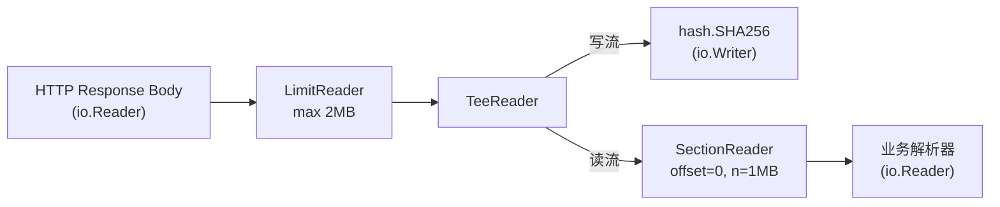

# 流式 I/O 的数学契约——io.Reader、io.Writer 与组合流模型

**摘要：**

Go 的标准库被外界评价为"少而精"，这种克制很大程度上来自 `io` 包对两个方法的执念——`Read(p []byte) (n int, err error)` 和 `Write(p []byte) (n int, err error)`。看上去平淡无奇的签名，背后却是一套形式化的契约：短读（short read）是合法状态、部分写（partial write）需要上层循环、`n > 0 && err != nil` 时必须先处理数据再处理错误、`io.EOF` 被刻意设计为终态标记而非错误。这套契约看似只是"读写字节"，却把文件、网络、内存、管道、加密流、压缩流等异构数据源统一成了同一种**流（Stream）**，进而让"装饰器模式"得以在流之上叠加，形成 `TeeReader`、`LimitReader`、`MultiReader`、`SectionReader`、`MultiWriter` 等组合子，也催生了 `io.Pipe` 这种零拷贝的同步阻塞协作原语，以及 `io.Copy` 内部通过 `ReaderFrom`/`WriterTo` 接口嗅探实现的快路径优化。本文从 `Read` 签名的完整语义出发，逐层拆解短读、EOF、部分写、`io.ErrUnexpectedEOF` 的设计理由，再沿着"契约 → 组合子 → 内存管道 → 快路径"的顺序走完整个流式模型，最后回到一个权衡取舍：接口简单带来的组合爆炸，与语义严格带来的实现复杂度，究竟该如何因地制宜。

---

## 第 1 章 从系统调用到接口——抽象的代价与收益

### 1.1 一个签名承载的半部 I/O 史

在讨论 `io.Reader` 之前，有必要先还原它出现之前的世界。

早期的 Unix 系统调用 `read(2)` 在 1970 年代就已定型：传入文件描述符、用户态缓冲区、期望字节数，返回实际读到的字节数；0 表示 EOF，负数表示错误。这套 API 的简洁性无可挑剔，但它有一个被操作系统屏蔽掉的"事实"——**实际读到的字节数可以小于请求的字节数**，这种现象被称作**短读（Short Read）**。短读并不是错误，而是流式 I/O 的常态：网络 socket 缓冲里只有部分数据、终端输入还没按回车、管道写端只写了几个字节就挂起、信号中断（`EINTR`）让内核提前返回，都会让 `read` 提前返回比请求少的字节数。

正如 W. Richard Stevens 在 *Advanced Programming in the UNIX Environment* 第 3 章里不厌其烦地强调的那样，任何健壮的 C 程序都必须在循环里处理"读了一部分"的情况，直到读到 0 或者遇到非 `EINTR` 的错误。Stevens 在书里给出了一个"包装函数" `readn`，专门处理短读的循环——这个函数后来几乎出现在每一个严肃的网络 C 程序里，成为事实上的标准做法。但这种"每个程序员都要自己写一个 readn"的现状，本身就暗示了底层 API 的抽象缺陷：如果系统调用能把"读满"作为默认语义，程序员就不必每次都写这段样板代码；反之，如果把"短读"作为显式返回、让上层处理，就必须有一套统一的约定来避免每个程序员各显神通。

Go 的设计者在 2009 年启动语言设计时，面对的正是这种"系统调用的原始语义"与"程序员期望的简单 API"之间的张力。如果照搬 `read(2)` 的返回值语义到 Go 里，每个调用方都得写一段 `for n < len(p) { ... }` 的样板代码，这种样板在 Stevens 的书里出现了不下百次；如果把短读屏蔽掉、强制"要么读满、要么返回错误"，又会丢失流式 I/O 的部分交付能力，并且在网络编程里引入不可预期的延迟——因为"读满"意味着必须等到足够的数据到达，而这在 TCP 这种字节流协议上是无法精确预知的。

最终的折中方案是 `io.Reader` 的签名：

```go
type Reader interface {
    Read(p []byte) (n int, err error)
}
```

它**允许**短读——`n` 可以小于 `len(p)`；它**允许** `n > 0` 的同时返回 `err`——典型场景是网络读到一半时连接断开，数据已经进到了 `p` 里，但错误也要传递给上层；它**约定**当 `err` 非 nil 时，后续的读应该返回 `n = 0, io.EOF`，把 `io.EOF` 当作**终态标记（Terminal Sentinel）**而不是错误。这套契约用 42 个字符的签名，同时覆盖了"读满、短读、出错、结束"四种状态，代价是把理解成本转嫁给了接口的实现者与调用者——双方都必须精确理解 `n` 与 `err` 的联合语义。

> [!info] 抽象的代价
> 任何接口抽象都是一次"把复杂现实压扁"的尝试。`io.Reader` 把文件、socket、管道、内存、压缩流、加密流统统压成一个 `Read` 方法，获得了惊人的组合能力，但代价是每种实现都必须小心翼翼地遵守同一套 (n, err) 契约——任何一个实现者理解偏差，都会污染整条装饰器链。这正是"统一抽象"的宿命：收益与风险同根同源。

### 1.2 Read 签名的完整语义：四种返回组合

把 `Read` 的返回值按 `(n, err)` 拆开，恰好有四种合法组合，每一种对应一种不同的物理状态。笔者把它们整理成下表，便于逐条对照：

| `n` | `err` | 物理含义 | 上层处理 |
|---|---|---|---|
| `> 0` | `nil` | 成功读到 `n` 字节，源仍然开放 | 处理 `p[0:n]`，继续读 |
| `> 0` | `io.EOF` 或非 nil | 读到 `n` 字节，**同时**到达终态或发生错误 | **先**处理 `p[0:n]`，**再**处理 err |
| `0` | `io.EOF` | 已无数据，正常结束 | 终止循环 |
| `0` | 非 nil 错误 | 未读到数据，发生错误 | 返回错误 |

这四种组合里最容易被误用的是第二种：`n > 0 && err != nil`。许多初学者的直觉是"有错误就丢掉数据"，但 `io` 契约明确要求**先处理已经读到的数据，再处理错误**。原因也很直接——网络 socket 在 `RST` 之前可能已经推送了若干字节，这些数据是合法的、已经拷贝到用户态缓冲区了，如果因为伴随的错误而丢弃，等同于让对端的有效载荷凭空消失。Go 标准库中的 `io.Copy`（后文详述）就是按这个顺序实现的：先判断 `n > 0` 把数据写出去，再判断 `err != nil` 决定是否终止。

还有一个细节值得展开：`err = io.EOF` 与 `err = 其他错误` 在 `n > 0` 的语境下处理逻辑并不完全相同。前者意味着"数据完整交付，源已正常关闭"，后者意味着"数据部分交付，源异常中断"。两种情况都需要先把 `p[0:n]` 处理掉，但后续决策不同——前者通常终止循环并返回 nil（整体成功），后者则要把错误向上抛。

> [!note] 一条被反复踩的契约
> "有错就丢数据"是违反 io 契约的典型反模式。正确姿势永远是：先把 `p[0:n]` 当作有效数据处理，再根据 `err` 决定是继续循环还是返回错误。这条规则在 `net`、`os`、`compress/*`、`crypto/*` 的所有 Reader 实现中都成立。违反它最常见的场景是自定义的协议解析器——在遇到 `n > 0 && err != nil` 时直接返回错误，把最后一批合法数据丢弃，造成"解析结果永远比真实数据少一块"的隐蔽 bug。

### 1.3 io.EOF 与 io.ErrUnexpectedEOF：终态的两种面孔

`io.EOF` 是一个被刻意设计为"哨兵错误（Sentinel Error）"的值，它的底层就是一个普通的 `errors.New("EOF")`。把它做成错误类型而不是一个布尔标志，有两个工程上的考虑：其一，Go 的函数返回值里 `error` 是一个统一的通道，不需要为"正常结束"单独开一个返回值字段，这种"用一个通道承载多种语义"的做法，与 Go 在并发领域用 channel 同时传递数据和信号是同构的；其二，哨兵错误可以用 `errors.Is(err, io.EOF)` 来识别，即便被中间层包装过（譬如 `fmt.Errorf("read: %w", err)`）也能被剥离出来。

但并不是所有"提前结束"都是正常的。当上层通过某种协议（譬如定长帧、TLV 头部）已经承诺了"这次要读 N 字节"，而底层 `Read` 在返回 `io.EOF` 时只给了不足 N 字节，这种情况就不是"正常结束"，而是**意外截断（Unexpected Truncation）**。`io` 包为此专门定义了 `io.ErrUnexpectedEOF`，用来和 `io.EOF` 做语义上的区分：前者表示"在应该还有数据的地方遇到了结束"，后者表示"结束在合理的位置"。

这种区分听起来只是语义洁癖，实际在解析二进制协议时却至关重要。设想一个场景：一个帧头部声明 payload 长度为 1024 字节，调用 `io.ReadFull` 去读满这 1024 字节，如果对端只发了 512 字节就关闭了连接，`ReadFull` 会返回 `io.ErrUnexpectedEOF`；如果对方在发完一个完整帧后才关闭，下一次再读就会得到 `io.EOF`。两种情况对应的故障诊断路径完全不同——前者是对端崩溃或网络截断，后者是正常的连接生命周期结束。把这两者混为一谈，会在日志里把"对端优雅关闭"错误地归类为"连接异常中断"，也会让监控系统错误地触发告警。

`io.ReadFull` 的实现正好体现了这种区分：

```go
func ReadFull(r Reader, buf []byte) (n int, err error) {
    return ReadAtLeast(r, buf, len(buf))
}

func ReadAtLeast(r Reader, buf []byte, min int) (n int, err error) {
    for n < min && err == nil {
        var nn int
        nn, err = r.Read(buf[n:])
        if nn > 0 {
            n += nn
        }
    }
    if n >= min {
        err = nil           // 读够了，即便底层返回 EOF 也抹掉
    } else if n > 0 && err == EOF {
        err = ErrUnexpectedEOF  // 没读够 + EOF → 升级为意外截断
    }
    return
}
```

这段代码有几个值得玩味的细节：它在循环里严格遵守"先处理数据、后处理错误"的契约（`n += nn` 在判断 `err` 之前）；它在读够数量时主动把 `err` 置为 nil，避免把底层源的正常 EOF 误传为错误；它只在"未读够 + EOF"的组合下才抛出 `ErrUnexpectedEOF`。这三处细节合起来，就是 `io` 契约在标准库内部的一个微型范例。

### 1.4 Writer 的对称契约：部分写与错误传播

`io.Writer` 的签名与 `Reader` 对称：

```go
type Writer interface {
    Write(p []byte) (n int, err error)
}
```

它的契约同样要求实现者遵守几个容易被忽略的细节：当 `n < len(p)` 时，必须返回一个非 nil 的 `err`（典型的如 `io.ErrShortWrite`，或者底层文件系统的 `ENOSPC`）；返回 `n > 0 && err != nil` 同样是合法的，表示"部分数据已写入，但后续发生错误"；调用方在收到 `n < len(p)` 时，**必须**用循环把剩余 `p[n:]` 继续写出去，而不是直接返回错误——这一点与 `Read` 的短读处理是同构的。

`os.File` 的 `Write` 方法在 Go 内部会尝试循环写完（这是对调用方友好的兜底），但自定义的 `Writer`（譬如网络流、加密流、哈希计算流）并不会替你兜底，调用方必须自己处理部分写。这也是为什么 `io.Copy` 内部对 Write 的返回值处理同样小心翼翼——先判断 `nw > 0` 累计已写字节数，再判断 `ew != nil` 决定是否终止，与 Read 端的处理完全对称。

> [!warning] 部分写的陷阱
> 把 `Write` 当成"要么全写、要么不写"的原子操作，是流式 I/O 里最常见的错误假设之一。文件系统的 `write(2)` 在遇到磁盘配额满、信号中断、socket 发送缓冲区不足等情况下，都可能只写一部分。`os.File` 的 `Write` 方法在 Go 内部会尝试循环写完，但自定义的 `Writer` 并不会替你兜底，调用方必须自己处理部分写。一个典型的反例是往 HTTP ResponseWriter 里写大文件时，没有处理部分写，结果客户端收到的是截断的响应，而服务端日志里却没有错误——因为 Write 返回的 `n < len(p)` 被完全忽略了。

### 1.5 Closer 与 ReaderWriterSeeker：契约的延伸

`io` 包里还有几个与 Read/Write 紧密相关的辅助接口，它们扩展了主契约的表达能力：

- **`io.Closer`**：只有一个 `Close() error` 方法，用于释放底层资源。`Close` 的契约里隐含了"关闭后的 Read/Write 行为"——通常应该返回错误，但 `Close` 本身是否幂等、是否能被多次调用，则由具体实现决定。`os.File` 的 Close 可以被调用多次，第二次返回 `ErrClosed`；而许多网络连接的 Close 则是幂等的。
- **`io.Seeker`**：提供 `Seek(offset int64, whence int) (int64, error)` 用于随机访问，把"流"的概念从"只能向前"扩展到"可回溯"。不过 Seek 与装饰器模式并不完全兼容——一旦在流上叠了 `TeeReader` 或者 `io.Pipe`，随机访问就失去了意义，因为中间层没有"位置"的概念。
- **`io.ReaderAt`**：提供 `ReadAt(p []byte, off int64) (n int, err error)`，从指定偏移读数据但不改变全局游标。它是 `SectionReader` 的底层依赖，也是并发读取同一文件不同区段时的首选接口——多个 Goroutine 可以安全地并发调用 `ReadAt`，因为每次调用都自带偏移，互不干扰。这种"带偏移的读"与"带游标的读"之间的张力，正是随机访问与流式访问两种范式在接口设计上的直接映射。

这几个接口合在一起，构成了 `io` 包对"数据访问"的完整抽象：流式读、流式写、关闭、随机访问、偏移读。它们之间的组合与约束，为第 2 章将要展开的装饰器模式提供了基座。

值得注意的是，这些接口之间的**组合约束**同样重要。`io.ReadWriteCloser` 仅仅是 `Reader + Writer + Closer` 的组合，但它的语义要求三个方法对同一个底层资源操作——不能读从一个文件、写往另一个文件。`io.ReadSeeker`、`io.ReadWriteSeeker` 等组合接口同样遵循这种"同一资源"的隐含约束。一旦实现者把 Read 和 Seek 指向不同的底层源（譬如读来自一个文件，Seek 操作另一个文件），就会产生难以预料的行为——`SectionReader` 之所以能正确工作，正是因为它假设底层的 `ReaderAt` 和 `Seeker` 操作的是同一个连续的字节序列。这种"组合接口对同一资源的隐含绑定"，是 `io` 包里没有被写进签名、但必须被实现者遵守的另一层契约。

> [!note] 契约的多层性
> `io.Reader` 的签名只规定了 `(n, err)` 的语义，但它背后还承载着更多隐含约束：不能返回 `(0, nil)`、不能修改 `p` 之外的内存、不能在 EOF 后"诈尸"返回数据、不能保留 `p` 的引用延迟使用。这些约束没有写在类型系统里，只能靠文档和共识维护——这也是为什么自定义 Reader 实现的 bug 在 Go 社区里如此常见。每多一层隐含约束，就多一个可能被违反的契约点；组合子嵌套得越深，整条链路的脆弱性就越高。

---

## 第 2 章 为什么出现——统一流式契约的价值

### 2.1 没有 io 的世界：每种数据源一套 API

要体会 `io.Reader`/`io.Writer` 这两个接口的价值，不妨做个反事实设想：如果 Go 没有这套统一抽象，会发生什么。

最直接的结果是，每一种数据源都需要一套专属 API。读文件用 `file.Read`，读网络连接用 `conn.Read`，读内存缓冲区用 `buffer.Read`，读 gzip 解压流用 `gzip.Read`，读加密流用 `cipher.Read`……它们的签名可能大同小异，但类型不一样、错误语义不一样、EOF 的表示方式也不一样——有的用布尔标志，有的用特殊错误码，有的用负数返回值。于是，想要写一个"复制数据"的功能，就得为每一对 (源, 目的) 组合写一个专用函数：文件到文件、文件到网络、网络到内存、内存到 gzip……组合数量呈乘积增长。

这就是 2009 年 Go 立项之前，许多语言标准库的真实状态。Java 的 `InputStream`/`OutputStream` 体系虽然也有统一抽象，但因为方法签名里混入了 `IOException` 这类 checked exception，加上 `available()`、`skip()`、`reset()` 等可选方法，导致实现者经常陷入"我到底该不该支持 `mark`"这类纠结——`markSupported()` 这种"询问接口是否支持某功能"的方法，本身就暗示了抽象的不纯粹。Go 的做法更激进：**只留两个必须实现的方法，其他一律通过组合子实现**。这种"最小接口 + 组合爆炸"的设计哲学，与 Go 在并发领域用两个关键字（`go`/`chan`）构建并发模型是同构的——简单到不能再简单，剩下的复杂度由组合子和运行时承担。

这种"做减法"的设计选择，背后是对"接口稳定性"的极致追求。一个接口一旦发布，就只能增加方法、不能删除方法（Go 的 interface 是鸭子类型，增加方法会破坏已有实现），所以接口里的方法越少，未来的腾挪空间越大。`io.Reader` 只用了一个 `Read` 方法，就把"读数据"这件事抽象到了极致——任何将来可能出现的新型数据源（云端对象存储、WebAssembly 模块的输出、量子随机数发生器），只要它能提供"按字节读"的能力，就能无缝接入整个 `io` 生态。

### 2.2 装饰器模式：流的"乐高积木"

一旦承认了"所有数据源都是 `io.Reader`"，一个自然的设计就是**装饰器模式（Decorator Pattern）**：把一个 `io.Reader` 包一层，得到一个新 `io.Reader`，新 Reader 在保留原 Reader 接口的同时，附加某种额外行为。`io` 包提供的几个组合子，正是这种思路的产物：

- **`io.TeeReader(r, w)`**：从 `r` 读数据的同时，把读到的字节原样写到 `w`。名字来源于 Unix 的 `tee` 命令——一根水管分出一根支管，主流继续向前、支流去计量或者落盘。典型用途是在读取 HTTP 响应体时同时计算 SHA256，或者在调试时把原始字节落盘，又或者在日志审计场景里把流经某个处理步骤的数据镜像到归档系统。TeeReader 没有自己的缓冲区，每次 Read 调用都会同时触发一次 r.Read 和一次 w.Write，因此 w 的写入速度会直接成为 r 读取的背压——这与后文将要讨论的 `io.Pipe` 在物理机制上是同构的。
- **`io.LimitReader(r, n)`**：从 `r` 读，但最多只读 `n` 字节，之后返回 `io.EOF`。这是防御性编程的利器——解析未知来源的数据时，加一个 `LimitReader` 包裹，就能防止恶意或损坏的输入让解析器无限读下去。LimitReader 的实现很朴素：内部维护一个剩余字节计数器，每次 Read 前用 `min(len(p), remaining)` 截断请求，读到之后递减计数器，到 0 就返回 EOF。
- **`io.MultiReader(readers...)`**：把多个 Reader 串联成一个逻辑 Reader，依次读，前一个返回 EOF 后自动切到下一个。它的语义类似于把多段水管首尾相接，从上游看就像是一根更长的水管。MultiReader 的典型用途是拼接多个分段文件，或者在协议解析里把"已预读的头部"和"尚未读取的 body"拼成一个连续流。
- **`io.SectionReader`**：在某个 Reader 上截取 `[off, off+n)` 区间，形成一个独立的可寻址 Reader。它要求底层 Reader 实现了 `io.ReaderAt`（按偏移读，不改变全局游标），因此只能用于文件或者 `bytes.Reader` 这类支持随机访问的源。SectionReader 实现了 Reader、ReaderAt、Seeker 三套接口，可以在自己的切片范围内自由 Seek，但不会越界——超出 [off, off+n) 范围的 Seek 和 Read 都会被截断或返回 EOF。这种"受限的随机访问"在处理二进制文件格式（譬如 zip 的 central directory、ELF 的 section table）时非常实用。
- **`io.MultiWriter(writers...)`**：`TeeReader` 的写端对等物——一次写入会广播到所有底层 Writer，任何一个返回错误就终止。典型用途是同时把日志写到标准输出和文件，或者把关键操作同时记录到内存 ring buffer 和持久化日志。

这些组合子有一个共同的性质：**它们都不持有自己的数据，只是把操作委托给底层的 Reader/Writer**。这意味着它们的内存占用是 O(1) 的，与被处理的数据规模无关；也意味着它们可以任意嵌套——`LimitReader(TeeReader(MultiReader(r1, r2), w), 1024)` 是完全合法的表达式，语义是"把 r1 和 r2 串起来，读出来的同时写到 w，但总共最多读 1024 字节"。这种"像乐高一样任意拼接"的能力，是统一流式契约最直接的工程红利。

> [!info] 组合子的本质
> 装饰器模式让流的"行为"与"数据源"解耦：加密、压缩、校验、截断、分片，都是可以在不改变底层源的前提下叠加的"行为层"。这种解耦的代价是每次 Read 都会多一层函数调用，但在编译器的内联优化下，这种开销在绝大多数场景中可以忽略。另一个隐性的代价是错误传播的链路变长——一个底层 Read 的错误要穿过 N 层装饰器才能到达调用方，每一层都可能改变、包装、或者吞掉错误，调试时需要逐层剥离才能定位根因。

### 2.3 一条组合流的实例

为了把上述组合子的嵌套关系具体化，我们可以想象一个真实场景：从一个 HTTP 响应体中读取一段 1 MB 的数据，同时计算它的 SHA256，并限制最大读取量以免被恶意响应撑爆内存。这条流水线可以用下面的 Mermaid 图描述：



在这条流水线里，`LimitReader` 是防御层，`TeeReader` 是旁路观测层，`SectionReader` 是数据切片层，每一层都是一个独立的 `io.Reader` 或 `io.Writer`，彼此通过接口对接，任何一层都可以单独替换或者移除而不影响其他层的实现。这种"即插即用"的组合能力，正是统一流式契约最直接的工程红利。

### 2.4 组合子的组合：从单点到生态

值得注意的是，`io` 包提供的组合子虽然数量有限，但它们与标准库中其他实现 `io.Reader`/`io.Writer` 的包叠加之后，会产生更大的组合爆炸。`compress/gzip`、`compress/zlib`、`compress/flate` 的 Reader/Writer 是装饰器；`crypto/cipher` 的 Stream 模式是装饰器；`encoding/base64` 的 Encoder/Decoder 也是装饰器。把这些全部视作 `io.Reader` 的派生，就能构造出诸如"gzip 解压 → base64 解码 → AES 解密 → SHA256 校验 → 写入文件"这种多层流水线，每一层都只用一个 `io.Reader` 或 `io.Writer` 接口对接，代码量极小，性能也足够好——因为数据是逐块流过整条流水线的，内存占用始终是 O(缓冲区大小)，与数据总量无关。

这种"流式流水线"的编程范式，在 Go 里是如此自然，以至于很多开发者写了很多年都没意识到这是一种特定的设计模式。它背后的数学事实是：**只要所有组件都遵守同一套 Read/Write 契约，它们的组合就自动遵守同一套契约**——这是一种代数意义上的"封闭性（Closure）"，组合子的输出仍然是 Reader/Writer，可以继续被其他组合子消费。这种封闭性在 Unix 管道的哲学里早有渊源（Doug McIlroy 在 1964 年提出的 "write programs that handle text streams, because that is a universal interface"），而 Go 的 `io` 包把它从文本流推广到了字节流，从进程间通信推广到了函数调用级别。

### 2.5 接口嗅探与类型断言：组合子的隐性成本

装饰器链的"即插即用"有一个隐性成本——**接口嗅探（Interface Sniffing）** 的普遍使用。标准库里的许多函数在接收到一个 `io.Reader` 时，不会直接用它提供的 `Read` 方法，而是先尝试把它断言成更特化的接口：`WriterTo`、`ReaderFrom`、`ReaderAt`、`ByteReader`、`RuneReader` 等等，能走快路径就走快路径，走不了再回退到通用路径。

这种设计的优点是性能——`bytes.Buffer` 作为 `WriterTo` 可以一次性把整块内存交给 Writer，避免循环；`os.File` 作为 `ReaderFrom` 可以尝试 `sendfile(2)` 实现零拷贝。缺点则是**行为的不一致性**：同一个 `io.Copy` 调用，对 `bytes.Buffer` 和对 `bufio.Reader` 走的是完全不同的代码路径，出了问题时很难判断到底走的是哪条路径。调试这种问题的常见手段是用 `pprof` 抓 CPU profile 看函数调用栈，或者在自定义 Reader 上包一层"日志装饰器"（自己写一个 struct 实现 `io.Reader`，每次 Read 都打印一行日志）来观察调用模式。

另一个更微妙的风险是：**接口嗅探可能绕过装饰器的行为**。如果一个装饰器（譬如自定义的 `CountingReader`）只实现了 `Read` 而没有实现 `WriterTo`，那么当它被传给一个会做接口嗅探的函数时，快路径会失效，回到通用路径——这通常不是问题，但如果装饰器的实现者期望自己的 `Read` 是唯一入口，却没想到底层源可能通过 `WriterTo` 直接写数据到目的端，绕过自己的 `Read`，就会让计数或者校验逻辑出现偏差。这种 bug 的隐蔽性在于，它在功能测试里不会暴露（数据还是正确复制了），只有在需要精确统计流量或者校验哈希时才会显现。

> [!warning] 装饰器实现者的自检清单
> 实现自定义装饰器时，要问自己：我的装饰器是否需要拦截所有的 Read/Write 调用？如果是，就要确保不让底层的 `WriterTo`/`ReaderFrom` 绕过我——通常的做法是**不要**把这两个接口暴露出去，让类型断言失败，迫使调用方走通用的 Read/Write 路径。反之，如果我的装饰器不关心数据内容（譬如只是计数），可以考虑同时实现 `WriterTo`/`ReaderFrom`，把行为下移到底层，保留快路径的性能优势。这两种选择各有代价，没有统一答案，但必须**显式决策**，不能留作默认。

---

## 第 3 章 如何落地——io.Copy、io.Pipe 与快路径优化

### 3.1 io.Copy：最朴素的流式复制

`io.Copy(dst Writer, src Reader) error` 是 `io` 包里最基础的函数——把 `src` 的数据全部复制到 `dst`，直到 `src` 返回 EOF 或者任意一方出错。它的直觉实现非常简单：开一个 32 KB 的缓冲区，循环从 `src` 读到缓冲区，再把缓冲区写到 `dst`。

```go
// io.Copy 的直觉实现（简化）
func Copy(dst Writer, src Reader) (written int64, err error) {
    buf := make([]byte, 32*1024)
    for {
        nr, er := src.Read(buf)
        if nr > 0 {
            nw, ew := dst.Write(buf[0:nr])
            if nw > 0 {
                written += int64(nw)
            }
            if ew != nil {
                err = ew
                break
            }
        }
        if er != nil {
            if er != EOF {
                err = er
            }
            break
        }
    }
    return written, err
}
```

这段代码有三个值得注意的细节，每一个都对应前文讲过的契约：

1. **先判断 `nr > 0` 再判断 `er != nil`**：这正是"先处理数据、再处理错误"的契约体现。即便 `er` 是某个非 EOF 的错误，只要 `nr > 0`，这部分数据就必须先写到 `dst` 去。
2. **`er == EOF` 时不视作错误**：只有非 EOF 的错误才会被赋给 `err` 返回；正常的 EOF 会被吞掉，让 `Copy` 返回 `nil` 表示成功完成。这是把"正常结束"和"异常错误"在语义上彻底分开。
3. **每次只写 `buf[0:nr]` 而不是整个 `buf`**：因为 `Read` 可能只填充了缓冲区的一部分，写 `buf[0:cap(buf)]` 会把上次残留的脏数据也写出去。

如果 `io.Copy` 永远停留在"32 KB 缓冲 + 循环"的实现上，那它在处理 `os.File` 或者 `net.Conn` 时就会浪费性能——前者可以直接用 `sendfile(2)` 在 kernel 态完成零拷贝，后者可以通过 `io.ReaderFrom`/`io.WriterTo` 接口走快路径。

### 3.2 ReaderFrom 与 WriterTo：接口嗅探的快路径

Go 的 `io` 包在 `Copy` 的实现里做了**接口嗅探（Interface Sniffing）**：进入 `Copy` 后，先检查 `src` 是否实现了 `io.WriterTo`（即 `WriteTo(w Writer) (n int64, err error)`），如果是，就直接调用 `src.WriteTo(dst)`，把"如何高效地把数据写到 Writer"这个决策下放给源自己；同理，也会检查 `dst` 是否实现了 `io.ReaderFrom`，让目的端自己决定如何高效地读。

```go
// io.Copy 的快路径（简化）
func Copy(dst Writer, src Reader) (written int64, err error) {
    // 优先尝试 WriterTo
    if wt, ok := src.(WriterTo); ok {
        return wt.WriteTo(dst)
    }
    // 其次尝试 ReaderFrom
    if rt, ok := dst.(ReaderFrom); ok {
        return rt.ReadFrom(src)
    }
    // 回退到通用 32KB 缓冲循环
    // ...
}
```

哪些类型实现了这两个接口呢？典型的有：

- **`bytes.Buffer`** 实现了 `WriterTo`，因为它的数据已经在内存里，可以直接 `dst.Write` 整块，省掉循环；
- **`strings.Reader`** 实现了 `WriterTo`，理由同上；
- **`os.File`** 在某些平台上实现了 `ReadFrom`，底层会尝试 `sendfile(2)` 或者 `splice(2)` 系统调用，实现从另一个文件描述符的**零拷贝（Zero-Copy）**传输；
- **`*net.TCPConn`** 在某些场景下也能走 `sendfile` 快路径。

这种"接口嗅探 + 快路径"的设计，本质上是**在保持接口最小化的前提下，给高性能实现留一个后门**。标准库不需要知道每种类型到底该怎么优化，只需要让类型自己声明"我可以用更高效的方式完成这件事"，`Copy` 就会自动识别并走捷径。代价是这种优化是隐式的——调试时不容易看出 `Copy` 究竟走的是通用路径还是快路径，需要借助 `pprof` 或者 trace 工具才能确认（详见 [[Golang/Go工程实践/06 Go 性能剖析——pprof、trace 与基准测试]]）。

> [!info] io.CopyBuffer：显式控制缓冲区
> 当调用方想要复用缓冲区以避免每次 `Copy` 都分配一次 32 KB 内存时，可以用 `io.CopyBuffer(dst, src, buf)` 显式传入一个缓冲区。这在高并发的服务器里是一个常见的内存分配优化——用一个 `sync.Pool`（详见 [[Golang/Go并发编程/10 sync.Map、sync.Pool 与原子操作]]）缓存缓冲区，多个 Copy 共享同一批 buffer，把 GC 压力从 O(并发数) 降到 O(pool 容量)。需要注意的是，传给 `CopyBuffer` 的 buffer 不能被多个 Copy 并发共享——每个 Copy 必须有自己的 buffer，否则会在并发写时把数据搞乱。如果要做高并发复用，应该用 Pool 在每次 Copy 开始前 Get 一个 buffer、结束后 Put 回去。

### 3.3 io.Pipe：零拷贝的同步阻塞协作

`io.Pipe()` 返回一对 `(Reader, Writer)`，任何写入 `Writer` 的数据会**同步**阻塞，直到有对应的 Goroutine 从 `Reader` 端读走——没有中间缓冲区，没有后台 Goroutine，没有数据拷贝，写端和读端必须**成对出现、并发运行**。

这种设计可以用一个生活化的比喻来理解：想象一根透明水管，一头接水龙头、一头接水桶，但水管的容量刚好只够一滴水通过——水龙头打开时，水必须立刻被水桶接住，否则水龙头就会被"背压（Back Pressure）"憋住、暂停出水。`io.Pipe` 就是一根容量为 0 的水管，写端和读端通过它实现**手递手的数据交接**，既没有中间库存，也没有额外的 Goroutine 在背后搬运。

```go
pr, pw := io.Pipe()

go func() {
    // 生产端：写入数据
    fmt.Fprintf(pw, "hello, ")
    fmt.Fprintf(pw, "world")
    pw.Close()
}()

// 消费端：同步读取
io.Copy(os.Stdout, pr)
```

这个例子里，`pw.Write` 会一直阻塞到 `pr.Read` 把数据取走；如果消费端处理得慢，生产端就会被自动限速——这就是**背压流控（Backpressure Flow Control）**的天然实现。相比之下，如果用 `bytes.Buffer` 做中介，生产端会一路狂写直到内存爆炸，消费端则可能在某个时刻才赶来处理，两个端的速率完全脱耦，失去了相互协调的能力。

`io.Pipe` 内部用一把 Mutex 和两个 `sync.Cond`（一个给写端、一个给读端）实现同步，每次 Write 都要等待 Read 把数据取走，每次 Read 也要等待 Write 把数据送来。这种严格的一一配对，让 `io.Pipe` 在语义上等价于"容量为 1 的 channel []byte"，但性能更好——因为没有数据拷贝，数据直接从写端的 `p` 切片搬到读端的 `p` 切片，中间没有额外的缓冲。

`io.Pipe` 还提供了 `CloseWithError(err error)` 方法，允许写端在关闭时传递一个错误给读端——读端的下一次 `Read` 会返回 `(0, err)`。这个设计非常适合"生产者中途发现异常，需要通知消费者停止"的场景，譬如一个解析 Goroutine 在解析到损坏的数据时，调用 `pw.CloseWithError(ErrCorrupt)`，消费端就能立刻感知并终止，而不是傻傻等到 `io.EOF`。读端同样有 `CloseWithError`，用于通知写端"我不再读了"，写端的下一次 `Write` 会返回 `io.ErrClosedPipe`。

> [!warning] io.Pipe 的 goroutine 配对要求
> `io.Pipe` 的写和读**必须在不同的 Goroutine 中执行**。如果在同一个 Goroutine 里先写后读，写端会因为没人读而永久阻塞，形成死锁。这是"零容量管道"的必然代价——没有缓冲，就没有单线程串行使用的可能。需要带缓冲的管道时，应该用 `chan []byte` 或者第三方实现，而不是 `io.Pipe`。另一个常见的坑是忘记 Close——如果生产端没有显式 Close，消费端的 `io.Copy` 就会一直阻塞在 Read 上，造成 Goroutine 泄漏（详见 [[Golang/Go并发编程/11 并发陷阱与调试——Goroutine 泄漏、死锁与 Race Detector]]）。

### 3.4 io.Pipe 的底层结构：一次窥视

`io.Pipe` 的底层是一个 `pipe` 结构体，包含：

```go
type pipe struct {
    wrMu    sync.Mutex  // 写端串行化
    wrCh    chan []byte // 传递写端数据给读端
    rdCh    chan int    // 传递读端已读字节数给写端
    once    sync.Once   // 保证 Close 只执行一次
    done    chan struct{} // 关闭信号
    // ... 省略错误字段
}
```

这里用 channel 而不是 `sync.Cond` 来实现同步（早期实现用的是 Cond，后来为了与 select 协作改成了 channel），让 Pipe 的关闭和错误传播都能通过 channel 的 select 多路复用来感知。`wrCh` 的容量是 0（无缓冲），这正是"零拷贝同步"的物理体现——写端把数据丢进 `wrCh` 必须等读端从 `wrCh` 取走；`rdCh` 的容量也是 0，读端告诉写端"我取走了多少字节"也要同步等待。两次 channel 的同步交接，完成了一次无拷贝的数据转移。

> [!info] 为什么不用带缓冲的 channel 做 Pipe
> 理论上可以用 `make(chan []byte, 1)` 实现"容量为 1 个 buffer"的 Pipe，让写端在缓冲区空时不阻塞。但这种设计会引入一个隐藏的缓冲层，破坏"背压流控"的语义——生产端可以超前消费一个 buffer 而不用等待，消费端则可能滞后一个 buffer，两端速率不再严格同步。`io.Pipe` 选择"零缓冲"，是为了让背压信号即时传递，任何一端的延迟都会立刻反映到另一端，这种严格的对等性在流式解析、流式加密等需要精确流控的场景里至关重要。

### 3.5 io.Pipe 与 channel 的对照：何时选哪个

`io.Pipe` 和 `chan []byte` 都能在 Goroutine 之间传递字节数据，但它们的语义差异决定了适用场景。下表给出一个直观的对比：

| 维度 | `io.Pipe` | `chan []byte` |
|---|---|---|
| 缓冲 | 0（严格同步） | 可选（可配容量） |
| 数据所有权 | 直接交接，无拷贝 | 传递 slice 头，底层数组共享 |
| 接口形态 | `io.Reader` / `io.Writer` | 仅能 `send`/`recv` |
| 与装饰器兼容 | 可以直接套 TeeReader、LimitReader 等 | 需要先包装成 Reader 才能用装饰器 |
| 多读多写 | 多写者串行化，多读者串行化 | 多 send 多 recv 天然支持 |
| 关闭语义 | `CloseWithError` 传递错误 | 关闭 channel 后 recv 返回零值 |
| 背压流控 | 严格（零缓冲） | 仅在 buffer 满时触发 |

一般的原则是：**如果两端都是字节流处理逻辑（譬如"生产者生成 JSON → 消费者解析 JSON"），优先用 `io.Pipe`**，因为它可以直接接入整个 `io` 生态的装饰器；**如果只是简单的 Goroutine 间信号传递，或者需要广播给多个消费者，用 `chan []byte`** 更直接。还有一种折中的设计——用 `chan []byte` 做传输通道，但在两端各起一个 Goroutine 把 channel 包装成 `io.Reader`/`io.Writer`，这样既能享受 channel 的灵活性，又能接入 `io` 生态。这种"channel + 适配层"的做法在高并发代理服务器里比较常见，代价是多两次 Goroutine 调度和 slice 拷贝。

### 3.6 io.Copy 的边界情况

即便简单如 `io.Copy`，也有一些值得展开的边界情况。

**零字节 Read 的陷阱**：如果 `src.Read` 反复返回 `(0, nil)`，`io.Copy` 会陷入无限循环——它既没有数据可写，也没有错误可报，只能继续调用 Read。这正是 1.4 节提到的契约要求：Read 在没有数据时**必须阻塞或返回错误**，不能返回 `(0, nil)`。标准库里的 `io.copyBuffer`（`io.Copy` 的内部实现）其实没有对这种情况做防护，因为它假定所有符合契约的 Reader 都不会返回 `(0, nil)`。一旦遇到了破坏契约的 Reader，唯一的表现就是 CPU 100% 死循环，这种 bug 在压力测试里很容易被忽略——因为大多数正常的 Reader 不会触发这种路径，只有在自定义 Reader 实现不当时才会暴露。

**Write 返回 0 字节**：与 Read 的陷阱对称，如果 `dst.Write` 返回 `(0, nil)`，`io.Copy` 也会出问题——它会把 `buf[0:nr]` 整块再次送进 Write，形成无限循环。这种 bug 通常发生在自定义 Writer 实现里，实现者可能误以为"返回 0 表示我暂时没写入，但你再试一次就好了"，但契约明确要求：Write 要么写入了至少 1 字节（`n > 0`），要么返回错误，绝不允许返回 `(0, nil)`。

**大文件复制的内存占用**：`io.Copy` 使用 32 KB 缓冲区，意味着无论源文件多大，内存占用都是恒定的 O(32KB)。这是流式处理的优势——与 `io.ReadAll` 一次性读入内存不同，`io.Copy` 可以在内存占用恒定的前提下复制任意大小的文件。但如果调用方用 `io.ReadAll` 读了一个 1 GB 的文件再传给 `io.Copy`，那就前功尽弃了——内存峰值已经飙到 1 GB，后续的 `io.Copy` 再怎么流式也挽救不回来。正确的做法是**从一开始就让数据以流的形式流过**：`io.Copy(dst, src)`，不要在任何中间步骤把整个流 materialize 成一个 `[]byte`。

---

## 第 4 章 边界与反例——不遵守契约会发生什么

### 4.1 短读误当 EOF：最经典的陷阱

回到 1.2 节的返回值表，最容易踩坑的组合是 `(n = 0, err = io.EOF)` 与 `(n > 0, err = io.EOF)` 的混淆。许多初学者会写出这样的代码：

```go
buf := make([]byte, 1024)
n, err := r.Read(buf)
if err != nil {
    return err  // 看到 err 就返回，丢弃 buf[0:n]
}
process(buf[0:n])
```

这段代码的问题在于：当 `Read` 返回 `n > 0` 且 `err = io.EOF` 时，最后一批有效数据被整块丢弃了。更微妙的是，即便 `err` 不是 EOF 而是其他错误，只要 `n > 0`，这部分数据也是有效的、不应该被丢掉。正确的写法应该是：

```go
buf := make([]byte, 1024)
for {
    n, err := r.Read(buf)
    if n > 0 {
        process(buf[0:n])  // 先处理数据
    }
    if err != nil {
        if err != io.EOF {
            return err  // 真正的错误
        }
        return nil  // 正常结束
    }
}
```

这种"先处理数据、后处理错误"的顺序，是 `io` 契约里最容易被违背、也最容易导致数据丢失的部分。`io.Copy` 的标准实现、`bufio.Scanner` 的内部循环、`encoding/json` 的流式解码器，都是按照这个顺序写的——任何偏离这个顺序的自定义 Reader/Writer 处理逻辑，都值得被仔细审视。

### 4.2 错误被吞：n > 0 时忽略 err 的另一种危险

与 4.1 相反的危险是**完全忽略 `n > 0` 时伴随的错误**。有些代码在 `Read` 返回 `n > 0` 时只看数据、不看 err，把 err 留到下一次 Read 才处理。这种写法在底层源是 `os.File` 时可能没问题（本地文件的 Read 要么成功、要么失败，很少出现"读了部分+出错"的组合），但在网络、管道、自定义流上会出问题：对端可能在发送了部分数据后崩溃，这次 Read 返回 `n > 0` 和 `io.ErrUnexpectedEOF`，如果忽略 err，上层会以为数据完整，继续处理一个残缺的载荷——在二进制协议解析里，这通常意味着后续字段全部错位，甚至引发 panic。

还有一种更隐蔽的错误吞没发生在装饰器链里：某一层装饰器在 `Read` 返回 `(n > 0, err != nil)` 时，选择只把数据返回给上层、把 err 自己存起来，下一次 Read 再抛出来。这种"延迟错误"的设计在某些场景下是合理的（譬如希望先让上层处理完数据再感知错误），但如果装饰器的实现者在"存起来"这步出了纰漏——譬如忘了在下次 Read 时返回错误，或者错误被后续调用覆盖——就会让错误彻底消失，上层永远感知不到。这种 bug 在测试环境里很难复现，往往要等到生产环境里出现数据损坏时才被发现，排查时又因为错误被吞而毫无头绪。

### 4.3 io.ReadAll 的内存陷阱

`io.ReadAll(r)`（Go 1.16+ 取代了 `ioutil.ReadAll`）是一个看似无害、实则暗藏风险的函数：它会把 `r` 的所有数据一次性读进内存。当 `r` 是一个文件大小已知且可控的本地文件时，这没问题；但当 `r` 是一个网络流、一个用户上传的 HTTP body、或者一个被恶意构造的无限流时，`ReadAll` 会毫无防备地把所有数据吃进内存，直到 OOM（Out of Memory）被系统杀掉。

`ReadAll` 的底层实现是一个不断增长的 `bytes.Buffer`，每次 Read 失败或者返回 EOF 时停止。它的内存增长曲线取决于 Read 的返回模式：如果每次 Read 都返回大块数据，buffer 会以 2 倍策略快速扩张（详见 [[Golang/Go语言核心/06 slice 的底层结构——扩容策略与内存陷阱]]）；如果每次只返回几字节，扩张会更慢，但最终还是会吞下整个流。无论哪种情况，内存占用的上限都是"流的总大小"，这在没有显式限制的场景下是非常危险的。

防御的方法正是 2.2 节提到的 `io.LimitReader`：

```go
// 防御性读取：最多读 10 MB
limited := io.LimitReader(r, 10*1024*1024)
data, err := io.ReadAll(limited)
```

`LimitReader` 在这里扮演的是"保险丝"的角色——它不会阻止你读数据，但会在超过阈值时主动熔断，返回 EOF，避免整个系统被一个失控的流拖垮。这种"显式声明边界"的做法，比依赖操作系统 OOM Killer 的事后补救要可控得多。

### 4.4 一个真实的协议解析 bug

笔者曾在实际项目里遇到一个典型的"短读误当 EOF"案例：一个自定义的二进制协议解析器，在读取消息体时用了如下的代码：

```go
// 错误的写法：丢弃了最后一批数据
hdr := readHeader(conn)  // 读取 16 字节头部
body := make([]byte, hdr.Length)
n, err := io.ReadFull(conn, body)
if err != nil {
    log.Printf("read body failed: %v", err)
    return err  // 即便 n > 0，也直接返回错误
}
processMessage(hdr, body[:n])
```

问题出在 `io.ReadFull` 的语义理解上。`ReadFull` 保证"要么读满 len(buf)，要么返回错误"——但在读满之前如果遇到 EOF，它会返回 `io.ErrUnexpectedEOF`，此时 `n` 可能大于 0（表示已经读到的部分数据）。上述代码在遇到 `ErrUnexpectedEOF` 时直接返回错误，丢掉了 `body[0:n]` 已经读到的数据。

更糟的是，由于这条连接是长连接，下次读消息时，上一次丢掉的那部分数据还残留在 socket 的接收缓冲里——但解析器已经推进了消息边界，接下来的消息头会被错当成上一条消息的 body 解析，整条连接的后续消息全部错位。这种 bug 在测试环境里极难复现（因为测试时消息通常能一次读满），只有在生产环境的网络抖动时才会暴露，排查时因为数据已经错位，日志也对不上，往往要耗费数小时才能定位到是"最后一批数据被丢弃"这个微小的契约违反。

修复方法是严格遵守 io 契约：

```go
n, err := io.ReadFull(conn, body)
if n > 0 {
    // 先处理已经读到的数据——哪怕 err 不为 nil
    // 可以选择记录日志、上报监控、或者把残缺消息转给容错处理
    logPartialMessage(hdr, body[:n])
}
if err != nil {
    if err == io.ErrUnexpectedEOF {
        // 对端异常关闭，消息不完整
        return fmt.Errorf("truncated message: %w", err)
    }
    return err
}
processMessage(hdr, body)  // 此时 n == len(body)，完整处理
```

这个案例的教训是：**io 契约的违反往往不是在常规路径上暴露，而是在异常路径上以级联故障的形式爆发**。一个看似无害的"丢弃部分数据"，在长连接上会被放大成"整条连接解析错位"，排查成本远高于修复成本。

### 4.5 自定义 Reader 的常见错误

实现自定义 `io.Reader` 时，有几类违反契约的典型错误：

1. **`Read` 返回 `n = 0, err = nil`**：这会让调用方陷入无限循环——`io.Copy` 这类函数会认为"还没读完也没出错"，继续调用 Read，而实现方永远返回 `(0, nil)` 就永远无法前进。契约要求：**当没有数据可读但源未结束时应阻塞**（譬如网络 socket 等待数据到达），**或者返回 EOF/错误**，绝不能返回 `(0, nil)`。这种错误在从其他语言的"非阻塞读"语义迁移过来时经常出现——某些语言的 Read 方法在没有数据时返回 0，调用方必须自己轮询；Go 的契约把"等待"的责任推给了 Read 的实现者，调用方可以放心阻塞。
2. **EOF 后再次 Read 仍返回数据**：一旦返回了 `io.EOF`，后续的 Read 必须继续返回 `(0, io.EOF)`，不能"诈尸"再吐出数据。否则 `io.Copy` 这类循环会提前终止，丢失后续数据。这种错误通常发生在带内部缓冲的 Reader 实现里——当缓冲里还有数据时，即便底层源已经返回 EOF，Reader 也应该先把缓冲吐完再返回 EOF；但有些实现者把顺序搞反了，先返回 EOF，再发现缓冲里还有数据，导致"诈尸"。
3. **修改传入的 `p` 切片之外的内存**：`Read` 只能写入 `p[0:len(p)]`，越界写入会破坏调用方的其他数据，而且这种错误很难定位——它可能在调用方的其他地方表现为"奇怪的数据损坏"，排查时很难追溯到 Read 这个源头。
4. **把 `p` 存起来延迟使用**：有些异步的 Reader 实现会把传入的 `p` 存进一个 channel 或者 Goroutine 里，等到数据到达时再填充。这种做法的问题在于，`p` 的所有权在 Read 返回时已经交还给调用方，调用方可能会在 Read 返回后立即使用 `p[0:n]`——如果底层 Goroutine 还在往里写，就会发生数据竞争。这种 bug 在 Race Detector 下可以被发现，但如果没有跑 Race Detector，就只会在生产环境里表现为偶发的数据损坏。

这些契约看似繁琐，实际上都是**让组合子能够正确工作**的前提。任何一个 Reader 违反了这些规则，不仅自己会出问题，还会污染所有叠加在它之上的装饰器——`TeeReader` 会丢掉数据、`LimitReader` 会统计错误、`MultiReader` 会过早切换到下一个源。

---

## 第 5 章 权衡取舍——简单接口与复杂语义

行文至此，可以把 `io.Reader`/`io.Writer` 的设计选择归结为几组清晰的权衡。

### 5.1 接口简单 vs 语义复杂

两个方法的签名只有 42 个字符，但要把 `(n, err)` 的四种组合、短读、部分写、EOF 的语义全部理解清楚，需要相当的认知投入。这是"把复杂度从编译时推到运行时"的必然代价——接口越简单，实现者越多，每个实现者都必须理解同一套契约，否则组合子就会出问题。相比之下，如果采用"Read 必须读满、Write 必须全写"的强契约，接口理解成本会降低，但性能会显著下降（因为必须等待数据凑满才能返回），并且无法表达"流式交付"的语义。Go 的选择是保留接口的最小化、把语义复杂度留给程序员，这与 Go 整体"显式优于隐式"的风格是一致的——它宁可在代码里多写几行循环处理短读，也不愿意在接口里塞进一个 `ReadFull` 方法把这种语义固化下来。

> [!note] 关于"显式"的代价
> Go 对"显式"的执念，在 `io` 包里体现得尤为明显：短读要程序员自己循环，部分写要程序员自己处理，EOF 要程序员自己判断。这种风格的代价是代码量更多、样板更多，但好处是每个决策点都暴露在代码里，调试时可以逐行追踪、pprof 可以逐行定位。相比之下，"隐式"的实现（譬如在 Read 内部循环读满）虽然代码更短，但一旦出现性能问题或者行为异常，定位起来就困难得多——因为你不知道"隐式"发生在哪一层。

### 5.2 零拷贝 vs 缓冲

`io.Pipe` 选择了零拷贝的同步阻塞模型，换来了天然的背压流控和最低的内存占用，但代价是必须配对 Goroutine、不能单线程使用；`bufio.Reader` 选择了用户态缓冲，换来了更少的系统调用次数和更灵活的 API（`Peek`、`ReadSlice`），但代价是 Flush 时机带来的数据可见性问题——数据已经离开了应用层但还没到达目的地，这种"中间态"在崩溃时会表现为数据丢失。两种方案没有绝对的高下之分，只有适用场景的不同——高吞吐的批处理适合缓冲，实时性要求高的协作适合零拷贝管道；解析二进制协议需要 Peek 能力就必须用 bufio，流式加密需要严格背压就应该用 Pipe。

### 5.3 组合子 vs 直接实现

用 `TeeReader`、`LimitReader` 这类组合子，可以让代码极其简洁——一行表达式就能叠加多层行为。但组合子嵌套过深时，错误传播和性能调试会变得困难：一个 `Read` 调用可能穿过五层装饰器，每一层都有自己的逻辑，出了问题不容易定位是哪一层出了错；每次 Read 多一层函数调用，虽然在编译器内联下开销极低，但在超高频场景（譬如每微秒百万次调用）下仍然值得用 `pprof` 验证。实践中的折中是：**核心路径用组合子保持代码清晰，性能热点用专门实现绕过抽象**。还有一种更极端的优化思路：当装饰器链稳定后，用代码生成把多层装饰器"压扁"成一个单一实现，消除所有中间函数调用——这种做法在某些高性能代理服务器里可以看到，但代价是牺牲了代码的可维护性。

### 5.4 EOF 作为哨兵 vs 作为类型

`io.EOF` 被设计为 `error` 类型而不是独立的布尔标志，让它可以被 `errors.Is` 识别、被 `%w` 包装，但也让它在语义上与普通错误混在一起——程序员必须时刻区分"这个 error 是不是 EOF"，稍有不慎就会写出 4.1 节那种丢弃数据的代码。这是 Go 早期设计的取舍：用类型系统的统一性换取一些认知负担。到了 Go 1.13 引入 `errors.Is`/`errors.As`（详见 [[Golang/Go工程实践/03 Go 错误处理哲学——从 error 到 errors.Is 与 errors.As]]）之后，这种负担被显著缓解，但历史代码里仍然充斥着 `err == io.EOF` 的旧式判断。如果今天重新设计，或许会把 EOF 做成一个独立的类型（譬如 `type Terminal struct{}`），让它在类型层面就与普通错误区分开，但这样又会破坏 `io.Reader` 签名的简洁性——每个 Read 调用都要多一个返回值字段来处理 EOF，得不偿失。

### 5.5 跨领域的回响

`io.Reader`/`io.Writer` 的统一抽象并不是 Go 的发明，而是对 Unix 管道哲学的继承与内化。Doug McIlroy 在 1964 年提出管道概念时，就把"数据流"视作连接各种工具的通用接口；Go 把这种思想从进程间通信下沉到了函数调用级别，让一个程序内部的不同组件也能用同样的"流"对接。这种抽象的影响力远超 `io` 包本身——`context.Context` 的"值在调用链中流动"、`channel` 的"数据在 goroutine 间流动"、乃至整个 Go 并发模型里"数据通过 channel 流动而不是通过共享内存访问"的哲学，都与"流式契约"一脉相承。理解 `io.Reader`，也就理解了 Go 设计思想的一个关键切面。

### 5.6 一个思想实验：如果重新设计 io.Reader

假设今天我们被要求重新设计 `io.Reader`，我们会做出不同的选择吗？这是一个有启发的思想实验。

一种可能的设计是**强制读满**：`Read(p []byte) (err error)` 要么把 `p` 填满，要么返回错误。这种设计消除了短读的歧义，调用方代码会简单很多——不需要循环处理部分读。但代价是彻底失去了流式交付的能力——每次 Read 都必须等待数据凑满才能返回，网络编程里会引入不可预期的延迟，因为 TCP 不保证一次 push 能填满请求的 buffer。

另一种可能的设计是**用 channel 返回数据**：`Read() (<-[]byte, error)`，每次返回一块数据，长度任意。这种设计更接近 Go 的并发风格，但会引入内存分配（每块数据都要单独分配一个 slice）和 GC 压力，对高吞吐场景不友好。

还有一种可能的设计是**带 context 的 Read**：`Read(ctx context.Context, p []byte) (n int, err error)`，让每次 Read 都能被取消。这种设计在超时控制上更优雅，但会让接口签名变得臃肿，而且与 Go 的"接口最小化"哲学冲突——`context` 可以作为 `Reader` 的一个字段由实现者自己持有，不必挤进接口签名。

这些思想实验的价值在于，它们让我们看清 `io.Reader` 当前设计背后的权衡：**它选择了"流式交付 + 最小签名 + 接口嗅探"的组合，而不是"强制读满 + 大签名"或者"channel + 高分配"**。没有哪个选择在所有维度上都是最优的，只有在具体的系统约束下最合适的。Go 诞生于 2009 年，面对的是大规模网络服务的场景——高吞吐、低延迟、内存敏感——`io.Reader` 的设计正是这种场景下的最优解。换一个场景（譬如嵌入式系统内存极其有限、或者实时系统延迟极其敏感），最优解可能完全不同。

由此可见，`io.Reader`/`io.Writer` 这两个看似平淡的接口，承载的远不止"读写字节"的物理动作——它们是一套形式化的契约、一个组合子的基座、一种把异构数据源统一为同一种流的工程哲学。理解这套契约的完整语义，才能在具体场景里因地制宜：什么时候用 `io.Copy` 就够了、什么时候必须手动循环、什么时候该加 `LimitReader` 兜底、什么时候该用 `io.Pipe` 做背压流控。**没有放之四海皆准的做法，只有对契约的精确理解，才能让你在每种场景下做出合适的取舍**——而这，正是流式 I/O 这堂数学契约课的真正落点。

`io.Reader` 的契约并不是孤立存在的，它与 [[Golang/Go语言核心/00 专栏导览|Go 语言核心]] 专栏里讨论的 string/slice 数据语义、[[Golang/Go并发编程/00 专栏导览|Go 并发编程]] 里的 Goroutine 协作模型，以及 [[Linux/网络协议栈与IO/00 专栏导览|网络协议栈与 IO]] 专栏里的文件描述符、Page Cache 等系统事实紧密相连。在 [[Golang/Go标准库与系统IO/00 专栏导览|本专栏]] 的下一篇里，我们会走进 `bufio` 的世界，看看在 `io.Reader` 的朴素契约之上，一层用户态缓冲究竟能带来怎样的性能与 API 表达力的双重跃升。

---

## 参考资料

1. Go 官方文档，`io` 包：https://pkg.go.dev/io
2. Rob Pike, "Concurrency is not Parallelism"（2012），阐述 Go 的设计哲学
3. Russ Cox, "Regular Expression Matching Can Be Simple And Fast"（2007），阐述 Go 标准库对"简单接口 + 高效实现"的追求
4. W. Richard Stevens, *Advanced Programming in the UNIX Environment*（第 3 版，2013），第 3 章 "File I/O"，详述 `read(2)`/`write(2)` 的短读与部分写语义
5. Doug McIlroy, "Programming Pipes"（1964），Unix 管道哲学的源头
6. Go 源码 `src/io/io.go`、`src/io/pipe.go`、`src/io/copy.go`

---

> [!note] 思考题
> 1. 为什么 `io.Reader` 的契约允许 `n > 0 && err != nil` 的组合？如果改成"要么返回数据、要么返回错误，二者不可兼得"，会对网络编程产生什么影响？
> 2. `io.Pipe` 为什么必须配对 Goroutine 使用？能否设计一个"带 1 字节缓冲的 Pipe"来放宽这个限制？这样的设计会失去什么？
> 3. `io.Copy` 的快路径通过接口嗅探实现，这种"运行时动态分发"与编译期静态分派相比，有哪些可见的调试与性能影响？
> 4. `io.EOF` 被设计为哨兵错误而非布尔标志，这种选择的优点和代价分别是什么？如果用现代 Go 的 `errors.Is` 来判断，和直接 `err == io.EOF` 有什么区别？
> 5. 设想一个场景：你需要从一个不可信的 HTTP 端点下载文件并保存到本地，应该叠加哪些 `io` 组合子来保证安全性与可观测性？
> 6. `io.ReaderAt` 与 `io.Reader` 在并发场景下的语义差异是什么？为什么 `SectionReader` 必须依赖 `ReaderAt` 而不是 `Reader`？
