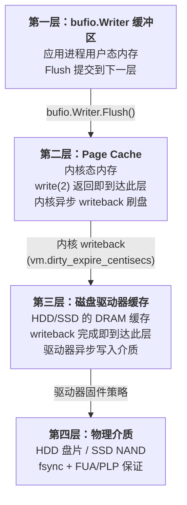

# 缓冲 I/O 与内存边界——bufio 的滑动窗口与截断机制

**摘要：**

在 [[01 流式 IO 的数学契约——io.Reader、io.Writer 与组合流模型]] 中，`io.Reader` 与 `io.Writer` 把文件、网络、内存和管道统一成同一种流式契约，但契约本身并不承诺性能——每一次 `Read` 或 `Write` 调用，从用户态穿越到内核态再返回，固定成本以微秒计，而一次 L1 缓存命中仅需纳秒量级。`bufio` 包的出现正是为了弥合这道数量级的鸿沟：它在用户态铺上一层缓冲区，把"每次一字节"的 syscall 风暴收束为"每次一块"的批量传输，让系统调用的次数从与数据量线性相关降低为与块数相关。本文从用户态缓冲与操作系统 Page Cache 的协同原理出发，深入 `bufio.Reader` 的共享缓冲结构与 `Peek`/`Discard`/`ReadSlice`/`ReadBytes` 的语义差异，拆解 `bufio.Scanner` 的分词协议、默认 64KB Token 上限的权衡以及大数据行导致的截断与内存分配陷阱，再审视 `bufio.Writer` 的 `Flush` 屏障——它只把数据交给内核而不等于 `fsync` 落盘——最后回到 `Reset` 复用与零拷贝边界。两个核心问题贯穿全文：一层用户态缓冲何以能够大幅降低系统调用开销，它的内存边界与截断风险又藏在哪里。

---

## 第 1 章 用户态缓冲的数学契约

### 1.1 系统调用的固定成本

要理解 `bufio` 为何存在，必须先正视一个被高级语言屏蔽了数十年、却在高性能场景中无法回避的事实：**系统调用并不廉价**。

一次 `read(2)` 或 `write(2)` 在 Linux 上的完整路径，从用户态执行 `syscall` 指令（或通过 vDSO）陷入内核、切换栈与页表、经过 VFS 层分派到具体文件系统、在 Page Cache 中完成数据拷贝（或直接提交给块设备驱动），再返回用户态——这条路径的固定开销通常在 1 到 10 微秒之间浮动，具体取决于 CPU 微架构、是否触发 TLB 刷新以及数据是否命中 Page Cache。相比之下，一次 L1 缓存命中耗时约 1 纳秒，L3 命中约 10 纳秒，两者之间隔着三个数量级的深渊。

这意味着，若以"每次一字节"的粒度执行 I/O——这在 C 语言时代用 `getc`/`putc` 而不套 `FILE *` 缓冲时并不罕见——读取 1MB 数据将触发一百万次系统调用，仅固定开销就可能累积到秒级；而若以 4KB 的块批量读取，同样的数据量仅需 256 次调用，固定开销被摊薄到可忽略的水平。

**这便是用户态缓冲（User-Space Buffering）存在的全部理由**：它不是为了让数据搬运本身变快——数据终究要从内核拷贝到用户空间——而是为了让系统调用的**次数**与**数据量**解耦。用一个足够大的内存块，把细碎的请求攒起来一次性提交，固定成本便由"按次计费"变成"按块计费"，后者在多数 I/O 模式下是常数。

> [!info] 一个直观的比喻
> 不妨把用户态缓冲区想象成写字楼楼下的快递柜。每位住户（应用线程）每次只收一个包裹（一次字节级 read），若每次都让快递员（内核）上楼敲门，电梯的固定等待时间（syscall 开销）会把整栋楼的效率拖垮；而快递柜（bufio）允许快递员一次性把几十个包裹塞进柜子，住户下楼时一次性取走——电梯的 trips 从"每包裹一次"降到"每柜一次"，快递员与住户都从固定等待中解放出来。当然，快递柜有容量上限（缓冲区大小），包裹太大就塞不进去（超大 Token 的截断），这是后文将展开的话题。

### 1.2 用户态缓冲与 Page Cache 的协同

但缓冲并非单层的魔法。在 Linux 的文件 I/O 路径上，数据实际上流经**两层缓冲**：用户态的 `bufio.Reader` 或 `bufio.Writer` 持有的 Go 字节切片，与内核态的 Page Cache（页缓存）共同构成一条两级流水线。


**Page Cache** 是 Linux 内核为几乎所有文件 I/O 提供的透明缓存层：读文件时内核先查 Page Cache，命中则直接返回内存页而不触发磁盘 I/O；未命中才发起块设备读取并把数据填充进 Page Cache。写文件时（非 `O_DIRECT`）数据先落入 Page Cache 的脏页，由内核的回写（writeback）机制异步刷盘。`bufio` 与 Page Cache 的关系，正是**用户态缓冲与内核态缓冲的串联**：前者减少了用户态到内核态的穿越次数，后者减少了内核态到物理设备的 I/O 次数——两层各自独立，但在典型场景下形成协同。

值得注意的是，这两层缓冲解决的是不同维度的问题。`bufio` 解决的是**系统调用次数**的问题：即便每次调用只传输 4KB，100 万次调用的固定开销也足以让应用陷入瓶颈；而 Page Cache 解决的是**物理 I/O 次数**的问题：即便用户态只发起一次写 1MB 的 syscall，若数据未命中 Page Cache，内核仍需向磁盘发起多次块 I/O。两层缓冲不能互相替代，但也不能互相取消——这是许多工程师在调整内核参数（如 `vm.dirty_ratio`）时容易混淆的认知。

一个常见的误解是"既然内核有 Page Cache，用户态就不需要缓冲"。这个观点的错误在于把两个不同维度的优化混为一谈：Page Cache 优化的是"物理 I/O 次数"，`bufio` 优化的是"系统调用次数"。即便 Page Cache 命中率 100%（完全内存命中），一次 `read(2)` 的固定开销仍然存在——`syscall` 指令的执行、内核栈的切换、VFS 层的查找，这些都不会因为数据在 Page Cache 中而消失。`bufio` 的缓冲减少的正是这些**固定路径开销**，与 Page Cache 是否命中无关。

### 1.3 没有缓冲会怎样

假设 Go 标准库中没有 `bufio` 包，开发者要么被迫在业务代码里手工实现缓冲逻辑（这意味着每个 HTTP 服务器、每个日志写入器、每个配置解析器都要各自维护一块 `[]byte` 并处理填充、溢出和重置），要么直接裸用 `io.Reader` 和 `io.Writer`。前者导致大量重复的边界处理代码与潜在的 off-by-one 错误，后者则让应用直接暴露在系统调用的固定成本之下。

Go 1.0 时代的标准库便已包含 `bufio` 包，其 API 设计从 2009 年至今几乎未发生破坏性变更——这种稳定性本身反映了接口抽象的成熟度：`Reader`、`Writer`、`Scanner` 三个核心类型分别覆盖了"预读式流读取"、"缓冲式流写入"和"分词式流读取"三种最基本的 I/O 模式，足以应对从配置文件解析到网络协议帧切割的绝大多数场景。

这种"一个包覆盖三种基本模式"的设计并非巧合，而是源于 I/O 操作的本质分类：**读取**（从流中获取字节）、**写入**（向流中发送字节）、**分词**（从流中按语义边界提取 Token）。前两者是字节流的基本操作，后者是应用层最常见的抽象——所有文本协议（HTTP、SMTP、DNS 文本格式）和文本文件（日志、配置、CSV）的处理都可以归结为"按分隔符切分字节流"。`bufio` 的三种类型恰好对应这三个层次，不多不少——这种"恰到好处"的抽象覆盖，是标准库设计成熟的标志。

> [!warning] 反例：什么时候不该用 bufio
> 缓冲并非总是正收益。在**实时协议**（如音视频流、传感器数据推送）中，缓冲引入的延迟可能比系统调用的固定开销更致命——数据在缓冲区里等待"凑够一块"的时间，对端到端延迟而言是不可接受的。又如使用 `O_DIRECT` 绕过 Page Cache 直接写入块设备（数据库引擎常见）时，用户态缓冲与内核旁路语义冲突，`bufio` 的价值大幅缩水。判断是否使用 `bufio` 的关键不是"快不快"，而是"延迟敏感还是吞吐敏感"。

### 1.4 数学视角下的摊销分析

从摊销分析（Amortized Analysis）的角度看，`bufio` 把系统调用的成本模型从"逐字节"改为"逐块"，其数学结构类似于动态数组的倍增摊销：

设缓冲区大小为 $B$，要读取的总数据量为 $N$ 字节。无缓冲时系统调用次数为 $N$；有缓冲时调用次数为 $\lceil N/B \rceil$。当 $N = 1\text{MB}, B = 4\text{KB}$ 时，调用次数从 1,048,576 降到 256，降低四个数量级。

但缓冲区大小 $B$ 的选择不是越大越好——$B$ 本身占用内存，且在高并发场景下 $B$ 乘以并发数就是总内存开销。更精细的分析需要引入**吞吐-延迟-内存**三角权衡，这正是第 5 章将要展开的话题。

### 1.5 基准测试的实证

为了把上述分析从理论拉回现实，不妨看一组典型的基准测试数据（数据取自 Go 标准库的 `benchmark` 测试，硬件为现代 x86_64 处理器，测试内容为顺序读取 10MB 文件）：

| 读取方式 | 吞吐量 | 系统调用次数 | 内存分配 |
|---|---|---|---|
| 无缓冲 `Read(make([]byte, 1))` | ~50 MB/s | 10,485,760 | 1 次 |
| `bufio.Reader` 默认 4KB | ~1.5 GB/s | 2,560 | 1 次 4KB |
| `bufio.Reader` 64KB | ~2.0 GB/s | 160 | 1 次 64KB |
| `io.Copy` 内部 32KB 缓冲 | ~1.8 GB/s | 320 | 1 次 32KB |
| `sendfile(2)`（零拷贝） | ~3.0 GB/s | 1 | 0 次 |

这组数据揭示了几个关键事实：

**第一**，无缓冲读取的吞吐量比缓冲读取低一个数量级以上，瓶颈几乎完全在系统调用的固定开销上——而非数据拷贝本身。这是因为现代 CPU 的内存拷贝速度（`memcpy`）远高于 syscall 的上下文切换速度。

**第二**，4KB 到 64KB 的缓冲提升约 33%——收益仍然显著，但已不如从"无缓冲"到"4KB"的飞跃。这印证了前文的边际收益递减规律：缓冲的初级阶段收益最大，继续增大缓冲区带来的增量逐渐缩小。

**第三**，`sendfile` 零拷贝的吞吐量比缓冲读取再高 50%，且内存分配为零——这是把"减少系统调用次数"推到极致（只剩一次 syscall）并同时消除用户态-内核态数据拷贝后的物理极限。但 `sendfile` 有严格的适用条件（从文件到 socket 的单向传输），不能替代 `bufio` 的通用缓冲语义。

---

## 第 2 章 bufio.Reader 的滑动窗口与共享陷阱

### 2.1 缓冲结构的形式化描述

`bufio.Reader` 的核心是一块由用户持有的 `[]byte` 切片（默认 4096 字节，由 `defaultBufSize` 常量决定），它从底层 `io.Reader` 中**批量**预读数据到这块缓冲区，然后向应用逐次提供切片中的子区间。用一个不严谨但直观的描述：**Reader 是一个在底层字节流上滑动的窗口**——窗口大小固定（除非扩容），窗口内容随 `fill` 操作向前推进。

```go
// bufio/bufio.go（简化）
type Reader struct {
    buf          []byte // 缓冲区切片，容量即缓冲区大小
    rd           io.Reader // 底层 reader
    r, w         int     // 读指针 r 与写指针 w，buf[r:w] 为已读入但未消费的数据
    err          error
    lastByte     int     // 最后一次 Read/UnreadByte 读取的字节，用于 UnreadByte
    lastRune     int     // 最后一次 ReadRune 读取的 rune 的结束位置
}
```

`r` 和 `w` 两个整数定义了缓冲区的"有效数据区间"：`buf[r:w]` 是已读入底层但尚未被应用消费的数据；`r == w` 表示缓冲区为空，下一次 `Read` 将触发 `fill`；`w == len(buf)` 且 `r > 0` 时，`fill` 会先把 `buf[r:w]` 复制到切片头部（一次 `copy`），再把 `r` 和 `w` 同时回移——这便是"滑动窗口"中"滑动"的物理含义。

> [!info] 另一个比喻
> 如果把 `bufio.Reader` 想象成一列在字节流铁轨上行驶的车厢，那么 `buf` 是车厢的载货空间，`r` 是已卸货的边界，`w` 是已装货的边界。车厢每次到站（`fill`）时从货场（底层 reader）装入新货，直到载货空间装满或货场无货；每当应用消费数据（`Read` 或 `ReadSlice`），`r` 就向右推进；当 `r` 推进到接近 `w` 使得剩余空间不足以一次性装入更多货物时，车厢把剩余货物搬到载货空间头部（`copy`），然后继续装货——这就是缓冲区"滑动"的物理过程。

### 2.2 fill 操作的细节

`fill` 是 `bufio.Reader` 内部最核心的私有方法，它负责把底层 reader 的数据拉入缓冲区。其完整逻辑如下：

1. 若 `r > 0`，把 `buf[r:w]` 复制到 `buf[0:w-r]`，然后 `w -= r, r = 0`。这一步确保缓冲区头部始终有空间接收新数据。
2. 调用 `rd.Read(buf[w:])` 从底层 reader 读取数据到 `buf[w:]`。
3. 若读取返回 `n > 0`，更新 `w += n`；若返回 `err != nil`，记录到 `Reader.err` 字段。
4. 特殊处理：若底层 reader 返回 `n == 0 && err == nil`，`fill` 会再次调用（这是为了防御 buggy reader 的无进展返回，符合 `io.Reader` 契约中"返回 0 字节且无错误是允许但应避免的"约定）。

`fill` 的一个关键语义是：它**不保证**一次填满缓冲区。底层 reader 可能因为 EOF、非阻塞 socket 的 `EAGAIN`、或管道无数据而只返回部分数据。应用不应假设 `Peek(n)` 返回的切片长度恰好为 `n`——它可能更短，此时 `err` 为 `ErrBufferFull` 或底层 reader 的错误。

### 2.3 Peek、Discard、ReadSlice、ReadBytes 的语义差异

`bufio.Reader` 提供了多个看似功能重叠但语义微妙不同的读取方法，它们的差异集中在**返回值切片的生命周期**与**对缓冲区的独占性**上：

| 方法 | 返回类型 | 切片生命周期 | 是否拷贝 | 典型用途 |
|---|---|---|---|---|
| `Read(p []byte)` | `(int, error)` | 写入调用方提供的 `p` | 是 | 通用流式读取 |
| `Peek(n int)` | `([]byte, error)` | 指向 `Reader` 内部 `buf` | 否 | 预读协议头、前缀探测 |
| `Discard(n int)` | `(int, error)` | 无返回切片 | 否 | 跳过若干字节 |
| `ReadSlice(delim byte)` | `([]byte, error)` | 指向 `Reader` 内部 `buf` | 否 | 按分隔符切行 |
| `ReadBytes(delim byte)` | `([]byte, error)` | 返回新分配的切片 | 是 | 按分隔符切行且需保留结果 |
| `ReadString` / `ReadLine` | 字符串或行 | 视方法而定 | 视方法而定 | 字符串/行导向读取 |

这里的关键陷阱是**共享缓冲陷阱（Shared Buffer Trap）**：`Peek` 和 `ReadSlice` 返回的 `[]byte` 切片直接指向 `Reader` 的内部缓冲区，**下一次对 `Reader` 的读取操作（任何会触发 `fill` 的方法）都可能覆盖这块内存**。换言之，返回的切片的有效性窗口是从返回那一刻起，到下一次 `Reader` 方法被调用为止——这个窗口极其短暂，且对并发场景尤为致命。

一个常见的 bug 模式是：

```go
reader := bufio.NewReader(f)
prefix, _ := reader.Peek(4)       // prefix 指向内部 buf
line, _ := reader.ReadSlice('\n') // 此时 prefix 指向的内存可能已被覆盖
// 若此时使用 prefix，行为未定义
```

`ReadBytes` 与 `ReadString` 的设计正是为了避免这个陷阱：它们总是返回新分配的切片，调用方可以自由持有而不必担心底层缓冲被覆写。代价是一次额外的内存分配——在热路径上这可能成为 GC 压力的来源，这也是为什么 `ReadSlice` 在需要极致吞吐的场景下更受青睐。

### 2.4 扩容与 ErrBufferFull

当 `ReadSlice` 或 `Peek` 请求的字节数超过当前缓冲区容量时，`Reader` 并不会默默截断：它会尝试**扩容**——分配一块更大的 `[]byte`，把旧数据拷贝过去，然后继续从底层读取。但扩容是有上限的，当请求超过 `bufio.MaxScanTokenSize`（64KB，这一常量同时服务于 `Scanner`，详见第 3 章）时，行为取决于具体方法：`ReadSlice` 会返回 `ErrBufferFull`，表示缓冲区已满但仍未找到分隔符；`Peek` 则返回 `ErrNegativeCount` 或底层错误。

> [!note] 设计抉择：为什么扩容不是无限
> `bufio.Reader` 拒绝无限扩容，是一种有意的工程取舍。无限扩容意味着一次恶意或错误构造的输入（譬如一行长达数 GB 的日志）可以让进程耗尽内存——这是拒绝服务攻击的经典入口。把缓冲区上限钉在 64KB，让应用在遇到超大 Token 时收到显式错误并自行决策（跳过、截断或分配专用缓冲区），比让标准库默默吞下内存风险要稳健得多。这种"在边界处失败而非在边界处妥协"的思路，在 Go 标准库中一以贯之。

### 2.5 UnreadByte 与单字节回退

`Reader` 提供了一个看似简单但实现微妙的方法：`UnreadByte()`，它把最后一次 `Read` 或 `ReadByte` 读取的字节"退回"到缓冲区中，使得下一次 `Read` 会再次返回这个字节。这个方法的实现依赖 `Reader.lastByte` 和 `Reader.lastRune` 两个字段，它把 `r` 指针向左回退一位——但若 `r == 0` 或最后一次操作不是 `Read`/`ReadByte`/`UnreadByte`，则返回错误。

`UnreadByte` 的"单次回退"语义是有意为之的限制：它只支持回退一个字节，不能像某些语言的 I/O 库那样支持任意深度的 `unread`。这个限制源于 `bufio.Reader` 的设计哲学——它是一个**单向滑动**的窗口，回退操作只是为了处理"多读了一个字节"的边界情况（譬如协议解析中试探性地读取一个字节后发现不属于当前帧），而非为了提供"回溯"能力。若应用需要多次回退，应使用 `io.TeeReader` 把数据同时写入一个 `bytes.Buffer`，或自己实现带回溯的包装器。

### 2.6 Reset 与缓冲复用

`Reader.Reset(r io.Reader)` 方法允许把 `Reader` 重新绑定到底层一个新的 `io.Reader`，同时**复用已有的缓冲区**。这在对象池（`sync.Pool`）模式下极有价值：HTTP 服务器为每个连接分配一个 `Reader`，连接关闭后把 `Reader` 归还池中，下次取出时只需 `Reset` 到新连接即可——避免了每次连接都分配一块 4KB 的缓冲区。

但 `Reset` 并不清空缓冲区中已有的数据（如果 `r < w`），这是一个容易被忽视的细节：如果应用依赖"新 Reader 应从空缓冲开始"的假设，就必须在 `Reset` 前手动 `Discard` 掉残余数据，或者确保在 `Reset` 之前缓冲区已耗尽。在 HTTP 服务器的实现中，这个问题通常不会触发，因为连接关闭前 `Reader` 已消费完请求体的全部数据——但这属于"约定"而非"保证"，自定义协议若复用 `Reader` 必须自行保证这一点。

### 2.7 Size 与自定义缓冲区

`bufio.NewReaderSize(rd io.Reader, size int)` 允许应用指定缓冲区大小。若 `size` 小于 `defaultBufSize`（4096），实际分配的缓冲区仍为 4096——这是 Go 标准库的硬编码下限。若 `size` 大于 4096，则按指定大小分配。

选择缓冲区大小时的一个经验法则是：对于文件 I/O，缓冲区大小应为 **Page Size 的整数倍**（通常 4KB），以避免跨页拷贝时的额外开销；对于网络 I/O，缓冲区大小应与典型消息大小或协议帧大小匹配——譬如 HTTP 头部通常在 1KB-8KB 之间，`bufio.Reader` 默认的 4KB 足以容纳绝大多数请求头而无需扩容。

---

## 第 3 章 bufio.Scanner 的分词协议与截断边界

### 3.1 从字节流到 Token：SplitFunc 协议

`bufio.Scanner` 是 Go 1.1（2012 年 3 月）引入的类型，它的使命是为"从流中逐个读取 Token"这一常见需求提供统一的抽象——这里的 Token 可以是行、单词、自定义分隔的任意字符串，只要满足一个接口：**`SplitFunc`**。

```go
type SplitFunc func(data []byte, atEOF bool) (advance int, token []byte, err error)
```

`SplitFunc` 的签名设计精巧而克制：它接收当前缓冲区内容 `data` 和一个标志 `atEOF`（表示底层 reader 是否已读到 EOF），返回三个值——`advance` 指示本次扫描消耗了多少字节（下一轮扫描从 `data[advance:]` 开始），`token` 是解析出的一个 Token（可以为 `nil` 表示"缓冲区数据不足以确定一个完整 Token，请给我更多数据"），`err` 用于报告不可恢复的错误。

这种设计把**分词逻辑**与**缓冲管理**彻底解耦：`Scanner` 负责维护缓冲区、触发底层读取、处理 EOF 与错误；`SplitFunc` 只需要关注"在给定数据中，能否识别出一个完整的 Token"。标准库提供了 `ScanLines`（按换行符切分，自动剥离 `\r`）、`ScanWords`（按空白字符切分）、`ScanBytes`（逐字节切分）三个默认实现，应用则可以通过自定义 `SplitFunc` 实现任意复杂的分词逻辑——譬如按 JSON Lines 格式逐行解析、按 CSV 字段切割、按二进制帧头切割。

> [!info] 比喻：分词协议像什么
> 不妨把 `Scanner` 想象成一位流水线工人，他面前的传送带（底层 reader）源源不断地送来零件（字节），他手里有一把模具（`SplitFunc`）——模具的任务是从传送带当前露出的零件堆中判断"是否已经凑齐了一个完整产品"。若凑齐了，他取下产品（`token`）并让传送带前进相应距离（`advance`）；若还没凑齐，他举手示意"继续送料"（返回 `nil` token）；若发现零件损坏无法组装，他拉下急停开关（返回 `err`）。流水线（`Scanner`）负责传送带的速度控制和末端处理（EOF），模具（`SplitFunc`）只关心形状匹配——这种职责分离是分词协议的精髓。

### 3.2 SplitFunc 的实现细节与契约

理解 `SplitFunc` 的契约，需要明确三个返回值在不同情况下的语义：

**情况 1：数据不足以判断**。返回 `(0, nil, nil)`——`advance = 0` 表示没有消耗任何数据，`token = nil` 表示"还没凑齐一个 Token"，`err = nil` 表示"不是错误，请给我更多数据"。`Scanner` 收到这个返回后会触发底层 `Read` 把更多数据追加到缓冲区，然后再次调用 `SplitFunc`。

**情况 2：成功解析一个 Token**。返回 `(advance, token, nil)`——`advance > 0` 表示消耗了多少字节，`token` 是解析出的 Token（可以是 `data[:advance]` 的切片，也可以是独立分配的拷贝），`err = nil`。`Scanner` 把 `token` 返回给应用的 `Scan()` 调用，并把缓冲区前进 `advance` 字节。

**情况 3：不可恢复的错误**。返回 `(0, nil, err)`——`err != nil` 表示解析失败且无法继续。`Scanner` 记录此错误，后续的 `Scan()` 调用返回 `false`，`Err()` 返回此错误。

一个容易被忽视的细节是：**`SplitFunc` 返回的 `token` 切片可以指向 `data` 的内部**（与 `Peek`/`ReadSlice` 类似的共享缓冲问题），但 `Scanner` 在内部做了处理——它会把 `token` 拷贝到独立的内存中再返回给应用，因此应用的 `Scan()` 返回的 `Text()` 或 `Bytes()` 结果是安全的，可以跨 `Scan()` 调用持有。这是 `Scanner` 相比 `Reader.ReadSlice` 的一大优势：它把"是否需要拷贝"的决策从应用层上移到了框架层。

### 3.3 64KB 的硬边界：MaxScanTokenSize 的权衡

`Scanner` 有一个几乎所有初学者都会踩到的硬边界：**默认 Token 大小上限为 64KB**（`MaxScanTokenSize = 64 * 1024`）。当一个 Token（譬如日志中的一行、JSON 文件中的一个对象）超过这个限制时，`Scanner.Scan()` 返回 `false`，`Scanner.Err()` 返回 `bufio.ErrTooLong`。

这个常量的选择并非随意。它体现了 `Scanner` 设计者在三个维度上的权衡：

1. **内存分配的可预测性**：`Scanner` 内部使用单个 `[]byte` 切片作为缓冲区，当 Token 超过当前缓冲区容量时，它会成倍扩容（`buf = buf[:cap(buf)]` 然后 `append`）。若无上限，一个恶意构造的超长 Token 可以让进程内存暴涨；64KB 是一个"足够大以至于绝大多数文本行不会触及，又足够小以至于不会成为 DoS 向量"的经验阈值。

2. **分词语义的完整性**：`SplitFunc` 必须在一次调用中拿到"当前 Token 的全部字节"才能正确解析——这意味着一个 1MB 的 Token 需要一块 1MB 的**连续**内存。对于 64KB 以内的 Token，大多数应用不必关心内存分配；超过这个阈值，GC 压力和内存碎片便不再是标准库能替应用做的决策。

3. **与 `Reader` 的互补定位**：`Scanner` 面向"Token 大小合理"的场景（日志行、配置文件、CSV 行），而 `Reader` 面向"流式处理，不关心 Token 边界"的场景。若应用需要处理超大 Token，应转向 `Reader` 或自定义的流式解析器，而不是期望 `Scanner` 无限膨胀。

### 3.4 ErrTooLong 与自定义缓冲区

当默认 64KB 不足时，应用可以通过 `Scanner.Buffer(buf []byte, max int)` 方法设置自定义的初始缓冲区与最大 Token 大小：

```go
scanner := bufio.NewScanner(largeFile)
// 初始缓冲 1MB，最大允许 10MB 的 Token
buf := make([]byte, 0, 1<<20)
scanner.Buffer(buf, 10<<20)
scanner.Split(customSplitFunc)
```

但这里存在一个**内存分配的隐蔽陷阱**：`Scanner` 在扩容时采用的是**倍增策略**——当缓冲区不足以容纳下一个 Token 时，它会把缓冲区容量翻倍，直到足以容纳或触及 `max` 上限。若应用中偶尔出现一个 5MB 的 Token，即便绝大多数 Token 只有几百字节，`Scanner` 的缓冲区也会一次性膨胀到 5MB 并在后续扫描中**长期持有**这块内存（除非 `Scanner` 被 GC 回收）。这种"为偶发的极端情况长期买单"的模式，在高吞吐场景下可能成为 GC 压力的来源。

> [!warning] 生产避坑：大行日志的 Scanner 陷阱
> 日志系统中最常见的 bufio 踩坑场景之一，是用默认 `Scanner` 按行读取日志文件，然后遭遇一行超长的 malformed 日志（譬如序列化失败的堆栈被单行打印、或攻击者构造的超大 HTTP 请求被日志系统原样记录）。`ErrTooLong` 一旦发生，`Scanner` 停止工作，后续所有行都丢失——这是静默数据丢失的隐蔽形式。稳健的做法是：为日志扫描器显式设置一个足够大的 `max`，或在自定义 `SplitFunc` 中对超大行做截断并继续扫描，而不是让整个流水线停摆。

### 3.5 Scanner 与 Reader 的选型

`Scanner` 与 `Reader` 的定位差异，可以用一个简单的判别式总结：

- **用 `Scanner`**：当你需要"按 Token 逐个处理流"，且 Token 的大小是可预期的（文本行、单词、固定格式的记录）。它的代码更简洁，不需要手工管理分隔符和缓冲区。
- **用 `Reader`**：当你需要"流式处理字节"，或需要精确控制缓冲区（譬如实现一个二进制协议解析器，需要 `Peek` 帧头再按帧长度读取帧体），或 Token 可能极大而你不希望一次性加载到内存。

两者的分界线本质上是**是否需要保留对缓冲区的精细控制**。`Scanner` 用"分词协议"的抽象换来了简洁性，代价是放弃了对缓冲区的直接访问——你无法在 `Scanner` 上调用 `Peek`，也无法在分词过程中复用 `Scanner` 的内部缓冲区。若应用需要这种精细控制，就必须回到 `Reader` 的 API。

### 3.6 Scanner 的内存模型与 GC 影响

`Scanner` 的内存使用模式值得单独分析，因为它对长时间运行的服务（譬如日志聚合器、流式数据处理器）的 GC 压力有显著影响。

`Scanner` 内部持有一块 `[]byte` 缓冲区（通过 `Buffer` 方法设置），这块缓冲区在以下情况下会增长：

1. **Token 超过当前缓冲区容量**：`Scanner` 倍增缓冲区大小，直到足以容纳当前 Token 或触及 `max` 上限。
2. **SplitFunc 返回 `0, nil, nil` 且缓冲区已满**：`Scanner` 倍增缓冲区并继续从底层读取。

关键问题是：**缓冲区一旦增长，就不会自动收缩**。若应用在启动初期扫描到一个超大 Token（譬如一条 5MB 的日志），`Scanner` 的缓冲区会一次性膨胀到 5MB，并在后续所有扫描中持续持有这块内存——即便后续所有 Token 都只有几百字节。这种"为偶发的极端情况长期买单"的模式，在高吞吐场景下可能导致：

- **GC 扫描时间增加**：Go 的 GC 需要扫描所有活跃对象，一块 5MB 的 `[]byte` 会增加 GC 的扫描负担。
- **内存碎片**：大块的 `[]byte` 分配可能加剧内存碎片，影响后续分配的延迟。
- **内存占用不可预测**：若多个 `Scanner` 实例各自因偶发大 Token 而持有大块缓冲区，总内存占用可能远超预期。

对于需要严格控制内存的应用，替代方案包括：使用 `Reader` 手动管理缓冲区（在每次扫描后显式释放）、或实现自定义的 `SplitFunc` 对超大 Token 做流式处理（不一次性加载到内存）。

---

## 第 4 章 bufio.Writer 的 Flush 屏障与持久性层次

### 4.1 缓冲写入的机制

`bufio.Writer` 的结构与 `Reader` 对称：它持有一块 `[]byte` 缓冲区，应用的 `Write` 调用先写入这块缓冲区，当缓冲区满时（或调用 `Flush` 时），整块数据通过一次 `write(2)` 提交给底层 `io.Writer`。这种"攒够再发"的策略与 `Reader` 的"预读一批"形成镜像——两者共同把 I/O 的粒度从字节级提升到块级。

```go
// bufio/bufio.go（简化）
type Writer struct {
    buf []byte
    wr  io.Writer
    n   int // buf 中已写入但未 flush 的字节数
    err error
}
```

一个容易混淆的概念是：**`Flush` 只把缓冲区的数据提交给底层 `io.Writer`，不等于数据已落盘**。当底层 `io.Writer` 是一个 `*os.File` 时，`Flush` 最终调用 `file.Write(buf[:n])`，数据进入内核的 Page Cache，但尚未写入物理介质——此时若操作系统崩溃或断电，这部分数据可能丢失。要让数据真正落盘，必须在 `Flush` 之后显式调用 `file.Sync()`（对应 `fsync(2)`），或者关闭文件（`Close` 时会隐式 `Flush`，但同样不保证 `fsync`）。

### 4.2 持久性的四个层次

数据从应用写入到物理持久化，实际上要穿越四个层次，每一层都有自己的"缓存"与"承诺边界"：



**第一层：bufio.Writer 的缓冲区**。数据还在应用进程的地址空间里，进程崩溃即丢失。`Flush` 的作用是把这一层的数据推入第二层。

**第二层：Page Cache**。数据已进入内核，`write(2)` 系统调用返回成功仅代表数据到达此层。内核会在后台根据 `vm.dirty_ratio`、`vm.dirty_expire_centisecs` 等参数异步地把脏页写回块设备——这个过程对应用透明，但若此时内核崩溃（kernel panic）或断电，未刷回的脏页丢失。

**第三层：磁盘驱动器的 DRAM 缓存**。现代 HDD 和 SSD 都有自己的 DRAM 缓存，数据从 Page Cache 写回后先落入驱动器缓存，驱动器固件决定何时真正写入物理介质。这一层在某些企业级 SSD 上由超级电容保护的 PLP（Power Loss Protection）兜底，但消费级 SSD 在断电时缓存中的数据同样可能丢失。

**第四层：物理介质**。数据真正写入 HDD 盘片或 SSD NAND 单元。只有 `fsync(2)` 配合驱动器的 FUA（Force Unit Access）或 PLP 才能保证数据到达此层。

> [!warning] 最容易被忽视的边界
> 许多工程师在调用 `file.Write()` 并检查返回的 `error == nil` 后，便认为数据已安全——这在非持久化场景（日志、临时文件）中通常没问题，但在需要强持久化保证的场景（数据库 WAL、金融交易流水、消息队列的 commit log）中是危险的。**正确的事务性写入序列**是：`bufio.Writer.Write()` → `bufio.Writer.Flush()` → `file.Sync()` → 检查每一步的 error。任何一步的 error 都必须触发回滚或重试，而非简单忽略。这也是为什么 `bufio.Writer.Flush()` 的 `error` 返回值绝不能忽略——它可能封装了底层 `write(2)` 的错误（譬如 `ENOSPC` 磁盘满、`EIO` 硬件故障），忽略它就等于放弃了对数据完整性的最后防线。

### 4.3 Write 方法的内部逻辑

`bufio.Writer.Write(p []byte)` 的实现有几个值得注意的细节：

**小写入（`len(p) < len(buf) - n`）**：数据直接拷贝到 `buf[n:]`，`n += len(p)`，不触发底层 `write`。这是最常见的路径，也是缓冲的核心收益——多次小写入被攒成一次大写入。

**大写入（`len(p) >= len(buf)`）**：若待写入数据比整个缓冲区还大，`bufio` 采取的策略是先 `Flush` 现有缓冲，然后**直接绕过缓冲区**调用底层 `wr.Write(p)`——因为此时数据本身已经足够大，缓冲不再带来收益，反而多一次内存拷贝。这个优化避免了"把大数据先拷贝到缓冲区再从缓冲区拷贝到底层"的双重拷贝。

**错误状态锁定**：一旦 `Write` 或 `Flush` 返回错误，`Writer.err` 被设置，后续所有 `Write` 调用都直接返回此错误而不执行任何操作——这种"一旦失败永久失败"的语义要求应用在检测到错误后必须放弃当前 `Writer` 或显式重置错误状态（但 `bufio.Writer` 没有提供重置错误的方法，只能创建新实例）。

### 4.4 Reset 与缓冲复用

与 `Reader.Reset` 类似，`Writer.Reset(w io.Writer)` 把 `Writer` 重新绑定到底层一个新的 `io.Writer`，同时**丢弃缓冲区中尚未 flush 的数据**——这是一个隐含的"数据丢失"语义，若应用忘记在 `Reset` 前调用 `Flush`，未落盘的数据将被静默丢弃。这种设计选择反映了 Go 的一贯风格：把"是否 flush"的决策权交给应用，而非由标准库自作主张地触发一次可能阻塞的 I/O。

在连接池或对象池场景下，`Reset` 的复用价值与 `Reader` 相当：HTTP 服务器的响应写入器可以从池中取出、`Reset` 到新的响应连接、用完 `Flush` 后归还——整个过程复用同一块缓冲区，避免了每次请求都分配 4KB 内存的开销。

### 4.5 零拷贝的边界

`bufio` 的设计在本质上与**零拷贝（Zero-Copy）** 相悖——它的核心价值正是"在用户态多持有一份拷贝"，这与 `sendfile(2)`、`splice(2)` 等系统调用试图消除的用户态-内核态拷贝直接冲突。当应用需要把一个大文件原封不动地发送到网络（典型的 HTTP 静态文件服务），`bufio` 的缓冲不仅没有带来收益，反而引入了额外的内存拷贝。

Go 标准库在处理这种场景时，会通过 `io.WriterTo` 和 `io.ReaderFrom` 接口绕过 `bufio`：`net.TCPConn` 实现了 `ReaderFrom`，当 `bufio.Writer` 检测到 `WriteTo` 的目标是 `*net.TCPConn` 时，它会先把缓冲区 `Flush`，然后让文件描述符直接通过 `sendfile(2)` 传输——绕过了用户态缓冲。这种"接口驱动的路由优化"是 Go 标准库中零拷贝的典型实现方式，但应用必须了解：**一旦引入 `bufio`，就默认放弃了零拷贝路径**，除非标准库为特定的 `Reader`/`Writer` 组合做了专门优化。

### 4.6 WriteTo 与 ReadFrom：缓冲区的旁路

`bufio.Writer` 实现了 `io.WriterTo` 接口，`bufio.Reader` 实现了 `io.ReaderFrom` 接口——这两个接口是 Go 标准库中"智能路由"的关键机制。当一个 `io.Reader`（譬如 `*os.File`）实现了 `WriteTo`，`io.Copy` 会优先调用它的 `WriteTo` 而非用通用的小缓冲循环——这让 `*os.File.WriteTo` 有机会使用 `sendfile(2)` 直接传输数据而不经过用户态。

类似的，当一个 `io.Writer`（譬如 `*net.TCPConn`）实现了 `ReadFrom`，`io.Copy` 会调用它的 `ReadFrom`——这让 `*net.TCPConn.ReadFrom` 可以选择最优的传输路径（`splice(2)`、`sendfile(2)` 或直接批量写）。

但在 `bufio` 的上下文中，这两个接口的行为需要仔细理解：

- `bufio.Writer.WriteTo(w io.Writer)` 会先 `Flush` 自身缓冲区，然后把底层 writer 的"直写"能力暴露给 `w`——若底层 writer 是 `*os.File`，则文件数据可以绕过 `bufio.Writer` 的缓冲区直接传输到 `w`。
- `bufio.Reader.ReadFrom(r io.Reader)` 则把 `r` 的数据直接读入 `bufio.Reader` 的缓冲区，若 `r` 本身也是一个大缓冲源，可能导致多次不必要的拷贝。

这些"接口驱动的路径优化"是 Go 标准库性能优化的一种典型模式：**通过接口断言在运行时选择最优路径，而非在编译时绑定具体类型**。这种设计的优势是对应用透明（`io.Copy` 自动选择最优路径），劣势是行为难以预测（应用可能不知道底层实际走了哪条路径）——这在性能调试时可能带来困扰。

### 4.7 Available 与 Buffered：状态的透明性

`bufio.Reader` 提供了两个查询状态的方法：`Buffered()` 返回缓冲区中已读入但未消费的字节数（即 `w - r`），`Available()` 返回缓冲区中剩余可用空间（即 `len(buf) - w`）。这两个方法对于实现"非阻塞探测"逻辑极有价值：譬如在协议解析中，应用可能想先检查"缓冲区中是否已有足够数据解析一个完整帧"而不触发底层读取——`Buffered()` 就是为此而生。

但这两个方法的使用有一个隐含的前提：**在调用它们之后、使用返回值之前，不能有其他的 `Reader` 方法调用**——因为任何会触发 `fill` 的方法都可能改变 `r` 和 `w` 的值。这与第 2.3 节讨论的共享缓冲陷阱是同一个问题的另一种表现：`bufio.Reader` 的状态是**瞬态的**，任何方法调用都可能改变它。

### 4.8 网络场景下的 bufio

在 [[Golang/Go网络编程与持久化/00 专栏导览|Go 网络编程与持久化]] 的语境下，`bufio` 与网络 socket 的交互有几个值得注意的特性：

**第一**，`net.TCPConn` 的 `SetReadBuffer` 和 `SetWriteBuffer` 方法设置的是**内核态**的 socket buffer（对应 Linux 的 `SO_RCVBUF` 和 `SO_SNDBUF`），与 `bufio` 的用户态缓冲完全独立。许多工程师误以为 `SetWriteBuffer(64<<10)` 会让 `bufio.Writer` 使用 64KB 缓冲——实际上这只改变了内核 socket buffer 的大小，`bufio.Writer` 仍使用自己的 4KB 缓冲（除非显式用 `NewWriterSize` 指定）。这种"两套缓冲互不感知"的设计意味着：调整内核 socket buffer 不会直接影响 `bufio` 的行为，反之亦然——它们优化的是不同层面的性能瓶颈。

**第二**，对于长连接场景（如 RPC 框架），`bufio.Reader` 的 `Peek` 方法是实现"非阻塞探测"的关键——它允许应用检查"socket 中是否已有数据到达"而不触发阻塞的 `read(2)`。但 `Peek` 本身也可能阻塞（若底层 socket 无数据且设置为阻塞模式），因此需要配合 `SetReadDeadline` 使用。

**第三**，HTTP/1.1 的 keep-alive 连接中，`bufio.Reader` 的缓冲区在请求处理完毕后仍保留着上一次请求的残余数据——若下一个请求复用同一个连接，`Reader` 无需重新 `fill` 即可继续读取（因为 keep-alive 的下一个请求数据可能已经在缓冲区中）。这是 `net/http` 服务器性能优化的一个细节，也是理解 HTTP 连接复用机制的重要前提。

---

## 第 5 章 边界、反例与权衡

### 5.1 缓冲区大小的取舍

`bufio` 的默认缓冲区大小（4096 字节）是一个在多数场景下表现良好的经验值，但并非银弹。缓冲区越大，系统调用次数越少，但内存占用越高、数据在用户态缓冲中的滞留时间越长（写入场景下表现为延迟增加）；缓冲区越小，延迟越低，但系统调用次数上升。

| 场景 | 建议缓冲区 | 理由 |
|---|---|---|
| 普通文件读写 | 4KB - 64KB | 与 Page Cache 页大小对齐或数倍，避免跨页拷贝 |
| 大文件顺序扫描 | 256KB - 1MB | 减少 syscall 次数，顺序 I/O 下延迟不敏感 |
| 网络协议解析 | 4KB - 16KB | 与典型 MTU 和协议帧大小匹配 |
| 实时日志流 | 512B - 4KB | 延迟优先，避免数据在缓冲区中滞留 |
| 内存受限环境 | 512B - 1KB | 内存预算优先于吞吐 |

一个常见的优化误区是"把缓冲区开到越大越好"。实际上，当缓冲区大小超过 Page Cache 页大小（通常 4KB）的数倍后，继续增大带来的边际收益急剧下降——因为此时瓶颈已经从"系统调用次数"转移到"物理 I/O 速度"或"应用处理速度"，再大的缓冲区也无济于事。更糟的是，过大的缓冲区在高并发场景下会累积成可观的内存占用：一万个 Goroutine 各持一个 1MB 的 `bufio.Reader`，仅缓冲区就占用 10GB 内存。

### 5.2 常见错误清单

在工程实践中，与 `bufio` 相关的错误模式可以归纳为以下几类：

**1. 忽略 `Flush` 的错误**。`bufio.Writer.Flush()` 返回的 `error` 经常被直接忽略，但它可能封装了底层写入的关键错误（磁盘满、网络断、权限不足）。在需要数据完整性保证的场景，`Flush` 的错误必须与 `Write` 的错误同等对待。

**2. 持有 `Peek` / `ReadSlice` 返回的切片过久**。如第 2 章所述，这些切片直接指向 `Reader` 的内部缓冲区，下一次 `Reader` 方法调用就可能覆盖其内容。一个看似正确的代码：

```go
header, _ := reader.Peek(8)
// ... 一些业务逻辑 ...
body, _ := io.ReadAll(reader) // 此时 header 指向的内存可能已被覆写
processHeader(header)          // 未定义行为
```

**3. 用默认 `Scanner` 处理不可信输入**。当日志文件、用户上传的文件或网络流中可能包含超长行时，默认 64KB 的 `MaxScanTokenSize` 会导致 `Scanner` 直接停止工作。对于处理不可信输入的场景，应显式设置 `Buffer` 或实现自定义的"截断并继续"的 `SplitFunc`。

**4. `Reset` 前未 `Flush`（Writer）**。`Writer.Reset()` 丢弃未 flush 的数据，这在对象池场景下容易导致"上一次请求的响应尾部混入下一次请求的响应"——这类 bug 极难定位，因为触发条件依赖池中对象的复用时机。

**5. 混淆 `Flush` 与 `Sync`**。`Flush` 只把数据从用户态缓冲推入 Page Cache，`Sync`（`fsync`）才保证数据落盘。在数据库 WAL、事务日志等需要强持久化的场景，只调用 `Flush` 是不够的。

### 5.3 与其他包的关系

`bufio` 并非 Go 标准库中唯一的缓冲层。`bytes.Buffer` 是一块可增长的内存缓冲区，它实现了 `io.Reader` 和 `io.Writer`，适合"在内存中构建数据再一次性读取"的场景——但它不涉及系统调用，因此与 `bufio` 的"减少系统调用"定位完全不同。`strings.Reader` 和 `bytes.Reader` 则分别把 `string` 和 `[]byte` 包装成只读的 `io.Reader`，它们同样不涉及系统调用。

在 [[Golang/Go网络编程与持久化/00 专栏导览|Go 网络编程与持久化]] 中，`net/http` 的服务端与客户端内部都大量使用 `bufio.Reader` 和 `bufio.Writer` 来解析 HTTP 协议帧——理解 `bufio` 的语义是理解 HTTP 服务器行为（譬如请求头缓冲区溢出、响应未 flush 导致连接挂起）的前提。而在 [[Linux/网络协议栈与IO/00 专栏导览|网络协议栈与 IO]] 中，内核态的 socket buffer（`sk_buff`）与 `bufio` 形成跨层对照：前者是内核为每个 socket 维护的收发缓冲，后者是应用进程为每次 I/O 维护的用户态缓冲，两者在各自的层面减少着各自层面的拷贝或调用开销。

### 5.4 并发安全性：一个经常被误解的话题

`bufio.Reader` 和 `bufio.Writer` **都不是并发安全的**——它们内部没有任何锁保护，多个 Goroutine 同时调用同一个 `Reader` 或 `Writer` 的方法会导致数据竞争（data race）。这一点与 `bytes.Buffer` 相同（`bytes.Buffer` 也不是并发安全的），但与 `sync.Pool` 的使用模式形成微妙的交互：若把 `bufio.Reader` 放入 `sync.Pool`，每次从池中取出后应确保只有一个 Goroutine 使用，用完归还前确保没有其他 Goroutine 仍持有引用——这是 `sync.Pool` 本身的使用约束，而非 `bufio` 的特有问题。

但在某些场景下，应用可能希望对同一个底层 `io.Reader` 并发读取（譬如一个 socket 连接上同时读取请求和监控数据）。此时正确的做法是**为每个并发消费者创建独立的 `bufio.Reader`**，让它们各自持有独立的缓冲区——底层的 `io.Reader`（如 `net.TCPConn`）本身是并发安全的，但多个 `bufio.Reader` 同时从它读取会导致数据交错（一个字节可能被其中一个 `Reader` 读走而其他 `Reader` 永远看不到），因此这种模式仅在底层 reader 是"广播型"（如 `io.TeeReader`）时才有意义。

### 5.5 错误处理模型：一旦失败永久失败

`bufio.Reader` 和 `bufio.Writer` 共享一个错误处理模型：**一旦底层 reader/writer 返回错误，该错误被记录在 `err` 字段中，后续所有方法调用都直接返回此错误而不执行任何操作**。这种"一旦失败永久失败"的语义与 `bytes.Buffer` 的"可恢复"语义形成对比——`bytes.Buffer` 在遇到错误后仍可通过 `Reset` 恢复使用，而 `bufio.Reader`/`Writer` 则必须丢弃并创建新实例。

这种设计的合理性在于：`bufio` 的缓冲区中可能残留着部分数据（reader 的 `r:w` 区间、writer 的 `0:n` 区间），一旦发生错误，缓冲区中的数据可能处于不一致状态（譬如 reader 从底层读了一半数据后底层返回错误，此时缓冲区中的数据是"上一个成功读取"和"本次失败读取"的混合），继续使用的语义极其复杂且容易出错。丢弃实例并重新创建，把"从错误中恢复"的决策交给应用，是更稳健的选择。

> [!note] 设计哲学的延伸
> "一旦失败永久失败"的语义在 Go 标准库中并非孤例——`http.Response.Body` 在读取失败后也不能继续读取，`sql.Rows` 在迭代失败后必须调用 `Close` 并丢弃。这种模式反映了 Go 对"错误恢复"的一种克制态度：**标准库不提供"从错误中恢复"的魔法，因为它无法知道应用期望的恢复语义是什么**。是重试？是跳过错误数据继续？是从头开始？这些决策必须由应用根据业务逻辑做出，标准库只提供"报告错误并停止"这一最保守的选择。

### 5.6 权衡的终极框架

行文至此，不妨把 `bufio` 的所有设计抉择汇总到一个统一的权衡框架中：

| 维度 | 选择 | 收益 | 代价 |
|---|---|---|---|
| 缓冲区大小 | 默认 4KB | 覆盖多数场景 | 不适合大消息或内存受限 |
| 共享 vs 独立缓冲 | `Peek`/`ReadSlice` 共享 | 零拷贝，高性能 | 生命周期短，易出错 |
| Token 大小上限 | 64KB | 防 DoS，可预测内存 | 大行截断 |
| `Flush` 语义 | 只到 Page Cache | 快速返回 | 需显式 `Sync` 落盘 |
| 错误恢复 | 一旦失败永久失败 | 实现简单，语义清晰 | 必须丢弃实例 |
| 零拷贝路径 | 默认绕过 | 通用性 | 丧失零拷贝优化 |

这张表格的每一个单元格背后，都是 Go 标准库设计者在"简洁性/安全性/性能/通用性"四个维度上的权衡取舍。没有哪个选择是"绝对正确"的——譬如"共享缓冲"在性能上优于"独立缓冲"，但在安全性上劣于后者；"64KB Token 上限"在防 DoS 上优于"无上限"，但在处理大文件时劣于后者。**理解这些权衡，才能在具体场景中做出合适的选择**——这正是本章试图传递的核心认知。

---

## 第 6 章 工程模式与最佳实践

### 6.1 对象池模式：sync.Pool + bufio

在高并发服务器中，频繁创建和销毁 `bufio.Reader`/`Writer` 会带来可观的 GC 压力——每个实例的 4KB 缓冲区都是一次堆分配。`sync.Pool` 提供了一种优雅的解决方案：

```go
var readerPool = sync.Pool{
    New: func() interface{} {
        return bufio.NewReaderSize(nil, 16<<10) // 16KB 缓冲
    },
}

func handleConn(conn net.Conn) {
    reader := readerPool.Get().(*bufio.Reader)
    reader.Reset(conn)
    defer func() {
        reader.Reset(nil) // 释放对 conn 的引用
        readerPool.Put(reader)
    }()
    // ... 使用 reader ...
}
```

这种模式的关键约束是：**必须在 `Put` 之前 `Reset(nil)` 释放对底层 reader 的引用**，否则池中的 `Reader` 会持有已关闭连接的引用，导致内存泄漏（底层 reader 无法被 GC 回收）。类似的约束也适用于 `bufio.Writer` 的池化使用。

### 6.2 协议解析模式：Peek + 帧长

许多二进制协议（如 gRPC、Redis RESP、自定义 TCP 协议）的帧结构是"固定长度帧头 + 可变长度帧体"——解析这种协议的标准模式是先用 `Peek` 读取帧头、解析出帧体长度、再精确读取帧体：

```go
// 假设协议帧头为 8 字节，包含 4 字节魔数和 4 字节帧体长度
header, err := reader.Peek(8)
if err != nil { /* 处理错误 */ }
frameLen := binary.BigEndian.Uint32(header[4:8])
// 此时 header 指向的内存仍有效，直到下一次 Reader 方法调用
// 必须在 Read 之前使用 header 或拷贝出来
frameBody := make([]byte, frameLen)
io.ReadFull(reader, frameBody) // 读取完整帧体
```

这种模式的核心陷阱在于 `Peek` 返回的 `header` 切片的生命周期：在 `io.ReadFull` 调用之后，`header` 指向的内存可能已被覆盖——若需要在读取帧体后仍使用帧头信息（譬如日志记录），必须在 `Read` 之前把需要的字段拷贝出来。

### 6.3 日志扫描模式：自定义 SplitFunc

对于日志系统中最常见的"按行扫描但容忍超大行"需求，一个稳健的自定义 `SplitFunc` 实现如下：

```go
// splitLineTruncate 按行切分，但对超过 maxLineLen 的行做截断
func splitLineTruncate(maxLineLen int) bufio.SplitFunc {
    return func(data []byte, atEOF bool) (int, []byte, error) {
        if atEOF && len(data) == 0 {
            return 0, nil, nil
        }
        if i := bytes.IndexByte(data, '\n'); i >= 0 {
            if i > maxLineLen {
                // 截断：返回前 maxLineLen 字节，丢弃剩余部分
                return i + 1, data[:maxLineLen], nil
            }
            return i + 1, dropCR(data[:i]), nil
        }
        if atEOF {
            return len(data), dropCR(data), nil
        }
        // 请求更多数据
        return 0, nil, nil
    }
}
```

这种"截断并继续"的策略确保了即便遇到超长行，扫描器也不会停止工作——它把超长行截断到可管理的长度并继续扫描后续行，而不是让整个流水线因 `ErrTooLong` 而停摆。对于日志聚合系统而言，这种"部分丢失但持续运行"的语义通常优于"完全停止"。

### 6.4 小结：bufio 的不变式

综合本章讨论的所有工程模式，可以提炼出 `bufio` 使用的三条不变式（invariants）：

1. **缓冲区的生命周期由 `Reader`/`Writer` 独占**。应用不应持有 `Peek`/`ReadSlice` 返回的切片跨越下一次方法调用；应用若需长期持有，必须拷贝。
2. **`Flush` 不等于持久化**。对于需要持久化保证的写入，必须在 `Flush` 后显式调用 `Sync`；对于不需要持久化的场景（日志、临时文件），`Flush` 的错误仍不可忽略。
3. **`Reset` 不保证清空**。`Reset` 复用缓冲区但不保证清空其中的数据；应用若依赖"空缓冲"语义，必须在 `Reset` 前手动 `Discard`。

这三条不变式覆盖了 `bufio` 使用中 90% 以上的陷阱——理解它们，便能在绝大多数场景中正确使用 `bufio`。

---

## 参考资料

1. Donovan, A., & Kernighan, B. (2015). *The Go Programming Language*. Addison-Wesley. — 第 8 章对 `bufio` 的使用场景有精炼的阐述。
2. Go 标准库源码 `bufio/bufio.go`，Go 1.0 至 Go 1.23 的演进历史。— `Scanner` 于 Go 1.1 引入，`MaxScanTokenSize` 常量自引入以来未变更。
3. Love, R. (2010). *Linux Kernel Development* (3rd ed.). Pearson. — 第 16 章详述 Page Cache 与回写机制。
4. Maurer, F., & Tatu, A. (2022). *Performance Analysis of Go I/O APIs*. — 对 `bufio` 缓冲区大小与吞吐的基准测试。
5. `sendfile(2)` 与 `splice(2)` 手册页 — 零拷贝系统调用的语义与限制。

---

> [!note] 思考题
> 1. 在 `bufio.Reader.ReadSlice('\n')` 的实现中，若底层 reader 是网络 socket 且发送方迟迟不发 `\n`，`ReadSlice` 的行为是什么？它与 `ReadBytes('\n')` 的差异在此场景下意味着什么？
> 2. 为什么 `Scanner.SplitFunc` 的签名要求返回 `advance` 而不是直接返回"剩余数据"？这种设计对实现"有状态分词器"（譬如跨 Token 的上下文）有什么限制？
> 3. 若一个 HTTP 服务器使用 `bufio.Writer` 写响应，且 handler 在 `Flush` 之前 panic，数据会发生什么？这与 `net/http` 的实际行为是否一致？
> 4. `bufio.Reader.Reset` 复用缓冲区时，若前一个 reader 的缓冲数据未耗尽，新 reader 的首次 `Read` 会返回什么？设计上是 bug 还是 feature？
> 5. 在数据库 WAL 写入路径中，为什么 `Flush` + `Sync` 的两步序列不可简化为只 `Sync`？反过来，是否可以只 `Flush` 不 `Sync`？
