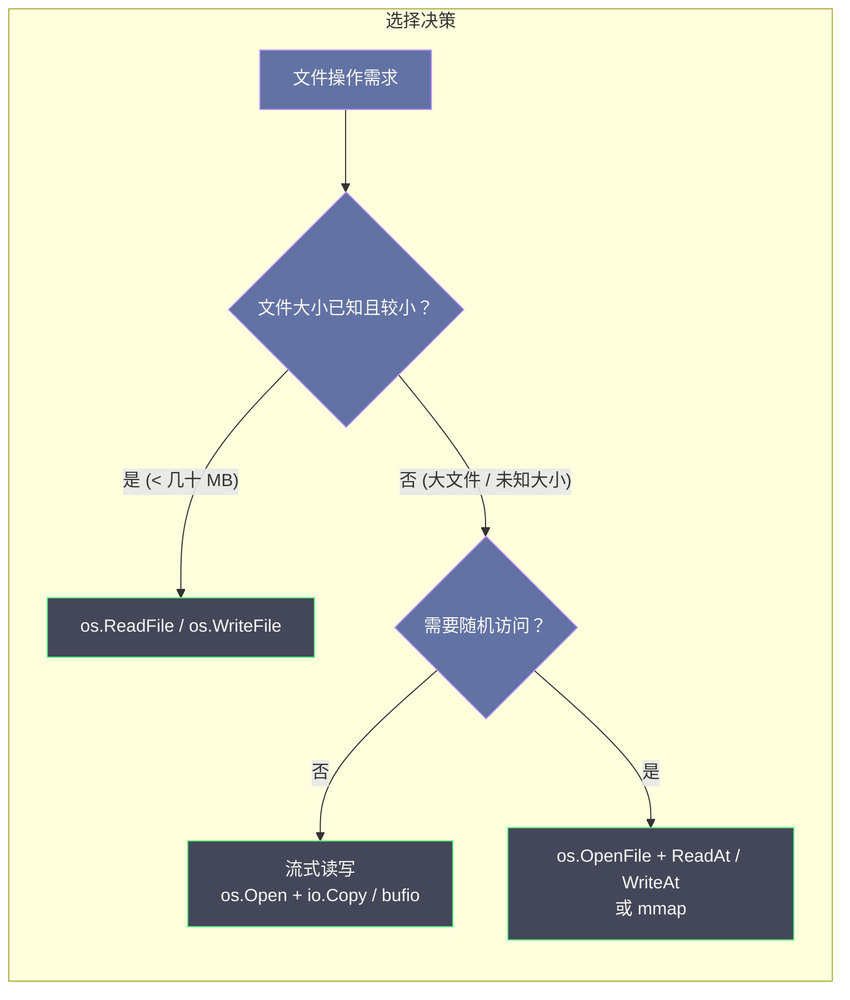

# 虚拟文件系统抽象与安全路径——os、filepath 与 io-fs

**摘要：**

在 Go 标准库的 I/O 契约链条中，`os`、`filepath` 与 `io/fs` 三个包构成了从操作系统事实到用户态抽象的关键一环。`os` 把 Linux 文件描述符（fd）包装为 `*os.File`，让程序可以用同一套 `Read`/`Write`/`Close` 方法面对磁盘文件、管道、Socket 与设备；`filepath` 在不同操作系统的路径分隔符差异之上提供统一的路径规范化与拼接语义，同时承担着防御路径穿越（Path Traversal）攻击的安全职责；而 Go 1.16 引入的 `io/fs` 则以一组只读接口把"文件系统"从操作系统的垄断中解放出来，使得嵌入文件（`embed.FS`）、内存文件、Zip 归档都能以同一棵树的面貌出现在业务代码面前。本文沿着"系统调用 → Go 封装 → 用户态抽象 → 路径安全 → 资源生命周期"这条主线展开，重点回答两个问题：其一，Go 的虚拟文件系统抽象如何在保持与操作系统事实同步的同时，为测试、嵌入与跨平台提供统一入口；其二，当用户输入能够影响文件路径时，怎样用 `filepath.Clean`、`filepath.IsLocal` 与 `fs.ValidPath` 的组合构建一条可信的路径验证链条。本文是 [[Golang/Go标准库与系统IO/00 专栏导览|Go 标准库与系统 IO]] 专栏的第三篇，与前两篇关于流式 I/O 和缓冲 I/O 的讨论形成递进关系——本篇将视角从数据流的契约提升到了文件系统抽象的层面，同时与 [[Linux/网络协议栈与IO/00 专栏导览|网络协议栈与 IO]] 专栏中关于文件描述符和 Page Cache 的系统级讨论相互呼应。理解本文的内容，也有助于后续阅读 [[Golang/Go工程实践/00 专栏导览|Go 工程实践]] 专栏中关于项目结构和测试隔离的章节。

---

## 第 1 章 从系统调用到 Go 文件抽象

### 1.1 Linux 文件描述符与 VFS 的接触面

在 Linux 内核中，一切 I/O 的起点是**虚拟文件系统（Virtual File System，VFS）**。VFS 并不对应某一块具体的磁盘或某一个具体的文件系统驱动，它是内核在 ext4、XFS、Btrfs、procfs、sysfs、tmpfs 等具体实现之上铺设的一层统一接口——就像一座城市的交通规则，不管路上跑的是轿车、卡车还是自行车，所有参与者都必须遵守同样的信号灯与车道标线。VFS 定义了超级块（superblock）、索引节点（inode）、目录项（dentry）与文件对象（file object）四种核心数据结构，其中 file object 是进程与文件之间的"会话记录"，而**文件描述符（file descriptor，fd）** 则是这个会话记录在进程空间的整数索引。

当一个进程调用 `open(path, flags, mode)` 时，内核完成一系列复杂的查找——从路径解析到 dentry 缓存命中，从 inode 读取到权限校验，最终在进程的文件描述符表（fd table）中分配一个最小可用整数，并将该位置指向一个新分配的 file object。此后的 `read(fd, buf, count)`、`write(fd, buf, count)`、`close(fd)` 都通过这个整数索引找到同一个 file object，直到 `close` 将其释放。如果进程在 `close` 之前调用了 `fork`，子进程会继承一份相同的 fd table 条目，两个进程共享同一个 file object 及其内部的偏移量——这个事实是许多"文件内容重复读取"或"日志写入交错"问题的根源。

Go 运行时对这一套机制的封装入口是 `os` 包。`os.Open`、`os.Create`、`os.OpenFile` 最终都走向 `syscall.Open` 或 `syscall.Openat`，返回的 `*os.File` 内部持有两个关键字段：一个是 fd 本身（`syscall.Handle` 在 Windows 上，`int` 在 POSIX 上），另一个是用于并发保护的互斥锁。`*os.File` 同时实现了 `io.Reader`、`io.Writer` 与 `io.Closer` 三个接口——这意味着流式 I/O 契约（短读、部分写、`n > 0 && err != nil` 的容错语义）在这里完全适用，只不过数据源从内存缓冲区换成了内核的 Page Cache 或直接是磁盘块。

从系统程序员的视角来看，VFS 的 file object 与 Go 的 `*os.File` 之间存在着一种**分层映射**的关系：内核的 file object 是全局的、被引用计数保护的，它的生命周期由最后一个指向它的 fd 或 dentry 引用决定；而 `*os.File` 是进程局部的、被 Go 的 GC 管理的，它的生命周期理论上由最后一次引用决定。但 `*os.File` 还额外持有一个 fd，而 fd 是对 file object 的一条引用——这就形成了一条跨边界引用链：Goroutine → `*os.File` → fd → file object → inode → 磁盘块。这条链上的每一环都有自己独立的生命周期管理策略，当不同层次的生命周期策略发生冲突时（譬如 Goroutine 还持有 `*os.File` 的引用但 fd 已被其他 Goroutine 关闭），就会产生难以调试的问题。

### 1.2 `*os.File`：文件描述符的 Go 语言包装

不妨把 `*os.File` 想象成一张图书馆的借阅卡——卡面上印着编号（fd），持卡可以去指定的书架（inode）取书（数据），但借阅卡本身并不关心这本书是印刷版（磁盘文件）、电子版（procfs 伪文件）还是一本空白笔记本（tmpfs 匿名文件）。`*os.File` 的设计继承了 VFS 的"一切皆文件"哲学，同时叠加了 Go 运行时特有的约束：

- **并发安全**：多个 Goroutine 可以同时调用同一个 `*os.File` 的 `Read` 或 `Write`，内部的文件偏移量由内核的 file object 统一管理，但 Go 层面额外增加了一把 `sync.Mutex` 来保护 fd 的生命周期——当一个 Goroutine 调用 `Close` 时，其他正在进行的 `Read`/`Write` 会收到 `ErrClosed` 错误，而不是静默写入一个已经被回收的 fd（这可能导致 fd 复用后的数据错乱）。
- **阻塞语义的转换**：Go 运行时对网络 fd 和磁盘 fd 采用不同的阻塞策略。网络 fd 会被设置为非阻塞模式，交由 netpoller 管理（参见 [[Golang/Go并发编程/12 Go 网络编程——netpoller 与 Goroutine-per-Connection]]），而磁盘 fd 默认保持阻塞模式——因为 Linux 的 Page Cache 使得大多数磁盘读写在微秒级完成，阻塞一个系统线程的代价可以接受。不过，当磁盘 I/O 确实缓慢（譬如机械硬盘的随机读取、NFS 的网络延迟）时，阻塞的系统调用会占用一个操作系统线程（M），直到该调用返回，这在大量并发磁盘 I/O 的场景下会导致线程数膨胀。
- **Finalizer 兜底**：如果一个 `*os.File` 被垃圾回收器回收但尚未调用 `Close`，Go 运行时会通过 `runtime.SetFinalizer` 自动调用 `close(fd)`，把 fd 归还给内核。这是一种安全网，但**绝不应当依赖它**——Finalizer 的执行时机不确定，在高并发场景下可能在 fd 耗尽之后才触发。

### 1.3 `os.File.Fd()` 的边界与陷阱

`*os.File` 提供了 `Fd()` 方法，返回底层的原始文件描述符（`uintptr` 类型）。这个方法的文档中有一句值得反复咀嚼的警告：**"Fd 返回引用底层文件对象的值。对其返回值的任何操作都可能改变文件的状态，譬如导致文件被关闭或复用。"** 这句话的含义是，一旦你拿到了原始的 fd，你就走出了 Go 的并发安全保护范围——你可以用这个 fd 调用 `syscall.Fcntl`、`syscall.Setsockopt`、甚至 C 库的 `mmap`，但这些操作绕过了 `*os.File` 的互斥锁，也绕过了 Go 运行时对 fd 生命周期的追踪。

一个常见的误用模式是把 `Fd()` 的返回值长期保存，然后在另一个 Goroutine 中使用。但此时原 `*os.File` 可能已经被关闭，fd 可能已被内核重新分配给一个全新的文件——你的操作会静默地作用在一个无关的文件上。另一个陷阱是 `os.NewFile(fd, name)` 的使用：它会根据 fd 的类型自动判断是否将 fd 设置为非阻塞模式，这一行为在 Go 不同版本之间经历过几次变更，从 Go 1.9 的"一律非阻塞"到 Go 1.11 的"仅对已知类型非阻塞"，再到 Go 1.14 之后的进一步收紧。如果你的代码依赖 `os.NewFile` 的特定阻塞行为，务必锁定 Go 版本并在升级时回归测试。

> [!warning] `Fd()` 的使用原则
> 把 `Fd()` 视为逃生舱，而不是常规通道。只在需要调用 Go 标准库尚未封装的内核 ioctl、fcntl 或 setsockopt 时短暂使用，使用完毕后不要让 fd 逃逸到调用栈之外。如果确实需要长期持有原始 fd 进行异步 I/O（譬如 `io_uring`），建议直接管理 fd 的分配与释放，而不是通过 `*os.File` 间接持有。

### 1.4 fd 表、进程继承与 `*os.File` 的映射全景

理解 `*os.File` 与操作系统 fd 的关系，需要把视角从单一进程扩展到整个进程树。在 Linux 中，每个进程的内核空间维护着一张**文件描述符表（fd table）**，它本质上是一个以非负整数为索引、以 `struct file *` 为值的指针数组。进程的用户态看不到这张表的全部——它只能通过 `read`、`write`、`lseek` 等系统调用间接地通过 fd 索引来操作对应的 file object。`/proc/self/fd/` 目录提供了一个观察这张表的窗口：目录下每个数字符号链接指向该 fd 对应的实际文件或 Socket。

当 Go 程序调用 `os.Open` 时，底层经历以下链路：Go 代码 → `syscall.Open` → 进入内核 → VFS 路径解析 → dentry cache 查找 → inode 权限校验 → 分配 `struct file` → 在 fd table 中找到最小可用整数 → 返回用户态 → Go 将其包装为 `*os.File`。这条链路中的每一步都可能失败（路径不存在、权限不足、fd 表满），而 Go 将每种失败都映射为一个实现了 `error` 接口的 `*PathError` 值。

值得特别关注的是 **fd 复用**现象。当一个 fd 被 `close` 后，内核会将其在 fd table 中的位置标记为可用。下一次 `open` 或 `socket` 系统调用很可能分配同一个整数——此时如果另一段代码仍然持有旧的 `uintptr`，它就会在新 fd 上执行操作，导致数据错乱。这种 bug 极难调试，因为它的发生是概率性的，取决于 fd 分配的时序。Go 的 `*os.File.Close()` 内部会将 fd 字段设为一个特殊值（`^uintptr(0)`），后续对 `Fd()` 的调用会返回这个无意义值——但如果你已经把这个 fd 复制到了别处，这道保护就失去了作用。

```go
// 危险模式：fd 逃逸导致复用后的数据错乱
func dangerous() {
    f, _ := os.Open("file1.txt")
    rawFd := f.Fd()      // rawFd = 3
    f.Close()             // fd 3 被归还给内核

    g, _ := os.Open("file2.txt") // fd 3 很可能被重新分配
    // 此时 rawFd == g.Fd() == 3，但它们指向不同的文件

    // 如果对 rawFd 调用 syscall.Read，读取的是 file2.txt 的内容
    // 而不是预期的 file1.txt——而且不会有任何错误提示
}
```

这段代码揭示了一个核心事实：**Go 的类型系统是防止 fd 滥用的第一道防线**。`*os.File` 的封装让你无法意外地跨文件混用 fd，而一旦通过 `Fd()` 逃逸到 `uintptr`，你就失去了这层保护。这也是为什么 Go 的设计者选择将 `Fd()` 的返回类型设为 `uintptr` 而非 `int`——`uintptr` 在 Go 的语义中是一个"足够容纳指针的整数类型"，它暗示了这个值不是一个普通的整数，而是一个指向内核资源的引用，生命周期不受 Go 的内存管理控制。

---

## 第 2 章 io/fs——只读文件系统抽象的诞生

### 2.1 为什么需要文件系统抽象

在 Go 1.16 之前，"文件系统"在 Go 标准库中是一个与操作系统绑定的概念——你要读文件，就用 `os.Open`；你要遍历目录，就用 `filepath.Walk`。这种设计在大多数场景下运作良好，但它带来了一个测试困境：如果你的业务逻辑需要读取配置文件、模板文件或者静态资源，那么在单元测试中你就必须准备真实的磁盘文件。这不仅拖慢了测试速度（磁盘 I/O 比内存操作慢三个数量级），更严重的是引入了环境依赖——测试可能因为运行目录不同、权限不足或临时文件清理不及时而失败。

与此同时，Go 社区对于将静态资源嵌入二进制文件的需求日益强烈。在微服务和容器化部署的时代，一个独立的二进制文件意味着更简单的部署、更少的配置错误和更快的启动速度。`go-bindata`、`statik` 等第三方工具通过 `go generate` 将静态文件转换为 Go 源码中的字节数组来解决问题，但这些方案缺乏统一的标准——每个工具都有自己的 API，彼此之间不兼容，也不与标准库的文件操作接口无缝衔接。

Russ Cox 在 Go 1.16 的设计文档中指出了另一个更深层的动机：**嵌入文件（embedded files）**。如果 Go 程序希望在编译时把静态资源打包进二进制文件（这个需求在部署为单一二进制的 Go 生态中极为普遍），那么这些嵌入的资源也需要以"文件系统"的面貌呈现给业务代码——否则，每一处读取文件的代码都需要一个"是读嵌入资源还是读磁盘"的分支判断，这种碎片化在大型项目中是不可接受的。

这两个需求——测试隔离与嵌入资源——在本质上指向同一个问题：如何让代码不关心文件"在哪里"，只关心文件"是什么"。答案是将文件系统的身份从"操作系统的一块磁盘区域"泛化为"任何可以通过路径名访问的命名数据集合"。一旦接受了这个泛化，磁盘文件就只是众多实现中的一种，嵌入文件、内存文件、归档文件都可以作为等价替代品出现。

解决方案是定义一组只读的文件系统接口，让磁盘文件、嵌入文件、Zip 归档、tar 包、甚至内存中的 `map[string][]byte` 都能实现同一套契约。这就好比银行柜台的设计——不管客户来办理的是存款、取款还是转账，柜员都使用同一套表单和流程；区别只在于后台的账务处理。`io/fs` 就是这套统一的"表单和流程"，而不同的文件系统实现则对应不同的后台处理逻辑。

### 2.2 四个核心接口

`io/fs` 的设计围绕四个接口展开，它们之间的层次关系可以用一棵接口嵌套树来描述：

```go
// FS：最顶层抽象，代表一个只读文件系统
type FS interface {
    Open(name string) (File, error)
}

// File：一个打开的文件或目录
type File interface {
    Stat() (FileInfo, error)
    Read([]byte) (int, error)
    Close() error
}

// ReadFile：可选优化接口，允许一次性读取全部内容
type ReadFile interface {
    ReadFile(name string) ([]byte, error)
}

// ReadDir：可选优化接口，允许一次性读取目录内容
type ReadDir interface {
    ReadDir(n int) ([]DirEntry, error)
}
```

**`fs.FS`** 是整个体系的根。它只有一个方法 `Open(name string) (File, error)`，语义极其简单：给定一个路径，返回一个可以读取的文件对象。但正是这种极简设计赋予了它强大的组合能力——任何实现了 `Open` 方法的类型都可以被视为一个文件系统。`embed.FS` 实现了它，`archive/zip.Reader` 通过适配实现了它，测试代码中手写的 `mapfs` 也可以实现它。

**`fs.File`** 同时嵌入了 `io.Reader`，这意味着它可以无缝接入上篇文章讨论的所有流式处理工具——`io.Copy`、`bufio.NewReader`、`io.LimitReader` 都能直接作用在一个 `fs.File` 上。同时，`File` 接口还要求实现 `Stat` 和 `Close`，这确保了文件对象既能提供元数据，也能释放资源。值得注意的是，`File` 是**只读**的——`io/fs` 刻意不包含 `Write` 方法，因为可写文件系统涉及权限、锁、事务等操作系统层面的复杂性，不适合用一个轻量接口来抽象。

**`fs.DirEntry`** 是 `fs.File` 在目录遍历场景下的优化。与 `fs.FileInfo` 不同，`DirEntry` 允许实现者在不调用 `Stat`（可能涉及额外的系统调用或 I/O）的情况下提供文件名、类型和基本元数据。这在遍历包含数万文件的目录时，性能差异可以达到一个数量级。`fs.FileInfo` 则保留了传统的完整文件元数据接口——大小、修改时间、权限位、模式位。

> [!info] 接口分层的设计哲学
> `io/fs` 的接口分层遵循了一条清晰的原则：**必选方法保持最小，可选方法提供优化路径**。`FS` 只要求 `Open`，但如果你知道某个文件系统支持高效的批量读取（譬如 `embed.FS` 的数据全部在内存中），就可以额外实现 `ReadFile` 接口。调用方通过类型断言（`if rfs, ok := fs.(fs.ReadFileFS); ok`）检测这种优化是否存在，存在则走快速路径，不存在则退回逐文件打开读取。这种设计在 Go 标准库中并非孤例——`io.Reader` 的 `io.WriterTo` 优化接口采用了完全相同的模式。

### 2.3 `fs.ValidPath` 的路径合法性规则

`fs.FS` 对传入的路径有严格的格式要求，这由 `fs.ValidPath` 函数来强制执行。规则可以归纳为以下几点：

- **必须是相对路径**：以 `/` 开头的绝对路径被视为非法。这是为了与"文件系统是一个自包含的树"这一抽象保持一致——如果你需要一个绝对路径，应当使用 `os` 包而非 `io/fs`。
- **禁止空路径和根路径**：空字符串 `""` 和 `"."` 之外的根路径表示都是非法的。`"."` 代表文件系统的根。
- **禁止使用 `..` 向上逃逸**：路径中不得包含 `..` 元素。这条规则的安全意义远大于语义洁癖——它是防止路径穿越攻击的第一道防线。
- **禁止空元素**：路径不得包含 `//` 这样的连续分隔符，因为这意味着存在一个空的中间元素。
- **必须以正斜杠 `/` 分隔**：即使在 Windows 上，`io/fs` 的路径也使用 `/`。这与 `filepath` 包使用操作系统原生分隔符形成对比，后文还会详述。

这些规则的集合构成了 `io/fs` 路径空间的"合法域"，只有落在该域内的路径才会被传递给底层文件系统的 `Open` 方法。这种"先验证、后分发"的设计，使得每一个 `fs.FS` 实现者都不必在自己的代码中重复处理路径合法性——框架层已经完成了这项工作。

### 2.4 `fs.Sub` 与 `embed.FS` 的组合

`fs.Sub(fsys FS, dir string) (FS, error)` 是一个看似简单实则意义深远的函数——它把一个文件系统的子目录"提升"为一个新的文件系统根。譬如你有一个包含 `web/static/css`、`web/static/js`、`web/templates` 的嵌入文件系统，通过 `fs.Sub(efs, "web/static")` 可以得到一个以 `web/static` 为根的新文件系统，此后在该子文件系统中打开 `"css/style.css"` 就等价于在原文件系统中打开 `"web/static/css/style.css"`。

```go
//go:embed web/static/*
var staticFS embed.FS

// 将子目录提升为根
sub, err := fs.Sub(staticFS, "web/static")
if err != nil {
    log.Fatal(err)
}

// 此后使用 sub 时，路径不再需要 "web/static/" 前缀
http.FileServer(http.FS(sub))
```

`embed.FS` 的设计有几个值得关注的细节。首先，嵌入的文件数据在编译时被链接到二进制文件的只读段（`.rodata`），运行时通过 `//go:embed` 指令注入，不需要额外的初始化步骤。其次，`embed.FS` 实现了 `fs.ReadFileFS` 接口，因为它的数据全部驻留在内存中，一次性读取不会有磁盘 I/O 的开销。第三，`embed.FS` 严格遵循 `fs.ValidPath` 的路径规则——嵌入指令中的通配符模式在编译时就会被验证，运行时试图访问不存在的嵌入文件会返回 `fs.ErrNotExist`。

`fs.Sub` 的实现方式很巧妙：它并不复制数据或重建索引，而是返回一个包装类型，在 `Open` 调用时自动拼接前缀。这意味着 `fs.Sub` 的操作是 O(1) 的，无论原始文件系统有多大。不过，多次嵌套的 `fs.Sub` 会形成一条包装链，每次 `Open` 都要遍历这条链来拼接路径——在极端情况下（几十层嵌套），这会产生可观察到的性能影响。

### 2.5 `fs.WalkDir`：分层目录树遍历

`fs.WalkDir(fsys fs.FS, root string, fn fs.WalkDirFunc) error` 是 `io/fs` 提供的目录遍历工具，它替代了旧的 `filepath.Walk`。新 API 的设计有两个关键改进：

第一，它接受 `fs.FS` 而非操作系统路径，这意味着你可以用同一套遍历逻辑处理磁盘目录、嵌入文件和 Zip 归档。第二，回调函数 `WalkDirFunc` 接收的参数从 `fs.FileInfo` 变为 `fs.DirEntry`——如前文所述，`DirEntry` 允许延迟加载完整的文件元数据，在遍历大型目录树时可以节省大量的系统调用。

```mermaid
%%{init: {'theme': 'dracula'}}%%
graph TD
    A["fs.WalkDir(fsys, '.', fn)"] --> B["Open: ."]
    B --> C["ReadDir: ."]
    C --> D["fn: a/ (dir)"]
    C --> E["fn: README.md (file)"]
    D --> F["Open: a"]
    F --> G["ReadDir: a"]
    G --> H["fn: a/b.txt (file)"]
    G --> I["fn: a/c/ (dir)"]
    I --> J["Open: a/c"]
    J --> K["ReadDir: a/c"]
    K --> L["fn: a/c/d.txt (file)"]
    I -.->|"SkipDir"| M["跳过 a/c 子树"]

    classDef call fill:#6272a4,stroke:#bd93f9,color:#f8f8f2
    classDef file fill:#44475a,stroke:#50fa7b,color:#f8f8f2
    classDef skip fill:#44475a,stroke:#ff5555,color:#f8f8f2
    class A,B,F,J call
    class C,E,G,H,K,L file
    class M skip
```

`WalkDirFunc` 返回 `filepath.SkipDir` 可以跳过当前目录的整个子树——这在按条件过滤目录遍历时非常有用，譬如跳过 `.git` 目录或 `node_modules`。回调函数的调用顺序是**深度优先、字典序排列**：同一目录下的条目按文件名字典序排序后依次访问，这保证了遍历结果在不同操作系统和不同文件系统上是一致的。

> [!note] `fs.WalkDir` vs `filepath.Walk`
> `filepath.Walk` 仍然可用，但它操作的是操作系统路径，无法与 `io/fs` 的抽象文件系统配合。在新代码中，如果你的遍历目标是 `fs.FS`（不管是磁盘目录、嵌入文件还是归档），应当优先使用 `fs.WalkDir`。如果你的目标是遍历当前工作目录下的文件系统并需要处理符号链接等操作系统特异的语义，`filepath.WalkDir`（注意不是 `filepath.Walk`，后者在 Go 1.16 中已被标记为不再推荐）仍然是合适的选择。

### 2.6 `fstest.MapFS` 与测试中的文件系统替身

`io/fs` 包的价值在测试场景中体现得最为直接。标准库提供了 `testing/fstest.MapFS` 类型——一个基于 `map[string]*MapFile` 的内存文件系统实现，它可以作为 `fs.FS` 在单元测试中替代表盘文件或嵌入文件。这种设计的巧妙之处在于，`MapFS` 不仅实现了 `fs.FS` 的基本接口，还实现了 `ReadFileFS`、`StatFS` 和 `GlobFS` 等可选接口，使得业务代码中使用的各种 `fs` 工具函数都能在测试中正常工作。

```go
func TestLoadConfig(t *testing.T) {
    // 构造一个内存文件系统，模拟生产环境的配置文件结构
    fsys := fstest.MapFS{
        "config/app.yaml": &fstest.MapFile{
            Data: []byte("name: myapp\nport: 8080\n"),
        },
        "config/db.yaml": &fstest.MapFile{
            Data: []byte("host: localhost\nport: 5432\n"),
        },
    }

    // 业务函数接受 fs.FS 接口，测试时注入 MapFS
    cfg, err := LoadConfig(fsys, "config")
    if err != nil {
        t.Fatal(err)
    }
    if cfg.Port != 8080 {
        t.Errorf("expected port 8080, got %d", cfg.Port)
    }
}
```

这种模式的意义在于它将文件 I/O 从业务逻辑的硬依赖中剥离出来。当 `LoadConfig` 的参数类型从 `string`（文件路径）变为 `fs.FS`（文件系统抽象）时，它就获得了对磁盘文件、嵌入文件、内存文件系统乃至测试替身的统一兼容性。这不仅仅是一个测试便利——它改变了代码的组织方式，使得文件 I/O 成为可以被注入、替换和模拟的依赖，而不是一块无法撼动的铁板。

从设计模式的角度看，`fs.FS` 扮演的角色类似于依赖注入（Dependency Injection）中的"提供者"——它不关心数据的来源，只提供一个统一的读取入口。这种设计让代码的可测试性大幅提升：在单元测试中使用 `fstest.MapFS` 构造确定性的测试数据，在集成测试中使用 `os.DirFS("testdata")` 读取真实的测试文件，在生产环境中使用 `embed.FS` 读取编译时嵌入的资源——三者实现了同一个接口，业务代码无需任何修改。这种"一次编写、多处适配"的能力，正是抽象的核心价值所在。

`fstest.MapFS` 还提供了一个 `TestFS` 方法，用于验证自定义的 `fs.FS` 实现是否符合规范——它会运行一组标准测试，检查路径验证、目录遍历、文件读取等行为是否与预期一致。这种"基于接口的契约测试"思路在 Go 标准库中并不多见，它体现了 `io/fs` 设计的严谨性：既然定义了一组接口，就应当提供一种方式来验证实现是否真正遵守了这些接口的语义契约。

---

## 第 3 章 跨平台路径安全性

### 3.1 `filepath.Clean` 的规范化规则

在不同操作系统之间移植文件路径时，最棘手的问题之一是路径格式的差异化——Windows 使用反斜杠 `\` 作为分隔符且支持盘符（`C:\Users`），Unix 使用正斜杠 `/`，而 macOS 虽然在文件系统层面是 Unix，但在历史上曾使用冒号 `:` 作为 Classic Mac OS 的路径分隔符（这一遗产至今仍影响某些 API 的行为）。`filepath` 包的核心职责之一就是屏蔽这些差异，让业务代码可以用统一的语义处理路径。

`filepath.Clean(path string) string` 是所有路径规范化的基础函数。它对传入的路径执行以下变换：

1. **消除冗余分隔符**：`a//b` 变为 `a/b`，`a///b` 也变为 `a/b`。
2. **消除 `.` 元素**：`a/./b` 变为 `a/b`，`./a` 变为 `a`。
3. **折叠 `..` 元素**：`a/b/../c` 变为 `a/c`，`a/b/../../c` 变为 `../c`（如果已经回退到根之上，则保留前导的 `..`）。
4. **消除尾部斜杠**：`a/b/` 变为 `a/b`，除非路径本身就是根目录 `/`。
5. **空路径转为 `.`**：空字符串被规范化为 `.`，表示当前目录。

这套规则看上去简单，但它们构成了路径安全性的基石。一个未经 Clean 的路径可能包含看似无害的 `./` 或 `../`，在经过字符串拼接后变成一条逃逸出预期目录的路径——这就是 Path Traversal 攻击的基本原理。

### 3.2 `filepath.Join` 与 Path Traversal 漏洞

`filepath.Join(elem ...string) string` 是最常用的路径拼接函数，它将多个路径元素用操作系统原生分隔符连接起来，并自动调用 `Clean` 进行规范化。它看起来安全——毕竟已经做了规范化——但仅靠 `Join` 并不能完全防御路径穿越。

考虑一个典型的 HTTP 文件服务器场景：用户请求 `GET /static/report.pdf`，服务端将其映射到磁盘路径 `/var/www/static/` + `report.pdf`。如果服务端直接用 `filepath.Join("/var/www/static", "report.pdf")` 构造路径，一切正常。但如果攻击者发送 `GET /static/../../etc/passwd`，拼接结果变为 `filepath.Join("/var/www/static", "../../etc/passwd")`，经 `Clean` 后得到 `/etc/passwd`——攻击者成功读取了系统敏感文件。

```go
// 危险代码：未验证用户输入的路径
func serveFile(w http.ResponseWriter, r *http.Request) {
    name := r.URL.Path // 攻击者可以控制这个值
    data, _ := os.ReadFile(filepath.Join("/var/www/static", name))
    w.Write(data) // 可能泄露 /etc/passwd
}
```

问题的根源在于 `filepath.Join` 和 `filepath.Clean` 只是**规范化**路径，而不是**验证**路径的合法性。它们忠实地执行了 `..` 的折叠，但不会判断折叠后的结果是否仍然在一个允许的目录内。要防御 Path Traversal，必须在规范化之后增加一层"边界检查"——确认最终路径仍然是目标根目录的子路径。

### 3.3 `filepath.IsLocal`（Go 1.20）的作用

Go 1.20 引入了 `filepath.IsLocal(path string) bool` 函数，直接回应了上述安全需求。它的判断逻辑可以用一句话概括：**路径中不包含向上逃逸的 `..` 元素**。具体来说，`IsLocal` 对路径先执行等价于 `Clean` 的规范化，然后检查结果是否满足以下条件：

- 不是绝对路径（不以 `/` 或 Windows 盘符开头）；
- 规范化后不以 `..` 开头；
- 不包含任何 `..` 元素。

如果这三个条件全部满足，`IsLocal` 返回 `true`，表示该路径是一个"本地"路径——它不会逃逸出当前目录。

```go
// 安全代码：使用 IsLocal 验证用户输入
func serveFile(w http.ResponseWriter, r *http.Request) {
    name := r.URL.Path
    if !filepath.IsLocal(name) {
        http.Error(w, "forbidden", http.StatusForbidden)
        return
    }
    full := filepath.Join("/var/www/static", name)
    data, err := os.ReadFile(full)
    if err != nil {
        http.Error(w, "not found", http.StatusNotFound)
        return
    }
    w.Write(data)
}
```

不过，`filepath.IsLocal` 有一个容易被忽视的语义细节：它只检查路径的**词法结构**，不检查文件系统上的实际状态。这意味着：

- 如果 `/var/www/static/link` 是一个指向 `/etc` 的**符号链接**，`IsLocal("link/passwd")` 返回 `true`（词法上无 `..`），但 `filepath.Join("/var/www/static", "link/passwd")` 经过内核的符号链接解析后会实际读取 `/etc/passwd`。
- `IsLocal` 的行为在不同操作系统上可能略有差异——Windows 上的设备名（`CON`、`PRN`、`AUX`）处理、大小写不敏感等特性需要额外的防御层。

因此，`IsLocal` 是必要条件，不是充分条件。一个完整的路径安全防御策略需要多层组合。

### 3.4 Windows 路径的额外复杂性

在跨平台路径安全的讨论中，Windows 是一个无法回避的挑战。Windows 的文件系统 API 有几条 Unix 世界不存在的规则，它们构成了额外的攻击面：

- **保留设备名**：`CON`、`PRN`、`AUX`、`NUL`、`COM1`-`COM9`、`LPT1`-`LPT9` 在 Windows 上是保留设备名，即使在文件路径的上下文中也会被内核解释为设备访问。攻击者可以通过构造形如 `CON` 或 `COM1` 的文件名触发设备访问，导致意外的行为。Go 的 `os` 包在 Windows 上对这些保留名做了特殊处理（在 `Open` 时添加 `\\?\` 前缀来绕过设备名解析），但这种处理并不覆盖所有场景。
- **备用数据流（Alternate Data Streams，ADS）**：NTFS 支持一个文件拥有多个命名数据流，语法为 `filename:streamname`。攻击者可以利用 ADS 在看似正常的文件名中隐藏数据——譬如 `report.pdf:hidden.exe` 在资源管理器中显示为 `report.pdf`，但实际指向一个隐藏的可执行数据流。`filepath.Clean` 和 `filepath.IsLocal` 不处理 ADS 语法。
- **短文件名（8.3 格式）**：Windows 为了向后兼容 MS-DOS，为每个长文件名保留了一个 8.3 格式的短文件名别名（譬如 `PROGRA~1` 对应 `Program Files`）。这种别名可以绕过基于字符串匹配的路径验证，因为验证逻辑检查的是长文件名，而实际解析时内核接受短文件名。

这些 Windows 特异的复杂性意味着，如果你的 Go 程序需要在 Windows 上处理不受信任的路径输入，除了 `filepath.IsLocal` 之外还需要额外的防御层——譬如使用 `GetFinalPathNameByHandle` API 在文件打开后获取规范化路径并重新验证，或者直接使用 Windows 的 `CreateFile` API 配合特定的安全标志。在跨平台的 Web 应用中，这种额外防御层的成本往往被忽视——大多数 Go 开发者在 Linux 上进行开发和测试，而生产环境同样运行在 Linux 上，这使得 Windows 特异的路径安全问题成为一个"长尾风险"：它只在少数场景下触发，但一旦触发就可能造成严重的安全漏洞。

### 3.5 路径安全性的完整防御策略

一个经过实践检验的路径安全防御方案至少包含以下层次：

| 层次 | 机制 | 防御目标 | 局限 |
|---|---|---|---|
| 词法验证 | `filepath.IsLocal` / `fs.ValidPath` | 拒绝含 `..` 的输入 | 不处理符号链接 |
| 规范化比对 | `Clean` 后检查 `HasPrefix` | 确保结果路径在根目录内 | 受符号链接影响 |
| 符号链接检测 | `os.Lstat` 检查是否为 symlink | 防止链接逃逸 | TOCTOU 竞态窗口 |
| `openat2` / `O_NOFOLLOW` | 内核级禁止跟随符号链接 | 彻底消除链接逃逸 | 仅 Linux 5.6+ / 部分 BSD |
| 隔离沙箱 | 容器 / chroot / `pledge` | 进程级限制可访问文件 | 部署复杂度高 |

在实际工程中，最常见的组合是"词法验证 + 规范化比对"。具体步骤如下：先对用户输入调用 `filepath.Clean`，再用 `filepath.IsLocal` 拒绝含有 `..` 的路径，最后将拼接后的完整路径与根目录做前缀比对——`strings.HasPrefix(cleanedPath, rootDir + string(filepath.Separator))`。这个组合可以防御绝大多数 Path Traversal 攻击，但对于符号链接和竞态条件（TOCTOU，Time-of-Check-Time-of-Use）无能为力。在高安全要求的场景下，应当配合 `O_NOFOLLOW` 标志或容器隔离。

```go
// 多层防御示例
func safeOpen(root, name string) (*os.File, error) {
    // 第一层：词法验证
    if !filepath.IsLocal(name) {
        return nil, fmt.Errorf("path not local: %s", name)
    }
    // 第二层：规范化
    clean := filepath.Clean(name)
    full := filepath.Join(root, clean)
    // 第三层：前缀比对（双重保险）
    absFull, _ := filepath.Abs(full)
    absRoot, _ := filepath.Abs(root)
    if !strings.HasPrefix(absFull, absRoot+string(filepath.Separator)) {
        return nil, fmt.Errorf("path escapes root: %s", name)
    }
    // 第四层：禁止跟随符号链接
    return os.OpenFile(absFull, os.O_RDONLY|syscall.O_NOFOLLOW, 0)
}
```

> [!warning] `io/fs` 与路径安全的协同
> `fs.ValidPath` 在 `io/fs` 框架层就拦截了含 `..` 的路径，这意味着任何实现了 `fs.FS` 接口的文件系统都不必在自己的 `Open` 方法中重复处理路径穿越——框架已经保证了传入的路径一定是词法安全的。但同样需要注意，`fs.ValidPath` 不处理符号链接（`embed.FS` 本身不支持符号链接，但基于磁盘的 `os.DirFS` 会受符号链接影响）。

---

## 第 4 章 临时文件与资源生命周期

### 4.1 文件描述符泄漏：一种安静的资源泄露

在 Go 程序中，文件描述符泄漏是一种比内存泄漏更隐蔽的资源问题。内存泄漏会被垃圾回收器部分缓解，且 Go 的 runtime 会在 GC 时对逃逸到堆上的 `*os.File` 执行 Finalizer（调用 `close(fd)`），但文件描述符泄漏往往不会触发任何可见的错误——fd 只是安静地被占用着，直到进程的 fd 数量达到 `ulimit -n` 的上限（Linux 默认 1024），此后所有的 `open` 调用都会返回 `too many open files` 错误。

文件描述符泄漏的常见原因包括：

- **忘记调用 `Close`**：在错误处理路径中遗漏了 `f.Close()`，尤其是当函数有多个提前返回点时。这种遗漏在快速迭代中极为常见——开发者在正常路径上记得关闭文件，但在某个边界条件触发的错误分支中却忘记了。
- **`defer f.Close()` 的延迟执行**：`defer` 会在函数返回时执行 `Close`，但如果函数长期运行（譬如一个持续处理请求的 HTTP Handler），fd 会在整个函数生命周期内被占用。这意味着在函数的整个执行期间，这个 fd 都是不可回收的，如果函数创建了大量临时文件对象，fd 的累积占用可能导致耗尽。
- **Goroutine 泄漏导致 `Close` 永远不被调用**：当一个 Goroutine 阻塞在某个 channel 操作或 I/O 上而永远不退出时，它持有的 fd 也永远不会被释放。这种泄漏是最难排查的，因为它不表现为明显的错误，而是表现为 fd 数量的缓慢增长。
- **`os/exec` 子进程的管道未关闭**：`exec.Command` 创建的子进程的 `StdoutPipe`/`StderrPipe` 返回的 `io.ReadCloser` 如果没有被关闭，对应的管道 fd 就会泄漏。这个问题在需要频繁创建子进程的服务中尤为突出。

### 4.2 `os.CreateTemp` 的正确用法

`os.CreateTemp(dir, pattern string) (*os.File, error)` 在指定目录下创建一个临时文件，文件名由 pattern 中的 `*` 替换为随机字符串生成。如果 `dir` 为空，则使用 `os.TempDir()` 返回的系统临时目录。临时文件的使用模式有一个经典的正确写法和一个经典的错误写法：

```go
// 正确写法：确保文件在函数退出时被关闭和删除
func writeTempData(data []byte) (string, error) {
    f, err := os.CreateTemp("", "myapp-*.dat")
    if err != nil {
        return "", err
    }
    name := f.Name()

    // defer 的顺序很重要：后 defer 的先执行
    // 先 Close 再 Remove（Remove 只在出错时执行）
    defer func() {
        f.Close()
    }()

    if _, err := f.Write(data); err != nil {
        os.Remove(name) // 出错时清理
        return "", err
    }
    if err := f.Sync(); err != nil {
        os.Remove(name)
        return "", err
    }
    // 成功路径：不删除，由调用者负责
    return name, nil
}
```

这段代码有几个值得注意的细节。首先，`f.Sync()` 确保数据从 Go 的缓冲区刷写到操作系统的 Page Cache，这在需要保证临时文件内容完整性的场景下是必要的。其次，错误路径中调用 `os.Remove` 之前先通过 `defer` 注册了 `f.Close()`——`Remove` 删除的是目录项（文件名到 inode 的映射），而非 inode 本身，只要 fd 仍然打开，文件的数据块就不会被释放。因此正确的顺序是先 `Close`（释放 fd），再 `Remove`（删除目录项）；如果在 `Close` 之前 `Remove`，文件在目录中消失了但 fd 仍然占用着数据块，直到 `Close` 后数据块才被真正回收。

> [!warning] 临时文件的命名竞争
> 在安全性敏感的场景下，`os.CreateTemp` 生成的文件名虽然包含随机成分，但它不是密码学安全的——攻击者在高并发环境下可能通过穷举预测文件名并抢先创建（TOCTOU）。如果需要密码学安全的临时文件，应当在受限权限的目录中创建，或使用 `memfd_create` 等不依赖文件系统命名空间的机制。

### 4.3 `os.ReadFile`/`os.WriteFile` 与流式读写的取舍

`os.ReadFile(path string) ([]byte, error)` 和 `os.WriteFile(path string, data []byte, perm os.FileMode) error` 是 Go 提供的高层文件操作便利函数。它们的设计哲学是"简单场景用最简单的 API"——一次调用完成整个文件的读取或写入，内部处理了 `Open`、`Read`/`Write` 循环和 `Close`。

但便利性的代价是**内存占用**。`os.ReadFile` 会一次性将整个文件内容加载到内存中，返回一个 `[]byte`。如果文件很大（譬如几百 MB 的日志文件或 GB 级的数据文件），这种操作会导致内存使用的尖峰，甚至触发 OOM Killer。此外，`os.ReadFile` 的底层实现会先调用 `Stat` 获取文件大小，然后一次性分配一个与文件大小匹配的 `[]byte`——如果文件在 `Stat` 之后继续增长（譬如另一个进程正在写入），分配的空间可能不够，此时会触发额外的扩容。



流式读写适用于以下场景：

- **大文件复制**：`io.Copy(dst, src)` 内部使用一个固定大小（32KB）的缓冲区循环读写，内存占用恒定。
- **文件内容转换**：读取一行、处理一行、写出一行，不需要同时持有全部内容。
- **管道处理**：结合 `io.TeeReader`、`io.LimitReader`、`bufio.Scanner` 等工具构建处理流水线。
- **网络传输**：文件上传或下载时，流式处理可以避免在内存中缓存整个文件。

不过，流式读写也有自己的代价：它引入了更多的系统调用次数（每次 `Read` 和 `Write` 都是一次系统调用，除非使用 `bufio` 缓冲），增加了代码的复杂度（需要手动处理错误和关闭文件），并且在某些场景下（譬如文件只有几百字节）反而比 `os.ReadFile` 更慢。`bufio.Reader` 和 `bufio.Writer` 可以在流式读写的基础上减少系统调用次数——它们维护一个用户态缓冲区（默认 4KB），将多个小的 `Read`/`Write` 合并为少量大的系统调用，这在机械硬盘或网络文件系统上效果尤其明显。

### 4.4 `os.DirFS` 与 `io/fs` 的衔接

`os.DirFS(dir string) fs.FS` 是连接操作系统文件系统与 `io/fs` 抽象的桥梁——它把一个磁盘目录包装为一个 `fs.FS`，使得 `io/fs` 生态中的所有工具（`fs.WalkDir`、`fs.Stat`、`fs.Glob`）都可以作用于磁盘文件。`os.DirFS` 的实现非常轻薄：它在每次 `Open` 调用时，将 `io/fs` 的路径规则（正斜杠分隔、禁止 `..`）转换回操作系统的路径格式，然后调用 `os.Open`。

这种设计带来了一个重要的安全推论：`os.DirFS` 的路径验证完全依赖于 `fs.ValidPath`——它拒绝 `..` 和绝对路径，但不处理符号链接。如果你的应用通过 `os.DirFS` 向外部暴露文件访问（譬如一个静态文件服务器），你需要意识到符号链接可以绕过 `fs.ValidPath` 的词法验证，读取 `DirFS` 根目录之外的文件。在 Go 的安全模型中，这被视为一个已知的限制——`os.DirFS` 的设计目标是便利性与测试支持，而不是安全沙箱。

```go
// os.DirFS 的安全边界
root := os.DirFS("/var/www/static")

// 以下调用会被 fs.ValidPath 拒绝
// root.Open("../etc/passwd")    // error: invalid path
// root.Open("/etc/passwd")      // error: invalid path

// 但如果 /var/www/static/link -> /etc，以下调用可以成功
// f, _ := root.Open("link/passwd") // 读取到 /etc/passwd
```

> [!info] `os.DirFS` 的正确定位
> `os.DirFS` 的价值在于**统一接口**——让你的业务代码可以无缝切换磁盘文件和嵌入文件，而无需修改读取逻辑。在测试中，用 `os.DirFS("testdata")` 代替硬编码的路径拼接；在部署中，用 `embed.FS` 代替 `os.DirFS`，两者实现了同一个 `fs.FS` 接口。但不要把 `os.DirFS` 当作安全边界——它不是沙箱，也不提供访问控制。

### 4.5 `Sync`、数据持久性与 `fsync` 的语义

`*os.File.Sync()` 调用底层的 `fsync(2)` 系统调用，将文件的数据和元数据从内核的 Page Cache 刷写到持久化存储设备。这个操作在数据库引擎、日志系统和配置文件更新等场景中至关重要——没有 `Sync`，一次掉电或内核崩溃可能导致数秒甚至数分钟的写入操作全部丢失。

`fsync` 的语义需要与 `fdatasync` 区分：前者同时刷写数据和元数据（包括文件修改时间、权限等），后者只刷写数据。在 Linux 上，`fdatasync` 通常比 `fsync` 快，因为它减少了一次元数据 I/O——但如果写入操作改变了文件的长度或权限，`fdatasync` 仍然会刷写元数据。Go 的 `*os.File.Sync()` 统一使用 `fsync`，这是一个保守但安全的选择。

在"原子文件更新"模式中，`Sync` 的正确使用顺序如下：先写入临时文件 → 调用 `Sync` 确保数据落盘 → 调用 `os.Rename` 将临时文件原子地覆盖目标文件 → 对目标文件所在目录调用 `Sync`（确保目录项的更新也落盘）。如果跳过最后一步的目录 `Sync`，在掉电后目标文件可能指向旧的 inode——因为目录项的更新可能还停留在 Page Cache 中。这种微妙的正确性要求在数据库引擎（譬如 BoltDB、BadgerDB）和配置管理工具（譬如 etcd 的 WAL）中都有体现。

> [!info] `Sync` 的性能代价
> `fsync` 的延迟取决于底层存储介质：在 NVMe SSD 上通常是微秒级，在 SATA SSD 上是毫秒级，在机械硬盘上可以达到数十毫秒。在高吞吐的写入场景中，频繁调用 `Sync` 会成为严重的性能瓶颈。常见的优化策略包括：批量写入后统一 `Sync`（以牺牲部分数据的安全性换取吞吐量）、使用 `O_DSYNC` 标志打开文件（使每次 `write` 都隐式等待数据落盘，但跳过元数据刷写）、或者使用电池保护写缓存（BBU）的 RAID 控制器（它可以让 `fsync` 在数据到达控制器的缓存时就返回，因为掉电时电池会保护缓存中的数据被写入磁盘）。

### 4.6 文件描述符泄漏的排查工具链

当生产环境的 Go 服务报告 `too many open files` 错误时，排查 fd 泄漏需要一套从粗到细的工具链。最直接的入口是 `/proc/<pid>/fd/` 目录——它列出了进程当前持有的所有 fd，每个条目是一个指向实际文件或 Socket 的符号链接。通过 `ls -la /proc/<pid>/fd/ | wc -l` 可以快速得到 fd 数量，而 `ls -la /proc/<pid>/fd/` 可以查看每个 fd 的具体指向，帮助判断泄漏发生在哪类资源上（磁盘文件、管道还是 Socket）。

在 Go 层面，`runtime.SetBlockProfileRate` 和 `pprof` 的 goroutine dump 可以辅助定位泄漏的 Goroutine——如果一个 Goroutine 长期阻塞在某个 I/O 操作上，它持有的 fd 很可能就是泄漏的源头。Go 1.21 之后引入的 `runtime.SetMutexProfileFraction` 也可以帮助追踪 `*os.File` 内部互斥锁的竞争情况，虽然它不能直接报告泄漏，但可以间接揭示哪些文件对象正处于异常的并发访问模式中。

另一个值得了解的工具是 `/proc/<pid>/fdinfo/` 目录——它为每个 fd 提供了比 `/proc/<pid>/fd/` 更详细的信息，包括文件偏移量（`pos`）、打开标志（`flags`）以及在某些文件系统上的额外元数据。通过对比同一 fd 在不同时间点的 `pos` 值，可以判断该 fd 是否处于活跃状态——如果偏移量长时间不变，这个 fd 很可能已经被遗忘。

对于长期运行的 Go 服务，建议在启动时记录 `ulimit -n` 的值，并设置一个周期性监控，在 fd 数量接近上限时触发告警。这种主动监控比被动等待 `too many open files` 错误要有效得多——后者往往在 fd 即将耗尽时才发现，留给排查和恢复的时间窗口极其有限。

```go
// 定期监控 fd 使用量的轻量实现
func monitorFDUsage(ctx context.Context, threshold float64) {
    entries, _ := os.ReadDir("/proc/self/fd")
    current := len(entries)

    // 读取软限制
    var rlim syscall.Rlimit
    syscall.Getrlimit(syscall.RLIMIT_NOFILE, &rlim)
    limit := int(rlim.Cur)

    ratio := float64(current) / float64(limit)
    if ratio > threshold {
        log.Printf("WARNING: fd usage %.1f%% (%d/%d)", ratio*100, current, limit)
    }
}
```

---

## 第 5 章 抽象便利性与系统事实的边界

### 5.1 抽象的代价

行文至此，我们可以回顾一下 Go 在文件系统抽象这条路上做出的权衡。`os.File` 用一层 Go 封装把 fd 包装为接口安全的 `io.Reader`/`io.Writer`，代价是失去了对 fd 生命周期的完全控制——`Fd()` 方法是一条逃生通道，但走出这条通道就意味着放弃了 Go 的并发保护。`io/fs` 用一组只读接口把文件系统从操作系统中解耦出来，代价是放弃了写入能力——可写文件系统涉及权限、锁、原子更新等复杂性，不适合用一个轻量接口覆盖。`filepath` 包用 `Clean`、`Join`、`IsLocal` 构建了一条路径安全链条，代价是这些函数只做词法分析，无法感知文件系统层面的符号链接和竞态条件。

每一层抽象都在"便利性"与"系统事实的完整性"之间做出取舍。抽象越高层，代码越简洁、越可测试、越可移植，但距离操作系统事实就越远，能控制的细节就越少。这不是 Go 特有的困境——Java 的 `java.nio.file.FileSystem`、Rust 的 `std::fs`、Python 的 `pathlib` 都面临着类似的权衡，只是选择的分割线位置不同。

### 5.2 与其他语言的横向对照

Go 在文件系统抽象这条路上的选择并非独一无二。将它与其他主流语言的设计做横向比较，可以更清晰地看到每条路径的取舍轮廓：

Java 从 1.0 的 `java.io.File` 出发，在 2011 年的 Java 7 中引入了 `java.nio.file.FileSystem` 和 `Path` 接口体系。Java 的设计比 Go 更为繁复——它区分了 `Path`（路径的逻辑表示）、`FileSystem`（文件系统实例）、`FileStore`（底层存储）三个层次，并提供了 `FileVisitor` 接口用于目录遍历。Java 的文件系统抽象在功能覆盖面上远超 Go 的 `io/fs`——它支持可写操作、文件监视（`WatchService`）、符号链接处理和扩展属性——但代价是接口数量和概念负担的显著增加。对于只需要读取嵌入资源和构建可测试的文件 I/O 的场景，Go 的只读 `fs.FS` 提供了更轻量的选择；而对于需要完整文件系统管理能力的应用，Java 的 NIO.2 体系确实覆盖了更多的操作系统特性。

Rust 的 `std::fs` 采用了另一种思路——它不试图建立一个虚拟文件系统抽象层，而是直接封装操作系统的文件 API，通过 `AsRawFd`/`FromRawFd` trait 让开发者在需要时直接操作原始 fd。Rust 的所有权系统（ownership）和生命周期（lifetime）机制在编译时就能防止许多 Go 中只能在运行时发现的 fd 误用——譬如在文件关闭后继续使用 fd 的问题在 Rust 中会被类型检查器拒绝。不过，Rust 的标准库目前不包含类似 `io/fs` 的可移植文件系统抽象，嵌入文件功能由第三方 crate `include_dir` 或 `rust-embed` 提供。

Python 的 `pathlib`（Python 3.4+）在路径操作层面提供了面向对象的 API，但在文件系统抽象层面没有走得太远——`open()` 仍然返回一个底层的文件对象，而不是一个可插拔的文件系统接口。Python 的嵌入文件需求通常由打包工具（譬如 PyInstaller）在部署层面解决，而不是在语言层面提供统一的抽象。

### 5.3 因地制宜的选择框架

在实际工程中，选择哪一层抽象应当由场景的约束来决定：

| 场景 | 推荐抽象层 | 理由 |
|---|---|---|
| 读取配置文件（几 KB） | `os.ReadFile` | 简单直接，内存开销可忽略 |
| 处理 GB 级数据文件 | `os.Open` + `bufio.Scanner` | 恒定内存占用，避免 OOM |
| 嵌入静态资源 | `embed.FS` + `fs.FS` 接口 | 单一二进制部署，无需外部文件 |
| 可测试的文件读取逻辑 | 依赖 `fs.FS` 接口 | 测试时注入 `mapfs` 或 `fstest.MapFS` |
| 面向用户的文件服务 | `fs.ValidPath` + `filepath.IsLocal` + `O_NOFOLLOW` | 多层防御 Path Traversal |
| 高性能随机读写 | 直接使用 `syscall` 或 `mmap` | 绕过多层抽象的开销 |
| 临时文件处理 | `os.CreateTemp` + `defer Close` + 显式 `Remove` | 防止 fd 泄漏和磁盘空间泄漏 |

> [!note] 核心权衡
> 文件系统抽象的本质是在**可移植性**与**系统特有能力**之间寻找平衡点。`io/fs` 的只读设计是对"文件系统最安全的公共子集"的提炼——它放弃了写入，但换来了嵌入文件、测试替身和归档系统的统一处理。`filepath` 的路径安全工具是对"跨平台路径操作的公共契约"的提炼——它不能替代安全沙箱，但能挡住绝大多数词法层面的攻击。而 `os.File` 与底层 fd 的关系则提醒我们：抽象不会消除系统事实，只是把它们推到了边界之外——当你的程序需要处理文件锁、符号链接、`mmap`、`io_uring` 或者 `splice` 零拷贝时，你终归要回到操作系统的事实层面，用 `Fd()` 或者 `syscall` 直接与内核对话。

由此可见，Go 标准库在文件系统这一领域的分层设计——从底层的 `syscall` fd 操作，到 `os.File` 的并发安全封装，到 `io/fs` 的可移植抽象，再到 `filepath` 的跨平台路径处理——并不是追求某一层的全能覆盖，而是让每一层各司其职，让使用者在便利性需求与系统控制需求之间，能够因地制宜地选择合适的抽象层级。没有最好的抽象层，只有最匹配当前约束的那一个。

理解这种分层设计的关键在于认识到一个事实：**抽象不会消除系统事实，它只是把系统事实推到了边界之外**。当你的程序只需要读取配置文件时，`os.ReadFile` 提供了足够的抽象；当你的程序需要处理不受信任的路径输入时，`filepath.IsLocal` 提供了必要的防御；当你的程序需要同时支持磁盘文件和嵌入文件时，`fs.FS` 提供了统一的接口；但当你的程序需要处理文件锁、`mmap`、`io_uring` 或者需要精确控制数据落盘时机时，你终归要回到操作系统的事实层面，用 `Fd()` 或者 `syscall` 直接与内核对话。每一层抽象的价值在于它让你尽可能长时间地不必关心下一层的细节，而每一层抽象的局限在于它无法完全覆盖下一层的全部能力。

这种认识对于系统设计者的意义在于：不要试图用一层抽象覆盖所有场景，也不要因为某一层抽象存在局限就否定它的价值。正确的做法是在每一层抽象的适用范围内使用它，在超出范围时优雅地降级到更低的层次——`Fd()` 方法的存在正是这种设计哲学的体现：它承认了抽象的不完备性，同时提供了一个可控的逃生路径。

---

## 参考资料

1. The Go Authors. "package io/fs - Go Documentation." Go official documentation, 2021. https://pkg.go/io/fs
2. The Go Authors. "package os - Go Documentation." Go official documentation. https://pkg.go/os
3. The Go Authors. "package filepath - Go Documentation." Go official documentation. https://pkg.go/path/filepath
4. Russ Cox. "proposal: io/fs." Go issue #40596, 2020. https://github.com/golang/go/issues/40596
5. Russ Cox. "proposal: embed." Go issue #41190, 2020. https://github.com/golang/go/issues/41190
6. Love, Robert. *Linux System Programming*. O'Reilly Media, 2009.
7. Kerrisk, Michael. *The Linux Programming Interface*. No Starch Press, 2010.
8. Go Team. "Go 1.20 Release Notes." 2023. https://go.dev/doc/go1.20（`filepath.IsLocal` 引入）
9. Go Team. "Go 1.16 Release Notes." 2021. https://go.dev/doc/go1.16（`io/fs` 与 `embed` 引入）

---

> [!note] 思考题
> 1. `*os.File.Fd()` 返回 `uintptr` 而非 `int`，这个类型选择背后有什么考量？如果在 Goroutine 调度过程中 fd 被回收并复用，持有 `uintptr` 的代码会面临什么问题？
> 2. `io/fs` 为什么刻意设计为只读？如果尝试定义一个 `fs.WriteFS` 接口，会遇到哪些语义上的困难（考虑权限、原子写入、文件锁、目录创建等问题）？
> 3. `filepath.IsLocal` 无法防御符号链接穿越。假设你需要实现一个安全的静态文件服务器，在不使用容器的情况下，你会如何组合标准库的工具来最大程度地缩小攻击面？
> 4. `os.DirFS` 在 Windows 上的行为与在 Linux 上有何差异？路径分隔符、保留设备名、大小写敏感性等因素如何影响路径安全验证？
> 5. 在什么场景下 `os.ReadFile` 比流式 `io.Copy` 更合适，即使文件很大？（提示：考虑 Page Cache 的预热效果和 Go 的 GC 行为。）
