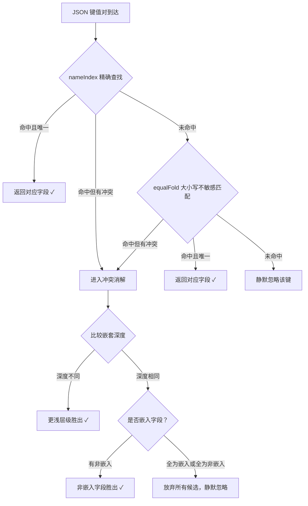

# 数据序列化语义与边界——encoding/json 的元数据解析与流式编解码

**摘要：**

1991 年，Douglas Crockford 在定义 JSON 时大约不会想到，这种原本为在线游戏设计的轻量数据交换格式会在二十年后成为 Web API 的事实标准，更不会想到它在 Go 语言的标准库里会演化出一套足以支撑起整个云原生生态的序列化框架。

Go 的 `encoding/json` 自 2012 年 Go 1.0 随语言一同发布以来，其核心 API——`Marshal`、`Unmarshal`、`Decoder`、`Encoder`——几乎没有发生破坏性变更，但围绕这几个入口构建的内部机制，包括类型元数据缓存、字段匹配规则、对象复用池、流式令牌解析器，却在历次版本迭代中经历了持续的打磨与优化。从表面看，它只是两个函数和两个结构体的组合；从内部看，它是一套精密的类型翻译系统——反射驱动的类型发现、基于 struct tag 的元数据注入、大小写不敏感的字段匹配、指针与零值的语义映射、IEEE 754 浮点数的精度边界、流式状态机的内存优化——每一个环节都承载着设计者对"简洁"与"正确"之间平衡点的取舍。

从表面看，它只是两个函数和两个结构体的组合；但从内部看，它是一套精密的类型翻译系统——反射驱动的类型发现、基于 struct tag 的元数据注入、大小写不敏感的字段匹配、指针与零值的语义映射、IEEE 754 浮点数的精度边界、流式状态机的内存优化——每一个环节都承载着设计者对"简洁"与"正确"之间平衡点的取舍。

本文从类型反射与元数据缓存的底层机制出发，依次覆盖字段匹配规则、缺失字段与零值及 null 的三态语义辨析、浮点精度与大整数边界、流式编解码的空间复杂度优势，以及自定义序列化接口的设计取舍，试图回答两个问题：`encoding/json` 在"动态数据的静态类型映射"这一根本命题上做出了怎样的设计权衡，以及这些权衡在工程实践中会以何种方式显形。行文将遵循"是什么 → 为什么 → 不这样会怎样 → 如何落地 → 边界与反例"的论述主线，在每一章都尝试同时给出机制细节和工程判断，以期在"理解底层"与"指导实践"之间建立桥梁。

---

## 第 1 章 反射驱动的类型翻译器

### 1.1 从字节流到结构体的语义鸿沟

JSON 数据是一段无类型的字节流，而 Go 程序操作的是强类型的内存结构，两者之间的翻译工作必须由一个中间层来承担。这个中间层的核心任务，是在运行时读取目标结构体的类型信息，建立 JSON 字段名与 Go 结构体字段之间的映射关系，并据此完成逐字节的解析或生成。Russ Cox 在最初设计 `encoding/json` 时，选择了 Go 的反射（Reflection）机制作为这个中间层的基石——这既是语言层面为数不多的、能够跨越类型边界的元编程手段，也是标准库对"简洁够用"这一设计信条的一次集中体现。反射的使用使得 `encoding/json` 无需在编译期知道目标类型的结构，而是在运行时动态地"发现"类型的字段和标签，这种灵活性是以性能为代价换来的——反射调用的开销比直接的字段访问高出一个数量级，但元数据缓存的存在在很大程度上弥补了这一差距。

不妨把 `encoding/json` 想象成一位坐在翻译席上的同传译员。译员手中有一本自己编纂的对照词典（元数据缓存），每当遇到一种新的语言组合（目标类型），译员会先把词典编写好，然后依据词典逐句翻译；下次再遇到同样的语言组合，译员便直接翻出缓存的词典，无需从头编纂。这种"**首次编译、后续复用**"的策略，是 `encoding/json` 性能模型的第一块基石，也是理解整个包性能特征的关键入口。

### 1.2 typeFields：元数据缓存的核心

`encoding/json` 的内部维护着一个以 `reflect.Type` 为键的全局缓存，缓存的值是该类型对应的**字段元数据列表**（Go 1.24 之前为 `typeFields` 结构，之后重构为 `structFields`）。每一次对 `json.Unmarshal` 或 `json.Marshal` 的调用，都会先查询这个缓存：如果命中，则直接使用已计算好的字段偏移量、tag 解析结果和字段匹配规则；如果未命中，则通过反射遍历该类型的全部字段，解析每个字段的 `json` struct tag，处理嵌入字段的提升与冲突，最后将结果写入缓存供后续使用。

这套缓存机制的关键细节有三点。第一，**缓存是按精确类型匹配的**——`T` 和 `*T` 被视为两种不同的键，各自维护独立的字段列表，这意味着对指针类型和值类型的编解码会各自触发一次缓存填充；第二，**缓存一旦建立便不会失效**，这意味着运行期间动态生成的类型（譬如通过 `reflect.StructOf` 构造的匿名结构体）会各自占用一份缓存，长期运行的高并发服务需要警惕由此带来的内存膨胀；第三，**字段列表的计算本身是昂贵的**，涉及反射遍历、字符串比较、tag 解析、冲突消解等多个步骤，这也是为什么对同一个类型反复调用 `Unmarshal` 时，单次调用的摊还成本会随着调用次数的增加而显著下降。

从实现的角度看，元数据缓存的全局性意味着它在整个进程的生命周期内持续存在。这种设计假设是：类型的种类是有限的，缓存的增长是有界的。但在某些极端场景下（譬如代码生成工具动态构造大量一次性类型），这个假设可能不成立，导致缓存无限增长。Go 的标准库目前没有提供清除或限制缓存大小的机制，这也是一个值得关注的潜在风险点。

```go
// 缓存的内部结构（简化）
// Go 1.24 之前的 typeFields，之后重构为 structFields
type structFields struct {
    list      []field              // 按字段在 struct 中的声明顺序排列
    nameIndex map[string]int       // 精确名称 → list 下标的快速索引
}

type field struct {
    name      string      // 解析后的 JSON 字段名（来自 tag 或字段名）
    nameBytes []byte      // 预分配的字节切片，避免重复分配
    equalFold func(s, t []byte) bool  // 大小写不敏感比较函数
    index     []int       // 字段在嵌套结构中的索引路径
    opts      encOpts     // omitempty、string 等编码选项
}
```

### 1.3 字段匹配规则：精确优先与回退策略

当 `json.Unmarshal` 解析到一个 JSON 对象中的键值对时，它需要把这个键（一个字符串）映射到目标结构体的某个字段上。这个映射过程遵循一套精心设计的优先级规则，其核心思想是**精确匹配优先，大小写不敏感回退**，并在存在歧义时通过冲突消解机制选出唯一的胜出者。

具体的匹配过程分为三层。第一层，在 `nameIndex` 中精确查找 JSON 键名，若命中且没有同名冲突，直接返回对应字段；第二层，若精确查找未命中，则对所有字段执行大小写不敏感的匹配（通过每个字段预存的 `equalFold` 函数），找到第一个（且唯一一个）匹配的字段；第三层，若在任一层发现多个字段都满足匹配条件，则触发冲突消解——**更浅的嵌套层级胜出**，若层级相同则**非嵌入字段胜出**，若仍然平局则所有候选字段均被放弃，该 JSON 键对应的值将被静默忽略。

```go
// 字段匹配优先级伪代码
func matchField(jsonKey string, sf structFields) *field {
    // 第一层：精确匹配
    if idx, ok := sf.nameIndex[jsonKey]; ok {
        return &sf.list[idx]
    }
    // 第二层：大小写不敏感回退
    var candidates []field
    for _, f := range sf.list {
        if f.equalFold([]byte(jsonKey), f.nameBytes) {
            candidates = append(candidates, f)
        }
    }
    // 第三层：冲突消解（更浅层级、非嵌入优先）
    return resolveConflict(candidates)
}
```

这种规则设计的工程意义在于：它使得 JSON 编解码对字段名的大小写变化具有适度的容错性（JSON 中 `Name` 和 `name` 可以映射到同一个 Go 字段），同时在出现歧义时选择最保守的行为——丢弃数据而非猜测，这避免了因字段顺序或命名约定差异而引入难以察觉的数据错配 bug。从信息论的角度看，**丢弃歧义数据**是一个零信息的决策（不引入任何新信息），而**错误地选择某一个候选**则是一个负信息的决策（引入了错误信息）——前者在工程上永远优于后者。

在实际项目中，字段匹配规则的另一个值得注意的行为是**静默忽略未知字段**。当 JSON 中包含目标结构体中没有的字段时，`Unmarshal` 会直接跳过这些字段，不会报错或警告。这种行为在大多数场景下是合理的（它使得 API 的前向兼容变得容易——新版本的 JSON 可以包含旧版本客户端不认识的字段），但在某些需要严格校验输入的场景下（譬如安全审计、配置校验），它可能成为隐患——攻击者可以在 JSON 中注入额外字段而不被检测到。为了应对这种场景，`json.Decoder` 提供了 `DisallowUnknownFields()` 方法，调用后若 JSON 中出现目标结构体没有的字段，`Decode` 会返回错误。



> [!info] 嵌入字段的提升规则
> 当一个结构体嵌入了另一个结构体（匿名嵌入），被嵌入结构体的字段会被"提升"到外层，在 JSON 编解码时表现得像是外层结构体自己的字段一样。但如果有两个嵌入路径同时提供了同名字段，则形成冲突，该字段被静默忽略——这是 Go 结构体嵌入语义在序列化层面的自然延伸，与 Go 类型系统中 struct 组合的设计一脉相承。

### 1.4 标签解析的细节与陷阱

`json` struct tag 的解析本身也有若干容易被忽视的细节。tag 的完整语法是 `json:"name,opt1,opt2"`，其中 `name` 部分是 JSON 中使用的字段名，`opt` 部分是逗号分隔的修饰符，目前支持的主要有 `omitempty` 和 `string`。一个常见误区是在 `name` 部分误用逗号，导致解析器将逗号后的内容误认为修饰符；另一个陷阱是 `string` 修饰符——它指示编解码器将数值或布尔类型字段先编码为 JSON 字符串、再在解码时从字符串中解析回原类型，这种机制在跨语言交互时偶尔有用，但会带来显著的性能开销和语义模糊性。

值得注意的是，**tag 解析的结果会被缓存在 `typeFields` 中**，因此 tag 解析的成本只在首次遇到某种类型时发生一次。这也意味着，如果同一个进程中对同一类型反复进行编解码，tag 解析的摊还成本几乎为零——这是元数据缓存带来的第一项性能红利。

一个值得探讨的设计细节是：为什么 `encoding/json` 选择使用 struct tag 来控制序列化行为，而不是引入类似 Java 注解或 C# attribute 那样的元数据机制？这个问题的答案与 Go 的语言设计哲学有关——Go 刻意保持了类型系统的简洁，不支持用户自定义注解，struct tag 是类型定义中唯一可以附加元数据的位置。这种设计的代价是 tag 只能以字符串形式存在，解析成本高于结构化的注解；其收益则是语言的简洁性——不需要引入额外的元数据语法和反射 API，仅凭现有的字符串解析即可完成。这种"用一个简单的字符串机制解决元数据需求"的设计思路，与 Go 在错误处理上使用裸 `error` 接口而非异常层次的思路如出一辙——都是用最小的语言特性覆盖最大的使用场景。

---

## 第 2 章 对象池与内存复用

### 2.1 高频序列化的分配困境

每一次 JSON 编解码都需要维护一个状态机：编码器需要追踪当前写入位置、处理转义、管理缩进层级；解码器需要维护输入位置、栈帧、当前令牌类型。这些状态对象在每次编解码操作中都是必需的，但它们的初始化成本——尤其是在高并发场景下——会累积成不可忽视的内存分配压力。

在 Go 1.10 之前，`encoding/json` 每次调用 `Marshal` 都会分配一个新的 `encodeState` 对象，调用 `Unmarshal` 也会分配一个新的 `decodeState` 对象。对于每秒处理数万次 JSON 编解码的网关服务或 API 服务器而言，这意味着每秒数万次的小对象分配，给垃圾回收器带来持续的压力。这种分配模式在 Go 的 GC 模型下尤其昂贵——每次 GC 都需要扫描和标记这些短命对象，而它们的生命周期往往只有几毫秒，纯粹是分配-使用-丢弃的循环。

这种"每次操作都重新分配状态对象"的模式，在低并发场景下几乎不会引起注意——Go 的分配器足够快，GC 也足够高效。但当并发量上升到数千 QPS 以上时，分配和 GC 的累积成本开始显现，表现为尾部延迟（P99 latency）的上升和 CPU 使用率的异常。这正是 `sync.Pool` 介入的动机——不是让"正常"场景更快，而是让"极端"场景不会崩溃。

### 2.2 sync.Pool 的介入

Go 1.10 引入了对 `sync.Pool`（参见[[Golang/Go并发编程/10 sync.Map、sync.Pool 与原子操作|10 sync.Map、sync.Pool 与原子操作]]）的使用，`encodeState` 和 `decodeState` 在操作完成后会被归还到池中，下次需要时从池中取出复用。这一改动的效果是显著的：在典型的 HTTP 服务负载下，`Marshal` 和 `Unmarshal` 的内存分配次数减少了 50% 以上，GC 压力相应下降。

> [!note] 池化复用的工程边界
> `sync.Pool` 在每次 GC 时会清空池中的对象，这意味着池的复用效果与 GC 频率密切相关——GC 越频繁，池越容易被清空，复用率越低。此外，从池中取出的对象必须在使用前完整重置其内部状态，否则上一次操作残留的数据会污染本次操作，这类 bug 往往表现为偶发的数据错乱，极难排查。

池化复用的另一个值得注意的细节是 `encodeState` 的内部缓冲区（`bytes.Buffer`）的复用策略。缓冲区在归还池中时不会释放底层数组，下次取出时直接在原有数组上覆盖写入。这意味着池中的 `encodeState` 会"记住"历史上处理过的最大 payload 的缓冲区大小——对于负载波动剧烈的服务，一个偶发的超大请求可能导致池中所有 `encodeState` 长期持有过大的缓冲区，造成持续的内存浪费。从 Go 1.16 起，标准库对此做了优化：超过 10 KB 阈值的缓冲区在归还时会被直接丢弃，不再进入池中，以避免这种"峰值污染"问题。

```go
// encodeState 的获取与归还（简化）
var encodeStatePool sync.Pool

func newEncodeState() *encodeState {
    if v := encodeStatePool.Get(); v != nil {
        e := v.(*encodeState)
        e.Reset()          // 重置内部状态，但保留底层缓冲区
        return e
    }
    return new(encodeState)
}

func (e *encodeState) release() {
    // 超过一定阈值的缓冲区会被丢弃，避免长期持有过大内存
    if e.Buffer.Cap() > 1<<16 {
        return  // 不归还，让 GC 回收
    }
    encodeStatePool.Put(e)
}
```

### 2.3 自定义类型与池化的边界

当开发者实现自定义的 `MarshalJSON` 或 `UnmarshalJSON` 方法时，`encoding/json` 的池化优化在一定程度上被旁路了。这是因为自定义方法拥有完全的编解码控制权，内部的状态管理不再受 `encodeState`/`decodeState` 的约束。如果自定义方法本身又频繁分配临时对象（譬如每次调用都 `json.Marshal` 一个子结构），则池化的收益会被大幅稀释。

因此，在高吞吐场景中，自定义序列化方法内部也应遵循对象池化或栈上预分配的原则，避免让 `encoding/json` 的池化优化在最后一公里处失效。这一考量与 Go 接口调用成本的分析密切相关——接口的动态分派本身成本不高（参见[[Golang/Go语言核心/10 接口的实现原理——iface、eface 与鸭子类型|10 接口的实现原理]]），但分派后的实现路径是否高效，才是决定整体性能的关键。

从基准测试的数据来看，在一个典型的 Go 1.20+ 环境中，`json.Marshal` 对一个中等大小（约 500 字节）结构体的单次调用，在启用池化后大约可以减少 30-40% 的分配次数。但对于更大的 payload（数 KB 以上），池化的收益会逐渐递减，因为缓冲区的大小已经主导了分配成本，状态对象本身的分配占比变得微不足道。这意味着**池化优化的效果高度依赖于 payload 的大小分布**——对于以小型请求为主的 API 服务，池化带来的 GC 压力缓解是显著的；对于以大型文档为主的数据管道，池化的贡献则相对有限。

值得注意的是，`sync.Pool` 的实现在 Go 1.13 中经历了一次重要优化——引入了 `sync.Pool` 的 per-P（per-Processor）本地缓存机制，减少了多 Goroutine 并发访问池时的锁竞争。这一优化对 `encoding/json` 的池化效果有直接的正面影响：在高并发场景中，每个 P 的本地池可以独立地缓存和分发 `encodeState`/`decodeState`，无需跨 P 竞争，从而进一步降低了池操作的延迟。这种"语言基础设施的改进带动标准库性能提升"的现象，在 Go 的演进历史中屡见不鲜——`sync.Pool` 的 per-P 优化不仅惠及 `encoding/json`，也惠及所有使用 `sync.Pool` 的标准库包和用户代码。

---

## 第 3 章 缺失、零值与 null 的三态语义

### 3.1 三种"空"的区分

JSON 与 Go 类型系统之间的语义映射，在"空值"这一维度上存在微妙的不对齐。一个 JSON 对象中的某个字段可能存在且非空、存在且为 `null`、或者根本不存在——这三种状态在 JSON 中是语义迥异的；而 Go 结构体中的某个字段，则只有**零值**（zero value）这一种"空"的表达能力。这种数量上的不对齐，是许多序列化 bug 的根源，也是理解 `encoding/json` 行为模式的入口。

不妨把这种不对齐想象成医学检验报告中的三种状态。"未检测"（字段缺失）意味着样本没有被送到实验室，报告上根本不会出现这一行；"检测正常"（零值）意味着实验室给出了结果，结果是"阴性"——它本身就是一个有意义的测量值；"检测异常"（`null`）意味着实验室明确告知"本次检测无法给出有效结果"。这三者在医学上绝不能混淆，在数据序列化中同样如此。

### 3.2 缺失字段的处理

当 JSON 数据中缺少某个字段时，`json.Unmarshal` 的行为是**保持目标字段的原始值不变**——不会清零，不会报错，只是跳过该字段。这意味着如果目标结构体是预分配并填充了默认值的，缺失字段不会覆盖这些默认值；但如果目标结构体是零初始化的，缺失字段的结果与"JSON 中显式给出零值"的效果完全相同。

| JSON 状态 | Go 零初始化字段 | Go 预填充字段 |
| :--- | :--- | :--- |
| 字段缺失 | 保持零值 | 保持原有值不变 |
| 字段为 `null` | 置为 nil（指针类型）或报错（非指针类型） | 置为 nil 或报错 |
| 字段为零值（如 `0`、`""`） | 覆盖为零值 | 覆盖为零值（原有值丢失） |

这一行为在增量更新场景中是有用的——可以先从数据库加载完整记录，再用 JSON 补丁中的非零字段覆盖对应位置，缺失字段自动保留原有值。但它也会在不经意间引入 bug：如果目标字段的类型是 `int`，则 JSON 中显式给出 `0` 和完全缺失该字段，在 Go 中产生的效果是一样的，调用方无法区分这两种情况。

一个典型的踩坑场景是配置覆盖逻辑。假设服务从环境变量和配置文件两处读取配置，配置文件中某些字段的零值（如 `port: 0`）本意是"显式禁用该端口"，但由于字段缺失和零值无法区分，当配置文件缺少某个字段时，Go 结构体中的零值会被错误地解读为"显式禁用"，而非"未配置"。解决这一问题的惯用方法是在结构体字段中使用指针类型（`*int`），或者使用一个额外的 `map[string]bool` 来记录哪些字段在 JSON 中实际出现过——前者简洁但增加了间接访问的成本，后者灵活但引入了额外的状态管理。

### 3.3 null 的承接：指针与 json.RawMessage

要区分"字段缺失"和"字段为 null"，必须使用指针类型。当 JSON 中某字段为 `null` 时，`Unmarshal` 会将目标指针字段设置为 `nil`；而当该字段缺失时，指针字段保持其原有值（若未显式初始化，则为 `nil`——此时确实无法与 null 区分）。但当该字段在 JSON 中给出一个非 null 值时，`Unmarshal` 会为目标指针分配一个新的底层对象，并将值写入该对象。

另一种承接 null 与延迟解析的机制是 `json.RawMessage`。这个类型本质上是 `[]byte` 的别名，`Unmarshal` 遇到它时会把对应的 JSON 原文（包括嵌套的对象或数组）原样保存到该字段中，不做任何解析。这种机制特别适合处理**结构未知或部分结构已知**的 JSON 数据——外层字段用强类型结构体承接，内层未知部分用 `json.RawMessage` 保留原文，待需要时再按需解析。

```go
type Event struct {
    Type    string          `json:"type"`
    Payload json.RawMessage `json:"payload"`  // 延迟解析，保留原文
}

// 使用场景：先解码外层，再根据 Type 决定 Payload 的解析目标
var e Event
json.Unmarshal(data, &e)
switch e.Type {
case "user.created":
    var u UserPayload
    json.Unmarshal(e.Payload, &u)
case "order.placed":
    var o OrderPayload
    json.Unmarshal(e.Payload, &o)
}
```

### 3.4 omitempty 的陷阱

`omitempty` 修饰符指示编码器在字段值等于其类型的零值时，跳过该字段的输出。这个看似合理的设计，在数值类型字段上可能引发严重的语义丢失。

考虑一个表示温度的结构体，其中 `Temperature float64` 字段标记了 `omitempty`。当实际温度为 0.0 度时，该字段会被完全省略，接收方在解码后得到的 `Temperature` 字段也是零值 0.0——此时接收方无法区分"发送方明确给出温度为零"和"发送方没有给出温度值"这两种情况。

更隐蔽的是布尔类型和空切片的处理。`bool` 的零值是 `false`，标记 `omitempty` 后，`false` 值会被省略；`[]int` 的零值是 `nil`（不是空切片 `[]int{}`），只有 `nil` 切片才会被省略，空切片因为不等于 `nil` 会被正常编码为 `[]`。这种 nil 与空切片的微妙差异，在[[Golang/Go语言核心/06 slice 的底层结构——扩容策略与内存陷阱|06 slice 的底层结构]]一篇中已有详述，此处不再展开，但需要在序列化上下文中再次强调：**`omitempty` 对零值的省略是单向不可逆的信息丢失**，一旦发送方省略了零值，接收方就永远无法恢复这一信息。

> [!warning] omitempty 的设计决策
> 在 RPC 或配置传输场景中，如果协议要求区分"未给出"和"给出零值"，则不应使用 `omitempty`，而应改用指针类型——指针的 `nil` 表示"未给出"，`&zeroVal` 表示"给出零值"，两者在 JSON 中分别编码为字段缺失和 `null`（或显式的零值）。这是 Go 标准库自身在 `encoding/json` 的测试用例中所采用的模式，也是 Go 团队推荐的工程实践。

---

## 第 4 章 精度陷阱与数值边界

### 4.1 float64 的精度截断

JSON 规范本身不区分整数和浮点数，所有数值字面量在语法上都是等价的。`encoding/json` 在解码时，默认将所有 JSON 数值解析为 `float64`（Go 中对应 `float64` 类型），然后再根据目标字段的类型进行转换。这一设计选择带来了两个值得警惕的问题。

第一个问题是**精度截断**。`float64` 遵循 IEEE 754 双精度格式，尾数有 52 位，加上隐含的 1 位，共 53 位有效二进制位，约等价于 15-17 位十进制有效数字。当一个 JSON 数值的有效位数超过 15 位十进制数字时，`float64` 无法完整保留其精度。譬如 JSON 中的 `12345678901234567`（17 位），被解析为 `float64` 后再转回整数，可能会得到 `12345678901234568`——末位发生了不可预期的变化。

第二个问题是**大整数丢失精度**。`int64` 的最大值约为 9.2 × 10^18，超过了 `float64` 的精确表示范围（约 9 × 10^15）。当 JSON 中包含一个大的 `int64` 值（譬如雪花 ID `7234567890123456789`），先被解析为 `float64` 时就已经丢失了末几位精度，再转回 `int64` 时得到的是一个错误的值。这是许多分布式系统中 ID 解析错误的根源，也是 Go 社区中被反复提及的"经典陷阱"。

### 4.2 json.Number 的救赎

为了应对精度问题，Go 在后续版本中引入了 `json.Number` 类型，它是一个字符串类型的别名（底层是 `string`），在解码时保留 JSON 数值的原始字面量，不做任何类型转换。使用 `json.Number` 需要在创建 `Decoder` 时显式调用 `UseNumber()` 方法，这会改变后续所有数值的解码行为——该 `Decoder` 实例后续解码的所有数值都将被保留为 `json.Number` 字符串，直到 `Decoder` 被丢弃。

```go
dec := json.NewDecoder(r)
dec.UseNumber()  // 此后所有数值解码为 json.Number（字符串）

var m map[string]any
dec.Decode(&m)
// m["id"] 的类型是 json.Number，值为 "7234567890123456789"

// 按需转换为具体类型
id, err := m["id"].(json.Number).Int64()
```

`json.Number` 的设计本质上是把类型转换的决策权从解码器推迟到了调用方，这是一种典型的**延迟求值**策略。它的代价是：调用方必须自己处理类型转换的逻辑和错误；其收益是：完全保留了原始精度，不会因为中间类型选择不当而导致数据丢失。在金融、支付、分布式 ID 等对精度有严格要求的场景中，`json.Number` 几乎是必选项。

### 4.3 整数类型的直接解码

从 Go 1.5 起，当目标字段是整数类型（`int`、`int32`、`int64`、`uint`、`uint64` 等）时，解码器会尝试直接将 JSON 数值解析为对应的整数类型，而非先解析为 `float64` 再转换。这一优化消除了大整数在 `int64` 字段上的精度丢失问题，但**仅当目标类型是已知的整数类型时才生效**——如果目标是 `any`（`interface{}`），数值仍然会被解析为 `float64`，精度丢失的问题依然存在。

```go
type Request struct {
    ID int64 `json:"id"`  // 直接解析为 int64，精度安全
}

var r Request
json.Unmarshal([]byte(`{"id": 7234567890123456789}`), &r)
// r.ID == 7234567890123456789 ✓

var m map[string]any
json.Unmarshal([]byte(`{"id": 7234567890123456789}`), &m)
// m["id"] 是 float64，值为 7.234567890123457e+18 ✗（精度丢失）
```

这一行为差异在跨服务通信中尤其值得警惕：发送方用 `int64` 编码的 ID，接收方如果用 `map[string]any` 解码，就会在不知不觉中丢失精度；只有当接收方也用强类型结构体（且 ID 字段是 `int64`）时，精度才能得到保证。这也是为什么 Go 社区普遍建议**在 API 边界处使用强类型结构体**，而非 `map[string]any`——不仅是为了代码可读性，更是为了避免这种隐蔽的精度丢失。

从 IEEE 754 标准的角度看，`float64` 能够精确表示的整数范围是 [-2^53, 2^53]，即 [-9007199254740992, 9007199254740992]。超过这个范围的整数，相邻两个可表示的 `float64` 值之间的间隔会超过 1，这意味着某些整数在 `float64` 中根本没有对应的表示——它们会被"四舍五入"到最近的可表示值。对于雪花 ID、Facebook Object ID 等通常在 64 位范围内生成的唯一标识符，这种精度丢失几乎是不可避免的（除非使用 `json.Number` 或强类型字段）。在实际工程中，一个常见的错误模式是：前端 JavaScript 也使用 `Number`（等价于 `float64`）来表示 JSON 数值，导致大整数 ID 在前端就已经丢失精度，即使后端的 Go 服务正确使用了 `int64` 字段也无法挽回——因为丢失发生在 JSON 文本生成之前。解决这一问题的全链路方案是：后端使用 `int64` 或 `json.Number`，前端使用 `BigInt`，并在 JSON 中将大整数编码为字符串（通过 `json:",string"` tag）。

---

## 第 5 章 流式编解码与空间复杂度

### 5.1 全量载入的内存代价

`json.Unmarshal` 的工作模式是：先将整个 JSON 文档读入内存，再在内存中完成解析。对于一个 100 MB 的 JSON 文件，这意味着需要同时在内存中持有原始字节切片和解析后的 Go 数据结构，峰值内存可能达到原始数据体积的数倍（考虑到 Go 结构体的字段对齐、字符串的额外分配、map 的负载因子等开销）。

这种"全量载入"的模式在处理小型 JSON 请求和响应时完全够用，但在以下场景中会遇到瓶颈：日志聚合系统从文件流中逐行读取 NDJSON（Newline Delimited JSON）；网关服务需要将大型 JSON 数组转换为另一种格式并流式输出；嵌入式设备需要在有限内存中处理超过 RAM 容量的 JSON 数据集。在这些场景中，`json.Unmarshal` 的全量载入模式会成为内存瓶颈，甚至直接导致 OOM（Out of Memory）崩溃。

### 5.2 Decoder 的令牌流模型

`json.Decoder` 提供了另一种工作模式：它从 `io.Reader` 中按需读取字节，维护一个状态机，每次调用 `Token()` 方法返回下一个 JSON 令牌（`Delim`、`string`、`float64`、`bool`、`nil`），调用 `Decode(v)` 方法则解析下一个完整的 JSON 值并填充到 `v` 中。这种模式的核心优势在于**空间复杂度从 O(N) 降到 O(1)**——无论 JSON 文档有多大，解码器在任一时刻只需要持有当前正在处理的那个值所需的内存。

```go
// 流式处理大型 JSON 数组
dec := json.NewDecoder(largeReader)

// 读取数组开始的 '['
t, _ := dec.Token()
// t == json.Delim('[')

for dec.More() {
    var item Item
    if err := dec.Decode(&item); err != nil {
        if err == io.EOF { break }
        return err
    }
    process(item)  // 逐个处理，无需持有整个数组
}

// 读取数组结束的 ']'
t, _ = dec.Token()
```

这种模式与 `io.Reader` 的流式契约天然契合（参见[[Golang/Go标准库与系统IO/00 专栏导览|Go 标准库与系统 IO]]专栏中关于 io.Reader 的设计讨论）：解码器只在需要更多字节时才从底层 Reader 读取，读取的字节被缓存在解码器内部的缓冲区中，处理完毕后即可释放。这与 Go 标准库中 bufio 的滑动窗口缓冲机制异曲同工——都是通过"按需读取、滑动窗口"的方式，将处理大规模数据的内存成本控制在恒定范围内。从系统资源的角度看，流式解码的本质是用 CPU 时间的微量增加（逐次读取的系统调用开销）换取内存空间的大幅节约，这在不以内存为瓶颈的现代服务器上几乎总是划算的。

`Decoder` 的内部实现是一个基于字节扫描的状态机（`scanner`）。它维护一个栈来追踪当前的嵌套层级（对象、数组），每读取一个字节就根据当前状态和字节内容执行状态转移。当遇到结构结束符（`}`、`]`）时，状态机会弹出栈帧，回到上一层级。这种设计使得 `Decoder` 在解析深层嵌套的 JSON 时，栈的深度等于 JSON 的嵌套深度，而非文档的总体大小——这是流式解析能够在内存受限环境中工作的根本保证。值得注意的是，`Decoder` 的内部缓冲区默认只有几百字节，它会频繁地向底层 Reader 发起小规模读取请求，因此将底层 Reader 包装为 `bufio.Reader` 可以减少系统调用的次数，进一步提升流式解码的吞吐。

### 5.3 NDJSON 的处理

NDJSON 是一种简单的流式 JSON 格式：每行一个完整的 JSON 对象，行与行之间以换行符分隔。它是日志采集、事件流传输等场景中的常见格式。`json.Decoder` 处理 NDJSON 的方式非常自然——每次调用 `Decode` 会读取并解析一个完整的 JSON 值，然后停止在该值之后的第一个空白字符（通常是换行符），下次调用 `Decode` 继续从该位置读取下一个 JSON 值。

```go
// NDJSON 流式处理
scanner := bufio.NewScanner(reader)
for scanner.Scan() {
    var event Event
    if err := json.Unmarshal(scanner.Bytes(), &event); err != nil {
        log.Printf("skip malformed line: %v", err)
        continue
    }
    handle(event)
}
```

上述代码使用了 `bufio.Scanner` 按行读取，再对每行调用 `json.Unmarshal`。这种方式在大多数场景下足够高效，但有一个隐含的限制：`bufio.Scanner` 的默认最大行长度为 64 KB，超过该长度的 JSON 行会导致 `Scan` 返回错误。若需处理超长行，需要调用 `scanner.Buffer()` 扩大缓冲区，或者改用 `json.Decoder` 直接从 Reader 中读取——后者没有单行长度限制，且省去了 `Scanner` 的额外内存拷贝。

在生产环境中处理 NDJSON 日志时，还需要考虑错误恢复和背压控制。当某一行 JSON 格式损坏时，`Unmarshal` 会返回错误，但流水线不应因此终止——上述代码中的 `continue` 语句确保了错误行的跳过，而后续的 `handle(event)` 可以继续处理。但如果 `handle` 的处理速度慢于 JSON 行的到达速度，则需要在两者之间引入缓冲队列或背压机制，以避免内存无限制增长。这种流式处理中的背压问题，与 Go 并发编程中 Channel 的缓冲和阻塞语义有着深刻的联系——两者本质上都是在"生产者速率"和"消费者速率"之间建立平衡。

### 5.4 Encoder 的流式输出

与 `Decoder` 对称，`json.Encoder` 将 Go 值序列化为 JSON 并直接写入 `io.Writer`，无需先将完整结果缓存在内存中。这在生成大型 JSON 响应或写入日志文件时尤其有用。`Encoder` 每次调用 `Encode` 会序列化一个完整的值，并在末尾追加一个换行符（这是 NDJSON 的标准格式）。

```go
enc := json.NewEncoder(writer)
enc.SetIndent("", "  ")  // 可选：美化输出

for _, item := range largeDataset {
    if err := enc.Encode(item); err != nil {
        return err
    }
}
```

`Encoder` 的内部同样使用了 `encodeState` 的池化复用，但它的写入目标是外部的 `io.Writer`，因此写入的粒度取决于底层 Writer 的缓冲策略——如果 Writer 是 `bufio.Writer`，则数据会在缓冲区满或显式 `Flush` 时才真正写入底层文件描述符；如果是网络连接，则取决于 TCP 的 Nagle 算法和发送缓冲区的状态。在需要严格控制写入延迟的场景中（譬如实时推送），应在每次 `Encode` 后立即调用 `Flush`，以确保数据及时到达对端。

从空间复杂度的角度看，流式 `Encoder` 和 `Decoder` 的组合可以将一个 JSON 处理流水线的内存占用从 O(N) 降到 O(1)——其中 N 是 JSON 文档的总大小。这意味着即使处理 TB 级的 JSON 数据流，只要单个 JSON 值的大小在内存可承载的范围内，整个流水线的内存占用就是恒定的。这种特性使得 Go 的流式 JSON API 在大数据管道、日志处理和实时分析等场景中具有独特的优势——它允许开发者用简洁的标准库 API 构建出内存高效的数据处理流水线，而无需引入复杂的第三方流式解析库。

---

## 第 6 章 自定义序列化与循环引用

### 6.1 MarshalJSON 与 UnmarshalJSON

Go 允许类型通过实现 `json.Marshaler` 和 `json.Unmarshaler` 接口，完全接管自身的 JSON 序列化行为。这两个接口各只有一个方法：

```go
type Marshaler interface {
    MarshalJSON() ([]byte, error)
}

type Unmarshaler interface {
    UnmarshalJSON([]byte) error
}
```

实现这两个接口后，`encoding/json` 在遇到该类型的值时，会直接调用对应方法，跳过所有反射和元数据缓存逻辑。这为实现自定义编码格式（譬如将 `time.Time` 编码为 Unix 时间戳而非 RFC3339 字符串）、处理敏感字段（譬如在序列化前脱敏）、以及实现多态类型（譬如根据类型标识字段决定解码目标）提供了完全的灵活性。

但自定义序列化也有明确的代价。第一，**绕过反射意味着绕过元数据缓存**——如果自定义方法的实现中又调用了 `json.Marshal` 或 `json.Unmarshal`（这在处理嵌套结构时几乎是不可避免的），则会触发新的反射和缓存查找，可能引入意料之外的性能开销。第二，**自定义方法的错误处理需要格外小心**——返回的 error 会被 `encoding/json` 原样传递给调用方，但在大型嵌套结构的编解码过程中，定位具体是哪个字段的自定义方法出了错，往往需要额外的日志或错误包装。第三，**自定义方法需要自行处理所有边界情况**，包括空值、nil 指针、嵌套结构的递归编解码等，这比使用默认行为需要更多的代码和测试。

从性能角度看，自定义 `MarshalJSON` 的实现如果采用硬编码的字符串拼接（而非再次调用 `json.Marshal`），可以显著减少反射开销和临时分配。一些高性能 JSON 库（如 `sonic`）的核心思路正是如此——为每种类型生成硬编码的序列化代码，完全绕开反射。但这种优化的代价是代码生成的复杂性和维护成本，通常只在框架层面才值得投入。

对于 `UnmarshalJSON`，一个常见的陷阱是：接收到的 `[]byte` 参数的生命周期仅在方法调用期间有效。如果需要在方法返回后仍然保留这些数据（譬如异步处理），必须先将数据拷贝出来。这一约束在标准库的文档中有明确说明，但在实践中仍时常被忽视，导致难以复现的数据竞争问题。

### 6.2 类型别名技巧与无限递归

实现自定义序列化时，一个常见的技巧是使用类型别名（type alias）来避免无限递归。如果直接在 `MarshalJSON` 中调用 `json.Marshal(t)`，其中 `t` 是接收者本身的类型，则会再次触发 `MarshalJSON` 方法，形成无限递归并最终栈溢出。

```go
type User struct {
    Name  string `json:"name"`
    Email string `json:"email"`
    Password string `json:"-"`  // 永远不序列化
}

// 正确：使用类型别名绕过 MarshalJSON 方法
func (u User) MarshalJSON() ([]byte, error) {
    type Alias User  // 类型别名，不继承方法集
    return json.Marshal(struct {
        Alias
        // 可以在此添加额外字段或覆盖
    }{
        Alias: (Alias)(u),
    })
}
```

这个技巧的原理是：类型别名 `Alias` 与原始类型 `User` 在内存布局上完全相同，但方法集为空（不继承 `MarshalJSON`），因此对 `Alias` 的 `json.Marshal` 调用会回退到默认的反射编解码路径，从而打破递归。这种"别名 + 匿名结构体嵌入"的模式，是 Go 社区中处理自定义序列化的惯用法，几乎出现在所有需要精细控制 JSON 输出的项目中。它与 Go 的类型系统设计（参见[[Golang/Go语言核心/04 类型系统——值类型、引用类型与 struct 组合|04 类型系统]])一脉相承——类型别名继承了内存布局但剥离了方法集，这一微妙的区别正是打破递归的关键。

值得补充的是，Go 1.22 引入了一种新的类型别名语法变体，允许在泛型上下文中使用类型别名。虽然这与 JSON 序列化的直接关系不大，但它反映了 Go 语言在类型别名机制上的持续演进。对于 JSON 序列化场景，类型别名的核心价值在于"继承内存布局但不继承方法集"——这一特性使得开发者可以在不修改原始类型定义的前提下，为序列化创建一个"干净的视图"，同时避免了无限递归的风险。

### 6.3 循环引用的处理

`encoding/json` **不支持循环引用**的自动检测和处理。如果数据结构中存在环形引用（譬如双向链表、树节点指向父节点），`json.Marshal` 会沿着引用链无限深入，最终因栈溢出而 panic。这是 JSON 作为树状数据格式的本质限制——JSON 的对象和数组只能表达有向无环图（DAG），无法表达任意图结构。

处理循环引用的常见策略有三种。第一，**在序列化前手动打断环**——将双向引用改为单向引用，或者在序列化时将指针字段替换为 ID 等标量标识。这种方式最简单直接，但要求数据模型本身支持 ID 引用，且需要额外的"打断"逻辑。第二，**实现自定义 `MarshalJSON`，维护一个已访问集合**，在遍历过程中检测是否遇到了已经访问过的节点，若是则用占位符（如 ID）替代。这种方式将循环引用检测封装在序列化逻辑内部，调用方无感知，但已访问集合本身会带来额外的内存和查找开销。第三，**使用专门的图序列化库**，通过 JSON Reference（`$ref`）机制将环状结构转化为引用关系，这种方式最灵活，但需要接收方也支持 `$ref` 的解析，增加了协议的复杂度。

在实际工程中，循环引用的出现往往暴露了数据模型设计的深层问题。JSON 本质上是树状格式，如果数据模型中存在环，说明该模型更适合用图结构来表达——此时强行使用 JSON 序列化可能需要引入额外的 ID 映射层，其复杂度可能超过改用二进制协议（如 Protobuf 的 `oneof` 和消息嵌套）的成本。因此，处理循环引用的第一步不是选择合适的序列化策略，而是**重新审视数据模型是否适合用 JSON 来表达**。

> [!note] 循环引用的检测成本
> 自动检测循环引用需要维护一个已访问对象的集合（通常用 `map[uintptr]struct{}`），每次序列化指针时都要查询该集合。对于没有循环引用的普通数据结构，这种检测的成本是完全额外的开销——这也是 `encoding/json` 选择不在标准库中实现循环引用检测的工程考量：让没有循环引用的场景不承担检测成本，让有循环引用的场景自行选择处理策略。

---

## 第 7 章 JSON 与二进制协议的取舍

### 7.1 紧凑性与可读性的永恒张力

JSON 的设计初衷是人类可读、文本化的数据交换格式，这在 Web 时代成为其最大的优势，也同时成为其最大的局限。与 Protobuf 等二进制协议相比，JSON 在以下方面存在明显的效率差距：

| 维度 | JSON | Protobuf |
| :--- | :--- | :--- |
| **编码体积** | 文本化，字段名重复出现，无压缩 | 二进制，字段用数字 tag 标识，varint 编码 |
| **编解码速度** | 需要字符串解析、类型推断、反射 | 预编译代码，无反射，直接字段偏移写入 |
| **Schema 演进** | 弱约束，字段增减无需协调 | 强 Schema，向前/向后兼容性有形式化保证 |
| **人类可读性** | 文本格式，可直接阅读和编辑 | 二进制，需专用工具查看 |
| **跨语言支持** | 几乎所有语言原生支持 | 需要 protoc 编译器生成各语言代码 |

在微服务架构中，内部服务间通信（RPC）通常选择 gRPC + Protobuf，以获得更低的延迟和更高的吞吐；而面向外部用户的 API 则几乎清一色使用 JSON，以换取最大的互操作性和调试便利性。这种"内外有别"的协议选型，是工程权衡的典型体现，也与 Go 生态与框架设计中关于 Protobuf 与 gRPC 的讨论（参见[[Golang/Go生态与框架设计/00 专栏导览|Go 生态与框架设计]]）相呼应。

值得一提的是，JSON 的"文本化"特性在调试和故障排查中具有不可替代的价值。当线上服务出现数据异常时，运维工程师可以直接用 `curl` 发送 JSON 请求、用 `jq` 解析 JSON 响应，甚至用文本编辑器手动构造测试用例——这些操作在使用二进制协议时几乎是不可能的。这种"可调试性"往往是团队协作中选择 JSON 的隐性理由，尽管它在性能上不是最优解。

### 7.2 encoding/json 的性能边界

`encoding/json` 的性能瓶颈主要集中在两个方面。第一是**反射开销**——每次处理新的类型都需要遍历字段、解析 tag、计算匹配规则，尽管元数据缓存显著降低了摊还成本，但缓存查找本身和首次计算的成本仍然存在。第二是**字符串处理**——JSON 的键名和字符串值需要处理 Unicode 转义（`\uXXXX`）、特殊字符转义（`\"`、`\\`、`\n` 等），以及 UTF-8 编码验证，这些操作的计算密度远高于二进制协议的定长字段读取。

Go 社区中出现了若干第三方的 JSON 库试图突破这些瓶颈，譬如 `github.com/json-iterator/go` 通过手写序列化代码替代反射，`github.com/segmentio/encoding/json` 通过更激进的缓冲区和零拷贝策略优化吞吐。这些库在特定场景下可以带来 2-5 倍的性能提升，但也各自付出了兼容性、维护成本或功能完整性的代价。在选择第三方库时，需要权衡性能收益与维护成本，并充分测试其在目标数据类型上的兼容性。

### 7.3 混合策略的工程实践

在性能敏感的场景中，一种常见的混合策略是：对外 API 保持 JSON 格式不变，对内服务间通信切换到 Protobuf；在必须使用 JSON 的场景中，对于高频编解码的核心类型，实现自定义的 `MarshalJSON`/`UnmarshalJSON` 方法，用硬编码的序列化逻辑替代反射路径。这种策略在保留了 JSON 对外兼容性的同时，将内部关键路径的性能提升到接近二进制协议的水平。

需要强调的是，**JSON 与 Protobuf 并非替代关系，而是互补关系**——前者胜在通用性和可读性，后者胜在效率和类型安全，选择哪种协议取决于具体的部署拓扑、性能需求和跨组织协作边界。在一个典型的云原生架构中，JSON 可能出现在 API 网关与客户端之间、配置文件中、日志格式中；而 Protobuf 则出现在服务间 RPC 调用、消息队列消息体、以及与底层存储系统的交互中。两者各有其不可替代的位置。

从协议演进的角度看，许多团队在实践中采用"gRPC 为主、JSON 为辅"的混合架构：gRPC Gateway 自动将 gRPC 服务暴露为 JSON API，使得同一套业务逻辑可以同时服务于内部的高效 RPC 调用和外部的通用 JSON API。这种方式在代码复用和协议灵活性之间取得了良好的平衡，但也引入了网关层的转换开销和调试复杂度（参见[[Golang/Go网络编程与持久化/00 专栏导览|Go 网络编程与持久化]]中关于 HTTP 服务端架构的讨论）。对于大多数中小规模的服务，直接使用 JSON 并在性能瓶颈处做针对性优化（譬如使用 `json.Encoder` 替代全量 `Marshal`、对核心类型实现自定义序列化），可能比引入 gRPC 的全套基础设施更为务实。

此外，JSON 的 Schema 验证也是工程中不可忽视的一环。与 Protobuf 的 `.proto` 文件不同，JSON 本身不携带 Schema 信息，调用方必须依赖额外的验证机制（如 JSON Schema 或自定义校验逻辑）来确保数据的合法性。在微服务间使用 JSON 通信时，缺少 Schema 约束意味着字段的增删、类型的变更都可能在运行时才被发现，这种"延迟暴露"的错误往往比编译期错误更难排查。这也是为什么 JSON Schema 在大型组织中逐渐被采纳为 API 契约的一部分——它在保留了 JSON 灵活性的同时，引入了形式化的 Schema 约束，缩小了 JSON 与 Protobuf 在"契约明确性"这一维度上的差距。

---

## 第 8 章 权衡与边界

### 8.1 encoding/json 的设计哲学

回顾 `encoding/json` 的整个设计，可以看到一条贯穿始终的主线：**在保持 API 简洁的前提下，尽可能用约定和容错覆盖大部分场景，将极端情况的处理权留给调用方**。字段匹配的大小写不敏感容错、缺失字段的静默跳过、`null` 与零值的自然映射、`json.Number` 的延迟类型转换、流式解码的空间优化——这些设计选择都体现了"让简单场景简单，让复杂场景可能"的哲学。

但这种哲学也有其代价。`any` 类型下大整数的精度丢失、`omitempty` 对零值的不可逆省略、循环引用的无检测、反射带来的性能天花板——这些都是"简单 API"背后的隐性成本，需要开发者对底层机制有足够的理解，才能在工程实践中规避风险。从这个角度看，`encoding/json` 的"简单"是一种**有代价的简单**——它把复杂性隐藏在看似简单的 API 背后，而不是显式地暴露给调用方。

### 8.2 适用前提与失效场景

`encoding/json` 的适用前提可以概括为三条：数据结构是树状的（无环）、数据规模在内存可承载的范围内（或可使用流式 API）、精度要求在 `float64` 和 `int64` 的可表达范围内（或使用 `json.Number` 和强类型字段）。一旦这三条前提中有任何一条不成立，就需要引入额外的机制——自定义序列化、流式解码、第三方库、或切换到二进制协议。

从更宏观的视角看，`encoding/json` 的设计选择反映了 Go 语言的一贯风格：**用约定代替强制，用文档代替类型系统约束，用运行时检查代替编译期保证**。这种风格使得入门门槛极低（几行代码就能完成 JSON 编解码），但也意味着许多陷阱（精度丢失、循环引用、omitempty 语义丢失）只有在运行时才会暴露。对于从强类型语言（如 Rust、Haskell）转向 Go 的开发者而言，这种风格可能需要一段时间的适应；但对于追求开发效率的团队而言，这种"够用就好"的设计哲学恰恰是 Go 在云原生时代迅速普及的重要原因之一。

### 8.3 因地制宜的取舍

由此可见，`encoding/json` 并非一个"放之四海皆准"的序列化方案。它是一个在"易用性、通用性、性能"三者之间做出特定权衡的产物——优先保证了易用性和通用性，将性能的极致优化留给了有需求的场景去自行实现。在云原生生态中，JSON 作为配置格式、API 协议和日志事实标准的地位短期内不会动摇，但理解其底层机制与边界条件，才能在高吞吐、高精度、大规模数据的场景中做出正确的架构决策，而不是在踩坑之后才回过头来质疑"标准库不够用"——真正的问题往往不是标准库不够用，而是我们没有在正确的场景中使用正确的工具。因地制宜地选用合适的方案，才是工程实践中唯一有效的做法。

行文至此，不妨回到最初的问题：`encoding/json` 的设计权衡究竟是怎样的。答案或许是——它选择了让 90% 的场景足够简单，而将剩下 10% 的场景的复杂性留给了开发者。这种选择是否"正确"，取决于你所处的具体场景：如果你正在构建一个面向数百万用户的 API 平台，那么 JSON 的通用性和可读性可能是最重要的考量；如果你正在设计一个高频交易系统的内部通信协议，那么 Protobuf 的紧凑编码和零反射开销才是你需要的。没有放之四海皆准的答案，只有在具体约束下的最优权衡。

---

## 参考资料

1. Go 官方文档：`encoding/json` 包源码与 API 参考，https://pkg.go.dev/encoding/json
2. JSON 规范（RFC 8259），https://datatracker.ietf.org/doc/html/rfc8259
3. Go 官方博客：Go 1.10 Release Notes 中关于 `encoding/json` 的 `sync.Pool` 优化说明，https://go.dev/doc/go1.10
4. Douglas Crockford, "The JSON Saga", http://json.org
5. Go 源码 `encoding/json/encode.go`、`encoding/json/decode.go`、`encoding/json/scanner.go`
6. IEEE 754 双精度浮点数标准（2008 修订版），https://ieeexplore.ieee.org/document/4610935
7. NDJSON 规范，http://ndjson.org/
8. Protobuf 语言指南，https://protobuf.dev/programming-guides/proto3/

---

> [!note] 思考题
> 1. 为什么 `json.Unmarshal` 对 `any` 类型的数值默认解析为 `float64` 而非 `int64`？这种设计在哪些场景下会导致精度丢失，如何通过 `json.Number` 或强类型字段规避？
> 2. 在高并发 API 网关场景下，`encoding/json` 的性能瓶颈主要来自哪些方面？`sync.Pool` 的复用机制在 GC 频繁的负载下效果如何？
> 3. 设计一个处理循环引用 JSON 数据结构的序列化方案，需要考虑哪些边界条件（检测成本、嵌套深度、自定义类型）？
> 4. 对比 `json.Decoder.Token()` 和 `json.Decoder.Decode()` 两种流式解析模式的适用场景，分析它们在处理 10 GB 级 NDJSON 日志文件时的内存与 CPU 开销差异。
5. 在微服务架构中，为什么内部 RPC 倾向于 Protobuf 而外部 API 倾向于 JSON？这种"内外有别"的协议选型背后有哪些工程考量？
6. `json.Number` 的延迟求值策略在哪些场景下是必要的？它与直接使用 `string` 类型承接数值字段相比，有哪些优势和劣势？
7. `encoding/json` 的元数据缓存是按精确类型（`reflect.Type`）为键的。如果一个服务在运行期间通过反射动态构造了大量一次性类型，这种缓存策略会带来什么问题？如何缓解？
