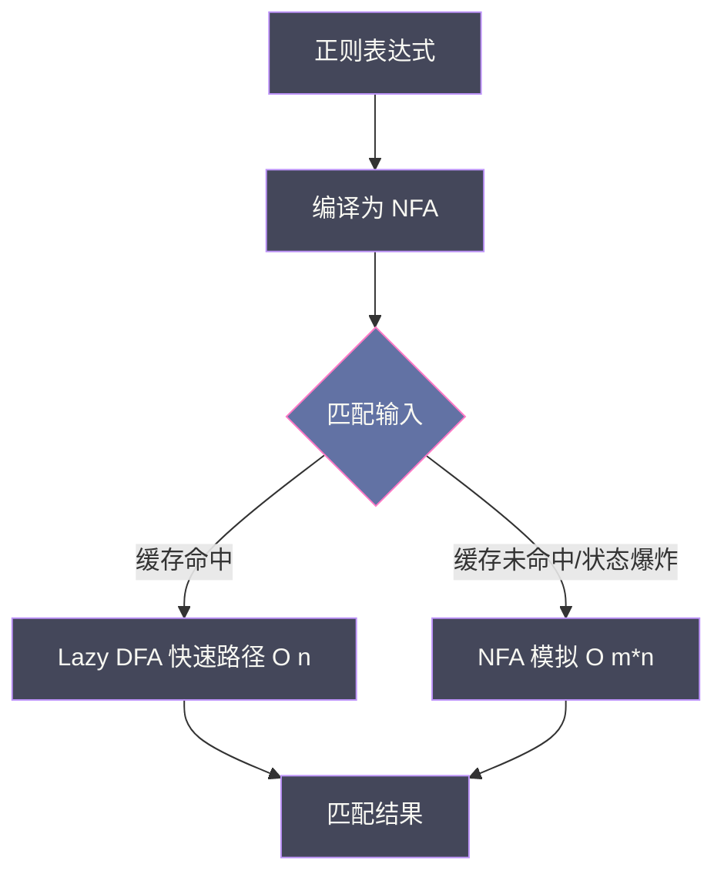

# 现代集合处理与文本度量——slices、maps、cmp 与正则引擎

**摘要：**

Go 在长达十余年的时间里，集合处理依赖一套基于 `interface{}` 与反射的工具函数，以及需要用户实现 `sort.Interface` 三方法才能排序的古老契约。这套设计在类型系统尚不支撑泛型的年代是务实的妥协，但它把类型安全的责任推给了调用方，把排序算法的选择权交给了实现者，也把"一个切片为什么要写五行代码才能排序"变成了 Go 社区最常被吐槽的体验问题。2022 年 Go 1.18 引入泛型，2023 年 Go 1.21 把 `slices`、`maps`、`cmp` 正式纳入标准库，标志着 Go 的集合操作从"反射驱动"转向"泛型驱动"。与此同时，Go 在文本处理与数值转换两条看似不相干的支线上做出了同样风格的选择：`strconv` 用零分配的栈上缓冲完成数值与字符串之间的转换，`regexp` 则采用 Russ Cox 设计的 RE2 引擎，以放弃反向引用与环视为代价，换取了对任意输入都保证线性时间复杂度的匹配行为。本文从集合操作泛型化的动机出发，逐一拆解 `slices` 与 `maps` 的算法设计、`cmp.Compare` 对浮点与 NaN 的语义处理、`strconv` 的数值转换边界，以及 RE2 引擎的自动机原理与工程取舍，最终回到一个贯穿全文的主题：标准库的设计不是功能的堆叠，而是对"可预测性"与"表达能力"之间的权衡。

---

## 第 1 章 泛型到来之前的集合处理：反射、接口与 sort.Interface

### 1.1 三个时代的切片排序

要理解 `slices.SortFunc` 为什么重要，先回顾它替代了什么。在 Go 1.18 泛型出现之前的十余年里，对切片排序只有一条路径：让你的切片满足 `sort.Interface`，即实现 `Len() int`、`Less(i, j int) bool`、`Swap(i, j int)` 三个方法。这意味着即便你只想对一个 `[]User` 按年龄排序，也要先定义一个新类型 `ByAge []User`，再实现三个方法，最后调用 `sort.Sort(ByAge(users))`。这个流程在 `sort` 包的文档里被称作"convention"，但对开发者而言更像是一道仪式——每次排序都要重复这套样板。

为了缓解样板之痛，Go 1.8 引入了 `sort.Slice`，它接受一个 `less` 闭包，免去定义新类型的步骤。但 `sort.Slice` 的底层实现并不美好：它通过反射把 `interface{}` 类型的切片拆解为 `reflect.Swapper`，排序过程中每一次元素交换都要经过反射调用。在基准测试里，`sort.Slice` 的吞吐大约是直接实现 `sort.Interface` 的一半。这不是实现者的疏忽，而是类型擦除的必然代价——当函数签名只告诉你"一个 `interface{}`"，你只能借助反射把它还原为具体类型再操作。

第三个时代始于 Go 1.21 的 `slices.SortFunc`。泛型让函数签名可以直接表达"对任意类型 T 的切片排序，只要你能给我一个比较函数"，既保留了闭包的便利，又绕开了反射的开销。

> [!info] 从反射到泛型的本质变化
> 反射把类型信息推迟到运行时解析，泛型把类型信息提前到编译时实例化。这两种机制都能实现"对任意类型操作"，但代价的支付时点不同：反射在每次调用时支付，泛型在每个类型实例化时支付一次。对于排序这种元素级密集操作，这个时点差异会被放大到数量级。

### 1.2 为什么标准库没有一开始就提供泛型版本

答案不在技术层面，而在语言演进层面。Go 在 2009 年发布首个版本时，泛型已被社区强烈期待，但 Go 团队在 Design and Evolution of Go 文档中明确表示，在没有想清楚"泛型如何与接口、类型推断、编译速度共存"之前，不会仓促加入。Go 的泛型讨论经历了 Type Functions、Contracts、最终到 Type Parameters 的多次方案迭代，直到 2022 年 Go 1.18 落地。在这个时间窗口里，标准库只能用 `interface{}` + 反射写出"够用"的集合工具，`sort` 包的设计也就停留在了那个年代。

这带来一个值得记录的事实：**标准库的 API 形态是语言能力的快照**。当你看到某个标准库的签名里出现 `interface{}` 或 `reflect.Value`，几乎可以断定它诞生于泛型之前；而 `slices`、`maps` 的泛型签名，则是 Go 1.18+ 能力的直接体现。理解这一点，才能理解为什么 Go 标准库中存在两套并存的集合操作方式——一套反射式的旧工具（`sort`、旧 `reflect` 工具函数）和一套泛型式的新工具（`slices`、`maps`），后者不是对前者的简单重写，而是设计哲学的切换。

在过渡期，许多项目同时保留两套调用方式：旧代码继续使用 `sort.Slice`，新代码使用 `slices.SortFunc`。这种"双轨并存"的局面在大型代码库中会持续数年，直到旧 API 被逐步标记为 deprecated。Go 团队目前尚未正式弃用 `sort` 包，但官方文档已明确建议"新代码优先使用 `slices` 包"。

值得注意的是，从 `sort.Interface` 迁移到 `slices.SortFunc` 并非简单的签名替换。`sort.Interface` 的 `Less(i, j int) bool` 接收的是索引，而 `slices.SortFunc` 的比较函数接收的是元素值。这意味着旧的排序逻辑中如果依赖索引（譬如"按下标优先"的排序），迁移时需要重新设计比较函数。此外，`sort.Stable`（稳定排序）在 `slices` 包中对应的是 `slices.SortStableFunc`，它保证相等元素的相对顺序不变——这在多轮排序（譬如先按部门排序，再按职级排序）时是必要的语义。

### 1.3 没有泛型集合工具会怎样

不妨做一个反事实推演：如果 Go 始终不引入泛型，`slices` 包会以什么形态存在？它只能继续走 `sort.Slice` 的老路——接受 `interface{}`，内部用反射拆解。这种设计在元素是值类型时尚可接受，但一旦涉及到泛型容器（譬如 `slices.Clone` 返回同类型切片），类型信息就会在边界处丢失，调用方不得不做类型断言。更隐蔽的问题在于零值语义：反射构造的零值与泛型实例化的零值在某些边界情况（譬如自定义类型的零值方法）下行为并不一致，这些差异会在生产环境的奇怪位置暴露出来。

泛型集合工具的引入，解决的不仅是代码行数的减少，更是**类型信息在整个操作链路上的完整性**。这一点对后续的 `cmp` 包和 `maps` 包同样成立。在泛型的世界里，类型不再是运行时的"惊喜"，而是编译期的"承诺"——函数签名告诉你的信息，在编译时就能被完整验证。

---

## 第 2 章 slices 的算法设计：pdqsort、原地语义与别名陷阱

### 2.1 pdqsort：Go 排序引擎的换代

`slices.Sort` 的底层算法是 pdqsort（pattern-defeating quicksort），由 Orson Peters 在 2021 年提出。在此之前，Go 的 `sort` 包使用的是 introspective sort（内省排序），它是 quicksort 在递归深度超过 `2*ln(n)` 时切换到 heapsort 的混合策略。introspective sort 的最坏情况复杂度为 `O(n log n)`，但在平均情况下的常数因子并不理想，且对已部分有序的输入缺乏利用。

pdqsort 的设计思路可以从它的名字拆解：它通过检测输入中的"模式"（pattern），在不同的局部场景下切换策略。具体来说，pdqsort 在以下几个维度上做判断：

1. **是否已经有序或近乎有序**：通过采样几个等距元素检测是否升序，若是则直接返回，这是 `O(n)` 的最佳路径；
2. **是否存在大量重复元素**：通过采样检测相等元素的比例，若是则切换到类似三路划分的策略，把相等元素聚集到中间，避免在重复元素上做无用划分；
3. **递归深度是否失控**：当递归深度超过阈值时，切换到 heapsort 保证最坏情况。

这三个检测让 pdqsort 在实际数据上的表现显著优于传统 introspective sort，尤其在"近乎有序"和"含大量重复元素"的输入上。Go 1.19 把 `sort.Slice` 的底层从 introspective sort 切换到 pdqsort，`slices.Sort` 直接继承了这一实现。

> [!note] 一个直觉比喻
> 如果把排序比作整理一叠文件，introspective sort 是"不论文件状态都按同一套流程翻找"，pdqsort 则是"先扫一眼：如果已经按字母排好了就放下；如果大半是同一类就单独挑出来；如果实在混乱才按最保险的流程来"。前者是勤勉的工匠，后者是有经验的档案管理员。

pdqsort 还有一个值得关注的工程细节：它在小区间（长度小于等于 12）上切换到插入排序（insertion sort）。这是因为在小数组上，quicksort 的递归开销超过插入排序的简单循环，而插入排序对近乎有序的输入有 `O(n)` 的最佳表现。这个"小数组用简单算法"的优化在几乎所有现代排序实现中都能看到（C++ 的 `std::sort`、Java 的 `DualPivotQuicksort` 都是如此），它是"算法复杂度在小输入规模上不如常数因子"这一工程常识的体现。

另一个值得注意的细节是 pdqsort 对"反序输入"的处理。introspective sort 在遇到完全反序的输入时，会退化为 `O(n^2)`（如果不做中位数选择的话），而 pdqsort 通过"采样检测是否反序，若是则翻转切片"的策略，把这种情况转化为 `O(n)` 的最佳路径。这种"针对特定输入模式做特判"的做法，在工程上是合理的——因为现实世界的输入往往不是完全随机的，它们通常带有某种结构（部分有序、大量重复、接近有序），针对这些结构做优化能让排序在大多数情况下跑得更快。

### 2.2 SortFunc 与比较闭包的契约

`slices.SortFunc` 的签名是 `func SortFunc[S ~[]E, E any](x S, less func(a, b E) int)`，比较函数返回 `int`：负值表示 `a < b`，零表示相等，正值表示 `a > b`。这个签名选择的是 C 语言 `qsort` 的比较函数惯例，而不是 `sort.Interface.Less` 的布尔值。原因是布尔值无法区分"小于"和"等于"，而在 pdqsort 的三路划分逻辑中，区分三种关系是必要的——三路划分需要把元素分到"小于基准""等于基准""大于基准"三个分区，只有三态返回值才能支持这种划分。

这里有一个常见的错误：用 `a - b` 作为比较函数。当 `a` 和 `b` 是 `int` 类型且差值超出 `int` 表示范围时，减法会溢出，返回错误的符号。正确的做法是使用 `cmp.Compare(a, b)`，它内部通过条件判断而非减法实现比较，完全规避了溢出风险。这一点将在第 3 章详细展开。

另一个常见的错误是**比较函数不满足传递性**。如果比较函数在某些输入对上不满足 `a < b && b < c => a < c`，pdqsort 的行为会变得不可预测——它不会 panic，但可能返回一个"部分排序"的结果，甚至触发死循环（在某些实现中）。这在自定义结构体的多字段排序时尤其容易发生，譬如先按字段 A 排序、A 相等时按字段 B 排序，但 B 字段本身的比较逻辑不满足传递性（譬如 B 是浮点数且包含 NaN）。

### 2.3 BinarySearch：有序序列上的对数查找

`slices.BinarySearch` 的签名是 `func BinarySearch[S ~[]E, E cmp.Ordered](x S, target E) (int, bool)`，它在已排序的切片上以对数时间查找目标值，返回 `(pos, found)`。如果找到，`found` 为 `true`，`pos` 是目标位置；如果未找到，`found` 为 `false`，`pos` 是目标应当插入的位置（保持有序性）。这个语义与 Python 的 `bisect_left` 一致，与 Java 的 `Arrays.binarySearch` 在未找到时返回 `-(insertion point) - 1` 的编码方式不同。

`slices.BinarySearchFunc` 允许自定义比较函数，适用于元素是结构体且按某个字段排序的场景。它的比较函数签名与 `SortFunc` 一致，返回 `int`。

```go
// 在一个已按时间排序的事件切片中查找第一个 >= 目标时间的事件
idx, _ := slices.BinarySearchFunc(events, targetTime, func(e Event, t time.Time) int {
    return e.Timestamp.Compare(t)
})
// idx 是第一个 >= targetTime 的位置，若所有事件都早于 targetTime 则为 len(events)
```

二分查找的前提是**切片已按相同比较函数排序**。如果排序与查找使用的比较函数不一致（譬如排序按字段 A，查找按字段 B），二分查找会返回不可预期的结果。这个前提在工程实践中被违反的频率，比多数人想象的高。另一个容易忽略的边界是：当切片中存在多个相等元素时，`BinarySearch` 返回的是**任意一个**匹配位置，不保证是第一个或最后一个。如果需要找到第一个匹配位置，应当使用 `slices.BinarySearch` 的返回值配合向左线性扫描，或者改用 `slices.BinarySearchFunc` 实现"查找第一个大于等于目标的元素"的语义。

### 2.4 Compact 与 DeleteFunc：原地操作的别名语义

`slices.Compact` 去除**连续**的重复元素，只保留每组连续相同元素的第一个。它的语义等价于 Unix 的 `uniq` 命令：如果输入未排序，它只会去除"相邻重复"，不会去除全局重复。这是刻意的设计——全局去重需要 `O(n)` 的额外空间（用 map），而 `Compact` 坚持 `O(1)` 额外空间与原地修改。如果业务需要全局去重，常见的组合是"先 `slices.Sort` 再 `slices.Compact`"，总时间复杂度 `O(n log n)`，或者直接使用 map 以 `O(n)` 时间完成。

```go
s := []int{1, 1, 2, 1, 3, 3}
s = slices.Compact(s)  // [1, 2, 1, 3]
// 注意：第二个 1 没有被去除，因为它与前面的 1 不相邻
```

`slices.CompactFunc` 允许自定义相等函数。

`slices.DeleteFunc` 删除满足给定谓词的元素，保持其余元素的相对顺序。它同样是原地操作，底层通过双指针实现：一个指针扫描，另一个指针记录下一个写入位置，最后截断切片。

```go
s := []int{1, 2, 3, 4, 5, 6}
s = slices.DeleteFunc(s, func(i int) bool { return i%2 == 0 })
// s == [1, 3, 5]
```

> [!warning] 原地操作的别名陷阱
> `Compact` 和 `DeleteFunc` 都是原地修改切片，但它们并不修改底层数组中"被删除元素"所在位置的内容——它们只移动有效元素并返回一个长度更短的新切片。原始切片（如果仍然被引用）的长度不变，但其底层数组中"超出新切片长度"的部分已经被移动过的元素覆盖。这种"部分覆盖"的状态是最容易产生 bug 的内存语义：两个切片共享底层数组，但逻辑长度不同，对一个切片的 append 可能覆盖另一个切片的有效数据。
>
> 这一点与 Go 的 slice 底层结构密切相关（参见 [[Golang/Go语言核心/06 slice 的底层结构——扩容策略与内存陷阱]]），在使用原地操作时，务必确认底层数组没有其他引用，或者显式 `Clone` 后再操作。

### 2.5 Replace、Insert 与 Grow：切片的结构性修改

`slices.Replace` 提供了一般性的"切片中间插入/删除"操作：`slices.Replace(s, start, end, v...)` 把 `s[start:end]` 替换为 `v`。如果 `v` 为空，等价于删除；如果 `start == end`，等价于在 `start` 位置插入。`Replace` 的实现涉及元素移动和切片截断/扩展，是原地操作与可能触发扩容的混合——当 `v` 的长度与原区间不同时，底层数组可能需要重新分配。

`slices.Insert` 是 `Replace` 的特例：`slices.Insert(s, i, v...)` 等价于 `slices.Replace(s, i, i, v...)`，即在位置 `i` 插入 `v`。它的底层实现通过 `append` 扩展切片并移动元素。

`slices.Grow` 为切片预留额外的容量：`s = slices.Grow(s, n)` 确保 `cap(s) - len(s) >= n`。它类似于 `make` 时指定的容量，但作用于已有切片。`Grow` 的扩容策略遵循 `append` 的规律（Go 1.18 之后为"小于 256 时翻倍，之后每次增长 25%+256 个元素"的近似策略），确保摊销 `O(1)` 的追加代价。

### 2.6 Clone 的浅拷贝边界

`slices.Clone` 返回一个与原切片等长等容量的新切片，元素按值复制。但这里的"按值复制"是浅拷贝：如果元素本身包含指针或引用类型（slice、map、channel、函数），复制的只是引用，新旧切片仍然共享这些引用指向的底层数据。

```go
type User struct {
    Name string
    Tags []string  // 引用类型
}

original := []User{{Name: "Alice", Tags: []string{"admin"}}}
cloned := slices.Clone(original)
cloned[0].Tags = append(cloned[0].Tags, "root")
// original[0].Tags 也变成了 ["admin", "root"]
// 因为 Clone 只复制了 User 结构体，Tags 字段仍指向同一个底层数组
```

深拷贝需要遍历元素并递归复制引用字段，Go 标准库没有提供通用的深拷贝函数——这是刻意的。深拷贝的语义依赖于具体类型（哪些字段需要递归复制、如何处理循环引用），标准库无法在不引入反射或生成代码的情况下给出统一实现。用户需要根据自己的类型手写深拷贝逻辑，或者在确定不需要深拷贝时，显式使用 `Clone` 并文档化"此切片已独立"的约定。

### 2.7 Contains 的线性代价与 map 替代

`slices.Contains` 的时间复杂度是 `O(n)`，它对切片做线性扫描。当切片长度较小（几十到几百个元素）时，线性扫描的常数因子很低，且缓存局部性优于哈希表；但当切片长度达到数千甚至更大时，频繁调用 `Contains` 的累计代价会显著拖慢程序。

此时应当用 map 替代。把切片构建为 `map[T]struct{}`，后续的查询是 `O(1)`。构建 map 的代价是 `O(n)`，但如果查询次数 `k` 满足 `k > n`，则总代价从 `O(k*n)` 降为 `O(n + k)`，收益显著。

```go
// 低效做法：在循环中反复调用 Contains
for _, item := range queries {
    if slices.Contains(allowed, item) { ... }  // O(n) per query
}

// 高效做法：先构建 set，再查询
set := make(map[string]struct{}, len(allowed))
for _, a := range allowed { set[a] = struct{}{} }
for _, item := range queries {
    if _, ok := set[item]; ok { ... }  // O(1) per query
}
```

`slices.ContainsFunc` 允许自定义匹配谓词，但时间复杂度同样是 `O(n)`。在实际工程中，"切片长度超过几百就考虑换 map"是一条有用的经验法则，但具体的阈值需要基准测试确认——缓存局部性在某些场景下能让线性扫描跑赢哈希查找。

### 2.8 Equal、Compare 与字典序

`slices.Equal` 比较两个切片的长度和每个位置的元素是否相等，时间复杂度 `O(min(len(a), len(b)))`。`slices.EqualFunc` 允许自定义元素比较函数，适用于元素是结构体或引用类型的场景。

`slices.Compare` 按字典序比较两个切片，返回值与字符串比较一致：负值表示 `a < b`，零表示相等，正值表示 `a > b`。它的语义等价于 C 语言的 `memcmp`，但作用于泛型切片。`slices.CompareFunc` 允许自定义元素比较。字典序比较的一个常见陷阱是：它按元素顺序短路比较，一旦在某位置分出大小就返回结果，不会继续比较后续元素——这在某些场景下是性能优势，但在需要"全量比较"的场景下可能造成误解。

---

## 第 3 章 cmp 包：Compare 的边界、NaN 与 Ordered 约束

### 3.1 cmp.Compare 的实现与溢出规避

`cmp.Compare` 的签名是 `func Compare[T cmp.Ordered](a, b T) int`，它的实现看似平凡：

```go
func Compare[T cmp.Ordered](a, b T) int {
    if a < b { return -1 }
    if a > b { return 1 }
    return 0
}
```

但这段代码值得审视的地方在于：它用两次比较（`<` 和 `>`）而不是减法（`a - b`）来实现三态返回。减法的陷阱在整数比较中已经广为人知——两个 `int` 的差可能溢出。但对浮点数，减法还有另一个问题：`NaN - x` 和 `x - NaN` 都是 `NaN`，而 `NaN` 与任何值的比较（包括 `NaN < NaN`、`NaN > NaN`、`NaN == NaN`）都返回 `false`。这意味着 `cmp.Compare` 在遇到 `NaN` 时，会走到 `return 0` 分支——把 `NaN` 与任何值视为"相等"。

这个行为在数学上是错误的（`NaN` 不等于任何值，包括自身），但在排序场景中是**一致的**：排序算法只需要比较函数满足自反性和传递性，`NaN` 被当作"等于一切"时，排序不会崩溃，但结果不可预测——所有 `NaN` 会被聚集到某个位置，但具体位置取决于排序算法的划分策略。

### 3.2 cmp.Ordered 的约束边界

`cmp.Ordered` 是一个类型约束（type constraint），它包含所有可以用 `<`、`>` 比较的类型：所有整数类型、所有浮点类型、所有字符串类型。它的定义涵盖了从 `int` 到 `string` 的全部可比较类型，并通过 `~` 符号允许底层类型匹配（譬如 `type MyInt int` 可以被 `~int` 匹配）。关于类型参数与约束的更多细节，参见 [[Golang/Go语言核心/11 Go 泛型——类型参数与实现机制]]。

这个约束的设计意图是让泛型函数能够使用 `<` 和 `>` 操作符，而不需要用户提供比较函数。但 `Ordered` 把整数和浮点放在同一个约束里，带来了语义上的不一致：整数比较是全序的（任意两个 `int` 都能比较出大小），浮点比较因为有 `NaN` 的存在不是全序的（`NaN` 与任何值比较都返回 `false`，包括与自身）。

这意味着依赖 `cmp.Ordered` 的泛型函数（譬如 `slices.Sort`、`slices.BinarySearch`）在输入包含 `NaN` 的浮点切片时，行为是未定义的——不会 panic，但结果不可预测。如果业务场景中可能出现 `NaN`（譬如计算分位数、处理含 `math.NaN()` 的统计数据），应当在排序前显式处理 `NaN`，或者使用自定义比较函数把 `NaN` 统一放到一端。

```go
// 把 NaN 视为比任何有限浮点数都大，保证全序
sortNaNLast := func(a, b float64) int {
    aNaN := math.IsNaN(a)
    bNaN := math.IsNaN(b)
    if aNaN && bNaN { return 0 }
    if aNaN { return 1 }
    if bNaN { return -1 }
    return cmp.Compare(a, b)
}
slices.SortFunc(data, sortNaNLast)
```

### 3.3 cmp.Or：默认值的统一处理

Go 1.22 在 `cmp` 包中新增了 `cmp.Or` 函数：`cmp.Or(vals ...T) T` 返回参数列表中第一个非零值。如果所有参数都是零值，返回零值。这个函数的价值在于统一了"取第一个非空值"的模式——在此之前，开发者需要写 `if a != "" { return a }; if b != "" { return b }; return c` 这样的链式判断，`cmp.Or` 把它压缩成一行：`cmp.Or(a, b, c)`。

`cmp.Or` 的典型使用场景是配置项的默认值填充：环境变量优先、配置文件次之、硬编码默认值兜底。它在语义上等价于 SQL 的 `COALESCE` 函数，也等价于 Python 的 `or` 链式表达式。

### 3.4 为什么不提供"安全"的浮点比较

一个自然的问题是：为什么 `cmp.Compare` 不在内部处理 `NaN`，而是把问题留给调用方？这个选择背后是 Go 对**显式优于隐式**的一贯坚持。如果标准库在 `Compare` 内部把 `NaN` 视为最大值，那么调用方在需要其他语义（譬如把 `NaN` 视为最小值、或者把 `NaN` 视为错误并 panic）时，就需要绕过标准库的行为。与其给出一个"大多数情况下合理"的默认行为，不如把选择权完整地交给调用方，让"如何处理 NaN"成为显式的业务决策。

这个取舍与 IEEE 754 浮点标准的设计哲学一致：IEEE 754 定义了 `NaN` 的传播规则（任何涉及 `NaN` 的算术运算结果都是 `NaN`），但没有定义 `NaN` 在排序中的位置——后者留给实现者决定。Go 的选择是"不在基础比较函数中做决定"，把 `NaN` 的排序语义推给需要排序的场景处理。

### 3.5 min 与 max 内建函数的补充

Go 1.21 同时引入了 `min` 和 `max` 作为内建函数（而非标准库函数），它们支持所有 `cmp.Ordered` 类型。内建函数的特殊性在于：它们不需要 import 任何包，可以在任何地方使用，并且编译器可以对它们做特殊优化（譬如常量折叠）。`min` 和 `max` 接受可变参数，返回参数列表中的最小/最大值；如果任一参数是 `NaN`，返回值是 `NaN`——这个行为与 IEEE 754 的 `minNum` 操作一致。

### 3.6 自定义类型的比较与泛型约束

当你需要让 `slices.Sort` 或 `slices.BinarySearch` 作用于自定义类型的切片时，有两条路径：一是让自定义类型满足 `cmp.Ordered`（这在 Go 的类型系统中无法直接做到，因为 `Ordered` 的约束是封闭的，只包含基本类型），二是使用 `SortFunc` 提供比较函数。这个设计意味着：**自定义类型永远需要显式提供比较函数**，没有"自动推断"的捷径。

这个看似不便的限制，背后是 Go 对"显式优于隐式"的又一次坚持。如果标准库允许自定义类型通过实现某个接口来"自动"参与排序，就会引入隐式行为——开发者可能不知道某个类型实现了排序接口，却在不经意间触发了排序操作。通过要求显式传入比较函数，Go 让"这个类型按什么规则排序"成为调用点的可见信息，而不是类型定义中的隐藏约定。

这种设计在实际工程中带来的好处是：当你阅读代码看到 `slices.SortFunc(users, compareByAge)` 时，你立刻知道用户是按年龄排序的；如果标准库允许隐式排序，你只能看到 `slices.Sort(users)`，需要去查看 `User` 类型的定义才能知道默认排序规则是什么。在大型代码库中，这种显式性是维护性的关键。

---

## 第 4 章 strconv：零分配数值转换的算法细节

### 4.1 为什么 strconv 需要单独讨论

数值与字符串之间的转换是程序中最常见的操作之一，也是容易被低估性能代价的操作。一次 `fmt.Sprintf("%d", n)` 在内部要完成格式化、内存分配、字符串构建；当这段代码出现在热路径（譬如每请求日志中的状态码转换）上时，累积的分配开销会显著影响 GC 压力。`strconv` 包的存在价值，就在于提供**零分配**或**最小分配**的数值转换函数，让热路径上的转换不产生堆分配。

在 Go 的性能剖析工具（参见 [[Golang/Go工程实践/06 Go 性能剖析——pprof、trace 与基准测试]]）中，`fmt.Sprintf` 经常出现在内存分配热点榜上。把它替换为 `strconv.FormatInt` 或 `strconv.Itoa`，在高频路径上可以显著减少 GC 压力。这不是说 `fmt` 包有缺陷——`fmt` 的设计目标是通用性和易用性，而 `strconv` 的设计目标是性能和零分配，两者服务于不同的场景。

### 4.2 AppendInt 与 FormatInt：栈上缓冲的艺术

`strconv.AppendInt(buf []byte, i int64, base int) []byte` 把整数 `i` 按 `base` 进制追加到 `buf` 后，返回新的切片。这个函数本身不做内存分配——如果 `buf` 的容量足够，它直接写入 `buf` 的预留空间；如果容量不足，它会 `append` 触发扩容，但扩容是由调用方的 `buf` 决定的，不是 `AppendInt` 内部的分配。这种"接受一个缓冲，返回扩展后的缓冲"的 API 设计是 Go 标准库中常见的零分配模式，`time.Time.AppendFormat`、`encoding/json.Encoder` 的内部都采用了类似的设计。

`strconv.FormatInt(i int64, base int) string` 的内部实现本质上是先分配一个栈上的小缓冲（通过 `AppendInt` 的变体），再把结果转为字符串。Go 编译器对这类"栈上缓冲转字符串"的模式有优化（escape analysis 可以识别出结果不会逃逸到堆上），因此 `FormatInt` 在多数情况下不产生堆分配。

整数转换的算法本身是重复除法：每次取 `i % base` 得到最低位的字符，然后 `i /= base`，直到 `i == 0`。负数的处理是先取绝对值（注意 `math.MinInt64` 的绝对值超出 `int64` 表示范围，需要单独处理——Go 的实现对 `math.MinInt64` 直接做字符串转换而非取反后转换），再按正数转换，最后在结果前加负号。这个"除法逐位"的过程对于大整数效率不高，但 `int64` 最多 19 位十进制数字，除法次数上限固定，常数代价可接受。

`strconv.Itoa(i int) string` 是 `FormatInt(int64(i), 10)` 的简写，用于最常见的十进制整数转字符串场景。`strconv.Atoi(s string) (int, error)` 是 `ParseInt(s, 10, 0)` 的简写，用于字符串转整数。这两个函数是日常使用最频繁的，它们的命名来自 C 语言的 `itoa` 和 `atoi`。

### 4.3 FormatFloat 与 Grisu/Ryu 思路

浮点数转字符串的难度远高于整数。核心问题是：给定一个 IEEE 754 双精度浮点数，如何输出**最短**的十进制字符串，使得该字符串解析回浮点数时得到原值？"最短"不是美观需求，而是精确性需求——如果输出的位数过多，会暴露浮点数的二进制表示无法精确表达的十进制小数（譬如 `0.1` 的实际存储值约为 `0.1000000000000000055511151231257827021181583404541015625`），让用户误以为浮点数"真的"能表达这么多位。

这个问题在学术上有多个解法。Burger 和 Dybvig 在 1996 年提出了 "Printing Floating-Point Numbers Quickly and Accurately" 算法；Florian Loitsch 在 2010 年提出 Grisu 算法族，用整数运算近似完成浮点格式化，在绝大多数情况下输出最短结果；Ulf Adams 在 2018 年提出 Ryu 算法，进一步简化了实现，在最坏情况下也能保证最短输出，且速度更快。

Go 的 `strconv.FormatFloat` 在内部使用基于 Grisu 思路的实现（具体为 `strconv/ftoa` 包），对无法用 Grisu 精确处理的情况回退到更保守的算法。`fmt` 参数控制输出格式：`'f'` 为十进制小数，`'e'` 为科学计数法，`'g'` 由实现选择较短者，`'b'` 输出二进制指数形式（用于精确调试）。`bitSize` 参数指定原始浮点类型（32 或 64），影响精度边界。`prec` 参数控制小数点后的位数（仅在 `'f'`、`'e'`、`'g'` 格式下有效），`-1` 表示使用最短表示。

> [!note] 一个工程比喻
> 浮点数格式化像是给一幅油画写文字描述——描述必须足够详细，让另一个画家根据文字能复原出**视觉上完全相同**的画（解析回浮点数得到原值），但不能描述到颜料分子的级别（输出全部有效位）。Grisu/Ryu 做的事情，就是找到那个"恰好足够"的描述长度，用最少的字符完成精确复原。

### 4.4 ParseInt 的错误边界

`strconv.ParseInt(s string, base int, bitSize int) (int64, error)` 把字符串解析为 `int64`。它的错误边界值得逐一列举：

1. **空字符串**：返回 `ErrSyntax`；
2. **仅有符号**（`"+"` 或 `"-"`）：返回 `ErrSyntax`；
3. **含非法字符**：返回 `ErrSyntax`，错误信息包含第一个非法字符的位置；
4. **溢出**：返回 `ErrRange`，以及 `bitSize` 范围内的极值（`math.MaxInt64` 或 `math.MinInt64`）；
5. **base 为 0**：按字符串前缀推断进制（`0x` 为 16，`0o` 或 `0` 为 8，`0b` 为 2，否则 10）。

一个容易忽略的行为是：**`ParseInt` 不接受前导空格或尾随空格**。`" 42"` 和 `"42 "` 都会返回 `ErrSyntax`。这与 `fmt.Sscanf("%d", ...)` 的行为不同，后者会跳过前导空格。在解析用户输入时，通常需要先用 `strings.TrimSpace` 处理。

另一个边界是 `bitSize` 参数的语义：它指定的是**目标类型的位宽**（0、8、16、32、64），不是输入字符串的位宽。`ParseInt(s, 10, 8)` 把字符串解析为 `int64`，但如果值超出 `int8` 的范围（-128 到 127），会返回 `ErrRange`。返回值的类型始终是 `int64`，`bitSize` 只用于溢出检查。

### 4.5 ParseFloat 的精度舍入

`strconv.ParseFloat(s string, bitSize int) (float64, error)` 把字符串解析为浮点数。它的精度舍入遵循 IEEE 754 的"round to even"规则：当字符串表示的值恰好位于两个可表示的浮点数中间时，舍入到偶数位。这个规则在统计意义上是无偏的，但意味着某些"看起来应该向上入"的值会向下舍。

```go
// 1e23 无法精确表示为 float64，ParseFloat 返回最近的可表示值
f, _ := strconv.ParseFloat("1e23", 64)
// f == 1e23（实际存储值为 99999999999999991611392.0）
fmt.Printf("%.0f\n", f)  // 输出 99999999999999991611392
```

这个行为不是 bug，而是 IEEE 754 的规格要求。但它意味着：如果业务逻辑假设 `"1e23"` 解析后的值精确等于 `10^23`，就会在后续计算中积累误差。需要高精度十进数运算的场景（譬如金融计算），应当使用 `math/big` 包或第三方库（譬如 `github.com/shopspring/decimal`），而不是 `float64`。关于浮点数的精度与底层表示的更多细节，参见 Go 语言核心专栏中关于基本数值类型的讨论。

### 4.6 Unquote 与字符串字面量解析

`strconv.Unquote` 解析一个带引号的字符串字面量（Go 语法中的 `"..."` 或 `` `...` ``），返回去引号并处理转义后的字符串。它支持的转义序列与 Go 语言规范一致：`\n`、`\t`、`\x`、`\u`、`\U` 等。`strconv.UnquoteChar` 是它的字符级版本，用于逐字符解析。

`Unquote` 的使用场景主要集中在解析配置文件和 DSL（领域特定语言），譬如从 JSON 或 TOML 的原始文本中提取字符串值。它不处理 Unicode 规范化——如果输入字符串中的 Unicode 字符有多种合法表示（譬如带音符的字符可以是一个组合字符或一个预组合字符），`Unquote` 不会把它们统一为同一种形式。

### 4.7 strconv 的性能量化

`strconv` 与 `fmt` 的性能差异在高频场景下非常显著。以整数转字符串为例，`strconv.Itoa` 的耗时大约是 `fmt.Sprintf("%d", n)` 的十分之一到二十分之一，且 `strconv.Itoa` 不产生堆分配，`fmt.Sprintf` 每次调用至少分配一次（返回的字符串和内部缓冲）。在每秒处理数十万次请求的服务端场景中，这种差异会体现在 GC 周期的频率和暂停时间上。

不过，这种性能差异只在热路径上有意义。对于日志输出、错误信息构建等低频场景，`fmt.Sprintf` 的可读性优势远大于其性能代价。标准的工程建议是：**先写可读的代码（`fmt.Sprintf`），在性能剖析（pprof）发现瓶颈后再替换为 `strconv`**。盲目替换会让代码变得冗长，但不会带来可观测的收益。

---

## 第 5 章 maps 包：泛型时代的哈希表操作

### 5.1 maps 包解决了什么问题

Go 的内置 `map` 在语言层面提供了基本的 CRUD 操作，但对于"对 map 整体做操作"（合并、遍历、转换、按条件过滤）缺乏标准工具。在 `maps` 包出现之前，开发者要么手写循环，要么借助第三方库。`maps` 包把最常见的操作纳入标准库，同时保持泛型签名以避免反射开销。

### 5.2 Keys、Values 与无序性

`maps.Keys(m)` 返回一个包含 map 所有键的迭代器（Go 1.23+ 的 range over function 语义）。在 Go 1.23 之前，`maps.Keys` 返回 `[]K` 切片。需要注意的是，**返回的键或值的顺序是不确定的**——Go 的 map 遍历顺序是故意随机的（参见 [[Golang/Go语言核心/07 map 的实现原理——哈希表与渐进式扩容]]），`maps.Keys` 和 `maps.Values` 继承了这一语义。如果业务逻辑依赖有序输出（譬如生成可比较的序列化结果），必须对结果显式排序。

这种"故意随机"的设计背后的考量是：如果 map 的遍历顺序是确定的，开发者可能会无意中依赖它（譬如假设"先插入的键先被遍历"），这种依赖在 map 实现变更时会变成 bug。通过强制随机化，Go 在语言层面阻止了这种脆弱依赖的形成。

如果业务确实需要按序遍历 map，标准做法是先把 keys 取出来，对 keys 排序，再按排序后的 keys 访问 map。这个额外的排序步骤是显式的成本，提醒开发者"map 本身无序"这个事实。

### 5.3 Equal 与 EqualFunc

`maps.Equal(m1, m2)` 比较两个 map 是否相等：键集合相同，且每个键对应的值用 `==` 比较也相同。值的比较使用 `==` 意味着：如果值类型是 slice 或 map（不可用 `==` 比较），编译会失败。此时应当使用 `maps.EqualFunc`，它允许自定义值的比较函数。

```go
// 比较两个 map[string][]int 是否相等
maps.EqualFunc(m1, m2, func(a, b []int) bool {
    return slices.Equal(a, b)
})
```

`maps.EqualFunc` 的第二个参数是值的比较函数，第一个参数是键的比较函数（通常用 `==`，但如果键是浮点数且含 NaN，需要自定义）。这个设计把"键相等"和"值相等"的语义解耦，允许更灵活的比较策略。

### 5.4 Copy、DeleteFunc 与 Grow

`maps.Copy(dst, src)` 把 `src` 的所有键值对写入 `dst`，覆盖 `dst` 中已有的同名键。它不会删除 `dst` 中 `src` 没有的键——语义是"合并"而非"替换"。如果两个 map 共享键但需要不同的值，`Copy` 的行为是"后写入的覆盖先写入的"，这个顺序依赖于 `src` 的遍历顺序（即不确定的）。

`maps.DeleteFunc(dst, func(k, v) bool)` 删除满足谓词的键值对，类似于 `slices.DeleteFunc` 的 map 版本。它在遍历过程中删除元素是安全的——Go 允许在 map 遍历期间删除当前或未来的键。

`maps.Grow(m, n)` 为 map 预留足够的桶空间以容纳 `n` 个新键，避免在连续插入时多次触发增量扩容。这个函数在已知将要插入大量键值对时有效，类似于 slice 的预分配 `make([]T, 0, n)`。但 map 的扩容机制与 slice 不同（参见 [[Golang/Go语言核心/07 map 的实现原理——哈希表与渐进式扩容]]），`Grow` 只是提前触发一次扩容，而不是按比例渐进扩容。

### 5.5 maps 包的设计局限

`maps` 包目前不包含一些开发者期待的工具函数，譬如 `Filter`（按条件筛选键值对生成新 map）、`Map`（对每个键值对做变换生成新 map）、`Reduce`（聚合所有键值对为一个值）。这些函数的缺失不是疏忽，而是刻意的——它们在泛型框架下的语义设计存在难点：`Filter` 返回的新 map 的容量如何确定？`Map` 的返回值类型是否允许与输入 map 的值类型不同？这些细节需要在标准库中慎重设计，而不是仓促推出一个"够用"的版本。

在等待标准库提供这些工具之前，开发者可以用简单的循环实现相同的功能，或者使用 `slices` 包的 `Collect`（Go 1.24+ 的 range over function 配套函数）把迭代器收集为切片或 map。随着 Go 迭代器模式的成熟（参见 Go 语言核心专栏关于迭代器的讨论），`maps` 包未来可能会新增一批基于迭代器的工具函数。

这种"标准库有意留白"的做法是 Go 设计哲学的体现：标准库只纳入"已经有稳定、统一语义"的工具，对于语义尚在演化的功能（譬如函数式编程风格的 `Map`/`Filter`/`Reduce`），宁可让开发者自己写或用第三方库，也不仓促提供。这种克制让标准库长期保持稳定，但也意味着 Go 的集合操作工具集不如函数式语言那样丰富。

> [!warning] 并发访问
> `maps` 包的所有函数都不提供并发安全性。对 map 的并发读写会触发 panic（"concurrent map iteration and map write"）。如果需要在多个 goroutine 之间共享 map，应当使用 `sync.Map`（参见 Go 并发编程专栏），或者在 map 外加 `sync.RWMutex`。`maps` 包的设计假设是"map 在单次调用期间不被其他 goroutine 修改"，这个假设与 Go 内置 map 的并发语义一致。

---

## 第 6 章 regexp 与 RE2：以功能换线性复杂度的取舍

### 6.1 回溯正则的代价

在讨论 Go 的选择之前，先理解它拒绝了什么。大多数语言的标准正则引擎（Perl、Python、Java、JavaScript、.NET）都基于回溯（backtracking）实现，通常被称为 PCRE（Perl Compatible Regular Expressions）风格。回溯引擎的核心是深度优先搜索：它在匹配过程中遇到分支时，先选一条路走下去，如果走不通就回溯到上一个分支点尝试另一条路。

这种实现在功能上极其强大——它支持反向引用（`\1` 引用第 1 个捕获组的内容）、环视（`(?=...)`、`(?!...)`、`(?<=...)`）等高级特性。但它的代价是：在最坏情况下，回溯引擎的时间复杂度是**指数级**的。经典的灾难性回溯（catastrophic backtracking）案例是：用 `(a+)+b` 匹配 `"aaaaaaaaaaaaaaac"`，引擎会在所有可能的 `a+` 划分方式上尝试，直到穷尽所有组合后宣告失败——输入长度每增加一个 `a`，耗时翻倍。

这种指数行为在生产环境中是安全漏洞。2019 年以来，多个开源项目（包括 Cloudflare、Nginx 的正则相关模块）报告过因正则表达式拒绝服务（ReDoS）导致的线上故障。回溯正则的表达能力与可预测性之间存在根本的张力：你无法在保持所有 PCRE 特性的同时保证匹配时间是输入长度的多项式函数。

### 6.2 RE2 的设计选择

Go 的 `regexp` 包基于 Russ Cox（Go 团队核心成员，也是 Go `regexp` 的主要作者）在 2010 年发表的 Regular Expression Matching Can Be Fast And Small 系列文章实现，采用 RE2 引擎。RE2 的核心思想是：**把正则表达式转换为有限状态自动机（finite automaton），然后在自动机上做匹配**。

有限状态自动机有两种主要形式：

1. **NFA（非确定性有限自动机）**：一个状态可以有多个转移，匹配时需要同时跟踪多条路径。通过 Thompson 构造法，任何正则表达式都可以转换为 NFA，NFA 的模拟可以在 `O(m*n)` 时间内完成（`m` 为模式长度，`n` 为输入长度）；
2. **DFA（确定性有限自动机）**：每个状态对每个输入字符有且仅有一个转移。DFA 匹配是 `O(n)` 的，与模式长度无关，但把 NFA 转换为 DFA 可能导致状态数指数爆炸。

RE2 的巧妙之处在于它的混合策略：它默认使用 NFA 模拟（保证 `O(m*n)` 时间），同时在运行时用缓存把访问过的 NFA 状态子集动态构建为 DFA 状态（称为 "lazy DFA" 或 "on-the-fly DFA"）。对于大多数实际输入，lazy DFA 的缓存命中率很高，匹配速度接近纯 DFA；对于故意构造的导致 DFA 状态爆炸的输入，RE2 会回退到 NFA 模拟，保证最坏情况仍然是 `O(m*n)`——这是**多项式时间**，不是指数时间。



> [!info] 自动机思路的工程比喻
> 回溯正则像是一个在迷宫里靠"试错+回头"找出口的人——遇到岔路就选一条，走不通就退回来换一条；最坏情况下他要把所有路径都试一遍。RE2 像是在进入迷宫前先把地图画出来，然后用"同时派出多个分身走所有可能路径"的方式搜索——分身数量受模式长度约束，不会随迷宫复杂度指数增长。代价是：RE2 无法做"这条路之前走过没有"这种需要记忆的判断（即反向引用），因为自动机的状态不包含"历史路径"信息。

### 6.3 RE2 放弃的功能

RE2 不支持的特性，正是 PCRE 引以为豪的功能集：

| 特性 | PCRE | RE2 | 原因 |
|---|---|---|---|
| 反向引用 `\1` | 支持 | 不支持 | 反向引用需要记住捕获组内容，等价于上下文无关文法，无法用有限自动机表达 |
| 环视 `(?=...)`、`(?<=...)` | 支持 | 部分支持（仅前向环视的有限形式） | 环视需要"在不消耗输入的情况下匹配"，与自动机的线性扫描模型冲突 |
| 回溯控制 `(*SKIP)`、`(*FAIL)` | 支持 | 不支持 | 这些指令本质是"控制回溯行为"，RE2 没有回溯 |
| 捕获组命名 `(?P<name>...)` | 支持 | 支持 | 命名只是捕获组的语法糖，不影响匹配能力 |
| 非贪婪量词 `*?`、`+?` | 支持 | 支持 | 非贪婪只影响匹配长度，不增加表达能力 |

RE2 的设计哲学是：**如果某个特性会导致最坏情况时间复杂度退化，就不提供它**。这个取舍在工程上是否合理，取决于使用场景。如果你的正则表达式需要解析具有嵌套结构的文本（譬如匹配括号配对），RE2 无法做到——这类任务本质上是上下文无关文法的，需要下推自动机而非有限自动机。此时应当用专门的解析器，而不是强行用正则。

### 6.4 regexp 的预编译与性能陷阱

Go 的 `regexp.MustCompile` 和 `regexp.Compile` 都返回一个 `*regexp.Regexp`，这个对象内部保存了编译好的自动机。`regexp.MatchString` 等顶层函数内部也会编译正则，但**每次调用都重新编译**——如果在循环中调用这些函数，等同于在循环中重复编译正则，性能损失巨大。

```go
// 错误：每次循环都重新编译正则
for _, line := range lines {
    if regexp.MatchString(`^\d{4}-\d{2}-\d{2}$`, line) { ... }
}

// 正确：预编译一次，循环中复用
re := regexp.MustCompile(`^\d{4}-\d{2}-\d{2}$`)
for _, line := range lines {
    if re.MatchString(line) { ... }
}
```

`regexp.MustCompile` 在正则语法错误时 panic，适用于编译期可验证的常量模式；`regexp.Compile` 返回 error，适用于用户输入的模式。两者编译结果相同，差异仅在错误处理。对于用户输入的正则模式，务必使用 `Compile` 并处理 error——恶意或错误的正则语法不应导致进程崩溃。

### 6.5 并发安全性与缓存淘汰

`*regexp.Regexp` 对象在编译后是**只读的**，可以被多个 goroutine 并发使用，无需加锁。这是因为 RE2 的自动机在匹配过程中不修改内部状态——lazy DFA 的状态缓存通过原子操作管理，保证并发安全。这一点让 `*regexp.Regexp` 可以作为包级变量共享，避免了每个 goroutine 独立编译的浪费。

但 lazy DFA 的缓存有大小限制（默认 1MB），当缓存满时会淘汰旧状态。这意味着对于极端复杂的模式和多样化的输入，RE2 可能频繁回退到 NFA 模拟，性能退化到 `O(m*n)`。在对延迟极度敏感的场景（譬如每请求都执行复杂正则匹配的网关），应当基准测试实际负载下的匹配时间，而不是依赖理论复杂度。可以通过 `regexp.MaxMemBytes` 调整缓存大小，但更大的缓存意味着更多的内存占用。

### 6.6 正则语法与编译期检查

Go 的 `regexp/syntax` 包提供了正则表达式的解析器，它把正则字符串解析为语法树（`syntax.Regexp`）。这个语法树可以用于静态分析——譬如检查正则是否包含可能导致性能问题的子表达式，或者把正则转换为其他形式（譬如从高阶正则表达式转换为有限自动机）。`regexp.MustCompile` 的编译过程本质上是：先用 `syntax.Parse` 解析为语法树，再用 `syntax.Compile` 编译为字节码，最后由匹配引擎执行。

这个分层设计让"正则解析"和"正则执行"可以独立测试和演化。如果你需要实现一个正则分析工具（譬如检测灾难性回溯的风险），可以直接使用 `syntax` 包而不必引入完整的匹配引擎。

### 6.7 RE2 与其他语言的对比

不同语言在正则引擎的选择上反映了各自对"安全 vs 功能"权衡的取舍：

| 语言 | 引擎 | 是否保证线性时间 | 是否支持反向引用 |
|---|---|---|---|
| Go | RE2 | 是 | 否 |
| Rust | regex crate（基于 RE2 思路） | 是 | 否 |
| Java | 回溯 + 优化 | 否（最坏指数） | 是 |
| Python | 回溯 | 否 | 是 |
| JavaScript (V8) | Irregexp（混合） | 部分 | 是 |
| .NET | 回溯 | 否 | 是 |

Rust 的 `regex` crate 与 Go 的 `regexp` 共享同一套设计哲学（作者 Andrew Gallant 明确表示受 RE2 影响），两者都选择以功能换取可预测性。Java 的 `java.util.regex` 虽然在实现上做了大量优化（譬如对锚定模式使用 Boyer-Moore 跳过），但本质上仍然是回溯引擎，无法在语言层面保证线性时间。JavaScript 的 V8 引擎使用的 Irregexp 是一个混合实现，对部分模式使用 DFA，但仍然支持反向引用和环视，因此最坏情况仍然是指数时间。

这种语言级别的选择差异，反映了不同社区对"正则表达式应当承担什么角色"的不同定位。Go 和 Rust 把正则视为"高效的文本匹配工具"，不期望它承担解析器的职责；Java、Python 等语言把正则视为"万能的文本处理瑞士军刀"，允许用户用它做更复杂的任务，代价是可预测性的丧失。没有绝对的对错，只有在具体使用场景下是否合适的权衡。

> [!info] RE2 的工程启示
> RE2 的设计告诉我们一个重要的工程原则：当一个通用工具的边界行为不可预测时，它的"强大"反而是一种风险。回溯正则在大多数输入上跑得很快，但在某些恶意输入上会挂死；泛型集合工具在每次调用时支付反射代价，但可以写出"通用"代码。**功能与可预测性之间的权衡，是每一个系统级工具库都必须面对的决策。** Go 选择了可预测性，这不是"更好的选择"，而是"在 Go 设计哲学下更一致的选择"。

---

## 第 7 章 权衡取舍：可预测性与表达能力的永恒博弈

行文至此，本文讨论的四个工具集看似各自独立——`slices`/`maps` 是集合操作、`cmp` 是比较语义、`strconv` 是数值转换、`regexp` 是文本匹配——但它们共享一个设计母题：**标准库在"可预测性"与"表达能力"之间的取舍**。

`slices.SortFunc` 选择 pdqsort，是在"平均性能"与"最坏情况保证"之间选择了"对实际数据足够快，且最坏情况可控"。`cmp.Compare` 不处理 NaN，是在"默认行为合理"与"把选择权交给调用方"之间选择了后者。`strconv.FormatFloat` 输出最短可复原字符串，是在"输出简短"与"精确还原"之间找到了精确还原的边界。`regexp` 采用 RE2，是在"支持所有正则特性"与"保证线性时间复杂度"之间选择了后者。

这些取舍都不是技术上的必然，而是设计哲学上的选择。Go 的标准库一贯偏好**可预测性**——宁可少提供一些功能，也不让用户在不经意间踩到性能陷阱。这与 Go 的整体设计哲学一致：简单、显式、少惊喜。

但这种偏好也有代价。当你需要用反向引用匹配重复结构时，当你需要在浮点排序中处理 NaN 时，当你在 `slices.Contains` 的热路径上发现性能不足时——标准库没有直接的工具，你需要自己组合、自己处理边界。这不是标准库的缺陷，而是它对调用方提出的要求：**你需要理解工具背后的语义，才能在边界处做出正确的选择**。

由此可见，标准库的设计不是功能的堆叠，而是对"什么该自动化、什么该显式化"的持续权衡。`slices`、`maps`、`cmp`、`strconv`、`regexp` 的 API 形态，是 Go 团队在这些权衡点上做出的具体选择——理解这些选择背后的原因，比记住 API 签名更重要。未来如果 Go 的泛型能力进一步增强（譬如支持更复杂的类型约束），`cmp` 包可能会演化出新的 API；如果 RE2 在某些场景下确实不够用，社区已经在标准库之外提供了基于 PCRE 的绑定（譬如 `github.com/dlclark/regexp` 或 CGo 绑定的 libpcre）。但无论如何演化，"可预测性 vs 表达能力"的权衡不会消失，它只会以新的形式出现在下一代设计中。因地制宜地理解每种工具的能力边界，在边界处做出显式的工程决策，是标准库教会我们的最重要的一课。

---

## 参考资料

1. Orson Peters. *Pattern-Defeating Quicksort*. 2021. https://arxiv.org/abs/2106.05122
2. Russ Cox. *Regular Expression Matching Can Be Fast And Small*. 2010. https://swtch.com/~rsc/regexp/regexp1.html
3. Ulf Adams. *Ryū: fast float-to-string conversion*. 2018. https://dl.acm.org/doi/10.1145/3192366.3192369
4. Florian Loitsch. *Printing Floating-Point Numbers Quickly and Accurately with Integers*. 2010. https://florian.loitsch.com/publications/digitgen/
5. Burger, Dybvig. *Printing Floating-Point Numbers Quickly and Accurately*. 1996. https://dl.acm.org/doi/10.1145/231379.231397
6. Orson Peters. *pdqsort reference implementation*. 2021. https://github.com/orlp/pdqsort
6. Go Team. *slices package documentation*. https://pkg.go.dev/slices
7. Go Team. *cmp package documentation*. https://pkg.go.dev/cmp
8. Go Team. *regexp/syntax package documentation*. https://pkg.go.dev/regexp/syntax
9. Go Team. *strconv package documentation*. https://pkg.go.dev/strconv
10. Russ Cox. *Regular Expression Matching: the Virtual Machine Approach*. 2009. https://swtch.com/~rsc/regexp/regexp2.html
11. IEEE 754-2019. *IEEE Standard for Floating-Point Arithmetic*.

---

> [!note] 思考题
> 1. `slices.SortFunc` 要求比较函数返回 `int`（负/零/正），而不是 `bool`（小于/不小于）。这个设计选择与 pdqsort 的哪部分逻辑直接相关？如果改为返回 `bool`，哪些排序优化会无法实现？
> 2. `cmp.Compare(NaN, NaN)` 返回 `0`，意味着在 `slices.Sort` 中 NaN 被视为"等于"任何值。这种行为在实际排序结果中会如何体现？试设计一个把 NaN 统一放到切片末尾的比较函数。
> 3. `strconv.ParseFloat` 遵循 IEEE 754 的 "round to even" 规则。在金融计算场景中，这个规则是否总是合适的？如果不是，应当用什么替代方案？
> 4. RE2 不支持反向引用（`\1`）。如果需要匹配"HTML 标签及其闭合标签"（譬如 `<div>...</div>`），RE2 无法做到。这种限制的本质原因是什么？它反映了正则语言与上下文无关文法之间的什么分界？
> 5. `slices.Clone` 是浅拷贝。在什么场景下，浅拷贝会引发难以察觉的并发 bug？设计一个深拷贝函数需要解决哪些泛型无法覆盖的问题？
