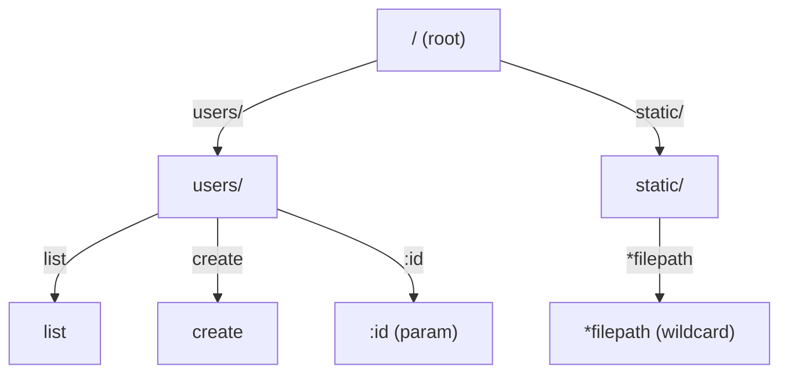
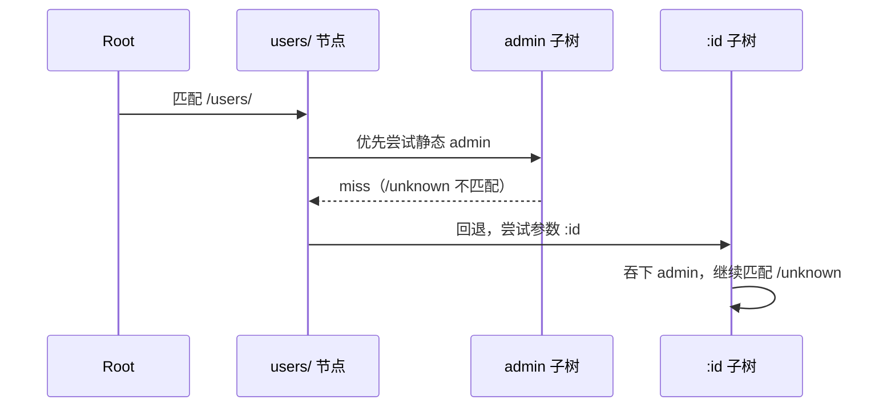
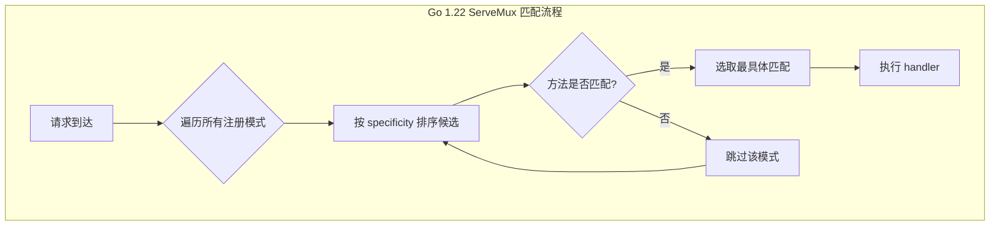
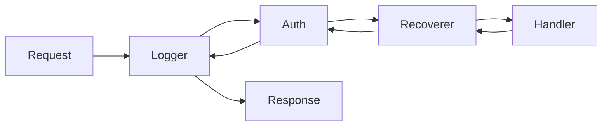

# 高性能 Web 路由架构——Radix Tree 与中间件流水线设计

**摘要：**

任何一个成熟的 Web 框架，其核心都由两块相互咬合的齿轮构成：一是把 URL 路径映射到具体处理函数的路由器（Router），二是在请求到达处理函数之前依次执行鉴权、日志、限流、编解码等横切逻辑的中间件流水线（Middleware Pipeline）。前者决定了一个请求「找谁处理」的延迟上界，后者决定了请求在「开始处理之前」要付出多少额外开销。两者任何一个选型失当，都会在每秒数万请求的流量下被放大成可观测的 CPU 与尾延迟（P99）问题。

Go 生态的路由方案在过去十年走过一条清晰的演进路径：从早期 `net/http` 默认 `ServeMux` 的纯前缀匹配，到 2013 年 Julien Schmidt 发表的 httprouter 把 Radix Tree（压缩前缀树）引入 Go Web 生态并确立「零分配路由匹配」的性能标杆，再到 2017 年之后 Chi 以「完全兼容 `net/http`」为卖点用普通 Trie 重建中间件链，直至 2024 年 Go 1.22 原生 `ServeMux` 一口气补齐方法匹配与 `{id}` 通配符，使「不用框架」的门槛显著下降。这三条并行路线——Radix Tree 派、Trie+中间件派、标准库增强派——各自占据不同的权衡位置，并不存在谁「绝对更好」的结论。

本文将围绕三个核心问题展开：其一，Radix Tree 作为路由数据结构，究竟做了哪些压缩与分裂操作，使得它在百万级路由表下依然保持常数级匹配？其二，中间件流水线的组合子设计与上下文（Context）的零分配复用，如何在框架内部实现——Gin 的 [[Golang/Go并发编程/10 sync.Map、sync.Pool 与原子操作|sync.Pool]] 池化与 Chi 的纯函数链有何取舍？其三，当路径参数、通配符、静态段在同一子树中发生优先级冲突时，不同框架如何裁决，以及「标准库是否够用」这个老问题的新答案。这三个问题的答案，共同构成了 [[Golang/Go生态与框架设计/00 专栏导览|Go 生态与框架设计]] 专栏的起点，也与 [[Golang/Go网络编程与持久化/00 专栏导览|Go 网络编程与持久化]] 专栏中关于原生 Handler 链的讨论形成对照——理解框架路由的设计，必须先理解它试图替代或扩展的底层机制。

---

## 第 1 章 从线性扫描到压缩前缀树：路由的数据结构革命

### 1.1 路由问题的本质

所谓「路由」，本质上是一个从字符串集合到处理函数的查找操作：给定一张形如 `/users/:id/posts`、`/static/*filepath`、`/api/v1/health` 的注册表，和一个具体的请求路径 `/users/42/posts`，路由器必须在微秒级返回对应的处理函数，并顺便把 `id=42` 这类路径参数提取出来。这件事听起来平凡，但它的性能上界直接决定了整个框架的吞吐天花板——在典型的微服务中，单次路由匹配若从 200ns 退化为 2μs，在一台八核机器上每秒十万请求的量级下就会多出近 1.5 秒的 CPU 时间，而这些时间原本可以用于序列化响应或读写数据库连接池。

最早期的 Go `ServeMux`（2009 年随 Go 前身问世）采用的是一种近乎直白的方案：把所有注册的路径模式（pattern）存进一张表，每次请求进来就从头遍历，逐一调用前缀匹配函数。这种做法在路由数量少于几十个时尚可接受，但有两个致命缺陷：一是时间复杂度为 O(N)，路由数量线性增长时匹配时间随之线性增长；二是前缀匹配无法处理「路径参数」这类动态片段，遇到 `/users/42` 这种请求时，旧版 `ServeMux` 只能把它派给一个兜底的 `/users/` 前缀，再由处理函数自己用 `strings.Split` 解析——这相当于把路由本该承担的结构化职责下放到业务代码里，既无法统一鉴权、也无法生成反向链接（reverse URL generation）。

如果把这种线性扫描想象成一座没有索引的图书馆：每来一个读者，图书管理员都要从第一排书架开始逐本比对书脊上的编号，直到找到匹配的那一本。读者数量少时这种笨办法尚可应付，一旦藏书超过一万册，每次查找都要走过大半座图书馆，读者排队等候的时间便再也无法忽视。

### 1.2 Radix Tree 的登场：httprouter 的破局

2013 年，Julien Schmidt 在 httprouter 项目中首次将 Radix Tree（也叫 Patricia Trie、压缩前缀树）系统性地引入 Go 路由实现。Radix Tree 的思想可以追溯到 1968 年 Morrison 的论文，它的核心操作是**公共前缀压缩**：若两条路径 `/users/list` 与 `/users/create` 共享前缀 `/users/`，则在树中合并为一条边，只在末端分支处才分裂为 `list` 与 `create` 两个子节点。这种压缩带来的直接收益是，树的高度远小于路径总数，查找时间从 O(N) 下降到 O(k)（k 为路径的字符段数，通常不超过 10）。

可以把 Radix Tree 想象成一座城市的高速公路系统：普通的 Trie 是每个字符都设一个收费站，车辆（请求）每走一个字符就要停下来核对一次；Radix Tree 则把相邻的、没有分叉的收费站合并成一段直达高速，只有当道路真正分叉（譬如 `/users/` 之后既可能是 `/list` 也可能是 `/create`）时才设分流口。车辆从入口到目的地只需要在少数几个分叉口做决策，其余时间都是无停顿的直达。

httprouter 的成功并不仅在于数据结构本身。它真正的突破在于把 Radix Tree 的查找过程实现为**零堆分配（zero allocation）**——整棵树的节点在注册阶段一次性构建完成，匹配过程中只沿着指针向下走，既不申请内存、也不构造中间字符串。这种设计让路由匹配的耗时稳定在百纳秒级，成为之后所有 Go 路由器的性能参照。与此形成对比的是，[[Golang/Go网络编程与持久化/01 原生 HTTP 服务端架构——Handler 链与 Go 1.22 增强路由树|原生 `ServeMux`]] 直到 2024 年的 Go 1.22 才引入真正的树形匹配，在此之前每个请求的匹配过程都伴随着模式字符串的反复切片与比较。

### 1.3 不这样做的代价

如果一个框架放弃树形结构而退回到线性扫描，在路由数量较小时（譬如几十个）几乎感觉不到差别，但一旦路由表膨胀到数千条——这在大型微服务、OpenAPI 生成的客户端、或者包含大量 RESTful 资源的 SaaS 平台中并不罕见——每个请求就要付出数百次字符串比较的代价。更隐蔽的问题是**优先级歧义**：当 `/users/new` 与 `/users/:id` 同时存在时，线性扫描必须依赖注册顺序或显式优先级规则来决定匹配谁，而 Radix Tree 天然把静态段放在参数段之前，通过树结构本身消除了歧义。

另一个不常被提及的代价是**反向链接生成**。一个设计良好的路由系统不仅能把请求路径映射到处理函数，还应当能从「路由名 + 参数」反向构造出 URL——这在 RESTful 服务的 HATEOAS 链接、HTTP 重定向目标构造、邮件中的确认链接等场景中非常有用。Radix Tree 的节点结构天然支持这种反向操作（从叶子回溯到根，遇到参数节点时填入具体值），而线性扫描或纯模式列表则必须遍历所有模式逐一尝试反向替换，代码复杂度陡增。

### 1.4 httprouter 的内部结构速写

要理解 httprouter 为什么快，必须看一眼它的核心数据结构。每个节点（`node`）大致包含以下字段：`path`（当前节点的边标签，即该段无分叉的路径字符串）、`wildChild`（布尔标记，指示是否存在参数子节点）、`indices`（静态子边的首字符索引表，用于快速二分查找）、`children`（子节点指针切片）、`handle`（叶子上的处理函数）。匹配时，算法首先在当前节点的 `indices` 中用 O(log n) 或 O(1) 查找请求路径下一个字符是否命中某个静态子边，命中则递归进入该子树；否则若 `wildChild` 为真，则进入参数子节点；最后若节点自身带有通配符处理函数，则吞掉剩余路径。

这里有两个值得注意的工程细节。其一，`indices` 把静态子边的查找从线性扫描降为常数或 log 级，这是 httprouter 在节点层面做的第一层优化；其二，`handle` 不是单一的处理函数，而是一个按 HTTP 方法索引的数组（实际实现是一个 `[]methodHandle` 结构，每个元素包含方法字符串与对应的 HandlerFunc），这使得同一棵树可以同时服务 GET、POST、PUT、DELETE 等不同方法而不互相干扰——这种「按方法分树」的设计与 Go 1.22 ServeMux 的「方法作为模式的一部分」形成了有趣的对照。

可以把这种结构想象成一座现代化机场的分拣系统：行李（请求）到达分拣口后，首先扫描目的地代码的首字母（`indices` 查找），被送入对应的滑道（子树），如果首字母没有命中，则被送到「其他」滑道（参数子节点），最终如果所有滑道都不接收，则被扔进「失物招领」筐（通配符）。每个滑道本身又是一套嵌套的分拣系统，直到行李抵达最终出口。这种多级分拣的设计，使得即使每小时处理十万件行李，每件行李在分拣系统中逗留的时间也只有毫秒级。

---

## 第 2 章 Radix Tree 的路由匹配算法：压缩、分裂与回溯

### 2.1 公共前缀压缩与边分裂

Radix Tree 的每个节点不存储单个字符，而是存储一段**无分叉的字符串（edge label）**。插入新路径时，算法从根出发，沿着已有边尽可能多地匹配公共前缀，直到三种情况之一出现：

1. **完全匹配**：新路径与某条已有路径完全重合，此时直接在该节点上追加新的 HTTP 方法处理函数（GET、POST 分别存储）；
2. **边中间分裂（Edge Split）**：新路径在已有边的中途分叉，譬如已有边是 `users/list`，新路径是 `users/list-detail`，则把原边在 `list` 处断开，新建一个中间节点，原 `list` 的后续部分与新的 `-detail` 分支分别挂在它下面；
3. **叶子延伸**：公共前缀耗尽后，剩余部分作为新边直接挂在当前节点下。

这三种操作保证了树中不存在「只有一个子节点」的冗余节点（即所谓「压缩」的本义），也使得节点总数始终不超过边数的两倍。注册阶段可能发生的分裂代价是 O(k)，但这是一次性成本，分摊到后续百万次查询上可以忽略不计。

下面的流程图刻画了一条典型 Radix Tree 在插入 `/users/list`、`/users/create`、`/users/:id`、`/static/*filepath` 之后的结构：



在这棵树中，查找 `/users/42` 的路径是：从根出发沿 `users/` 边到达 `Users` 节点，静态子边 `list`、`create` 均 miss，退到参数子边 `:id`，吞下 `42`，到达叶子 `UsersParam`，返回对应的处理函数并记录参数 `id=42`。整个过程只涉及 3 次指针跳转与 2 次字符串比较，无任何堆分配。

### 2.2 静态、参数与通配符的混合匹配

纯静态路径的匹配只是沿指针向下走，真正的复杂性来自三类节点的共存：静态段（`/users`）、参数段（`:id`）、通配符段（`*filepath`）。httprouter 的 Radix Tree 为每个节点维护**三张独立的子节点表**，匹配时按固定优先级尝试：

1. **静态段优先**：先看当前请求片段是否命中任一静态子边，命中则直接进入该子树，不再考虑参数与通配符；
2. **参数段次之**：静态段全部 miss 时，尝试参数子节点（以 `:` 开头），把当前片段作为参数值吞下，继续向下匹配；
3. **通配符兜底**：参数段也 miss 时，最后尝试通配符子节点（以 `*` 开头），它会吞掉从当前位置到路径末尾的所有内容，且通配符节点必须是叶子节点（这是 httprouter 的硬约束）。

这种「静态 > 参数 > 通配符」的优先级并非任意选择，而是由 URL 语义决定的：`/users/me` 中的 `me` 应该匹配静态的「当前用户」处理逻辑，而不是作为 `:id` 参数被解析为一个普通用户 ID；只有当不存在专门的静态路由时，才退化为参数匹配。通配符通常用于静态文件服务（`/static/*filepath`），它必须放在最后，否则任何更长路径都会被它过早吞掉。

可以把这种优先级机制想象成医院的分诊规则：已知名字的专家门诊（静态）优先于按科室轮转（参数），而「全科兜底」（通配符）永远排在最后——只有前两者都无法处理时，病人才会被送到全科。这种设计既保证了高频请求的快速路径，又避免了兜底逻辑过早截胡专科请求。

### 2.3 回退回溯（Backtracking）

最棘手的边界情况出现在「参数段匹配成功但后续子树 miss」时。考虑如下注册表：

```go
r.GET("/users/:id", getUser)
r.GET("/users/:id/posts", getUserPosts)
r.GET("/users/admin/settings", getAdminSettings)
```

当请求 `/users/admin/settings` 到来时，Radix Tree 在 `Users` 节点会遇到三个子节点：静态 `admin`、参数 `:id`。按优先级先尝试静态 `admin`，进入该子树后继续匹配 `/settings`——如果该子树中存在 `settings` 静态边，直接命中；但若请求变成 `/users/admin/unknown`，静态子树 miss 了，算法必须**回退**到父节点，重新尝试参数 `:id` 分支，把 `admin` 作为参数值吞下。



这种回溯在 httprouter 的早期版本中曾导致某些 pathological case 下性能退化，后续版本通过限制通配符节点位置与引入「通配符不能与同层参数共存」的注册期校验，把回溯控制在有界范围内。Gin 继承了这些优化，因此在绝大多数真实 API 设计下，回退只发生零次或一次。

可以把回退想象成导航软件的「路线重新规划」：当首选路线在某个路口发现封路时，不是直接报错，而是退回到上一个分叉口重新选择。只要封路是少数情况，重新规划的开销远小于每次都从头搜索；但若路网本身设计混乱、封路过多，回退的累积代价就会凸显——这也是为什么路由注册时需要遵循「静态优先、通配符置底」的纪律。

### 2.4 树结构的内存权衡

Radix Tree 的空间复杂度大致为 O(M·k)，其中 M 是注册的路径数、k 是平均路径段数。每个节点需要存储 edge label（字符串）、子节点指针数组（通常 3 个，分别对应静态、参数、通配符）、以及叶子上的方法-处理函数映射。与线性表相比，树结构在路由数量少时可能更占内存（因为节点开销），但当路由数量达到数百条以上时，压缩带来的共享前缀反而让总内存低于朴素存储。

Gin 继承的 httprouter 实现中，整棵树在 `router.Engine()` 初始化完成后即冻结，运行时只读不写，这使得它可以被并发请求安全地共享而无需加锁——这一点对多核 Go 服务端的吞吐至关重要。冻结也意味着不支持运行时动态增删路由，任何「热更新路由」的需求都必须通过整体替换路由器实例来实现，这是 Radix Tree 派框架一个常被忽略的工程约束。

---

## 第 3 章 三大路由架构对比：Gin、Chi 与 Go 1.22 ServeMux

### 3.1 Gin：httprouter 派生的 Radix Tree

Gin 在 2014 年发布时直接 fork 了 httprouter 的路由树代码，并在其上叠加了自己的 `gin.Context`、中间件分组与绑定工具。它的核心匹配逻辑——包括按 HTTP 方法分离的 9 棵树（GET/POST/.../HEAD 各一棵）、静态/参数/通配符三优先级、通配符必须为叶子等约束——几乎原样保留。Gin 的工程贡献主要在于把 Context 做成可池化（详见第 4 章）和把中间件按路由组（`router.Group`）分层挂载，使得「`/api/v1` 下挂鉴权、`/public` 下不挂」这类分层策略能自然表达。

Gin 的路由注册期会进行严格校验：若检测到通配符与同层参数冲突、或同一路径重复注册，会立即 panic 而非默默覆盖。这种「fail-fast」策略在开发阶段就能暴露配置错误，避免上线后才发现某条路由被意外遮蔽。代价是注册过程相对脆弱，升级 Gin 版本时偶尔会触发新的注册期 panic，需要人工调整路由结构。

### 3.2 Chi：纯 `net/http` 兼容的 Trie + 中间件链

Chi 发布于 2017 年，它的设计哲学与 Gin 截然相反：不引入任何私有类型，所有处理函数签名严格保持 `func(http.ResponseWriter, *http.Request)`，中间件就是 `func(http.Handler) http.Handler`。这意味着任何为 `net/http` 写的 handler 都可以无缝插入 Chi 的路由树，反之亦然。Chi 的路由器基于普通 Trie（非压缩），每个路径段作为一个节点，参数段（`/{id}`）与通配符段（`/{path...}`）作为特殊节点挂在其父节点下。

这种设计的代价是性能：Chi 的匹配速度比 Gin 慢一个数量级（在基准测试中通常是 1-2μs 对 100-200ns），但它换来了两个工程优势：一是与标准库生态的完全兼容，任何 `net/http` 中间件（譬如 `gzip`、`cors`、`prometheus` 官方 exporter）都能直接挂载；二是路由树本身可以被当作普通 `http.Handler` 嵌套，便于构建大型多租户服务。

Chi 的中间件生态是其最大的护城河。`go-chi/chi/middleware` 子包提供了超过 30 种开箱即用的中间件，涵盖日志、限流、CORS、请求 ID 注入、实时（RealIP）提取、超时控制等常见需求，这些中间件的签名都是标准的 `func(http.Handler) http.Handler`，可以无摩擦地迁移到任何基于 `net/http` 的框架。这种兼容性在大型组织中尤为重要——当团队需要在 Gin、Echo、标准库服务端之间共享中间件时，Chi 风格的中间件就成了事实上的「通用货币」。

Chi 的路由树在实现上比 Radix Tree 简单得多：每个路径段（`/` 分隔的片段）对应树的一层，参数段 `{id}` 只是一个特殊标记的节点。匹配时从根开始，逐段向下遍历，遇到静态段就精确匹配，遇到参数段就吞下当前段作为参数值，遇到通配符段就吞下剩余所有段。因为没有公共前缀压缩，树的高度等于最长路径的段数，每个节点只存一段字符串，内存开销比 Radix Tree 更大；又因为没有 `indices` 索引，每个节点的子边查找是线性扫描，在子节点较多的情况下性能进一步下滑。不过对于典型的路由表（几百条路由、每条路由不超过 10 段），这些开销都在可接受范围内。

### 3.3 Go 1.22 原生 ServeMux：迟到但完整

在长达十年的时间里，标准库 `ServeMux` 一直是 Go 开发者「不得不用第三方框架」的首要原因。Go 1.22（2024 年 2 月发布）对 `ServeMux` 做了一次彻底的升级：引入了 `method + path` 联合模式（譬如 `GET /users/{id}`）、支持 `{name}` 形式的命名参数、支持 `{path...}` 形式的尾缀通配符、支持 `{$}` 精确匹配根路径，并在注册阶段自动检测模式冲突（譬如同时注册 `/users/{id}` 与 `/users/admin` 时会产生 panic）。

新版 `ServeMux` 的底层并非 Radix Tree，而是一种**按最长前缀优先的树形匹配**，它在注册时构建模式树，匹配时遍历所有可能匹配的模式并选取「最具体」的一个——具体性（specificity）的排序规则由 Go 团队在 proposal 57596 中严格定义：静态段优先级最高，通配符次之，方法限定的模式优先于不限定方法的模式。这种设计的工程优点是语义直观、冲突检测严格，但在性能上仍然不如 Radix Tree：每个请求需要计算路径与所有注册模式的「最具体匹配」，无法像 Radix Tree 那样通过指针跳转直接定位。

ServeMux 的模式语法与 httprouter 有一个微妙但重要的差异：`{name}` 匹配到下一个斜杠为止（不能包含斜杠），而 `{name...}` 必须出现在模式末尾且匹配从当前位置到路径末尾的所有内容（包括斜杠）。这与 httprouter 的 `:id` 与 `*filepath` 在语义上是对应的，但写法不同。迁移时若不注意，容易出现「原本在 Gin 中匹配的多级路径，在 ServeMux 中用了 `{id}` 而只能匹配单级」的错误。

另一个工程上的差异是**方法限定的优先级**。Go 1.22 的 ServeMux 允许注册 `GET /users/{id}` 与 `/users/{id}`（不限方法），后者的优先级低于前者——当请求方法是 GET 时，优先匹配限定方法的模式；当请求方法是 POST 且没有 `POST /users/{id}` 时，才退到不限方法的兜底模式。这种「最具体匹配」的语义比 httprouter 的「按方法分树」更灵活，但也更难预测——开发者必须同时考虑路径与方法两个维度才能确定某个请求会被哪个模式匹配。



### 3.4 横向对比

| 维度 | Gin (httprouter) | Chi | Go 1.22 ServeMux |
|---|---|---|---|
| 数据结构 | Radix Tree（压缩前缀树） | 普通 Trie | 模式树（按 specificity 排序） |
| 单请求匹配耗时 | ~200ns | ~1-2μs | ~500ns-1μs |
| 零堆分配 | 是 | 否 | 部分（参数提取需分配） |
| 路径参数语法 | `:id`、`*filepath` | `{id}`、`{path...}` | `{id}`、`{path...}` |
| `net/http` 兼容 | 私有 `gin.Context` | 完全兼容 | 完全兼容 |
| 中间件生态 | Gin 专属 | 直接使用 `net/http` 中间件 | 直接使用 `net/http` 中间件 |
| 注册期冲突检测 | 通配符与参数同层报错 | 宽松 | 严格（conflict panic） |
| 反向 URL 生成 | 支持（通过路由名） | 不原生支持 | 不原生支持 |
| 适用场景 | 高吞吐 API 服务 | 需要复用 `net/http` 生态的中大型服务 | 中小型服务、微服务、新 Go 项目 |

从表中可以看出，三者并非简单的「新替旧」关系：Gin 的性能优势在超高吞吐场景下依然不可替代，Chi 的生态兼容性在需要拼接多种标准中间件时最有价值，而原生 `ServeMux` 则让「小型服务不必引入框架依赖」成为顺理成章的选择。

---

## 第 4 章 中间件流水线的组合子设计与零分配上下文

### 4.1 中间件作为函数组合子

在 Go 的 HTTP 模型中，中间件的标准签名是 `func(http.Handler) http.Handler`——它接收一个 handler，返回一个新的 handler。这种签名的数学本质是**自同态（endomorphism）**：handler 集合在中间件的作用下闭合，多个中间件的组合等价于函数的复合（composition）。Chi 正是利用了这一性质，把中间件链写成：

```go
r := chi.NewRouter()
r.Use(middleware.Logger)
r.Use(middleware.Recoverer)
r.Use(middleware.Compress(gzip.LevelDefault))

r.Route("/admin", func(r chi.Router) {
    r.Use(middleware.Auth)
    r.Get("/", adminHandler)
})
```

每一次 `Use` 都是把所有已注册的中间件「包」在外层，最终请求到达业务 handler 之前，已经像洋葱一样被层层包裹——这就是 Web 社区常说的「洋葱模型」。每一层中间件可以在调用 `next.ServeHTTP(w, r)` 之前做前置处理（譬如解析 token、记录开始时间），在调用之后做后置处理（譬如记录耗时、写入响应头），错误与 panic 也可以在这条回路上被统一捕获。



这种设计的优雅之处在于**可组合性**：任何一个中间件都可以独立测试、独立替换、独立在多个路由组之间复用。当团队决定从 Logger A 切换到 Logger B 时，只需修改 `r.Use(...)` 的一行，业务代码完全不受影响。这种「横切关注点与业务逻辑解耦」的思想，与 AOP（Aspect-Oriented Programming）在 Java 生态中的定位如出一辙，但实现上更为轻量——不需要字节码增强或注解处理器，纯粹依靠函数组合。

### 4.2 框架私有 Context 的代价与收益

Gin 选择不直接使用 `*http.Request` 作为上下文载体，而是引入了自己的 `gin.Context` 结构体。这个结构体内嵌了 `*http.Request`，同时附带了已解析的路径参数（`Params`）、响应状态码、中间件索引、以及一系列用于 JSON 渲染、绑定、校验的便捷方法。这样做的工程收益是显而易见的：业务代码只需一个参数就能访问所有请求相关状态，不必在多个中间件之间通过 `r.WithContext(r.Context().WithValue(...))` 这种略显繁琐的方式传递。

但代价是类型不兼容：`gin.HandlerFunc` 的签名是 `func(*gin.Context)`，任何为 `net/http` 写的标准 handler 或中间件都无法直接用于 Gin，必须通过 `gin.WrapH` 或 `gin.WrapF` 做适配。这种私有抽象在框架初期能快速迭代，但长期看会形成「生态孤岛」——Gin 社区不得不维护自己的中间件仓库，而不是复用 `net/http` 生态经过多年验证的实现。

从更宏观的视角看，这种「私有 Context vs 标准 Context」的抉择，是整个 Go 生态中反复出现的主题——类似的张力也出现在 `database/sql` 与 GORM 的 Active Record 之间、在 `log/slog` 与 zap 的结构化日志之间、在 [[Golang/Go工程实践/03 Go 错误处理哲学——从 error 到 errors.Is 与 errors.As|标准 error 与框架自定义错误类型]] 之间。每一次抉择的核心问题都是：「为了短期工程便利引入的私有抽象，长期看是否会成为生态互通的障碍？」答案因具体场景而异，但倾向于标准接口的方案通常在五年尺度上更具生命力。

### 4.3 sync.Pool 与零分配上下文

在高吞吐场景下，每个请求都 `new(gin.Context)` 是不可接受的：每秒十万请求意味着每秒十万次 Context 的分配与回收，这些短命对象会迅速填满 P0 代（generation 0）的垃圾回收队列，触发频繁的 Young GC。Gin 的解决方案是用 `sync.Pool` 把 Context 池化：

```go
var contextPool = sync.Pool{
    New: func() interface{} {
        return &Context{}
    },
}

func (engine *Engine) serveHTTP(c *Context) {
    ctx := contextPool.Get().(*Context)
    ctx.reset()                      // 清空上一次请求的残留状态
    defer contextPool.Put(ctx)       // 用完后归还
    engine.handleHTTPRequest(ctx)
}
```

`sync.Pool` 是 Go 标准库提供的 per-P（per-processor）缓存结构，它的核心特性有三：一是每个 P（逻辑处理器）维护一个本地队列，Get 优先从本地取，避免跨 P 竞争；二是 GC 触发时会清空池中所有对象（这是 Go 1.13 之后的行为修正），防止内存泄漏；三是 New 工厂函数只在池空时被调用。通过池化，Gin 把 Context 的分配开销摊销到接近零，单请求的堆分配次数从十几次下降到个位数。

这种设计的边界在于：池化对象必须是无状态的，或者说，归还时必须被彻底 reset。Gin 的 `Context.reset()` 会把 `Params`、`Keys`（用于中间件传值的 map）、`Errors` 等字段清空或置零，任何在业务代码中持有的 Context 引用在请求结束后都会变成「脏指针」——这是一个常见的 bug 来源，譬如在异步 goroutine 中使用 `c.JSON()` 而不先复制 Context，就会读到已被其他请求污染的数据。正确的做法是在派生的 goroutine 中使用 `c.Copy()` 获取一个独立副本，或者干脆把需要的数据提取为局部变量再传入。

池化设计还有一个更微妙的性能边界：`sync.Pool` 的 `Get` 与 `Put` 本身虽然比 `make` 快，但在极高并发下（譬如每秒数十万请求、数十个 P 同时竞争），Pool 内部的 local get 与 shared put 之间的同步开销也会成为瓶颈。Go 1.13 之后 Pool 的实现做了大量优化（包括 per-P local 队列的无锁化），但在 benchmark 中仍可观察到 Pool 在高 GOMAXPROCS 下的吞吐量上界。某些极端场景下（譬如每秒百万请求的 API 网关），开发者会考虑用 per-P 的自定义环形缓冲区替代 `sync.Pool`，以避免跨 P 的共享队列竞争——这种做法牺牲了通用性，换来了更确定的延迟分布。

Chi 没有采用 Context 池化，因为它根本没有私有的 Context 类型。每个请求的 `*http.Request` 由 `net/http` 服务端池化（`http.Server` 内部复用 request 对象的部分字段），中间件通过 `r.WithContext()` 创建新的 Request 副本——这涉及一次 `*Request` 的浅拷贝与一次 Context 树的包装，开销比 Gin 的池化大，但比每次从头构造小。这种设计反映了 Chi 的核心哲学：不追求极致性能，而是追求与标准库的无缝兼容。

### 4.5 中间件的性能影响：洋葱模型的代价

中间件流水线的性能影响常被低估。每增加一层中间件，请求就多经历一次函数调用、一次可能的堆分配（譬如记录日志时的时间戳格式化）、以及一次 defer 的注册与执行。在 Gin 的基准测试中，从「无中间件」到「Logger + Recoverer」，单请求延迟会增加约 20-50%；加上 Compress 中间件后，延迟进一步翻倍。这些开销在每秒千次请求下微不足道，但在每秒十万次请求下就会累积成可观的 CPU 成本。

更隐蔽的性能陷阱是**中间件中的反射与序列化**。许多日志中间件使用 `runtime.Caller()` 获取调用栈、使用 `fmt.Sprintf` 格式化字符串、使用 `json.Marshal` 序列化请求信息——这些操作在 benchmark 中看似只需几微秒，但在高并发下会触发大量的堆分配，加剧 GC 压力。生产级的日志中间件通常会使用 `sync.Pool` 复用 buffer、使用 `strconv.AppendInt` 替代 `fmt.Sprintf`、使用异步队列把日志写入推迟到后台 goroutine，以避免阻塞请求处理路径。

下面是一个简化的零分配日志中间件示例，展示了如何用 buffer pool 与异步写入降低中间件的开销：

```go
var bufPool = sync.Pool{
    New: func() any { return new(bytes.Buffer) },
}

func ZeroAllocLogger(next http.Handler) http.Handler {
    return http.HandlerFunc(func(w http.ResponseWriter, r *http.Request) {
        buf := bufPool.Get().(*bytes.Buffer)
        buf.Reset()
        start := time.Now()
        next.ServeHTTP(w, r)

        // 用 strconv 替代 fmt.Sprintf，避免堆分配
        buf.WriteString(r.Method)
        buf.WriteByte(' ')
        buf.WriteString(r.URL.Path)
        buf.WriteString(strconv.FormatInt(time.Since(start).Milliseconds(), 10))

        logLine := buf.String()
        go func() { logOutput.Println(logLine) }()  // 异步写入
        bufPool.Put(buf)
    })
}
```

这段代码的关键点有三：一是使用 `sync.Pool` 复用 `bytes.Buffer`，避免每次请求都分配新的 buffer；二是使用 `strconv.FormatInt` 与字节级写入，替代 `fmt.Sprintf` 的反射与字符串拼接；三是把日志写入放到 goroutine 中异步执行，不阻塞请求处理路径。当然，这种优化是有代价的——异步写入引入了日志丢失的风险（进程崩溃时未写入的日志会丢失），`sync.Pool` 在 GC 时被清空的特性也意味着 buffer 的复用率并非 100%。在日志完整性要求极高的场景下（譬如审计日志），仍然需要同步写入并放弃 buffer pool。

另一个常被忽视的问题是**中间件的 defer 滥用**。在中间件中广泛使用 `defer` 做后置处理（譬如记录耗时、写审计日志）是一种看似优雅但性能不佳的做法——Go 的 defer 在 1.14 之前每次调用都要做堆分配，在 1.14 之后虽有优化（open-coded defer），但在高频路径上仍然是不可忽视的开销。高性能中间件通常会用显式的「前置代码 + 后置代码」两段式结构替代 defer，或者把后置处理放到一个单独的中间件中，以减少 defer 的嵌套层数。

### 4.6 中间件的数据传递模式

中间件之间、中间件与 handler 之间需要传递数据（譬如鉴权中间件把 user_id 传给业务 handler）。Go 生态中有三种常见的数据传递模式：

1. **Context Value**：使用 `context.WithValue(ctx, key, value)` 把数据挂在请求的上下文树中。这是标准库推荐的方式，Chi 与原生 `ServeMux` 场景下最常用。缺点是 key 的类型必须小心处理（字符串 key 容易冲突，推荐用未导出的 struct 类型作为 key），且取值时需要类型断言，编译器无法保证安全。
2. **Request Header**：把数据注入到 `r.Header` 中（譬如 `X-User-Id: 42`），业务代码从 Header 中读取。这种方式的好处是数据可以被下游服务（譬如反向代理）透明传递，缺点是 Header 会被序列化到网络上，不适合传递大对象或敏感信息。
3. **框架私有 Context**：Gin 的 `c.Set("user_id", 42)` 与 `c.Get("user_id")` 把数据存在 `gin.Context.Keys` 这个 map 中。这种方式类型安全较差（仍然是 `interface{}`），但 API 最顺手，且数据不会随 Request 复制到下游服务。

三种模式并无绝对优劣，选择取决于数据的作用域与生命周期。跨服务传递用 Header，单服务内传递用 Context Value 或框架私有 Context，敏感数据用后者（避免泄漏到日志或响应头中）。

---

## 第 5 章 参数解析、路径优先级冲突与边界

### 4.4 中间件顺序与短路语义

中间件的执行顺序并非无关紧要，它直接决定了请求的处理语义。一个典型的顺序约定是：

1. **Recoverer**（最先）：捕获后续所有中间件与 handler 的 panic，防止进程崩溃；
2. **Logger / RequestID**（次之）：在请求进入业务逻辑前记录入口信息，即便后续出错也有据可查；
3. **Auth / RateLimit**（中段）：在业务处理前完成鉴权与限流，不合法请求在此短路返回 401/429，不进入后续 handler；
4. **Compress / CORS**（靠后）：对响应做编码或添加跨域头，必须在 handler 写响应之前设置好 header；
5. **Handler**（最后）：真正执行业务逻辑。

「短路」是中间件流水线的一个重要语义：某一层中间件可以选择不调用 `next.ServeHTTP`，直接写响应返回。限流、鉴权、缓存命中（cache-aside）都依赖短路。这种设计使得「拒绝非法请求」的开销几乎为零——请求在流水线前端被拦截，不会触达昂贵的业务逻辑或数据库查询。但短路也引入了调试上的复杂性：当响应不符合预期时，开发者必须逐层排查是哪一层中间件短路了请求，这在中间件数量较多时可能变成一场考古活动。

---

## 第 5 章 参数解析、路径优先级冲突与边界

### 5.1 路径参数的语义陷阱

路径参数（`/users/:id`）看似简单，但语义上有三个常被忽略的边界：

1. **类型不校验**：Radix Tree 把 `:id` 视为「任何非空字符串片段」，`/users/abc` 与 `/users/42` 在路由层面等价。类型校验（id 必须是数字、必须是 UUID）必须由业务代码或中间件完成，框架不会代劳。把「数字 ID」的假设写进路由层是常见的语义错位。
2. **斜杠不分段**：参数段只匹配「两个斜杠之间」的内容，`/users/:id` 不会匹配 `/users/42/extra`。若需要吞掉多级路径，必须显式使用通配符（`*filepath` 或 `{path...}`）。
3. **URL 编码**：`/users/hello%20world` 中的 `%20` 在路由匹配阶段保持编码形式，业务代码需调用 `r.URL.Query().Get("id")` 或框架提供的解码方法才能得到原始字符串。这一行为在 Gin 与标准库之间是一致的，但 Chi 的早期版本曾有过不一致的处理，需要升级到新版。

一个更为隐蔽的陷阱是**空参数**：`/users/` 是否匹配 `/users/:id`？在 httprouter 中答案是否定的——参数段必须非空；但在某些其他框架中，空参数可能被当作空字符串传入。这种语义差异在跨框架迁移时可能引发难以察觉的 bug。

### 5.2 优先级冲突的工程案例

考虑如下注册表：

```go
r.GET("/users/me", getMe)
r.GET("/users/:id", getUser)
r.GET("/users/:id/posts", getUserPosts)
r.GET("/users/admin/settings", getAdminSettings)
r.GET("/*", notFound)
```

按 Radix Tree 的优先级规则：

- `/users/me`：静态段优先，命中第一条；
- `/users/42`：静态 miss，退到参数，命中第二条；
- `/users/me/posts`：先尝试静态 `me` 的子树，发现 `posts` 不在 `me` 的子节点中，**回退**到参数 `:id` 子树，命中第三条（id=me）；
- `/users/admin/settings`：静态 `admin` 子树中存在 `settings`，直接命中第四条；
- `/unknown`：所有具体路径 miss，最后兜底到第五条通配符。

这种优先级规则在 Gin 中通过 Radix Tree 的结构自然实现，但在 Chi 与 Go 1.22 ServeMux 中则依赖注册顺序或 specificity 计算。Chi 的文档明确警告：「同一层级同时注册 `/{id}` 与 `/me` 时，`/me` 必须在前」——这是线性扫描顺序的体现。Go 1.22 ServeMux 则通过注册期冲突检测自动处理：若注册顺序违反 specificity 规则，会在启动时 panic，而不是默默地在运行时给出错误的匹配。

### 5.3 通配符与参数不能共存的约束

httprouter 有一条硬约束：**同一节点的同一层级不能同时存在参数子节点与通配符子节点**。譬如以下注册会 panic：

```go
r.GET("/files/:user/avatar.png", handler1)
r.GET("/files/*filepath", handler2)
```

这条约束的原因是 Radix Tree 的结构决定了通配符必须「吞掉所有后续内容」，如果允许它和参数共存，匹配算法将面临二义性：`/files/alice/avatar.png` 究竟该匹配参数（user=alice, 后续静态段）还是通配符（filepath=alice/avatar.png）？httprouter 选择在编译期拒绝这种歧义，而不是在运行时冒险回溯。这种「编译期拒绝」的工程哲学与 Go 语言本身的「显式优于隐式」一致——它牺牲了一些表达力，换来了运行时行为的可预测性。

Chi 与 ServeMux 没有这条约束，但它们用「 specificity 排序」替代——当存在歧义时，选取「更具体」的那个模式。这种设计表达力更强，但语义更难预测，开发者必须理解 specificity 的完整排序规则才能确定某个请求会被哪个模式匹配。

### 5.4 查询参数与路径参数的混淆

另一个常见的语义错误是把**查询参数（query parameter）**与**路径参数（path parameter）**混为一谈。路径参数是 URL 路径的一部分（`/users/42` 中的 `42`），由路由器解析；查询参数是 URL 问号后面的键值对（`/users?id=42&fields=name` 中的 `id=42`），由 `r.URL.Query()` 解析。两者在语义上有本质区别：路径参数标识**资源本身**（哪个用户），查询参数标识**操作的修饰符**（返回哪些字段、按什么排序、分页偏移）。

把查询参数写进路径（譬如 `/users/42/name/email/phone`）是一种「RESTful 过度设计」的反模式——它让 URL 结构变得僵硬（每增加一个可选字段就要新增一条路由），也让客户端构造 URL 变得复杂（必须按固定顺序拼接路径段）。更合理的做法是保持路径简洁（`/users/42`），用查询参数传递可选的修饰符（`/users/42?fields=name,email,phone`），后者由 handler 内部解析，与路由层无关。

这种「路径参数 vs 查询参数」的边界划分，本质上是**接口契约的设计问题**，与路由数据结构的选型无关。但路由器的设计会影响这种契约的表达能力——Radix Tree 派框架因为路径参数解析极快，容易诱导开发者把本应是查询参数的东西也写进路径（反正性能没问题）；而 ServeMux 在 Go 1.22 之前完全不支持路径参数，反而迫使开发者养成「路径 + 查询参数」的正确习惯。技术选型的副作用，往往比选型本身更值得警惕。

### 5.5 尾部斜杠的规范性问题

最后一个常被忽视的边界是**尾部斜杠（trailing slash）**。`/users/42` 与 `/users/42/` 在 HTTP 语义上是不同的 URL，但在用户感知中往往是等价的。不同框架对此的处理策略各异：

- **httprouter / Gin**：默认严格区分，注册 `/users/:id` 不会匹配 `/users/42/`。Gin 提供 `Router.RedirectTrailingSlash` 选项（默认开启），自动把带尾部斜杠的请求 301 重定向到不带斜杠的版本（或反之，取决于注册形式）。
- **Chi**：默认严格区分，提供 `middleware.StripSlashes` 中间件把请求路径中的尾部斜杠去掉再匹配。
- **Go 1.22 ServeMux**：默认严格区分，没有内置的重定向选项，需要自己写中间件处理。

这种严格区分的设计并非吹毛求疵——它避免了「同一个资源有两个 URL」导致的缓存失效、SEO 稀释、链接混乱等问题。但在实际项目中，客户端（尤其是浏览器与移动 App）经常会无脑添加尾部斜杠，强制要求客户端修改 URL 往往不现实。因此，生产系统通常会在反向代理层（Nginx、Envoy）统一处理尾部斜杠，而非依赖应用层框架。

---

## 第 6 章 选型判据：标准库是否够用

---

## 第 6 章 选型判据：标准库是否够用

### 6.1 三条判断标准

「是否还需要第三方路由框架」这个问题，答案取决于三个具体维度：

1. **性能敏感度**：若服务的 P99 延迟预算紧张（譬如 P99 < 5ms），且路由匹配在 profiling 中占据可观测比例，Radix Tree 派（Gin）仍是首选。Chi 与原生 `ServeMux` 的单次匹配慢几百纳秒，在每秒千次请求下无感，在每秒十万次下则是秒级的 CPU 差异。
2. **中间件生态依赖**：若项目需要大量使用 `net/http` 标准中间件（譬如 OpenTelemetry 的 `otelhttp`、Prometheus 的 `promhttp`、各种 SSO 网关），Chi 的零适配成本优势显著；Gin 用户要么自己写适配层，要么依赖社区已经 wrap 好的版本。
3. **团队与依赖管理**：原生 `ServeMux` 在 Go 1.22 之后已经能够覆盖绝大多数 RESTful API 的路由需求，且没有第三方依赖，对依赖洁癖严格的团队（譬如金融、医疗合规场景）是最稳妥的选择。

### 6.2 一个经验性的分界线

笔者观察到的一个经验性分界线是：**路由数量 < 100、团队 < 5 人、无历史包袱的新项目**，优先使用 Go 1.22+ 的原生 `ServeMux`——它足够好、零依赖、行为可预测，且与标准库其他组件（`httputil.ReverseProxy`、`http.FileServer`、`httptest`）无缝集成；**路由数量 > 300、需要分组中间件策略、团队已有 Gin 经验**的项目，继续使用 Gin 是成本最低的选择；**需要大量拼接 `net/http` 中间件、或者正在从 `net/http` 渐进式迁移**的项目，Chi 是最平滑的桥梁。

这个分界线并非绝对，但它反映了三种方案各自的最佳适用带。技术选型的核心不是寻找「最优解」，而是识别「代价最可承受」的解——性能代价、生态代价、学习代价、维护代价，每一项都要在具体项目中具体权衡。

### 6.3 反例与误区

一个常见的误区是「Radix Tree 永远比 Trie 快」。这个结论在小路由表（< 50 条）下并不成立——此时两种结构的匹配时间都在百纳秒级，差异被网络延迟与序列化开销淹没，而 Radix Tree 的注册期分裂成本反而可能拖慢启动。另一个误区是「框架越新越好」——Go 1.22 的 ServeMux 虽然功能齐全，但它的「最具体匹配」语义与 Gin 的「优先级 + 回溯」语义并不完全等价，迁移时若不注意通配符位置与参数命名约定，可能得到与预期不同的匹配结果。

还有一个更深层的误区：把「路由性能」等同于「服务性能」。在实际的微服务调用链中，路由匹配通常只占总延迟的 1%-5%，数据库查询、远程调用、序列化才是大头。为了把路由从 200ns 优化到 100ns 而引入一个重量级框架，往往会因为框架的其他开销（反射、绑定、渲染）抵消掉收益。性能优化应当从 profiling 出发，而不是从基准测试排行榜出发。关于基准测试的统计学陷阱与 benchstat 工具的使用，[[Golang/Go工程实践/07 基准测试深入与统计学推断——消除优化干扰与 benchstat|基准测试深入与统计学推断]] 一文中已有详细论述，此不赘述。

### 6.4 路由之外的框架价值

一个常被忽略的事实是：路由性能只是框架价值的 20%。框架提供的其他价值包括：

- **参数绑定与校验**：Gin 的 `ShouldBindJSON`、`ShouldBindQuery` 等方法，底层使用 `go-playground/validator` 做结构化校验，省去了手动逐字段解析与校验的样板代码。这类工具与路由本身无关，但在业务开发中占据的代码比例远超路由。
- **渲染工具**：`c.JSON()`、`c.XML()`、`c.HTML()` 等方法封装了响应头设置、内容编码、模板渲染等细节，避免业务代码直接操作 `http.ResponseWriter`。
- **分组中间件**：`router.Group("/admin").Use(auth)` 这种分层中间件挂载方式，在标准库中需要自己用 `http.NewServeMux()` 嵌套多个 mux 来模拟，代码略显繁琐。
- **测试辅助**：Gin 的 `httptest.NewRecorder()` + `router.ServeHTTP()` 组合，可以在不启动真实 HTTP 服务器的情况下测试完整的路由与中间件链路，比标准库的 `httptest` 更顺手。

这些价值不会因标准库路由的增强而消失。即便未来 Gin 把自己的路由器替换为标准库 `ServeMux`，上述工具层的价值依然存在——框架的生命力，终究取决于它提供的「不可替代性」有多宽。

---

## 第 7 章 边界、争议与演进方向

### 7.1 Radix Tree 的局限性

Radix Tree 并非万能。它的几个结构性局限包括：

- **Host-based 路由支持弱**：httprouter 的设计只针对路径匹配，若要按 `Host` 头分派（多租户场景），必须在框架层再包一层 map，Radix Tree 的优势被稀释。
- **正则路由无法原生支持**：`/users/:id(\d+)` 这种带约束的参数在 Radix Tree 中无法表达，必须借助中间件或业务代码后校验。
- **通配符位置约束过严**：同一层级不能混合参数与通配符的约束在某些复杂 API 设计中会成为障碍，迫使开发者重构 URL 结构。
- **不支持运行时动态路由**：树结构在注册完成后即冻结，无法像某些动态路由系统（譬如 Envoy 的控制面）那样在不重启的情况下增删路由。

这些局限并非 httprouter 或 Gin 的「bug」，而是 Radix Tree 数据结构本身的特性——追求极致的匹配速度，必然要牺牲一部分表达力。这是所有数据结构设计的永恒权衡：没有一种结构能在所有维度上都最优。

从更抽象的视角看，路由架构的设计本质上是一个**编译期与运行期的权衡**问题：Radix Tree 把尽可能多的决策推到注册期（编译期），通过严格的结构约束换取运行时的可预测性；而 ServeMux 的「最具体匹配」则把部分决策推迟到运行时，通过更灵活的语义换取表达力。这种权衡在编程语言设计（静态类型 vs 动态类型）、数据库设计（schema-on-write vs schema-on-read）、网络协议设计（HTTP/2 的静态 HPACK 表 vs HTTP/1.1 的文本头部）中反复出现，并无绝对的对错，只有「代价分布是否适合当前场景」的判断。

另一个值得注意的演进方向是**基于 eBPF 或 sidecar 的路由卸载**。在 Kubernetes 生态中，Istio/Envoy 等 service mesh 已经把路由决策从应用进程卸载到 sidecar 代理，应用只需处理业务逻辑，路由匹配由 Envoy 的 C++ 路由器完成。这种架构下，Go 应用内部的路由器只需要处理「应用层语义路由」（譬如按业务模块分派），而非「网络层路由」（譬如按 Host 分派），两者的性能需求截然不同。对于已经采用 service mesh 的团队，内部路由器的性能权重进一步下降，选型时更应关注表达力与生态兼容性。

### 7.2 标准库会完全取代框架吗

从 2026 年的视角看，Go 标准库 `ServeMux` 在功能上已经覆盖了 80% 的路由需求，但「覆盖功能」与「覆盖工程生态」是两回事。框架提供的不仅仅是路由器，还有：参数绑定与校验（Gin 的 `ShouldBindJSON`）、分组中间件、渲染工具、测试辅助（`httptest` 已内置，但框架的 `PerformRequest` 更顺手）、以及庞大的社区中间件仓库。这些工程资产不会因为标准库路由的增强而消失。

更现实的演进方向是「框架瘦身」：Gin 与 Echo 等框架可能会逐步把自己的 Radix Tree 替换为标准库 `ServeMux`（在不破坏 API 兼容性的前提下），把工程重心从「重复造轮子」转向「提供标准库缺失的绑定、校验、渲染工具」。这条路线在 Python 生态（FastAPI 依赖 Starlette，Starlette 依赖标准库 `httplib`）中已有先例。在 Go 生态中，类似趋势已经在某些新框架（譬如 Hertz 的某些可替换组件）中出现，但完全取代尚需时日。

### 7.3 性能之外的权衡

最终，路由选型是一个典型的「没有银弹」问题。Radix Tree 的性能优势是用表达力约束换的，Chi 的生态兼容是用匹配速度换的，标准库的简洁是用高级特性（譬如分组中间件的便利写法）换的。架构者的职责不是寻找「最好的方案」，而是在具体项目的性能预算、团队习惯、依赖约束下，找到「代价最可承受」的方案——这种权衡本身，才是路由架构设计的核心认知。

行文至此，不妨回顾一下开篇的那座「图书馆」比喻：从线性扫描到 Radix Tree，我们本质上是在给图书馆增加索引；但索引本身也要占用空间、也要维护、也有其表达力的边界。一个优秀的图书馆管理员，不会盲目追求最复杂的索引系统，而是根据藏书规模、读者流量、借阅模式，选择「恰好够用」的那一档。路由架构的设计，亦是如此。

从 2013 年 httprouter 的横空出世，到 2024 年 Go 1.22 `ServeMux` 的全面升级，Go 生态的路由方案走过了一条「从不足到过剩」的演进路径。十年前，标准库的路由能力确实捉襟见肘，引入第三方框架几乎是必选项；十年后，标准库已经能够满足绝大多数场景，框架的存在价值更多体现在工程工具层（绑定、校验、渲染）而非路由本身。这种演进并非 Go 独有——Python 的 Flask/FastAPI、Node.js 的 Express/Fastify、Ruby 的 Sinatra/Rails，都经历过类似的「从依赖框架到标准库补齐」的过程。技术生态的成熟，往往伴随着框架的「退潮」——不是框架消失，而是框架的核心能力下沉为标准，框架的价值重新定义。

对于新项目的架构者而言，最重要的不是记住「Gin 比 Chi 快十倍」这种基准测试数字，而是理解每种方案背后的权衡取舍：Radix Tree 的极致性能是用表达力约束换来的，Chi 的生态兼容是用匹配速度换来的，标准库的简洁是用高级特性换来的。这些权衡没有对错，只有「在当前项目约束下，哪个代价最可承受」的判断。架构不是被发明出来的，而是被演进出来的——每一种路由方案的诞生，都对应着一类具体工程问题的出现；而它们的未来，也将随着新问题的出现而继续演进。

---

## 参考资料

1. Julien Schmidt. httprouter: A high performance, fixed memory router for Go. GitHub, 2013. https://github.com/julienschmidt/httprouter
2. Morrison, D.R. PATRICIA — Practical Algorithm To Retrieve Information Coded In Alphanumeric. Journal of the ACM, 1968.
3. Go Team. Go 1.22 Release Notes — net/http: Enhanced ServeMux. https://go.dev/doc/go1.22
4. Go Team. Proposal 57596: net/http: Add pattern methods and wildcards to ServeMux. https://github.com/golang/go/issues/57596
5. Peter Bourgon. Go 语言 HTTP 路由综述. https://peter.bourgon.org/go-in-production/#http-routing
6. Chi 官方文档. https://go-chi.io
7. Gin 官方文档. https://gin-gonic.com
8. Go 团队. net/http 源码（`src/net/http/server.go`, `src/net/http/request.go`）.
9. Eduardo Silva. Monkey HTTPD: Radix Tree based routing. 2014. https://monkey-project.com
10. Caleb Doxsey. An Introduction to the go-chi Router. 2017. https://go-chi.io/blog
11. Damian Gryski. Performance Profiling in Go. 2014. https://dgryski.medium.com/performance-profiling-with-cpuprofile-8e45b60a3b1
12. Go Team. `sync.Pool` 源码与文档. https://pkg.go.dev/sync#Pool

---

> [!note] 思考题
> 1. 若你的服务同时注册了 `/api/v1/users/:id` 与 `/api/v1/users/me`，在 Gin 与 Go 1.22 `ServeMux` 中，请求 `/api/v1/users/me/posts` 的匹配路径分别是什么？两者的回退策略有何差异？
> 2. 为什么 `sync.Pool` 在 Go 1.13 之后会在每次 GC 时清空？这一行为对 Gin 这种池化 Context 的设计意味着什么？
> 3. 在什么场景下，Chi 的「普通 Trie + 线性扫描」反而可能比 Radix Tree 更合适？请从注册成本、路由规模、表达力三个维度论证。
> 4. 若你的项目需要支持「按 Host 头分派 + 路径参数 + 正则约束」，三种方案（Gin/Chi/ServeMux）各自需要怎样的补丁或扩展？
> 5. Go 1.22 的「最具体匹配」与 httprouter 的「优先级 + 回溯」语义是否完全等价？请构造一个反例说明二者的行为差异。
> 6. 假设你的 Gin 服务在某次压测中观察到 GC 频率异常升高，但路由匹配本身并未分配内存，可能的原因是什么？请从中间件、Context 池化、handler 实现三个层面分析。
> 7. 在 service mesh 架构下，应用内部路由器的职责边界与独立部署时相比有何变化？请从 Host 分派、路径参数、中间件复用三个角度论述。
