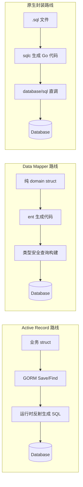

# 数据持久层架构模式取舍——Active Record (GORM)、Data Mapper (Ent) 与原生封装

**摘要：**

对象与关系数据库之间的阻抗不匹配（Impedance Mismatch）是过去三十年企业软件架构中最为持久的工程矛盾之一。2002 年 Martin Fowler 在《企业应用架构模式》中为两种主流解决方案命名——Active Record 与 Data Mapper——这场讨论并未因 NoSQL 的兴起或微服务的普及而结束，反而在 Go 生态中以三条并行路线的形式重新呈现：GORM 把 Active Record 的"模型即表"理念借助反射与钩子机制推向极致；Ent 以代码生成与图谱模型实现 Data Mapper 的彻底分离；sqlc 与原生封装路线则反其道而行，把 SQL 写回 SQL。本文从领域建模的两大流派分野切入，依次剖析 GORM 的 reflect 字段映射与 Hook 回调、Ent 的 schema as code 与类型安全查询、sqlc 的编译期生成策略，再就 N+1 预加载、Schema 迁移演进与抽象代价做出横向权衡，最终落在"没有唯一正确答案，只有匹配团队与业务语境的取舍"这一认知框架上。

---

## 第 1 章 两种领域建模流派的分野

### 1.1 名词之争背后的真问题

2002 年，Martin Fowler 在《Patterns of Enterprise Application Architecture》一书中将数据持久层的两大主流做法正式命名为 **Active Record** 与 **Data Mapper**。这两个名词看上去像是同义词——毕竟都是在"把对象存进数据库"——但它们承载的是两种截然不同的领域建模哲学，对应着两种对"业务对象究竟长什么样"的回答。

要理解这场分歧，不妨先限定讨论的范围：本文所说的"领域建模"特指**如何组织应用代码中的业务对象（entity / model / domain object）与数据库表（table / row）之间的对应关系**。这个看似平凡的选择，决定了后续所有查询、校验、迁移与测试的形态。

### 1.2 Active Record：模型即表的内存投影

Active Record 的核心思想可以概括为一句口号：**一个类的实例既是业务对象，又是数据库某一行的代言人**。类的字段直接映射表的列，类的方法（`Save`、`Delete`、`Find`）直接对应 CRUD 操作。Ruby on Rails 在 2004 年将这种模式推向了大众视野，自此 Active Record 成为动态语言世界最主流的 ORM 形态。

用一个生活化的比喻：Active Record 像是**小区的快递代收点**——每件包裹（对象）身上贴着收件人、房号、电话（字段），代收点前台既负责登记包裹信息（数据），也负责通知收件人来取（行为）。包裹本身就知道自己该被放到哪个货架上，不需要额外的物流调度员。

在 Go 语境下，GORM 是这种模式的典型代表。一个典型的 GORM 模型长这样：

```go
type User struct {
    gorm.Model
    Name     string  `gorm:"size:64;not null"`
    Email    string  `gorm:"uniqueIndex;size:128"`
    Age      int
    Orders   []Order `gorm:"foreignKey:UserID"`
}

// 实例方法直接承担持久化行为
func (u *User) Activate() error {
    u.Status = "active"
    return db.Save(u).Error  // 对象知道如何保存自己
}
```

`gorm.Model` 内嵌了 `ID`、`CreatedAt`、`UpdatedAt`、`DeletedAt` 四个字段，这是 GORM 对"所有表都应具备的基础设施列"这一约定的固化。模型与数据库表的对应关系通过 struct tag 声明，运行时由反射（reflect）机制读取。

Active Record 的优势直观：**开发速度快、认知负担低、小项目里代码量少**。但它也带来两个结构性的后果：其一，业务逻辑与持久化逻辑在同一个类型上纠缠，随着业务复杂度上升，模型类会膨胀为"上帝对象"；其二，模型与数据库 schema 强绑定，schema 一旦变化，整个领域模型都要跟着变形——这对于领域驱动设计（DDD）所强调的"领域层不依赖基础设施层"是一条直接的冲突。

### 1.3 Data Mapper：领域对象与映射的彻底分离

Data Mapper 的哲学与 Active Record 正相反：**领域对象是纯粹的，它不知道自己将被如何存储**。持久化逻辑由一个独立的映射层（mapper）承担，映射层读取领域对象的状态，将其转换为 SQL 语句；从数据库读取时，则由映射层把行数据装配回领域对象。

还是用比喻说明：Data Mapper 像是**专业的报关行**——货主（领域对象）只关心自己的货物（业务数据）是否完好，报关行（mapper）负责填报关单、跑海关流程、安排运输。货主不需要懂报关，报关行也不改变货物本身。两套角色各司其职，即便海关规则变了（数据库换了），换一家报关行即可，货主无感。

在 Java 世界，Hibernate 是 Data Mapper 的经典实现。Go 生态里，**Ent**（Facebook 在 2019 年开源）以代码生成的方式把 Data Mapper 的理念推到了新高度——它甚至不让开发者手写 mapper，而是通过 schema 定义自动生成整套映射代码。这一点将在第 4 章展开。

Data Mapper 的代价同样清晰：**更多的代码、更多的间接层、更陡的学习曲线**。对一个只有三五张表的 CRUD 应用而言，Data Mapper 带来的结构清晰度往往抵不过它引入的样板代码。这就是为什么两种模式长期并存——它们各自对应着不同的复杂度阈值。

### 1.4 跨语言视角与 Go 的位置

两种模式的分野并非 Go 独有。Java 世界里，Hibernate（2001 年）与 MyBatis（2010 年前身 iBATIS）分别代表了 Data Mapper 与"半 ORM"路线的长期共存；Ruby 世界几乎被 ActiveRecord 一家统治，直到 Hanami 引入 repository 模式；C# 的 Entity Framework 从 v1 的 Active Record 逐步演化为 v5 之后的 Code First + Migration 混合形态；Python 的 Django ORM 是 Active Record，SQLAlchemy 则通过 session 与 mapper 分离实现了 Data Mapper。

这些语言社区的共同经验是：**早期 Active Record 占优（因为开发速度快），中后期 Data Mapper 或混合方案逐步渗透（因为领域复杂度上升）**。但 Go 的情况有一个显著差异——**Go 的静态类型系统、对反射的谨慎态度、以及代码生成工具的成熟**，让 Data Mapper 路线的"额外样板"成本被大幅摊薄。Ent 的 `go generate` 一次就能生成数千行类型安全的查询代码；sqlc 一行 SQL 直接编译为类型安全的 Go 函数。这在动态语言世界里需要手写大量样板代码，在 Go 里却可以交给工具链。

换言之，Go 的生态位让 Data Mapper 与原生封装路线的"代价门槛"显著降低，三条路线的并存因此比其他语言社区更为均衡。

| 维度 | Active Record | Data Mapper |
| :--- | :--- | :--- |
| 模型与表的耦合度 | 高，模型即表 | 低，映射层隔离 |
| 领域对象纯净度 | 低，承担持久化行为 | 高，纯业务对象 |
| 学习曲线 | 平缓 | 陡峭 |
| 适合场景 | CRUD 为主、schema 稳定 | 领域逻辑复杂、需测试隔离 |
| 代表框架 | GORM、Rails ActiveRecord | Ent、Hibernate |

> [!note] 概念锚点：两种模式不是高下之分
> Active Record 与 Data Mapper 的分歧不在于谁更"正确"，而在于**把"变化的代价"放在哪里**。Active Record 把代价压在领域层——数据库变动直接影响业务代码；Data Mapper 把代价压在映射层——多一层间接，换来领域层的稳定性。选型的本质是判断：在你的业务语境里，哪一层的稳定性更值钱。

---

## 第 2 章 ORM 的兴起与反叛

### 2.1 阻抗不匹配与 ORM 的历史角色

对象模型与关系模型的不匹配并非工程疏忽，而是两种数据组织范式在根本上的分歧：对象模型强调封装、继承、多态，关系模型强调集合、约束、连接。早在 1990 年代，学术界就把这种分歧称为 **Object-Relational Impedance Mismatch**——它不是 bug，而是两种范式的本体论差异。

ORM（Object-Relational Mapping）的出现是为了在这两种范式之间搭桥。早期 ORM（譬如 Hibernate 2001 年发布、ActiveRecord 2004 年随 Rails 1.0 发布）给开发者带来三个具体好处：

其一，**消除样板 SQL**。开发者不再需要为每张表手写 `INSERT`、`UPDATE`、`SELECT`，框架通过反射自动生成。其二，**统一类型映射**。数据库的 `VARCHAR`、`INT`、`DATETIME` 在代码里对应 `string`、`int`、`time.Time`，跨数据库迁移时只需替换驱动。其三，**关系导航**。对象间的关联通过字段访问而非 JOIN 表达，譬如 `user.Orders` 代替 `SELECT * FROM orders WHERE user_id = ?`。

这些好处在 2010 年代中期之前几乎无可争议。然而，当系统的规模与性能要求攀升到一定程度，ORM 的隐性代价开始显形。

值得一提的是，ORM 的流行在某种程度上与"软件工程中对象建模的中心地位"相互强化——在 DDD（领域驱动设计）的影响下，许多团队把"领域模型是软件的核心"理解为"领域模型应该是面向对象的"，进而推导出"数据库必须通过 ORM 映射到对象"。这条推理链条的每一步都不算错，但组合在一起却遮蔽了另一种可能性：**如果领域模型并不需要复杂的对象行为，只是一组带约束的数据结构，那么 ORM 的封装就变成了纯粹的负担**。这也是为什么在微服务架构中，每个服务的领域模型往往比单体时代简化许多——而 ORM 的必要性也随之降低。

### 2.2 Go 持久层生态的简短前史

在 GORM、Ent、sqlc 三条路线成型之前，Go 社区曾出现过一批更早的 ORM 尝试：beego/orm（2012 年随 beego 框架发布，是 Go 早期最流行的 ORM）、upper.io/db（2014 年，试图在 Go 里复刻 ActiveRecord 的简洁）、reform（2015 年，强调 struct tag 驱动）。这些项目的共同命运是**逐渐被 GORM v2 吸收用户，或停止维护**。

这一历史值得回顾，因为它揭示了一个生态演化的规律：Go 社区的持久层选型经历了"**从碎片化到收敛**"的过程。GORM v2（2020 年）通过向后兼容的 API 升级与完善的插件机制（`*gorm.DB` 的插件注册、driver 接口扩展）成为了 Active Record 路线的事实标准；而 Ent 与 sqlc 则在 GORM 力有不逮的领域（强类型查询、零开销封装）各自占据了生态位。三条路线的并存不是偶然，而是十年试错后社区投票的结果。

### 2.3 反 ORM 运动的合理性

2010 年代后期，一股"反 ORM"（或曰"ORM 怀疑论"）的思潮在后端工程中蔓延。Bill Karwin 在《SQL Antipatterns》（2010 年）中专门用一章讨论了"ORM 造成的 SQL 盲"——当开发者只能通过 ORM API 表达查询时，他们往往写出低效的 SQL 而不自知。其核心批评可以归纳为四点：

**第一，性能失控**。ORM 自动生成的 SQL 往往不是最优的。N+1 查询（见第 6 章）是典型症状；更隐蔽的是隐式 JOIN、未预期的 `SELECT *`、错误的分页排序。当数据量从万级爬到亿级，ORM 的抽象泄漏（Leaky Abstraction）开始反噬。

**第二，SQL 能力被阉割**。窗口函数、CTE（Common Table Expression）、lateral join、数据库特定的 JSON 操作符——这些 SQL 标准或特定数据库的高级能力，往往在 ORM 的 API 中缺席或表达笨拙。对于重度依赖数据库能力的团队，ORM 反而是束缚。

**第三，调试成本**。当 ORM 在运行时通过反射拼出 SQL，出问题时开发者面对的是一长串不可读的动态字符串，而不是可直接粘贴到客户端执行的静态 SQL。排查性能问题需要先"反编译"ORM 的输出，再分析执行计划。

**第四，迁移的脆弱性**。ORM 通常提供 auto-migration 功能，但对生产数据库而言，"自动"意味着"失去对 DDL 执行顺序、锁行为、在线变更策略的控制"。这在第 7 章会详细讨论。



上图把三条路线的代码流转并列呈现：Active Record 依赖运行时反射、Data Mapper 依赖生成期代码、原生封装则把 SQL 直接固化为 Go 函数——**抽象层出现的位置（运行时 / 生成期 / 编译期）决定了调试、性能与安全的边界**。

### 2.3 Go 生态的三条路线

由此，Go 生态的持久层选型呈现出三条清晰的路线：

**路线一：Active Record 路线，以 GORM 为代表**。保留 ORM 的全部便利，接受反射与运行时代价，适合快速迭代的业务系统。

**路线二：Data Mapper 路线，以 Ent 为代表**。用代码生成取代反射，用图谱模型显式表达关系，适合领域逻辑复杂、需要强类型查询的系统。

**路线三：原生封装路线，以 sqlc 为代表**。放弃 ORM，把 SQL 写回 SQL，用编译期代码生成获得类型安全，适合 SQL 能力强、对性能与控制力要求高的团队。

这三条路线并非相互取代的关系，而是对应着不同的复杂度区间与团队能力画像。行文至此，我们可以逐一展开它们各自的机制与代价。

---

## 第 3 章 GORM 的反射与钩子机制

### 3.1 基于 reflect 的字段映射

GORM 的所有魔法都建立在 Go 的反射（reflect）机制之上。当你写下 `db.Create(&user)` 时，GORM 内部要完成以下工作：

1. 通过 `reflect.ValueOf(&user).Elem()` 取得 struct 的值。
2. 遍历 struct 的每一个 field，读取 `gorm:"column:name"` 等 struct tag。
3. 把字段名、tag 声明、字段值组装成 INSERT 语句的列名与占位符。
4. 处理关联（`HasMany`、`BelongsTo` 等）的级联保存。
5. 执行 SQL 后，回写数据库生成的主键与时间戳到 struct 字段。

这个过程每一次 `Create`、`Save`、`Find` 都会发生。GORM 内部通过 **schema 缓存**（首次解析后缓存 struct 的字段元数据）减轻了部分开销，但反射的固有成本——类型断言、字段查找、tag 解析——在热路径上仍然不可忽视。

用一个比喻形容：GORM 的字段映射像是一位**精通十八国礼仪的翻译官**——每位客人（字段）进门，他都要先翻一遍护照（reflect.Type）、查一下座位表（gorm tag）、确认用餐禁忌（字段零值判断），然后才安排入座。这套流程在客人少时感觉体贴周到，客人多时就显得繁琐——而 sqlc 的做法更像是**直接把座位表印刷出来**（编译期生成），客人来时按表入座，不需要翻译官每次重新核对。

GORM 对反射的依赖带来了两个具体后果：

**第一，错误发现推迟到运行时**。struct tag 写错（譬如 `gorm:"colunn:name"` 拼写错误），编译器不会报错，只有真正执行到该操作时才会以"列不存在"或"字段未映射"的形式暴露。这与 Go 社区主流的"编译期能发现的错误不要留到运行时"哲学相悖。

**第二，字段可见性与零值语义的陷阱**。GORM 默认不更新零值字段（`0`、`""`、`false`），因为反射无法区分"用户没传这个字段"和"用户显式传了零值"。这迫使开发者使用 `map[string]interface{}` 或 `gorm.Expr` 等笨拙的方式显式更新零值，成为新手最常踩的坑之一。

**第三，反射的性能成本在热路径上不可忽视**。根据社区基准测试（GORM 官方 benchmark 与第三方评测），GORM 的单次 `Create` 操作耗时约为原生 `database/sql` 的 3-5 倍，差异主要来自 reflect 的 struct 解析与 tag 遍历。对于 QPS 在千级以下的 CRUD 应用，这一差异可以被 I/O 延迟掩盖；但对于 P99 延迟要求在个位数毫秒的网关层或高频交易场景，反射开销会成为显性瓶颈。这也是 sqlc 与 Ent 在这类场景中更受青睐的根本原因——它们把反射成本从运行时转移到了生成期。

### 3.2 Hook 回调的生命周期

GORM 提供了一整套 **Hook（钩子）回调**，允许开发者在 CRUD 操作的关键节点注入自定义逻辑：

- `BeforeCreate`、`AfterCreate`
- `BeforeUpdate`、`AfterUpdate`
- `BeforeDelete`、`AfterDelete`
- `BeforeFind`、`AfterFind`
- `AfterSave`、`AfterScan` 等

Hook 通过 Go 的方法集（method set）实现——只要 struct 定义了签名匹配的方法，GORM 会在对应时机自动调用。这种设计的诱惑在于**它让持久化逻辑看起来像是被"封装"在模型内部**，譬如：

```go
func (u *User) BeforeCreate(tx *gorm.DB) error {
    if u.Age < 0 {
        return errors.New("invalid age")
    }
    u.Email = strings.ToLower(u.Email)
    return nil
}
```

但 Hook 也有结构性代价。**第一，隐式控制流**：阅读 `db.Create(&user)` 的代码时，你无法直观看到哪些 Hook 会被触发——它们像地雷一样埋在模型的方法集里，必须通读模型定义才能拼出完整流程。**第二，测试隔离困难**：想单元测试业务逻辑时，Hook 会连带触发数据库操作；想单元测试 Hook 时，又需要一个真实的 `*gorm.DB` 实例。**第三，Hook 之间的依赖顺序不显式**：当多个 Hook 修改同一字段时，执行顺序取决于方法定义顺序与 GORM 的内部调度，调试成本上升。

> [!warning] Hook 的隐性成本
> Hook 把"何时发生什么"藏在了方法签名里。当一个模型累积了五六个 Hook，其行为变得难以预测——尤其在团队交接或半年后回头看代码时。笔者建议：**只在 Hook 里放与持久化强相关的横切逻辑（譬如时间戳填充、软删除标记），业务校验逻辑放在应用层显式调用**，让控制流在阅读代码时一目了然。

### 3.3 链式 API 与 Session 的陷阱

GORM 的链式 API（chain API）是它最被广泛使用的表层：

```go
db.Where("age > ?", 18).
   Order("created_at DESC").
   Limit(10).
   Find(&users)
```

这种写法流畅、表达力强，但背后有一个容易被忽视的语义陷阱：**`db` 对象在链式调用中究竟是被修改，还是返回了一个新对象？**

GORM 在早期版本（v1）中，`db.Where(...)` 会**修改原 `db` 对象的内部状态**，这意味着如果你把一个 `*gorm.DB` 当作全局变量复用，不同 goroutine 的链式调用会互相污染——这是典型的**共享可变状态**问题，与 Go 的并发安全哲学直接冲突。

GORM v2（2020 年发布）通过引入 `Session` 机制修复了这个问题：默认情况下，链式调用返回一个新的 `*gorm.DB` 实例（内部通过 `clone := db.Session(&Session{})` 实现），原 `db` 保持不变。但为了性能考虑，部分方法（譬如 `Debug()`、`Table()`）仍然可能修改原对象。开发者必须清楚哪些方法是"安全链式"、哪些需要显式调用 `db.Session(&gorm.Session{NewDB: true})` 创建全新会话。

这种二元语义——**同样的 `.Where()` 看上去一样，底层可能一个克隆一个不克隆**——是 GORM 使用中最隐蔽的陷阱之一。它提醒我们：ORM 的便利往往以"隐式语义"为代价，当抽象泄漏时，开发者必须理解底层才能写出正确代码。

### 3.4 事务与软删除的封装边界

GORM 对事务的封装采用闭包模式：

```go
err := db.Transaction(func(tx *gorm.DB) error {
    if err := tx.Create(&user).Error; err != nil {
        return err  // 返回 error 触发回滚
    }
    if err := tx.Create(&order).Error; err != nil {
        return err
    }
    return nil  // 返回 nil 触发提交
})
```

这个 API 设计合理——闭包保证了 `tx` 的作用域被限制在函数体内，不会泄漏到外部。但 GORM 的**软删除**（soft delete）机制却引入了另一层隐式行为：只要模型包含 `gorm.DeletedAt` 字段（`gorm.Model` 默认包含），所有查询都会自动追加 `WHERE deleted_at IS NULL`，`Delete` 操作会自动转换为 `UPDATE ... SET deleted_at = NOW()`。

这种"透明过滤"在业务层看来是便利——不需要在每个查询里手动排除已删除数据；但在数据迁移、后台管理、数据审计等场景下，它会成为陷阱——**你以为查到了所有数据，实际上 ORM 默默过滤掉了已软删除的行**。GORM 提供了 `Unscoped()` 方法来绕过这一过滤，但这个"绕过"本身需要开发者明确知道软删除的存在——在新人入职或接手遗留代码时，这往往是一个延迟爆发的坑。

> [!warning] 软删除的隐式过滤
> GORM 的软删除是 Active Record "魔法"的典型体现——它替你做了决定（所有查询都应排除已删除数据），但这个决定并非在所有业务场景下都正确。数据对账、合规审计、历史回溯——这些场景都需要 `Unscoped()` 绕过过滤。笔者建议在团队内明确约定：**软删除的使用必须写入编码规范，且所有 `Find` / `First` / `Count` 调用都应显式注释是否需要包含已删除数据**。

---

## 第 4 章 Ent 的代码生成与图谱模型

### 4.1 Schema as code 的生成期契约

Ent 的设计理念与 GORM 几乎对立：**与其在运行时通过反射解析模型，不如在编译前把一切固定下来**。Ent 要求开发者在 `ent/schema/` 目录下以 Go 代码定义每张表的 schema：

```go
// ent/schema/user.go
type User struct {
    ent.Schema
}

func (User) Fields() []ent.Field {
    return []ent.Field{
        field.String("name").NotEmpty().MaxLen(64),
        field.String("email").Unique().MaxLen(128),
        field.Int("age").Positive().Optional(),
    }
}

func (User) Edges() []ent.Edge {
    return []ent.Edge{
        edge.To("orders", Order.Type),
    }
}
```

运行 `go generate ./ent` 后，Ent 的代码生成器会为每个 schema 生成一整套类型安全的代码：entity 类型、create / update / delete / query builder、predicate（WHERE 条件）、以及关系遍历方法。整个过程发生在 `go build` 之前——生成的代码就是普通的 Go 代码，可以被 IDE 索引、被编译器校验、被 linter 检查。

Ent 的代码生成管道本身值得关注：它首先解析 `ent/schema/` 目录下所有 schema 定义，构建一张**完整的图谱模型**（包括所有节点类型、边类型与方向）；然后根据图谱模型生成 Go 代码——每个 schema 对应一个 entity 类型、一组 builder、一组 predicate；最后生成 client 类型作为所有操作的入口。这张图谱在生成期就固定下来——如果 schema 之间出现不一致（譬如 `edge.To` 指向不存在的 schema、`edge.From` 的 inverse 关系不匹配），生成器会在 `go generate` 阶段直接报错，而不是等到运行时暴露。

这种 "schema as code" 的方式带来几个直接的工程收益：

**第一，**字段校验从运行时提前到**生成期**。`field.Int("age").Positive()` 在生成代码时就会把 `age > 0` 的校验写入 create builder，漏掉校验的 schema 无法通过生成。这比 GORM 的 struct tag 拼写错误只能在运行时暴露要安全得多。

**第二，关系成为一等公民**。`edge.To("orders", Order.Type)` 显式声明了 User 与 Order 之间的有向关系。Ent 的代码生成器据此生成 `user.QueryOrders()`、`order.QueryUser()` 等类型安全的遍历方法——不需要像 GORM 那样在运行时通过反射解析 `foreignKey` tag。

用一个比喻说明：GORM 的模型像是**手工绘制的地图**——每次出发前都要重新确认方向、比例尺和图例；Ent 的 schema 则像是**建筑施工图**——在施工前（`go generate`）就把所有尺寸、材料、承重关系固定下来，现场施工（业务代码）只需按图作业，不需要现场测量。

### 4.2 类型安全的查询构建与边遍历

Ent 最有特色的能力是**类型安全的查询构建**（type-safe query builder）。在 GORM 中，WHERE 条件通常以字符串或 `map` 表达：

```go
// GORM：字符串条件，字段名错误只有运行时知道
db.Where("age > ? AND status = ?", 18, "active").Find(&users)
```

在 Ent 中，同样的查询用生成的 predicate 表达：

```go
// Ent：编译期校验，字段名或类型错误直接编译失败
client.User.Query().
    Where(user.AgeGT(18), user.StatusEQ("active")).
    All(ctx)
```

`user.AgeGT(18)` 是一个类型为 `func(*sql.Selector)` 的 predicate，它在编译期就被固定下来。如果 schema 中没有 `age` 字段，或者误传字符串类型，**编译器直接报错**，不会等到运行时才发现。

Ent 的另一个特色是**边遍历**（edge traversal）。在图谱模型中，实体是节点（node），关系是边（edge）。Ent 生成的代码让关系导航变得直观：

```go
// 查询某个用户的所有已完成订单，按金额倒序
orders, err := client.User.Get(ctx, userID).
    QueryOrders().
    Where(order.StatusEQ("completed")).
    Order(ent.Desc(order.FieldAmount)).
    All(ctx)
```

`QueryOrders()` 是 Ent 根据 `edge.To("orders", Order.Type)` 自动生成的方法，返回类型是 `*OrderQuery`，后续所有链式调用都保持类型安全。这种体验与 GraphQL 的 resolver 链类似——实际上 Ent 的图谱模型确实受到了 Facebook 内部图查询语言的启发（Ent 由 Facebook / MySQL 团队在 2019 年开源）。

### 4.3 生成期校验与运行时边界

Ent 把尽可能多的校验推到生成期，但并非所有校验都能在生成期完成——**业务校验仍然发生在运行时**。Ent 提供了两个扩展点：

**生成器钩子**（`entc.Extensions`）在 `go generate` 阶段运行，用于扩展生成的代码结构，譬如添加自定义方法、修改模板。**运行时拦截器**（`ent.Interceptor`）在每次查询执行前运行，类似 SQL 中间件，用于审计日志、软删除过滤、租户隔离等横切逻辑。

这种分层设计比 GORM 的 Hook 更清晰：生成器钩子处理"代码长什么样"，运行时拦截器处理"查询怎么走"，二者职责正交。但代价是学习曲线更陡——开发者需要理解 Ent 的代码生成流程、模板系统（Go template）、以及图谱模型的基本概念（节点、边、方向、inverse edge）。

### 4.4 Mutation 机制与图遍历的性能考量

Ent 的写入操作通过独立的 **Mutation** 类型表达——每次 `Create` 或 `Update` 都生成一个 `UserMutation` 对象，它记录了所有被修改的字段与关系变更。这种设计与 Active Record 的"对象即 mutation"形成对比：在 GORM 中，你对 struct 字段赋值后调用 `Save()`，框架通过反射 diff 出变更的字段；在 Ent 中，变更被显式记录在 mutation 对象上，生成期就确定了哪些字段会被 SET。

对于复杂的图谱遍历查询，Ent 的性能特征需要特别注意。**边遍历的每一步都对应一次数据库查询**——`user.QueryOrders().QueryItems().All(ctx)` 会触发三条 SQL（查 user、查 orders、查 items），而非一条 JOIN。这对于深度较浅的遍历是合理的；但当遍历深度超过三层，或每层返回的节点数量较大时，查询数量会呈指数增长——这是 Ent 版本的"N+1 问题"。Ent 的解决方案是在 schema 定义阶段就预判常见的查询模式，通过 `WithEdges` 的 eager-loading 把多条查询合并为两条（主查询 + edge 查询），但这对 schema 设计的前瞻性提出了较高要求。

> [!info] Ent 的适用边界
> Ent 的图谱模型特别适合**关系密集**的领域——社交网络、组织架构、权限系统、工作流引擎——这类场景中实体间关系本身就是核心业务语义，用图谱表达比用外键列更贴近业务语言。但对于简单的 CRUD 表（譬如配置表、字典表），Ent 的代码生成开销会显得过度工程化。

---

## 第 5 章 原生封装与 sqlc 风格

### 5.1 把 SQL 写回 SQL

sqlc（由 Kyle Conroy 在 2019 年发布）代表了第三条路线：**既不依赖运行时反射，也不引入复杂的领域模型，而是让开发者直接写 SQL，由工具链在编译前生成类型安全的 Go 代码**。

使用 sqlc 的工作流是：

1. 开发者在 `sqlc.yaml` 中配置数据库类型、schema 位置、SQL 文件位置。
2. 在 `.sql` 文件中写标准的 SQL 查询，譬如：

```sql
-- name: GetUser :one
SELECT id, name, email, age FROM users WHERE id = $1;

-- name: ListActiveUsers :many
SELECT id, name, email, age FROM users
WHERE status = 'active'
ORDER BY created_at DESC
LIMIT $1 OFFSET $2;
```

3. 运行 `sqlc generate`，sqlc 解析 SQL 语句，生成对应的 Go 函数与结构体：

```go
// Code generated by sqlc. DO NOT EDIT.
func (q *Queries) GetUser(ctx context.Context, id int64) (User, error) { ... }
func (q *Queries) ListActiveUsers(ctx context.Context, limit int32, offset int32) ([]User, error) { ... }
```

生成的代码直接使用 `database/sql`（详见 [[Golang/Go网络编程与持久化/06 database-sql 连接池抽象与状态机原理]]），没有任何运行时反射开销，也没有 ORM 的 API 黑盒。

### 5.2 编译期安全与运行时性能

sqlc 的核心承诺是：**你写的 SQL 决定了生成的代码，SQL 错了编译就失败**。这与 Ent 的"schema 错了编译失败"异曲同工，但 sqlc 的保证更进一步——它校验的不只是字段名，而是**整条 SQL 的语法与类型**。sqlc 内部集成了对应数据库的 SQL 解析器（支持 PostgreSQL 与 MySQL），会在生成阶段执行真实的类型推导，包括：

- `SELECT` 列的类型与 nullability
- 参数占位符的类型
- `JOIN` 的列匹配
- `COALESCE`、`CASE WHEN` 等表达式的结果类型

这意味着，如果你在 SQL 里写了 `WHERE age > $1`，而 `$1` 在 Go 代码里被误传为 `string`，**编译器直接报错**——不需要等到运行时。

从性能角度看，sqlc 生成的代码等价于手写的 `database/sql` 调用——没有反射、没有 ORM 开销、没有中间层。在基准测试中，sqlc 的读性能与手写 SQL 几乎一致（差异通常在 1-2% 以内，来自 SQL string 的轻微差异）；写性能显著高于 GORM，因为 GORM 的反射与 Hook 链在每次写操作时都会引入额外的 reflect 解析与回调调度开销。对于 QPS 在万级以上的写入密集型服务，这种差异会转化为可观的 CPU 成本节省。

但性能并非 sqlc 的全部优势。**可调试性**是另一个关键因素——当 sqlc 生成的代码出现问题，你可以直接把 `.sql` 文件里的 SQL 粘贴到数据库客户端执行、分析执行计划、优化索引；而不需要像 GORM 那样先打开 debug 日志、从日志里提取动态拼装的 SQL、再手动替换参数占位符。这种"所见即所得"的调试体验在生产排障时的价值，往往超过基准测试中几个百分点的差异。

### 5.3 适用边界与代价

sqlc 的代价同样清晰：

**第一，你必须写 SQL**。这对于 SQL 能力强的团队是优势，对于习惯了 ORM 抽象的团队是负担。许多年轻的后端工程师对 SQL 的掌握停留在 `SELECT * FROM ... WHERE ...` 的水平，面对窗口函数、CTE、事务隔离级别等问题时需要额外的学习投入。

**第二，关系导航需要手动 JOIN**。没有 GORM 的 `Preload` 或 Ent 的 `QueryOrders()`——所有关联查询都要在 SQL 里显式写 `JOIN`。这在表少时是优势（SQL 完全可控），在表多、关系复杂时会带来大量重复的 JOIN 模板代码。

**第三，迁移不是 sqlc 的职责**。sqlc 只负责"从 SQL 生成 Go 代码"，不处理 schema 的演进与迁移。迁移需要配合其他工具（golang-migrate、Atlas、dbmate 等），这在第 7 章会详细讨论。

用一个比喻说明这三条路线的差异：**GORM 像是一辆自动挡轿车**——踩油门就走，但发动机盖下面的事你管不了；**Ent 像是一辆带行车电脑的跑车**——所有参数都可以精确调节，但需要先学会看仪表盘；**sqlc 像是一辆手动挡**——换挡离合全靠你自己，但你对发动机的工作状态了如指掌。

### 5.4 sqlc 的刚性边界与混合路线

sqlc 的能力边界同样清晰，这些边界决定了它不适合所有场景：

**第一，不支持动态 SQL**。如果你的查询条件在运行时才确定（譬如管理后台的高级搜索表单，字段数量与组合方式都动态），sqlc 无法直接处理——它需要每条 SQL 在 `generate` 阶段就固定下来。应对方式是预生成所有可能的条件组合，或使用 `CASE WHEN` 在单条 SQL 里编码分支逻辑，但这两种做法都会导致 SQL 文件膨胀或可读性下降。

**第二，不支持运行时查询构建**。Ent 与 GORM 都允许在代码里根据条件拼接查询（`if filter.Name != "" { query = query.Where(...) }`），sqlc 的生成模型不支持这种模式——查询结构必须在 `.sql` 文件中静态声明。

**第三，数据库方言锁定**。sqlc 的 SQL 解析器与特定数据库绑定（PostgreSQL 与 MySQL 的解析器是独立的），切换数据库意味着重写 SQL 文件——这与 GORM "换驱动即可" 的跨数据库承诺相反。

作为应对，GORM 在 2022 年发布了 **gen** 包（`gorm.io/gen`），试图走一条混合路线：**在编译期通过代码生成提供类型安全的查询构建，同时保留 GORM 的运行时执行引擎**。gen 生成的代码类似 Ent 的 predicate，但底层仍然调用 GORM 的 `*gorm.DB` 执行 SQL——这意味着它继承了 GORM 的反射开销，同时增加了代码生成的步骤。这种"两头都沾"的策略能否长期成立，还有待社区验证。

---

## 第 6 章 N+1 问题与预加载

### 6.1 问题的根源

N+1 是 ORM 最经典的性能陷阱，也是理解 Active Record 与 Data Mapper 实际代价的绝佳窗口。

场景：查询 100 个用户，并获取每个用户的订单列表。在天真的 ORM 用法中：

```go
var users []User
db.Find(&users)  // 第 1 条 SQL：SELECT * FROM users

for i := range users {
    db.Model(&users[i]).Association("Orders").Find(&users[i].Orders)
    // 第 2 到第 101 条 SQL：SELECT * FROM orders WHERE user_id = ? × 100
}
```

1 次查询用户 + 100 次查询订单 = 101 条 SQL——这就是 N+1 问题。它的根源在于：**ORM 默认延迟加载（lazy loading）关联数据**，因为不是每次查询都需要关联数据，全量加载反而浪费。但当天真的遍历结果并访问关联字段时，延迟加载就退化为逐条查询。

用一个比喻形容：N+1 问题像是**快递员逐个敲门送同一栋楼的 100 个包裹**——每个包裹都从仓库出发、走完整条路线、敲一次门。而高效的方案是**一次配送整层楼**——把所有包裹装车，一趟走完。

### 6.2 GORM 的 Preload 机制

GORM 通过 `Preload` 解决 N+1：

```go
db.Preload("Orders").Find(&users)
// SQL 1: SELECT * FROM users
// SQL 2: SELECT * FROM orders WHERE user_id IN (1, 2, 3, ..., 100)
```

`Preload` 的实现并不是 SQL JOIN，而是**两条独立查询**：先查主表，再把主表的主键收集成 `IN (...)` 子句查关联表。这样做的好处是实现简单、与 GORM 的反射架构一致；坏处是当关联数据量大时，`IN (...)` 子句可能过长（某些数据库对 `IN` 列表长度有限制，譬如 Oracle 的 1000 元素上限）。

GORM 还支持嵌套预加载与条件预加载：

```go
db.Preload("Orders.Items").
   Preload("Orders", "status = ?", "completed").
   Find(&users)
```

但这引入了新的复杂性：**预加载的时机、条件与嵌套深度需要开发者精确控制**，否则容易出现"预加载了不需要的关联"或"漏掉了必要的预加载"两种极端。

### 6.3 Ent 的 WithEdges 机制

Ent 通过 `WithEdges`（或具体命名的 `WithOrders()`）解决同样的问题：

```go
users, err := client.User.Query().
    WithOrders(
        order.Where(order.StatusEQ("completed")),
    ).
    All(ctx)
```

Ent 的实现同样是两条查询（主查询 + edge 查询），但它有两个关键差异：

**第一，类型安全**。`WithOrders()` 是生成的方法，参数是类型安全的 predicate——你无法传错字段名或类型。

**第二，eager-loading 是显式的**。Ent 不提供隐式的延迟加载——如果你不调用 `WithOrders()`，返回的 user 对象根本没有 `Orders` 字段可访问。这迫使开发者在查询时就明确表达"我需要什么关联数据"，从设计上消除了 N+1 的可能。

### 6.4 真正的解决：有时是 JOIN，有时是冗余

N+1 的终极解决并不总是"更好的预加载"。在某些场景下，**SQL JOIN 才是正解**：

```sql
SELECT u.id, u.name, o.id AS order_id, o.amount
FROM users u
LEFT JOIN orders o ON o.user_id = u.id
WHERE o.status = 'completed';
```

一条 SQL 完成所有工作，没有 N+1，也没有 `IN (...)` 的长度问题。但 JOIN 的代价是**结果集膨胀**（一个用户对应多个订单时，用户数据重复传输）与**对象装配复杂度**（ORM 需要在内存中把扁平结果重新组装成嵌套结构）。

对于读多写少、性能敏感的场景，**数据冗余**（在用户表中冗余最近订单的状态字段）或 **CQRS**（读写分离，读端使用预计算的宽表）可能是更务实的选择。这些方案的共同点是：**用写入时的额外开销换取读取时的性能确定性**。

> [!note] N+1 的本质
> N+1 不是 ORM 特有的问题——任何"按需加载"的抽象都会面临同样的抉择。但 ORM 的延迟加载默认行为让 N+1 成为一种**隐式陷阱**——开发者不写任何额外的代码就会踩坑。Ent 通过显式 eager-loading 的设计让 N+1 在编译期就"不可表达"；GORM 通过 Preload 让 N+1 可解决但需手动干预；原生 SQL 路线则根本不存在 N+1——因为你写的每条 SQL 都完全可控。

### 6.5 分页模式与 ORM 的交互

与 N+1 密切相关的是**分页查询的 ORM 表达**。最常见的分页方式是 `LIMIT/OFFSET`：

```go
db.Offset((page - 1) * pageSize).Limit(pageSize).Find(&users)
```

这种方式的问题是：**OFFSET 越大，数据库扫描的行数越多**——`OFFSET 100000` 意味着数据库要先扫描前 100000 行再丢弃。当数据量达到百万级，深分页的延迟会从毫秒级退化到秒级。

替代方案是**游标分页**（cursor-based pagination）——用上一页最后一条记录的排序键作为下一页的起点：

```sql
SELECT * FROM users WHERE id > $1 ORDER BY id LIMIT $2;
```

游标分页对 ORM 是一个挑战：GORM 与 Ent 的 API 都没有原生支持游标语义（你需要手写 WHERE 条件），而 sqlc 天然就能表达这种查询。这是"ORM 抽象限制 SQL 表达力"的又一个具体例证——当你的业务需要高效处理深分页（譬如信息流、时间线），ORM 的封装可能成为瓶颈。

---

## 第 7 章 迁移与 Schema 演进

### 7.1 为什么迁移是持久层最难的部分之一

数据库 schema 的演进是生产系统不可避免的常态——新字段、新索引、字段重命名、类型变更、表拆分。每一次 schema 变更都必须回答两个问题：**现有数据如何转换？线上服务如何在变更期间保持可用？**

这两个问题在 toy project 里不值一提，但在生产环境中却可能演变成复杂的工程挑战。ORM 框架通常提供 auto-migration 功能，但这种"自动化"往往掩盖了迁移的真实复杂度。

### 7.2 GORM AutoMigrate 的边界

GORM 的 `AutoMigrate` 是最简单的迁移方式：

```go
db.AutoMigrate(&User{}, &Order{})
```

它会根据 struct 定义自动生成 `CREATE TABLE` 或 `ALTER TABLE` 语句，**只增加列和索引，不删除列**（这是 GORM 对"auto"的安全约束）。但 AutoMigrate 的局限同样明显：

- **不处理列重命名**。你把 struct 字段从 `Name` 改为 `FullName`，AutoMigrate 会新建 `full_name` 列而不会删除或重命名旧的 `name` 列。
- **不处理数据类型变更**。把 `int` 改为 `string`，AutoMigrate 不会自动转换已有数据。
- **不处理外键约束的级联变更**。
- **不记录迁移历史**。每次启动都会执行一遍检查，没有"当前 schema 版本"的概念。

这使得 AutoMigrate 只适合开发与原型阶段，**生产环境的 schema 演进必须使用显式的迁移工具**。

### 7.3 Ent 与 Atlas 的迁移方案

Ent 在 2021 年孵化出了独立的迁移工具 **Atlas**（atlasgo.io）。Atlas 的设计理念是**声明式与版本式迁移的结合**：

**声明式迁移**（declarative migration）：你描述"schema 应该长什么样"，Atlas 通过 diff 当前数据库状态与期望状态，自动生成 `ALTER TABLE` 语句。这类似 Terraform 对基础设施的处理方式。

**版本式迁移**（versioned migration）：你显式编写 SQL 迁移脚本（譬如 `20261007120000_add_email_index.sql`），Atlas 负责按版本顺序执行并记录状态。这类似 golang-migrate 的工作方式。

Atlas 的独特价值在于**它理解 schema 的语义**——它知道添加 NOT NULL 列需要先填默认值、知道重命名列需要数据迁移、知道修改索引类型需要重建。这种理解来自 Ent 的 schema 模型——Atlas 可以读取 `ent/schema/` 目录，把 schema 定义作为"期望状态"的唯一事实源。

### 7.4 生产迁移的工程约束

生产环境的 schema 迁移必须遵守几条硬约束，这些约束与 ORM 的选择无关，但直接影响迁移工具的配置：

**第一，在线变更（Online DDL）**。MySQL 的 `ALTER TABLE` 默认会锁表（metadata lock），在业务高峰期可能引发连接堆积甚至雪崩。生产迁移必须使用 pt-online-schema-change、gh-ost 或 MySQL 8.0 的 Instant DDL 等机制，保证变更期间读写不中断。

**第二，向后兼容**。schema 变更必须分阶段进行——先加列、再双写、再切读、再删旧列——每个阶段都要保证新旧代码都能正常工作。这在微服务架构中尤其重要，因为不同服务可能在不同时间部署。

**第三，回滚预案**。每条迁移脚本都应该有对应的回滚脚本。Atlas 与 golang-migrate 都支持 `up` 与 `down` 两个方向，但回滚脚本的正确性需要开发者自己保证。回滚脚本尤其容易出错——譬如数据迁移（把旧列数据复制到新列）的回滚不是简单的逆向操作，因为回滚期间新列可能已经产生了新数据。

**第四，迁移前的验证**。生产迁移在执行前应有验证步骤：在 staging 环境先跑一遍迁移脚本 + 回滚脚本，确认耗时、锁行为与数据完整性。Atlas 提供了 `atlas migrate lint` 命令，它会对迁移脚本做静态分析，检测潜在的锁表风险（譬如 `ALTER TABLE ADD COLUMN` 在某些 MySQL 版本上会触发全表重建）。这类工具把迁移从"凭经验"推向了"凭证据"，但代价是流程变长——对于小团队而言，这种流程是否值得，取决于 schema 变更的频率与业务影响。

用一个比喻说明：**生产环境的 schema 迁移像是在高速公路上换轮胎**——你不能把车停下来（服务不能停），你必须一边开一边换（在线变更），而且换的过程中要保证车不会失控（向后兼容与回滚预案）。AutoMigrate 这种"一键换胎"的工具在这种场景下力不从心。

### 7.5 Expand-Contract 模式与特性开关

在生产环境中，最稳健的 schema 演进策略是 **Expand-Contract 模式**（又称"滚动兼容迁移"），其核心思想是把一次破坏性的 schema 变更拆分为多个阶段：

**Expand 阶段**：先添加新列（不删除旧列），新旧代码可以同时读写新列——老代码忽略新列，新代码同时读写新旧列。**Migration 阶段**：后台任务把旧列数据迁移到新列。**Contract 阶段**：确认所有代码都切换到新列后，删除旧列。

这种策略的关键在于**每个阶段都必须保证向前与向后兼容**——新代码能在没有旧列的环境下工作（为回滚留后路），旧代码能在新列存在时不受影响。这通常需要配合**特性开关**（feature flag）来控制新旧代码路径的切换时机——schema 迁移完成后，运维通过开关逐步把流量从旧代码路径切换到新代码路径，出现问题可以秒级回滚。

在这个流程里，ORM 的 auto-migration 完全无法胜任——它不理解"兼容窗口"、不支持"分阶段执行"、也没有"特性开关"的概念。生产环境的迁移工具必须支持**显式的版本管理、up/down 双向脚本、以及执行状态跟踪**——这也是 Atlas 与 golang-migrate 在这类场景中比 AutoMigrate 更受信任的原因。

---

## 第 8 章 选型判据与抽象的代价

### 8.1 没有银弹：选型的多维权衡

行文至此，我们可以尝试把三条路线的核心取舍放在同一张表里审视：

| 维度 | GORM (Active Record) | Ent (Data Mapper + Codegen) | sqlc (原生封装) |
| :--- | :--- | :--- | :--- |
| **开发速度** | 快，API 流畅 | 中，需 schema 定义 + generate | 慢，需手写每条 SQL |
| **运行时性能** | 中，reflect 与 Hook 开销 | 中高，生成代码无反射 | 高，等价手写 |
| **编译期安全** | 低，tag 错误运行时暴露 | 高，schema 错误编译失败 | 最高，SQL 错误编译失败 |
| **SQL 控制力** | 低，API 表达力受限 | 中，图谱查询表达力强 | 最高，原生 SQL |
| **学习曲线** | 平缓 | 陡峭，需理解 schema + codegen | 中，需 SQL 熟练 |
| **迁移支持** | AutoMigrate（弱） | Atlas（强） | 无，需外部工具 |
| **适用团队** | 快速迭代的业务团队 | 领域复杂的平台团队 | SQL 能力强的性能敏感团队 |

### 8.2 抽象的代价

ORM 的核心价值在于**抽象**——把 SQL 的细节藏在 API 之后，让开发者用业务语言思考。但抽象的代价可以从三个维度衡量：

**调试成本**。当 ORM 生成的 SQL 不符合预期，你需要"穿透"抽象层查看底层——在 GORM 中是打印 SQL 日志，在 Ent 中是检查生成的代码。抽象层越厚，穿透的成本越高。

**性能成本**。ORM 的便利往往以运行时代价为交换——GORM 的反射、Ent 的代码生成时间、甚至 sqlc 的生成步骤。在热路径上，这些成本可能被放大。

**认知成本**。团队成员需要学习 ORM 的 API、理解它的语义陷阱（譬如 GORM 的 Session、Ent 的 edge direction）、记住它的边界（譬如 sqlc 不支持动态 SQL）。这些认知负担在团队扩张时尤其显著。新成员入职时，GORM 的学习曲线最低（API 直觉、文档丰富），Ent 次之（需要理解 schema 与 codegen 流程），sqlc 的门槛在于 SQL 本身的熟练度——对于刚从动态语言 ORM 转过来的工程师，"手写 SQL"这件事本身就是一种认知冲击。

**可测试性**。抽象层对测试的影响也值得考量。GORM 的模型方法（包括 Hook）在单元测试时需要 mock `*gorm.DB`，这通常意味着引入 sqlmock 或真实的测试数据库；Ent 的生成代码可以通过内存客户端（`ent/testclient`）测试，但 schema 本身的测试需要运行 codegen；sqlc 的生成函数因为等价于 `database/sql` 调用，测试策略与手写 SQL 完全一致——可以直接用真实的测试数据库，也可以用 sqlmock mock 底层 driver。

> [!info] 抽象不是免费的
> 任何 ORM 的便利都以某种形式的代价为交换——GORM 用运行时反射换取 API 流畅，Ent 用代码生成换取类型安全，sqlc 用开发者手写 SQL 换取零开销。**理解每条路线的代价形态，比单纯比较"哪个更快"更有价值**——因为代价是否可接受，取决于你的业务语境。

### 8.3 选型的判据框架

基于上述权衡，笔者建议用以下四个判据做选型决策：

**判据一：团队 SQL 熟练度**。如果团队对 SQL 的掌握扎实（能写窗口函数、理解执行计划、会用 CTE），sqlc 或 Ent 是更好的选择——它们不会束缚你的 SQL 能力。如果团队以业务开发为主、SQL 能力有限，GORM 的 API 抽象能显著降低门槛。

**判据二：Schema 稳定性**。如果 schema 基本稳定（譬如数据字典、配置表），ORM 的便利可以充分发挥。如果 schema 频繁演进（譬如快速迭代的 C 端产品），需要考虑迁移工具的能力——Ent + Atlas 在这点上比 GORM 更成熟。

**判据三：领域复杂度**。如果业务逻辑主要体现在数据库查询（典型的 CRUD 后台），GORM 足够。如果业务逻辑主要体现在对象间的交互与状态转换（譬如工作流引擎、权限系统），Ent 的图谱模型更贴近业务语言。如果需要复杂的报表查询与数据分析，sqlc 对 SQL 的完全控制是优势。

**判据四：性能敏感度**。如果系统的瓶颈在 I/O 而非 CPU，ORM 的反射开销通常可以忽略。如果系统对延迟极度敏感（譬如 P99 < 10ms 的网关层），sqlc 的零开销抽象更可靠。

### 8.4 混合使用与渐进演化

一个常见的疑问是：**同一个项目里能否混合使用 GORM 与 sqlc（或 Ent）**。答案是肯定的——在实际工程中，混合使用往往比"全站统一一个框架"更务实。典型的混合模式是：

**核心业务表**（订单、用户、支付等）用 Ent 或 sqlc 获得强类型与性能保证；**边缘业务表**（配置、字典、日志等）用 GORM 快速迭代；**报表与分析查询**用原生 `database/sql` 或 sqlc 获得完全的 SQL 控制力。这种混合的前提是**边界清晰**——不同框架的模型不直接混用，而是通过明确的接口层隔离。如果团队试图在同一个模型上同时使用 GORM 的 tag 和 Ent 的 schema，只会得到两套互相冲突的元数据。

另一个务实的做法是**渐进演化**：项目初期用 GORM 快速验证产品方向；当 schema 稳定后、性能瓶颈出现时，逐步把热路径上的模型迁移到 sqlc 或 Ent；对于已经稳定的 CRUD 部分，保留 GORM 不做无谓的重构。这种"先快后优"的策略比"一开始就用最重的框架"更符合多数创业团队与内部工具团队的现实。

### 8.5 因地制宜

归根结底，数据持久层的选型与"哪种 ORM 更好"无关，而与"哪个团队的哪种业务在哪种复杂度区间"有关。GORM 的反射代价在百万日活以下的应用中几乎不可感知；Ent 的代码生成在关系密集的领域模型中能显著降低出错概率；sqlc 的原生控制力在高性能网关层与数据密集型服务中不可替代。

架构者的第一职责是做决策权衡，而不是寻找"最佳实践"。理解每条路线的设计约束与适用边界，在具体语境中做出取舍，并在 ADR（Architecture Decision Record）中记录理由——这才是持久层选型真正的"正确答案"。Go 生态中这三条路线并存的局面，恰恰反映了持久层问题的多维权衡本质——正如 [[Golang/Go生态与框架设计/00 专栏导览|Go 生态与框架设计]] 专栏开篇所述，每个框架的路线之争背后，都是对"抽象代价如何分配"这一核心问题的不同回答。有利有弊才需要决策，有取有舍才需要权衡——这句话在持久层选型上的适用性，或许比对任何其它架构决策都更为贴切。

---

## 参考资料

1. Fowler, M. (2002). *Patterns of Enterprise Application Architecture*. Addison-Wesley. ——Active Record 与 Data Mapper 的原始定义。
2. GORM 官方文档. https://gorm.io/ ——GORM v2 的 API、Hook、Session 与 Preload 机制。
3. Ent 官方文档. https://entgo.io/ ——Ent 的 schema 定义、代码生成与图谱模型。
4. sqlc 官方文档. https://sqlc.dev/ ——sqlc 的工作流与 SQL 类型推导机制。
5. Atlas 官方文档. https://atlasgo.io/ ——Atlas 的声明式与版本式迁移机制。
6. Conroy, K. (2019). sqlc: Generate Type-Safe Go from SQL. ——sqlc 项目的起源与设计动机。
7. Facebook / MySQL team (2019). Ent: An Entity Framework for Go. ——Ent 项目的开源公告与设计哲学。
8. Go 官方文档. database/sql. https://pkg.go.dev/database/sql ——Go 标准库的数据库抽象接口，另见 [[Golang/Go网络编程与持久化/00 专栏导览|Go 网络编程与持久化]] 专栏对该包连接池状态机的深入剖析。
9. Go 官方文档. reflect. https://pkg.go.dev/reflect ——反射包的 API 说明，运行时成本的具体来源另见 [[Golang/Go运行时进阶与底层机制/00 专栏导览|Go 运行时进阶与底层机制]] 专栏。
10. Go 官方文档. interface. https://go.dev/doc/effective_go#interfaces ——接口与鸭子类型的语义基础，详可参见 [[Golang/Go语言核心/10 接口的实现原理——iface、eface 与鸭子类型]]。

---

> [!note] 思考题
> 1. 在一个用户-订单-商品三层关系的电商系统中，分别用 GORM、Ent、sqlc 实现"查询某用户最近 30 天订单及其商品明细"，三条路线的代码形态与性能特征有何差异。
> 2. GORM v2 的 Session 机制为何需要区分"克隆"与"修改原对象"两种语义，这种区分与 Go 的并发安全哲学有何关系。
> 3. Ent 把 eager-loading 作为唯一的关联访问方式，从设计上消除了 N+1，但这对 API 的灵活性带来了什么限制。
> 4. 在生产环境中，"AutoMigrate"与"显式迁移脚本"的取舍如何与微服务的独立部署原则相互影响。
> 5. 如果一个项目同时包含"简单 CRUD 表"与"关系密集的领域模型"，混合使用 GORM 与 Ent 是否可行，边界应如何划分。
