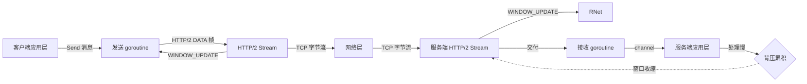

# 现代二进制通信协议——Protobuf 紧凑编码与 gRPC 多路复用机制

**摘要：**

在分布式系统的通信栈里，"用什么格式描述数据"和"用什么方式传输数据"是两个长期被混为一谈、却必须分开回答的问题。前者决定消息的体积、兼容性与跨语言成本，后者决定连接的使用效率、并发能力与流控粒度。2001 年由 Google 内部孵化、2008 年正式开源的 Protocol Buffers（Protobuf），以及 2015 年随 HTTP/2 普及而成熟的 gRPC，分别在这两个层面上给出了工业级的答案。本文沿着"编码—传输—接口演进"的主线，先拆解 Protobuf 的 TLV 变长编码与字段标签机制，说明它如何以极小的字节预算换取紧凑的线框；再分析 gRPC 在 HTTP/2 之上构造的单连接多路复用、流控与四种流式模式，对比 JSON/REST 在浏览器友好度、调试成本与吞吐量上的差异；最后落到工程边界——何时该用 gRPC、何时不该用，以及接口版本演进中那些被无数次重蹈的覆辙。回答的两个核心问题是：**二进制协议相对 JSON 的优势究竟来自哪些具体机制，以及 gRPC 的多路复用如何改变服务间通信的资源模型**。

---

> [!info] 专栏定位
> 本文属于 [[Golang/Go生态与框架设计/00 专栏导览|Go 生态与框架设计]] 专栏第 03 篇。本专栏聚焦企业级开源组件的设计模式与理论权衡，而非框架使用教程。前一篇讨论了 ORM 在 Active Record 与 Data Mapper 之间的路线之争，本篇转向通信协议：为什么现代微服务在内部通信中普遍选择 gRPC + Protobuf，以及这一选择背后的编码、传输与工程纪律。

---

## 第 1 章 从文本到二进制：序列化协议的演进动力

### 1.1 文本协议的成本账单

在 HTTP/1.1 + JSON 的组合统治 Web API 的十余年里，绝大多数工程师对"请求—响应"的直觉模型是：客户端拼一个 JSON 字符串，服务端解析成对象，处理后再序列化一个 JSON 字符串返回。这个模型的好处是**人可读、浏览器原生支持、curl 一行命令即可调试**，代价却往往在流量规模上涨之后才被看见。

这种"明文面单"式的协议设计并非没有理论依据。REST 架构风格（Roy Fielding, 2000）的核心主张之一是**无状态**与**统一接口**，JSON 作为自描述的文本格式天然契合这一理念——每一条消息都完整描述自身结构，接收方无需任何先验知识即可解析。这种设计在异构系统集成、第三方 API 开放等场景中展现出强大的生命力，但在**同构微服务集群的高频内部调用**场景中，其代价逐渐显现。

JSON 的开销主要来自三个层面。其一是**冗余的字段名**：每一条消息都要把字段名以 UTF-8 文本完整发送，即便通信双方早已持有同一份 schema；一个包含 20 个字段、每字段平均 10 字符的消息，字段名本身就占约 200 字节，而实际数值可能只有 60 字节。其二是**缺乏类型区分**：数字、布尔、null 全部以字符表示，`true` 占 4 字节而实际信息量只有 1 bit，`12345` 占 5 字节而 varint 编码仅需 2 字节。其三是**缺少长度前缀与分帧**：HTTP/1.1 依赖 `Content-Length` 或 chunked 编码来界定消息边界，这使得在一个 TCP 连接上并发多个请求必须借助管道（pipelining），而管道又受制于**队头阻塞（Head-of-Line Blocking）**——前一个响应未发完，后一个响应必须等待。

不妨把 JSON/REST 想象成一家快递公司的"明文面单"：每一份包裹上都用手写汉字写着"寄件人张三、收件人李四、重量三公斤、内容书籍"，无论收发双方多么熟悉，每次都要把同一套信息逐字念一遍。这种设计在包裹量小时问题不大，一旦日均百万级，纸质面单的成本就会压倒一切。

### 1.2 二进制协议的反击

二进制序列化的核心思想，是**用双方预先共享的结构描述（schema）代替在线传输的字段名**，再用紧凑的二进制编码代替文本表示。这条路线并非 Protobuf 独创：Apache Thrift（2007，Facebook）、MessagePack（2008）、Apache Avro（2009，Hadoop 生态）、FlatBuffers（2014，Google，游戏场景）都沿着相似的方向探索，只是侧重点不同——Thrift 自带 RPC 框架，MessagePack 追求"像 JSON 一样即插即用"，Avro 强调 schema 自描述以支持动态语言，FlatBuffers 主打零拷贝访问。

不妨用一个生活化的比喻来理解 schema 共享的价值：想象两个长期合作的棋手，他们不需要每步棋都喊出"车从 A1 走到 A5"，只需要说"老样子"——双方共享的棋谱就是 schema。而 JSON 则像两个陌生人下棋，每一步都要完整报出起点和终点，即便这些坐标在棋盘上从未改变。这种"共享知识"的机制，使得二进制协议在消息体积与解析速度上都具备结构性优势，但代价是**失去了自描述性**——没有 schema 的二进制字节流，对人类而言只是一串毫无意义的数字。

Protobuf 的特殊之处在于它与 Google 内部微服务架构的深度绑定，以及 2015 年 gRPC 的发布把它从"序列化库"升级为"完整的 RPC 方案"。gRPC 选择 HTTP/2 作为传输层，又把 Protobuf 作为默认编码格式，二者共同构成了一个从字节到帧、从流控到接口演进的闭环。

值得注意的一个细节是：二进制序列化并非总是优于文本。在**消息体极小（譬如只有一两个字段）**或**字段结构高度动态（譬如任意 key-value 的元数据）**的场景，JSON 的体积劣势会被其结构的自描述性抵消——schema 协商本身的网络与工程成本，可能超过省下的字节数。这一边界在后面的章节还会反复出现。

### 1.3 没有 Protobuf 会怎样

假设一个中型微服务集群每天跨服务调用 10 亿次，每次消息平均 500 字节（JSON 格式），那么每日序列化流量约为 500 GB；换成 Protobuf 通常可以压到 150–200 GB，节省 60% 以上的带宽。这不仅是网卡成本的问题，更是序列化/反序列化 CPU 开销的问题：JSON 的文本解析需要 UTF-8 解码、字符串 intern、数字转换，而 Protobuf 的 varint 解码几乎是位运算的直接映射。在 Go 的 `encoding/json` 与 `google.golang.org/protobuf` 的基准测试中，后者在典型消息上的吞吐约为前者的 5–10 倍，堆分配次数则下降一个量级。

这种性能差异在**尾部延迟（P99 latency）**上体现得尤为明显。JSON 的解析时间波动较大——字符串的长度、嵌套的深度、数字的位数都会影响解析速度；而 Protobuf 的解码时间是**消息大小的线性函数**，波动极小。对于追求 SLA 的系统（譬如 P99 < 100ms），Protobuf 的可预测性本身就是一种优势——它降低了延迟的方差，使得系统在高负载下仍能保持稳定。

另一个常被忽视的维度是**跨团队协作的契约强度**。在大型组织中，微服务的接口契约需要跨团队维护。JSON 的松散性使得"契约"往往停留在文档层面——文档说字段是 `int`，但实际可能收到 `string`；文档说字段是 `required`，但实际可能缺失。这种"文档与实现的脱节"在 JSON 世界中几乎无法根治，因为 JSON 本身不提供强制校验机制（JSON Schema 虽然存在，但在生产环境中的普及度远不及 Protobuf 的代码生成）。Protobuf 通过**代码生成强制契约**——客户端与服务端的 message 类型由同一个 `.proto` 文件生成，字段类型、必填性、枚举值都在编译期锁定，运行时不可能出现类型不匹配的情况。这种"契约即代码"的理念，是 Protobuf 在大型组织中广泛采用的重要原因。

值得注意的是，Protobuf 的契约强度并非没有代价。在快速迭代的早期项目中，schema 的频繁变更会导致**代码生成链路的负担**——每次修改 `.proto` 文件都需要重新编译、重新生成客户端与服务端代码、重新部署。这一流程在成熟团队中通过 CI/CD 自动化，但在小团队中可能成为开发效率的瓶颈。因此，Protobuf 的"契约强度"本质上是一种**工程投资**——前期投入更多，后期收益更大；对于生命周期短、变更频繁的项目，JSON 的"弱契约"可能更合适。

另一个值得讨论的维度是**Protobuf 与领域驱动设计（DDD）的关系**。DDD 强调"限界上下文"（Bounded Context）的边界清晰，而 Protobuf 的 `.proto` 文件恰好可以作为限界上下文之间的**显式契约**——每个上下文有自己的 `.proto` 文件，上下文的交互通过 gRPC 调用完成。这种"proto 文件即上下文边界"的组织方式，在微服务架构中被广泛采用，它使得服务的职责边界在代码层面即可见、可验证。

最后需要指出的是，**Protobuf 与 gRPC 的流行并非技术上的必然，而是历史与生态的产物**。在 2015 年 gRPC 发布之前，Thrift 在跨语言 RPC 领域占据主导地位；如果 Facebook 在 2007 年选择开源 Thrift 时配套一个类似 gRPC 的现代化框架，今天的生态格局可能截然不同。Protobuf 的成功，很大程度上得益于 Google 的品牌效应、gRPC 与 HTTP/2 的同步发布、以及云原生时代对标准化通信协议的迫切需求。理解这一历史背景，有助于我们在技术选型时保持清醒——**选择 gRPC 不是因为它"最好"，而是因为它在当前生态中最成熟、最广泛支持**。

技术的演进从未停止。HTTP/3 与 QUIC 正在重塑传输层的格局，Protobuf edition 正在统一 schema 演进的节奏，gRPC over QUIC 的实验已经展开。未来的通信协议栈会是什么模样，目前仍然言之尚早——但可以确定的是，**理解 Protobuf 与 gRPC 的设计权衡，是理解现代分布式系统通信栈的必经之路**。

这一理解的起点，正是本文所展开的编码、传输与工程纪律的三重奏。

---

更隐蔽的代价是**跨语言一致性**。JSON 对数字的处理在不同语言间存在微妙差异：JavaScript 将所有数字视为 IEEE 754 双精度浮点，Java 区分 `int`/`long`/`float`/`double`，Go 的 `encoding/json` 默认把数字反序列化为 `float64`。一个 64 位整数经过 JavaScript 中转后可能丢失精度，而 Protobuf 在 schema 层面就区分了 `int32`、`int64`、`uint32`、`uint64`、`sint32`、`sint64`、`fixed32`、`fixed64` 八种整数类型，编解码双方从协议层就被锁定在同一个语义上。

> [!info] 演进锚点
> 2001 年 Protobuf 在 Google 内部诞生，最初用于解决搜索引擎索引数据的跨语言描述问题；2008 年随 Protocol Buffers 2.x 开源，引入 `required`/`optional`/`repeated` 三分类；2015 年 Proto3 发布，移除 `required` 与 `default`，简化语义并配套 gRPC 1.0；2022 年 Protobuf edition 取代 proto2/proto3 的版本区分方式，改为按年份编号的 edition（edition-2023、edition-2024），以统一语言特性与线框特性的演进节奏。

---

## 第 2 章 Protobuf 的编码机制：TLV 与变长的艺术

### 2.1 字段标签：wire type 与字段号

Protobuf 的线框（wire format）是一种 **TLV（Tag-Length-Value）** 变体，但与传统 TLV 不同的是，**大部分字段没有显式的 Length 字段**——长度要么由 wire type 隐含（如 varint 自定界、64-bit 固定 8 字节），要么在字符串/嵌套消息中以 varint 前缀形式出现。

每个字段在编码时首先产出一个 **tag**，由 `(field_number << 3) | wire_type` 组成，以 varint 编码。wire type 只有五种有效值：

| Wire Type | 含义 | 适用类型 |
| :--- | :--- | :--- |
| 0 | Varint | int32, int64, uint32, uint64, sint32, sint64, bool, enum |
| 1 | 64-bit | fixed64, sfixed64, double |
| 2 | Length-delimited | string, bytes, embedded messages, packed repeated fields |
| 5 | 32-bit | fixed32, sfixed32, float |

字段号（field number）的范围是 1 到 536,876,083（2^29 - 1），但实践中强烈建议使用 1–15，因为**这个范围的字段号可以用 1 个字节编码 tag**（field_number 占 4 bit，wire_type 占 3 bit，合计 ≤ 7 bit），而 16–2047 需要 2 个字节。在高频小消息的场景下，把热点字段放在 1–15 范围可以节省 30% 以上的 tag 开销。这一细节在普通业务消息中影响甚微，但在每秒数十万次的内部调用链路中，累积节省的 CPU 与带宽足以成为性能优化清单上的高优先级项。

### 2.2 Varint 编码：用 bit 换 byte

Varint 是 Protobuf 体积优势的基石之一。其规则是：每字节的低 7 位存放有效数据，最高位（MSB）作为"是否还有后续字节"的标志位。一个 32 位整数最少 1 字节（值 0–127）、最多 5 字节；64 位整数最多 10 字节。对于大量出现的小数值（譬如布尔值、枚举、长度前缀），varint 只需 1 字节，相比 JSON 的文本表示节省 70%–90%。

但 varint 有一个常被忽视的陷阱：**负数的编码长度**。`int32` 类型的 `-1` 在 varint 中需要 10 字节（因为负数在 32 位补码表示下高位全是 1，必须符号扩展到 64 位 varint 的 10 字节上限）。为此 Protobuf 提供了 `sint32` 与 `sint64`，采用 **ZigZag 编码**：把符号位映射到最低位，`-1` 编码为 `1`、`1` 编码为 `2`、`-2` 编码为 `3`，从而让绝对值小的负数也能用 1–2 字节表示。在 Go 的 `.proto` 文件中，如果字段可能取负值，**必须显式使用 `sint32`/`sint64`**，否则性能会显著退化——这一陷阱在温度、坐标、金融差值等场景中屡见不鲜。

### 2.3 字段顺序、缺失与默认值

Protobuf 编码时**不要求字段按序号顺序出现**，也不要求为默认值字段产出任何字节。一个未设置的 `int32` 字段在解码时直接返回 `0`，未设置的 `string` 字段返回空字符串。这意味着**消息的体积只与"非默认字段"的数量相关**，与 schema 的总字段数无关——这一点与 JSON 截然不同，JSON 即便省略字段也仍然需要逗号、引号等结构字符。

解码器遇到未知字段号时，会根据 wire type 跳过对应字节并保留在 `unknown fields` 中（Go 的 protobuf 实现提供相应 API 访问）。这一机制是**向后兼容的物理基础**：老客户端读新服务端的消息不会崩溃，新客户端读老服务端的消息也能正确识别所有已知字段。

字段在消息内的顺序也值得玩味。虽然规范不要求按序号顺序，但 `protoc` 生成的编码器会按字段号升序排列字段，因为这样能让解码器在一次线性扫描中完成解析——**任何偏离升序的字段顺序都会让解码器的工作变得更复杂**，尽管在语义上仍然是合法的。

> [!info] TLV 的隐喻
> 不妨把 Protobuf 的编码想象成一间只贴编号、不贴名字的储物柜：收发双方都手持同一份"编号—物品清单"，所以柜子上不需要写"张三的牙刷"，只需要一个数字编号。varint 则是把大物件拆成若干小格——大多数物件只占一格，只有真正巨大的物件才会连占数格。

### 2.4 Packed Repeated 与嵌套消息

对于 `repeated` 字段，Protobuf 2 的默认编码是为每个元素单独输出一对 (tag, value)；Protobuf 3 对数值类型的 repeated 字段默认启用 **packed 编码**，即把所有元素连续排列，前面加一个 length-delimited 总长度前缀。一个包含 100 个 `int32` 的字段，packed 后可以节省 100 个 tag 字节——对于遥测、指标上报这类"一消息几百个数值"的场景，压缩比可达 5 倍以上。

嵌套消息（embedded message）的编码与 string/bytes 类似，先输出 tag，再输出子消息的字节长度，再输出子消息的完整编码。这意味着**嵌套并不引入额外的结构开销**，只是多了一个 varint 长度前缀。与 JSON 的对象嵌套相比，JSON 需要为每个嵌套层级额外支付一对 `{}` 与若干 `:`、`"`，Protobuf 的嵌套代价要小得多。

### 2.5 编码细节的 Go 视角

在 Go 中使用 Protobuf，开发者通常不直接接触编码细节——`proto.Marshal()` 与 `proto.Unmarshal()` 封装了全部 wire format 逻辑。但这种封装也把陷阱藏了起来。一个典型的性能反模式是**在热路径上反复分配 message 对象**：Go 的 protobuf 实现会为每个 message 分配独立的 struct 及其内嵌的 repeated 字段切片，高频调用下 GC 压力显著。应对策略包括使用对象池（`sync.Pool`）复用 message、使用 `proto.Buffer` 的 `Reset()` 方法避免重复分配编码器内部缓冲区，以及在可能的场景使用 **protobuf arena 分配**（gRPC-Go 与 protobuf-go 在高版本中提供了实验性的 arena 支持）。

另一个值得注意的细节是 **`protojson` 与 `protojsonpb` 的差异**：当需要把 Protobuf 消息转为 JSON 输出（譬如给前端或日志）时，官方推荐的 `protojson` 包（`google.golang.org/protobuf/encoding/protojson`）严格遵循 proto3 的 JSON 映射规范，包括字段名的 camelCase 转换、枚举的字符串表示、`google.protobuf.*` well-known 类型的特殊处理。相比之下，早期社区的 `gogo/protobuf` 的 JSON 实现与标准存在细微差异，迁移时需要逐项验证。

### 2.6 编码体积的实测对比

为了更直观地理解 Protobuf 的体积优势，不妨看一组典型的对比数据。一个包含 10 个字段（3 个 string、2 个 int32、1 个 bool、1 个 enum、1 个 repeated int32（10 元素）、1 个嵌套 message（含 3 字段））的消息：

| 格式 | 体积（字节） | 相对比例 |
| :--- | :--- | :--- |
| JSON（无空白） | ~320 | 100% |
| JSON（格式化） | ~480 | 150% |
| Protobuf 3 | ~95 | 30% |
| MessagePack | ~130 | 41% |
| Thrift (Binary) | ~110 | 34% |

这组数据的差异主要来自：JSON 需要为每个字段名付出 UTF-8 字符的代价，而 Protobuf 的字段号只占 1 字节；JSON 的 repeated 字段需要 `[`、`]`、`,` 等分隔符，而 Protobuf 的 packed 编码只需要一个长度前缀；JSON 的嵌套对象需要 `{`、`}`、`"` 等结构字符，而 Protobuf 的嵌套消息只需要一个 tag + 长度前缀。

在**高基数场景**（譬如每次调用携带 100+ 字段的 telemetry 数据）下，Protobuf 的优势更加显著——JSON 的体积会线性增长，而 Protobuf 由于 varint 与 packed 编码的特性，体积增长更为平缓。这也是为什么 OpenTelemetry 在 2021 年后逐步将默认导出格式从 JSON 切换为 Protobuf 的核心原因。

### 2.7 压缩的叠加效应

Protobuf 的编码本身已经紧凑，但在某些场景下仍可通过通用压缩算法进一步减小体积。常见的选择是 **gzip**（HTTP/2 的 `content-encoding: gzip`）或 **zstd**。由于 Protobuf 的编码具有较高的局部性（相似字段连续排列），通用压缩算法通常能再压缩 30%–50%。但压缩的 CPU 开销不容忽视：gzip level 6 的压缩速度约为 100MB/s，对于每秒处理 1GB 数据的服务端，压缩可能成为瓶颈。

gRPC 支持在压缩层使用 `SendCompressed()` 与 `AcceptCompressed()` 注册自定义压缩器，Go 的 grpc 仓库提供了 gzip、snappy、zstd 的实现。在高吞吐场景下，**snappy**（压缩速度快、压缩率中等）通常是比 gzip 更合适的选择；在带宽敏感但 CPU 富余的场景下，**zstd**（压缩率高、速度可调）更具优势。压缩策略的选择，本质上是在 CPU 时间与网络带宽之间做权衡——这一权衡在不同硬件架构（譬如 ARM vs x86）与不同网络环境（譬如跨数据中心 vs 同机架）下会有截然不同的最优解。

---

## 第 3 章 Schema 演进：向后兼容的工程纪律

### 3.1 字段号的复用禁忌

Protobuf 的兼容规则看似简单，却是在无数线上事故中锤炼出来的。**第一条铁律：已被删除的字段号不得复用**。原因很直接——假设 v1 schema 有字段 5（`user_id`），v2 删除了它并把字段 5 重新定义为 `order_id`，那么一个 v2 客户端发送给 v1 服务端的消息里，字段 5 会被 v1 解码为 `user_id`，语义完全错乱。这条规则在 Google 内部通过 **`reserved` 关键字**强制执行：

```protobuf
message User {
  reserved 5, 100 to 200;        // 字段号保留，永久禁用
  reserved "legacy_token";       // 字段名保留，防止误用
  string name = 1;
  int32 age = 2;
}
```

`reserved` 不仅是文档性的提示——`protoc` 编译器会在任何人尝试使用保留的字段号或字段名时报错，从而把兼容性问题从"运行时故障"前移到"编译期错误"。这一机制在大型团队中尤其关键，因为 schema 的维护者往往与业务代码的编写者不是同一人。

### 3.2 Proto3 的"简化"与代价

2015 年发布的 Proto3 在语义上做了几项引发争议的简化：**移除 `required` 关键字**、**移除 `default` 字段选项**、**把 repeated 默认改为 packed**、**所有字段隐式 optional 且默认值为零值**。这些改动让 schema 更简洁，但也带来了一个无法回避的问题：**无法区分"未设置"与"显式设置为零值"**。一个 `int32 count = 1;` 字段，解码出 `0` 时，调用方无法判断对端是"没填"还是"填了 0"。

为解决这一问题，Protobuf 在 2019 年重新引入了 `optional` 关键字（配合 `proto3 optional` 语法），编译器会为 optional 字段生成一个 bitset 记录哪些字段被显式设置。Go 的实现则通过 `*int32` 指针类型来表达可空语义——非 nil 表示已设置，nil 表示未设置。这一回归引发了社区的广泛讨论：Proto3 的初衷是简化，但**过度简化最终迫使设计者重新引入被移除的特性**，并以更复杂的方式（bitset + 指针类型）实现。

另一项常被忽视的语义变化是 **enum 的首值必须为 0**。Proto3 要求每个 enum 类型的第一个值必须是 0（通常命名为 `UNSPECIFIED` 或 `UNKNOWN`），这确保了未设置的 enum 字段解码后有一个合法的默认值。这一约束在 proto2 中不存在，迁移时必须调整所有 enum 定义。

### 3.3 演进的五条经验法则

1. **只加字段，不改语义**：已有字段号对应的类型与含义一旦上线即冻结。
2. **删除用 `reserved`**：永远给被删字段号留一个墓碑。
3. **变更字段的 wire type 必须重建字段号**：`int32` 改 `string` 不是兼容变更，必须分配新字段号，即便语义上"都是文本"。
4. **`repeated` 与 `map` 的语义变化谨慎对待**：packed 与非 packed 在旧版解析器中的行为不同；`map` 字段在底层是 repeated 的 key-value 消息，变更其 value 类型是不兼容的。
5. **`oneof` 的字段互斥在演进中容易被破坏**：向 `oneof` 添加新字段通常是安全的，但把 `oneof` 拆开或合并则是不兼容变更；把已有字段移入 `oneof` 也是不兼容的。

这些纪律的本质，是用**编译期约束与人工 review** 替代运行时的 schema 协商——这与 JSON 生态中常见的"schema registry + 运行时校验"路线形成鲜明对比。两种路线各有适用场景：Protobuf 的纪律适合**长生命周期、跨团队的服务接口**，JSON + schema registry 的灵活性适合**快速迭代、字段高度动态的内部事件总线**。

### 3.4 Well-known types 与跨语言边界

Protobuf 定义了一组 **well-known types**（WKT），包括 `Timestamp`、`Duration`、`Any`、`Struct`、`Value`、`FieldMask`、`Empty` 等。它们的作用是在标准库层面统一跨语言的语义：`google.protobuf.Timestamp` 在所有语言中都映射为"UTC 秒 + 纳秒"的语义，避免了各语言自行定义时间戳格式带来的混乱。

`Any` 类型值得单独讨论——它允许在消息中嵌入任意类型的子消息，通过 `type_url` 字段标识实际类型。这种机制类似于 JSON 中的多态对象，但**类型解析需要双方共享一个类型注册表**，否则解码器无法将 `type_url` 映射回具体的 Go/Java 类型。在实际工程中，`Any` 的使用应当克制，因为**它破坏了 schema 的静态可分析性**——代码生成工具无法预知 `Any` 中可能出现的类型，调用方必须处理类型断言失败的情况。

> [!info] Well-known types 的隐喻
> Well-known types 好比国际邮政中的"标准信封规格"——无论寄件人用什么语言写信，只要信封符合 ISO 269 标准，全球的邮局都能处理。`Timestamp` 就是时间领域的"标准信封"，`Duration` 是时间间隔的"标准信封"。但 `Any` 则像是一个"神秘包裹"——邮局知道它来自某个寄件人，但不知道里面是什么，需要收件人自己拆开并识别。

### 3.5 演进纪律的工程代价

schema 演进纪律的执行并非没有代价。在大型组织中，Protobuf 的"只加字段、不改语义、删除用 reserved"原则，意味着**随着时间推移，schema 中会积累大量 reserved 字段号和废弃字段**——一个经历了十年演进的 core service，其 proto 文件可能包含 200+ 字段号，其中只有 80 个是活跃的。这种"墓碑式演进"虽然保证了兼容性，但也增加了 schema 的认知负担。

应对这一问题的工程实践包括：

- **定期审计 reserved 字段**：通过 CI 脚本统计 reserved 字段数量，超过阈值时触发 review。
- **分层 schema 设计**：把核心字段（高频、长期稳定）与扩展字段（低频、可能废弃）分离到不同的 message 中，通过 `oneof` 或 optional 嵌套组织。
- **文档化演进历史**：在 proto 文件的注释中记录每个字段的添加/废弃原因，帮助后续维护者理解设计意图。

这些实践的共同目标是**在不破坏兼容性的前提下，控制 schema 的熵增**——schema 的熵增是任何长期演进系统的必然趋势，区别只在于是主动管理还是被动承受。

---

## 第 4 章 gRPC 与 HTTP/2 的多路复用

### 4.1 为什么 gRPC 选择 HTTP/2

2015 年 gRPC 发布时，摆在设计者面前的传输层选项有三：自建 TCP 协议（如 Thrift 的 TTransport）、复用 HTTP/1.1（如早期 JSON-RPC）、基于 HTTP/2。gRPC 选择 HTTP/2 并非偶然，而是因为 HTTP/2 提供了三项恰好满足 RPC 需求的原语：

1. **多路复用（Multiplexing）**：单个 TCP 连接上可以并发任意数量的请求—响应对（stream），每个 stream 独立分帧，互不阻塞。
2. **帧与流控**：HTTP/2 定义了 DATA、HEADERS、RST_STREAM、WINDOW_UPDATE 等九种帧类型，并为每个连接和每个 stream 提供基于 `WINDOW_UPDATE` 的流量控制。
3. **头部压缩（HPACK）**：重复的请求头（如 `:authority`、`content-type`、自定义 metadata）通过静态/动态字典压缩，避免 HTTP/1.1 中每请求重复发送数百字节 header 的浪费。

> [!note] HTTP/2 的隐喻
> 如果把 TCP 连接想象成一条高速公路，HTTP/1.1 就是单车道——前一辆车（请求）没下高速，后一辆车只能在入口排队；HTTP/2 则是在同一条公路上划出多条虚拟车道（stream），每辆车走自己的道，但共享同一条物理道路的资源。WINDOW_UPDATE 则是每条车道的红绿灯，告诉上游"我还能吞多少车"，避免下游被淹没。

HTTP/2 的帧结构是理解 gRPC 行为的基础。每个帧由 9 字节头部（3 字节长度 + 1 字节类型 + 1 字节标志 + 4 字节 stream 标识）和可变长度的负载组成。gRPC 的一次 unary 调用至少涉及：客户端发送 HEADERS 帧（包含 `:method`、`:path`、`content-type: application/grpc`、`te: trailers` 等伪头）+ DATA 帧（包含 gRPC 消息：1 字节压缩标志 + 4 字节消息长度 + 消息体）；服务端响应 HEADERS 帧（状态头）+ DATA 帧（gRPC 响应消息）+ HEADERS 帧（trailer，包含 `grpc-status` 与可选的 `grpc-message`）。

### 4.2 gRPC 的单连接并发模型

gRPC 客户端默认对同一个 host:port 维护**单个 HTTP/2 连接**（可通过 `WithDefaultServiceConfig` 与负载均衡配置调整），所有 RPC 调用都作为这个连接上的 stream 并发执行。这与 HTTP/1.1 客户端通常为每个 host 维护 4–8 个连接形成鲜明对比。单连接模型的好处是**减少 TCP 握手与拥塞控制的开销**，坏处是**一旦这条连接触发 TCP 层面的丢包重传，所有 stream 都会受影响**——这就是 HTTP/2 长期被诟病的**队头阻塞（Head-of-Line Blocking）问题**。

HTTP/2 的 HoL 阻塞发生在**传输层**，与 HTTP/1.1 的应用层 HoL 阻塞有本质区别：后者是"前一个响应没发完，后一个响应不能发"（可以通过 pipelining 缓解但浏览器普遍禁用），前者是"同一个 TCP 连接的丢包重传会拖慢所有 stream"。这一缺陷直到 HTTP/3（基于 QUIC/UDP，2022 年 RFC 9114 标准化）才真正解决——QUIC 在 UDP 之上实现了 stream 级别的独立重传，一个 stream 的丢包不影响其他 stream。gRPC 社区也已在 2021 年后开始推进 gRPC over QUIC 的标准化。

在 Go 的实现中，HTTP/2 连接由 `golang.org/x/net/http2` 包管理，gRPC 在其之上封装了 `transport` 层，提供 stream 生命周期管理、流控窗口更新与错误映射。每个 gRPC stream 对应一个 `transport.Stream` 对象，其读写操作通过 Go 的 channel 与 context 传播取消信号——这一设计与 [[Golang/Go并发编程/12 Go 网络编程——netpoller 与 Goroutine-per-Connection]] 中讨论的 Goroutine-per-Connection 模型一脉相承，只是把"一个连接一个 goroutine"细化为"一个连接上多个 stream，每个 stream 一对 goroutine（读/写）"。

### 4.3 拦截器与中间件流水线

gRPC 的拦截器（interceptor）机制是其工程扩展性的核心。Unary interceptor 的签名是 `func(ctx, req, info, handler) (resp, error)`，本质上是一个**装饰器**——在调用实际的业务 handler 前后插入日志、鉴权、监控、限流等横切关注点。Streaming interceptor 的签名则返回一个包装后的 `grpc.ServerStream` 或 `grpc.ClientStream`，允许拦截器拦截每一次 `Send()` 与 `Recv()` 调用。

拦截器链的组织方式与 Go 生态中的 HTTP 中间件高度相似——都是**洋葱模型**，请求从外向内穿过每一层拦截器，响应从内向外再次穿过。但有一个关键差异：HTTP 中间件通常基于 `http.Handler` 的函数组合，而 gRPC 拦截器必须严格匹配类型签名，且**链式调用需要手动组装**（在 `grpc.UnaryInterceptor()` 中传入一个包装函数，依次调用下一层）。这一设计被广泛批评不够优雅，直到 2020 年 gRPC-Go 引入 `grpc.ChainUnaryInterceptor()` 与 `grpc.ChainStreamInterceptor()`，才支持声明式地传入多个拦截器并按顺序执行。

拦截器的性能影响不容小觑。在 Go 中，每次 unary 拦截器调用都涉及一次函数调用与可能的 context 分配，过深的拦截器栈（譬如 10 层以上）会为每次 RPC 增加数百微秒的延迟。对于延迟敏感的热点接口，建议**只在必要的拦截器中做重逻辑**，把轻量级的 metadata 校验与重型的鉴权/日志分离到不同的拦截器层。

### 4.4 gRPC 的四种流式模式

gRPC 基于 HTTP/2 的 stream 抽象，支持四种调用模式，覆盖从简单请求—响应到双向流的全部场景：

| 模式 | 服务端流 | 客户端流 | 典型场景 |
| :--- | :--- | :--- | :--- |
| Unary | 否 | 否 | 简单查询、CRUD 单条操作 |
| Server Streaming | 是 | 否 | 列表分页、实时推送、数据下载 |
| Client Streaming | 否 | 是 | 批量上传、日志收集 |
| Bidirectional Streaming | 是 | 是 | 实时聊天、协同编辑、双向同步 |

Unary 模式最接近传统 REST，但底层仍然是 HTTP/2 的一个完整 stream（HEADERS 帧 + DATA 帧 + HEADERS 帧 + DATA 帧）。Server Streaming 允许服务端在一次调用中持续推送多条消息，客户端通过 `Recv()` 循环读取直至 `io.EOF`。Client Streaming 则反向——客户端持续发送，服务端在 `CloseAndRecv()` 时一次性返回结果。Bidirectional Streaming 是最灵活也最复杂的模式，双方可以同时收发，但必须处理好**背压（backpressure）**——当消费速度慢于生产速度时，HTTP/2 的 WINDOW_UPDATE 会在 stream 级别发出信号，gRPC 的 Go 实现通过 channel 与 context 的组合把背压传播到应用层。

```go
// 服务端 bidirectional streaming 的典型骨架
func (s *chatServer) Chat(stream pb.ChatService_ChatServer) error {
    for {
        msg, err := stream.Recv() // 阻塞等待客户端消息
        if err == io.EOF {
            return nil
        }
        if err != nil {
            return err
        }
        // 处理消息并回复
        reply := process(msg)
        if err := stream.Send(reply); err != nil {
            return err
        }
    }
}
```

这段代码看似简单，却隐藏了几个工程陷阱：`Recv()` 与 `Send()` 都是阻塞调用，如果处理逻辑耗时过长，会阻塞 stream 的接收 goroutine，导致对端 WINDOW_UPDATE 无法被及时处理，最终可能触发流控死锁。正确的做法是把处理逻辑放到独立的 goroutine 中，或使用带缓冲的 channel 解耦收发。

### 4.4 流控与背压的物理机制

HTTP/2 的流控基于**滑动窗口**：每个 stream 初始窗口为 65,535 字节，通信双方可通过 WINDOW_UPDATE 帧动态调整。当接收方的应用层消费不及时，接收缓冲区填满，窗口缩小到 0，发送方必须暂停该 stream 的 DATA 帧发送——这就是 HTTP/2 原生的背压机制。gRPC 在此基础上封装了更高层次的控制：Go 的 `grpc.Server` 默认不限制并发 stream 数量，但可以通过 `grpc.MaxConcurrentStreams()` 显式设置上限，超出上限的新 stream 会被服务端拒绝（返回 `REFUSED_STREAM`）。

背压的设计失误是 gRPC 集群中常见的故障来源。一个典型的反例：客户端以每秒 1 万条的速率向服务端发送 client-streaming 消息，但服务端的处理速率只有每秒 5000 条；如果客户端不读取服务端的 WINDOW_UPDATE 或不检查 `Send()` 的 error，几秒内就会导致服务端内存耗尽或 TCP 接收缓冲区溢出，最终连接被重置。正确的做法是在发送侧使用带缓冲的 channel 结合 `select` 与 `context.Context` 的取消信号，让应用层与传输层的流控同步。



> [!warning] 工程中的常见误区
> 背压不是"加了 buffer 就能解决"的问题。过大的 buffer 会掩盖慢消费者的问题，最终导致内存溢出或延迟飙升；过小的 buffer 会频繁阻塞生产者，降低吞吐。正确的做法是**让 buffer 的大小反映系统的处理能力上限**，并在 buffer 满时向上游传播阻塞信号，而非丢弃消息或 panic。

### 4.6 Deadline 与超时传播

gRPC 的另一个重要特性是 **deadline 的自动传播**。客户端在发起 RPC 时可以设置 `context.WithTimeout(ctx, 5*time.Second)`，这个 deadline 会通过 gRPC 的 metadata（`grpc-timeout` header）传递给服务端，服务端在处理过程中如果需要调用下游服务，会自动把**剩余的 deadline**传递给下游——这一机制使得整条调用链的超时控制是**级联**的，而非每个节点独立设置。

这一设计避免了传统 REST 架构中常见的"超时叠加"问题：假设客户端给网关 10 秒超时，网关给服务 A 10 秒超时，服务 A 给服务 B 10 秒超时，那么最坏情况下客户端等待 30 秒才能得到结果——每个节点的超时独立，无法感知整体链路的时间预算。gRPC 的 deadline 传播确保了**整条链路共享同一个时间预算**，任何节点的超时都会导致上游立即感知并取消后续调用。

在 Go 实现中，deadline 通过 `context.Context` 的 `Deadline()` 方法读取，服务端可以通过 `ctx.Err() == context.DeadlineExceeded` 判断调用是否超时。这一设计与 [[Golang/Go并发编程/12 Go 网络编程——netpoller 与 Goroutine-per-Connection]] 中讨论的 context 取消传播机制一脉相承——gRPC 的 stream 生命周期与 context 的生命周期是绑定的，context 取消时 stream 会立即发送 RST_STREAM 帧通知对端。

---

## 第 5 章 gRPC 与 JSON/REST 的取舍

### 5.1 体积与吞吐的对比

在典型的企业级消息（20–50 字段，含嵌套结构）上，Protobuf 的编码体积约为 JSON 的 30%–40%，序列化/反序列化吞吐约为 JSON 的 5–10 倍。这些数据随消息结构差异很大：**字段少、值短的消息差异较小，嵌套深、重复字段多的消息差异较大**。对于内部微服务间的高频调用（譬如每秒数万次），这种差异直接体现在 CPU 利用率与网络带宽成本上。

一个值得对比的基准测试来自 gRPC 官方仓库的 benchmark 套件：在包含 2 个 int32、1 个 string、1 个嵌套 message 的简单消息上，Protobuf 的编码速度约为 JSON 的 7 倍，解码速度约为 10 倍；在包含 50 个字段、含 repeated 与 map 的复杂消息上，差距进一步拉大到 15–20 倍。这些数字在 Go 中尤其显著，因为 Go 的 `encoding/json` 使用反射进行 struct 与 map 的转换，而 Protobuf 的代码生成直接产出类型化的编解码逻辑，完全避免了反射开销。

### 5.2 可读性与调试成本

JSON 的"人类可读"优势在调试时体现得最为明显：`curl` 一行命令即可构造请求，`jq` 即可解析响应，浏览器开发者工具原生展示。gRPC 的调试则需要专用工具——`grpcurl`（命令行）、`BloomRPC`/`Postman gRPC`（GUI）、`grpc_debug` 拦截器（服务端日志）。对于面向第三方开发者的公开 API，JSON/REST 的生态友好度仍然是决定性因素；这也是为什么 Stripe、GitHub、Slack 等外部 API 至今仍以 REST 为主。

gRPC 生态也在逐步弥补这一短板。**gRPC 的 reflection 服务**（`grpc.reflection.v1alpha.ServerReflection`）允许客户端在运行时查询服务端支持的方法与消息类型，使得 `grpcurl` 可以像 `curl` 一样"盲探"服务端接口——但这一能力需要服务端显式启用，且在生产环境中通常出于安全考虑而禁用。**gRPC 的 channelz 与 csds** 则提供了运行时的连接与 stream 状态查询，用于诊断连接泄漏、stream 异常等问题。

### 5.3 浏览器友好度与 gRPC-Web

HTTP/2 的 stream 模型与浏览器 XHR/Fetch API 的语义存在根本冲突：浏览器无法直接创建 raw HTTP/2 stream，也无法访问 HPACK 压缩后的 header。为此 gRPC 团队推出了 **gRPC-Web**（2018），它在 HTTP/1.1 或 HTTP/2 之上定义了一个简化的子集，允许浏览器作为客户端调用 gRPC 服务，但**不支持 client-streaming 与 bidirectional-streaming**。通常还需要一个 Envoy 或 grpc-web proxy 作为中间层，把 gRPC-Web 请求转换为后端的标准 gRPC 调用。

这一限制使得前端实时推送场景（譬如聊天、协同编辑）往往仍然依赖 WebSocket，而非 gRPC 的 bidirectional streaming。2023 年后，Connect Protocol（由 Buf 团队推出）作为 gRPC 的替代方案出现，它兼容 gRPC 的 Protobuf 编码但基于标准 HTTP/1.1 或 HTTP/2，不需要 proxy 即可被浏览器调用——这一方案尚未成为行业标准，但代表了 gRPC 生态在浏览器友好度方向上的演进尝试。

### 5.4 取舍矩阵

| 维度 | JSON/REST | gRPC/Protobuf |
| :--- | :--- | :--- |
| 消息体积 | 大（含字段名与结构字符） | 小（schema 驱动） |
| 序列化性能 | 较慢（文本解析 + 反射） | 快（二进制 + 代码生成） |
| 浏览器原生支持 | 完全支持 | 需 gRPC-Web + proxy |
| 流式支持 | SSE/WebSocket（应用层） | 原生四种模式 |
| 接口演进 | 宽松（字段可随意增减） | 严格（reserved、字段号纪律） |
| 调试成本 | 低（curl/jq/浏览器） | 中高（grpcurl/专用工具） |
| 跨语言一致性 | 弱（数字语义差异） | 强（schema 即契约） |
| 负载均衡 | HTTP 层 L7 成熟 | 需 L7 感知（长连接 + 连接级 LB 失效） |

最后一行是工程上最容易被忽视的差异：gRPC 的单连接多路复用模型与传统 L4 负载均衡（基于 IP:Port 哈希）存在冲突——所有请求都落在同一条连接上，意味着**同一个客户端的所有流量只会到达一台后端**。为此 gRPC 生态发展出了**客户端负载均衡**（gRPC name resolver + load balancing policy）与**代理端负载均衡**（Envoy xDS）两条路线，这是选型时必须评估的架构成本。

### 5.5 与 JSON/REST 相关的 Go 生态细节

在 Go 中同时使用 JSON 与 Protobuf 是常见需求——譬如一个服务同时暴露 REST 与 gRPC 接口。[[Golang/Go标准库与系统IO/04 数据序列化语义与边界——encoding-json 的元数据解析与流式编解码]] 详细分析了 `encoding/json` 的 struct tag、`json.Number` 与 `json.Decoder` 的边界，这些知识在混合接口场景中仍然关键。一个典型的工程模式是：**内部服务间用 gRPC + Protobuf，对外网关用 REST + JSON**，中间通过一个转换层（譬如 `protojson` 包）完成消息格式的切换。这种架构的代价是维护两套接口的 schema 映射，好处是各司其职——内部追求吞吐，外部追求兼容。

---

## 第 6 章 代码生成与接口演进的工程边界

### 6.1 .proto 文件作为单一事实源

gRPC + Protobuf 的工程模型以 `.proto` 文件为**单一事实源（Single Source of Truth）**：服务接口、请求/响应消息、字段编号、注释全部在这里定义，Go/Java/Python/TypeScript 的客户端与服务端代码由 `protoc` 编译器 + 对应语言的插件自动生成。这一模型的好处是**契约前置**——在写任何业务代码之前，收发双方已经对消息结构达成一致；坏处是**任何接口变更都需要走"修改 .proto → review → 重新生成 → 重新编译"的链路**，迭代速度比 JSON 的"直接改代码"慢。

Go 生态中，`protoc-gen-go` 生成消息代码，`protoc-gen-go-grpc` 生成服务接口代码，二者在 2020 年后被拆分为独立插件以解耦版本演进。生成的 Go 代码是**严格类型化**的：每个 message 是一个 struct，每个 field 有明确的 Go 类型，编译期即可捕获类型不匹配的错误——这是 JSON + `interface{}` 方案无法提供的。

另一个值得注意的工程细节是 **Buf**（buf.build）工具的崛起。Buf 作为 `protoc` 的现代替代，提供了更快的编译速度、模块化的依赖管理（`buf.yaml` + `buf.lock`）、以及内置的 breaking change 检测（`buf breaking`）与 lint 检查（`buf lint`）。在大型 monorepo 或多团队协作场景中，Buf 的 breaking change 检测可以在 CI 阶段自动拦截不兼容的 schema 变更，把人工 review 的负担部分自动化。

### 6.2 接口版本策略

gRPC 官方推荐**不做版本号（v1/v2）**，而是通过字段增删与 reserved 机制实现"无版本演进"。这一理念在 Google 内部可行，因为 Google 的微服务集群由单一团队统一管控；但在开源生态中，**跨团队、跨公司的 API 契约往往需要显式的版本标识**，否则下游很难判断自己支持的客户端库能否安全升级。实践中常见的折中是：**在 URL path 或 metadata 中携带 API 版本**（譬如 `x-api-version: 2`），同时在 .proto 中通过 package 名区分大版本（`mypackage.v1` / `mypackage.v2`）。

版本策略的选择背后是一个更深层的工程权衡：**显式版本降低了认知成本，但增加了维护成本**（需要同时支持多个版本的接口）；**隐式版本降低了维护成本，但提高了对 schema 纪律的要求**（任何不兼容变更都必须通过字段增删实现，而非版本号切换）。小型团队通常适合显式版本（迭代快、变更频繁），大型团队适合隐式版本（变更受控、review 严格）。

### 6.3 错误模型与状态码

gRPC 定义了一套标准化的 **Status Code**（17 种，源自 Google 内部 RPC 系统），包括 `OK`、`CANCELLED`、`UNKNOWN`、`INVALID_ARGUMENT`、`NOT_FOUND`、`ALREADY_EXISTS`、`PERMISSION_DENIED`、`INTERNAL` 等。这些状态码通过 HTTP/2 的 `grpc-status` trailer 传输，与 HTTP 状态码是**独立的两套体系**——一个 gRPC 响应在 HTTP 层面始终是 `200 OK`，真正的业务状态藏在 trailer 里。这一设计简化了 HTTP/2 栈的处理，但给传统的 HTTP 层监控（譬如 Nginx access log）带来了困难，需要专门解析 trailer 才能获取真实的调用结果。

Go 中处理 gRPC 错误的惯用方式是 `status.FromError(err)`，它从 error 中提取 `*status.Status`，包含 code、message 与可选的 details（任意 protobuf 消息）。这一机制比 HTTP 的 status code + body 更加结构化，但也要求客户端与服务端对错误语义达成一致——一个常见的反模式是服务端在 `INTERNAL` 中塞入大量调试信息，导致客户端无法可靠地根据错误码做分支处理。

错误模型的设计还涉及一个微妙的工程权衡：**gRPC 的 17 种状态码看似丰富，实则无法覆盖所有业务语义**。譬如"库存不足"、"余额不够"这类业务错误，应该映射到哪个状态码？实践中常见的做法是：
- 使用 `FAILED_PRECONDITION` 表示业务前置条件不满足
- 在 `details` 字段中嵌入自定义的 protobuf 消息，携带业务错误码与上下文
- 避免在 `message` 字段中塞入人类可读的长文本（这些信息应该由客户端的 i18n 系统处理）

这种"状态码 + 结构化 details"的错误模型，比 HTTP REST 中常见的"status code + 自由格式 body"更加严格，但也更加适合跨语言的机器处理。

### 6.4 接口设计的反模式

> [!warning] 工程中的常见误区
> 许多团队在引入 gRPC 后仍然按 REST 的思路设计接口——譬如把 `GetUser` 写成 `GetUserByName`、`GetUserByEmail`、`GetUserById` 三个方法。gRPC 的正确姿势是**用 message 字段表达查询条件**，让接口保持稳定：`GetUser(GetUserRequest)` 中 `GetUserRequest` 包含 `name`、`email`、`id` 等 optional 字段。这种"接口稳定、参数可变"的设计是 schema 演进纪律的核心体现。

另一个常见的反模式是**把 RPC 方法设计成"动词"**——譬如 `CalculateTotalPrice`、`SendEmailNotification`。gRPC 的方法名应该**描述资源而非动作**，与 REST 的"资源导向"理念一致：`GetOrder`、`CreatePayment`、`ListNotifications`。这一命名惯例的背后是**接口稳定性的考量**——资源名词相对稳定，而业务动作容易随需求变化；用资源作为方法的锚点，可以减少接口变更的频率。

还有一个值得警惕的反模式是**过度使用 bidirectional streaming**。并非所有需要"双向通信"的场景都适合 bidirectional streaming——如果客户端只是需要接收服务端的推送（譬如实时通知），server streaming 配合客户端的 reconnect 逻辑可能更简单、更可靠。Bidirectional streaming 的复杂性在于**双方的状态同步**：任何一方崩溃都需要另一方能够检测到并恢复，这比单向的 server streaming 复杂得多。

### 6.5 与 Go 工程实践的协同

gRPC 在 Go 工程实践中的位置，可以通过几个具体的集成点来说明：

- **与 `context` 的集成**：每个 RPC 调用都携带 `context.Context`，用于传递 deadline、取消信号与 metadata。这与 Go 标准库的 `http.Request.Context()` 一脉相承，使得 gRPC 与 HTTP 服务端可以共享同一套超时与取消逻辑。
- **与 `errors` 包的集成**：gRPC 的错误可以通过 `status.Error()` 构造，并通过 `status.FromError()` 解析。这一机制与 Go 1.13 引入的 `errors.Is()`/`errors.As()` 正交——gRPC 的错误是"传输层"的，而 `errors.Is()` 是"应用层"的，二者需要在 interceptor 中正确映射。
- **与测试体系的集成**：gRPC 的服务端测试可以通过 `bufconn` 包在内存中建立连接，避免绑定真实端口；客户端测试可以通过 mock interceptor 注入预设的响应。这一测试模式与 [[Golang/Go工程实践/00 专栏导览|Go 工程实践]] 专栏中讨论的表驱动测试与 mock 机制高度一致。

这些集成点使得 gRPC 并非一个"孤岛式"的框架，而是**深度嵌入 Go 生态**的组件——它的生命周期管理、错误处理、测试模式都与 Go 的标准实践保持一致。这种一致性是 gRPC 在 Go 社区广泛采用的重要原因之一。

---

## 第 7 章 边界、反例与不适用场景

### 7.1 gRPC 不适合的场景

gRPC 并非银弹。以下场景中，JSON/REST 或直接使用消息队列可能更合适：

1. **面向公网的第三方 API**：浏览器友好度、调试便捷性、生态工具链的成熟度都指向 REST。
2. **事件驱动的异步通信**：gRPC 是同步 RPC 模型，如果需要"发后即忘"的解耦，Kafka / RabbitMQ / NATS 更合适。
3. **极小团队、快速迭代的早期项目**：.proto 编译链与代码生成的工程成本在小团队中可能超过其收益。
4. **需要人类直接编辑消息体的场景**：配置文件、运维脚本、自动化测试 fixture 用 JSON/YAML 远比 Protobuf 友好。
5. **高度动态的 schema**：如果消息结构在运行时才能确定（譬如用户自定义的表单数据），Protobuf 的静态 schema 模型反而成为负担，此时 JSON 或 Protobuf 的 `google.protobuf.Struct` 更合适。

### 7.2 常见陷阱

- **大消息导致 OOM**：gRPC 默认不限消息大小，Go 的 `grpc.MaxRecvMsgSize` 默认 4MB，超过即返回 `ResourceExhausted`。调整前务必评估内存压力。
- **长连接的健康检查缺失**：HTTP/2 长连接可能在上游已断开的情况下仍然保持"半开"状态，需要启用 gRPC 的 `keepalive` 参数（`KeepaliveTime`、`KeepaliveTimeout`、`PermitWithoutStream`）以主动探测死连接。
- **拦截器链的性能陷阱**：Unary interceptor 在 Go 中是同步调用链，过深的拦截器栈会显著增加延迟；streaming interceptor 的误用则可能导致 goroutine 泄漏。
- **TLS 与 mTLS 的部署成本**：生产环境的 gRPC 几乎总是需要 TLS，而内部服务间的 mTLS 又需要证书管理基础设施（CertManager、SPIFFE）——这是 JSON/REST 在 HTTP/1.1 上"先裸跑再渐进加固"的弹性所不具备的。
- **metadata 的大小限制**：gRPC 的 metadata（相当于 HTTP header）默认限制为 8KB，超过会返回 `Internal` 错误。在传递大量上下文信息（譬如分布式追踪的 span context）时，需要评估 metadata 的体积。

### 7.3 与 Go 生态其他组件的协同

gRPC 在 Go 微服务栈中的位置，通常是在 [[Golang/Go网络编程与持久化/00 专栏导览|Go 网络编程与持久化]] 专栏所描述的 HTTP 原生能力之上的**一层抽象**。它与 Go 的 `context` 包深度集成——每个 RPC 调用都携带 context，用于传递 deadline、取消信号与 metadata；它与 Go 的 `io.Reader`/`io.Writer` 流式语义正交——streaming RPC 的应用层仍然可以复用标准库的流式处理模式。

gRPC 与 Go 并发模型的结合点还包括：每个 stream 的收发 goroutine 如何与 netpoller 交互（详见 [[Golang/Go并发编程/12 Go 网络编程——netpoller 与 Goroutine-per-Connection]]）、stream 的生命周期如何与 context 的取消传播协同、以及在 bidirectional streaming 中如何避免 goroutine 泄漏。这些底层细节决定了 gRPC 服务在高并发场景下的稳定性与资源效率。

对于序列化边界的更一般性讨论，可参考 [[Golang/Go标准库与系统IO/04 数据序列化语义与边界——encoding-json 的元数据解析与流式编解码]]，该篇分析了 JSON 在 Go 标准库中的元数据（struct tag）机制与流式解码（`json.Decoder`）的边界，与本文的 Protobuf 编码形成互补视角。理解 `encoding/json` 的反射开销与 `proto.Marshal` 的代码生成开销之间的差异，有助于在具体场景中做出更精确的性能判断。

### 7.4 可观测性与调试

gRPC 的可观测性与 JSON/REST 存在显著差异。在 REST 世界中，HTTP 状态码、请求/响应 body、header 都可以被 Nginx、Envoy、APM 工具直接记录与解析；而在 gRPC 世界中，**真正的业务状态藏在 trailer 中**，且消息体是二进制的 Protobuf 编码——传统的 HTTP 日志工具无法直接展示 gRPC 调用的内容。

为此 gRPC 生态发展出了一套专门的可观测性方案：

- **gRPC stats handler**：Go 的 gRPC 提供了 `stats.Handler` 接口，允许在 RPC 生命周期的各个阶段（begin、inHeader、inPayload、inTrailer、end）插入自定义逻辑，用于记录延迟、字节数、错误码等指标。
- **OpenTelemetry gRPC instrumentation**：`go.opentelemetry.io/contrib/instrumentation/google.golang.org/grpc/otelgrpc` 包提供了开箱即用的 OpenTelemetry 集成，自动为每次 RPC 生成 span，并在 metadata 中传播 W3C Trace Context。
- **gRPC channelz**：一种内置的运行时诊断服务，可以查询连接状态、stream 数量、消息计数等底层信息，类似于 HTTP/2 的 `netty` 调试端点。

这些工具的成熟度在 2022 年后显著提升，但仍无法完全消除 gRPC 调试的门槛——对于习惯 `curl | jq` 的工程师而言，学习 `grpcurl` 与 channelz 的成本是不可忽视的。

### 7.5 负载均衡的深层挑战

gRPC 的单连接多路复用模型对负载均衡提出了独特的挑战。传统的 L4 负载均衡（如 LVS、HAProxy TCP 模式）基于 IP:Port 做哈希，而 gRPC 客户端默认只建立一条到服务端的连接——这意味着**所有请求都会落在同一台后端**，完全失去了负载均衡的意义。

解决这一问题的方案有三：

1. **客户端负载均衡**：gRPC-Go 内置了 name resolver + load balancer 架构，客户端通过 resolver 获取后端实例列表，再通过 balancer 策略（round_robin、random、grpclb）选择目标实例。这一方案需要服务发现机制（如 etcd、Consul、Kubernetes DNS）的配合。
2. **代理端负载均衡**：在客户端与服务端之间部署 Envoy 或类似代理，由代理负责连接管理与负载均衡。客户端连接到代理，代理维护到多个后端的连接池。这一方案简化了客户端的配置，但引入了额外的网络跳数与运维复杂度。
3. **L7 负载均衡感知**：某些现代负载均衡器（如 Envoy、Istio）能够解析 gRPC 的 metadata 并做更精细的路由（譬如按 `x-user-id` 做一致性哈希），但这要求负载均衡器具备 gRPC 协议的理解能力。

这一问题的本质是**长连接与负载均衡的天然矛盾**：长连接减少了握手开销，但也固化了客户端与后端的映射关系。在微服务架构中，这一矛盾需要通过服务发现与客户端负载均衡来化解，而这又增加了系统的复杂度——这正是"没有银弹"的又一例证。

在 Kubernetes 环境中，这一挑战尤为突出。Kubernetes 的 Service 默认使用 iptables 或 IPVS 做 L4 负载均衡，而 gRPC 的长连接会导致**所有流量都落在同一个 Pod**——即便 Deployment 有 10 个副本。解决方案包括：
- 使用 `grpc.balancer.config` 指定 round_robin 策略，并通过 headless Service（`clusterIP: None`）让客户端获取所有 Pod IP
- 部署 Istio 或 Envoy sidecar，由 sidecar 负责连接管理与负载均衡
- 使用 gRPC 的 `xds` resolver，直接从控制平面（如 Istio Pilot）获取负载均衡配置

这些方案的共同点是**把负载均衡的责任从基础设施层上移到应用层或 sidecar 层**——这与传统 REST 世界中"基础设施层自动处理负载均衡"的预期截然不同，也是许多团队在迁移到 gRPC 后遇到的第一个"惊喜"。

### 7.6 安全性与认证

gRPC 的安全性建立在 TLS 之上。生产环境的 gRPC 部署几乎总是需要 TLS，而内部服务间的 mTLS（双向 TLS）又需要证书管理基础设施。gRPC-Go 提供了 `credentials.NewTLS()` 与 `credentials.NewClientTLSFromCert()` 等辅助函数，简化了 TLS 配置的加载，但**证书的生命周期管理（颁发、轮换、吊销）仍然需要外部基础设施**——譬如 CertManager、SPIFFE/SPIRE、或 Vault PKI。

这一需求在某些场景下成为 gRPC 的部署障碍：对于没有成熟 PKI 基础设施的团队，启用 mTLS 的成本可能超过 gRPC 本身的收益。相比之下，REST over HTTP/1.1 在早期可以采用"裸 HTTP + 网络层 ACL"的简化方案，逐步迁移到 TLS——gRPC 的"TLS-first"设计虽然更安全，但也提高了入门门槛。

gRPC 还支持通过 **metadata 传递认证令牌**（如 OAuth2 token、JWT），服务端的 unary interceptor 可以在调用业务逻辑之前校验 token 的有效性。这一机制与 HTTP 的 `Authorization` header 等价，但由于 gRPC 的 metadata 是类型化的（key-value 字符串对），校验逻辑可以更加结构化——譬如通过 `grpc.AuthInterceptor()` 统一处理认证，通过 `grpc.RPCInfo()` 获取方法级的权限配置。

---

## 第 8 章 权衡与收束

行文至此，Protobuf 与 gRPC 的设计轮廓已经清晰：Protobuf 用 schema 共享换取字段名的省略，用 varint 与 wire type 换取体积与解析速度，用字段号纪律与 reserved 机制换取跨版本的兼容性；gRPC 用 HTTP/2 的多路复用换取单连接的高并发，用帧与 WINDOW_UPDATE 换取可控的背压，用四种 stream 模式换取从 unary 到双向流的表达力。

但这些优势并非免费。Protobuf 的紧凑以**可读性与调试便捷性**为代价，schema 纪律以**迭代速度**为代价，gRPC 的单连接模型以**负载均衡的复杂度**为代价，HTTP/2 的多路复用又以**TCP 层的队头阻塞**为代价。工程决策从来不是"选最好"，而是"选最适合"——在内部微服务的高频调用场景，gRPC + Protobuf 的优势压倒性；在面向公网的 API 场景，REST + JSON 的生态成熟度仍然不可替代；在实时推送场景，WebSocket 与 gRPC streaming 的取舍取决于客户端类型与团队熟悉度。

值得注意的是，**gRPC 与 Protobuf 的设计哲学存在深层的一致性**：二者都选择把复杂性从运行时前移到编译期，把灵活性从应用层下沉到基础设施层。Protobuf 的 schema 纪律要求开发者在编码阶段就考虑向后兼容，而非在运行时依赖 schema registry 做动态校验；gRPC 的流控机制要求开发者在传输层就处理背压，而非在应用层通过无限缓冲掩盖问题。这种"前置复杂性"的设计取向，与 Go 语言本身的"显式优于隐式"哲学一脉相承——它们都假设开发者愿意在编码阶段投入更多思考，以换取运行时更高的确定性与效率。

这一取向的代价是**学习曲线与工程门槛**。一个刚接触 gRPC 的工程师，需要理解 HTTP/2 的 stream 模型、Protobuf 的 wire format、拦截器链的组织方式、deadline 的传播机制、以及负载均衡的特殊挑战——这些概念在传统 REST/JSON 世界中大多被隐藏或简化了。对于小团队或快速迭代的项目，这一门槛可能超过 gRPC 带来的性能收益；但对于**长生命周期、高吞吐、跨语言**的微服务集群，gRPC + Protobuf 的工程纪律与性能优势，通常在运营 1–2 年后开始显著体现。

由此可见，二进制协议与多路复用的价值不在于它们"更先进"，而在于它们**把代价从运行时转移到了编译期，把灵活性从应用层转移到了基础设施层**。这种转移是否值得，最终取决于团队的规模、服务的拓扑、流量的量级与演进的速度。因地制宜，才是架构选型的唯一有效准则。

> [!note] 设计哲学的镜像
> 如果把 Protobuf 与 JSON 比作两种截然不同的法律文书风格——前者像是公证处的标准化表格，每个字段的位置、类型、取值范围都严格定义，填写时必须一丝不苟，但一旦签署便具有无可争议的法律效力；后者像是律师之间的备忘录，自由格式、自然语言，灵活但容易产生歧义。gRPC 与 REST 的关系也类似：gRPC 是标准化的国际商事仲裁流程，REST 是各国法院的本土诉讼程序——前者高效、一致，但需要专业化的基础设施支撑；后者灵活、普适，但在跨境场景下需要大量的翻译与协调。

---

## 参考资料

1. Protocol Buffers 官方文档，https://protobuf.dev/，2023
2. gRPC 官方文档，https://grpc.io/docs/，2023
3. HTTP/2 RFC 7540，IETF，2015
4. HTTP/3 RFC 9114，IETF，2022
5. gRPC-Web: From React to gRPC in 5 minutes，Johan Brandhorst-Satzkorn，2018
6. Protocol Buffers: Google's Data Interchange Format，Kenton Varda，2008
7. Buf 官方文档，https://buf.build/docs，2023
8. Connect Protocol 规范，https://connect.build/docs/protocol，2023
9. gRPC-Go 仓库，google.golang.org/grpc
10. Envoy Proxy gRPC 负载均衡文档，https://www.envoyproxy.io/docs/envoy/latest/start/sandboxes/grpc
11. The Go Programming Language, Alan Donovan & Brian Kernighan, 2015
12. OpenTelemetry Protocol (OTLP) 规范，https://opentelemetry.io/docs/specs/otlp/，2022
13. gRPC Load Balancing，https://grpc.io/blog/grpc-loadbalancing/，2016
14. Kubernetes gRPC 负载均衡实践，https://kubernetes.io/blog/2020/11/18/bring-kubernetes-support-to-grpc-microservices/，2020

---

> [!note] 思考题
> 1. 为什么 Protobuf 对负整数提供 `sint32` 与 `int32` 两种类型？在什么场景下错误选择会导致性能退化？
> 2. HTTP/2 的队头阻塞与 HTTP/1.1 的队头阻塞在发生层与影响范围上有何本质区别？为什么 HTTP/3 选择基于 UDP 而不是继续修补 TCP？
> 3. gRPC 的单连接多路复用模型如何影响 L4 负载均衡的有效性？客户端负载均衡与代理端负载均衡各自引入了哪些新的工程复杂度？
> 4. 在跨团队的公开 API 场景，"无版本演进"的 Protobuf 纪律为何难以直接适用？折中方案有哪些？
> 5. 设想一个场景：你的 gRPC 服务端收到 client-streaming 请求时内存持续增长。可能的根因是什么？如何在应用层与传输层分别设置防线？
> 6. Protobuf 的 "schema 即契约" 理念与 JSON Schema 的 "运行时校验" 理念，分别适合什么样的团队规模与迭代节奏？
> 7. 在你的项目中，如果要将现有的 REST/JSON 接口迁移到 gRPC/Protobuf，最大的工程挑战会是什么？如何分阶段实施？
