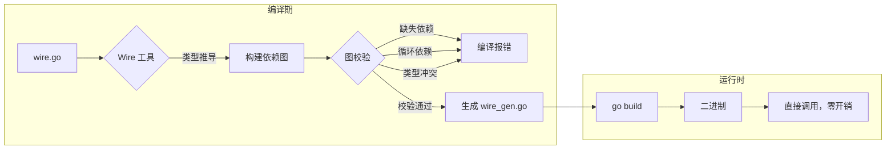

# 依赖注入（DI）的两大流派——静态编译生成（Wire）vs 运行时反射图（Fx）

**摘要：**

依赖注入（Dependency Injection，DI）是控制反转（Inversion of Control，IoC）的一种具体实现方式——对象不再自行创建所依赖的组件，而是由外部把依赖"注入"进来，从而把构造逻辑与使用逻辑解耦，提升可测试性与可替换性。在 Java 世界里，Spring 框架几乎以一己之力把 DI 变成了企业开发的默认姿势；但在 Go 生态中，由于缺乏反射驱动的轻量容器传统，DI 长期停留在"手工在 main 函数里 new 一遍"的阶段。直到 Google 的 Wire（2018 年开源）和 Uber 的 Fx（2017 年开源）先后成熟，Go 开发者才第一次有了两条正式的 DI 路线：一个在编译期通过代码生成把依赖图写死到源码里，追求零运行时开销与可读的生成代码；另一个在运行时通过 reflect 动态构建依赖图，并以生命周期钩子（`OnStart`/`OnStop`）管理组件的启动与关闭。本文从依赖注入的本质出发，沿着"静态编译生成"与"运行时反射图"两条路线分别深入，剖析 Wire 的 ProviderSet 与 `wire_gen.go`、Fx 的 Provide/Invoke 与 Module 化装配，对比两者在依赖环检测时机、启动性能、二进制体积、IDE 支持、可调试性上的差异，最终落到选型判据——团队规模、启动时间敏感度、对"启动时才发现缺依赖"这一类误报的容忍度。

---

## 第 1 章 依赖注入的本质——控制反转与构造解耦

### 1.1 从"自己 new"到"外部注入"

在没有依赖注入的代码里，一个组件若需要用到另一个组件，最常见的做法是在自己的构造函数里直接创建它。一个 HTTP Handler 需要用到数据库连接，那就 `db := NewDatabase(config)`；一个 UserService 需要用到 Logger，那就 `logger := NewZapLogger()`。这种方式在小项目中毫无问题，代码线性、直观、一眼看得到依赖从哪来。但随着项目规模增长，这种做法会把三个隐患一点点养大。

第一个隐患是**测试困难**。当 Handler 内部硬编码了 `NewDatabase()`，想在单元测试里把数据库替换为内存 Mock 就成了问题——要么修改 Handler 源码，要么用一些粗暴的方式（譬如替换全局变量，或者用 `monkey patching`——这在 Go 里既不安全也不被推荐）。第二是**配置散落**。每个用到数据库的地方都各自构造一份连接，配置读取、连接池参数分散在多个文件里，改一处漏一处。第三是**生命周期失控**。谁来负责关闭数据库连接？如果 Handler 和 Worker 各自创建了一份，关闭顺序如何保证？漏掉一个 `defer db.Close()` 就是连接泄漏，在多实例部署的场景下可能把数据库的连接池耗尽。

依赖注入的思路是把这些"创建依赖"的责任从组件内部抽出来，交给一个外部的装配者（assembler）。组件只声明"我需要一个 Database"，而不去关心这个 Database 具体怎么构造、连接参数从哪来、是不是一个 Mock。这种**控制反转**——控制权从组件内部转移到了外部——是 DI 的灵魂。Martin Fowler 在 2004 年的文章 *Inversion of Control Containers and the Dependency Injection pattern* 中把这一思路系统化，此后 Spring 框架在 Java 世界里把它推向了主流。

> [!info] 一个生活比喻
> 依赖注入就好比餐厅里的"叫菜"与"做菜"分离。顾客（使用方）只管声明"我要一份宫保鸡丁"，而不用关心厨师从哪个冰柜取鸡肉、用哪口锅炒、火候多大。厨房（注入器）负责把所有原料与工具准备齐，把成品端上来。如果有一天厨师休假，厨房换个师傅照样能把菜做出来——顾客端的"接口"没变，只是后厨的实现换了。更重要的是，如果餐厅想做卫生检查（单元测试），可以要求厨房用假鸡肉（Mock）走一遍流程，验证整个做菜流水线的正确性，而不需要真的去杀一只鸡。

### 1.2 Go 为什么迟迟没有"标配"的 DI 框架

Java 有 Spring，C# 有 .NET DI Container，但 Go 社区在相当长的时间里对 DI 框架持冷淡态度。原因藏在 Go 的设计哲学里。

首先是**对反射的警惕**。Go 的 `reflect` 包功能强大，但代价是类型安全丧失、编译期无法校验、运行时性能下降，以及调试时堆栈难以阅读（参见 [[Golang/Go运行时进阶与底层机制/00 专栏导览|Go 运行时进阶与底层机制]] 中关于反射性能边界的讨论）。Spring 风格的 DI 容器大量依赖反射读取注解、扫描包路径、动态代理——这些在 Java 中习以为常的技巧，在 Go 里都会踩到语言的短板。Go 没有 Java 那样的运行时类加载器和字节码增强能力，想实现一个"扫描 `@Inject` 注解然后自动装配"的容器，要么做不到，要么代价极高。其次是**显式优于隐式**的社区偏好。Go 开发者更倾向于看到清晰的函数调用和明确的错误返回，而不是一个黑盒容器在启动时默默完成一堆魔法。最后是 **`go build` 的编译速度文化**。Go 的设计目标之一就是秒级编译，任何引入复杂运行时代码生成或大规模反射的方案，都与这种文化存在张力。

因此，当 Go 社区开始认真讨论 DI 时，路线从一开始就分裂为两个方向：一条是接受代码生成、把依赖图在编译期彻底算清楚，生成出来的代码和手写没什么两样——这就是 Google 的 Wire；另一条是承认运行期反射不可避免，但用类型安全的参数结构体（`fx.In`/`fx.Out`）来限制反射范围，同时引入生命周期管理来弥补 Go 缺少的"容器托管 bean"概念——这就是 Uber 的 Fx。

### 1.3 没有 DI 会踩的坑

不妨设想一个没有 DI 的中等规模 Go 项目：十几个微服务，每个服务在 `main.go` 里手工构造依赖链——Config、Logger、Database、Redis、Kafka Producer、Metrics、Tracer、Repository、Service、Handler，层层 new 下去，三四百行初始化代码堆在 `main()` 函数里是常态。这种"巨型 main 函数"是 Go 项目中常见的一种代码腐化形态——它把本该分散在各模块中的构造逻辑集中到一处，随着项目增长变成一坨难以理解和维护的代码。

这种代码有几种典型的"并发症"。第一，**构造顺序敏感**。如果 Logger 还没 new 出来就被 Database 用到，程序会在运行时 panic（nil pointer dereference）。编译器对此无能为力，因为 `main()` 里的语句顺序只是运行时逻辑，编译器只能检查每个语句本身的类型正确性，无法跨语句追踪"这个变量在使用前是否已经被赋值"。第二，**替换成本高**。想把 MySQL 换成 PostgreSQL，或者在测试中用 fake 替换 Kafka，需要翻遍所有构造点逐一修改。第三，**资源泄漏**。数据库连接池、HTTP 客户端、goroutine 池——它们都需要在进程退出前正确关闭。手工构造意味着手工管理关闭顺序，漏掉一个就是 goroutine 泄漏或者连接异常断开。第四，**循环依赖难排查**。A 依赖 B、B 依赖 A，在编译期没有工具帮你发现，只能在运行时通过 panic 的堆栈去逆向推理——而这往往发生在凌晨三点的生产环境告警里。

DI 框架的核心价值就是把这些"运行时才暴露的问题"尽可能提前——要么提前到编译期（Wire），要么提前到启动期（Fx），总之不让它们藏在生产环境的角落里。从 [[Golang/Go工程实践/00 专栏导览|Go 工程实践]] 的视角看，DI 框架也是项目结构规范化的重要一环——它强迫开发者把"如何构造组件"的逻辑从业务代码中分离出来，放到专门的装配层（assembling layer）中去。

---

## 第 2 章 静态编译生成——Google Wire 的设计哲学

### 2.1 Wire 的起源与定位

Wire 是 Google 在 2018 年开源的依赖注入工具，属于 Google Cloud SDK 家族的一部分。它的核心思想异常简洁：**不用反射，不用运行时容器，通过代码生成（code generation）在编译期把依赖图算清楚，生成一个 `wire_gen.go` 文件，里面是纯手写的 Go 代码——只是由工具替你写好了**。

这种设计的背后有一个朴素的判断：依赖注入本质上是一个**编译期可以解决的问题**。一个程序需要哪些组件、组件之间的依赖关系是什么、是否存在缺失或循环——这些信息在编译期全部可得，因为 Go 的类型系统是静态的，每个函数的参数和返回类型在编译时就是确定的。既然如此，为什么不干脆让工具在编译期把图算好、把代码生成出来，而要把这些逻辑拖到运行时用反射去做呢？

Wire 的答案是：不需要。用一个不太恰当的比喻，Wire 像是一位勤快的秘书——在项目编译前，秘书已经把"谁需要谁、按什么顺序构造、哪些资源要先开哪些要先关"全部整理成一份详细的清单（`wire_gen.go`），开发者打开这个文件就能看到完整的依赖构造过程，和手写代码没有区别。运行时没有黑盒，没有反射开销，也没有"启动失败才发现缺了一个依赖"的尴尬。

### 2.2 Provider、ProviderSet 与 wire.go

Wire 的 API 极简，核心概念只有两个：**Provider** 和 **ProviderSet**。

**Provider** 是一个普通的构造函数。Wire 不要求你实现特定接口、标注特殊注解，甚至不需要 import Wire 的包——只要函数签名符合"输入是依赖，输出是构造结果（和可选的 error）"的形式，它就是一个 Provider。

```go
// NewUserRepository 是一个 Provider：输入 *Database，输出 *UserRepository
func NewUserRepository(db *Database) *UserRepository {
    return &UserRepository{db: db}
}

// NewDatabase 是一个叶子 Provider：没有输入，输出 *Database 和 error
func NewDatabase(cfg *DatabaseConfig) (*Database, error) {
    // 连接数据库...
    return db, nil
}
```

**ProviderSet** 是一组 Provider 的集合，通常在 `wire.go` 文件中声明。`wire.go` 是 Wire 的输入文件——它不是合法的 Go 代码（包含 `//go:build wireinject` 构建标签，使得 `go build` 正常编译时跳过它），而是给 Wire 工具看的"依赖清单"。

```go
//go:build wireinject
// +build wireinject

package main

import "github.com/google/wire"

func InitializeApp() *App {
    wire.Build(
        NewDatabaseConfig,
        NewDatabase,
        NewUserRepository,
        NewUserService,
        NewHTTPHandler,
        NewHTTPServer,
        NewApp,
    )
    return &App{}
}
```

开发者在这个文件里声明"我需要一个 `*App`"，Wire 工具会根据函数签名自动推导依赖图——`*App` 需要 `*HTTPServer`，`*HTTPServer` 需要 `*HTTPHandler`……一直推导到叶子节点（没有输入参数的 Provider 或者输入参数通过 `wire.Value` 提供的值）。如果推导成功，Wire 生成 `wire_gen.go`；如果推导失败（缺依赖、有环、类型不匹配），Wire 在代码生成阶段就报错，根本不会进入运行时。

```go
// Code generated by Wire.
//go:generate go run -mod=mod github.com/google/wire/cmd/wire
//go:build !wireinject
// +build !wireinject

package main

func InitializeApp() *App {
    dbConfig := NewDatabaseConfig()
    db, err := NewDatabase(dbConfig)
    if err != nil {
        panic(err)
    }
    repo := NewUserRepository(db)
    service := NewUserService(repo)
    handler := NewHTTPHandler(service)
    server := NewHTTPServer(handler)
    app := NewApp(server)
    return app
}
```

打开 `wire_gen.go`，看到的就是一段平铺直叙的构造代码。没有反射，没有 map，没有运行时开销——调用顺序完全确定，编译器可以做内联优化，IDE 可以正常跳转、调试、设置断点。注意到 Wire 自动处理了 error 返回值——如果某个 Provider 返回了 `error`，生成的代码会检查 error 并在非 nil 时 panic（也可以通过 `wire.Error` 自定义错误处理策略）。

### 2.3 编译期校验的价值

Wire 的核心竞争力不在于生成的代码本身——那段代码手写也不难——而在于**编译期的依赖图校验**。这种校验覆盖了几类典型错误：

**缺失依赖**：如果某个 Provider 需要的输入类型没有任何 Provider 能产出，Wire 在代码生成阶段就会报错，错误信息会明确告诉你缺了哪个类型的 Provider。这在大型项目中价值极大——想象一个上百个 Provider 的系统，某个深层组件依赖了一个没有被注册的 Config 结构体，手工构造时可能要到运行某个特定分支的代码才会暴露，而 Wire 在 `go generate` 阶段就能抓到。

**循环依赖**：A 依赖 B、B 依赖 C、C 依赖 A——这种环在手工构造时往往在运行时才以 panic 或 stack overflow 的形式暴露。Wire 在构建依赖图时会检测环，并在编译阶段给出清晰的报错路径。Go 编译器本身只检查**包级别**的循环依赖（import cycle），但对于同一个包内多个类型之间的循环构造依赖，编译器是无能为力的——Wire 补上了这个空缺。

**多个 Provider 产出同类型**：如果两个 Provider 都返回 `*Config`，Wire 不知道该用哪个，会在编译时报错。这迫使开发者用 Go 的类型系统（定义不同的 Config 类型，譬如 `*DatabaseConfig` 和 `*RedisConfig`）或 Wire 的 `bind`、`Provide` 选项来显式区分。这种"类型冲突即报错"的行为，实际上是在强制执行一种良好的设计实践——每种依赖都有唯一的类型标识，避免"万能 Config 结构体"的反模式。



> [!note] 编译期校验的一个认知
> 可以把 Wire 理解为把"依赖图的拓扑排序"从运行时搬到了编译期。传统运行时 DI 容器在程序启动时做一次图遍历，构建依赖关系并实例化；Wire 则把这个过程在开发阶段就执行完毕，生成的代码是拓扑排序后的静态结果。代价是每次修改依赖关系都需要重新运行 `go generate`（或者在 CI 中检查生成代码是否最新），收益是运行时零开销、零意外。

### 2.4 Wire 的高级特性

除了基本的 Provider 和 ProviderSet，Wire 还提供了几种高级机制来应对复杂场景。

**`wire.Bind`**：当一个 Provider 返回的是具体类型（譬如 `*MySQLRepository`），但使用方依赖的是接口类型（譬如 `Repository`），需要用 `wire.Bind(new(Repository), new(*MySQLRepository))` 显式声明绑定关系。这个设计体现了 Go 的"显式优于隐式"哲学——虽然 Go 的接口是隐式实现的（duck typing），但在 DI 场景中，显式声明"哪个具体类型实现了哪个接口"可以让依赖关系更清晰。

**`wire.Struct`**：当一个结构体的字段都是依赖注入的组件时，`wire.Struct(new(App), "*")` 可以自动生成填充代码，省去写构造函数的麻烦。也可以指定只填充部分字段：`wire.Struct(new(App), "DB", "Logger")`。

**`wire.Value`**：用于注入常量值。譬如一个 `string` 类型的服务器地址，不可能通过 Provider 函数来提供（因为函数签名 `func() string` 有太多匹配），需要用 `wire.Value("localhost:8080")` 显式注入。

**`wire.InterfaceValue`**：类似 `wire.Value`，但用于接口类型的值注入。

### 2.5 Wire 的边界与局限

Wire 不是没有代价。它的几个局限在特定场景下会变得明显。

**代码生成的摩擦**。每次修改依赖关系后，都需要重新运行 `go generate`（或 `wire` 命令）来更新 `wire_gen.go`。忘记重新生成是新手最常踩的坑——本地代码看起来没问题（因为 `wire.go` 的类型引用在语法层面是正确的），CI 却报错，因为 CI 检测到 `wire_gen.go` 与 `wire.go` 不一致，或者 CI 环境没有安装 Wire 工具。虽然可以通过 `go:generate` 指令集成到构建流程中，但这层间接性仍然增加了认知负担。

**Provider 签名的约束**。Wire 要求依赖关系通过函数签名表达——输入参数是依赖，返回值是产出类型。如果一个组件的依赖无法通过构造函数参数表达（譬如需要从 map 中按字符串 key 动态选取、或者依赖是运行时才确定的接口实现），Wire 就不太适用。这种场景在插件化架构或多租户系统中比较常见。

**学习曲线**。`ProviderSet`、`wire.Bind`、`wire.Struct`、`wire.Value`、`wire.InterfaceValue`、`wire.FieldsOf`——这些概念虽然不多，但初学时容易混淆。团队新人需要理解"wire.go 不是真正的 Go 代码"、"wire_gen.go 才是运行时的真相"这一层间接性。这种"两个文件、两个真相"的模型，与 Go 社区通常"一个文件就是一个真相"的直觉不太一致。

**与接口绑定的配合**。当 Provider 返回的具体类型需要绑定到接口时，需要显式声明 `wire.Bind(new(Interface), new(*Impl))`。这在大型项目中是必需的，但也意味着接口设计的变化会波及 Wire 配置——新增一个接口实现、修改一个接口方法签名，都可能需要更新 `wire.go`。

---

## 第 3 章 运行时反射图——Uber Fx 的设计哲学

### 3.1 Fx 的起源与核心取舍

Fx 是 Uber 在 2017 年开源的应用框架，依赖注入是它的核心模块之一（`go.uber.org/fx`）。与 Wire 的"编译期生成"相反，Fx 走的是"运行时装配"路线——依赖图在程序启动时通过 `reflect` 动态构建，组件的实例化、调用顺序、生命周期钩子都由 Fx 的运行时管理。

这个设计的背后是另一个朴素的判断：**应用启动是一个一次性的、有限时间内的过程，反射的开销在这个场景下完全可以接受；而运行时装配带来的灵活性——动态 Module、条件注入、生命周期管理——是编译期方案难以提供的**。Fx 的设计目标不是"最快的启动速度"，而是"最灵活的装配能力"——它假设应用的依赖关系可能比较复杂、模块可能需要动态组合、组件可能有复杂的启动和关闭顺序要求，在这些场景下，运行时的灵活性比编译期的确定性更有价值。

如果说 Wire 像一位提前把清单写好的秘书，那么 Fx 更像是一位经验丰富的项目经理——在项目启动会议上，根据每个人提交的"我需要什么、我能提供什么"的声明，当场把任务分配图排出来，同时约定好"谁先启动、谁先关闭"的协作顺序。会议本身需要时间（启动期的反射开销），但会议结束后每个人的工作关系都清晰了，而且如果有人临时请假（某个依赖缺失），会议当场就能发现（启动时即报错）。

### 3.2 Provide、Invoke 与依赖图构建

Fx 的核心 API 有三个：`fx.Provide`、`fx.Invoke`、`fx.New`。

`fx.Provide` 注册一个构造函数到依赖图中。与 Wire 类似，Fx 也通过函数签名推导依赖关系——参数是依赖，返回值是产出。不同的是，Fx 在运行时通过 `reflect.TypeOf` 读取函数签名，把类型作为 key 注册到内部的依赖图中。

```go
app := fx.New(
    fx.Provide(
        NewDatabaseConfig,
        NewDatabase,
        NewUserRepository,
        NewUserService,
        NewHTTPHandler,
        NewHTTPServer,
    ),
    fx.Invoke(RegisterRoutes),
)
```

`fx.Invoke` 注册一个需要立即调用的函数——它的参数同样由依赖图自动填充，但它的返回值会被忽略（通常用于注册路由、启动 goroutine、初始化全局状态等副作用操作）。`Invoke` 函数的执行时机在所有 `Provide` 的组件都实例化之后，这保证了被调用的函数可以安全地使用任何已注册的组件。

`fx.New` 是装配的入口。它接收一组 `fx.Option`，构建依赖图，按拓扑顺序实例化所有组件，并执行所有 `Invoke` 函数。如果图中存在缺失（某个参数类型没有被任何 `Provide` 注册）或环（A 依赖 B、B 依赖 A），`fx.New` 会 panic，并在错误信息中给出详细的依赖链。

```text
fx: missing type *config.DatabaseConfig

    needed by:
        func(*config.DatabaseConfig) *Database
            in: /app/database.go:12

    needed by:
        func(*Database) *UserRepository
            in: /app/repository.go:8
```

错误信息的结构是一条反向依赖链——从缺失的类型出发，沿着"谁需要它"一路追到根节点，帮助开发者快速定位"我需要在哪个 Module 里补上这个 Provider"。

### 3.3 参数对象与结果对象——类型安全的反射边界

直接使用 `reflect` 读取函数参数有一个问题：如果一个构造函数需要多个同类型的参数（譬如两个 `string` 分别代表 host 和 port），反射无法区分它们——`reflect.TypeOf` 只能看到两个 `string`，不知道哪个是 host 哪个是 port。Fx 的解决方案是引入**参数对象**（`fx.In`）和**结果对象**（`fx.Out`）。

```go
type DatabaseParams struct {
    fx.In

    Config *DatabaseConfig `name:"primary"`
    Logger *zap.Logger
    Metrics *metrics.Collector
}

func NewDatabase(params DatabaseParams) *Database {
    // params.Config、params.Logger、params.Metrics 由 Fx 自动填充
    return &Database{
        cfg:     params.Config,
        logger:  params.Logger,
        metrics: params.Metrics,
    }
}
```

通过嵌入 `fx.In`，开发者把多个依赖聚合到一个结构体里，每个字段可以有独立的类型和 `name` 标签（`name` 标签用于区分同类型的多个实例，譬如 `name:"primary"` 和 `name:"replica"` 的两个 `*Database`）。Fx 在运行时通过反射读取结构体字段，而不是函数参数列表，从而绕过了"同类型参数无法区分"的限制。

`fx.Out` 则以类似方式支持一个函数产出多种类型的值：

```go
type DatabaseResult struct {
    fx.Out

    DB     *Database
    Health *HealthChecker
}

func NewDatabase(params DatabaseParams) (DatabaseResult, error) {
    db := &Database{...}
    health := &HealthChecker{db: db}
    return DatabaseResult{DB: db, Health: health}, nil
}
```

这种设计的精妙之处在于：**反射只发生在框架层，业务代码仍然是类型安全的**。开发者写的 `NewDatabase` 函数接收的是一个普通的结构体参数，不需要自己做任何反射操作。框架通过 `reflect` 把依赖图里的组件填到结构体字段里，开发者感受到的仍然是强类型的 Go 代码。这与 [[Golang/Go运行时进阶与底层机制/00 专栏导览|Go 运行时进阶与底层机制]] 中讨论的"反射的性能边界"形成呼应——Fx 把反射的开销控制在框架内部的图构建阶段，业务代码不需要承担反射的代价。

### 3.4 生命周期钩子——Fx 的差异化优势

Fx 相对于 Wire 最显著的差异化优势是**生命周期管理（Lifecycle Management）**。在 Wire 的方案里，依赖构造完成后，谁来负责关闭？这需要在 `main()` 里手工编排一个 `defer` 链——先开数据库后关，先开 HTTP 服务器后关，顺序不能错。而在 Fx 里，每个组件可以在构造函数中注册 `OnStart` 和 `OnStop` 钩子，由 Fx 统一管理启动与关闭顺序。

```go
func NewDatabase(lc fx.Lifecycle, cfg *DatabaseConfig) *Database {
    db := &Database{cfg: cfg}

    lc.Append(fx.Hook{
        OnStart: func(ctx context.Context) error {
            return db.Connect(ctx)
        },
        OnStop: func(ctx context.Context) error {
            return db.Close()
        },
    })

    return db
}

func NewHTTPServer(lc fx.Lifecycle, handler *HTTPHandler) *HTTPServer {
    srv := &HTTPServer{handler: handler}

    lc.Append(fx.Hook{
        OnStart: func(ctx context.Context) error {
            go srv.ListenAndServe()
            // 等待服务器就绪
            return srv.Ready(ctx)
        },
        OnStop: func(ctx context.Context) error {
            return srv.Shutdown(ctx) // 优雅停机
        },
    })

    return srv
}
```

`fx.Lifecycle` 是一个钩子注册表。当 `app.Run()`（或 `app.Start()`）被调用时，Fx 按依赖图的**正序**执行所有 `OnStart` 钩子——先启动叶子依赖（数据库连接、缓存客户端），再启动上层组件（消息队列消费者、HTTP 服务器）。当进程收到关闭信号时，Fx 按**逆序**执行所有 `OnStop` 钩子——先关闭 HTTP 服务器（停止接受新请求、等待进行中的请求完成），再关闭消息队列消费者，最后关闭数据库连接（确保所有进行中的数据库操作完成）。

这种"依赖图即生命周期图"的设计，解决了手工管理关闭顺序时的几个痛点：第一，关闭顺序与构造顺序天然一致，不需要额外维护一份"关闭清单"——在 Wire 方案里，`defer` 链的顺序必须与构造顺序严格相反，任何重构（新增组件、调整构造顺序）都需要同步更新 `defer` 链，这种"两处修改"的模式是 bug 的温床。第二，某个组件的 `OnStop` 失败时，Fx 会记录错误并继续关闭其他组件（不会因为一个关闭失败就跳过后续的清理）。第三，与 `signal.NotifyContext` 配合，可以实现优雅停机（graceful shutdown），这在 [[Golang/Go网络编程与持久化/00 专栏导览|Go 网络编程与持久化]] 中关于优雅停机的讨论中有详细的机制分析。

> [!info] 生命周期管理的一个认知
> Fx 的 `Lifecycle` 本质上把"组件的构造、启动、关闭"三个阶段统一到了一个框架契约下。在 Wire 的世界里，框架只管"构造"，启动和关闭都是开发者的事；在 Fx 的世界里，框架把三个阶段都管了。这种全包式管理的代价是框架的存在感更强（你要 import Fx 的包、使用它的类型），收益是大型应用的生命周期编排变得可组合——每个模块自己管自己的启停，主入口只需要调用 `app.Run()`。

### 3.5 Module 化与可插拔装配

Fx 的另一个差异化特性是 **Module（模块）** 模式。一个 Module 是一组 `fx.Option` 的聚合，代表一个可独立交付的功能单元。

```go
var DatabaseModule = fx.Options(
    fx.Provide(NewDatabaseConfig),
    fx.Provide(NewDatabase),
    fx.Provide(NewHealthChecker),
)

var HTTPModule = fx.Options(
    fx.Provide(NewHTTPServer),
    fx.Provide(NewRouter),
    fx.Invoke(RegisterRoutes),
)

var WorkerModule = fx.Options(
    fx.Provide(NewKafkaConsumer),
    fx.Provide(NewJobProcessor),
    fx.Invoke(StartWorker),
)

func main() {
    fx.New(
        DatabaseModule,
        HTTPModule,
        WorkerModule,
        fx.Invoke(Run),
    ).Run()
}
```

这种 Module 化的装配方式使得依赖关系可以按功能域分组，不同团队可以独立维护自己的 Module，最终在 `main()` 里像拼乐高一样组合起来。在微服务架构中，一个服务的 `main.go` 可能只有十几行，剩下的全部在各个 Module 里。每个 Module 是一个独立的 Go 包，有自己的测试——这符合 [[Golang/Go工程实践/01 Go 项目结构——从 Standard Layout 到 Clean Architecture|Go 项目结构]] 中讨论的"用物理目录表达逻辑边界"的设计原则。

Wire 也可以实现类似的模块化——通过多个 `ProviderSet` 组合——但由于 Wire 的代码生成特性，跨 Module 的依赖仍然需要在 `wire.Build()` 中显式列出所有 Provider（或者通过 `ProviderSet` 的组合来间接引用），模块化的粒度不如 Fx 灵活。Fx 的 Module 可以在运行时动态组合——譬如根据配置文件决定加载哪些 Module——这在多租户或者可插拔架构中非常有用。

### 3.6 Fx 的边界与局限

Fx 的灵活性不是没有代价。

**运行时错误的延后**。Wire 在编译期就能发现的缺失依赖或类型不匹配，Fx 要到程序启动时才会暴露。在 CI/CD 流水线里，这意味着如果没有集成启动测试，这类错误可能逃到生产环境。对于启动频繁的服务（譬如每次部署都会启动），这个窗口期很短；但对于启动不频繁的批处理任务，或者依赖外部资源（数据库、配置中心）才能启动的服务，这个风险不容忽视——本地 CI 环境可能无法完整启动服务，导致依赖缺失的问题逃过检查。

**反射的性能开销**。`reflect.TypeOf` 在每次调用时都需要解析类型信息，大量 Provider 的注册与图构建在启动期会消耗可观的 CPU 时间。Fx 内部使用了一个类型到 Provider 的 map，每次 `Provide` 都需要通过反射解析函数签名的参数类型和返回类型，这个过程涉及大量的 interface 装箱与类型比较。对于 Provider 数量在几十个以内的应用，启动开销通常在 10-50 毫秒的量级，对于长驻服务可以忽略不计。但对于 Provider 数量上百的超大型应用，或者冷启动敏感的 Serverless 场景，这个开销需要实际测量。

**二进制体积**。Fx 框架本身的代码（加上 `reflect` 相关的运行时支持）会增加最终二进制的大小。虽然这个增量通常在几 MB 以内，对于大多数服务端应用不是问题，但在极致精简的场景下（譬如嵌入式设备、istio sidecar 这类对镜像大小敏感的环境）需要权衡。

**调试复杂度**。运行时的依赖图对开发者是半透明的——你能看到错误信息里的类型链，但不像 Wire 的 `wire_gen.go` 那样有一份可以直接阅读、打断点的源码。当依赖图非常复杂时（上百个 Provider），排查"为什么某个组件没有被正确初始化"会变得困难。虽然 Fx 提供了 `fx.WithLogger` 来打印图构建过程，但这需要事先配置，在事后排查时往往来不及。

**`panic` 而非 `error`**。Fx 在依赖缺失或环检测时选择 `panic` 而不是返回 `error`，这与 Go 社区"显式错误处理"的偏好存在一定张力。虽然 `panic` 在启动期是可以接受的（启动失败就应该 crash，而不是带着残缺的依赖图继续运行），但它使得在测试中模拟"缺少某个依赖"的场景变得不太优雅——你需要用 `recover` 来捕获 panic，而不是简单地检查一个 error 返回值。

---

## 第 4 章 两大流派的正面比较

### 4.1 依赖环检测时机

这是 Wire 和 Fx 最根本的差异之一。

Wire 在 `go generate`（代码生成）阶段做拓扑排序，如果图中存在环——A 依赖 B、B 依赖 C、C 依赖 A——Wire 会立即报错，并给出环的完整路径。开发者在写代码的阶段就能发现并修复这个问题，根本不会进入编译和运行阶段。

Fx 在 `fx.New`（应用启动）阶段做图遍历，如果存在环，程序启动时会 panic 并打印环的路径。这意味着**环的存在要到运行时才暴露**。在 CI 里如果有启动测试，这个窗口期很短；但如果没有，环可能藏在代码里直到生产环境才被触发。

```mermaid
%%{init: {'theme': 'dracula'}}%%
sequenceDiagram
    participant Dev as 开发者
    participant Wire as Wire 工具
    participant Fx as Fx 运行时
    participant Prod as 生产环境

    rect rgb(40, 40, 60)
    Note over Dev,Wire: Wire 路径
    Dev->>Wire: go generate
    Wire-->>Dev: 编译期发现环依赖 → 报错
    Dev->>Dev: 修复依赖图
    Dev->>Wire: go generate
    Wire-->>Dev: 生成 wire_gen.go ✓
    end

    rect rgb(40, 60, 40)
    Note over Dev,Fx: Fx 路径
    Dev->>Fx: 编写 Provide/Invoke
    Dev->>Fx: go build ✓（编译通过）
    Fx->>Prod: 部署并启动
    Prod-->>Dev: 运行时发现环依赖 → panic
    Dev->>Dev: 修复依赖图
    Dev->>Fx: 重新部署
    end
```



> [!note] 检测时机的认知
> 依赖环是一种**架构腐化的信号**——它意味着模块职责划分出了问题，A 和 B 本应合并，或者需要一个 C 来提取公共依赖。无论用 Wire 还是 Fx，环都应该被尽早发现和消除。差别只在于"尽早"的程度：Wire 让你在设计阶段就发现（代码生成时），Fx 让你在部署阶段才发现（启动时）。对于追求"问题越早发现修复成本越低"的团队，Wire 的编译期检测更有吸引力。

### 4.2 启动性能与二进制体积

Wire 生成的代码是直接的函数调用序列，没有任何框架开销。启动路径就是一条线性的 new 链，编译器可以做内联优化，执行时间与手写构造代码没有差异。Go 的编译器对于这种线性的函数调用链，有可能将小型构造函数内联（inlining），进一步消除函数调用开销。

Fx 在启动时需要完成以下工作：遍历所有 `Provide` 注册的函数，用 `reflect` 解析每个函数的参数和返回类型，构建类型到 Provider 的映射表，做拓扑排序（检测环和缺失），然后按顺序调用 Provider 并实例化组件，最后执行所有 `Invoke` 函数。这个过程的耗时与 Provider 的数量成正比。

| 维度 | Wire | Fx |
| :--- | :--- | :--- |
| 启动期依赖图构建 | 编译期已完成，运行时零开销 | 运行时反射构建，毫秒级开销 |
| 二进制体积增量 | Wire 工具本身不进入二进制 | Fx 库 + reflect 运行时约数 MB |
| 运行时内存开销 | 无额外开销 | 依赖图在内存中保留（类型 map） |
| 冷启动影响 | 无 | Serverless 场景需评估 |
| 编译器优化空间 | 生成代码可内联 | 框架内部调用难以内联 |

对于大多数 HTTP 微服务，Fx 的启动开销在可接受范围内——服务启动后持续运行数小时甚至数天，启动期多花的几十毫秒很快被摊薄。但对于以下场景，Wire 的零开销优势会变得重要：

- **Serverless / FaaS**：函数每次调用都可能冷启动，启动时间直接关联成本和响应延迟。
- **CLI 工具**：命令行工具要求毫秒级响应，启动期的反射开销在总执行时间中占比显著。
- **Sidecar / Init Container**：在 Kubernetes 的 init container 或 sidecar 场景中，容器启动速度影响整个 Pod 的就绪时间。

### 4.3 可调试性与 IDE 支持

Wire 生成的 `wire_gen.go` 是标准 Go 代码——IDE 可以正常索引、跳转、设置断点、单步调试。开发者在调试"为什么某个组件没有被正确初始化"时，可以直接打开 `wire_gen.go` 看到完整的构造顺序，和调试手写代码没有区别。`gopls`（Go 语言服务器）能正确解析生成代码的类型信息，代码补全和类型检查都能正常工作。

Fx 的依赖图在运行时构建，IDE 无法静态分析出"A 组件的依赖 B 是从哪个 Provider 来的"。`gopls` 看到的是 `fx.Provide(NewDatabase)` 这样的注册调用，无法追踪到 `NewDatabase` 产出的 `*Database` 会被注入到哪个组件。调试时需要借助 Fx 的错误信息（启动失败时打印的依赖链）或日志（Fx 支持通过 `fxlog` 选项打印依赖图的构建过程）。断点调试仍然可行，但"跳转到依赖的构造点"需要手动查找，而不是 IDE 自动跳转。

### 4.4 错误信息与开发体验

两者的错误信息都做得相当不错，但风格不同。

Wire 的错误信息面向编译期，通常以 `go generate` 的 stderr 输出呈现：

```text
wire: github.com/example/app: no provider found for *config.DatabaseConfig
    needed by *Database in provider set "AppSet"
```

Fx 的错误信息面向运行时，以 panic 的堆栈形式呈现：

```text
panic: received non-nil error from func(*config.DatabaseConfig) *Database
    in: /app/database.go:12
    cause: missing type *config.DatabaseConfig
```

从开发体验的角度，Wire 的错误在"写代码阶段"暴露，开发者可以立即修复并继续开发；Fx 的错误在"运行程序时"暴露，需要启动程序才能看到。对于频繁修改依赖关系的开发阶段，Wire 的反馈循环更快——保存代码后运行 `go generate`，几秒钟就能看到结果；而 Fx 需要编译、运行、等待程序启动到 DI 阶段才能看到错误。

### 4.5 可测试性的差异

DI 的核心收益之一是提升可测试性，但 Wire 和 Fx 在测试场景下的体验存在微妙的差异。

在 Wire 方案中，生成的 `wire_gen.go` 里的构造函数调用是明文的——测试时如果想替换某个组件（譬如把真实的 `*Database` 换成 `*MockDatabase`），只需要在测试代码里手工构造 Mock 版本，然后直接调用下游的构造函数即可。由于 Wire 生成的代码就是普通的函数调用序列，测试代码完全可以绕过 Wire，直接构造需要的依赖链。这种"绕过框架直接测试"的方式在单元测试中非常常见，也是 Wire 方案的一个隐性优势——测试不依赖 Wire 工具链，不需要 `go generate`，测试运行速度与没有 DI 框架时完全一致。

```go
// 测试代码：直接构造依赖链，绕过 Wire
func TestUserService_GetUser(t *testing.T) {
    mockDB := NewMockDatabase()
    repo := NewUserRepository(mockDB)
    service := NewUserService(repo)

    user, err := service.GetUser(context.Background(), "alice")
    if err != nil {
        t.Fatalf("unexpected error: %v", err)
    }
    // ...断言
}
```

在 Fx 方案中，测试时替换组件需要使用 `fx.Replace` 选项——它允许在 `fx.New` 的 Option 列表中覆盖已有的 Provider。这种方式更优雅（不需要绕过框架），但引入了对 Fx 框架的测试依赖：

```go
func TestUserService_GetUser(t *testing.T) {
    fx.New(
        fx.Provide(NewUserRepository),
        fx.Provide(NewUserService),
        fx.Replace(*NewMockDatabase()), // 替换真实的 Database
        fx.Invoke(func(svc *UserService) {
            user, err := svc.GetUser(context.Background(), "alice")
            assert.NoError(t, err)
            assert.Equal(t, "alice", user.Name)
        }),
    )
}
```

两种方式的取舍在于：Wire 的测试方式更轻量、更快（不需要启动 Fx 运行时），但需要测试代码了解组件的构造细节（"构造 Mock 需要哪些上游依赖"）；Fx 的测试方式更声明式、更解耦（测试代码只需要声明"我要替换哪个类型"），但测试执行速度略慢（每次测试都要启动 Fx 运行时）。对于测试数量庞大、执行速度敏感的 CI 场景，Wire 的方式更有优势；对于希望测试代码与构造逻辑保持松耦合的场景，Fx 的方式更优雅。

### 4.6 完整对比矩阵

| 维度 | Wire（静态编译生成） | Fx（运行时反射图） |
| :--- | :--- | :--- |
| 依赖图构建时机 | 编译期（`go generate`） | 运行时（`fx.New`） |
| 依赖环检测 | 编译期报错 | 启动时 panic |
| 缺失依赖检测 | 编译期报错 | 启动时 panic |
| 运行时开销 | 零 | 反射 + 图构建（毫秒级） |
| 二进制体积 | 无框架开销 | Fx 库约数 MB |
| 生成代码可读性 | `wire_gen.go` 平铺直叙 | 无生成代码，依赖图在内存中 |
| IDE 支持 | 生成代码可跳转、断点 | 需手动查找 Provider |
| 生命周期管理 | 开发者手工编排 | `fx.Lifecycle` 框架托管 |
| 模块化灵活性 | `ProviderSet` 组合，粒度较粗 | `fx.Options` 组合，粒度较细 |
| 动态条件注入 | 不支持（编译期确定） | 支持（运行时决定） |
| 学习曲线 | `wire.go` 间接性、代码生成流程 | `fx.In`/`fx.Out`、反射边界 |
| CI 友好度 | 高（编译期捕获错误） | 中（需启动测试辅助） |
| 适用场景 | 启动敏感、强类型偏好、中小团队 | 大型应用、生命周期复杂、模块化需求强 |

---

## 第 5 章 选型判据与工程实践

### 5.1 没有银弹，只有权衡

选择 Wire 还是 Fx，不是一个"哪个更好"的问题，而是一个"在当前项目约束下，哪个的代价更可接受"的问题。以下是几个关键的决策维度。

**启动时间敏感度**。如果服务对冷启动时间有严格要求（Serverless、CLI 工具、Sidecar），Wire 的零运行时开销是决定性的优势。如果服务是长驻进程（HTTP 微服务、Worker），Fx 的毫秒级启动开销可以忽略不计。这里的判断标准不是"谁的启动更快"，而是"启动时间在整体性能预算中占比多大"——一个每秒处理万级请求的服务，启动期多花 50 毫秒在运行第一天的 86400 秒面前毫无意义；但一个每次请求都冷启动的 FaaS 函数，50 毫秒可能是用户体验与 SLA 违约的分界线。

**团队规模与协作模式**。大团队、多模块并行开发时，Fx 的 Module 化装配和生命周期管理价值更大——每个团队维护自己的 `fx.Options`，最终在 `main()` 里组合，互不干扰。小团队、单体应用时，Wire 的简洁性和编译期校验足以覆盖需求，且没有框架学习成本。

**对"启动时才暴露错误"的容忍度**。如果团队有完善的 CI 流水线（包含启动测试），Fx 的运行时错误检测可以被拦截在部署前。如果 CI 流水线不完整，或者服务启动依赖外部资源（数据库、配置中心）导致本地无法完整启动，Wire 的编译期检测更安全。

**生命周期的复杂度**。如果应用的组件启停顺序复杂（数据库连接池 → 缓存 → 消息队列消费者 → HTTP 服务器，关闭时逆序），Fx 的 `fx.Lifecycle` 可以显著减少手工编排的工作量和出错概率。如果组件生命周期简单（只有构造和关闭，没有"启动"动作），Wire 加一个 `defer` 链就能解决。

**代码生成 vs 运行时框架的偏好**。有些团队对代码生成有天然的警惕——生成代码与源码不一致、忘记重新生成、CI 与本地环境差异——这些摩擦会增加维护负担。如果团队更倾向于"所有逻辑都在源码里可见"，Fx 的运行时方案更对胃口。反之，如果团队已经习惯了 `go generate`（譬如用于 `mockgen`、`stringer`、`protobuf`），Wire 的代码生成不会带来额外负担。

### 5.2 Wire 的工程实践建议

使用 Wire 时，以下几点经验可以减少常见的坑。

**把 `wire_gen.go` 纳入版本控制**。这样 CI 不需要安装 Wire 工具也能编译通过，且 PR review 时可以看到依赖关系的变化。代价是仓库里多了一个"看起来像手写但其实是生成"的文件，需要通过 code review 约定不要手工修改它——任何对 `wire_gen.go` 的手工修改都会在下次 `go generate` 时被覆盖。

**在 CI 中检查生成代码一致性**。一个常见的 CI 步骤是：运行 `go generate`，然后 `git diff --exit-code`——如果 diff 不为空，说明有人修改了 `wire.go` 但忘记重新生成，CI 直接失败。这一步能在几秒钟内捕获最常见的 Wire 使用错误。

**合理拆分 ProviderSet**。按功能域拆分（`DatabaseSet`、`HTTPSet`、`ServiceSet`），而不是把所有 Provider 堆在一个大 Set 里。这不会改变 Wire 的行为，但会让 `wire.go` 更易读，也更接近 [[Golang/Go工程实践/01 Go 项目结构——从 Standard Layout 到 Clean Architecture|Go 项目结构]] 中讨论的模块化设计原则。

**善用 `wire.Struct` 但不过度**。当构造函数只是简单地把依赖赋给结构体字段时，`wire.Struct(new(App), "*")` 可以省去写构造函数的麻烦。但要注意，过度使用会让依赖关系变得隐式——显式的构造函数更容易 review 和理解。一条经验法则是：如果一个结构体超过 5 个字段，或者某些字段需要特殊的初始化逻辑，写一个显式的构造函数比 `wire.Struct` 更好。

### 5.3 Fx 的工程实践建议

使用 Fx 时，以下几点经验可以提升可靠性。

**在 CI 中增加启动测试**。既然 Fx 的依赖缺失和环检测要到启动时才暴露，CI 里应该有一步"启动程序并确认无 panic"的测试。这可以用一个专门的 `TestFxStart` 测试用例实现——调用 `fx.New` 并立即 `app.Start()`，确认无错误后 `app.Stop()`。这种测试不需要连接真实的数据库或消息队列（可以用 `fx.Replace` 替换为 Mock），但能覆盖依赖图的完整性检查。

**善用 `fx.In`/`fx.Out` 避免参数爆炸**。当一个构造函数需要超过 3-4 个参数时，用 `fx.In` 结构体聚合它们。这不仅解决了同类型参数的问题，也让依赖声明更清晰——一眼看得到这个组件需要什么，而不是去数函数签名里的第几个参数是什么类型。

**生命周期钩子里的错误处理**。`OnStart` 和 `OnStop` 的 error 返回值要认真对待——`OnStart` 失败会阻止后续组件启动（Fx 会自动回滚已经启动的组件，按逆序执行它们的 `OnStop`），`OnStop` 失败会被记录但不会阻止后续组件关闭。确保 `OnStop` 里的清理操作是幂等的，避免重复关闭导致的 panic。同时，`OnStop` 的 context 通常带有超时（由 `app.Stop` 的参数控制），确保清理操作能在超时前完成——如果数据库关闭需要等待所有进行中的事务完成，要合理设置超时时间。

**日志与可观测性**。Fx 支持通过 `fx.WithLogger` 注入自定义 logger，在开发阶段打印依赖图的构建过程。这在排查"为什么某个组件没有被初始化"时非常有用。生产环境可以关掉这些日志以减少噪音，但在 staging 环境建议保留，以便在部署后快速确认依赖图是否符合预期。

### 5.4 混合使用的可能性

Wire 和 Fx 并非完全互斥。在一些大型项目中，可以看到两者混合使用的模式：用 Wire 管理核心业务组件的依赖（追求编译期校验和零开销），用 Fx 的 `Lifecycle` 管理基础设施组件的启停（追求生命周期托管）。这种混合的前提是两者的边界清晰——Wire 负责"如何构造"，Fx 负责"何时启停"。

不过，混合使用会增加认知负担和调试复杂度——团队需要同时理解两套 DI 模型的语义和约束，在出问题时也要判断"这是 Wire 的问题还是 Fx 的问题"。除非项目确实同时有"编译期校验强需求"和"复杂生命周期管理需求"，否则建议只选其一。对于大多数 Go 项目，**二选一已经足够**。

---

## 第 6 章 从 DI 看 Go 的工程哲学

### 6.1 显式与隐式的永恒张力

Wire 和 Fx 的路线之争，本质上是 Go 社区内部"显式 vs 隐式"张力的一个缩影。Go 语言本身倾向于显式——显式错误处理（没有受检异常）、显式接口实现（没有 `implements` 关键字）、显式 import（没有自动引入未使用的包）。Wire 延续了这种气质：依赖图生成到源码里，一切可见、可调试、可追踪。Fx 则引入了受控的隐式：依赖图在运行时构建，生命周期由框架托管，开发者只需声明意图。

两种选择都有合理的工程依据。显式的优势在于可预测性——代码的行为在编译时就确定了，没有运行时的"惊喜"，调试时每一步都可追踪。隐式的优势在于可组合性——模块只需声明自己的输入输出，框架负责把一切拼起来，新增一个模块不需要修改任何已有模块的代码。

值得注意的是，Go 社区对隐式的容忍度在逐年上升。2017 年 Fx 刚开源时，"运行时反射构建依赖图"在 Go 社区里是会引起争议的——不少资深开发者认为这违背了 Go 的"简单、显式"哲学。但到了 2026 年，随着 Uber、ByteDance 等公司在生产环境大规模使用 Fx，以及 `go.uber.org/fx` 的 API 趋于稳定，这种路线已经被广泛接受。技术的接受度与实践中的可靠性正相关——当一个方案被足够多的人验证过，社区的抵触情绪自然会消退。

这种演进并不是孤例。回顾 Go 生态的历史，类似的"从抵触到接受"的模式在多个技术上都出现过：`context` 包在 Go 1.7 进入标准库之前，社区对"显式传递 context 参数"的做法也有争议；`go modules` 在 1.11 引入并在 1.16 默认启用之前，`dep`、`govendor`、`glide` 等第三方方案的拥护者与"Go 不需要包管理器"的原教旨主义者之间的争论同样激烈。最终，实践中的便利性压倒了理念上的洁癖——`context` 和 `go modules` 都成了今天 Go 开发的标配。Fx 的命运，大概率也是如此。

### 6.2 DI 不是目的，解耦才是

无论选择 Wire 还是 Fx，依赖注入本身不是目的——它只是实现**解耦**的手段。真正重要的是：业务逻辑不依赖于具体的数据库实现、不依赖于具体的 HTTP 框架、不依赖于具体的日志库。DI 框架帮你实现了"构造层面的解耦"，但"设计层面的解耦"仍然需要开发者自己完成——合理的接口划分、清晰的模块边界、单向的依赖方向。

一个用 Wire 组织得很好的项目，如果接口设计混乱、模块职责不清，仍然是难以维护的。一个用 Fx 组织的项目，如果只是把 `fx.New` 当成了"更复杂的 `main()`"，把所有 Provider 堆在一个文件里，也没有真正享受到 DI 的收益。DI 框架是解耦的**必要条件**，不是**充分条件**——它提供了"可以解耦"的基础设施，但"要不要解耦、怎么解耦"仍然是架构层面的决策。一个常见的误区是把"引入了 DI 框架"等同于"架构已经解耦了"——这好比买了一副好的跑鞋就认为自己已经跑完了马拉松，工具只是降低了执行的成本，真正的跑步仍然需要你自己来完成。判断一个项目的 DI 是否"真正有效"，不是看它用了 Wire 还是 Fx，而是看它的单元测试能否在不启动真实数据库、真实 HTTP 服务器、真实消息队列的前提下独立运行——如果能，说明构造层面的解耦是到位的；如果不能，再好的 DI 框架也救不了设计上的耦合。

> [!note] DI 的一个认知
> 依赖注入解决的是"构造的解耦"——组件不知道也不关心自己的依赖从哪里来。但这不自动带来"设计的解耦"——模块之间的职责划分、接口抽象、依赖方向仍然需要架构层面的思考。换句话说，DI 框架把"构造逻辑"从业务代码中搬到了装配层，但如果业务代码本身的设计就有问题（譬如 God Object、循环依赖、职责不清），DI 框架只是让这些问题的暴露方式从"运行时 panic"变成了"编译期报错"或"启动期 panic"——问题仍然在那里，只是更容易被看到了。

### 6.3 结语

Wire 和 Fx 代表了 Go 生态中依赖注入的两条成熟路线——一条把一切前置到编译期，追求零运行时开销与极致的可预测性；另一条把装配逻辑交给运行时，换取生命周期管理与模块化的灵活性。两者都在生产环境中经受住了考验，两者也都有各自的代价与边界。

由此可见，依赖注入框架的选型和大多数架构决策一样，没有银弹，只有权衡——启动时间敏感度、团队规模、CI 完善度、生命周期复杂度、对代码生成 vs 运行时框架的偏好，这些维度共同决定了哪条路线在当前项目里代价更小。因地制宜地选用合适的方案，并在选用后忠实于它的最佳实践，才是唯一有效的做法。毕竟，框架只是工具，真正的工程判断力在于理解每条路线背后的约束与代价，然后做出清醒的选择。

---

## 参考资料

1. Google Wire: a code generation tool for dependency injection. <https://github.com/google/wire>
2. Uber Fx: a dependency injection based application framework for Go. <https://github.com/uber-go/fx>
3. Martin Fowler. Inversion of Control Containers and the Dependency Injection pattern. 2004. <https://martinfowler.com/articles/injection.html>
4. Go Wiki: CodeGenComments (on `go generate`). <https://go.dev/wiki/CodeGenComments>
5. Uber Engineering Blog. Building reliable services with Uber's Fx framework. 2019.
6. Go Blog. Dependencies and the modern Go developer. 2023.

---

> [!note] 思考题
> 1. 假设你有一个构造函数 `func NewService(repo Repository, logger *zap.Logger, cfg *Config) *Service`，在 Wire 中它是 Provider，在 Fx 中它也是 Provider。两者的处理方式有什么本质不同？分别需要开发者做什么额外的工作？
> 2. 在 Fx 中，如果两个 Module 都 `fx.Provide` 了同一个类型，会发生什么？与 Wire 中的同名类型冲突相比，排查难度有何差异？
> 3. Wire 的 `wire_gen.go` 如果被手工修改，下次 `go generate` 时会被覆盖。这种"生成代码不可编辑"的约束，在团队协作中有什么好处和坏处？如果你是 Tech Lead，会如何制定相关的 code review 规范？
> 4. 考虑一个需要热重载配置的场景（配置变更后部分组件需要重新初始化），Wire 和 Fx 各自该如何应对？哪个更适合这种需求？为什么？
> 5. 如果把 DI 框架的"依赖图构建"看作一种编译器，Wire 是"编译时编译器"，Fx 是"运行时解释器"。类比编程语言的编译与解释，这种类比在哪些维度上成立，在哪些维度上不成立？
