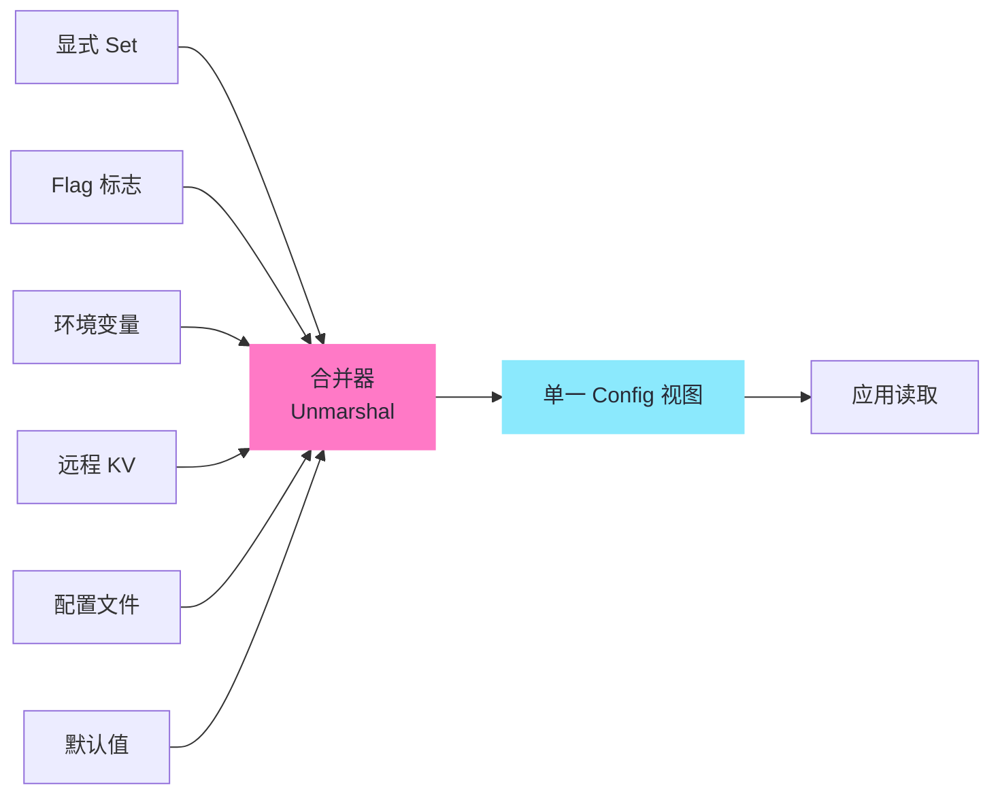

# 现代化配置与日志选型——Viper 拓扑加载与 Zap 零分配架构

**摘要：**

每一个上线多年的 Go 服务，都绕不开两个看似不起眼、却在演进中反复反噬的工程问题：**配置从哪里来、日志往哪里写**。早期的 Go 项目往往用 `flag` 包解析命令行参数，用 `log.Println` 输出标准日志，便以为万事大吉；可当服务规模扩展到十几个环境、几十项参数、上百个配置源时，这种"裸奔"的做法会暴露出优先级混乱、热更新困难、环境泄漏、日志无法检索、字段漂移等一系列工程债务。与此同时，日志侧的问题同样致命：`fmt.Println` 输出的文本行无法被聚合系统结构化解析，`log.Printf` 拼接字符串带来不必要的分配，紧急故障时海量日志又缺乏采样限流，最终可观测性（Observability）的三根支柱之一——日志（Logging）——从内部诊断工具退化为昂贵的噪声源。

本文从配置与日志这两条并行主线出发，系统回答两个工程问题：**第一，如何在多种配置源（文件、环境变量、远程 KV、命令行标志）共存的前提下，建立清晰、可预测的优先级与热加载拓扑**；**第二，如何在保证人类可读性的同时，让日志具备字段化、可检索、低分配的可观测性特征**。路线选择围绕 Go 生态中最具代表性的两个库展开：Viper 负责配置拓扑加载与合并，Zap 负责零分配结构化日志；末尾引入 Go 1.21 标准库 `log/slog`，讨论官方统一结构化日志标准后带来的迁移路径与取舍。行文将反复回到同一个认知框架：**没有银弹，架构即权衡**——配置的灵活性永远与可预测性对抗，日志的表达力永远与分配成本对抗，选型不是寻找"最优解"，而是在具体场景下做出恰当的折中。

---

## 第 1 章 配置管理的演进——从硬编码到拓扑加载

### 1.1 是什么：配置的本质是"运行期可调的参数集合"

**配置（Configuration）** 在狭义上指一组在程序启动时或运行期可被读取、用于决定程序行为的键值对。它不同于代码——代码需要重新编译才能改变行为；它也不同于输入数据——输入数据是业务请求携带的，配置是程序自身运行环境的描述。一个典型的 Go 服务配置可能包括监听端口、数据库 DSN、Redis 地址、特性开关（Feature Flag）、日志级别、限流阈值等。

配置的边界需要明确：那些在编译期就能确定的常量（譬如圆周率、协议版本号）应当写成 `const`；那些在请求期才能确定的数据（譬如用户 ID、订单号）属于业务输入；只有那些**在部署期或运行期才确定、且不同环境取值不同**的参数，才属于配置的范畴。这条边界一旦模糊，就会出现"常量被放进配置文件导致各环境不一致"或"用户输入被当作配置读取导致安全问题"之类的工程事故。

### 1.2 为什么出现：硬编码与 `flag` 包为何不够用

回到 2010 年代早期的 Go 项目，配置管理的主流做法有三种：

1. 在代码里写 `const Port = 8080`，改配置要重编；
2. 用标准库 `flag` 包解析命令行参数，启动时一次性读取；
3. 读 `os.Getenv`，把敏感值放进环境变量。

这三种做法在单体、单环境的年代勉强够用，但一旦服务规模扩张，它们暴露出三个系统性缺陷：

- **优先级混乱**：环境变量覆盖配置文件？配置文件覆盖命令行？还是反过来？没有统一规则，每个项目各自为政；
- **热更新缺失**：修改配置需要重启服务，而重启意味着连接断开、请求丢失、部署流水线被触发；
- **格式分裂**：YAML、JSON、TOML、HCL 各有拥趸，一个项目内可能同时出现三种格式，运维人员无所适从。

**Viper** 的出现正是为了解决这一组问题。它在 2014 年由 Steve Francia 主导设计（同时也是 Cobra CLI 框架的作者），目标是成为 Go 生态中的"配置注册中心"——不管配置来自文件、环境变量、远程 KV 存储还是命令行标志，都经过同一套 API 暴露给应用，且合并优先级严格确定。用笔者自己的话说：**Viper 就像一个多声道混音台，每路信号（配置源）都有自己的音量推子（优先级），最终输出的是合并后的单声道（应用看到的配置值）**。

### 1.3 不这样会怎样：配置失控的反事实

不妨设想一个没有 Viper 之类统一配置层的大型项目：开发同学在代码里手写 `os.Getenv("DB_HOST")`，运维同学在 Docker 镜像里放一份 `config.yaml`，CI 系统又通过命令行参数注入灰度开关。三份配置源并存，谁覆盖谁？当线上出了问题，排查者需要同时翻阅 `.env`、`config.yaml`、启动脚本和三份部署清单，才能确定最终生效的 `DB_HOST` 值。更糟的是，某位开发者在 `config.yaml` 中把日志级别改成 `debug` 准备排查问题，却发现服务仍然输出 `info` 级别——因为启动脚本里的命令行标志 `--log-level=info` 拥有更高优先级，而这条规则只存在于某位离职同事的脑子里。

这种"**配置熵增**"是大型项目的必然趋势，除非从一开始就引入一个明确的合并规则与单一事实源（Single Source of Truth）。Viper 的价值，正在于把这种隐式的合并规则显式化，并以代码的形式固化下来。

值得注意的是，**配置管理的演进并非一蹴而就**。早期项目往往从 `flag` 包起步，随着环境数量增长引入环境变量，随着容器化引入配置文件，随着微服务规模引入远程配置中心——每一次引入都是一次"打补丁"，如果没有统一的抽象层，最终必然陷入优先级混乱的泥潭。Viper 的设计哲学是**从一开始就提供一个能容纳所有配置源的统一抽象**，而不是让开发者在每个阶段都重新发明合并规则。这种"顶层设计"的思路，与 Go 语言整体偏好显式、少魔法的风格一脉相承。

---

## 第 2 章 Viper 的配置源优先级与拓扑合并

### 2.1 七种配置源与它们的严格优先级

Viper 支持七种配置源，按优先级从高到低排列如下：

| 序号 | 配置源 | 典型用途 |
|---|---|---|
| 1 | 显式调用 `Set` | 代码中硬覆盖，优先级最高 |
| 2 | 命令行标志（`flag`） | 启动时一次性覆盖，譬如 `--port=9000` |
| 3 | 环境变量（`env`） | 容器化部署注入，譬如 `DB_HOST` |
| 4 | 远程 KV（`etcd` / `consul`） | 配置中心下发，支持热更新 |
| 5 | 配置文件（`config.yaml` 等） | 项目级默认值，随代码提交 |
| 6 | 另一配置文件（`config.default.yaml`） | 兜底默认，不随环境变化 |
| 7 | 再次显式 `Set` 的默认值 | 代码中的最终兜底 |

这条优先级链是 Viper 设计的核心约束，它回答了一个看似简单、却困扰过无数项目的问题：**当同一个 key 出现在多个地方时，谁说了算**？答案是"显式覆盖 > 启动参数 > 环境 > 远程 > 文件 > 默认"，一条从高到低的清晰链条。

这条链条的工程意义在于：它允许团队把"运维关心的参数"放在环境变量、"开发关心的参数"放在配置文件、"灰度开关"放在远程 KV，彼此独立演化而不冲突。用生活场景作比：**这就像一家公司的决策层级——董事会决议（显式 Set）可以否决股东大会的倾向（flag），CEO 的指令（env）可以覆盖中层方案（远程 KV），而公司的章程（配置文件）则规定了所有人在没有特殊指令时的默认行为**。决策链条清晰，权责才不会混乱。

### 2.2 拓扑合并：从多源到单一视图

Viper 内部的合并过程可以用下图描述：



每个配置源都是一个"数据生产者"，合并器（Merge）按优先级顺序从高到低遍历，将 key 写入一个全局的 `map[string]interface{}`；当同一个 key 被多个源写入时，**优先级高的源胜出，低优先级的写入被丢弃**。最终应用通过 Viper 的读取 API 看到的，是这张已经合并完成的"单一视图"。

这个过程有两个值得强调的细节：

1. **key 大小写不敏感**：Viper 内部会把所有 key 转换为小写，因此 `DB_HOST`、`db.host` 和 `Db-Host` 在 Viper 看来是同一个 key。这既是便利（避免因为大小写不一致导致的配置失效），也是陷阱（如果你的配置文件里同时存在 `Db_Host` 和 `db_host`，它们会相互覆盖，而 Viper 不会报警）。
2. **嵌套 key 用点号分隔**：`viper.GetString("database.host")` 会访问到 `{"database": {"host": "..."}}` 这个嵌套结构。这个约定与 Spring Boot 的 `@Value("${database.host}")` 类似，但实现机制完全不同——Viper 是在读取时动态拆分点号，而不是在加载时把嵌套结构扁平化。

### 2.3 如何落地：最小可用的 Viper 初始化模板

以下是一段典型的生产级 Viper 初始化代码，涵盖了配置文件加载、环境变量绑定和命令行标志绑定：

```go
func InitConfig(cfgFile string) error {
    v := viper.New()

    // 1. 配置文件：优先使用指定路径，否则查找 ~/.app/config.yaml
    if cfgFile != "" {
        v.SetConfigFile(cfgFile)
    } else {
        v.AddConfigPath("$HOME/.app")
        v.SetConfigName("config")
        v.SetConfigType("yaml")
    }

    // 2. 环境变量：读取所有以 APP_ 开头的环境变量
    v.SetEnvPrefix("APP")
    v.AutomaticEnv()
    v.SetEnvKeyReplacer(strings.NewReplacer(".", "_"))

    // 3. 命令行标志：绑定 flag 包定义的变量
    v.BindPFlag("port", rootCmd.Flags().Lookup("port"))

    // 4. 默认值兜底
    v.SetDefault("port", 8080)
    v.SetDefault("log.level", "info")

    // 5. 读取配置文件（找不到则使用默认值，不报错）
    if err := v.ReadInConfig(); err != nil {
        var cfgNotFound viper.ConfigFileNotFoundError
        if !errors.As(err, &cfgNotFound) {
            return err
        }
    }
    return nil
}
```

这段代码有几个值得玩味的取舍：

- `SetEnvPrefix("APP")` 配合 `AutomaticEnv()` 让所有 `APP_` 前缀的环境变量自动进入 Viper，**前缀避免了与其他程序的环境变量冲突**；
- `SetEnvKeyReplacer` 把 `.` 替换为 `_`，使得 `APP_DATABASE__HOST` 对应 `database.host` 这个嵌套键，这个约定与 Docker Compose 的环境变量命名风格保持一致；
- `BindPFlag` 把 Cobra 命令行标志与 Viper 绑定，**让命令行参数自动获得比环境变量更高的优先级**；
- 配置文件找不到时**不报错**，这是有意为之——开发环境可能根本没有配置文件，完全靠默认值和环境变量运行。

---

## 第 3 章 热加载与运行时覆盖——WatchConfig 与环境变量绑定

### 3.1 WatchConfig 的 inotify 机制

Viper 的 `WatchConfig()` 与 `OnConfigChange()` 组合提供了配置文件的热加载能力——当磁盘上的配置文件被修改时，应用可以在不重启的前提下重新读取配置并生效。这个功能背后的实现依赖操作系统的文件系统事件通知：Linux 上是 `inotify`，macOS 上是 `FSEvents`，Windows 上是 `ReadDirectoryChangesW`。底层封装由 `fsnotify` 库完成。

```go
v.WatchConfig()
v.OnConfigChange(func(e fsnotify.Event) {
    fmt.Printf("配置文件已变更: %s\n", e.Name)
    // 重新反序列化到结构体
    if err := v.Unmarshal(&appConfig); err != nil {
        log.Printf("重新加载配置失败: %v", err)
    }
})
```

这段代码看似简单，但要稳妥地在生产环境使用，有三个陷阱必须注意：

1. **编辑器写文件的方式**：`vim` 默认使用"先写临时文件再 rename"的方式保存，这会触发 `RENAME` 事件而不是 `WRITE` 事件；`fsnotify` 在 Viper 早期版本中对此处理不当，可能导致热更新失效。现代版本已修复此问题，但在某些网络文件系统（NFS、SMB）上仍有边界情况。
2. **原子性**：`OnConfigChange` 回调执行时，`Unmarshal` 并不是原子的——如果在反序列化过程中另一个 goroutine 读取了 `appConfig`，可能看到一半新一半旧的中间状态。常见的做法是**用 `atomic.Value` 或 `sync.RWMutex` 保护 `appConfig`**，或者干脆每次回调生成一个新的不可变对象，通过 `atomic.Swap` 替换。
3. **远程 KV 的热加载是另一条路径**：`WatchRemoteConfig()` 走的是轮询（polling）机制，而不是文件系统事件。它在 etcd / Consul 客户端上定期拉取最新值，间隔默认为 5 秒。这意味着远程配置的热更新存在秒级延迟，而文件配置的热更新则是毫秒级——两者的实时性并不等价。

用一个比喻来收束：**WatchConfig 像一扇装在配置文件上的门铃——有人按门铃（文件变更）时应用会听到铃声（回调），但门铃本身并不能保证屋里的人（业务逻辑）已经做好了迎客准备（数据一致性）**。真正的安全更新，需要配合应用层的同步机制。

### 3.2 环境变量绑定的边界

Viper 的环境变量绑定有两种模式：

- `AutomaticEnv()`：自动读取所有环境变量（或带指定前缀的环境变量）；
- `BindEnv("database.host", "DB_HOST")`：显式绑定某个 key 到特定的环境变量名。

显式绑定的优先级高于自动绑定，且能处理环境变量名与配置 key 不一致的情况。但有一个常被忽略的边界：**`BindEnv` 只建立映射关系，不立即读取环境变量的值**——每次通过 `v.Get("database.host")` 读取时，Viper 都会重新查询一次 `os.Getenv("DB_HOST")`。这意味着环境变量的变更对 Viper 是"准实时"的，不需要重启应用——但反过来，这也意味着每次读取都有一次系统调用的开销，尽管这个开销在纳秒级别，通常可以忽略。

另外一个陷阱是 `BindEnv` 与 `SetEnvPrefix` 的交互：如果你同时设置了 prefix 并显式绑定了环境变量名，**显式绑定的名字会覆盖 prefix 的拼接**，这往往与直觉不符。

### 3.3 远程 KV 配置：etcd 与 Consul 的集成边界

Viper 支持 etcd 和 Consul 作为远程 KV 配置源，这个能力的实现依赖于 `github.com/spf13/viper/remote` 包。远程配置的优势在于**集中管理与审计追踪**——所有环境、所有服务的配置都集中存储在一个地方，变更历史可以被完整记录，权限可以被统一控制。

但远程配置也有明显的代价：

- **可用性依赖**：如果 etcd 集群不可达，Viper 在启动阶段会阻塞等待（默认超时取决于底层客户端配置），这对需要快速启动的服务（譬如 Kubernetes 的 readiness probe）可能是致命的。常见的规避方案是在启动阶段同时从本地配置文件和远程 KV 加载，以本地文件作为降级兜底。
- **延迟成本**：远程配置的读取涉及网络往返，相比本地文件读取（毫秒级）有数量级的差异。虽然 Viper 在内部会缓存读取结果，但首次加载的延迟仍然需要考虑。
- **一致性语义**：Viper 的远程配置读取是"最终一致"的——它在每次读取时从远程拉取最新值，但不保证与其他服务实例的读取完全同步。这种语义对于日志级别、feature flag 等容忍短暂不一致的配置是足够的，但对于强一致性要求（譬如分布式锁的超时时间）则不合适。

远程配置与本地配置的取舍，本质上是**集中化管理的成本与分散式自治的便利之间的权衡**。小团队、小项目，本地配置文件已经足够；中大型团队、多环境部署，远程配置中心的价值才会显现。

---

## 第 4 章 结构体反序列化——mapstructure 的覆盖规则与 Get 类型陷阱

### 4.1 Unmarshal 与 mapstructure 标签

Viper 内部使用 `github.com/mitchellh/mapstructure` 库完成从 `map[string]interface{}` 到 Go 结构体的转换。这个库通过结构体字段的 `mapstructure` 标签决定映射关系，而不是 `json` 标签——这是一个常被新手忽略的细节。

```go
type Config struct {
    Database DatabaseConfig `mapstructure:"database"`
    Log      LogConfig      `mapstructure:"log"`
}

type DatabaseConfig struct {
    Host     string `mapstructure:"host"`
    Port     int    `mapstructure:"port"`
    Timeout  time.Duration `mapstructure:"timeout"`
}
```

`mapstructure` 默认使用弱类型转换（weak decode）：字符串 `"8080"` 可以自动转为 `int`，`"5s"` 可以转为 `time.Duration`。这种宽容在多数情况下是便利的，但在某些场景会引发难以察觉的 bug：譬如配置文件里把 `port: 08080`（八进制写法）写成整型，mapstructure 会按十进制解析为 8080，而不是你预期的八进制 4160。

### 4.2 Get 类型断言的陷阱

Viper 提供了一组类型安全的读取方法：`GetString`、`GetInt`、`GetBool`、`GetStringSlice` 等。它们看起来比 `Unmarshal` 更轻量，适合读取零散配置，但有一个**根本性的陷阱**：`Get` 系列方法在类型不匹配时会返回零值，而不是报错。

```go
v.Set("port", "not-a-number")
port := v.GetInt("port") // port = 0，无错误返回
```

这个设计决策是有意为之——Viper 选择了"宽容失败"的哲学，认为一个配置项读取失败不应该让应用启动失败。但这种宽容会掩盖 bug：当你把 `port: "abc"` 写进配置文件时，应用会悄无声息地监听 0 端口（一个特殊含义的端口），而不是在启动阶段就报错。

更深层的陷阱在于嵌套结构的读取：`v.Get("database.host")` 能够正确读取嵌套值，但 `v.Get("database")` 返回的是一个 `map[string]interface{}`，你需要自己做类型断言——而 Viper 不会对嵌套 map 的 key 做大小写规范化，这意味着如果你的配置文件里写的是 `Database`，用 `v.Get("database.host")` 能访问到，但某些边缘情况下的大小写混用可能让嵌套访问失败。

### 4.3 何时选择 Unmarshal，何时选择 Get

工程实践中，这两种读取方式的使用边界可以概括为：

- **Unmarshal**：用于读取**结构化的、成块的**配置，譬如整个数据库配置段、整个日志配置段。它的优势在于强类型、有编译期校验（通过结构体字段），且支持 `mapstructure` 的自定义解码钩子（DecodeHook）处理特殊类型（譬如 `time.Duration`、IP 地址、URL）。
- **Get / GetString**：用于读取**零散的、动态 key 的**配置，譬如 feature flag 列表、动态路由规则。它的优势在于轻量、无需预先定义结构体，但代价是类型安全弱、错误易被掩盖。

一个常见的折中方案是：**核心配置用 Unmarshal 反序列化到结构体，feature flag 等动态配置用 Get 系列方法按需读取**，两者在同一个 Viper 实例上并存。这种"双轨制"在实际项目中被广泛采用，既保证了核心配置的强类型，又保留了动态配置的灵活性。

> [!note] 与 JSON 标签的对比
> `mapstructure` 的标签设计与 `encoding/json` 的标签设计一脉相承——都通过结构体字段上的标签字符串控制序列化/反序列化的行为（参见 [[Golang/Go标准库与系统IO/04 数据序列化语义与边界——encoding-json 的元数据解析与流式编解码]]）。但两者有一个关键差异：`json` 标签控制的是 JSON 字节的编解码，`mapstructure` 标签控制的是 `map[string]interface{}` 到结构体的转换。如果你的配置文件是 YAML，Viper 会先把 YAML 解析成 `map[string]interface{}`，再用 mapstructure 转换成结构体——**中间多了一层间接转换**，这也是为什么 Viper 的结构体字段需要同时写 `json` 和 `mapstructure` 标签，或者使用统一的标签名。

---

## 第 5 章 结构化日志的必要性——从 print 到字段化

### 5.1 是什么：结构化日志与普通文本日志的本质差异

**结构化日志（Structured Logging）** 是指日志条目以结构化的格式（通常是 JSON）输出，每条日志包含一组明确的键值对字段，而不是一段自由格式的文本。典型的非结构化日志形如：

```
2026/10/07 14:23:45 INFO: User 12345 logged in from 192.168.1.1
```

对应的结构化日志形如：

```json
{"time":"2026-10-07T14:23:45Z","level":"info","msg":"User logged in","user_id":12345,"ip":"192.168.1.1"}
```

两者的本质差异不在格式，而在**语义的可检索性**。非结构化日志必须用正则表达式解析才能提取字段，而结构化日志天然支持字段索引、过滤与聚合。当日志量从每秒几百行增长到几十万行时，这种差异从"便利"变成了"能否使用"的分水岭。

### 5.2 为什么出现：可观测性三支柱对日志的要求

现代可观测性（Observability）理论的三根支柱是**指标（Metrics）、日志（Logs）、链路（Traces）**。指标用于宏观监控，链路用于跨服务请求追踪，而日志则承担**事件细节记录**的角色——它是排查具体问题的最后一道防线。

这道防线要发挥作用，必须满足三个条件：

1. **可检索**：能按时间、级别、服务名、trace ID 等字段快速过滤；
2. **可聚合**：能与指标系统联动，譬如统计某类错误日志的出现频率；
3. **字段化**：每条日志的关键信息都以字段形式存在，而不是淹没在自由文本中。

这三条要求共同指向一个结论：**非结构化日志无法满足现代可观测性的基本需求**，必须转向结构化日志。这就像图书馆如果只把书堆在地上而不编目入库，规模小时还能凑合找，规模大了就必须有索书号、分类体系和检索终端——日志系统从 `print` 进化到结构化，是同一种"规模倒逼秩序"的规律在起作用。

### 5.3 不这样会怎样：文本日志的反事实

一个典型的反例来自笔者亲历的项目：某金融系统在故障排查时需要从近 30 天的日志中找出特定用户的所有操作记录。由于日志是非结构化的自由文本，运维团队不得不写一个复杂的正则表达式，逐行扫描 200GB 的日志文件，耗时近 4 小时才得出结果。如果日志一开始就是结构化的 JSON，并接入了 Elasticsearch 或 Loki，同样的查询可以在秒级完成。

更隐蔽的问题是**字段漂移**：不同开发者写的日志格式不一致，有的用 `user_id`，有的用 `userId`，有的用 `uid`；有的把 IP 放在文本末尾，有的放在开头。这种不一致性在日志量小时不可见，一旦需要跨模块聚合分析，就变成了巨大的工程障碍。结构化日志通过**强制字段命名**从根本上避免了这个问题。

### 5.4 结构化日志的性能代价

结构化日志并非没有代价。与非结构化日志相比，结构化日志的主要性能代价来自三个方面：

1. **字段序列化**：每个字段都需要被编码为目标格式（JSON / Protocol Buffers），这涉及类型判断、字符串转义、数字格式化等操作。对于简单的字符串拼接日志，这些操作的开销是额外的。
2. **时间格式化**：结构化日志通常要求精确到毫秒甚至微秒的时间戳，时间格式化本身是一个相对昂贵的操作（涉及时区转换、数字转字符串等）。Zap 在这方面做了专门的优化——它提供了一个 `TimeEncoder` 的池化实现，避免每次日志调用都分配新的时间字符串。
3. **内存分配**：如果日志库的设计不当，每条日志都可能产生若干临时对象，这些对象最终需要 GC 回收。在高吞吐场景下，GC 压力会成为性能瓶颈。Zap 的零分配设计正是为了解决这个问题。

这三方面的代价，在不同日志库中的差异巨大。标准库 `log` 包的代价主要在内存分配（每次调用都产生新字符串），Zap 的代价几乎为零（零分配 + 池化），slog 的代价居中（有少量分配但远小于标准库）。**选型的本质是在日志表达力与性能代价之间寻找恰当的平衡点**——对于大多数业务服务，slog 的代价已经足够低；只有当你的服务达到每秒数万条日志的吞吐，才需要考虑 Zap 的零分配优化。

---

## 第 6 章 Zap 的零分配架构——zapcore 分层与字段编码器

### 6.1 Zap 的诞生背景与设计目标

Zap 由 Uber 在 2016 年开源，目标是在 Go 生态中提供**最快**的结构化日志库。Zap 的名字本身就是"快"的隐喻（zap：疾速、猛击）。它的性能标杆是：在热路径上的日志调用**零堆分配（zero allocation）**——也就是说，一条日志从调用到写入，不会产生任何垃圾回收器（GC）需要追踪的堆内存分配。

这个目标的实现依赖于几个核心设计：

- **双层 API**：`zap.Logger`（强类型、零分配）与 `zap.SugaredLogger`（弱类型、有分配，兼容 `Printf` 风格）；
- **分层架构**：`zapcore.Core` 负责日志的决策（是否输出、输出到哪里）与写入，`zapcore.Encoder` 负责字段序列化；
- **字段池化**：`zap.Field` 是一个固定大小的值类型，通过 `sync.Pool` 复用，避免每次调用都分配新对象。

用生活场景类比：**Zap 的架构像一条快递分拣流水线——发件人（调用方）把包裹（Field）贴好标准标签，分拣机（Core）决定这个包裹该走哪条传送带（Encoder），传送带末端是卡车（Writer），把包裹运走。整条流水线上，包裹的标签是预先印好的标准格式（零分配），不会临时手写标签（避免反射）**。

### 6.2 zapcore 的分层结构

Zap 的内部分为三个层次，每一层都可以独立替换：

| 层次 | 组件 | 职责 |
|---|---|---|
| 顶层 | `zap.Logger` | 对外 API，提供 `Info`、`Error`、`With` 等方法 |
| 中层 | `zapcore.Core` | 决策层：检查日志级别、采样、调用编码器、写入 Sink |
| 底层 | `zapcore.Encoder` + `zapcore.WriteSyncer` | 编码器（JSON / Console）+ 写入器（文件 / stdout / 网络） |

这种分层的好处是**正交组合**：你可以选择 JSON 编码 + 文件输出，也可以选择 Console 编码 + 网络输出，每种组合都是编码器与写入器的独立拼装。这与 `encoding/json` 的设计哲学相似——序列化格式与传输通道分离。

值得深入的是 **Core 的决策机制**。每当应用调用 `logger.Info(...)` 时，Core 需要完成以下决策：

1. **级别检查**：当前日志级别是否满足？如果 logger 设置为 InfoLevel，Debug 调用会被直接丢弃，不产生任何编码开销——这是 Zap 性能优化的第一道防线；
2. **字段组装**：把调用方传入的 `Field` 切片与通过 `With()` 方法预先绑定的字段合并，形成一个完整的字段集合；
3. **编码器调用**：把字段集合交给 Encoder，Encoder 按目标格式（JSON 或 Console）把字段序列化为字节流；
4. **写入器调用**：把序列化后的字节流交给 WriteSyncer，WriteSyncer 把字节流写入底层输出（文件、stdout、网络）。

每一步都是可替换的：你可以自定义 Core 实现特殊的决策逻辑（譬如按日志级别路由到不同输出），可以自定义 Encoder 实现私有格式，可以自定义 WriteSyncer 实现缓冲写入或网络传输。这种**策略模式**的组合，是 Zap 灵活性的根源，也是它与标准库 `log` 包"单一实现"哲学的根本差异。

### 6.3 Field：零分配的核心机制

Zap 零分配的秘密集中在 `zap.Field` 的设计上。每个 `Field` 是一个固定大小的结构体，内部包含：

- `Key`：字段名（字符串）；
- `Type`：字段类型（整型、浮点、字符串、时间、错误、数组等枚举）；
- `Integer`：整型值（用于 int、bool、time 等）；
- `String`：字符串值（用于 string、error 等）；
- `Interface`：接口值（用于自定义对象）。

```go
// zap.Field 的简化结构
type Field struct {
    Key       string
    Type      FieldType
    Integer   int64
    String    string
    Interface interface{}
}
```

这个设计的精妙之处在于：**对于常见的标量类型（int、string、bool、time），Field 用固定字段直接存储值，不需要任何堆分配**。只有当字段值是自定义对象时，才会退化到 `Interface{}` 字段，触发反射和分配。这就是 Zap 在热路径上能做到零分配的根本原因——**它用类型枚举（FieldType）替代了 Go 的 interface{} 多态，把运行时的反射推迟到了编译期可以内联的分支判断**。

```go
// 零分配：int、string、time 等直接存入 Field 结构体
logger.Info("request handled",
    zap.Int("status", 200),       // Integer 字段存储
    zap.String("method", "GET"),  // String 字段存储
    zap.Duration("latency", d),   // Integer 字段存储（纳秒数）
)
```

与之对比，传统的 `log.Printf` 风格日志：

```go
log.Printf("request handled: status=%d method=%s latency=%v", 200, "GET", d)
```

每次调用都会：

1. 用 `fmt.Sprintf` 格式化字符串，产生一次堆分配；
2. 格式化后的字符串本身又是一次分配；
3. `log` 包内部还要把这条消息复制到缓冲区，再产生一次分配。

Zap 通过 `Field` 的设计，把这三到四次分配压缩为零——**这就是零分配的含义，不是"完全没有分配"，而是"热路径上的日志调用不产生新的堆分配"**。

### 6.4 With 方法：字段绑定的不可变性

Zap 的 `With()` 方法允许预先绑定一组字段，所有后续的日志调用都会自动携带这些字段：

```go
requestLogger := logger.With(
    zap.String("request_id", reqID),
    zap.String("trace_id", traceID),
)
requestLogger.Info("processing")  // 自动包含 request_id 和 trace_id
```

这个设计的工程价值在于：**它解决了"上下文传播"的问题**。在微服务架构中，一个请求可能跨越多个函数调用，每个函数都需要在日志中记录请求 ID 和 trace ID。如果没有 `With()`，每个函数都需要显式传递这些字段；有了 `With()`，外层函数只需调用一次 `With()`，生成的子 logger 会自动携带所有绑定的字段，内层函数无需关心。

值得注意的是，`With()` 返回的是一个**新的 Logger 实例**，而不是修改原 logger——这符合 Go 的不可变性哲学。原 logger 不受影响，新 logger 包含了额外绑定的字段。这种设计避免了并发访问同一 logger 时的竞态条件，也避免了字段绑定的意外泄漏。

`With()` 的内部实现通过**字段切片的复制**来保证不可变性。每次调用 `With()`，Zap 都会把现有字段和新字段拼接成一个新的切片，而不是在原切片上追加。这种"复制而非修改"的策略，是 Zap 在保证零分配的同时维护不可变性的关键——字段切片本身是值类型，复制的开销在纳秒级别。

---

## 第 7 章 ObjectMarshaler 与采样——绕过反射与限流

### 7.1 ObjectMarshaler：自定义对象的零分配之路

当 Field 的值是自定义对象时，Zap 默认会使用 `reflect` 包反射遍历对象字段，这会破坏零分配的保证。为了绕过这个问题，Zap 提供了 `zapcore.ObjectMarshaler` 接口，允许用户自定义对象的序列化逻辑：

```go
type User struct {
    ID   int64
    Name string
    Role string
}

func (u User) MarshalLogObject(enc zapcore.ObjectEncoder) error {
    enc.AddInt64("id", u.ID)
    enc.AddString("name", u.Name)
    enc.AddString("role", u.Role)
    return nil
}

// 使用：
logger.Info("user login", zap.Object("user", user))
```

这种写法看似繁琐，但它的工程价值在于：**通过显式的字段枚举，把反射的运行时开销转化为编译期可以优化的分支判断**。在每秒数万条日志的高吞吐场景下，这种差异会被放大到可感知的程度——根据 Zap 作者公开的性能基准，使用 `ObjectMarshaler` 比默认反射快 5-10 倍，且零分配。

这里有一个权衡：**ObjectMarshaler 要求为每个需要日志输出的类型手动实现序列化方法，增加了代码量；但换来的是可预测的性能和零分配**。在大多数业务系统中，只有少数几个高频类型（请求、响应、用户、错误）需要实现 ObjectMarshaler，其余低频类型仍然可以依赖默认反射——这就是"按需优化"的工程哲学。

### 7.2 采样（Sampling）：限流的工程价值

即使 Zap 能做到每条日志零分配，**日志的写入本身也是有成本的**——磁盘 IO、网络带宽、下游日志系统的处理能力都是有限的。当系统出现故障时，错误日志可能瞬间暴增数十倍，如果不加限制地全量写入，轻则磁盘被打满，重则下游日志系统（如 Elasticsearch）被打挂，进而影响整个可观测性栈的稳定性。

Zap 的采样机制通过 `zapcore.NewSampler` 实现：

```go
core := zapcore.NewSampler(
    zapcore.NewCore(
        zapcore.NewJSONEncoder(encoderConfig),
        zapcore.AddSync(logFile),
        zap.InfoLevel,
    ),
    time.Second,    // 采样周期
    100,            // 每个周期内相同（level, message）的前 100 条全量记录
    5,              // 之后每 5 条记录 1 条
)
```

这个设计的精妙之处在于**按 (level, message) 组合去重采样**——它不是简单的随机丢弃，而是保证每种不同的日志消息在每个采样周期内都有一定数量的样本被保留。这意味着：

- 常见的 Info 日志不会被过度采样（因为它们本来就在阈值内）；
- 突发的错误日志会被限流，但不会完全消失（每 5 条还能保留 1 条）；
- 罕见的错误日志会被完整保留（因为它们的总数通常不超过阈值）。

这种"**保头限尾**"的采样策略，是 Zap 对日志系统"既要保留信号、又要控制成本"这一对矛盾的工程折中。它不是万能的——如果你的故障模式是"罕见错误突然大量出现"，采样可能会漏掉关键的现场信息。但在绝大多数场景下，采样是保护下游系统的必要防线。

> [!warning] 采样策略的边界条件
> 采样在以下场景可能带来风险：（1）低频但关键的错误日志（譬如数据损坏告警）可能被采样丢弃，建议在采样配置中对 Error 及以上级别跳过采样；（2）采样是基于 (level, message) 的去重，如果 message 中包含动态字段（譬如 trace ID），同一种错误会因为 message 不同而无法有效去重，导致采样失效。Zap 的 Sampler 提供了 `WithoutMessageHook` 选项来处理这种情况，但需要谨慎配置。

---

## 第 8 章 Encoder 的两种实现——JSON 与 Console 的工程取舍

### 8.1 JSON 编码器：机器可读性的代价

Zap 提供了两种内置的编码器：**JSONEncoder** 与 **ConsoleEncoder**。JSONEncoder 输出标准 JSON 格式，是生产环境的首选——它能被 Elasticsearch、Loki、Fluentd 等日志系统直接解析，支持字段索引和聚合查询。但 JSON 编码器的工程代价在于：

- **人类可读性差**：当你在终端直接查看日志文件时，JSON 格式的多行嵌套结构不如纯文本直观；
- **编码开销**：JSON 编码需要处理字符串转义（换行符、引号、Unicode 控制字符）、嵌套结构展开、字段排序等，比纯文本拼接有更高的 CPU 开销。

JSONEncoder 的内部实现通过 `appendKey`、`appendString`、`appendInt` 等方法逐字段拼接 JSON 字节流，**整个过程避免了临时字符串的分配**——它直接操作 `[]byte` 切片，把字段追加到缓冲区中。这种"字节流拼接"的思路与 `encoding/json`（参见 [[Golang/Go标准库与系统IO/04 数据序列化语义与边界——encoding-json 的元数据解析与流式编解码]]）的 `json.Encoder` 类似，但 Zap 的编码器更加激进地避免了 interface{} 反射，因为它知道所有字段的类型都是预先确定的 FieldType 枚举。

### 8.2 Console 编码器：开发环境的便利

ConsoleEncoder 输出人类友好的彩色文本格式，适合本地开发和调试。它的输出类似：

```
2026-10-07T14:23:45.123+0800	INFO	handler/request.go:42	request handled	{"status": 200, "method": "GET", "latency": "5ms"}
```

这种格式包含时间戳、日志级别、调用位置、消息和字段，字段部分以 JSON 格式附加在消息末尾——**它是人类可读与机器可解析的折中方案**。一些日志聚合系统（如 Loki）能够解析这种"消息 + 内嵌 JSON"的混合格式，但解析规则比纯 JSON 更复杂，建议在开发环境使用 Console，生产环境统一使用 JSON。

两种编码器的切换非常简单：

```go
// 生产环境
encoder := zapcore.NewJSONEncoder(productionConfig)

// 开发环境
encoder := zapcore.NewConsoleEncoder(developmentConfig)
```

这里的工程取舍是：**不要为了"统一"而在生产环境使用 ConsoleEncoder，也不要为了"人类可读"而在开发环境使用 JSONEncoder**——前者会让你在终端排查问题时抓狂，后者会让你的日志聚合系统解析失败。因地制宜，按环境选用。

---

## 第 9 章 Zap vs slog——标准库统一与迁移路径

### 9.1 slog 的登场：Go 1.21 的结构化日志标准

2023 年 8 月发布的 Go 1.21，把 `log/slog` 正式纳入标准库。`slog` 的设计目标与 Zap 有显著的重叠：**结构化、支持字段、可替换处理器**。它的出现标志着 Go 官方对结构化日志的态度从"交给生态"转向"标准库统一"。

slog 的核心设计包括：

- `slog.Logger`：对外 API，支持 `Info`、`Error` 等方法；
- `slog.Handler`：处理器接口，负责决定日志如何被序列化和写入；
- `slog.Attr`：属性（即字段），一个键值对，类似 `zap.Field`；
- `slog.Group`：分组，可以把多个 Attr 组合成一个嵌套结构。

与 Zap 相比，slog 的设计更偏"最小公约数"——它没有 Zap 那样激进的零分配优化，但提供了**标准库级别的稳定性和统一性**。slog 的默认处理器输出文本格式，但可以替换为 JSON 处理器（`slog.NewJSONHandler`）输出结构化 JSON。

### 9.2 性能对比：Zap 仍然领先的维度

尽管 slog 在设计哲学上借鉴了 Zap 的部分思路，但在绝对性能上，Zap 仍然保持优势。根据社区公开的基准测试（2024 年数据），在每秒数十万条日志的高吞吐场景下：

| 维度 | Zap (Logger) | slog (JSONHandler) | 说明 |
|---|---|---|---|
| 单条日志分配次数 | 0 | 1-3 | Zap 在热路径上零分配 |
| 单条日志耗时 | ~200ns | ~500-800ns | Zap 快 2-4 倍 |
| 字段编码方式 | 类型枚举（编译期优化） | Attr 接口（部分反射） | Zap 的 FieldType 机制更激进 |
| API 风格 | 强类型（zap.Int/String） | 弱类型（slog.Int/Any） | Zap 强制显式类型 |

不过，**性能差异在大多数业务场景中并不构成决定性因素**。每秒数千条的日志量下，slog 的性能完全够用；只有当你的系统达到每秒数万乃至数十万条日志（譬如大型网关、代理服务器），Zap 的零分配优势才会转化为可观的 CPU 与 GC 成本节省。

### 9.3 迁移路径：从 Zap 到 slog 与反向迁移

对于存量 Zap 用户，迁移到 slog 并非必要，但也并非不可行。Zap 社区提供了 `zapslog` 适配器，允许把 Zap 的 Core 包装成 slog 的 Handler，从而实现**混合使用**：新代码用 slog 的标准 API，老代码保持 Zap，两者共享同一个底层输出。这种适配器的设计思路，本质上是**把 Zap 的高性能底层作为 slog 的一个可选后端**，既保留了 slog 的标准 API 接口，又享受了 Zap 的零分配优化。

```go
// 用 Zap 的 Core 作为 slog 的后端
core := zapcore.NewCore(
    zapcore.NewJSONEncoder(encoderConfig),
    zapcore.AddSync(os.Stdout),
    zap.InfoLevel,
)
slogHandler := zapcore.NewSlogHandler(zap.New(core))
logger := slog.New(slogHandler)
```

反向迁移（从 slog 到 Zap）也是可行的：Zap 提供了 `zap.NewStdLog` 等兼容层，但 slog 的标准 API 本身已经足够简洁，多数情况下无需专门迁移到 Zap，除非性能确实是瓶颈。

工程上的取舍可以归纳为：

- **新项目**：如果团队对性能敏感、且日志量可能很大，直接用 Zap；如果更看重标准库兼容性和长期稳定性，用 slog。
- **存量项目**：如果已经在用 Zap，不必迁移到 slog，除非有强烈的标准库偏好；如果还在用 `log` 标准库，优先考虑迁移到 slog（成本最低），而非 Zap。

用一个比喻收束本节：**slog 像是国家推行的统一身份证，而 Zap 像是某家银行发行的 VIP 卡。两者都能证明"你是谁"，但 VIP 卡在银行自己的体系内享受更快的通道。如果业务量不大，身份证足够用；如果你的"业务量"大到需要 VIP 通道，那就办张 VIP 卡——但不要为了办 VIP 卡而把已经在用身份证的全体员工都重新办一遍**。

### 9.4 slog 的设计哲学：最小公约数 vs 激进优化

slog 的设计哲学与 Zap 的根本差异，在于**对"标准库应该做什么"的不同理解**。标准库的目标是提供"最小公约数"——覆盖 80% 的常见需求，让大多数项目不需要引入第三方依赖就能完成基本的结构化日志。而 Zap 的目标是**覆盖性能敏感场景的最后 20%**——为那些日志量达到每秒数十万条的服务提供极致的性能优化。

这两种哲学没有对错之分，只有适用场景的差异。标准库的优势在于**稳定性与长期维护**——它随 Go 版本一起演进，不需要跟踪第三方库的版本变化，不会因为上游 breaking change 而被迫重构。Zap 的优势在于**性能与灵活性**——它的分层架构允许用户按需替换每一个组件，它的零分配设计在性能敏感场景下无可替代。

值得注意的是，**slog 的 Handler 接口设计本身就预留了"高性能后端"的扩展空间**。任何第三方日志库（包括 Zap）都可以实现 slog 的 Handler 接口，成为 slog 标准 API 的一个可选后端。这种"标准 API + 可选后端"的设计，是 Go 标准库一贯的风格——`database/sql` 提供了标准 SQL 接口，但具体的数据库驱动由第三方实现；`net/http` 提供了标准 HTTP 接口，但具体的路由框架由第三方实现。slog 延续了这种设计哲学：**标准库负责 API 统一，生态负责实现多样性**。

---

## 第 10 章 选型权衡——配置与日志的协同

### 10.1 配置与日志的协同点

配置与日志看似是两个独立的话题，但在工程实践中它们有几个关键的协同点：

1. **日志级别是配置**：`log.level` 是运行时最常调整的配置项之一。Viper 的热加载能力让日志级别可以在不重启服务的前提下动态调整，这在故障排查时极为实用——先调到 debug 抓现场，排查完再调回 info 恢复正常。
2. **日志输出路径是配置**：日志写到哪个文件、输出到什么级别、是否开启 JSON 格式，这些都应该是配置项，而不是硬编码。
3. **配置变更本身应被日志记录**：当 Viper 热加载检测到配置变更时，应当输出一条结构化的 Info 日志，包含变更的 key、旧值、新值，方便审计和排查。

### 10.2 选型的权衡矩阵

把配置与日志的选型放在一起看，可以形成一张权衡矩阵：

| 维度 | Viper + Zap | Viper + slog | 标准 flag + log |
|---|---|---|---|
| 配置源支持 | 七种，优先级严格 | 七种，优先级严格 | 命令行+环境变量 |
| 热加载 | 支持（inotify / 轮询） | 支持 | 不支持 |
| 日志结构化 | JSON + 字段 | JSON + 字段 | 纯文本 |
| 热路径性能 | 零分配 | 有分配（1-3 次） | 有分配（多次） |
| 标准库依赖 | 第三方 | 标准库 | 标准库 |
| 学习成本 | 高（两套 API） | 中（一套 + 标准） | 低 |
| 长期维护风险 | 社区维护 | 标准库保证 | 标准库保证 |

这张矩阵没有"最优解"——**选择哪条路线，取决于你的团队规模、性能需求、对标准库的偏好、以及存量代码的迁移成本**。

### 10.3 边界与反例：什么时候不该用 Viper / Zap

Viper 和 Zap 都不是银弹，它们有自己的适用边界：

- **Viper 不适合的场景**：极简 CLI 工具（用 Cobra + flag 即可）；对启动时间极度敏感的工具（Viper 的初始化开销在毫秒级，对命令行工具不可接受）；强类型配置且不需要多源合并（直接用 `envconfig` 或 `koanf`）。
- **Zap 不适合的场景**：日志量不大的小型服务（slog 足够）；需要与 OpenTelemetry 深度集成的场景（OTel 的 log bridge API 目前对 slog 支持更好）；团队对第三方库有严格限制（标准库 slog 无此问题）。

一个常见的反例是：某些项目在引入 Zap 时，过度追求零分配，为每个业务类型都实现了 `ObjectMarshaler`，结果代码量膨胀、可读性下降，但性能提升微乎其微——因为只有热路径上高频调用的类型才值得手动优化，**"过早优化是万恶之源"这句话在日志选型上同样适用**。

> [!info] 配置侧的替代方案
> Viper 并不是 Go 生态中唯一的配置库。**Koanf** 是近年来崛起的一个替代方案，它的设计更加模块化，把每个配置源和每个编码器都拆成独立的包，按需导入，避免了 Viper 的"全家桶"依赖。**Envconfig** 则专注于环境变量到结构体的映射，适合只需要环境变量配置的场景。选择哪个库，取决于你对"功能全面"与"依赖最小"的偏好。

### 10.4 性能剖析与日志选型的联动

日志选型不是孤立的技术决策，它与整个性能剖析体系紧密相关。当你的日志系统成为性能瓶颈时（譬如 CPU 占用过高、GC 停顿频繁），**第一步不是换日志库，而是用 pprof 定位真实的瓶颈**（参见 [[Golang/Go工程实践/06 Go 性能剖析——pprof、trace 与基准测试]]）。pprof 的 CPU profile 会清晰地告诉你，多少 CPU 时间花在了日志编码上，多少花在了 JSON 序列化上，多少花在了文件写入上。基于这些数据，你才能做出有依据的决策——是引入 Zap 的零分配优化，还是调整日志级别，还是引入采样限流，还是干脆把日志写入异步化。

同样，**Go 运行时的内存分配器与 GC 机制**（参见 [[Golang/Go运行时进阶与底层机制/00 专栏导览|Go 运行时进阶与底层机制]]）决定了日志分配的代价有多大。在对象分配频繁的场景下，Zap 的零分配设计能显著降低 GC 压力；但在对象分配已经很少的场景下，零分配的收益就微乎其微。**选型的依据是现场数据，而不是文档数字**。

### 10.5 日志的下游：从输出到可观测性

日志的输出只是日志生命周期的第一步。在现代化的可观测性栈中（参见 [[可观测/日志/00 专栏导览|日志]] 专栏），日志需要被采集、传输、存储、索引、查询，最终与指标和链路联动。**日志的格式选择必须考虑下游系统的解析能力**——JSON 格式是 Elasticsearch 和 Loki 的首选，但如果你用的是简单的 grep 排查场景，Console 格式反而更方便。

日志采集的架构选型（Fluentd vs Filebeat vs Vector）和日志存储的选型（Elasticsearch vs Loki vs ClickHouse）是另一个层面的工程问题，超出了本文的范围，但值得在整体可观测性设计中一并考虑。

### 10.6 落地的务实建议

综合以上讨论，笔者给出几条落地的务实建议：

1. **配置侧**：中大型项目统一使用 Viper 管理配置，明确优先级规则并写入团队文档；核心配置用 `Unmarshal` 强类型化，feature flag 用 `Get` 系列按需读取；热加载必须配合 `atomic.Value` 或 RWMutex 保护共享状态。
2. **日志侧**：日志量较大或性能敏感的项目选 Zap；新项目且日志量不大可选 slog；不要在同一个项目中混用多种日志库。
3. **协同侧**：把日志配置（级别、输出路径、格式）纳入 Viper 管理；配置变更时输出结构化日志；日志级别可通过 Viper 热加载动态调整。
4. **演进侧**：不要一开始就追求零分配——先用最简方案跑起来，用 pprof（参见 [[Golang/Go工程实践/06 Go 性能剖析——pprof、trace 与基准测试]]）定位真实性能瓶颈，再针对性地引入 Zap 的零分配优化。

---

配置与日志，是每一个 Go 服务都绕不开的两个基础设施。它们的选型看似是技术问题，实则是工程权衡——**灵活性 vs 可预测性、表达力 vs 性能、标准统一 vs 生态活力**，每一对矛盾都没有绝对的答案，只有在具体场景下的恰当折中。Viper 的拓扑加载给了配置一个清晰的优先级链条，Zap 的零分配架构给了日志一个性能天花板，而 slog 的登场则提醒我们：**最好的基础设施往往是那些" boring "的、标准库级别的、不需要太多思考就能用的东西**。

回到本专栏的整体视角（参见 [[Golang/Go生态与框架设计/00 专栏导览|Go 生态与框架设计]]），从 Gin 的 Radix Tree 路由到 GORM/Ent 的数据持久层，从 gRPC 的 Protobuf 编码到 Wire/Fx 的依赖注入，再到本文的 Viper/Zap 配置日志选型，**每一个框架都在解决同一类问题：如何在不牺牲 Go"显式、简单"气质的前提下，提供足够的工程抽象**。Viper 把七种配置源统一到一个 API 表面，Zap 把复杂的日志编码抽象为 Field/Core/Encoder 的分层组合——它们的成功，都源于这种"恰当的抽象"而非"过度的魔法"。

由此可见，因地制宜地选用合适的方案，并在不同阶段做出恰当的演进决策，才是工程实践的核心——而不是盲目追求某一种"最优"工具。未来是否会出现一个统一的 Go 可观测性标准库，把日志、指标、链路全部整合进标准库？目前仍然言之尚早，但 slog 的登场至少说明，官方已经开始在这个方向上探索。

---

## 参考资料

1. Viper 官方文档：https://github.com/spf13/viper
2. Zap 官方文档：https://github.com/uber-go/zap
3. Go 1.21 Release Notes - log/slog：https://go.dev/doc/go1.21#slog
4. mapstructure 文档：https://github.com/mitchellh/mapstructure
5. fsnotify 文档：https://github.com/fsnotify/fsnotify
6. Uber Engineering Blog - Zap: https://eng.uber.com/zap/
7. Go 官方博客 - slog 设计：https://go.dev/blog/slog

---

> [!note] 思考题
> 1. Viper 的 `OnConfigChange` 回调中如果 `Unmarshal` 失败，应该让应用 panic 还是降级继续使用旧配置？两种选择各有什么风险？
> 2. Zap 的零分配设计为什么只对强类型 `Logger` 成立，而 `SugaredLogger` 无法做到零分配？两者的取舍是什么？
> 3. 如果你的项目已经大量使用 Zap，但公司决定统一可观测性栈到 OpenTelemetry，你会选择迁移到 slog 还是保留 Zap？迁移的路径和成本是什么？
> 4. 在配置热加载场景下，如果用 `atomic.Value` 保护配置对象，新的请求何时能看到新配置？旧请求是否会受到影响？
