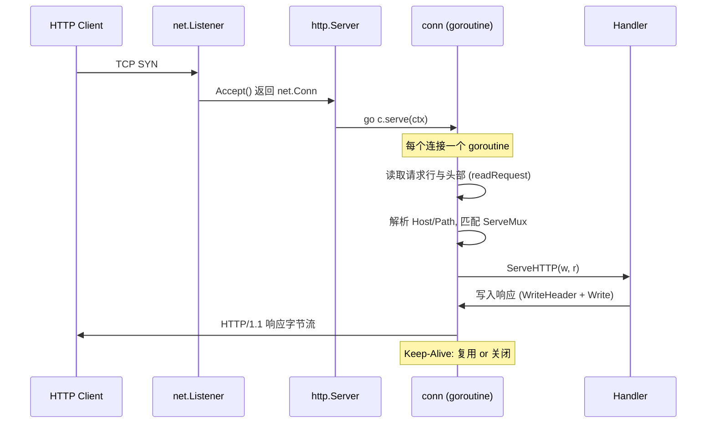
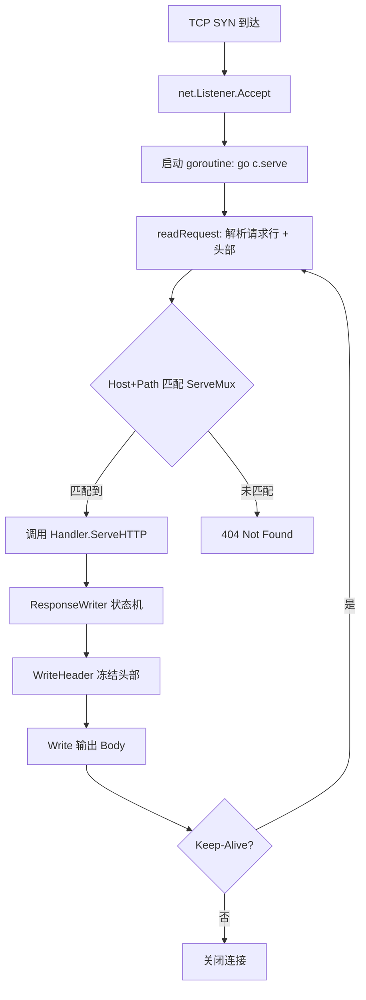

# 原生 HTTP 服务端架构——Handler 链与 Go 1.22 增强路由树

**摘要：**

Go 标准库的 `net/http` 并非一个简单的 API 集合，而是一套围绕「请求如何在到达业务代码之前被逐层分解」设计的微型框架。它的核心抽象只有三个：`http.Handler` 这一单一方法接口、`http.ResponseWriter` 这一隐式状态机，以及从 2023 年 Go 1.22 开始显著增强的原生 `ServeMux` 路由器。前两者构成了「Handler 链」的骨架——每一个请求从 Accept 开始，到被 goroutine 承载、被 `ReadRequest` 解析、被 `ServeHTTP` 分派、最终由 `ResponseWriter` 编码成字节流写回对端，这条流水线几乎决定了所有 Go HTTP 服务端的性能上限与行为边界。

Go 1.22 之前的 `ServeMux` 因其只能做前缀匹配、不支持 HTTP 方法路由、不支持路径参数而被业界广泛诟病，催生了从 Gorilla Mux 到 Gin 的庞大第三方路由生态。但自 Go 1.22 起，原生 `ServeMux` 一次性补齐了方法匹配、`{id}` 通配符、`{path...}` 尾缀捕获、`{$}` 精确锚定与前缀优先级冲突检测等能力，使得「不用框架也能写出像样的路由」成为现实——不过，这并不意味着它已经取代了所有第三方路由，它在算法取舍上仍然存在若干与 Radix Tree 路由器不同的权衡。

本文将沿三条线索展开：其一，`http.Handler` 的函数式抽象与 `Server` 的请求生命周期——理解请求从 TCP 字节流到业务回调的完整物理过程；其二，Go 1.22 增强路由树的匹配算法与冲突规则——精确到源码层面的优先级判定；其三，`http.ResponseWriter` 的状态机与分块传输编码——理解为什么「先写 Body 再调 `WriteHeader` 不会生效」、「Content-Length 何时被推断」、「流式输出为什么必须显式 Flush」。这三条线索的交汇点，是理解所有 Go HTTP 框架的底层物理，也是定位线上疑难（譬如响应被缓冲、中间件接口断链、停机时请求丢失）的必要知识基础。

---

## 第 1 章 Handler 的函数式抽象与请求生命周期

### 1.1 一个方法的极简契约

Go 的整个 HTTP 服务端模型建立在一个仅包含一个方法的接口之上：

```go
type Handler interface {
    ServeHTTP(ResponseWriter, *Request)
}
```

这个设计不是出于对「极简主义」的审美偏好，而是出于对**组合性**的工程追求。任何一个能处理 HTTP 请求的对象——无论它是一个具体的 handler、一段函数、一个中间件链、还是一个完整的子路由器——只要实现这一个方法，就能被嵌入到 `net/http` 的处理流水线中。函数式语言中，这等价于把「请求处理」抽象为一个 `Request -> Response` 的纯函数类型；在 Go 中，这个位置由 `HandlerFunc` 适配器占据：

```go
type HandlerFunc func(ResponseWriter, *Request)

func (f HandlerFunc) ServeHTTP(w ResponseWriter, r *Request) {
    f(w, r)
}
```

`HandlerFunc` 的作用，好比一个把普通函数「抬升」为接口实例的升格器——它本身没有任何逻辑，只是让一段符合签名的函数能够满足 `Handler` 接口，从而被 `http.Handle("/", ...)` 或 `mux.Handle("/api", ...)` 注册到路由表中。这种设计有一个微妙但重要的推论：**Go 中没有「路由」和「处理器」的类型区分**，一个 `Handler` 既可以是一个叶子节点（真正写响应），也可以是一个分发器（把请求转发给其他 Handler），这为中间件和子路由器提供了统一的类型基础。

如果把 HTTP 服务端想象成一座大型医院的前台分诊系统，`Handler` 接口就是所有科室必须遵守的「接诊协议」——无论来的是什么病人，分诊台只要求每个科室能回答一个问题：「你能处理这个请求吗？能的话你接诊。」函数本身不会挂号，但通过 `HandlerFunc` 的适配器，它就能被纳入分诊台的排班表。

进一步观察会发现，`Handler` 接口的签名中没有任何 `context.Context` 参数——请求的上下文被嵌入了 `*Request` 内部（通过 `r.Context()` 访问）。这不是疏忽，而是历史演进的产物：Go 1.7（2016 年）才将 `context` 包纳入标准库并集成到 `http.Request`，在此之前，请求的取消信号、超时控制和值传递都依赖第三方约定。把 Context 挂在 Request 上而非作为独立参数传入，是一种向后兼容的折衷：所有旧代码无需改动签名即可获得上下文能力，但代价是 `r = r.WithContext(ctx)` 这种略显笨拙的写法——每次修改 Context 都需要构造一个新的 Request 副本，因为 Request 在 Handler 链中应当被视为**不可变**的。

### 1.2 请求从何处来：Server 的生命周期

一个 HTTP 请求在抵达 `ServeHTTP` 之前，已经经历了一段不短的物理旅程。`http.Server` 的内部处理流程可以用下面的序列来刻画：



这段流程中有几个值得驻足的工程细节：

**goroutine-per-connection 模型**。`Server` 在 Accept 到一条新连接后，会立即启动一个全新的 goroutine 来服务这条连接（上图中 `go c.serve(ctx)` 一行）。这个 goroutine 会持续存在，直到连接关闭——对于 HTTP/1.1 Keep-Alive 连接，同一个 goroutine 会循环读取该连接上发来的多个请求。这与 [[Golang/Go并发编程/12 Go 网络编程——netpoller 与 Goroutine-per-Connection]] 中描述的 netpoller 机制密切相关：goroutine 在等待 socket 可读时会被挂起（而非阻塞操作系统线程），这正是 Go 能轻松承载数万并发连接的基础。值得补充的是，这个 goroutine 的生命周期与连接的生命周期绑定，而不是与单个请求绑定——这意味着 handler 中的任何阻塞（譬如一个永不返回的 channel 读取）都会永久占用一条连接的资源，直到客户端或服务器的超时机制将其切断。

**readRequest 的边界**。`readRequest` 负责从 TCP 字节流中解析出一个完整的 `*http.Request`，包括请求行（方法、URI、协议版本）、所有头部、以及一个惰性读取的 Body（`io.ReadCloser`）。值得注意的是，Body 此时并未被读入内存——它只是一个连接到原始 socket 的读取器，业务代码在调用 `r.Body.Read()` 时才会真正触发网络 I/O。这一点对内存占用与请求处理时延都有直接影响：对于 POST 请求，如果业务代码决定不读取 Body（譬如一个鉴权中间件在验证失败后直接返回 401），它仍然有责任调用 `r.Body.Close()` 来释放底层连接资源，否则这条连接上的后续请求将无法被处理。标准库在 handler 返回后会尝试自动关闭 Body，但这种「延迟清理」在高并发场景下会积累大量待释放的资源，成为内存缓慢泄漏的隐蔽源头。

**ServeMux 的分派发生在 readRequest 之后**。`Server` 在解析完请求后，会用请求的 `Host + Path` 去查询已注册的 `Handler`（默认是 `DefaultServeMux`，除非 `Server.Handler` 被显式设置）。匹配过程就是下文第 2 章的主题。如果 `Server.Handler` 为空且 `DefaultServeMux` 也没有注册任何模式，`Server` 会返回 404——这个默认行为在生产环境中常常需要被替换为一个自定义的「兜底 handler」，以返回更友好的错误页面或记录未匹配请求的日志。

### 1.3 为什么不是更简单的模型

不妨设想一种替代设计：让 `Handler` 的签名返回一个 `Response` 结构体，类似 `func(w, r) Response`。这样看起来更函数式、更纯粹。但这种设计会立即遇到几个难以回避的问题：

其一，**响应可能是流式的**。一个 10 GB 的文件下载不可能先构造完整 Response 再一次性发送；它需要边读边写，而「边写」的语义只有在 `ResponseWriter` 这种可写流接口上才能表达。其二，**头部与状态的写入顺序是重要的**。`WriteHeader(404)` 必须在 Body 之前调用，否则 HTTP 协议不允许再追加头部——这种时序约束用「返回一个完整结构」的模型根本无法表达。其三，**中间件需要双向控制**。中间件既要在请求进入前修改上下文，又要在响应返回后记录指标，这要求 Handler 能在调用链中「包裹」ResponseWriter——而这种包裹只有在 Handler 是一个接受 `ResponseWriter` 参数的函数时才能做到。

由此可见，`Handler(ResponseWriter, *Request)` 这个看似原始的签名，实际上是同时承载了流式输出、状态时序控制与中间件组合能力的**最小充分设计**。它不是简单，而是精炼。



上图从另一个视角展示了请求处理的状态迁移：从 TCP 层的连接建立，到应用层的协议解析，再到 Handler 的调用与响应的序列化，最终回到连接复用或关闭的抉择。这条流水线上的每一个节点都有可能成为性能瓶颈或故障源——Accept 的 backlog 溢出、readRequest 的头部解析超时、ServeMux 的 O(n) 匹配成本、Handler 的阻塞、ResponseWriter 的缓冲延迟、Keep-Alive 的连接泄漏——理解它们的物理存在，是排查生产问题的第一步。

### 1.4 `Server` 结构体的关键配置字段

`http.Server` 本身是一个结构体，它的几个字段直接影响请求生命周期的行为边界，值得逐一说明：

```go
type Server struct {
    Addr         string
    Handler      Handler
    ReadTimeout  time.Duration
    WriteTimeout time.Duration
    IdleTimeout  time.Duration
    // ...
}
```

**`ReadTimeout`** 控制从连接上读取完整请求（包括 Body）的最大时间。它的计时从连接被 Accept 开始，到 `readRequest` 完成 Body 读取为止。对于 POST 请求，如果客户端上传 Body 的速度极慢（即所谓的「慢速客户端攻击」，Slowloris 攻击的一种变体），`ReadTimeout` 会在超时后关闭连接，防止 handler goroutine 被无限期占用。一个常见的误解是 `ReadTimeout` 只覆盖请求头的读取——实际上它覆盖从 Accept 到 Body 读取完成的全过程，这意味着如果 Body 特别大且上传缓慢，整个读取过程必须在 `ReadTimeout` 内完成，否则连接会被切断。

**`WriteTimeout`** 控制从响应头部开始写入到 Body 写完的最大时间。对于流式响应（SSE、大文件下载），这个超时可能导致连接被意外切断——因为 `WriteTimeout` 的语义是「从第一次 Write 开始计时」，而不是「每次 Write 之间」的间隔。这是一个经常被误用的字段，对长连接场景应当谨慎设置，或者干脆不设置而依赖 handler 内部的超时控制。

**`IdleTimeout`** 是 HTTP/1.1 Keep-Alive 连接在空闲状态下保持打开的最长时间。它决定了连接池中闲置连接的存活窗口，设置过短会增加 TCP 握手的开销，设置过长会累积大量闲置连接占用文件描述符。在负载均衡器后的服务中，这个值应当与上游 LB 的超时协调——如果 LB 的空闲超时比服务的 `IdleTimeout` 长，LB 可能会向一条已经被服务端关闭的连接发送请求，导致 `connection reset by peer` 错误。一种稳健的做法是让服务的 `IdleTimeout` 略长于 LB 的超时（譬如 LB 60s，服务 65s），这样服务端永远不会在 LB 之前关闭连接，避免了这种「竞态关闭」的问题。

**`ReadHeaderTimeout`** 是 Go 1.8 新增的字段，它只覆盖请求头部的读取时间，不包括 Body。当你需要为 Body 上传留出更长的时间（譬如文件上传接口）但又不想让慢速头部攻击耗尽资源时，这个字段比 `ReadTimeout` 更精确。在实践中，许多安全加固指南建议同时设置 `ReadHeaderTimeout`（较短，譬如 10s）和 `ReadTimeout`（较长，以适应 Body 上传），这种分层超时的思路与阶梯式防御的理念一脉相承。

### 1.5 默认 Server 的陷阱

许多 Go 程序使用 `http.ListenAndServe(":8080", handler)` 启动服务，这个便捷函数在内部创建了一个使用全部零值配置的 `http.Server`。零值意味着没有任何超时——`ReadTimeout`、`WriteTimeout`、`IdleTimeout` 全部为空，连接将永远不超时。这种配置在开发环境下不会引发问题，但在生产环境中，它使服务暴露于多种资源耗尽攻击之下：慢速客户端可以永远占用连接而不发送完整请求，handler 中的阻塞操作可以永远占用 goroutine 而不被超时切断。

生产环境中应当始终显式配置 `http.Server` 实例并设置合理的超时值。这不是性能优化的细节，而是服务端可用性的基本要求。

---

## 第 2 章 Go 1.22 增强路由树：从前缀匹配到模式匹配

### 2.1 历史债务：Go 1.21 及之前的 ServeMux

在讨论 Go 1.22 的新路由之前，有必要先看清旧版 `ServeMux` 到底缺了什么。Go 1.21 的 `ServeMux` 只支持两种注册模式：

- **精确路径**：譬如 `/health`，只匹配 `/health` 这一个字符串
- **子树前缀**：譬如 `/api/`（以斜杠结尾），匹配所有以 `/api/` 开头的路径

它不区分 HTTP 方法，不支持路径参数，不支持通配符。这意味着：

```go
// Go 1.21 的写法：所有方法走同一处理，路径参数手动切分
http.HandleFunc("/users/", func(w http.ResponseWriter, r *http.Request) {
    id := strings.TrimPrefix(r.URL.Path, "/users/")
    switch r.Method {
    case http.MethodGet:
        // 查询用户
    case http.MethodPut:
        // 更新用户
    }
})
```

这段代码有三个在工程上都令人不悦的特征：其一，`/users/` 会同时匹配 `/users/123` 和 `/users/123/orders`，区分逻辑只能靠业务代码自己处理；其二，`GET /users`（不带尾部斜杠）会 301 重定向到 `/users/`，这在 REST API 中常常是不期望的行为；其三，无法在路由层面区分 `GET /users` 与 `POST /users`，必须把方法分派逻辑也揉进同一个 handler。

这些局限正是过去十年 Go 第三方路由生态繁荣的根本原因——从 Gorilla Mux（2012）到 Gin（2014）再到 Chi（2017），几乎每个主流框架都在 `ServeMux` 之上重新发明了一个路由器。它们共有的核心能力是：HTTP 方法路由、`/users/:id` 风格的路径参数、中间件链。而 Go 1.22 的目标，是在标准库里把这些能力**以足够好的形式**提供出来——不是要击败所有第三方路由，而是让大多数服务不再需要依赖它们。

### 2.2 新模式语法：方法、通配符与精确锚定

Go 1.22 为 `ServeMux` 引入了所谓「增强模式语法」（enhanced pattern syntax），其核心扩展有三：

**方法前缀**。在模式开头写 `METHOD `（注意空格），就可以把该模式限定为特定 HTTP 方法：

```go
mux.HandleFunc("GET /users/{id}", getUser)
mux.HandleFunc("POST /users", createUser)
mux.HandleFunc("PUT /users/{id}", updateUser)
mux.HandleFunc("DELETE /users/{id}", deleteUser)
```

没有方法前缀的模式匹配所有方法（与 Go 1.21 行为一致）。这里有一个重要规则：**同一路径下，方法特定模式总是优先于方法通配模式**。当请求 `GET /users/42` 到来时，如果同时存在 `GET /users/{id}` 和 `/users/{id}` 两个注册，前者胜出，不论注册顺序。这一规则的设计意图是允许开发者为特定方法定义精确处理，同时用一个通配模式兜底处理其他方法（譬如返回 405 Method Not Allowed）。

**路径通配符**。`{name}` 匹配到下一个斜杠或字符串结尾之间的任意非空字符串段，`{name...}`（带省略号）匹配包括斜杠在内的剩余路径：

| 模式 | 匹配 | 不匹配 |
|---|---|---|
| `/users/{id}` | `/users/42`、`/users/abc` | `/users/42/orders`、`/users/` |
| `/files/{path...}` | `/files/a/b/c`、`/files/x` | `/files/`（`...` 要求至少一段） |
| `/users/{id}/orders/{oid}` | `/users/42/orders/7` | `/users/42/orders` |

被捕获的值可以通过 `r.PathValue("id")`、`r.PathValue("path")` 等方法取出——这是 `*http.Request` 在 Go 1.22 中新增的方法，与路由器通过请求上下文协作实现。通配符的名称（譬如上面例子中的 `id`、`path`）只在当前请求的路径值查询中使用，不会影响匹配逻辑本身——这意味着你可以把模式从 `{id}` 重命名为 `{userId}` 而不改变任何匹配行为，只需要在 handler 中同步修改 `PathValue` 的参数即可。

**精确锚定符 `{$}`**。模式末尾的 `{$}` 表示「字符串结尾」，用来区分一个带斜杠路径的精确匹配与其子树匹配：

```go
mux.HandleFunc("/users/", userList)   // 匹配 /users/、/users/42、/users/42/orders ...
mux.HandleFunc("/users{$}", usersRoot) // 只匹配 /users 这一个字符串
```

没有 `{$}` 时，`/users` 会因为默认的重定向行为被转到 `/users/`——这是从 Go 1.21 继承下来的「根路径子树匹配」规则。`{$}` 的出现让开发者可以显式打破这一默认，在 REST API 设计中尤为有用。

### 2.3 通配符的命名约定与语义

通配符的命名在 `ServeMux` 中是**纯粹的标识符**，它不携带任何类型信息或约束。`{id}`、`{userId}`、`{abc}` 在匹配算法看来完全等价——它们都匹配一段非斜杠的非空字符串。这种设计与某些第三方路由器的「类型化通配符」（譬如 `{id:int}`）不同，它把类型校验的责任完全交给了业务代码。

这种简化是有代价的：如果一个 `id` 参数本应是数字，但客户端传入了非数字字符串，路由器仍然会匹配到对应的 handler，handler 必须在业务逻辑中手动校验并返回 400 Bad Request。不过，这种设计也带来了显著的好处：它避免了路由表因类型约束而急剧膨胀（每一个类型变体都是一个新的模式），并且让通配符的重命名（譬如从 `{id}` 改为 `{userId}`）成为一个纯粹的 handler 层变更，不影响路由配置本身。

> [!warning] 通配符命名的一个常见陷阱
> 通配符名称在同一个模式中必须唯一。`/users/{id}/posts/{id}` 会因为重名而在注册时 panic，即使两个 `{id}` 出现在不同的路径段中。如果你确实需要两个不同位置的同名参数，只能使用不同的名称（譬如 `{userId}` 和 `{postId}`）。

### 2.4 匹配算法：优先级与冲突判定

`ServeMux` 在收到一个请求后，需要在所有已注册的模式中选出「最具体」的那一个。这个「最具体」的定义遵循一套确定的优先级规则，可以概括为：

1. **方法特定模式优先于方法通配模式**（在其余条件相同时）。
2. **固定路径优先于含通配符的路径**——`/users/list` 胜过 `/users/{id}`，因为前者是完全固定的字符串。
3. **更长的固定前缀优先于较短的固定前缀**——`/users/recent/list` 胜过 `/users/`。
4. **含通配符的模式中，通配符出现越晚、固定前缀越长的优先**——`/api/v1/users/{id}` 胜过 `/api/{version}/users/{id}`。

如果两个模式在优先级规则下「不可区分」（譬如都注册了 `GET /users/{id}`），`ServeMux` 会在**注册第二个模式时立即 panic**，而不是在运行时默默覆盖或随机选取。这个设计选择值得品味：它把配置错误从「运行时的不确定性」提前到了「启动时的必然失败」，与 Go 中「init 函数 panic 暴露初始化错误」的哲学一脉相承。

```go
mux.HandleFunc("GET /users/{id}", getUser)
mux.HandleFunc("GET /users/{uid}", getUserAlt) // panic: cannot register duplicate pattern
```

可以用一个比喻来理解这套优先级算法：把每个模式想象成一块带镂空的模具，请求是一块要被打孔的钢板。模具的镂空越精确（固定字符越多、通配符越晚出现），它与钢板的吻合度就越高。如果两块模具在吻合度上完全相等，那说明设计图本身有矛盾——冲压机应当立即报警，而不是偷偷选一块凑合用。

这种 panic 行为有一个容易被忽视的实践影响：**如果你的路由注册分布在多个包的 `init()` 函数中**（这在大型项目里并不罕见），模式冲突的 panic 可能在程序启动的早期阶段就发生，而堆栈信息只会指向标准库内部，不会直接指向冲突的注册位置。排查这类问题的有效手段是在启动日志中捕获 panic 的模式字符串，然后全局搜索该字符串定位注册位置。

### 2.4 与 Go 1.21 的行为差异

这里有一张容易踩坑的行为差异表，值得逐项确认：

| 行为 | Go 1.21 及之前 | Go 1.22 及之后 |
|---|---|---|
| `/users` 注册后访问 `/users` | 301 重定向到 `/users/`（若 `/users/` 已注册）| 同上，但若注册了 `/users{$}` 则直接匹配 |
| `/users/` 注册后访问 `/users` | 301 重定向 | 同上，无变化 |
| 未注册任何根路径，访问 `/` | 404 | 同上 |
| 模式字符串含方法前缀 | 视为路径一部分（匹配字面量 `"GET /..."`）| 识别为方法约束 |
| `r.PathValue(name)` 方法 | 不存在 | 返回路径参数值 |
| 重复模式注册 | 静默覆盖为最新注册 | panic |
| 通配符 `{name}` 匹配空字符串 | 不支持 | 不匹配（要求至少一个字符） |

最后一条关于 `PathValue` 尤其值得注意：如果你的代码库中有用旧版本 Go 运行但编译时用了 Go 1.22 语法的部署，`r.PathValue` 在运行时可能返回空字符串而非预期的参数值——这种**编译期与运行期的版本错位**是升级过程中最隐蔽的故障源之一。类似的，如果你把含方法前缀的模式（譬如 `"GET /users"`）注册到 Go 1.21 的 `ServeMux` 中，它会被当作字面路径 `"GET /users"` 来匹配——只有客户端真的发送 `GET "GET /users"` 这种荒谬请求时才会命中，实际效果等同于该路由永远不会被匹配到。

### 2.5 边界与局限：原生 ServeMux 不会做的事

尽管增强后的 `ServeMux` 已经能覆盖大多数 REST API 场景，但它仍然有意不做几件事，理解这些边界有助于正确选型：

**没有正则通配符**。`{id}` 只能匹配一段非斜杠字符串，不能写 `{id:[0-9]+}` 这样的约束。需要数字校验只能在业务代码中手动做，或者用中间件包装。这个取舍是刻意的——正则表达式会让模式匹配的复杂度急剧上升，且与 `ServeMux` 期望的线性扫描算法不兼容。Go 团队在 proposal #61410 的讨论中明确拒绝了正则通配符，理由是「绝大多数路由不需要正则约束，而需要正则约束的场景应该在业务层处理」。

**没有中间件 API**。`ServeMux` 本身不提供 `Use()` 之类的中间件注册入口。中间件只能在 handler 层用函数组合手动嵌套，或者借助外层的 `http.Handler` 包装。这一点在下一篇文章 [[02 HTTP 中间件模型与请求防御边界]] 中会详细展开。这种缺失不是设计疏忽，而是刻意的克制——`ServeMux` 的职责是路由分派，中间件编排被留给了开发者自行组合。这种设计哲学与 Go 语言的整体风格一致：标准库提供最小的原语，复杂的编排由开发者在应用层完成。

**没有路由分组与命名空间**。不能像 Gin 那样 `g := mux.Group("/api/v1")`，所有模式都是扁平注册的。对于大型 API，这意味着模式字符串会比较冗长，但同时也意味着路由表是全局可审计的——没有「某个分组下隐式应用了某个中间件」这种暗箱。在微服务架构中，路由分组通常对应着不同的业务域，而扁平注册恰好强制开发者直面「我的服务到底暴露了多少个端点」这个本不该被隐藏的问题。

**性能上限低于 Radix Tree 路由器**。`ServeMux` 的匹配算法在最坏情况下是 O(n) 线性扫描所有注册模式（n 为模式数量），而基于 Radix Tree 的路由器（譬如 Gin、Chi 的底层实现）可以做到 O(k)（k 为路径段数，与路由总数无关）。当路由数量达到数千条时，这种差异会变得可测量；但对于绝大多数服务（路由数百条以内），`ServeMux` 的性能完全足够。一个经验性的量化参照：在 Go 1.22 的基准测试中，`ServeMux` 处理 100 条路由的匹配耗时约数百纳秒，而同场景下 Radix Tree 路由器约数十纳秒——差异在一个数量级内，但两者的绝对值都远小于一次数据库查询或网络调用的开销。因此，除非你的服务确实有数千条路由且对每一点延迟都高度敏感，否则性能不应当成为选择第三方路由器的决定性因素。

---

## 第 3 章 ResponseWriter 的隐式状态机

### 3.1 三个互斥的阶段

`http.ResponseWriter` 是服务端写回响应的唯一出口，它的接口只有三个方法：

```go
type ResponseWriter interface {
    Header() Header
    WriteHeader(statusCode int)
    Write([]byte) (int, error)
}
```

但这三个方法背后的状态机远不如接口看起来那么简单。`ResponseWriter` 内部维护了一个隐式的阶段标记，它会在以下三个状态之间单向迁移：

**头部可写阶段**：`WriteHeader` 尚未被调用，`Header()` 返回的 map 可以随意增删改。此时没有任何字节被写入底层连接。

**头部已冻结阶段**：`WriteHeader` 被显式调用（或者 `Write` 被首次调用时隐式触发），HTTP 状态行与所有头部被序列化并写入 socket 缓冲区。从这一刻起，对 `Header()` 的任何修改都不会影响已经发出的字节流。

**Body 写入阶段**：`Write` 被调用，Body 数据被追加到 socket 缓冲区。此阶段中可以反复 `Write`，但不能再 `WriteHeader`。

这里最关键也最反直觉的规则是：**`WriteHeader` 只能生效一次，第二次及之后的调用会被静默忽略**（标准库会向 stderr 写一条 `http: multiple response.WriteHeader calls` 日志，但不会返回错误给调用方）。这意味着中间件中如果有任何「在 handler 执行之后再修改状态码」的尝试——譬如错误恢复中间件想在 panic 之后返回 500——都必须在 handler 调用之前确保头部尚未冻结，否则就会遇到「明明设置了 500，客户端收到的却是 200」的经典故障。

这种设计的根本原因是 HTTP 协议本身的约束：HTTP 响应是单向字节流，状态行与头部必须在 Body 之前完整发出，一旦 Body 的第一个字节落到 TCP 发送缓冲区，状态码就已经对客户端可见，无法再撤回。`ResponseWriter` 的状态机不过是这一协议事实的镜像。

### 3.2 隐式 200 与 Content-Length 推断

如果业务代码从未显式调用 `WriteHeader`，标准库会在首次 `Write` 时自动补一个 `200 OK`——这就是所谓的「隐式 200」。这一行为与 `WriteHeader` 只能生效一次的规则结合，会产生一个常见的陷阱：

```go
func handler(w http.ResponseWriter, r *http.Request) {
    w.Write([]byte("hello"))       // 隐式 WriteHeader(200)
    http.Error(w, "oops", 500)     // 试图写 500，但头部已冻结
    // 客户端看到的是 200 OK + "hellooops"
}
```

`http.Error` 内部会先调 `w.WriteHeader(500)` 再写 Body，但此时头部已经冻结，500 被忽略，状态码仍是之前隐式写入的 200。这类 bug 在快速原型中很少暴露（因为通常第一次写就是最终响应），但在中间件叠加之后会变得高频——特别是当错误处理逻辑位于外层中间件，而内层 handler 已经开始写 Body 时。

一种防御这种陷阱的工程实践是：在中间件中传入一个「可记录的 ResponseWriter 包装器」（response recorder），它在 `WriteHeader` 被调用时记住状态码，但暂不写入底层连接，而是等到 handler 返回后再决定是否真正发出。这种模式被称为「缓冲中间件」，它允许中间件在 handler 执行过程中修改状态码——代价是所有响应都被缓冲到内存中，直到 handler 返回。对于大响应体，这种缓冲可能导致显著的内存开销，因此通常只对需要错误恢复或响应改写的中间件使用。

**Content-Length 的推断机制**同样值得理解。当 `Write` 被首次调用时，如果头部中尚未设置 `Content-Length` 且没有设置 `Transfer-Encoding: chunked`，标准库会对写入的字节进行缓冲（默认缓冲阈值约为 2 KB），试图在一次写入中推断出完整的响应长度：如果缓冲期内所有 Body 数据都已经到达，就自动计算长度并写入 `Content-Length` 头部；如果缓冲期内 Body 持续产生数据超过阈值，就放弃 `Content-Length`，转为 `Transfer-Encoding: chunked`。

这个 2 KB 缓冲的存在有一个重要的实践意义：**对于小于 2 KB 的响应，即便业务代码没有显式设置 `Content-Length`，客户端仍然能收到正确的长度头**——这对那些不支持分块传输的老旧客户端（譬如某些嵌入式 HTTP 客户端）至关重要。但对于大于 2 KB 的响应，要么显式设置 `Content-Length`，要么接受分块传输——没有第三种选择。

> [!info] Content-Length 推断的边界条件
> 当响应同时设置了 `Content-Length` 和 `Transfer-Encoding: chunked` 时，HTTP/1.1 规范要求 `Transfer-Encoding` 优先（因为它是「逐跳」头部）。标准库在这种情况下会忽略 `Content-Length`。这是一个容易在代理场景中触发问题的细节：如果上游服务同时设置了两者，而你的代理没有正确处理，客户端可能收到不一致的长度信息。

### 3.3 ResponseWriter 的底层实现

在标准库内部，`ResponseWriter` 的具体实现类型是 `*http.response`（小写，非导出），它内嵌了一个 `bufio.Writer` 来缓冲头部与 Body 写入。这个 `bufio.Writer` 的默认缓冲区大小是 4 KB，它在以下两种情况下会被 flush 到底层 `net.Conn`：

1. 缓冲区写满（4 KB）
2. 业务代码显式调用了 `Flusher.Flush()`（见第 4 章）
3. handler 返回后，`Server` 会确保所有缓冲数据都被 flush

理解这一点对排查「响应延迟」类问题很有帮助：如果 handler 写入了少量数据后去做了一件耗时操作（譬如查数据库），而没有显式 flush，客户端在这段耗时操作期间是看不到任何数据的——数据还躺在服务端的 `bufio.Writer` 里。在排查这类问题时，一种有效的手段是在 handler 中手动调用 `Flush()` 并观察客户端的响应延迟变化，以此确认瓶颈是否在服务端缓冲。

### 3.4 `Header()` 的引用语义陷阱

`Header()` 返回的是一个 `http.Header` 类型，它的底层是 `map[string][]string`。这意味着 `Header()` 返回的是 map 的引用，而不是副本——对返回值的任何修改都会立即反映到 `ResponseWriter` 的内部状态中。这个设计本身是合理的（避免了每次 `Header()` 调用都复制整个 map 的开销），但它有一个容易被忽视的后果：

```go
func handler(w http.ResponseWriter, r *http.Request) {
    h := w.Header()
    h.Set("X-Custom", "value1")
    
    w.WriteHeader(200) // 头部冻结
    h.Set("X-Other", "value2") // 修改生效，但不会被发送到客户端
    // 因为头部已经被序列化到 socket 缓冲区
}
```

`Header()` 返回的引用在 `WriteHeader` 之后仍然可以被修改，但这些修改不会出现在最终发出的 HTTP 响应中。这不是 bug，而是状态机冻结语义的自然结果——但它在调试时很容易造成困惑，因为开发者可能会在日志中看到 `Header()` 返回的 map 包含某个键，而客户端的抓包却看不到对应的头部。

### 3.5 `http.Header` 的键名规范化

`http.Header` 在设置键名时会自动进行「文本标题大小写」（Title-Case）规范化。譬如 `h.Set("content-type", "application/json")` 会被存储为 `Content-Type`。这种规范化与 HTTP 规范一致（头部字段名是大小写不敏感的），但它有一个副作用：如果你在 `Header()` 中手动遍历键名，你看到的永远是规范化后的形式，而不是你原始输入的形式。此外，`http.Header` 的底层是 `map[string][]string`，这意味着同一个键可以有多个值（譬如 `Set-Cookie` 头部），`Add()` 方法会追加值，而 `Set()` 会覆盖所有现有值。理解这个区别对于正确处理多值头部（譬如 `Set-Cookie`、`Link` 等）至关重要。

### 3.6 状态码的语义与选择

HTTP 状态码的选择看似简单，但在实践中却常常引发争议。几个容易混淆的场景值得说明：

**204 No Content vs 200 OK with empty body**。两者在语义上有微妙差别：204 明确表示「响应不包含任何 Body」，客户端不应当期望有内容；200 with empty body 则表示「请求成功，响应 Body 恰好为空」。对于 REST API 的 DELETE 操作，204 是更符合惯例的选择；对于返回空数组的 GET 操作，200 with `[]` 更为恰当。

**301 Moved Permanently vs 308 Permanent Redirect**。两者都表示永久重定向，但 301 允许客户端将 POST 请求改为 GET（这是历史遗留行为），而 308 严格要求保持原始方法不变。对于 REST API，如果你的重定向需要保持 POST/PUT 等方法，应当使用 308 而非 301。

**500 Internal Server Error vs 502 Bad Gateway vs 503 Service Unavailable**。这三个状态码都表示服务端错误，但语义不同：500 表示本服务内部错误；502 表示本服务作为网关或代理时，从上游收到了无效响应；503 表示服务暂时不可用（通常伴随着 `Retry-After` 头部）。在微服务架构中，正确区分这三种状态码有助于上游服务做出更精确的重试与降级决策。

状态码的选择不仅是语义正确性的问题，也直接影响客户端的行为。许多 HTTP 客户端库（包括 `net/http` 的 `Transport`）会根据状态码决定是否自动重试、是否跟随重定向、以及是否向调用方返回错误。错误的状态码可能导致客户端做出不符合预期的决策——譬如用 500 代替 503 可能使客户端的重试机制无法正确触发退避策略，从而在服务过载时加剧问题。

由此可见，`ResponseWriter` 的状态机看似简单，实则蕴含了 HTTP 协议的多个关键约束。理解这些约束——头部冻结的单向性、隐式 200 的触发条件、Content-Length 的推断机制、状态码的语义差异——是编写正确且健壮的服务端代码的前提。这些知识在日常开发中可能不常触及，但一旦在线上事故中暴露出来，它们往往是定位问题的关键线索。

---

## 第 4 章 分块传输编码与流式响应

### 4.1 为什么需要 Chunked

HTTP/1.1 的响应有两种定长方式：`Content-Length` 头部指明字节数，或者 `Transfer-Encoding: chunked` 指明用分块方式传输。前者适用于响应大小在开始发送之前就能确定的场景（静态文件、JSON 序列化结果等），后者适用于响应大小事先未知、需要边生成边发送的场景（数据库流式查询、实时日志推送、大文件代理转发等）。

分块传输的格式很直观：每个非零大小的块以「块大小的十六进制表示 + CRLF」开头，后跟块数据 + CRLF；最后一个大小为 0 的块标志着结束，之后是可选的 trailer 头部：

```
4\r\n
Wiki\r\n
6\r\n
pedia\r\n
0\r\n
\r\n
```

上面这段编码表示两个块（大小为 4 的 "Wiki" 和大小为 6 的 "pedia"），然后以大小为 0 的块结束。客户端或中间代理在收到完整的分块响应后，会自动把这些块拼接成连续的 Body 供应用层消费——这也是为什么普通 HTTP 客户端调用方通常不需要关心分块的存在。

可以把 chunked 编码想象成一条传送带上的包裹：每个包裹上贴着一个写有自己重量的标签（十六进制），传送带操作员不需要知道整条传送带会有多少包裹，只需要在收到一个写着「0」的空包裹时知道传送结束了。这种方式天然适合「边生产边运输」的场景——工厂不需要等所有产品下线才开始发货。

### 4.2 在 Go 中触发 Chunked

在 Go 中，触发分块传输有两种方式，它们的语义略有不同：

**隐式触发**：如前节所述，当 `Write` 产生的数据超过标准库的内部缓冲阈值，且没有设置 `Content-Length`，标准库会自动切换到 chunked 编码。这是最常见的路径，适合那些「不知道响应多大，但反正不小」的场景。隐式触发对业务代码完全透明——开发者不需要写任何额外代码，标准库会根据数据量自动选择最合适的传输编码。

**显式流式写入与 `http.Flusher`**：如果需要在每次 `Write` 之后立即让数据抵达客户端（而不是等待缓冲区满或 handler 返回），就必须使用 `http.Flusher` 接口：

```go
func streamingHandler(w http.ResponseWriter, r *http.Request) {
    flusher, ok := w.(http.Flusher)
    if !ok {
        http.Error(w, "streaming unsupported", http.StatusInternalServerError)
        return
    }

    w.Header().Set("Content-Type", "text/event-stream")
    w.Header().Set("Cache-Control", "no-cache")
    w.Header().Set("Connection", "keep-alive")

    for i := 0; i < 10; i++ {
        fmt.Fprintf(w, "data: event %d\n\n", i)
        flusher.Flush() // 立即把当前缓冲数据推送到客户端
        time.Sleep(500 * time.Millisecond)
    }
}
```

这段代码实现了一个简化版的 Server-Sent Events（SSE）端点。关键在 `flusher.Flush()` 这一调用——它会把 `bufio.Writer` 中已缓冲的所有数据强制写入底层 `net.Conn`，从而让客户端能立即收到。没有 `Flush()`，客户端可能要等到 4 KB 缓冲区满或者 handler 返回后才能看到数据。

值得注意的是，**并非所有 `ResponseWriter` 都实现了 `http.Flusher`**。标准的 `http.response` 实现了它，但如果 ResponseWriter 被中间件包装（譬如一个带缓冲的日志中间件），包装层可能没有暴露 `Flusher` 接口——这就是为什么类型断言 `w.(http.Flusher)` 的 ok-check 是必须的，而不是形式主义的防御代码。这个主题将在 [[02 HTTP 中间件模型与请求防御边界]] 中深入讨论。

### 4.3 Go 1.20 的 `http.NewResponseController`

Go 1.20 引入了 `http.NewResponseController` 作为访问底层 `ResponseWriter` 可选能力的统一入口，它解决了中间件包装导致类型断言失败的问题：

```go
// Go 1.20 之前：类型断言，中间件包装后可能失败
if f, ok := w.(http.Flusher); ok {
    f.Flush()
}

// Go 1.20 及之后：通过 ResponseController，中间件透明穿透
rc := http.NewResponseController(w)
err := rc.Flush()
```

`ResponseController` 会沿着 ResponseWriter 的包装链向下查找，直到找到实现了 `Flusher`（或其他可选接口，譬如 `http.Hijacker`）的底层实现。这种设计的工程价值在于：**中间件可以在不破坏可选接口可达性的前提下透明地包裹 ResponseWriter**——这是中间件模型能正确工作的一个隐性前提。

`ResponseController` 还提供 `SetReadDeadline` 和 `SetWriteDeadline` 方法，允许业务代码对底层连接设置 I/O 截止时间，这在流式长连接场景中用于实现超时控制非常有用。但要注意，这两个方法作用于底层 `net.Conn`，而不是 `ResponseWriter` 的缓冲层——它们控制的是操作系统级别的 socket 超时，与 `Server.WriteTimeout` 的应用层超时是两个不同的机制。

### 4.4 HTTP/2 下的流式响应

HTTP/2 从根本上改变了响应的传输机制。在 HTTP/1.1 中，chunked 编码是在应用层将响应分割成多个块；而在 HTTP/2 中，响应被分割成多个「帧」（frame），每个帧可以承载一段数据，所有帧在同一条 TCP 连接上多路复用。这意味着在 HTTP/2 下，`Transfer-Encoding: chunked` 这个头部实际上不再被使用——HTTP/2 有自己的帧分割机制。

对于业务代码而言，`Flusher.Flush()` 在 HTTP/2 下的语义是「立即发送一个 DATA 帧」，底层由 HTTP/2 的流控机制管理帧的大小与发送时机。这种差异在绝大多数场景下是透明的，但在性能调优时需要注意：HTTP/2 的多路复用意味着同一连接上的多个流（stream）共享带宽，一个流的频繁 flush 可能会影响其他流的延迟。此外，HTTP/2 的头部压缩（HPACK）使得每个流的头部开销大大降低，但流控窗口的默认大小（64 KB）可能成为大响应流的瓶颈——当窗口被耗尽时，发送方必须等待接收方的 WINDOW_UPDATE 帧才能继续发送。

### 4.5 流式响应的物理约束

流式响应（Chunked + Flusher）有几个容易忽视的物理约束，它们大多与「缓冲」这一主题相关——从服务端的 bufio.Writer，到代理的缓冲策略，再到 TCP 的 Nagle 算法：

**代理缓冲**。许多反向代理（Nginx、CDN 节点、公司网关）默认会缓冲上游响应，直到接收到足够数据或上游关闭连接才向客户端转发。即便服务端每次 `Write` 都 `Flush`，客户端仍可能看不到实时效果。解决这需要在代理侧显式关闭缓冲（Nginx 的 `proxy_buffering off;`）或使用特定的响应头部触发代理的流式转发。在微服务架构中，一个请求可能经过多层代理（服务网格 sidecar、API Gateway、CDN），每一层都可能有自己的缓冲策略——排查流式响应的延迟问题时，需要逐层确认缓冲是否被关闭。

**gzip 压缩的冲突**。`net/http` 的自动 gzip 压缩（通过 `http.Transport` 的客户端侧实现，或服务端手动使用 `gzip.Writer`）与 `Flusher` 存在张力：gzip 需要积累足够数据才能有效压缩，频繁 flush 会显著降低压缩率，甚至导致压缩后的字节数超过原始数据。对于 SSE 等小数据频繁推送的场景，通常建议关闭 gzip。一个量化参照：如果每次 flush 只推送 50 字节的文本，gzip 的头部开销（约 18 字节）加上 deflate 块的最小长度，可能使压缩后的数据反而大于原始数据。

**TCP 层面的延迟**。即使应用层正确调用了 `Flush()`，操作系统的 TCP 栈可能因为 Nagle 算法而延迟发送小数据包。Go 的 `net.Conn` 默认启用了 TCP_NODELAY（即禁用 Nagle 算法），但在某些特殊配置或经过代理的场景下，Nagle 算法可能重新生效，导致小数据被缓冲在操作系统的发送队列中。

**客户端的接收缓冲**。客户端的 HTTP 库也可能有内部缓冲。譬如浏览器的 EventSource API 会缓冲 SSE 数据直到收到完整的事件（以 `\n\n` 结尾），JavaScript 的 fetch API 的 ReadableStream 在某些实现中也有内部缓冲。排查流式响应的延迟问题时，客户端侧的缓冲行为也需要纳入考量。

---

## 第 5 章 架构权衡：标准库、框架与生产场景

### 5.1 三层模型的取舍

回到本文开头提出的问题：`net/http` 的这套设计，在更宏观的架构图景中处于什么位置？

一个典型的 Go 生产 HTTP 服务端的请求处理栈可以抽象为三层：

| 层次 | 责任 | 典型组件 |
|---|---|---|
| 传输层 | Accept 连接、TLS 终结、HTTP 协议解析 | `http.Server`、`net.Listener` |
| 路由与中间件层 | 路径匹配、方法分派、横切关注点 | `ServeMux`、中间件链、或 Gin/Echo/Chi |
| 业务层 | 请求处理、响应生成 | `HandlerFunc`、Service 结构体 |

`net/http` 提供了第一层的全部实现与第二层的基础实现（`ServeMux`）。当业务复杂度较低时，这个组合足够用；当需要复杂的中间件编排、路由分组、自动文档生成或高性能路径匹配时，第三方框架就在第二层介入，但仍然建立在 `net/http` 的传输层之上。

这意味着一个经常被忽视的事实：**无论使用 Gin、Echo 还是 Chi，`http.Server` 的 goroutine-per-connection 模型、`ResponseWriter` 的状态机、chunked 编码行为都与直接使用 `net/http` 时完全一致**。框架只替换了路由器，没有替换传输层。这也意味着，理解本文讨论的底层机制，对使用任何框架的开发者都有价值。

一个直接的推论是：如果你在 Gin 中遇到了「响应被缓冲」、「状态码无法修改」、「流式输出不实时」这类问题，它们的根源不在 Gin，而在 `ResponseWriter` 的状态机——解决方案也应当在 `ResponseWriter` 的层面寻找，而不是试图在框架层面绕过。

### 5.2 何时用原生 ServeMux，何时上框架

一个实用的决策框架：

**选择原生 `ServeMux`（Go 1.22+）的场景**：路由数量在数百条以内；不需要复杂的中间件链（或者愿意手动组合）；团队成员对标准库更熟悉、对第三方依赖更谨慎；追求最小二进制体积与最长支持周期。在微服务架构中，大多数单一职责的服务都符合这些条件——它们的路由通常只有几十个端点，中间件需求有限（鉴权、日志、recover），标准库完全能胜任。

**选择第三方路由框架的场景**：路由数量庞大（数千条以上）且对匹配性能敏感；需要丰富的中间件生态（鉴权、限流、日志、指标、Panic 恢复等开箱即用）；需要路由分组与命名空间来组织大型 API；需要路径参数正则校验、自动 Swagger 文档生成等高级能力。在构建 API Gateway、BFF（Backend for Frontend）层或大型单体应用时，这些能力通常是必需的。

**两者混合的场景**：在一些微服务中，可以看到「外层用标准库 `ServeMux` 做顶层分派，内层特定子树用第三方路由器」的混合架构。这种做法在 Go 1.22 之后尤其自然——标准库处理 `/health`、`/metrics`、`/debug/pprof` 等运维端点，第三方路由处理 `/api/v1/...` 业务端点。由于 `Handler` 接口的统一性，这种混合不需要任何特殊的集成代码：

```go
mux := http.NewServeMux()
// 运维端点用标准库
mux.HandleFunc("GET /health", healthCheck)
mux.Handle("GET /metrics", prometheus.Handler())
mux.Handle("GET /debug/pprof/", http.DefaultServeMux)

// 业务端点用第三方路由
apiRouter := gin.New()
apiRouter.GET("/users/:id", getUser)
mux.Handle("/api/v1/", apiRouter)

http.ListenAndServe(":8080", mux)
```

这种混合架构的优势在于：运维端点保持在标准库的生态中（便于与 `expvar`、`pprof` 等工具集成），业务端点享受框架的生产率加成，而两者的组合点只有一个清晰的 `Handle` 注册。

### 5.3 可观测性与调试端点的原生支持

`net/http` 标准库内置了几个对生产运维极有价值的调试端点，它们都与 `ServeMux` 的注册机制直接相关：

**pprof 端点**。`net/http/pprof` 包在 `init()` 函数中自动向 `DefaultServeMux` 注册 `/debug/pprof/` 前缀下的一组端点，提供 CPU profile、goroutine dump、heap profile 等运行时诊断信息。这种设计意味着只要你的程序 import 了 `net/http/pprof`（通常以空白导入 `_ "net/http/pprof"` 的形式），这些端点就自动可用——但代价是它们默认暴露在服务的公网端口上，任何能访问服务端口的人都能获取运行时的详细信息。生产环境中，应当把这些端点注册到一个独立的管理端口上，或者通过中间件加上鉴权保护。

**expvar 端点**。`expvar` 包提供了类似的自动注册机制，它在 `/debug/vars` 端点暴露程序的公开变量（通常是计数器、Gauge 等指标），格式为 JSON。这种机制在 Prometheus 普及之前是 Go 服务指标暴露的标准方式，现在仍然在一些遗留系统中使用。

这两个包的存在体现了 `net/http` 的一个设计哲学：**运维能力应当是内建的，而不是外部附加的**。但这种内建能力的默认暴露也是一个需要谨慎处理的安全边界——它再次印证了本文的核心观点：理解 `ServeMux` 的注册机制与 `Server` 的配置边界，是正确构建生产级 Go HTTP 服务的基础。

### 5.4 不是终局的演进

Go 1.22 的 `ServeMux` 增强是一个显著的里程碑，但它不是路由技术的终局。Radix Tree 路由器在路径匹配性能上仍然有结构性优势；中间件 API 的缺失迫使开发者用函数组合手动管理，容易出错；模式冲突的 panic 行为在热重载场景下也不够友好。可以合理预期，Go 标准库会在后续版本中继续迭代这一组件——但它的演进方向，与所有标准库组件一样，将是「足够好、足够稳、足够向后兼容」，而不是「性能最优、功能最全」。

这正是标准库与框架之间永恒的分工：标准库提供**稳定的物理基础**，框架提供**生产率的工程加速**。理解前者让你知道地基是什么做的，选择后者让你在上面盖得更快。两者并不矛盾，但混淆它们的边界——譬如以为用了 Gin 就不再需要理解 `ResponseWriter` 的状态机——则是在地基上留下了只有线上事故才能揭示的裂缝。

架构的决策从来不是在「好」与「坏」之间做选择，而是在「足够好」与「过度工程」之间找到适合当前场景的平衡点。对于绝大多数 Go 服务，`net/http` 加上 Go 1.22 的增强 `ServeMux` 已经是一个足够坚实的起点；只有当业务复杂度确实超出了这个起点的承载能力时，才值得引入框架这一层额外的抽象——而理解底层的物理机制，能让你在引入抽象时知道哪些约束是被框架隐藏了，哪些约束是协议本身固有的。

行文至此，不妨用一个简化的类比来收束本章的讨论：`net/http` 的 `Handler`、`ServeMux` 与 `ResponseWriter` 三者之间的关系，恰如一座剧院的舞台、节目单与扩音系统——舞台（Handler）决定了演出的形式，节目单（ServeMux）决定了观众在何时看到哪个节目，扩音系统（ResponseWriter）决定了声音如何传递到观众耳中。你可以选择用最简单的设备（标准库），也可以选择顶级的音响和灯光（第三方框架），但无论设备如何升级，演出的物理规律——声波在空气中传播需要时间、灯光的亮度受功率限制——这些基本的约束永远不会改变。理解这些约束，才能在任何设备上都做出正确的选择。

---

## 参考资料

1. The Go Authors. *net/http package documentation*. https://pkg.go.dev/net/http
2. Go Team. *Go 1.22 Release Notes — Enhanced ServeMux*. https://go.dev/doc/go1.22
3. Russ Cox. *Go 1.22 ServeMux enhancements*, GitHub proposal issue #61410, 2023.
4. Brad Fitzpatrick. *http: add Flusher interface clarification*, Go issue discussions, 2016.
5. Julien Schmidt. *httprouter: A high performance HTTP request router*, 2013. https://github.com/julienschmidt/httprouter

---

> [!note] 思考题
> 1. 为什么 `http.Handler` 接口只要求一个方法 `ServeHTTP` 就够了，而不是像某些框架那样区分 `Handle(ctx, req) resp` 这种纯函数签名？这种设计对中间件组合有什么具体影响？
> 2. Go 1.22 的 `ServeMux` 在模式冲突时选择 panic 而不是静默覆盖，这种设计取舍背后的工程考量是什么？在哪些部署场景下这种 panic 可能带来问题？
> 3. 如果一个 handler 先 `Write` 了 1 KB 数据，再调 `WriteHeader(500)`，客户端最终看到的状态码是什么？为什么？这给中间件的错误恢复逻辑带来了什么约束？
> 4. 在使用 `http.Flusher` 进行流式输出时，即使服务端每次写入后都调用了 `Flush()`，客户端仍可能看不到实时数据。除了服务端缓冲，还有哪些环节可能造成延迟？如何定位？
> 5. 当 `ResponseWriter` 被多层中间件包裹后，`http.Flusher` 的类型断言为什么会失败？`http.NewResponseController` 是如何解决这个问题的？它在性能上有什么代价？
