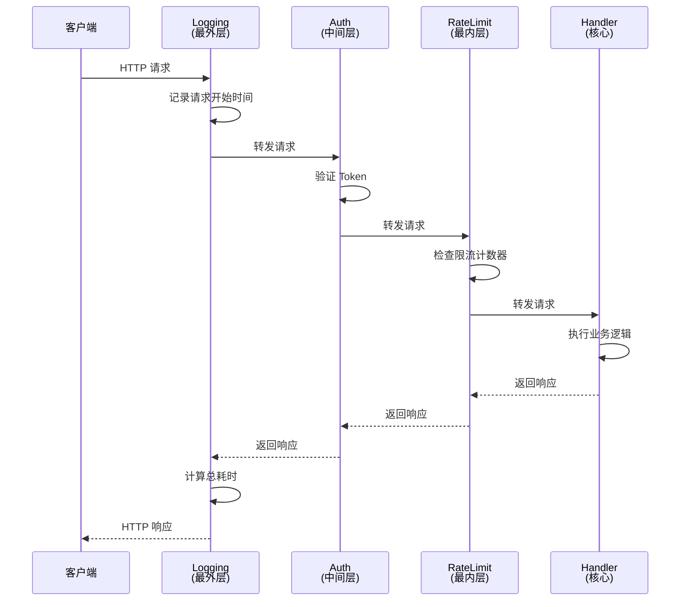

# HTTP 中间件模型与请求防御边界

**摘要：**

HTTP 中间件（Middleware）是 Go 标准库 `net/http` 提供的核心扩展机制，它允许开发者在不修改原有 Handler 逻辑的前提下，以函数组合的方式为请求处理链注入横切关注点（Cross-cutting Concerns）。本文从中间件的数学本质——洋葱模型（Onion Model）与函数组合子（Function Combinator）理论出发，剖析 `func(next http.Handler) http.Handler` 这一类型签名的同构特性，揭示中间件顺序即执行顺序的深层机制。随后聚焦 `http.ResponseWriter` 装饰器模式（Decorator Pattern）的代价：包装后对 `http.Hijacker`、`http.Flusher`、`http.Pusher` 等接口继承性的破坏，以及 Go 1.20 引入 `http.NewResponseController` 的修复路径。文章进一步展开防御性编程（Defensive Programming）的三个关键边界：`http.MaxBytesReader` 的请求体截断保护、严格反序列化（`json.Decoder.DisallowUnknownFields`、层级与大小限制）的输入验证、Panic 恢复屏障（Recover Middleware）与 `http.ErrAbortHandler` 的协作机制。最后讨论请求上下文（Request Context）的传递模型与中间件中的超时注入策略。

作为 [[Golang/Go网络编程与持久化/00 专栏导览|Go 网络编程与持久化]] 专栏的第二篇，本文建立在原生 HTTP 服务端架构的基础之上，深入探讨中间件这一核心扩展机制。通过本文，读者将理解中间件不仅是代码复用的工具，更是构建安全、可观测、可维护的 HTTP 服务的防御纵深。

---

## 第 1 章 洋葱模型：中间件的数学本质与组合代数

### 1.1 从管道到洋葱：函数组合子的类型同构

Go 的中间件设计深受函数式编程（Functional Programming）影响，其核心是一个简洁的类型签名：

```go
func(next http.Handler) http.Handler
```

这个签名的精妙之处在于，它接受一个 `http.Handler`，返回一个**新的** `http.Handler`。从范畴论（Category Theory）的视角看，中间件是一个**自同态映射（Endomorphism）**——它将 Handler 空间映射到自身，且保持组合结构不变。多个中间件的叠加，本质上是函数的复合（Composition）：

```go
// 三个中间件的组合
handler := LoggingMiddleware(AuthMiddleware(RateLimitMiddleware(finalHandler)))
```

这里的执行顺序并非从左到右，而是**从外到内**——Logging 包裹 Auth，Auth 包裹 RateLimit，RateLimit 包裹 finalHandler。请求像洋葱一样从外层进入，逐层穿过，到达核心 Handler 后再逐层返回响应。这种结构被形象地称为**洋葱模型（Onion Model）**。

> [!note] 洋葱模型的直观比喻
> 不妨设想一个俄罗斯套娃（Matryoshka Doll）。每个套娃代表一个中间件，请求从最外层套娃开始，逐层打开，直到触及最小的核心套娃（最终 Handler），然后再逐层合上。每个套娃可以在打开时做前置处理（譬如记录日志、验证权限），在合上时做后置处理（譬如统计耗时、注入响应头）。套娃的顺序决定了处理的顺序，但每个套娃都不知道其他套娃的存在——这正是关注点分离（Separation of Concerns）的精髓。

洋葱模型的概念并非 Go 首创。它源于 2000 年代中期的函数式 Web 框架社区，早期在 Haskell 的 WAI（Web Application Interface）和 Scala 的 Unfiltered 库中得到了系统性的阐述。Go 在 2009 年发布时，`net/http` 包的设计者 Russ Cox 借鉴了这一模型，将其简化为 `func(http.Handler) http.Handler` 的形式，避免了复杂的类型类（Type Class）系统，却保留了函数组合的全部数学性质。

### 1.2 中间件顺序即执行顺序：从左到右的外层优先

理解了洋葱模型，就能明白中间件的**顺序语义（Ordering Semantics）**。在典型的 Web 框架中，中间件列表通常按从左到右的顺序注册：

```go
mux.Use(LoggingMiddleware)
mux.Use(AuthMiddleware)
mux.Use(RateLimitMiddleware)
mux.Handle("/api", finalHandler)
```

当请求到达 `/api` 时，执行顺序是：Logging → Auth → RateLimit → finalHandler。Logging 是最外层，它最先看到请求，最后看到响应；RateLimit 是最内层中间件，它最后看到请求，最先看到响应。这种**外层优先（Outer-first）** 的语义意味着：

1. **前置处理的顺序**：外层中间件的预处理代码先执行。如果 Logging 在 Auth 外层，那么即使 Auth 失败，Logging 也会记录这次请求。
2. **后置处理的顺序**：外层中间件的后处理代码后执行。Logging 可以记录整个请求的总耗时，包括 Auth 和 RateLimit 的耗时。
3. **短路逻辑的位置**：如果某个中间件决定拒绝请求（譬如 Auth 验证失败），它可以直接返回响应，不再调用 `next.ServeHTTP`，从而阻断内层中间件和最终 Handler 的执行。

这种顺序语义并非 Go 独有，而是所有基于函数组合的中间件系统的共性。Express.js、Koa、Gin、Chi 都遵循类似的约定，只是语法糖的形式不同。



### 1.3 为什么需要中间件：横切关注点的解耦

中间件的出现不是偶然的，它解决的是一个经典的软件工程问题：**横切关注点（Cross-cutting Concerns）** 的模块化。

考虑一个典型的 HTTP 服务需要处理的职责：日志记录、认证授权、限流熔断、请求解压缩、CORS 处理、链路追踪、指标采集、Panic 恢复、超时控制。这些职责有两个共同特征：

1. **它们与业务逻辑正交**：无论 Handler 是处理订单创建还是用户查询，都需要记录日志、验证权限、统计指标。
2. **它们跨越多个 Handler**：如果把日志代码嵌入每个 Handler，会导致大量重复代码，且难以统一修改。

如果把业务逻辑比作剧院的主演，那么中间件就是舞台灯光、音响、字幕、安保——它们不参与剧情，但每场演出都不可或缺。把灯光师塞进演员的台词里，显然是荒谬的设计。

没有中间件的世界会怎样？假设我们要为 100 个 Handler 添加请求耗时统计，每个 Handler 都要在开头记录 `startTime`，在结尾计算 `duration` 并写入日志。如果某天需要把日志格式从 JSON 改为 Prometheus 指标，就要修改 100 处代码。更糟糕的是，如果某个 Handler 忘记写统计代码，就会产生监控盲区。中间件的价值在于**一次编写，处处生效**——只需一个 TimingMiddleware，所有 Handler 自动获得耗时统计能力。

这种解耦不是抽象的理论追求，而是工程实践的迫切需要。在大型微服务系统中，一个服务可能有数百个 API 端点，每个端点都需要统一的认证、日志、限流策略。如果这些逻辑分散在各个 Handler 中，修改一个全局策略（譬如从 JWT 切换到 OAuth 2.0）将是一场灾难。中间件提供了**策略与实现的分离**——策略在中间件中定义，实现在 Handler 中完成，两者通过清晰的接口协作。

### 1.4 函数组合的代数性质：结合律与恒等元

中间件的函数组合还满足重要的代数性质，这些性质保证了系统的可预测性：

**结合律（Associativity）**：中间件的组合顺序不影响最终结果，只要相对顺序不变。

```go
// 以下两种分组方式等价
handler1 := A(B(C(finalHandler)))
handler2 := (A ∘ B) ∘ C (finalHandler)  // 伪代码，表示先组合 A 和 B，再组合 C
```

这意味着我们可以灵活地组织中间件，不必担心括号的嵌套方式。在 Go 的标准库中，`http.ServeMux` 不直接支持中间件，但社区库（譬如 Chi、Gorilla Mux）提供了 `Use()` 方法，底层就是将中间件按顺序组合。

**恒等元（Identity）**：存在一个"什么都不做"的中间件，它只是透传请求和响应。

```go
func IdentityMiddleware(next http.Handler) http.Handler {
    return http.HandlerFunc(func(w http.ResponseWriter, r *http.Request) {
        next.ServeHTTP(w, r)
    })
}
```

插入或移除 IdentityMiddleware 不会改变行为。这个性质在测试和调试中很有用——可以用 IdentityMiddleware 临时替换某个中间件，而不破坏组合结构。

**零元（Zero Element）**：在某些情况下，中间件可以"短路"请求，不再调用 `next.ServeHTTP`。这种中间件相当于代数中的"零元"——它吸收了后续的请求处理。

```go
func AuthMiddleware(next http.Handler) http.Handler {
    return http.HandlerFunc(func(w http.ResponseWriter, r *http.Request) {
        if !isAuthenticated(r) {
            http.Error(w, "Unauthorized", http.StatusUnauthorized)
            return // 不调用 next.ServeHTTP，请求被吸收
        }
        next.ServeHTTP(w, r)
    })
}
```

这些代数性质不是数学游戏，它们保证了中间件系统的**可组合性（Composability）** 和**可替换性（Substitutability）**，使得复杂的请求处理链可以被分解为简单、可测试的单元。

### 1.5 中间件的历史演进：从 CGI 到 Go 的函数组合

中间件的概念可以追溯到早期的 Web 服务器架构。CGI（Common Gateway Interface，1993 年）时代，Web 服务器通过子进程调用外部程序处理请求，"中间件"主要是服务器本身的功能（譬如 Apache 的模块系统）。随着 FastCGI（1996 年）和应用服务器的兴起，中间件逐渐从服务器层下沉到应用层，成为应用框架的一部分。

Java 的 Servlet 规范（1997 年）引入了 Filter 的概念，这是现代中间件的雏形。Filter 通过 `doFilter(chain.doFilter)` 的模式实现了请求的链式处理，影响了后续几乎所有 Web 框架的设计。Python 的 WSGI（2003 年）通过 `__call__` 协议实现了类似的中间件模型。Ruby 的 Rack（2007 年）则通过 `call(env)` 返回 `[status, headers, body]` 的约定，提供了更灵活的中间件组合。

Go 的 `net/http` 在 2009 年设计时，选择了最简洁的中间件形式——`func(http.Handler) http.Handler`。这个签名没有复杂的协议，没有状态管理，纯粹是函数的组合。这种设计体现了 Go 的哲学：**简单优于复杂，显式优于隐式**。它要求开发者理解函数组合的本质，但也避免了框架魔法（Framework Magic）带来的认知负担。

### 1.6 标准库与框架的中间件实现对比

Go 标准库的 `http.ServeMux` 在 Go 1.22 之前不直接支持中间件（`Use()` 方法），开发者需要手动组合中间件：

```go
// Go 1.22 之前的手动组合
mux := http.NewServeMux()
mux.Handle("/api", LoggingMiddleware(AuthMiddleware(finalHandler)))
```

这种方式虽然繁琐，但提供了完全的控制权。Go 1.22（2024 年 2 月）引入了增强的路由功能，但 `http.ServeMux` 仍然没有内置的 `Use()` 方法。社区库（譬如 Chi、Gorilla Mux、Gin）提供了更友好的中间件 API：

```go
// Chi 框架的中间件支持
r := chi.NewRouter()
r.Use(LoggingMiddleware)
r.Use(AuthMiddleware)
r.Get("/api", finalHandler)
```

Chi 的实现本质上是将中间件按顺序组合，与手动组合的效果相同，但语法更简洁。这种"约定优于配置"的做法，降低了中间件的使用门槛，但也引入了框架依赖。

不同框架的中间件 API 看似不同，但底层都是 `func(http.Handler) http.Handler` 的组合。理解这个本质，就能在不同框架间无缝切换，而不必重新学习中间件的工作原理。这也是 Go 中间件模型的优雅之处——**底层统一，表层灵活**。

Gin 框架的中间件实现略有不同，它使用 `gin.HandlerFunc`（签名为 `func(*gin.Context)`）而非 `func(http.Handler) http.Handler`。这种设计提供了更丰富的 Context API，但也牺牲了与标准库的兼容性。开发者在选择框架时，需要权衡标准库兼容性与框架便利性之间的取舍。

---

## 第 2 章 ResponseWriter 的装饰器陷阱与接口继承性破坏

---

## 第 2 章 ResponseWriter 的装饰器陷阱与接口继承性破坏

### 2.1 装饰器模式的诱惑：拦截响应流

中间件最常见的诉求之一是**拦截和修改响应**：压缩响应体、注入安全头、统计响应大小、记录响应状态码。这些需求都要求中间件能够"包装"（Wrap）原始的 `http.ResponseWriter`。

Go 的 `http.ResponseWriter` 是一个接口：

```go
type ResponseWriter interface {
    Header() Header
    Write([]byte) (int, error)
    WriteHeader(statusCode int)
}
```

装饰器模式（Decorator Pattern）的做法是：创建一个结构体，内嵌原始的 `http.ResponseWriter`，然后重写需要拦截的方法。

```go
type statusRecorder struct {
    http.ResponseWriter
    statusCode int
}

func (r *statusRecorder) WriteHeader(code int) {
    r.statusCode = code
    r.ResponseWriter.WriteHeader(code) // 委托给原始 Writer
}

func StatusRecordingMiddleware(next http.Handler) http.Handler {
    return http.HandlerFunc(func(w http.ResponseWriter, r *http.Request) {
        recorder := &statusRecorder{ResponseWriter: w, statusCode: 200}
        next.ServeHTTP(recorder, r)
        log.Printf("Response status: %d", recorder.statusCode)
    })
}
```

这个模式看起来很优雅——`statusRecorder` 通过内嵌（Embedding）继承了 `ResponseWriter` 的所有方法，只需重写 `WriteHeader` 就能捕获状态码。但问题就隐藏在这个"继承"里。

内嵌（Embedding）在 Go 中是一种语法糖，它提供了"像继承一样"的行为，但语义上不同于面向对象语言中的继承。内嵌字段的类型信息在编译时被"扁平化"——`statusRecorder` 看起来有 `Header()`、`Write()`、`WriteHeader()` 方法，但这些方法实际上是委托给内嵌的 `ResponseWriter` 字段。这种委托在接口层面是不透明的。

### 2.2 类型断言的灾难：接口继承性的破坏

Go 的 `net/http` 包中，`http.ResponseWriter` 的实际实现（譬如 `*http.response`，一个未导出的类型）通常还实现了其他接口：

- `http.Hijacker`：支持 HTTP 升级（Upgrade），用于 WebSocket 连接。
- `http.Flusher`：支持流式响应，允许逐步发送数据。
- `http.Pusher`：支持 HTTP/2 服务器推送（Server Push）。
- `io.ReaderFrom`：支持 `io.Copy` 优化，直接从文件或 socket 发送数据。

这些接口是通过**类型断言（Type Assertion）** 在运行时检测的：

```go
// net/http 源码中的典型模式
if hj, ok := w.(http.Hijacker); ok {
    conn, bufrw, err := hj.Hijack()
    // ...
}
```

当中间件用 `statusRecorder` 包装了原始的 `ResponseWriter` 后，类型断言的行为发生了微妙的变化：

```go
func(w http.ResponseWriter, r *http.Request) {
    recorder := &statusRecorder{ResponseWriter: w}
    // 这里的 w 是原始 Writer，可能是 *http.response，实现了 Hijacker
    
    // 但在 Handler 内部：
    if hj, ok := w.(http.Hijacker); ok {
        // w 现在是 recorder，类型是 *statusRecorder
        // statusRecorder 没有显式实现 Hijacker 接口
        // 即使它内嵌的 ResponseWriter 可能实现了 Hijacker
        // 类型断言也会失败
    }
}
```

**这就是装饰器模式的代价：它破坏了接口继承性。** 内嵌的字段不会自动"转发"接口实现。即使 `statusRecorder` 内嵌的 `ResponseWriter` 是 `http.Hijacker`，`statusRecorder` 本身也不是 `http.Hijacker`——除非显式实现 `Hijack()` 方法。

这种破坏在实际场景中会导致严重的后果：

1. **WebSocket 升级失败**：如果中间件包装了 ResponseWriter，WebSocket 库的类型断言 `w.(http.Hijacker)` 会失败，导致握手无法完成。gorilla/websocket 库的早期版本就因此产生了大量 issue。
2. **流式响应失效**：Server-Sent Events（SSE）或大文件流式传输依赖 `http.Flusher`，包装后类型断言失败，导致响应被缓冲，内存暴涨。一个本应流式传输的 1GB 视频文件，可能被全部加载到内存中。
3. **HTTP/2 推送丢失**：`http.Pusher` 断言失败，服务器推送功能静默失效。客户端收不到预期的推送资源，页面加载性能下降。

> [!warning] 装饰器陷阱的严重性
> 这不是一个理论问题，而是 Go 社区中长期存在的痛点。Gin、Echo、Chi 等框架都提供过不同的解决方案，但标准库直到 Go 1.20 才给出官方的修复路径。在 Go 1.20 之前，开发者要么避免包装 ResponseWriter，要么为每种可能的接口组合编写包装器——这显然是不可维护的。一个典型的"完整"装饰器需要实现 6 个接口方法（`Hijack`、`Flush`、`Push`、`ReadFrom`、`CloseNotify`、`Unwrap`），代码量超过 100 行，且随着 Go 版本更新可能还需要添加新的接口方法。

### 2.3 Go 1.20 的救赎：http.NewResponseController

Go 1.20（2023 年 2 月）引入了 `http.NewResponseController`，提供了一个优雅的解决方案。其核心思想是：**不再依赖类型断言，而是通过统一的 API 访问可选接口。**

```go
func FlushingMiddleware(next http.Handler) http.Handler {
    return http.HandlerFunc(func(w http.ResponseWriter, r *http.Request) {
        // 不再需要类型断言 w.(http.Flusher)
        rc := http.NewResponseController(w)
        
        next.ServeHTTP(w, r)
        
        // 通过 ResponseController 调用 Flush
        err := rc.Flush()
        if err != nil {
            log.Printf("Flush failed: %v", err)
        }
    })
}
```

`http.ResponseController` 的工作原理是：它会**递归地解包（Unwrap）** 被装饰的 `ResponseWriter`，直到找到实现了目标接口的底层实现。

为了支持这种解包机制，装饰器必须实现一个特殊的方法：

```go
type statusRecorder struct {
    http.ResponseWriter
    statusCode int
}

// Unwrap 方法告诉 ResponseController 如何找到原始 Writer
func (r *statusRecorder) Unwrap() http.ResponseWriter {
    return r.ResponseWriter
}
```

`Unwrap()` 方法成为装饰器与 `ResponseController` 之间的契约。当调用 `rc.Flush()` 时，`ResponseController` 会检查 `w` 是否实现了 `http.Flusher`；如果没有，它会调用 `w.Unwrap()` 获取内层的 Writer，再次检查，直到找到实现或到达底层。

这种设计巧妙地解决了接口继承性问题：

1. **装饰器无需显式实现所有可选接口**：只需实现 `Unwrap()`，将接口检测委托给 `ResponseController`。
2. **支持多层装饰**：即使有多个中间件层层包装，`ResponseController` 也能穿透所有装饰器，找到底层实现。
3. **向后兼容**：旧的中间件如果没有实现 `Unwrap()`，`ResponseController` 会退化为普通的类型断言，不会崩溃。

> [!info] Unwrap 的设计哲学
> `Unwrap()` 方法的引入，体现了 Go 社区对"组合优于继承"原则的深化理解。内嵌（Embedding）虽然提供了语法上的便利，但它在接口层面的语义是不完整的——内嵌不会自动转发接口实现。`Unwrap()` 显式地表达了"我的底层实现"这一语义，使得装饰器链变得可观察、可穿透。这与 Go 的 `error` 接口在 1.13 引入 `Unwrap()` 是一脉相承的设计哲学——通过显式的接口方法，让包装结构变得可查询、可操作。

### 2.4 防御性装饰器的最佳实践

基于 Go 1.20 的 `ResponseController`，现代 Go 中间件的装饰器应遵循以下最佳实践：

1. **始终实现 `Unwrap()` 方法**：如果你的中间件需要包装 ResponseWriter，务必实现 `Unwrap()` 以支持接口穿透。
2. **优先使用 `ResponseController`**：在中间件中需要调用 `Flush()`、`Hijack()` 等方法时，使用 `http.NewResponseController(w)` 而非类型断言。
3. **最小化包装范围**：只在必要时包装 ResponseWriter。如果中间件只需要记录请求信息，不需要修改响应，就不要包装。
4. **测试装饰器的接口兼容性**：编写测试用例，验证包装后的 ResponseWriter 仍然支持 `Hijacker`、`Flusher` 等接口（通过 `ResponseController`）。

```go
// 推荐的装饰器实现
type responseRecorder struct {
    http.ResponseWriter
    statusCode int
    written    int64
}

func (r *responseRecorder) Unwrap() http.ResponseWriter {
    return r.ResponseWriter
}

func (r *responseRecorder) WriteHeader(code int) {
    if r.statusCode == 0 { // 防止多次调用
        r.statusCode = code
    }
    r.ResponseWriter.WriteHeader(code)
}

func (r *responseRecorder) Write(b []byte) (int, error) {
    n, err := r.ResponseWriter.Write(b)
    r.written += int64(n)
    return n, err
}
```

这种实现既保留了装饰器的功能，又维护了接口继承性，是 Go 1.20 之后的标准做法。值得注意的是，`responseRecorder` 没有显式实现 `Hijacker` 或 `Flusher` 接口，但通过 `Unwrap()` 方法，`ResponseController` 可以穿透装饰器，找到底层的实现。这种"延迟绑定"的策略，使得装饰器可以适应不同的底层 Writer 类型，而不必为每种类型编写专门的装饰器。

---

## 第 3 章 防御性编程边界：输入验证与请求体保护

### 3.1 不可信的网络：为什么需要防御性编程

HTTP 服务暴露在不可信的网络环境中，客户端发送的请求可能包含恶意构造的数据：超大请求体耗尽内存、畸形 JSON 触发解析器漏洞、未知字段隐藏攻击载荷。防御性编程（Defensive Programming）的核心原则是**不信任任何外部输入**，在数据进入业务逻辑之前，建立多层防御屏障。

这种原则不是偏执，而是工程实践的教训总结。2017 年的 Equifax 数据泄露事件，部分原因就是 Apache Struts 框架没有正确验证文件上传请求的大小和类型；2021 年的 Log4Shell 漏洞，则是因为日志库没有对输入字符串进行充分的转义和限制。这些事件提醒我们：**输入验证不是可选项，而是安全基线**。

中间件是实施防御性编程的理想位置——它在请求到达 Handler 之前执行，可以拦截、验证、修正甚至拒绝请求。这种**前置防御（Pre-emptive Defense）** 的好处是：

1. **统一执行**：所有请求都必须经过中间件，无法绕过。
2. **早期拦截**：在业务逻辑执行前就拒绝恶意请求，节省计算资源。
3. **关注点分离**：Handler 专注于业务逻辑，不必关心输入验证的琐碎细节。

本节将探讨三个关键的防御边界：请求体大小限制、严格反序列化、Panic 恢复屏障。这三个边界构成了 HTTP 服务的"防御纵深"——即使某一层被突破，后续层仍然能够提供保护。

### 3.2 http.MaxBytesReader：请求体的截断保护

HTTP 服务器面临的一个经典攻击是**大型请求体耗尽内存（Large Payload Attack）**。攻击者发送一个 `Content-Length` 声称很小、但实际 body 极大的请求，或者使用分块传输编码（Chunked Transfer Encoding）持续发送数据，导致服务器内存耗尽。这种攻击的成本极低——只需一个慢速网络连接和足够的时间——但危害极大，可能导致服务崩溃或触发垃圾回收风暴。

Go 的 `http.MaxBytesReader` 提供了一种优雅的解决方案：

```go
func UploadHandler(w http.ResponseWriter, r *http.Request) {
    // 限制请求体最大为 10MB
    r.Body = http.MaxBytesReader(w, r.Body, 10<<20)
    
    var data UploadData
    if err := json.NewDecoder(r.Body).Decode(&data); err != nil {
        if err.Error() == "http: request body too large" {
            http.Error(w, "Request too large", http.StatusRequestEntityTooLarge)
            return
        }
        http.Error(w, "Invalid request", http.StatusBadRequest)
        return
    }
    // 处理上传数据...
}
```

`MaxBytesReader` 的工作原理是：它包装原始的 `r.Body`（一个 `io.ReadCloser`），在读取时累计字节数。当累计字节数超过限制时，后续的 `Read()` 调用会返回错误，且 `http.Server` 会标记该连接为"请求体过大"，关闭连接。

但 `MaxBytesReader` 有几个容易被忽视的细节：

1. **错误检测**：`MaxBytesReader` 返回的错误不是标准的 `io.EOF`，而是一个特殊的错误类型。在 Go 1.19 之前，需要通过错误字符串匹配（如上例）；Go 1.19 引入了 `http.MaxBytesError` 类型，可以使用 `errors.As` 检测：

```go
var maxBytesErr *http.MaxBytesError
if errors.As(err, &maxBytesErr) {
    log.Printf("Request body exceeded limit: %d bytes", maxBytesErr.Limit)
}
```

2. **与 `Content-Length` 的关系**：`MaxBytesReader` 不依赖 `Content-Length` 头。即使客户端声称 `Content-Length: 100`，但如果实际发送了 100MB 数据，`MaxBytesReader` 仍然会在达到限制时截断。这是因为 `Content-Length` 可以被伪造，而 `MaxBytesReader` 基于实际读取的字节数。这种设计体现了"零信任"原则——不依赖客户端的声明，只信任实际的行为。

3. **对分块传输的限制**：对于使用 `Transfer-Encoding: chunked` 的请求，`MaxBytesReader` 同样有效。它会在累计读取超过限制后停止，即使客户端还在发送数据。这种一致性保证了无论使用哪种传输编码，服务器都能受到保护。

4. **中间件化**：可以将 `MaxBytesReader` 封装为中间件，统一保护所有 Handler：

```go
func MaxBodySizeMiddleware(maxSize int64) func(http.Handler) http.Handler {
    return func(next http.Handler) http.Handler {
        return http.HandlerFunc(func(w http.ResponseWriter, r *http.Request) {
            r.Body = http.MaxBytesReader(w, r.Body, maxSize)
            next.ServeHTTP(w, r)
        })
    }
}
```

这种中间件化的做法，使得请求体大小限制成为全局策略，而非个别 Handler 的责任。

> [!note] MaxBytesReader 的局限
> `MaxBytesReader` 提供的是**运行时截断保护**，而非**预先检查**。它不会在请求开始时就拒绝超大请求，而是在读取过程中逐步检查。这意味着服务器可能已经读取了部分数据（最多达到限制大小）才会触发错误。对于需要严格限制请求大小的场景（譬如防止磁盘耗尽），还需要结合 `http.Server.MaxHeaderBytes` 和反向代理层的限制。此外，`MaxBytesReader` 不检查请求头的数量（除了 `MaxHeaderBytes`），如果攻击者发送大量请求头（即使每个头都很小），也可能导致内存问题。因此，完整的防御策略需要多层协作。

### 3.3 严格反序列化：未知字段、层级与大小限制

JSON 是 Go Web 服务最常用的数据格式，但 `encoding/json` 的默认行为是**宽容的（Lenient）**：它会忽略未知的 JSON 字段，允许任意深度的嵌套，对字符串和数字的大小没有硬限制。这种宽容性在开发阶段很方便，但在生产环境中可能成为攻击面。

**未知字段攻击**：攻击者在 JSON 中插入业务逻辑不期望的字段，可能绕过验证逻辑、注入恶意数据或触发未预期的代码路径。Go 1.10（2018 年 2 月）引入了 `json.Decoder.DisallowUnknownFields()`，允许严格模式：

```go
func CreateUserHandler(w http.ResponseWriter, r *http.Request) {
    var user User
    decoder := json.NewDecoder(r.Body)
    decoder.DisallowUnknownFields() // 严格模式
    
    if err := decoder.Decode(&user); err != nil {
        var syntaxErr *json.SyntaxError
        var unmarshalTypeErr *json.UnmarshalTypeError
        var unknownFieldErr *json.UnknownFieldError // Go 1.10+
        
        switch {
        case errors.As(err, &syntaxErr):
            http.Error(w, "Invalid JSON syntax", http.StatusBadRequest)
        case errors.As(err, &unmarshalTypeErr):
            http.Error(w, "Type mismatch", http.StatusBadRequest)
        case errors.As(err, &unknownFieldErr):
            http.Error(w, "Unknown field: "+unknownFieldErr.Field, http.StatusBadRequest)
        default:
            http.Error(w, "Invalid request", http.StatusBadRequest)
        }
        return
    }
    // 处理用户创建...
}
```

这种严格模式的好处是：它强制客户端与服务端的"契约"保持一致。如果客户端发送了服务端不知道的字段，说明客户端可能使用了新版本的 API，或者存在 bug。通过拒绝未知字段，可以及早发现这些问题，避免它们在系统中潜伏并引发更严重的问题。

**层级深度限制**：深度嵌套的 JSON 可能导致栈溢出或解析器性能下降。虽然 Go 的 `encoding/json` 对嵌套深度有内部限制（默认 10000 层），但对于业务逻辑，通常需要在更小的范围内限制：

```go
// 自定义深度检查的 Reader
type depthLimitedReader struct {
    r     io.Reader
    depth int
    max   int
}

func (d *depthLimitedReader) Read(p []byte) (n int, err error) {
    // 统计 '{', '[', '}', ']' 等字符，超过限制时返回错误
    // 实现略...
    return d.r.Read(p)
}
```

这种自定义 Reader 的做法，可以在解析之前就限制 JSON 的复杂度，避免解析器陷入深度递归。

**大小限制**：除了 `MaxBytesReader` 的字节级限制，还可以对 JSON 的特定字段施加大小限制。譬如限制字符串字段的最大长度、数组的最大元素数：

```go
type User struct {
    Name    string   `json:"name"`    // 验证长度 <= 100
    Email   string   `json:"email"`   // 验证格式和长度
    Tags    []string `json:"tags"`    // 验证 len <= 10
}

func (u *User) Validate() error {
    if len(u.Name) > 100 {
        return errors.New("name too long")
    }
    if !isValidEmail(u.Email) {
        return errors.New("invalid email")
    }
    if len(u.Tags) > 10 {
        return errors.New("too many tags")
    }
    return nil
}
```

这种**多层防御（Defense in Depth）** 策略——字节级限制 + 结构级验证 + 业务级校验——确保即使某一层被绕过，后续层仍然能够拦截恶意数据。每一层都有其特定的保护目标：字节级限制防止内存耗尽，结构级验证防止格式攻击，业务级校验确保数据符合业务规则。

值得强调的是，严格反序列化不仅仅是安全措施，它还是**接口契约（Interface Contract）** 的体现。当客户端和服务端使用不同的 JSON 结构时，说明它们的"契约"已经不一致。这种不一致可能是由于版本升级、文档缺失或沟通不畅造成的。通过拒绝未知字段，可以及早发现并修复这些问题，避免它们在系统中积累并成为技术债务。

在实际项目中，严格反序列化的引入可能会遇到阻力——旧客户端可能发送多余的字段，直接开启严格模式会导致大量请求失败。渐进式的做法是：先在测试环境开启严格模式，统计未知字段的频率和分布；然后与客户端团队沟通，清理多余的字段；最后在生产环境逐步启用。这种**渐进式迁移（Progressive Migration）** 策略，在保证安全的同时，减少了对现有系统的冲击。

### 3.4 Panic 恢复屏障：recover 中间件与 http.ErrAbortHandler

Go 的 panic 机制在应用层是优雅的失败模式，但在 HTTP 服务中，未捕获的 panic 会导致整个 Goroutine 崩溃，如果 panic 发生在 `net/http` 的核心路径中，甚至可能导致服务器退出。这种故障模式在开发阶段可能不明显（因为开发者会关注日志），但在生产环境中，一个未捕获的 panic 可能导致服务不可用，影响用户体验和业务连续性。

**recover 中间件**是生产环境中的必备组件，它拦截 Handler 中的 panic，记录错误信息，返回 500 响应，防止服务崩溃：

```go
func RecoveryMiddleware(next http.Handler) http.Handler {
    return http.HandlerFunc(func(w http.ResponseWriter, r *http.Request) {
        defer func() {
            if err := recover(); err != nil {
                // 记录 panic 信息，包括堆栈
                log.Printf("Panic recovered: %v\n%s", err, debug.Stack())
                
                // 返回 500 响应
                http.Error(w, "Internal Server Error", http.StatusInternalServerError)
            }
        }()
        next.ServeHTTP(w, r)
    })
}
```

这个中间件的实现看似简单，但有几个关键的细节：

1. **defer 的位置**：`defer` 必须在函数开始时注册，确保无论 `next.ServeHTTP` 是否正常返回，`recover` 都会被调用。
2. **堆栈信息**：`debug.Stack()` 提供了 panic 发生时的完整调用栈，对于调试至关重要。在生产环境中，应该将这些信息写入日志系统，而不是返回给客户端（避免泄露敏感信息）。
3. **错误分类**：`recover()` 返回的 `err` 是 `any` 类型，需要类型断言或格式化来获取详细信息。

但 recover 中间件需要与 `http.ErrAbortHandler` 协作，才能正确处理**客户端主动断开**的场景。

当客户端在响应完成前关闭连接（譬如浏览器取消请求、网络中断），`net/http` 会触发 panic，错误类型是 `http.ErrAbortHandler`。这是一个**哨兵错误（Sentinel Error）**，表示"请求被中止，不应视为服务器错误"。如果 recover 中间件把它当作普通 panic 处理，会产生大量虚假的错误日志和 500 响应。

正确的做法是：recover 中间件应该检查 panic 的值，如果是 `http.ErrAbortHandler`，则不记录错误，不返回响应（因为连接已断开）：

```go
func RecoveryMiddleware(next http.Handler) http.Handler {
    return http.HandlerFunc(func(w http.ResponseWriter, r *http.Request) {
        defer func() {
            if err := recover(); err != nil {
                if err == http.ErrAbortHandler {
                    // 客户端断开，不记录错误，不返回响应
                    return
                }
                
                // 记录其他 panic
                log.Printf("Panic recovered: %v\n%s", err, debug.Stack())
                http.Error(w, "Internal Server Error", http.StatusInternalServerError)
            }
        }()
        next.ServeHTTP(w, r)
    })
}
```

> [!info] http.ErrAbortHandler 的设计意图
> `http.ErrAbortHandler` 的引入（Go 1.7，2016 年 8 月）解决了长期困扰 Go Web 开发者的"虚假 panic"问题。在 Go 1.7 之前，客户端断开连接会导致 `net/http` 内部 panic，recover 中间件会捕获并记录，产生大量噪音。`http.ErrAbortHandler` 提供了一种显式的信号机制，区分"真正的程序错误"和"正常的网络中断"。这种设计体现了 Go 的错误处理哲学：**用值而非控制流表示异常状态**。`http.ErrAbortHandler` 不是通过特殊的控制流（譬如 try-catch）来表示异常，而是通过一个普通的 panic 值，让 recover 中间件可以显式地识别和处理。

**recover 中间件的位置**：recover 中间件应该放在**最外层**（洋葱模型的最外圈），确保它能捕获所有内层中间件和 Handler 的 panic。如果放在内层，外层中间件的 panic 就无法被捕获。

```go
// 正确的中间件顺序
mux.Use(RecoveryMiddleware)       // 最外层：捕获所有 panic
mux.Use(LoggingMiddleware)        // 记录请求日志
mux.Use(AuthMiddleware)           // 验证权限
mux.Use(RateLimitMiddleware)      // 限流
mux.Handle("/api", finalHandler)  // 业务逻辑
```

这种顺序保证了即使 Logging、Auth 或 RateLimit 中间件发生 panic，Recovery 也能拦截。如果 Recovery 放在 Logging 内层，Logging 的 panic 就无法被捕获，可能导致服务崩溃。

### 3.5 输入验证的综合策略：从边缘到核心

防御性编程不是单一技术的堆砌，而是**分层策略（Layered Strategy）** 的协同。一个完整的输入验证链条可能如下：

1. **网络层**：反向代理（譬如 Nginx、Envoy）限制请求大小、连接速率、Header 数量。
2. **传输层**：`http.MaxBytesReader` 限制请求体大小。
3. **解析层**：`json.Decoder.DisallowUnknownFields()` 拒绝未知字段，限制嵌套深度。
4. **业务层**：结构体的 `Validate()` 方法检查字段格式、长度、范围。
5. **持久化层**：数据库约束（譬如 `NOT NULL`、`UNIQUE`、`CHECK`）作为最后防线。

每一层都有其特定的保护目标和局限性。网络层的限制是全局的，无法针对不同 API 端点做精细化控制；传输层的限制是字节级的，无法理解业务语义；解析层的限制是结构级的，无法验证业务规则；业务层的限制是逻辑级的，但可能因为代码缺陷而被绕过；持久化层的限制是物理级的，但错误信息对用户不够友好。

**纵深防御（Defense in Depth）** 的核心思想是：不依赖任何单一层，而是让多层协作，形成冗余保护。即使某一层被突破，后续层仍然能够提供保护。这种策略在安全领域被称为"瑞士奶酪模型"——每一层都像一片有孔的奶酪，单独一片无法完全阻挡威胁，但多层叠加就能覆盖所有的孔洞。

### 3.4 Panic 恢复屏障：recover 中间件与 http.ErrAbortHandler

Go 的 panic 机制在应用层是优雅的失败模式，但在 HTTP 服务中，未捕获的 panic 会导致整个 Goroutine 崩溃，如果 panic 发生在 `net/http` 的核心路径中，甚至可能导致服务器退出。这种故障模式在开发阶段可能不明显（因为开发者会关注日志），但在生产环境中，一个未捕获的 panic 可能导致服务不可用，影响用户体验和业务连续性。

**recover 中间件**是生产环境中的必备组件，它拦截 Handler 中的 panic，记录错误信息，返回 500 响应，防止服务崩溃：

```go
func RecoveryMiddleware(next http.Handler) http.Handler {
    return http.HandlerFunc(func(w http.ResponseWriter, r *http.Request) {
        defer func() {
            if err := recover(); err != nil {
                // 记录 panic 信息，包括堆栈
                log.Printf("Panic recovered: %v\n%s", err, debug.Stack())
                
                // 返回 500 响应
                http.Error(w, "Internal Server Error", http.StatusInternalServerError)
            }
        }()
        next.ServeHTTP(w, r)
    })
}
```

这个中间件的实现看似简单，但有几个关键的细节：

1. **defer 的位置**：`defer` 必须在函数开始时注册，确保无论 `next.ServeHTTP` 是否正常返回，`recover` 都会被调用。
2. **堆栈信息**：`debug.Stack()` 提供了 panic 发生时的完整调用栈，对于调试至关重要。在生产环境中，应该将这些信息写入日志系统，而不是返回给客户端（避免泄露敏感信息）。
3. **错误分类**：`recover()` 返回的 `err` 是 `any` 类型，需要类型断言或格式化来获取详细信息。

但 recover 中间件需要与 `http.ErrAbortHandler` 协作，才能正确处理**客户端主动断开**的场景。

当客户端在响应完成前关闭连接（譬如浏览器取消请求、网络中断），`net/http` 会触发 panic，错误类型是 `http.ErrAbortHandler`。这是一个**哨兵错误（Sentinel Error）**，表示"请求被中止，不应视为服务器错误"。如果 recover 中间件把它当作普通 panic 处理，会产生大量虚假的错误日志和 500 响应。

正确的做法是：recover 中间件应该检查 panic 的值，如果是 `http.ErrAbortHandler`，则不记录错误，不返回响应（因为连接已断开）：

```go
func RecoveryMiddleware(next http.Handler) http.Handler {
    return http.HandlerFunc(func(w http.ResponseWriter, r *http.Request) {
        defer func() {
            if err := recover(); err != nil {
                if err == http.ErrAbortHandler {
                    // 客户端断开，不记录错误，不返回响应
                    return
                }
                
                // 记录其他 panic
                log.Printf("Panic recovered: %v\n%s", err, debug.Stack())
                http.Error(w, "Internal Server Error", http.StatusInternalServerError)
            }
        }()
        next.ServeHTTP(w, r)
    })
}
```

> [!info] http.ErrAbortHandler 的设计意图
> `http.ErrAbortHandler` 的引入（Go 1.7，2016 年 8 月）解决了长期困扰 Go Web 开发者的"虚假 panic"问题。在 Go 1.7 之前，客户端断开连接会导致 `net/http` 内部 panic，recover 中间件会捕获并记录，产生大量噪音。`http.ErrAbortHandler` 提供了一种显式的信号机制，区分"真正的程序错误"和"正常的网络中断"。这种设计体现了 Go 的错误处理哲学：**用值而非控制流表示异常状态**。`http.ErrAbortHandler` 不是通过特殊的控制流（譬如 try-catch）来表示异常，而是通过一个普通的 panic 值，让 recover 中间件可以显式地识别和处理。

**recover 中间件的位置**：recover 中间件应该放在**最外层**（洋葱模型的最外圈），确保它能捕获所有内层中间件和 Handler 的 panic。如果放在内层，外层中间件的 panic 就无法被捕获。

```go
// 正确的中间件顺序
mux.Use(RecoveryMiddleware)       // 最外层：捕获所有 panic
mux.Use(LoggingMiddleware)        // 记录请求日志
mux.Use(AuthMiddleware)           // 验证权限
mux.Use(RateLimitMiddleware)      // 限流
mux.Handle("/api", finalHandler)  // 业务逻辑
```

这种顺序保证了即使 Logging、Auth 或 RateLimit 中间件发生 panic，Recovery 也能拦截。如果 Recovery 放在 Logging 内层，Logging 的 panic 就无法被捕获，可能导致服务崩溃。

---

## 第 4 章 请求上下文：超时注入与值传递的隐式契约

### 4.1 Context 的三重身份：取消信号、截止时间与值容器

Go 的 `context.Context` 在 HTTP 请求处理中扮演三重角色：

1. **取消信号（Cancellation Signal）**：当客户端断开连接或请求超时，`ctx.Done()` 通道关闭，通知所有依赖该 Context 的 Goroutine 退出。
2. **截止时间（Deadline）**：`ctx.Deadline()` 返回一个时间点，表示请求应该在何时完成。下游操作可以根据截止时间调整行为（譬如设置数据库查询超时）。
3. **值容器（Value Container）**：`ctx.Value(key)` 允许在请求生命周期内传递请求级别的数据（譬如用户 ID、请求 ID、追踪 Span）。

在中间件模型中，Context 是**请求生命周期**的载体。每个 HTTP 请求到达时，`net/http` 会创建一个 `context.Context`，附加到 `http.Request` 上：

```go
func Handler(w http.ResponseWriter, r *http.Request) {
    ctx := r.Context()
    // ctx 在请求完成或客户端断开时自动取消
}
```

中间件可以通过 `r.WithContext(ctx)` 创建新的请求，附带修改后的 Context：

```go
func TimeoutMiddleware(timeout time.Duration) func(http.Handler) http.Handler {
    return func(next http.Handler) http.Handler {
        return http.HandlerFunc(func(w http.ResponseWriter, r *http.Request) {
            ctx, cancel := context.WithTimeout(r.Context(), timeout)
            defer cancel() // 防止 Context 泄漏
            
            next.ServeHTTP(w, r.WithContext(ctx))
        })
    }
}
```

这种设计允许中间件**逐层注入超时**——外层中间件设置总超时，内层中间件设置子操作超时，形成**超时层次（Timeout Hierarchy）**。`defer cancel()` 的调用是必要的，因为 `context.WithTimeout` 会启动一个后台 Goroutine 监控超时，如果不调用 `cancel()`，这个 Goroutine 会泄漏，直到超时发生。

### 4.2 超时注入策略：从外层到内层的逐步收紧

超时不是单一的全局配置，而是**分层的、渐进的**。一个典型的超时层次可能如下：

1. **外层中间件**：设置整个请求的总超时（譬如 30 秒）。
2. **内层中间件**：设置特定操作的超时（譬如数据库查询 5 秒，外部 API 调用 10 秒）。
3. **Handler**：设置具体操作的超时（譬如单个 SQL 语句 2 秒）。

```go
func DatabaseQueryMiddleware(db *sql.DB) func(http.Handler) http.Handler {
    return func(next http.Handler) http.Handler {
        return http.HandlerFunc(func(w http.ResponseWriter, r *http.Request) {
            ctx := r.Context()
            
            // 为数据库操作设置超时
            queryCtx, queryCancel := context.WithTimeout(ctx, 5*time.Second)
            defer queryCancel()
            
            // 将带有超时的 Context 传递给 Handler
            next.ServeHTTP(w, r.WithContext(queryCtx))
        })
    }
}
```

这种**逐步收紧（Progressive Tightening）** 的策略有两个好处：

1. **资源保护**：即使某个子操作卡住，总超时仍然会终止整个请求，防止资源泄漏。
2. **精细控制**：不同操作可以有不同的超时策略，避免"一刀切"导致的误杀。

> [!note] 超时的嵌套语义
> `context.WithTimeout` 创建的子 Context 继承了父 Context 的截止时间，但会取两者的**较小值**。如果父 Context 在 10 秒后超时，子 Context 设置为 20 秒，实际超时仍然是 10 秒。这种语义保证了子操作不会超过父操作的生命周期，避免了"子超时比父超时还长"的荒谬情况。这种设计体现了 Go 的保守主义哲学：**宁可过早取消，不可无限等待**。

超时层次的设计需要谨慎。过短的超时会导致正常请求被误杀，过长的超时会导致资源浪费。一个经验法则是：**外层超时应该大于所有内层超时之和**，留有缓冲时间处理网络延迟和调度开销。

### 4.3 Context 值的隐式契约：类型安全与键冲突

`ctx.Value(key)` 是 HTTP 请求中传递数据的标准方式，但它有一个容易被忽视的问题：**键冲突（Key Collision）**。

`ctx.Value` 的签名是 `func(key any) any`，键和值都是 `any` 类型。如果两个包使用相同的字符串作为键（譬如 `"userID"`），它们的值会互相覆盖，导致难以调试的 bug。

Go 社区的最佳实践是：**使用未导出的类型作为键**。

```go
// 定义一个未导出的类型
type contextKey string

// 定义未导出的常量作为键
const userIDKey contextKey = "userID"

// 设置值
func SetUserID(ctx context.Context, userID string) context.Context {
    return context.WithValue(ctx, userIDKey, userID)
}

// 获取值
func GetUserID(ctx context.Context) (string, bool) {
    userID, ok := ctx.Value(userIDKey).(string)
    return userID, ok
}
```

这种设计利用了 Go 的类型系统：**即使另一个包也定义了 `contextKey("userID")`，由于类型未导出，它们在不同包中是不同的类型，不会冲突。** 这种做法在标准库中也得到了应用，譬如 `net/http` 使用 `http.serverContextKey` 作为内部 Context 值的键。

中间件是使用 Context 值的主要场景。譬如认证中间件在验证成功后，将用户 ID 注入 Context：

```go
func AuthMiddleware(next http.Handler) http.Handler {
    return http.HandlerFunc(func(w http.ResponseWriter, r *http.Request) {
        token := r.Header.Get("Authorization")
        userID, err := validateToken(token)
        if err != nil {
            http.Error(w, "Unauthorized", http.StatusUnauthorized)
            return
        }
        
        // 将 userID 注入 Context
        ctx := SetUserID(r.Context(), userID)
        next.ServeHTTP(w, r.WithContext(ctx))
    })
}
```

后续 Handler 可以从 Context 中取出 userID，而不必通过参数传递：

```go
func GetUserProfileHandler(w http.ResponseWriter, r *http.Request) {
    userID, ok := GetUserID(r.Context())
    if !ok {
        http.Error(w, "User ID not found in context", http.StatusInternalServerError)
        return
    }
    // 使用 userID 查询用户资料...
}
```

这种模式被称为**请求作用域值（Request-scoped Values）**，它是 Go 中传递请求级别数据的标准方式。但要注意，Context 值应该用于**元数据（Metadata）**——与请求相关但不属于业务参数的数据（譬如用户身份、请求 ID、追踪信息）。业务参数应该通过函数参数显式传递，避免过度依赖隐式的 Context 值。

### 4.4 取消传播与优雅降级

当客户端断开连接时，`r.Context()` 会被取消，`ctx.Done()` 通道关闭。中间件和 Handler 应该监听这个信号，及时终止耗时操作：

```go
func SlowOperationHandler(w http.ResponseWriter, r *http.Request) {
    ctx := r.Context()
    
    // 启动一个耗时操作
    resultCh := make(chan Result, 1)
    go func() {
        result, err := slowDatabaseQuery(ctx)
        if err != nil {
            // 检查是否因为 Context 取消
            if errors.Is(err, ctx.Err()) {
                return // 不发送结果，因为请求已取消
            }
            log.Printf("Query error: %v", err)
            return
        }
        resultCh <- result
    }()
    
    select {
    case result := <-resultCh:
        // 正常返回结果
        json.NewEncoder(w).Encode(result)
    case <-ctx.Done():
        // 客户端断开，不返回响应
        log.Printf("Request cancelled: %v", ctx.Err())
        return
    }
}
```

这种**取消传播（Cancellation Propagation）** 机制确保了当客户端不再需要响应时，服务器能够及时释放资源（数据库连接、CPU 时间、内存），避免资源浪费。

中间件在取消传播中扮演关键角色。譬如超时中间件在超时后取消 Context，触发所有下游操作的取消；认证中间件在认证失败后，可以直接返回响应，不再调用 `next.ServeHTTP`，从而阻止请求继续处理。

取消传播的正确实现需要遵循几个原则：

1. **及时响应取消信号**：长时间运行的操作（譬如数据库查询、HTTP 客户端调用）应该使用 `context.Context` 作为参数，并监听 `ctx.Done()` 通道。
2. **避免 Goroutine 泄漏**：启动 Goroutine 时，确保它们能够在 Context 取消时退出。可以使用 `select` 语句同时监听业务通道和 `ctx.Done()`。
3. **传播错误信息**：当操作因为 Context 取消而终止时，应该返回 `ctx.Err()`（譬如 `context.DeadlineExceeded` 或 `context.Canceled`），让调用者知道失败的原因。

### 4.5 Context 的常见误用与最佳实践

Context 的强大容易导致滥用。以下是几个常见的误用场景和对应的最佳实践：

**误用 1：将 Context 用于传递可选参数**

```go
// 错误示例：用 Context 传递可选参数
func QueryDatabase(ctx context.Context, query string) (*Result, error) {
    timeout, ok := ctx.Value("timeout").(time.Duration)
    if !ok {
        timeout = 5 * time.Second // 默认值
    }
    // 使用 timeout...
}
```

Context 应该用于传递**请求作用域的元数据**，而非函数参数。如果 `timeout` 是 `QueryDatabase` 的参数，应该通过函数签名显式传递：

```go
// 正确做法：通过函数参数传递
func QueryDatabase(ctx context.Context, query string, timeout time.Duration) (*Result, error) {
    // 使用 timeout...
}
```

这种显式传递的好处是：函数签名清晰地表达了依赖关系，调用者必须提供 `timeout`（即使是零值），编译器可以在编译期检查参数类型。

**误用 2：将 Context 存储在结构体中**

```go
// 错误示例：将 Context 存储在结构体中
type UserService struct {
    ctx context.Context // 危险：Context 的生命周期与结构体不匹配
    db  *sql.DB
}

func (s *UserService) GetUser(id int) (*User, error) {
    // 使用 s.ctx 可能导致 Context 已过期或泄漏
}
```

Context 应该作为函数的第一个参数传递，而非存储在结构体中。因为 Context 的生命周期通常与请求相关，而结构体的生命周期可能更长。将 Context 存储在结构体中，可能导致 Context 泄漏（如果结构体长期存活）或 Context 过期（如果请求已完成）。

**误用 3：在 Context 中存储大量数据**

```go
// 错误示例：在 Context 中存储大量数据
ctx = context.WithValue(ctx, "user", user)
ctx = context.WithValue(ctx, "permissions", permissions)
ctx = context.WithValue(ctx, "preferences", preferences)
ctx = context.WithValue(ctx, "session", session)
// ... 更多数据
```

Context 的值存储是**不可变的（Immutable）**——每次调用 `context.WithValue` 都会创建一个新的 Context，指向旧 Context 作为父节点。大量使用 `WithValue` 会导致 Context 链过长，增加内存占用和访问延迟。此外，Context 不是数据库，它应该只存储**轻量级的元数据**（譬如用户 ID、请求 ID），而非重量级的业务数据。

**最佳实践：Context 作为请求作用域的容器**

Context 的正确使用方式是：

1. **请求入口创建 Context**：`net/http` 自动为每个请求创建 Context，无需手动创建。
2. **中间件注入元数据**：认证中间件注入用户 ID，追踪中间件注入 Span ID，日志中间件注入 Request ID。
3. **Handler 读取元数据**：Handler 从 Context 中读取必要的元数据，用于业务逻辑。
4. **操作传递 Context**：数据库查询、HTTP 客户端调用等操作，将 Context 作为第一个参数传递，以支持取消和超时。

遵循这些最佳实践，Context 就能发挥其应有的价值——作为请求生命周期的载体，协调取消、超时和元数据传递。

---

## 第 5 章 边界与反例：中间件的适用前提与常见误区

---

## 第 5 章 边界与反例：中间件的适用前提与常见误区

### 5.1 中间件不是万能药：适用前提与局限

中间件的强大容易让人过度依赖，但它有明确的适用前提：

1. **横切关注点**：中间件适用于跨越多个 Handler 的通用逻辑。如果某个逻辑只与特定 Handler 相关（譬如订单创建的特殊验证），应该放在 Handler 内部，而非中间件。
2. **请求-响应模型**：中间件假设请求和响应是同步的。对于异步处理（譬如消息队列）、长连接（譬如 WebSocket）、流式响应（譬如 SSE），中间件的行为可能不符合预期。
3. **顺序敏感**：中间件的执行顺序很重要，错误的顺序会导致逻辑错误。譬如 Auth 中间件必须在业务逻辑之前执行，否则未认证的请求会到达 Handler。

**反例 1：中间件中的状态污染**

```go
// 错误示例：在中间件中共享状态
var requestCount int // 全局变量

func CountingMiddleware(next http.Handler) http.Handler {
    return http.HandlerFunc(func(w http.ResponseWriter, r *http.Request) {
        requestCount++ // 并发不安全
        next.ServeHTTP(w, r)
    })
}
```

中间件是并发执行的（每个请求一个 Goroutine），全局变量会导致竞态条件（Race Condition）。正确的做法是使用 `sync/atomic` 或 `sync.Mutex`：

```go
var requestCount atomic.Int64

func CountingMiddleware(next http.Handler) http.Handler {
    return http.HandlerFunc(func(w http.ResponseWriter, r *http.Request) {
        requestCount.Add(1)
        next.ServeHTTP(w, r)
    })
}
```

这种错误在单线程测试中不会出现，但在生产环境的高并发场景下会导致数据不一致。使用 `-race` 标志运行测试可以帮助发现这类问题。

**反例 2：过度包装 ResponseWriter**

```go
// 错误示例：多层装饰器导致接口丢失
func Middleware1(next http.Handler) http.Handler {
    return http.HandlerFunc(func(w http.ResponseWriter, r *http.Request) {
        w1 := &wrapper1{ResponseWriter: w}
        next.ServeHTTP(w1, r)
    })
}

func Middleware2(next http.Handler) http.Handler {
    return http.HandlerFunc(func(w http.ResponseWriter, r *http.Request) {
        w2 := &wrapper2{ResponseWriter: w} // w 已经是 wrapper1
        next.ServeHTTP(w2, r)
    })
}
```

如果 `wrapper1` 和 `wrapper2` 都没有实现 `Unwrap()` 方法，`http.ResponseController` 无法穿透包装，导致 `Hijacker`、`Flusher` 等接口失效。务必为每个装饰器实现 `Unwrap()`。

**反例 3：在中间件中修改请求体**

```go
// 错误示例：在中间件中读取并修改 r.Body
func BodyModificationMiddleware(next http.Handler) http.Handler {
    return http.HandlerFunc(func(w http.ResponseWriter, r *http.Request) {
        body, _ := io.ReadAll(r.Body)
        // 修改 body...
        r.Body = io.NopCloser(bytes.NewReader(body))
        next.ServeHTTP(w, r)
    })
}
```

`r.Body` 是一个 `io.ReadCloser`，只能读取一次。如果中间件读取了 body，Handler 就无法再读取。即使重新赋值 `r.Body`，也会丢失原始的流式特性（譬如大文件上传）。正确的做法是：如果必须修改 body，使用 `io.TeeReader` 或缓存到临时文件，但要谨慎处理内存和性能。

### 5.2 性能考量：中间件的代价

中间件不是免费的。每个中间件都会增加：

1. **函数调用开销**：每个中间件至少增加一次函数调用（`next.ServeHTTP`）。
2. **内存分配**：如果中间件创建了新的结构体（譬如装饰器），会增加垃圾回收压力。
3. **延迟**：中间件的逻辑（譬如数据库查询、外部 API 调用）会增加请求延迟。

在高性能场景中，应该：

- **最小化中间件数量**：只添加必要的中间件。
- **避免不必要的分配**：使用 `sync.Pool` 复用装饰器对象。
- **异步化耗时操作**：将日志写入、指标上报等操作放到后台 Goroutine。

```go
// 优化示例：使用 sync.Pool 复用装饰器
var recorderPool = sync.Pool{
    New: func() any {
        return &statusRecorder{}
    },
}

func StatusRecordingMiddleware(next http.Handler) http.Handler {
    return http.HandlerFunc(func(w http.ResponseWriter, r *http.Request) {
        recorder := recorderPool.Get().(*statusRecorder)
        recorder.ResponseWriter = w
        recorder.statusCode = 200
        defer recorderPool.Put(recorder)
        
        next.ServeHTTP(recorder, r)
        log.Printf("Status: %d", recorder.statusCode)
    })
}
```

这种优化减少了内存分配，但要注意 `sync.Pool` 的对象可能被清零，使用前要正确初始化。此外，`sync.Pool` 本身也有开销，只有在装饰器创建成本较高时才值得使用。

### 5.3 权衡取舍：因地制宜的设计

中间件模型的核心权衡在于**灵活性与复杂性的平衡**：

| 维度 | 优势 | 代价 |
|---|---|---|
| **代码复用** | 一次编写，处处生效 | 过度抽象可能导致逻辑分散 |
| **关注点分离** | Handler 专注于业务逻辑 | 中间件链过长时难以调试 |
| **顺序语义** | 明确的执行顺序 | 错误的顺序导致隐蔽的 bug |
| **装饰器模式** | 灵活的响应拦截 | 接口继承性破坏（Go 1.20 前） |
| **防御性编程** | 多层保护，早期拦截 | 过度防御可能影响性能 |
| **Context 传递** | 请求作用域值传递 | 隐式依赖，难以追踪 |

由此可见，中间件不是银弹。它适合处理横切关注点，但不适合承载复杂的业务逻辑。一个良好的中间件设计应该：

1. **职责单一**：每个中间件只做一件事。
2. **可组合**：中间件之间松耦合，可以灵活组合。
3. **可测试**：中间件可以独立测试，不依赖特定的 Handler。
4. **可观测**：中间件的行为可以被监控和调试。
5. **可替换**：中间件可以被轻松替换或禁用。

最终，中间件的价值在于**让 Handler 回归业务逻辑的本质**，把横切关注点交给专门的模块处理。但这种分离不是绝对的——当中间件变得过于复杂时，不妨重新审视：它是否应该成为 Handler 的一部分？当 Handler 变得过于臃肿时，不妨思考：它是否应该拆分为多个中间件？**因地制宜，而非教条主义**，才是架构设计的精髓。在 Go 的哲学中，简单的、显式的解决方案往往优于复杂的、隐式的方案。中间件模型提供了一个强大的工具，但如何使用这个工具，仍然需要开发者的判断力和工程智慧。

### 5.4 中间件测试策略：隔离与集成

中间件的测试是保证质量的关键环节。由于中间件的行为依赖于请求和响应的流动，测试时需要模拟 HTTP 请求和响应。Go 的 `net/http/httptest` 包提供了强大的测试工具：

```go
func TestLoggingMiddleware(t *testing.T) {
    handler := LoggingMiddleware(http.HandlerFunc(func(w http.ResponseWriter, r *http.Request) {
        w.WriteHeader(http.StatusOK)
        w.Write([]byte("OK"))
    }))
    
    req := httptest.NewRequest("GET", "/api", nil)
    rec := httptest.NewRecorder()
    
    handler.ServeHTTP(rec, req)
    
    if rec.Code != http.StatusOK {
        t.Errorf("Expected status 200, got %d", rec.Code)
    }
    // 验证日志输出...
}
```

`httptest.NewRequest` 创建了一个模拟的 HTTP 请求，`httptest.NewRecorder` 创建了一个模拟的 ResponseWriter，可以捕获响应内容。这种**隔离测试（Isolated Testing）** 的方式，可以验证单个中间件的行为，而不依赖真实的 HTTP 服务器。

对于复杂的中间件链，还需要**集成测试（Integration Testing）**，验证多个中间件的协作行为：

```go
func TestMiddlewareChain(t *testing.T) {
    mux := http.NewServeMux()
    mux.Use(RecoveryMiddleware)
    mux.Use(LoggingMiddleware)
    mux.Use(AuthMiddleware)
    mux.Handle("/api", finalHandler)
    
    req := httptest.NewRequest("GET", "/api", nil)
    req.Header.Set("Authorization", "Bearer invalid-token")
    rec := httptest.NewRecorder()
    
    mux.ServeHTTP(rec, req)
    
    if rec.Code != http.StatusUnauthorized {
        t.Errorf("Expected status 401, got %d", rec.Code)
    }
}
```

集成测试可以验证中间件的顺序、协作和边界情况，但它的调试成本更高——当测试失败时，需要定位是哪个中间件出了问题。因此，建议先编写隔离测试验证单个中间件，再编写集成测试验证整体行为。

### 5.5 中间件的演进：从同步到异步

传统的中间件模型是**同步的（Synchronous）**——请求从外层到内层逐层处理，响应从内层到外层逐层返回。这种模型简单直观，但在高并发场景中可能成为瓶颈——如果某个中间件执行耗时操作（譬如数据库查询），整个请求链都会被阻塞。

Go 1.21（2023 年 8 月）引入了 `slog` 包，提供了结构化的日志 API。一些高级中间件开始探索**异步处理（Asynchronous Processing）** 的模式——将耗时操作（譬如日志写入、指标上报）放到后台 Goroutine，避免阻塞请求处理：

```go
func AsyncLoggingMiddleware(next http.Handler) http.Handler {
    return http.HandlerFunc(func(w http.ResponseWriter, r *http.Request) {
        start := time.Now()
        
        next.ServeHTTP(w, r)
        
        // 异步写入日志
        go func() {
            duration := time.Since(start)
            slog.Info("Request completed",
                "method", r.Method,
                "path", r.URL.Path,
                "duration", duration,
            )
        }()
    })
}
```

这种异步模式的好处是减少了请求延迟，但代价是增加了复杂性——后台 Goroutine 的生命周期需要管理，日志的顺序可能乱序，错误处理更加困难。是否使用异步模式，需要根据具体的性能需求和系统复杂度权衡。

由此可见，中间件模型本身也在不断演进。从同步到异步，从简单组合到复杂协调，中间件的设计需要平衡性能、复杂性和可维护性。没有银弹，只有**因地制宜的权衡取舍**——这正是工程设计的精髓所在。在 Go 的生态中，中间件模型已经证明了自己的价值，但它的未来仍然取决于开发者的创造力和判断力。

回顾全文，中间件的核心价值在于提供了一个**可扩展的、分层的请求处理框架**。它允许开发者以声明式的方式组织横切关注点，以组合式的方式构建复杂的请求处理链。但这种强大也伴随着责任——开发者需要理解中间件的数学本质、接口继承性的陷阱、防御性编程的边界、Context 的隐式契约，以及性能与复杂性的权衡。只有深入理解这些机制，才能在实践中做出明智的设计决策，构建出既安全又高效的 HTTP 服务。这正是 Go 中间件模型的魅力所在——它简单而不简陋，强大而不复杂，为开发者提供了充分的表达空间，同时保持了代码的可读性和可维护性。

---

## 参考资料

1. Go 官方文档. net/http. https://pkg.go.dev/net/http
2. Go 1.20 Release Notes. https://go.dev/doc/go1.20
3. Andrew Gerrand. Go 1.7 Release Notes. https://go.dev/doc/go1.7
4. Rob Pike. Go at Google: Language Design in the Service of Software Engineering. 2012
5. Russ Cox. HTTP/2 Server Push. https://go.dev/blog/h2push
6. Go Wiki. HTTP Middleware. https://go.dev/wiki/HTTP-Middleware
7. Phil Cousineau. Go Middleware Patterns. 2016
8. Google. Dapper: Large-Scale Distributed Systems Tracing. 2010

---

> [!note] 思考题
> 1. 如果一个中间件在调用 `next.ServeHTTP` 之前 panic，recover 中间件能否捕获？如果 panic 发生在 `next.ServeHTTP` 之后呢？
> 2. `http.ResponseController` 的 `Unwrap()` 机制如何处理多层装饰器？如果某一层没有实现 `Unwrap()`，会发生什么？
> 3. 在设计中间件时，如何权衡"前置防御"与"性能开销"？是否存在中间件数量过多导致性能下降的临界点？
> 4. Context 值传递的隐式依赖是否违反了"显式优于隐式"的原则？在什么场景下，使用 Context 值比函数参数更合适？
