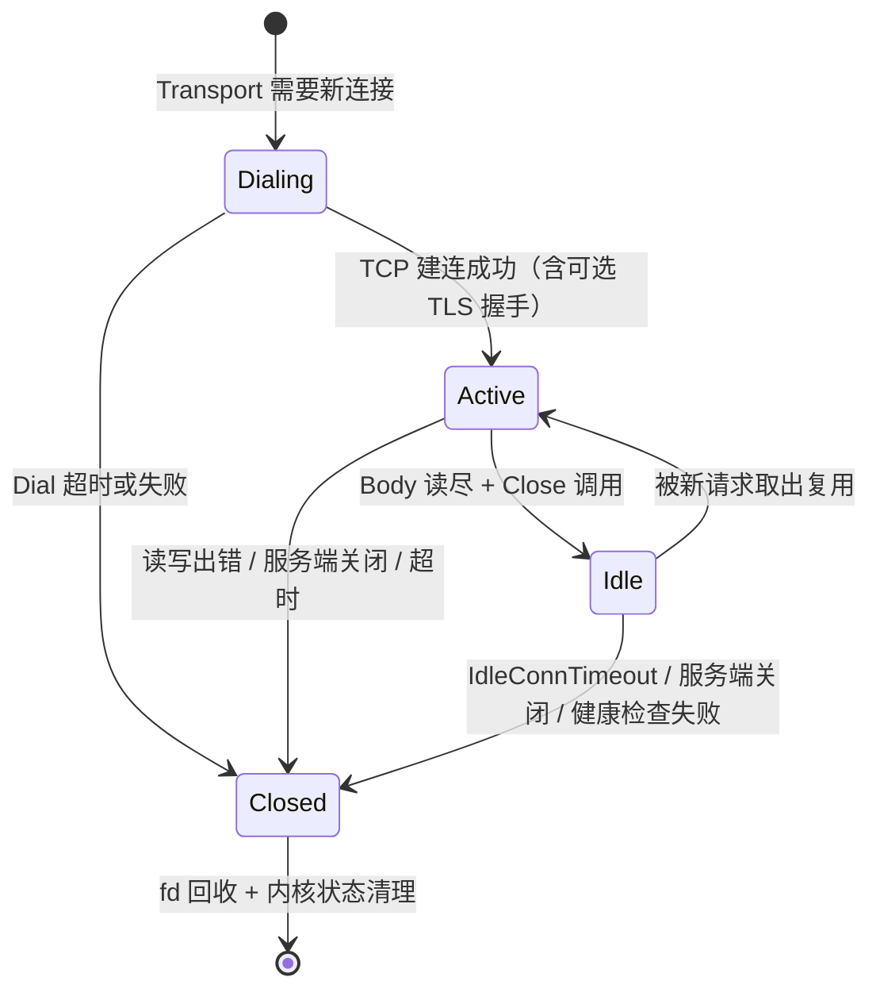
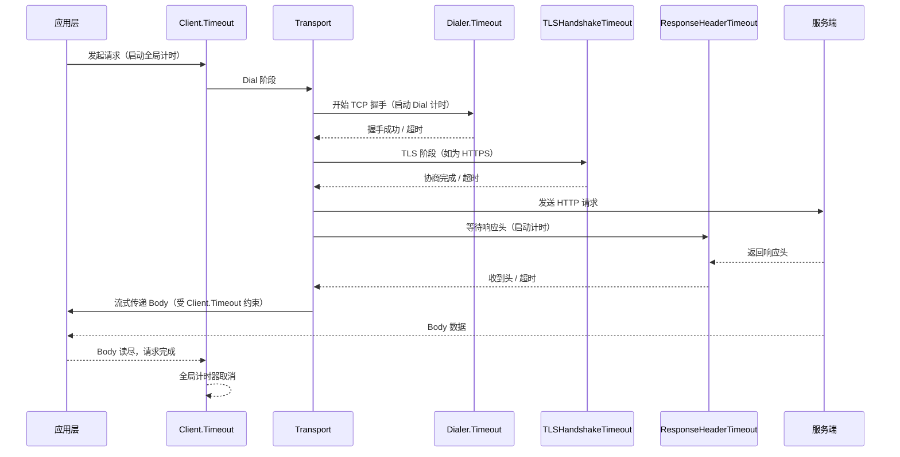

# HTTP 客户端连接池物理生命周期与超时阶梯

**摘要：**

在微服务架构中，一个 Go 服务每秒可能向下游发出数万次 HTTP 请求；如果每次请求都新建一条 TCP 连接，那么仅三次握手与端口分配就足以把服务推向性能悬崖。连接池正是为解决这一问题而诞生——它在进程内维护一组已经建好的 TCP 连接，让后续请求复用已有连接，从而省去反复握手、反复分配临时端口的开销。但连接池并不是"建好就不管"的静态缓存，它所持有的每一条连接都是一份有物理生命周期的操作系统资源：它可能因为对端静默关闭而成为半死连接，可能因为 Body 未被读尽而无法归还池中，也可能因为超时设置不当而在客户端侧堆积出数以万计的 TIME_WAIT，最终导致端口耗尽。本文从一条 TCP 连接在 HTTP/1.1 Keep-Alive 模式下的物理过程讲起，逐层拆解 `http.Transport` 的连接池模型、连接泄漏的三条典型路径、端口耗尽的成因与缓解手段，以及阶梯式超时防御的配置哲学。文章最后讨论一个常被忽略的反面——连接复用本身对负载均衡的冲击，以及在"复用效率"与"流量均匀分布"之间必须做出的工程取舍。

---

## 第 1 章 从逐请求建连到连接复用

### 1.1 HTTP/1.0 的短连接模型

HTTP 协议最初被设计为一种"请求—响应—断连"的无状态协议。在 HTTP/1.0 的默认行为中，客户端为每一个请求建立一条新的 TCP 连接，服务端在发送完响应后主动关闭连接，整个生命周期可以用四个阶段概括：DNS 解析、TCP 三次握手、HTTP 请求与响应、TCP 四次挥手。对于一个包含 10 个资源的网页，这意味着 10 次完整的握手与挥手过程——仅握手与挥手就引入了至少 10 个 RTT（Round-Trip Time）的额外延迟，若考虑慢速网络或跨洲际链路，这部分延迟足以占据首屏加载时间的一半以上。

这种"用完即弃"的模型之所以在早期 Web 可行，是因为彼时的页面资源稀少，且服务端需要应对的并发连接数有限——关闭连接可以尽快释放服务端的文件描述符和内存资源。但随着 Web 应用复杂度的增长，短连接模型的两个缺陷变得不可忍受：其一，**握手延迟的累积效应**让页面加载性能急剧下降；其二，**频繁建连对服务端资源的消耗**在高并发场景下形成瓶颈，每一条新建连接都要分配一个 `sock` 结构、消耗一份内核内存，并在端口空间中占据一个临时端口。正如我们在 [[Linux/网络协议栈与IO/00 专栏导览|网络协议栈与 IO]] 专栏中所讨论的，一条 TCP 连接在内核中的资源占用远不止一个文件描述符——它还包括发送缓冲区、接收缓冲区、TCP 控制块（`struct tcp_sock`）以及可能的安全关联（security association），这些资源的总开销在数百字节到数 KB 之间。

### 1.2 HTTP/1.1 Keep-Alive 与连接复用

1997 年发布的 RFC 2068（HTTP/1.1）将 **持久连接（Persistent Connection）** 确立为默认行为，也即 Keep-Alive 机制。其核心思想并不复杂：在一次 TCP 连接上连续发送多个 HTTP 请求与响应，而非每次请求都重新握手。客户端在请求头中加上 `Connection: keep-alive`（在 HTTP/1.1 中这已是默认值，无需显式声明），服务端在响应完成后不关闭连接，而是将其保持在 ESTABLISHED 状态，等待客户端的下一个请求。

这就像一个经常光顾同一咖啡馆的顾客与咖啡师之间形成的默契——第一次点单时需要互相认识、确认口味偏好（三次握手），此后每次光临只需报出常喝的品种即可直接取走咖啡，不必重复自我介绍。当然，如果顾客很长时间不再光顾，咖啡师也不会无限期地等待——他会设定一个合理的等待时长，超时后将这位"熟客记忆"释放，把精力留给新客人。HTTP Keep-Alive 中的 `Keep-Alive: timeout=5, max=100` 头（由服务端发出）扮演的正是这个角色：`timeout` 是服务端愿意闲置等待的秒数，`max` 是该连接上允许复用的最大请求次数。

不过，HTTP 层面的 Keep-Alive 只是一个协议级的"建议"——它告诉对方"我希望复用这条连接"，但连接能否真正复用、复用多久、何时回收，取决于客户端连接池的实现策略以及操作系统 TCP 栈的状态管理。在 Go 的标准库中，这一整套物理过程被封装在 `http.Transport` 之中。

### 1.3 HTTP Pipelining 与头部阻塞

HTTP/1.1 还引入了 **管线化（Pipelining）** 的概念——允许客户端在收到前一个响应之前发送下一个请求，从而减少等待 RTT 的次数。然而管线化在实践中几乎从未被广泛启用，因为它引入了一个棘手的**头部阻塞（Head-of-Line Blocking）**问题：服务端必须按照请求的到达顺序依次返回响应，即使后面的请求处理得更快，也必须等待前面的响应发送完毕。这意味着一个慢请求会阻塞其后所有请求的响应返回，性能收益极为有限，反而增加了实现复杂度。大多数浏览器和 HTTP 客户端库在默认配置下都禁用了管线化——Chrome 在 2013 年前后、Firefox 在 2017 年前后相继关闭了这一特性。

HTTP/2 通过多路复用（Multiplexing）从根本上解决了这个问题——多个请求可以在同一条连接上并行传输响应，互不阻塞。但这是第 7 章讨论连接复用与负载均衡矛盾时的重要背景，在此先做铺垫。

从连接复用的演进脉络来看，HTTP 协议经历了三个清晰的阶段：HTTP/1.0 的"一请求一连接"（短连接），到 HTTP/1.1 的"多请求一连接"（持久连接），再到 HTTP/2 的"多请求并行一连接"（多路复用）。每一个阶段都在试图解决上一阶段遗留的延迟问题——但每一个阶段的解决方案都引入了新的工程挑战。连接池的概念贯穿这三个阶段：在 HTTP/1.1 下，连接池管理一组持久连接，每个连接串行处理请求；在 HTTP/2 下，连接池管理的连接数大幅减少（因为每条连接可以并行处理数千个请求），但每条连接内部的状态管理更加复杂。

### 1.4 为什么需要理解物理过程

许多 Go 开发者在使用 `http.Client` 时只关心 `Timeout` 一个字段，甚至直接依赖 `http.DefaultClient` 发起所有请求——这在低流量场景下不会暴露任何问题，但在生产级流量下却可能引发一系列看似毫无关联的故障：连接数持续攀升却不下降、`dial tcp: cannot assign requested address` 报错、请求偶尔超时但服务端日志一切正常。这些故障的共同根源是客户端对连接池中每条连接的**物理生命周期**缺乏感知——它何时建立、何时空闲、何时被关闭、关闭后在内核中进入什么状态。

理解这些物理过程的价值在于：当线上出现问题时，开发者能够从操作系统层面定位原因，而不是仅仅在应用层反复猜测。这正是本文要展开的主线——从一条 TCP 连接的诞生到消亡，再到连接池的复用策略与超时阶梯。

---

## 第 2 章 一条连接的物理生命周期

### 2.1 连接的建立：从 Dial 到 Ready

当 `http.Transport` 决定为某个请求创建一条新连接时，它经历以下步骤：

1. **DNS 解析**：将目标域名转换为 IP 地址列表。Go 的 `net.Resolver` 默认使用系统的 `getaddrinfo`（通过 cgo 或纯 Go 实现），解析结果会被缓存在进程内，缓存 TTL 由操作系统决定（在 Linux 上通常受 `nscd` 或 `systemd-resolved` 控制）。在 Go 1.20 之后，`net.Resolver` 的行为更加可预测，但在高并发场景下，DNS 解析仍然可能成为瓶颈——特别是当目标域名的 TTL 很短、且 DNS 服务器响应较慢时。一种常见的优化是在 `DialContext` 中引入本地 DNS 缓存（譬如使用 `github.com/rs/dnscache`），避免每次新建连接都触发一次外部 DNS 查询。
2. **TCP 三次握手**：`net.Dialer` 调用 `socket()` → `connect()`，内核发送 SYN，等待 SYN-ACK，发送 ACK。`Dialer.Timeout` 覆盖整个 Dial 过程（含 DNS 与握手），默认值为 0（即无超时，由操作系统 TCP 栈的 SYN 重传策略决定，Linux 上约 13-30 秒）。在高延迟网络中，这一默认值可能导致大量 Goroutine 长时间阻塞在 Dial 阶段。
3. **TLS 握手（若为 HTTPS）**：在已建立的 TCP 连接之上进行 TLS 协商。`Transport.TLSHandshakeTimeout` 控制这一阶段的超时，默认值 10 秒。TLS 1.3 只需 1-RTT，TLS 1.2 需要 2-RTT，加上证书验证和可能的 OCSP Stapling 查询，握手时间可能显著高于 TCP 握手。值得一提的是，TLS 1.3 引入了 **Session Resumption（会话恢复）** 机制，允许客户端和服务端在之前建立的会话基础上快速恢复加密通道，省去完整的证书交换与密钥协商过程。Go 的 `tls.Config` 通过 `SessionTicketsDisabled` 和 `ClientSessionCache` 控制这一行为——启用 Session Resumption 可以显著降低 HTTPS 建连的延迟，但也会引入会话票据安全性方面的考量。
4. **连接就绪**：TCP 连接进入 ESTABLISHED 状态，可以开始发送 HTTP 请求。

上述过程的每一步都可能失败，而**超时配置的阶梯性**正是为了在每一层都设置合理的等待上界——这一点将在第 6 章详细展开。

### 2.2 连接的使用与状态迁移

一条连接在其生命周期中，在连接池内部经历三种逻辑状态：

- **空闲（Idle）**：连接已建立，当前没有被任何请求占用，静置在池的空闲队列中等待下一次被取出复用。
- **活跃（Active）**：连接正在被某个请求使用，正在发送请求体或接收响应体。
- **已关闭（Closed）**：连接已被任一方关闭（客户端主动关闭、服务端发送 `Connection: close`、超时触发、读取错误），对应的文件描述符已关闭或正在关闭。

连接在状态之间的迁移由事件驱动：空闲连接被请求取出后转为活跃；活跃连接上的请求完成后（响应体被完全读取且 `resp.Body.Close()` 被调用），连接回到空闲状态；若在此期间检测到错误，连接直接转入关闭状态。



这张状态图的关键信息在于：**从 Active 到 Idle 的路径有一条严格的前提条件**——响应体必须被完全读尽且 `resp.Body.Close()` 必须被显式调用。如果这两个条件之一不满足，连接就无法回到空闲队列供后续请求复用，而是直接被丢弃并关闭。这是 Go HTTP 客户端最常见的连接泄漏路径之一，将在第 4 章详细分析。

### 2.3 连接的对端关闭与半死连接

一个常被忽视的物理事实是：TCP 连接的关闭是**异步的、非对称的**。当服务端因为自身的 Keep-Alive 超时（譬如 nginx 默认的 `keepalive_timeout 75s`）而关闭连接时，它会向客户端发送 FIN 包，客户端内核将连接的 TCP 状态从 ESTABLISHED 转为 CLOSE_WAIT。但此时客户端应用层（也即连接池）可能尚未感知到这一事件——FIN 包只是静静地躺在内核的接收缓冲区中，等待应用层下一次 `read()` 时返回 0（EOF）。

如果连接池在这期间将这条连接取出并尝试发送新请求，那么第一次 `write()` 可能成功（因为 FIN 是单向的，对端仍可接收数据，直到对端也收到 RST 或自身的 FIN），但随后的 `read()` 会返回错误。更糟糕的情况是，如果对端已经完成了完整的四次挥手（即对端在发送 FIN 后也收到了客户端的 ACK 并关闭了连接），客户端的 `write()` 会触发 RST，请求直接失败。

这种"连接池中的死连接"在生产环境中并不罕见，尤其是在服务端 Keep-Alive 超时时间短于客户端 `IdleConnTimeout` 的场景下——服务端已经关闭了连接，但客户端的连接池尚未将其清理。Go 的 `http.Transport` 对此的应对策略是：在从池中取出一条空闲连接时，使用一个内部方法（`readLoop` 和 `writeLoop` 的 Goroutine 协作）检测连接的健康状态——如果 `readLoop` Goroutine 已经因为 EOF 而退出，连接会被立即丢弃并创建新连接。这种机制并非完美——它无法捕获到所有半死连接（譬如连接恰好在检测通过后、请求发送前断开），但在绝大多数情况下能有效避免使用死连接。

与连接池物理过程相关的另一个重要话题是 Goroutine 的调度模型——每个持久化连接在 Go 内部都由一对 Goroutine（`readLoop` 和 `writeLoop`）维护，这两个 Goroutine 在连接空闲时会被 netpoller 挂起（参见 [[Golang/Go并发编程/12 Go 网络编程——netpoller 与 Goroutine-per-Connection]]），不消耗 CPU 资源，但确实占用内存——每条连接的 readLoop + writeLoop 大约消耗 4-8 KB 的 Goroutine 栈空间。当连接池中有数千条空闲连接时，这些 Goroutine 的内存开销也不可忽视。

---

## 第 3 章 Transport 连接池模型

### 3.1 池的核心参数

`http.Transport` 是 Go HTTP 客户端的核心引擎——它管理连接池、处理重试、控制超时、执行 TLS 协商。连接池的行为由以下几个关键参数决定：

| 参数 | 默认值 | 含义 |
|---|---|---|
| `MaxIdleConns` | 100 | 整个 Transport 实例中，**所有主机合计**的最大空闲连接数 |
| `MaxIdleConnsPerHost` | 2 | **单个主机**的最大空闲连接数。若为 0，则使用 `DefaultMaxIdleConns`（值为 2） |
| `MaxConnsPerHost` | 0（无限制） | 单个主机的**总连接数**上限（含空闲与活跃），0 表示不限制 |
| `IdleConnTimeout` | 90s | 空闲连接在池中的最长存活时间，超时后被关闭 |
| `DisableKeepAlives` | false | 若为 true，则每个请求完成后立即关闭连接，不复用 |

这组参数中，**最容易被误用的是 `MaxIdleConnsPerHost`**。它的默认值是 2，意味着对于同一个目标主机，连接池中最多保留 2 条空闲连接。如果你的服务向单个下游实例发送高并发请求（譬如每秒 5000 次），那么在任何时刻，池中最多只有 2 条空闲连接——其余请求完成后，多余的空闲连接会被立即关闭，下次请求又不得不重新建连。这不仅违背了连接池的初衷，还会因频繁建连而增加延迟和端口消耗。

### 3.2 MaxIdleConns 与 MaxIdleConnsPerHost 的交互

理解这两个参数的交互关系需要建立一个心智模型：连接池对每个主机维护一个独立的空闲连接队列，而 `MaxIdleConnsPerHost` 限制的是每个队列的长度，`MaxIdleConns` 限制的是所有队列长度之和的上界。当某个请求完成、连接试图归还池中时，Transport 依次检查：

1. 该主机的空闲连接数是否已达 `MaxIdleConnsPerHost`？若是，连接被关闭而非入池。
2. 全部主机的空闲连接总数是否已达 `MaxIdleConns`？若是，连接被关闭。
3. 两个条件都不满足，连接进入空闲队列，等待被后续请求复用。

这意味着 `MaxIdleConnsPerHost` 是更精细的控制维度——它决定了每个目标主机在连接池中的"配额"。如果你向 10 个不同的下游服务发送请求，每个服务部署了 3 个实例（共 30 个主机），那么要确保连接复用生效，`MaxIdleConnsPerHost` 至少应设为一个合理的值（譬如 10-50），同时 `MaxIdleConns` 应不小于 `MaxIdleConnsPerHost × 主机数`（即 300-1500）。

> [!warning] 默认配置下的陷阱
> 使用 `http.DefaultTransport`（或零值 `Transport`）时，`MaxIdleConnsPerHost` 为 2。对于微服务间高频调用的场景，这一默认值几乎必然导致连接复用不足——大量请求被迫重新建连，端口消耗飙升，延迟抖动加剧。**生产环境中的 HTTP 客户端应当始终显式构造 `Transport` 并根据流量特征调参。**

### 3.3 DisableKeepAlives 与 ForceAttemptHTTP2

当 `DisableKeepAlives` 被设置为 `true` 时，Transport 会在每个请求的头部加入 `Connection: close`，告知服务端本次请求完成后关闭连接。这种模式适用于极少数场景——譬如你确定每个请求的目标主机都不同，或者你希望每次请求都获得一条"新鲜"的连接以避免长连接的潜在问题（譬如某些负载均衡器在长连接上不再重新分配后端）。但在绝大多数场景下，关闭 Keep-Alive 是一个性能负优化——它放弃了连接复用带来的全部收益。

另一个值得关注的参数是 `ForceAttemptHTTP2`（Go 1.13 引入）。当 Transport 配置了 TLS 且该字段为 `true` 时，即使在 TLS ALPN 协商中服务端不支持 HTTP/2，Transport 也不会回退到 HTTP/1.1——它会强制尝试 HTTP/2。在 HTTP/2 下，单条 TCP 连接上可以复用多个请求（多路复用），因此 `MaxIdleConnsPerHost` 的意义发生了根本变化——你不再需要为每个并发请求保留一条独立的空闲连接，因为一条 HTTP/2 连接就能承载所有请求。这一差异在第 7 章讨论连接复用与负载均衡的矛盾时会再次出现。

### 3.4 连接池的内部实现细节

在 Go 的源码中，`http.Transport` 的连接池由一个名为 `idleConnCache` 的 map 维护，其键为 `addr`（目标主机地址的字符串表示），值为一个 `*persistConn` 的切片——也即每个主机对应一个空闲连接队列。当一个请求完成、连接试图归还池中时，Transport 调用内部方法 `putIdleConn`，该方法依次执行以下检查：

1. 该主机的空闲连接切片长度是否已达 `MaxIdleConnsPerHost`？
2. 全部主机的空闲连接总数是否已达 `MaxIdleConns`？
3. 连接是否仍处于健康状态（未被关闭、未发生错误）？

任何一项检查失败，连接都会被直接关闭（调用 `pc.close`，内部触发 `conn.Close`）而非入池。这意味着在极端情况下（譬如流量骤降后突然恢复），大量连接可能在短时间内被关闭又重新创建——因为流量骤降期间空闲连接数达到了上限，流量恢复后这些连接又被取出使用，使用完毕后又因上限限制被关闭。这种"振荡"现象在 `MaxIdleConnsPerHost` 设置较小时尤为明显。

另一个值得注意的实现细节是：当请求等待空闲连接时（也即所有空闲连接都被取出、且已达到 `MaxConnsPerHost` 限制），Transport 会将请求放入一个等待队列（FIFO）。新连接建立完成后，或现有连接归还池中时，Transport 会从等待队列中取出第一个等待者并唤醒它。等待队列的长度没有上限——这意味着在极端情况下，等待队列可能无限增长，导致请求延迟不可预测。`MaxConnsPerHost` 参数在此扮演了一个"安全阀"的角色——如果不设置它，在高并发且下游响应缓慢的场景下，等待队列中的 Goroutine 数量可能失控。

### 3.5 自定义 DialContext 与连接控制

`Transport` 的 `DialContext` 字段允许开发者完全自定义连接建立过程——这是实现本地 DNS 缓存、连接超时精细化控制、自定义网络命名空间（譬如在多租户环境中）的关键入口。一个常见的实践是：

```go
dialer := &net.Dialer{
    Timeout:   3 * time.Second,  // 包含 DNS + TCP 建连的总超时
    KeepAlive: 30 * time.Second, // TCP Keep-Alive 探测间隔
    // 在 Linux 上，KeepAlive 的默认行为是：
    // 空闲 15 分钟后开始探测，每 30 秒探测一次，最多探测 9 次
    // 这些参数可以通过 SetKeepAlivePeriod 修改
}

transport := &http.Transport{
    DialContext:         dialer.DialContext,
    MaxIdleConns:        500,
    MaxIdleConnsPerHost: 50,
    IdleConnTimeout:     90 * time.Second,
}
```

这里 `Dialer.KeepAlive` 控制的是 TCP 层面的 Keep-Alive 探测（操作系统发送空的 ACK 包来检测对端是否存活），与 HTTP 层面的 Keep-Alive（连接复用）是两个完全不同层次的概念。TCP Keep-Alive 的作用是检测对端是否异常崩溃——如果对端机器断电或网络中断，TCP 层面的探测能够在数分钟内发现连接已不可达，从而触发应用层的重连逻辑。

---

## 第 4 章 连接泄漏的三条路径

连接池的价值在于复用，而复用的前提是连接能被正确归还。一旦连接无法归还，它就变成了一份被占用却不再产生价值的资源——这就是连接泄漏。在 Go 的 HTTP 客户端中，连接泄漏有三条典型路径，每一条都对应着对物理过程的某种误用。

### 4.1 路径一：响应体未读尽

这是最常见的泄漏路径。HTTP/1.1 Keep-Alive 要求连接在响应完成后仍处于可用状态，以便承载下一个请求。但"响应完成"并不等于"响应头被解析"——它意味着**响应体被完全消费**。如果应用层只读取了响应头就丢弃 `resp.Body`，那么响应体的剩余字节仍然残留在 TCP 接收缓冲区中。此时若将这条连接归还池中，下一个取用它的请求将面临一个致命问题：它从连接中读到的第一个字节不是新响应的数据，而是上一个响应遗留的残余——协议层面已经完全错乱。

Go 的 `http.Transport` 对此的应对策略相当务实：当 `resp.Body.Close()` 被调用时，如果 Body 尚未被完全读取，Transport 会启动一个后台 Goroutine 将剩余数据读尽并丢弃（调用 `io.Copy(io.Discard, resp.Body)`），然后将连接归还池中。这一机制意味着**即使你没有显式读尽 Body，调用 `Close()` 仍然能让连接被复用**——但代价是那个后台 Goroutine 会占用连接直到读尽完成，在此期间该连接无法被使用，事实上降低了池的利用率。如果响应体的剩余数据量很大（譬如一个数 MB 的 JSON 响应被提前中断），这个读尽过程可能持续较长时间，期间该连接对应的 readLoop 和 writeLoop Goroutine 都无法被释放。

更糟糕的情况是**连 `Close()` 都没有调用**。此时 Body 对应的 Goroutine 永远不会退出，连接永远不会归还池中，而持有该连接的 Goroutine 也永远阻塞在 `read()` 上——这就是一个彻头彻尾的资源泄漏。

```go
// 反面示例：Body 未关闭
resp, err := client.Get("https://api.example.com/data")
if err != nil {
    return err
}
// 遗漏了 resp.Body.Close()
// 连接永远不会归还池中，Goroutine 永久阻塞
data, _ := io.ReadAll(resp.Body)
```

```go
// 正确做法：defer 确保关闭
resp, err := client.Get("https://api.example.com/data")
if err != nil {
    return err
}
defer resp.Body.Close() // 无论后续逻辑是否出错，Body 必定被关闭
data, _ := io.ReadAll(resp.Body)
```

### 4.2 路径二：提前取消读取导致连接不可复用

有时候，应用层在读取响应体的中途决定放弃——譬如发现响应状态码是 500，不需要继续读取 Body。如果此时代码直接 `return` 而没有调用 `Close()`，那么连接既没有被读尽也没有被关闭，进入泄漏状态。即使调用了 `Close()`，由于 Body 未被读尽，Transport 的后台 Goroutine 需要代为读尽——对于一个大体积的响应体，这个过程可能持续较长时间，期间连接被无效占用。

一种优化做法是：在决定放弃读取时，先主动读取并丢弃剩余数据，再关闭 Body。这看似多余，实则让读尽操作发生在请求的 Goroutine 中，而非 Transport 的后台 Goroutine 中——连接可以被更快地归还池中。但对于体积不可预知的响应体，这一做法可能导致请求延迟增加（因为要等待全部数据读完）。工程上的取舍是：**在"快速释放连接"与"不阻塞当前 Goroutine"之间选择前者还是后者**，取决于连接池的容量压力和响应体的预期大小。对于确定体积较大且不需要完整读取的响应（譬如下载一个大文件时收到错误响应），更激进的做法是在 Transport 层面为该请求设置 `DisableKeepAlives: true`（通过 per-request 的配置），显式告知 Transport 这条连接在请求完成后直接关闭，不值得尝试复用。

### 4.3 路径三：TCP FIN 挥手未完成

前两条路径发生在应用层，第三条路径发生在传输层。当客户端调用 `resp.Body.Close()` 且 Body 已被读尽时，连接被归还池中。但如果此时**服务端已经主动关闭了连接**（发送了 FIN），客户端内核会回复 ACK，连接进入 CLOSE_WAIT 状态。在 Go 的实现中，连接池在归还连接时会检查连接的健康状态——如果检测到连接已不可用（通过读取返回的 EOF 或错误），它不会将连接放入空闲队列，而是直接关闭文件描述符。

真正的麻烦出现在一种边界情况：连接在归还池中后、下一次被取出前的窗口期内，服务端发送了 FIN。此时连接在池中是"空闲"状态，但在 TCP 层面已经进入 CLOSE_WAIT。客户端连接池的 readLoop Goroutine 能够感知到这一事件（因为 `read()` 会返回 EOF），并将连接标记为不可用。但如果请求恰好在 readLoop 处理 FIN 之前被调度到这条连接上，写入操作仍然可能成功（因为 TCP 是半双工的，CLOSE_WAIT 状态下的连接仍然可以发送数据），直到服务端回复 RST 或发送自己的 FIN 后请求才会失败。

对于这种无法完全避免的边界情况，Go 的 `Transport` 实现了**自动重试机制**：当请求因为连接被关闭而失败（且请求的 Body 未被消费过，也即请求是幂等的或请求体未被读取）时，Transport 会自动在新连接上重试该请求。这一机制对应用层透明，但会增加一次请求的延迟——如果频繁触发，说明服务端的 Keep-Alive 超时与客户端的 `IdleConnTimeout` 之间存在不匹配。

### 4.4 一个真实的泄漏案例

以下是一个在生产环境中反复出现的连接泄漏模式，值得单独讨论：

```go
func fetchData(client *http.Client, url string) ([]byte, error) {
    resp, err := client.Get(url)
    if err != nil {
        return nil, err
    }
    // 场景：只关心 200 状态码的响应
    if resp.StatusCode != http.StatusOK {
        // 直接返回错误，但 resp.Body 没有被关闭
        return nil, fmt.Errorf("unexpected status: %d", resp.StatusCode)
    }
    defer resp.Body.Close()
    return io.ReadAll(resp.Body)
}
```

这段代码的问题在于：当 `StatusCode` 不是 200 时，函数直接 `return`，而 `resp.Body` 既没有被读取也没有被关闭。每一次非 200 的响应都会泄漏一条连接和两个 Goroutine（readLoop 和 writeLoop）。在正常流量下，这些泄漏可能不被察觉——因为非 200 响应可能只占请求总数的 1%。但在高并发场景下（譬如每秒 10000 个请求，其中 1% 返回 500），每秒就会泄漏 100 条连接和 200 个 Goroutine——一小时后就是 360000 个 Goroutine，足以让进程内存膨胀到数 GB。

修复方法很简单：将 `defer resp.Body.Close()` 移到错误检查之前，或者在提前返回的分支中显式关闭 Body：

```go
func fetchData(client *http.Client, url string) ([]byte, error) {
    resp, err := client.Get(url)
    if err != nil {
        return nil, err
    }
    defer resp.Body.Close() // 提前到所有分支之前
    if resp.StatusCode != http.StatusOK {
        return nil, fmt.Errorf("unexpected status: %d", resp.StatusCode)
    }
    return io.ReadAll(resp.Body)
}
```

这个案例的教训是：**`defer resp.Body.Close()` 应当紧跟在 `err != nil` 检查之后**，而不是放在后续的逻辑分支中。任何在 `Body.Close()` 之前的提前返回都是潜在的泄漏点。

> [!info] 连接泄漏的排查手段
> 当怀疑连接泄漏时，可以通过以下方式定位：
>
> 1. **Goroutine 分析**：`pprof` 的 goroutine profile 中，大量阻塞在 `net/http.(*persistConn).readLoop` 或 `writeLoop` 的 Goroutine 是连接泄漏的强信号。可以使用 `runtime.Stack()` 或 `net/http/pprof` 端点获取当前所有 Goroutine 的堆栈信息。在 Go 1.21 之后，`pprof` 的 goroutine profile 还包含了 Goroutine 的创建时间和等待时长，可以更精确地识别泄漏的 Goroutine。
> 2. **连接状态统计**：在 Linux 上使用 `ss -tan state time-wait | wc -l` 和 `ss -tan state close-wait | wc -l` 分别观察 TIME_WAIT 和 CLOSE_WAIT 的数量。CLOSE_WAIT 堆积通常意味着应用层没有正确关闭连接。
> 3. **Transport 统计**：通过自定义 `Transport` 的 `DialContext` 和连接包装器，可以统计新建连接数与复用连接数的比例，从而判断连接池的有效性。一个简单的方法是包装 `net.Conn`，在 `Close()` 方法中增加计数器，然后定期打印新建连接数与关闭连接数的差值。

---

## 第 5 章 端口耗尽与 TIME_WAIT

### 5.1 临时端口的物理约束

每一条从客户端发出的 TCP 连接需要一个四元组来唯一标识：`(源 IP, 源端口, 目标 IP, 目标端口)`。在一个典型的服务端场景中，源 IP 是固定的（机器的内网 IP），目标 IP 和目标端口也是固定的（下游服务的地址），因此**唯一能变化的只有源端口**——也即临时端口（Ephemeral Port）。

Linux 内核的默认临时端口范围是 32768-60999（`/proc/sys/net/ipv4/ip_local_port_range`），约 28000 个端口。当连接被频繁创建和关闭时，每次关闭后该端口会进入 TIME_WAIT 状态，持续 60 秒（`net.ipv4.tcp_fin_timeout` 的默认值）。在这 60 秒内，该端口不能被新连接使用——这就意味着，如果每秒新建并关闭 500 条连接，那么 60 秒后将有 30000 个端口处于 TIME_WAIT 状态，恰好用尽了全部临时端口空间。此时新建连接将收到 `cannot assign requested address` 错误——这就是**端口耗尽**。

### 5.2 连接池为何能缓解端口耗尽

端口耗尽的根因是**连接创建速率超过了 TIME_WAIT 的回收速率**。连接池的介入从两个维度缓解了这一矛盾：

其一，**降低连接创建速率**。复用已有连接意味着不需要新建 TCP 连接，也就不会新增 TIME_WAIT。一个配置合理的连接池，在稳态下可能只有少数几条连接在服务所有请求——这些连接被反复复用，而不是创建后即弃。

其二，**改变 TIME_WAIT 出现的位置**。TCP 协议规定，TIME_WAIT 出现在**主动关闭连接的一方**。如果客户端从不主动关闭连接（而是让服务端因 Keep-Alive 超时而关闭），那么 TIME_WAIT 就会出现在服务端而非客户端。在连接池中，如果 `IdleConnTimeout` 设置得足够长，且服务端先触发关闭，客户端就不会进入 TIME_WAIT。当然，这是一种被动的缓解方式——它把压力转嫁给了服务端，并非长久之计。

### 5.3 端口耗尽的进一步缓解

当连接池已经无法完全消除端口耗尽时（譬如流量尖峰导致大量新建连接），可以采取以下措施：

1. **扩大临时端口范围**：`sysctl -w net.ipv4.ip_local_port_range="1024 65535"`，将可用端口从约 28000 扩大到约 64000。这是最简单直接的方式，但只是延缓了耗尽的时间点。
2. **启用 `tcp_tw_reuse`**：`sysctl -w net.ipv4.tcp_tw_reuse=1`，允许内核将处于 TIME_WAIT 状态的端口重新分配给新的出站连接（前提是新的 TCP 序列号不会与旧连接冲突，由内核保证安全）。注意 `tcp_tw_recycle` 在 Linux 4.12 之后已被移除，因为它在 NAT 环境下会导致连接异常——当多个客户端共享同一个 NAT 公网 IP 时，`tcp_tw_recycle` 会根据时间戳判断新连接是否是旧连接的"合法继承者"，但 NAT 环境下不同客户端的时间戳可能不同步，导致合法连接被错误拒绝。
3. **多源 IP**：如果机器绑定了多个 IP 地址，四元组中的源 IP 维度也被打开，可用端口空间成倍增加。这在 Kubernetes 环境中可以通过配置多网卡或多 IP 实现。
4. **SO_REUSEPORT**：这个 socket 选项允许多个进程绑定到同一个端口——但它的语义是"多个 socket 监听同一端口以分担入站流量"，而非"多个出站连接共享同一源端口"。SO_REUSEPORT 主要用于服务端场景（譬如多个 Nginx worker 进程共享 80 端口），对客户端出站连接的端口耗尽没有直接帮助。

> [!note] 连接池与端口耗尽的关系比喻
> 把临时端口想象成一家餐厅的桌号。每条新建连接就是一桌新客人，用餐结束后桌子需要清理（TIME_WAIT 的 60 秒）才能接待下一桌。如果客人来得太快、桌子来不及清理，餐厅就会挂出"客满"的牌子（端口耗尽）。连接池扮演的角色类似于"熟客长包桌"——几位常客固定占着几张桌子反复使用，不需要每次都走"入座-点餐-清桌"的流程。这既减少了清桌的频率（降低端口消耗），也让常客不必等位（降低建连延迟）。但长包桌也不能无限多——餐厅总共只有那么多桌子（`MaxIdleConns` 限制），而且如果常客一直占着桌子却不来消费（空闲连接占着端口却不复用），反而会让新客人无处可坐。

---

## 第 6 章 阶梯式超时防御

HTTP 客户端的超时配置不是一道单选题，而是一道**多选题**——不同的超时参数控制着连接生命周期中不同的阶段，它们之间是**层层嵌套、逐级收紧**的关系，构成一座阶梯。理解每一级超时的职责边界，是避免超时配置冲突和意外行为的关键。

### 6.1 各级超时的职责

| 超时参数 | 覆盖阶段 | 默认值 | 建议值范围 |
|---|---|---|---|
| `net.Dialer.Timeout` | DNS 解析 + TCP 三次握手 | 0（无超时） | 1-5s |
| `Transport.TLSHandshakeTimeout` | TLS 握手（含证书验证） | 10s | 3-10s |
| `Transport.ResponseHeaderTimeout` | 从请求发送完毕到收到响应头 | 0（无超时） | 1-10s（依业务 SLA） |
| `Transport.ExpectContinueTimeout` | 100-continue 协商等待 | 1s | 1-2s |
| `http.Client.Timeout` | 整个请求生命周期（从发起到 Body 读尽） | 0（无超时） | 依业务 SLA，通常 5-30s |
| `context.WithTimeout` | 与 `Client.Timeout` 叠加，取先到者 | 无 | 依业务 SLA |

每一级超时的触发条件和后果都不同：

- **`Dialer.Timeout`** 超时后，TCP 连接建立失败，请求立即返回错误，没有连接需要回收。
- **`TLSHandshakeTimeout`** 超时后，TLS 协商失败，已建立的 TCP 连接被关闭，请求返回错误。
- **`ResponseHeaderTimeout`** 超时后，连接被关闭（因为无法确定服务端是否还会发送响应），请求返回 `timeout awaiting response headers` 错误。**注意**：如果此时服务端实际上已经处理完请求、只是响应在网络中延迟，那么这个请求在服务端侧是成功执行的——客户端的超时并不能取消服务端的执行。这正是分布式系统中"超时"与"取消"的本质区别——超时只是"不再等待"，不是"让对端停止"。
- **`ExpectContinueTimeout`** 控制 100-continue 机制——当请求包含 `Expect: 100-continue` 头时，客户端在发送请求体之前等待服务端确认"我愿意接收"。超时后，客户端直接发送请求体（跳过等待），而非报错。这一机制主要用于大体积 PUT/POST 请求，避免在服务端拒绝接收时浪费带宽发送请求体。
- **`Client.Timeout`** 是一个包罗万象的超时——它覆盖了从 DNS 解析开始到响应体被完全读取的整个过程。它内部使用的计时器会在任何阶段超时时触发错误。需要注意的是，`Client.Timeout` 包含 Body 读取时间——如果响应体很大且网络较慢，Body 读取本身可能占据大量时间，导致 `Client.Timeout` 在 Body 读取阶段触发。
- **`context` deadline** 与 `Client.Timeout` 的关系是"先到者胜出"——如果两者同时设置，任何一个触发都会取消请求。`context` 的优势在于它可以在调用链中级联传播——当上游请求的 context 被取消时，所有依赖它的下游 HTTP 请求也会被自动取消。



这张时序图清晰地展示了各级超时的嵌套关系——每一级超时都是一个独立的计时器，它们并行运行，任何一个触发都会终止整个请求。外层超时（`Client.Timeout`）的总时长应当大于内层超时之和，否则外层超时永远无法独立触发。

### 6.2 阶梯配置的哲学

阶梯式超时的核心哲学是**"快速失败、逐级收紧"**。外层超时应该大于内层超时之和，否则外层超时永远无法独立触发——它要么被内层超时提前截获，要么恰好同时触发，导致排查困难。一个合理的配置示例：

```go
transport := &http.Transport{
    DialContext: (&net.Dialer{
        Timeout:   3 * time.Second,  // TCP 建连：3 秒
        KeepAlive: 30 * time.Second, // 探测间隔
    }).DialContext,
    TLSHandshakeTimeout:   5 * time.Second,  // TLS 握手：5 秒
    ResponseHeaderTimeout: 8 * time.Second,  // 等待响应头：8 秒
    ExpectContinueTimeout: 1 * time.Second,  // 100-continue：1 秒
    IdleConnTimeout:       90 * time.Second, // 空闲连接回收：90 秒
    MaxIdleConns:          500,
    MaxIdleConnsPerHost:   50,
}

client := &http.Client{
    Timeout:   20 * time.Second, // 整体超时：20 秒（> 3+5+8=16 秒的逐级之和）
    Transport: transport,
}
```

在这组配置中，`Client.Timeout`（20 秒）被设置为略大于 `Dialer.Timeout + TLSHandshakeTimeout + ResponseHeaderTimeout`（3+5+8=16 秒）的总和，留出了 4 秒的余量用于 Body 读取和不可预见的延迟。这种"外层大于内层之和"的配置方式保证了每一级超时都有独立触发的可能——如果 TCP 建连慢了，`Dialer.Timeout` 会先触发；如果 TLS 握手慢了，`TLSHandshakeTimeout` 会先触发；只有当所有阶段都在各自的超时内完成、但总体时间超过 20 秒时，`Client.Timeout` 才会触发。

### 6.3 超时触发后的连接回收

超时触发后，连接如何回收取决于超时发生的阶段和类型：

- **建连阶段超时**（`Dialer.Timeout` 或 `TLSHandshakeTimeout`）：连接尚未就绪，直接关闭文件描述符，没有连接需要归还池中。
- **`ResponseHeaderTimeout` 超时**：连接被关闭，但连接池中的 `persistConn` 结构体会被标记为不可用。如果此时响应的头部恰好到达（在网络中与超时事件竞争），存在一个微妙的竞态——Go 的实现选择直接丢弃这条连接，而非冒险将其归还池中。这意味着一次"假超时"（服务端已经发送了响应，但网络延迟导致客户端超时先触发）不仅浪费了一次请求的延迟，还浪费了一条连接——这条连接在服务端侧可能是正常完成的，但客户端已经将其丢弃。
- **`Client.Timeout` 或 `context` 超时**：请求被取消，连接被关闭。如果响应体正在被读取，`Read()` 返回 `context canceled` 或 `timeout` 错误。连接不会归还池中。

关键的一点是：**超时触发并不等同于请求在服务端被取消**。HTTP 协议本身没有提供"取消已发送请求"的机制（除非使用 HTTP/2 的 RST_STREAM 或 gRPC 的 cancellation）。当客户端因超时断开连接时，服务端可能仍在继续处理该请求——只是他的响应将被丢弃（因为客户端已经关闭了连接，服务端在写入时会收到 `EPIPE` 或 `ECONNRESET`，进而放弃处理）。这意味着超时配置不仅是性能问题，也是**资源浪费问题**——过短的超时可能导致服务端在无效请求上浪费大量计算资源。在设计超时值时，应当以服务端的 P99 延迟为基准，而非平均值。

---

## 第 7 章 连接复用与负载均衡的矛盾

### 7.1 长连接对流量分布的影响

连接池的一个隐含假设是：下游服务的所有实例是等价的，请求发到哪个实例并不重要。这个假设在"下游是一台机器上的多个进程"时成立，但在"下游是一个由负载均衡器管理的集群"时则未必。

考虑这样一个场景：你的服务通过一个四层（TCP）负载均衡器连接下游的 10 个实例。负载均衡器的分配策略是轮询（Round-Robin）——每当有新的 TCP 连接到达时，它将其分配给当前连接数最少的实例。现在，如果你的客户端使用了一个 `MaxIdleConnsPerHost=50` 的连接池，那么在稳态下，只有 50 条长连接承载所有流量。这 50 条连接在负载均衡器上被分配给了 10 个实例——假设初始分配是均匀的（每个实例 5 条），那么后续的所有请求都将沿着这 50 条固定路径流动，**新的实例加入集群时不会获得任何流量**，因为它上面没有已建立的连接。

更极端的情况是：如果下游实例扩缩容（譬如从 10 个增加到 20 个），新加入的 10 个实例会因为没有任何长连接而完全空闲，而原有的 10 个实例仍然承载着全部流量——直到连接池中旧连接因 `IdleConnTimeout` 或 `MaxIdleConns` 限制被关闭、新连接在负载均衡器上被分配到新实例为止。这个"收敛"过程可能需要数分钟，在扩容的紧急场景下（譬如流量突增需要横向扩展），这数分钟的空载期可能正是业务最需要新实例贡献算力的时候。

### 7.2 缓解策略

这一矛盾的根源在于**连接复用的粒度与负载均衡的粒度不匹配**——连接池倾向于在少量连接上集中流量，而负载均衡器倾向于在多个实例间分散流量。缓解策略可以从多个维度入手：

1. **缩短 `IdleConnTimeout`**：让空闲连接更快被关闭，迫使后续请求在新连接上经过负载均衡器重新分配。但这会增加建连开销，与连接池的初衷相悖。一种折中方案是使用"分阶段的 `IdleConnTimeout`"——在扩缩容期间临时缩短超时，稳定后恢复原值。
2. **使用随机化的 `MaxIdleConnsPerHost`**：让不同客户端实例的连接池持有不同数量的空闲连接，增加流量分布的随机性。
3. **使用 HTTP/2**：HTTP/2 的多路复用允许在单条连接上承载数千个并发请求，这意味着更少的连接就能满足同样的流量需求——但长连接对负载均衡的影响反而更加显著。为此，HTTP/2 引入了 `MAX_CONNECTIONS` 和 `GOAWAY` 机制，允许服务端主动关闭连接以促使客户端重新建连。Go 的 `http2.Transport` 对 `GOAWAY` 的处理是：收到 GOAWAY 后，停止在该连接上发送新请求，并在新连接上重试被拒绝的请求。
4. **在应用层实现连接打散**：周期性主动关闭部分空闲连接，或者在请求级别随机选择是否复用连接——这些做法牺牲了部分连接复用收益，换取更均匀的流量分布。
5. **使用七层（HTTP）负载均衡器**：七层负载均衡器能够解析 HTTP 请求并在请求级别做分配，而非在连接级别。这样即使客户端只有一条长连接（HTTP/2 场景），负载均衡器仍然可以将不同的请求分配到不同的后端实例。这是目前最彻底的解决方案，也是 Kubernetes Service Mesh 中 Envoy 等 Sidecar 代理的默认行为。

### 7.3 Service Mesh 场景下的特殊考量

在 Service Mesh 架构中（譬如使用 Istio + Envoy 的 Kubernetes 集群），连接池的位置和配置发生了根本性的变化——客户端的请求不再直接发送到下游服务，而是先发送到本地 Sidecar 代理（Envoy），由 Sidecar 代理再转发给下游服务。这意味着有**两个连接池**在起作用：客户端到 Sidecar 的连接池，以及 Sidecar 到下游的连接池。

在这种架构下，负载均衡的粒度问题变得更加微妙。Envoy Sidecar 通常以 `CONNECT` 模式（HTTP/2 多路复用）与下游的 Sidecar 建立连接——一条 HTTP/2 连接承载多个请求。如果 Envoy 对每个下游服务只维护少量长连接，那么流量分布的问题就被转移到了 Sidecar 层面。Envoy 自身对此的应对策略包括：基于 EDS（Endpoint Discovery Service）的动态服务发现，当下游实例变化时主动触发连接重建；以及通过 `circuit breaker` 配置限制每个后端的最大连接数，防止长连接导致的流量倾斜。

对于使用 Service Mesh 的应用开发者而言，一个重要的认知转变是：**你在应用层配置的 `http.Transport` 参数，控制的只是客户端到 Sidecar 的连接池**——Sidecar 到下游的连接池由 Envoy 的配置（`Cluster` 资源）管理，与应用层完全解耦。这意味着应用层的 `MaxIdleConnsPerHost` 调优可能不会直接影响最终的流量分布——真正起作用的是 Envoy 的负载均衡策略和连接池配置。

### 7.3 取舍的本质

连接复用与负载均衡之间的矛盾，本质上是**效率与弹性的取舍**。连接池追求的是效率——用最少的连接承载最多的请求，减少建连开销；负载均衡追求的是弹性——让每个实例都能及时接收到流量，快速响应集群拓扑的变化。在稳态下，效率更重要（因为集群拓扑不变，连接池的集中化不会造成问题）；在动态场景下，弹性更重要（因为集群拓扑频繁变化，连接池的集中化会阻碍流量的再平衡）。

没有一种配置能同时满足两种目标——**因地制宜的选择才是正确的做法**。对于集群拓扑稳定、实例数固定的场景，可以大胆增加 `MaxIdleConnsPerHost` 和 `IdleConnTimeout`，最大化连接复用效率。对于频繁扩缩容、实例数动态变化的场景，应当适度缩短空闲连接的存活时间，或者直接使用七层负载均衡来解耦连接级别与请求级别的分配。

---

## 第 8 章 实践中的配置策略

### 8.1 面向微服务间调用的配置

微服务间调用（Service-to-Service）的典型特征是：目标主机数量有限（每个下游服务的实例数通常在 3-100 之间），但请求频率极高（单实例每秒可能数千次）。在这种场景下，连接池的首要目标是**最大化连接复用率、最小化端口消耗**。推荐配置：

```go
transport := &http.Transport{
    DialContext: (&net.Dialer{
        Timeout:   3 * time.Second,
        KeepAlive: 30 * time.Second,
    }).DialContext,
    ForceAttemptHTTP2:     true,
    TLSHandshakeTimeout:   5 * time.Second,
    ResponseHeaderTimeout: 10 * time.Second,
    IdleConnTimeout:       120 * time.Second,
    MaxIdleConns:          2000,
    MaxIdleConnsPerHost:   100,
    MaxConnsPerHost:       0, // 不限制总连接数
}
```

这里 `MaxIdleConnsPerHost=100` 确保了每个下游实例有充足的空闲连接可供复用，`IdleConnTimeout=120s` 略大于大多数服务端的 Keep-Alive 超时（通常 60-90 秒），以减少客户端和服务端同时关闭连接的竞态。`ForceAttemptHTTP2=true` 让客户端优先尝试 HTTP/2，从而利用多路复用减少物理连接数。

### 8.2 面向外部 API 调用的配置

调用外部第三方 API 的场景则有所不同：目标主机可能分布在全球各地，网络延迟不可控，且你无法控制服务端的 Keep-Alive 策略。在这种场景下，超时配置应当更加保守，以防止慢速连接拖垮整个客户端：

```go
transport := &http.Transport{
    DialContext: (&net.Dialer{
        Timeout:   5 * time.Second,
        KeepAlive: 15 * time.Second,
    }).DialContext,
    TLSHandshakeTimeout:   10 * time.Second,
    ResponseHeaderTimeout: 15 * time.Second,
    IdleConnTimeout:       60 * time.Second,
    MaxIdleConns:          200,
    MaxIdleConnsPerHost:   10, // 外部 API 通常不需要大量空闲连接
}
```

### 8.3 监控与告警

无论采用何种配置，都应当对连接池的关键指标进行监控：

- **新建连接速率**：如果该指标持续偏高，说明连接复用率不足，可能需要增大 `MaxIdleConnsPerHost`。
- **空闲连接数**：如果长期为 0，说明池中的连接总是被立即用完，没有空闲余额——可以考虑增大 `MaxIdleConns`。
- **请求错误率中的 `connection reset by peer`**：如果该指标偏高，说明服务端的 Keep-Alive 超时短于客户端的 `IdleConnTimeout`，导致大量半死连接。
- **TIME_WAIT 连接数**：通过 `ss` 或 Prometheus 的 `node_netstat_Tcp_OutSegs` 等指标观察，持续偏高说明端口耗尽风险较大。
- **请求延迟的 P50 和 P99**：连接池的健康状态直接影响请求延迟。如果 P99 延迟中出现周期性尖刺，可能是连接池在频繁创建新连接（因为空闲连接被服务端关闭后客户端需要重新建连）。

### 8.4 一个完整的基准测试示例

为了量化连接池参数对性能的影响，可以编写如下的基准测试：

```go
func BenchmarkHTTPClient(b *testing.B) {
    // 场景：向单个下游发送 1000 并发请求
    transport := &http.Transport{
        DialContext: (&net.Dialer{
            Timeout:   3 * time.Second,
            KeepAlive: 30 * time.Second,
        }).DialContext,
        MaxIdleConns:        1000,
        MaxIdleConnsPerHost: 100,
        IdleConnTimeout:     90 * time.Second,
    }
    client := &http.Client{Transport: transport}

    b.ResetTimer()
    b.RunParallel(func(pb *testing.PB) {
        for pb.Next() {
            resp, err := client.Get("http://localhost:8080/api/health")
            if err != nil {
                b.Fatal(err)
            }
            io.Copy(io.Discard, resp.Body)
            resp.Body.Close()
        }
    })
}
```

通过调整 `MaxIdleConnsPerHost` 的值（譬如分别测试 2、10、50、100），可以观察到连接复用率、请求延迟和新建连接速率的变化趋势。典型的结论是：`MaxIdleConnsPerHost` 从 2 增加到 10-20 时，性能提升最为显著（因为建连开销被大幅削减）；从 20 增加到 100 时，收益递减（因为连接已经足够复用，再增加的空闲连接只是在占用内存）；超过 100 后，收益几乎可以忽略，但内存开销线性增长。这印证了"参数调优不是越大越好，而是找到性能与资源消耗的平衡点"这一工程原则。

---

## 参考资料

1. RFC 7230, "Hypertext Transfer Protocol (HTTP/1.1): Message Syntax and Routing", Section 6: Connection Management, 2014
2. RFC 7540, "Hypertext Transfer Protocol Version 2 (HTTP/2)", Section 5.1: Streams and Multiplexing, 2015
3. Go `net/http` 源码：`transport.go`，`persistConn` 结构体与 `getConn` / `putConn` 方法
4. Linux Kernel Documentation: `Documentation/networking/ip-sysctl.txt`，`tcp_fin_timeout`、`ip_local_port_range`、`tcp_tw_reuse` 参数说明
5. Julia Evans, "What's up basically forever: TCP's TIME_WAIT state", 2020
6. Envoy Proxy Documentation: "Upstream Cluster Connection Pool"，HTTP/2 连接池与 GOAWAY 处理
7. Kubernetes Documentation: "Service ClusterIP load balancing"，连接级别 vs 请求级别负载均衡

---

> [!note] 思考题
> 1. 如果你的 Go 服务向同一个下游实例发送每秒 10000 个请求，而 `MaxIdleConnsPerHost` 保持默认值 2，你认为实际的新建连接速率大约是多少？请从请求处理时间和连接归还时机的角度分析。
> 2. 在生产环境中观察到 `CLOSE_WAIT` 状态连接持续堆积，但应用代码中每个 `resp.Body` 都有对应的 `defer Close()`。请分析可能的原因（提示：考虑 `Transport` 的 `ResponseHeaderTimeout` 超时是否可能在 Body 读取之前触发连接关闭，以及这种场景下 readLoop Goroutine 的状态迁移路径）。
> 3. 在使用 Kubernetes Service（ClusterIP）作为下游时，连接池的长连接会导致新 Pod 无法获得流量。请设计一个方案，在不过度牺牲连接复用效率的前提下，让新 Pod 在上线后 30 秒内获得公平的流量份额。
> 4. 对比 `http.Client.Timeout` 和 `context.WithTimeout` 在以下场景中的行为差异：请求已经发送完毕、服务端正在处理但尚未返回响应头、此时超时触发。两种超时分别如何影响连接的状态？服务端侧的请求是否会被取消？
