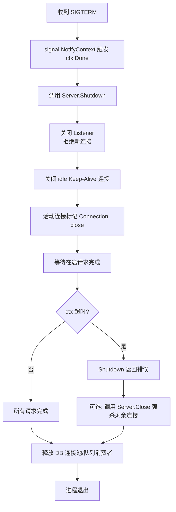

# 服务端优雅停机（Graceful Shutdown）与生命周期管理

**摘要：**

一个微服务在正常运行时看上去总是平静的：数百条 TCP 连接挂在监听端口上，若干在途请求正穿越 Handler 链，数据库连接池借出了十几条物理连接，Kafka 消费者刚刚拉取到一批消息还未提交偏移量。这一切在进程收到 `SIGTERM` 的瞬间被同时打破——容器编排器要求它在三十秒内消失，但那些正在处理中的请求、尚未提交的偏移量、刚刚建立一半的 WebSocket 帧，都不会因为调度器的意志而自动归位。优雅停机（Graceful Shutdown）要解决的，正是"进程如何在被杀死之前，把这一团悬而未决的状态一个个安顿好"。本文从操作系统信号模型出发，拆解 `http.Server.Shutdown` 的内部五步流程，讨论在途请求的 Context 级联与长连接退化策略，梳理资源回收的先后顺序，最后落到 Kubernetes 的 `terminationGracePeriodSeconds` 与 `preStop` Hook 的配合上。文章要回答的两个核心问题是：停机过程中究竟有哪些物理状态必须被有序清理？以及在"停机必须完成"与"请求必须被负责地处理"这两个相互拉扯的目标之间，工程上该如何权衡？

---

## 第 1 章 停机的物理事实：进程消失之前发生了什么

### 1.1 进程终止的三种姿态

在类 Unix 系统上，一个进程消失的方式并不只有一种。最粗暴的是 `SIGKILL`，内核直接回收进程的资源描述符，用户态代码没有任何机会参与善后；最自觉的是进程自己调用 `os.Exit(0)`，跑完已注册的 `defer` 与 `atexit` 回调之后主动交还控制权；介于二者之间的是信号驱动的"被动但有准备"的退出——进程收到 `SIGTERM` 或 `SIGINT`，由用户注册的信号处理器决定如何收尾。

优雅停机讨论的就是第三种。它不是"不退出"，而是"在退出之前完成一组有序的清理动作"。这个定义的关键在于**有序**二字：如果清理动作的顺序错了，譬如先释放了数据库连接池再等请求处理完，那些还在执行的 Handler 就会把 SQL 打到一条已经关闭的连接上，换来的是比不优雅还要难看的错误堆栈。

不妨用一个生活中的比喻来理解这件事。餐厅打烊不是把还在吃饭的客人直接轰走（`SIGKILL`），也不是等所有客人都吃完才去锁门（无限期 `Shutdown`），而是先停止接纳新的食客，然后告诉已经入座的客人"厨房不再接单，但您这桌会服务完"，再等最后一位客人结账离开，最后关灯、清账、锁门。这个顺序一旦乱了——譬如先把厨房的煤气掐了——正在烹饪的菜就变成了半生不熟的尴尬产物。

### 1.2 为什么需要优雅停机

没有优雅停机时，服务重启或发布就是一场小型灾难。具体而言，一次粗暴的 `kill -9` 会同时制造至少四类问题：

**在途请求被腰斩。** 客户端刚刚发出 POST 请求，服务端 Handler 正执行到一半，进程就消失了。TCP 层面对端收到的是 RST 而不是 FIN，HTTP 客户端通常把这种情况归类为"连接重置"，用户看到的是 502 或者网络错误。对于幂等的 GET 请求，重试可以解决问题；对于一次支付接口的扣款请求，重试本身就是新的风险。

**独占资源未被释放。** 进程持有的文件锁、分布式锁（如果在 Redis 里登记了但没来得及释放）、临时文件、Unix Domain Socket 的监听路径，都需要在退出前主动清理。这些资源不会随着进程消失而自动回到可用状态——至少不会在客户端预期的时间窗口里。

**消息队列的偏移量不一致。** Kafka 或 RabbitMQ 的消费者在拉取消息和提交偏移量之间存在时间窗口。如果进程在这个窗口里消失，同一批消息会在重启后被另一个消费者重复处理。优雅停机要做的是：停止拉取新消息，等待当前批次处理完毕，提交偏移量，然后再退出。

**数据库连接池的脏状态。** 如果进程在事务进行到一半时消失，数据库端会等到 TCP keepalive 超时才发现对端已死，这段时间里该事务持有的行锁会阻塞其他事务。对于连接池较大的服务，数百条同时断开的 TCP 连接还会在对端形成大量 `CLOSE_WAIT`，需要几分钟到十几分钟才能被内核回收。

这些问题叠加起来，就是为什么线上服务发布时常见"抖动"现象：每次滚动更新，总有一小批请求失败；每个被杀的进程都会在数据库和消息队列里留下需要自愈的疤痕。优雅停机的目标，就是把这些疤痕的数量降到零。

### 1.3 一个服务端进程的状态全景

在讨论"如何停机"之前，有必要先画清楚一个正在运行的服务端进程究竟持有哪些状态。把这些状态列出来，停机的"有序性"才有具体的着落对象。

**监听 socket。** 绑定了 IP 与端口的 `net.Listener`，内核为其保留了 accept 队列。它是一条单行道——新连接的入口。关闭它意味着不再有新的客户端能建立连接。

**活跃 TCP 连接集合。** 已经被 `Accept()` 取走、但尚未关闭的 socket。这些连接里又可以分为三类：空闲的 Keep-Alive 连接（等待下一次请求）、正在处理请求的连接、以及长连接（WebSocket、SSE、长轮询）。`http.Server` 通过内部的 `activeConn` map 维护着这个集合，`Shutdown` 的等待逻辑就建立在这个 map 的计数上。

**应用层资源句柄。** 数据库连接池（`*sql.DB`）里的每一条物理连接、Redis 客户端的连接池、Kafka 消费者的 session、gRPC 的 client conn，都是需要显式关闭的资源。它们不在 `http.Server` 的管理范围内，但它们的泄漏同样会在对端制造脏状态。

**内存中的事务状态。** 一个正在执行的分布式事务可能持有多把行锁、已经写入了补偿日志、尚未提交偏移量。这些状态只存在于进程的内存里，进程一旦消失，它们在数据库和消息队列中留下的就是需要靠超时与重试才能自愈的疤痕。

**后台常驻 Goroutine。** 调度器、批处理 worker、metrics 收集器、health check 上报器，这些与"处理请求"没有直接关系的 Goroutine，往往有自己独立的生命周期。它们的退出时机应当在 HTTP 停机之后，但在最终关闭 logger 之前。

把这张清单铺开，就能理解为什么"优雅停机"永远是一个应用特定的设计问题——每个服务持有的状态清单不同，停机的具体步骤也就不同。标准库只能帮你处理前两类（Listener 与活跃连接），剩下的必须由应用代码负责。

### 1.4 Go 的特殊位置

Go 在优雅停机这件事上有一个有趣的结构性优势：`net/http` 的标准库从 Go 1.8（2017 年 2 月）开始内置了 `Server.Shutdown` 方法，这意味着 Go 服务端程序不需要借助任何第三方框架就能实现正确停机。相比之下，Java 的 Tomcat、Node.js 的 Express 都需要额外的 Shutdown Hook 代码；Python 的 Gunicorn 虽然支持优雅重启，但那是 master-worker 多进程模型下的产物，与 Go 的单进程多线程模型截然不同。

不过，内置 `Shutdown` 并不意味着"写个 main 函数就万事大吉"。`Shutdown` 解决的是 HTTP 层的停机，但数据库连接、消息队列消费者、后台 Goroutine、长连接会话等应用层状态仍然需要工程师自己编排。这种"标准库提供一半，框架补齐另一半，剩下由应用负责"的分工，正是理解 Go 停机模型的关键。也可以说，`Shutdown` 提供了一个"停机脚手架"——它把最难写对的那部分（Listener 关闭、idle 连接清理、请求等待计数）交给标准库，把应用特定的清理步骤留给业务代码去填充。

本专栏（参见 [[Golang/Go网络编程与持久化/00 专栏导览|Go 网络编程与持久化]]）的上下篇分别讨论了 HTTP 服务端的 Handler 链架构与客户端连接池的生命周期——这两者恰好构成了停机过程的两个观察视角：从服务端看，停机是"如何把已经在处理的请求负责地完成"；从客户端看，停机是"如何在对端消失时优雅地重连到新的实例"。两者的交汇点，正是停机期间服务质量的关键。

---

## 第 2 章 操作系统信号捕获：Go 的 signal 机制

### 2.1 三种关键信号

在 POSIX 信号体系里，与进程退出相关的信号有三个：

**`SIGINT`（信号 2）** 来自终端的 Ctrl-C，通常由运维人员在控制台手动触发，表达的是"用户希望这个进程停下来"的意图。

**`SIGTERM`（信号 15）** 是 `kill` 命令的默认信号，也是 Kubernetes、systemd、Supervisor 等进程管理工具终止子进程的标准手段。它的设计初衷就是"请你自行退出"，给进程一个自我清理的机会。

**`SIGKILL`（信号 9）** 是内核的终极手段，用户态无法捕获、无法忽略、无法阻塞。Kubernetes 在 `terminationGracePeriodSeconds` 到期后会发送 `SIGKILL`，作为对未能及时响应 `SIGTERM` 的进程的强制终结。

工程上有一句常被引用但很少被严格遵守的话："任何进程都应该能在收到 `SIGTERM` 时干净地退出。"这句话背后的含义是——`SIGTERM` 是文明社会给进程的最后一个体面机会，错过它就只能面对 `SIGKILL` 的粗暴。

### 2.2 Go 的 signal 包

Go 的 `os/signal` 包提供了两种捕获信号的手段，分别对应两个不同的历史阶段。

早期的 `signal.Notify` 把信号转发到一个 channel，由用户代码循环读取并处理：

```go
c := make(chan os.Signal, 1)
signal.Notify(c, syscall.SIGTERM, syscall.SIGINT)

go func() {
    <-c
    // 触发停机流程
}()
```

这种写法有两个小陷阱：其一，channel 必须带缓冲——如果缓冲为 1 而连续收到两次 `SIGTERM`，第二次发送会被 `signal` 包非阻塞地丢弃；其二，用户需要自己管理"收到信号后做停机"到"停机完成退出"之间的全部逻辑，包括第二次信号的"强制退出"语义。

Go 1.16（2021 年 2 月）引入了 `signal.NotifyContext`，将信号捕获与 `context.Context` 的取消语义直接绑定：

```go
ctx, stop := signal.NotifyContext(context.Background(), syscall.SIGTERM, syscall.SIGINT)
defer stop()

// 启动 HTTP Server
srv := &http.Server{Addr: ":8080", Handler: mux}

// 阻塞等待信号
<-ctx.Done()

// 触发停机
shutdownCtx, cancel := context.WithTimeout(context.Background(), 25*time.Second)
defer cancel()
srv.Shutdown(shutdownCtx)
```

这种写法的好处不只是代码变短，更重要的是它把"操作系统信号"统一到了 Go 程序里已经广泛使用的 Context 取消模型上——信号不再是一个孤立的事件，而是可以沿着 Context 树向下游传播的取消通知。笔者在工程实践中几乎总是推荐 `NotifyContext`，除非你需要处理"第一次信号优雅停机、第二次信号强制退出"这种两级语义（这需要额外的 channel 监听）。

### 2.3 信号的默认行为与被覆盖

值得强调的是，Go 运行时在启动时会为 `SIGPIPE` 做特殊处理（忽略它，防止向已关闭 socket 写数据时进程意外退出），但 `SIGTERM` 和 `SIGINT` 的默认行为仍然是终止进程。如果用户代码没有通过 `signal.Notify` 或 `signal.NotifyContext` 注册处理器，收到这两个信号时进程会立即退出——这跟 `SIGKILL` 的区别只在于用户态代码有没有机会执行 `defer`。

因此，"注册信号处理器"这件事不是"是否要优雅停机"的决策，而是"是否要让停机行为符合预期"的底线。哪怕是完全不打算做优雅停机的脚本式工具，也应当显式注册信号处理，以便在退出前刷日志、关闭文件描述符。

---

## 第 3 章 `http.Server.Shutdown` 的底层原理

### 3.1 五个阶段的物理过程

`http.Server.Shutdown(ctx)` 是 Go 标准库提供的 HTTP 层停机入口。它的行为可以拆解为五个顺序执行的阶段，每个阶段都对应一组具体的物理状态变化：

**阶段一：关闭 Listener。** `Shutdown` 首先调用 `Server` 内部持有的 `net.Listener` 的 `Close` 方法。这一动作的物理效果是：内核把该 socket 标记为关闭，新的 `SYN` 包到达时会收到 RST，客户端看到"connection refused"。从这一刻起，服务器不再接受任何新连接。需要注意的是，已经通过三次握手但尚未发出 HTTP 请求的"半新连接"（Accept 队列里尚未被 `Accept()` 取走的连接）也在这个阶段被一并拒绝。

**阶段二：关闭闲置的 Keep-Alive 连接。** 在 HTTP/1.1 的默认行为下，`Server` 会保持已处理完请求的连接处于活跃状态，等待客户端复用——这就是 Keep-Alive 连接池。这些连接没有任何在途请求，纯粹是"为了性能而保留的空闲资源"。`Shutdown` 会遍历 `Server` 维护的活跃连接集合（`server.connState` 里状态为 `StateIdle` 的连接），主动发送 FIN，把它们的 TCP 状态推入 `FIN-WAIT-1`。

**阶段三：通知活动连接转入非活动。** 这是最精妙也最容易被误解的一步。对于那些当前正在处理请求的连接，`Shutdown` 不会立即断开它们，而是做了一件更聪明的事：它把这些连接标记为"下一次请求处理完毕后不再保持活跃"。具体实现上，Go 会让这些连接在下一次响应写出时自动附加 `Connection: close` 头部，告知客户端"这次响应之后，连接就会关闭，请不要复用"。这样，客户端在收到响应后会主动发起关闭，而不是在下一次请求时才发现对端已不存在。

**阶段四：等待在途请求完成。** `Shutdown` 通过内部持有的 `sync.WaitGroup`（准确地说是 `server.trackListener` 与 `trackConn` 协同维护的计数器）等待所有 `StateActive` 的连接数量归零。每完成一个请求，对应连接的引用计数减一；`Shutdown` 在循环中阻塞，直到计数归零或者传入的 Context 超时。

**阶段五：Context 超时后强制返回。** 如果传入的 Context 在等待过程中被取消（通常是 timeout 到期），`Shutdown` 立即返回 `context.DeadlineExceeded` 错误。注意，此时它**不会**强制关闭还在活动的连接——它只是告诉调用方"我尽力了，剩下的交给你"。如果调用方希望强制结束剩余连接，需要再调用 `Server.Close()`，也就是下一节讨论的对象。



### 3.2 Shutdown 与 Close 的关键差异

`Server.Close()` 的行为简单粗暴：立即关闭所有 Listener，立即关闭所有活动连接，不等任何请求完成，立即返回 `http.ErrServerClosed`。正在执行的 Handler 会收到被中断的 `ResponseWriter`，后续的 `Write` 调用返回 `ErrClosed` 或 `syscall.EPIPE`，客户端看到的是不完整的响应或者连接重置。

二者的工程含义截然不同：`Shutdown` 是"请完成当前正在做的事再走"，`Close` 是"立刻走"。在优雅停机流程里，正确的做法是**先调用 `Shutdown`，若超时再调用 `Close` 作为兜底**，而不是反过来。一个常见的反模式是在信号处理里直接调用 `Close`——这等于主动放弃了优雅停机的全部好处，只是让进程退出的姿态比 `SIGKILL` 稍微文明一点点（因为还能执行 defer），但对客户端来说几乎没有差别。

### 3.3 `ErrServerClosed` 的语义

当 `Server.Serve()` 在 `Shutdown` 或 `Close` 之后返回时，它的 error 值是 `http.ErrServerClosed`。这个值是一个标记性错误（sentinel error），专门用于区分"服务器正常停机"与"监听出错"。正确的 main 函数应该这样处理：

```go
if err := srv.ListenAndServe(); err != nil && err != http.ErrServerClosed {
    log.Fatalf("listen: %v", err)
}
```

忽略这个判断会让每次正常的优雅停机都被误判为事故并触发告警——这是新手常踩的坑。

### 3.4 内部实现的关键数据结构

`Server.Shutdown` 的行为之所以能够正确，依赖于 `net/http` 内部维护的几组关键数据结构。理解它们，有助于在调试"停机卡住"问题时定位根因。

**`activeConn map[*conn]struct{}`。** 这是一个以 `*conn`（`net/http` 内部对 TCP 连接的封装）为 key 的集合。每当一条新连接被 `Accept` 后，它就被加入这个 map；当连接关闭时，从 map 中删除。`Shutdown` 的"等待在途请求完成"逻辑，本质上就是等待这个 map 变空。

**`connState` 回调与状态机。** 每条连接都有一个状态（`StateNew`、`StateActive`、`StateIdle`、`StateClosed`、`StateHijacked`），当状态变更时会触发 `Server.ConnState` 回调（如果设置了的话）。`Shutdown` 通过观察连接的状态来区分"空闲 Keep-Alive 连接"与"正在处理请求的连接"——前者直接关闭，后者标记为 Connection: close。

**`inFlight` 计数与 WaitGroup。** 每个正在执行的请求都对应一个 in-flight 计数。`Shutdown` 通过一个内部的 WaitGroup 等待这些计数归零。注意：WaitGroup 等待的是"请求处理完成"而不是"连接关闭"——对于 Keep-Alive 连接，一次请求处理完后连接仍然存活，但对应的 WaitGroup 已经 Done。

一个常见的"停机卡住"调试陷阱是：Handler 里启动了一个新的 Goroutine 处理后台任务，但这个 Goroutine 没有与 `r.Context()` 关联。`Shutdown` 会等待这个 Goroutine 完成，而它可能在无限循环里，于是整个停机流程就卡住了。解决方法是确保所有从 Handler 派生的 Goroutine 都监听 `r.Context().Done()` 并在取消时退出。

### 3.5 `Shutdown` 的并发语义

`Shutdown` 可以被多个 Goroutine 并发调用——Go 的内部实现通过一个 `sync.Mutex` 保证第一次调用执行清理流程，后续的并发调用要么阻塞等待第一次完成，要么立即返回（取决于版本）。工程上的推荐做法是只在信号处理器里调用一次 `Shutdown`，避免并发调用带来的语义混乱。

另一个并发陷阱：`Shutdown` 在等待期间不会阻止新的 `Serve` 调用接受连接——如果你在一个 Goroutine 里调用 `Shutdown`，同时在另一个 Goroutine 里又启动了 `ListenAndServe`，新的连接仍然会被接受，`Shutdown` 的等待永远不会结束。正确做法是：`Shutdown` 调用之前或同时，必须保证没有新的 `Serve` 调用在进行。

---

## 第 4 章 在途请求的 Context 级联与超时

### 4.1 停机信号如何传导到 Handler

当一个在途请求的 Handler 正在执行数据库查询、调用下游 HTTP 接口或等待 channel 通信时，它怎么知道服务器正在停机？答案是 **Context 级联**。

Go 为每个进入 Handler 的 HTTP 请求都准备了一个 request-scoped 的 `Context`，可通过 `r.Context()` 获取（关于 Context 的完整设计原理，参见 [[07 Context 的设计与取消传播机制]]）。在 `Shutdown` 期间，这个 Context 并不会自动被取消——这是一个反直觉的事实。`Shutdown` 只是等待这些请求完成，并没有主动取消它们。真正让请求 Context 与停机联动的，是 `http.Server.BaseContext` 与 `BaseContext` 配合 `Shutdown` 的 ctx，以及**业务代码主动检查 `r.Context().Done()`** 的自觉。

更准确地说，Go 1.21 起 `http.Server` 引入了 `Shutdown` 期间的行为精细化控制：当 `Shutdown` 的 ctx 超时触发时，`Server` 会把该 ctx 的取消信号传递给所有还在活动的请求的 `Request.Context`，迫使它们快速失败。在此之前，请求的 Context 不会因为停机超时而自动取消，业务代码只能通过轮询 `r.Context().Done()` 或者根本不检查来实现 cooperative cancellation。

这意味着，一个真正考虑停机安全的 Handler 应当这样写：

```go
func queryHandler(w http.ResponseWriter, r *http.Request) {
    ctx := r.Context()
    
    // 数据库查询必须传入 request context
    row, err := db.QueryContext(ctx, "SELECT ...")
    if err != nil {
        if ctx.Err() == context.Canceled {
            // 可能是客户端断开，也可能是停机
            return
        }
        http.Error(w, err.Error(), 500)
        return
    }
    // ...
}
```

关键点是：**任何阻塞型的 I/O 操作都必须传入 request Context**。如果你的数据库客户端、Redis 客户端、HTTP 客户端使用的是 `context.Background()` 而不是 `r.Context()`，那停机时这些调用根本感知不到外部变化，会一直阻塞到它们自己的超时——这会让 `Shutdown` 的等待时间失去意义。

### 4.2 超时阶梯的设计

停机过程涉及的超时不是一层，而是一组阶梯。最外层是 Kubernetes 的 `terminationGracePeriodSeconds`（默认 30 秒），它是内核强制 `SIGKILL` 的硬边界；中间层是传给 `Shutdown` 的 ctx 超时（譬如 25 秒），它留出几秒给后续的资源清理；内层是各个在途请求自己的超时（由业务 Handler 控制或者由 `http.Server.ReadTimeout` / `WriteTimeout` 约束）。

这三层的关系是：内层超时必须小于中间层，中间层必须小于外层。任何一层的违反都会导致"停机不完整"或者"进程被 SIGKILL"。实践中常见的错误是把 `Shutdown` 的超时设得比 `terminationGracePeriodSeconds` 还长——譬如 K8s 给 30 秒，但 `Shutdown` 用了 35 秒，结果数据库连接池的清理代码永远跑不到，进程就被 `SIGKILL` 了。

### 4.3 客户端断开与停机的语义区分

一个经常被忽略的问题是：`r.Context()` 被取消并不一定意味着停机，也可能是客户端主动断开了连接。Handler 在检查 `ctx.Err()` 时需要意识到这一点——对于停机，我们通常希望停止发起新的下游调用；对于客户端断开，我们可能还希望把已经开始的下游调用做完（避免浪费），但至少不要再写 ResponseWriter。

区分这两种情况的手段之一是检查 `Server` 是否已经处于停机状态。可以用一个 `sync.Once` 触发的全局 `shutdownCh` channel，或者一个 `atomic.Bool` 标志。Handler 在发现 `r.Context()` 被取消时，先检查这个标志：如果是停机，立即返回；如果只是客户端断开，可以根据业务需求决定是否继续后台处理。

值得补充的是：Go 的 `net/http` 在客户端断开时会自动取消请求的 Context，但**已经发起到下游的 HTTP 请求不会自动取消**——这需要业务代码在发起下游请求时显式传入 `r.Context()` 作为父 Context。如果下游请求用的是 `context.Background()`，即使客户端已经断开，下游的请求仍然会继续执行，造成无谓的资源浪费。这种"上下文断裂"是导致服务停机期间雪崩的常见隐性原因之一。

---

## 第 5 章 长连接的退化与清理策略

### 5.1 问题的本质

HTTP 请求-响应模型有一个让优雅停机变得复杂的"例外族"：长轮询（Long Polling）、WebSocket、Server-Sent Events（SSE）。这些协议共享一个特征——连接一旦建立，就不再遵循"请求-响应-关闭"的节奏，而是持续挂起，由服务端在有新数据时主动推送，或者由客户端在任意时刻写入。

从 `Server.Shutdown` 的视角看，这些连接都属于 `StateActive`，因为它们始终"正在处理请求"——哪怕 Handler 已经阻塞在 `select` 上等了好几个小时。`Shutdown` 会无限期地等待这些连接变成 idle，而它们永远不会变成 idle，于是 `Shutdown` 就卡住了。

这就像一个餐厅里有位客人坐下之后既不点菜也不离开，只是坐着发呆——餐厅永远无法"等服务完最后一位客人"再打烊，因为这位客人根本不接受服务，也永远不会主动结束。

### 5.2 连接注册表模式

解决长连接停机问题的标准模式是**连接注册表（Connection Registry）**。核心思想是：把所有长连接集中登记在一个并发安全的数据结构里，`Shutdown` 流程在等待常规请求完成之后，显式地通知注册表里的每一条长连接"该走了"。

```go
type ConnectionRegistry struct {
    mu    sync.RWMutex
    conns map[*websocket.Conn]context.CancelFunc
}

func (r *ConnectionRegistry) Register(conn *websocket.Conn, cancel context.CancelFunc) {
    r.mu.Lock()
    r.conns[conn] = cancel
    r.mu.Unlock()
}

func (r *ConnectionRegistry) Unregister(conn *websocket.Conn) {
    r.mu.Lock()
    delete(r.conns, conn)
    r.mu.Unlock()
}

func (r *ConnectionRegistry) ShutdownAll() {
    r.mu.RLock()
    defer r.mu.RUnlock()
    for _, cancel := range r.conns {
        cancel()  // 通知每条连接退出
    }
}
```

每条 WebSocket 连接在建立时把自己的 `CancelFunc` 注册进去，Handler 主循环则通过 `select` 监听这个 cancel channel：

```go
func wsHandler(reg *ConnectionRegistry) http.Handler {
    return http.HandlerFunc(func(w http.ResponseWriter, r *http.Request) {
        conn, _ := upgrader.Upgrade(w, r, nil)
        defer conn.Close()
        
        ctx, cancel := context.WithCancel(r.Context())
        defer cancel()
        reg.Register(conn, cancel)
        defer reg.Unregister(conn)
        
        for {
            select {
            case <-ctx.Done():
                // 发送 WebSocket Close Frame
                conn.WriteControl(
                    websocket.CloseMessage,
                    websocket.FormatCloseMessage(websocket.CloseNormalClosure, "server shutting down"),
                    time.Now().Add(5*time.Second),
                )
                return
            case msg := <-incomingCh:
                conn.WriteJSON(msg)
            }
        }
    })
}
```

`Shutdown` 的流程变成：先调用 `Server.Shutdown(ctx)` 等待常规 HTTP 请求完成，然后调用 `registry.ShutdownAll()` 显式关闭所有长连接，最后再做数据库连接池的释放。

### 5.3 长轮询的特殊处理

长轮询（Long Polling）介于普通 HTTP 请求与真正的长连接之间。Handler 在收到请求后会阻塞等待事件，直到超时或者有新数据才响应。从 `Shutdown` 的视角看，它们也是 `StateActive`，但好消息是它们终究会结束——只要把它们的阻塞等待与停机信号挂钩。

具体做法是：Handler 阻塞等待的 channel 之外，额外监听 `r.Context().Done()`。当 `Shutdown` 开始等待时，如果业务代码主动取消这些长轮询请求的 Context（譬如通过上文的全局 `shutdownCh`），它们就会立即返回一个"请重试"的响应，客户端收到后会向另一个已经启动的新实例发起请求——这就是滚动更新中"连接排空"与"服务发现刷新"的协作。

### 5.4 Server-Sent Events 的优雅结束

SSE（Server-Sent Events）的处理与 WebSocket 类似，但因为它是单向的（服务端到客户端），结束的方式更简单：Handler 在退出前发送一个特殊的 `event: shutdown` 事件，客户端收到后主动发起重连，重连时自然落到新实例上。HTTP/2 的 stream 在这个模型里与 HTTP/1.1 的处理一致——`Shutdown` 会等待 stream 结束，但不会主动打断它们，必须由业务代码自己触发。

一个工程上的细节是：SSE 连接在 `Shutdown` 期间可能已经很久没有发送数据了，此时客户端侧的 TCP keepalive 还没有检测到连接失效。如果服务端在停机后直接关闭 socket，客户端可能要在几分钟之后才发现连接已经死了——这对用户体验是不可接受的。因此，SSE 的 ConnectionRegistry 应当在 `ShutdownAll()` 中**主动发送一条结束事件**，让客户端立即感知到并触发重连，而不是等 TCP 自己发现问题。

### 5.5 连接注册表的清理边界

ConnectionRegistry 解决的是"主动通知长连接退出"，但它本身也引入了一个需要被清理的状态——注册表本身是一个并发数据结构，它也需要在停机流程中被正确地关闭和释放。一个常见的遗漏是：`ShutdownAll` 之后，注册表里的 `cancel` 函数被调用了，但对应的 Goroutine 还需要时间来完成清理（譬如发送 WebSocket Close Frame、刷 buffer）。如果在这之前就继续后续步骤（譬如关闭数据库），那些还在运行的 Goroutine 可能会把数据写到已经关闭的资源上。

稳妥的做法是：`ShutdownAll` 之后，用一个 `sync.WaitGroup` 等待所有长连接 Goroutine 真正退出（每个 Goroutine 在 defer 里调用 `wg.Done()`），然后再进行下一步清理。这个 WaitGroup 的等待同样应当有超时保护，以防某个 Goroutine 卡在 I/O 上无法退出。

---

## 第 6 章 资源回收顺序

### 6.1 顺序为何重要

优雅停机不是一件事，而是一系列动作的有序组合。顺序错了，看似完成了停机，实则留下了一串等待自愈的脏状态。正确的顺序大致是：

**第一步：停止接受新请求。** 关闭 Listener。这必须是最先发生的，否则后续每一步都在与新流量赛跑。

**第二步：等待在途请求完成（在超时范围内）。** 这是 `Server.Shutdown` 的主要工作。超时到达时仍未完成的请求，由 `Server.Close` 强制终结。

**第三步：停止消息队列消费者。** 不再拉取新消息，等待当前批次处理完毕并提交偏移量。这一步必须在请求排空之后，否则那些"请求处理了一半需要发后续消息"的场景会出问题。

**第四步：释放后台 Goroutine。** 调度器、定时器、批处理 worker 等常驻 Goroutine 应当收到取消信号并退出。通常通过一个共享的 `context.Context` 管理它们的生命周期。

**第五步：关闭数据库连接池。** 此时已经没有代码会借用数据库连接，`sql.DB.Close()` 可以安全地归还所有物理连接。

**第六步：关闭日志、监控、tracer 的刷写器。** 这是最后一步，确保停机期间产生的日志和 span 都被完整刷出，而不是留在内存 buffer 里随着进程消失。

这六个步骤的依赖关系是严格的：前一步没有完成，后一步就不应当开始。用一个 `errgroup.Group` 加显式的阶段控制可以实现，但在大多数工程实践中，直接按顺序串行调用就足够清晰：

```go
func gracefulShutdown(ctx context.Context, srv *http.Server, reg *ConnectionRegistry, db *sql.DB, consumer *KafkaConsumer, flusher LogFlusher) {
    // 阶段 1: 停止接收
    shutdownCtx, cancel := context.WithTimeout(ctx, 20*time.Second)
    defer cancel()
    srv.Shutdown(shutdownCtx)  // 忽略错误，继续清理
    
    // 阶段 2: 关闭长连接
    reg.ShutdownAll()
    time.Sleep(500 * time.Millisecond)  // 给 Close Frame 一点发送时间
    
    // 阶段 3: 停止消费者
    consumer.Stop()  // 内部等待当前批次处理完并提交偏移量
    
    // 阶段 4: 关闭数据库
    db.Close()
    
    // 阶段 5: 刷日志
    flusher.Flush()
}
```

### 6.2 资源释放的反模式

一个常见的反模式是"所有资源都通过 defer 释放"。`defer` 的作用域是函数，而优雅停机涉及的多个资源释放步骤之间是有依赖关系的——数据库必须等到请求处理完成才能关闭——这些依赖关系无法用 defer 的栈序（LIFO）自然表达。正确的做法是把停机逻辑显式写成一个函数，按依赖顺序逐行调用，让代码本身的书写顺序就是执行顺序。

另一个反模式是"超时后直接 `os.Exit(1)`"。这相当于在 `Shutdown` 还没完成时就跳到 `SIGKILL` 的效果，所有未完成的清理都被跳过。更好的做法是：超时后调用 `Server.Close()` 强制结束剩余连接，然后继续后续的资源释放——即使这些连接是被强制关闭的，它们对应的数据库连接和消息队列偏移量仍然有机会被正确清理。

还有一个微妙的反模式是"在停机流程里重新启动新任务"。有些服务在停机时会尝试做"最后一次刷数据""最后一次同步缓存"之类的操作，这些操作本身需要启动新的 Goroutine 和网络请求。问题是：这些新任务没有自己的超时保护，也没有与停机 Context 关联，它们可能成为停机流程里新的阻塞点。原则是：**停机流程只应当做清理，不应当做新业务**。任何"最后再做一件事"的冲动，都值得被质疑。

### 6.3 与 `context.Context` 生命周期管理的配合

一个设计良好的 Go 服务，通常会有一个"应用 Context"——一个贯穿整个进程生命周期的 `context.Context`，所有后台 Goroutine 都通过 `context.WithCancel(appCtx)` 派生自己的子 Context。当 `appCtx` 被取消时，所有后台 Goroutine 都应当监听并退出。

优雅停机与这个应用 Context 的配合点是：在 HTTP 请求排空完成之后、关闭数据库之前，取消 `appCtx`。这样，所有后台 Goroutine（定时器、worker、metrics collector）都会在数据库关闭之前停止运行，避免它们尝试借用已经关闭的数据库连接。这种"先停消费者、再释放资源"的顺序，正是 Context 级联取消机制的自然应用。

---

## 第 7 章 与 Kubernetes 的配合

### 7.1 Pod 终止的物理过程

在 [[云原生/Kubernetes/Kubernetes架构深度剖析/00 专栏导览|Kubernetes]] 中，一个 Pod 被终止的过程并不是简单的"发个 SIGTERM 然后结束"。kubelet 在执行 Pod 终止时，走的是这样一条链路：

**Step 1.** kubelet 开始终止 Pod，记录起始时间。

**Step 2.** 如果 Pod 定义了 `preStop` Hook，kubelet 先执行它。`preStop` 可以是 exec 命令，也可以是 HTTP 请求。在 `preStop` 执行期间，Pod 的状态被从 Service 的 Endpoints 中摘除（异步发生），但进程还没收到任何信号。这个时间窗口的工程价值是：让服务先从负载均衡器里退出来，避免新流量继续打进来，再开始停机流程。

**Step 3.** `preStop` 完成后（或者没有 `preStop`），kubelet 向 Pod 的主进程发送 `SIGTERM`。

**Step 4.** 主进程开始优雅停机流程。此时 Pod 处于 `Terminating` 状态。

**Step 5.** 当 Pod 终止时间超过 `terminationGracePeriodSeconds`（默认 30 秒）减去 `preStop` 执行时间后，kubelet 发送 `SIGKILL`，强制结束。

这里有个常被忽略的细节：**Service Endpoints 的摘除和 SIGTERM 的发送是异步的**。也就是说，即使 `preStop` 里做了 `sleep 10` 等待 Endpoints 同步，也不能百分百保证新流量不再进来——kube-proxy 的 iptables 或 IPVS 规则刷新有自己的周期。工程上稳妥的做法是在应用层也做双重保护：`Shutdown` 一开始就关闭 Listener，这样即使有漏网的新请求进来，也会被拒绝而不是被处理到一半杀死。

### 7.2 terminationGracePeriodSeconds 的调优

默认 30 秒看起来很长，但对于需要完成大量在途请求和数据库操作的服务来说，可能远远不够。笔者见过的生产案例里，一个处理批量导出的服务需要 5 分钟才能干净停机——它在停机前要把正在导出的几万行数据写完、把临时文件上传到对象存储、在数据库里标记任务完成。

调优的基本公式是：

```
terminationGracePeriodSeconds ≥ 
    preStop 耗时 + 
    Server.Shutdown 超时 + 
    消息队列消费者排空耗时 + 
    数据库连接池关闭耗时 + 
    日志刷写耗时 + 
    缓冲时间 (5-10 秒)
```

缓冲时间不可或缺，因为它应对的是"停机流程中某些步骤比预期慢"的场景。没有缓冲时间，一旦某个步骤慢了几秒，整个停机流程就会被 `SIGKILL` 截断，又回到了不优雅的老路。

### 7.3 preStop Hook 的常见用法

`preStop` 最常见的用法是 `sleep` 一段时间，给 Endpoints 同步留出时间：

```yaml
lifecycle:
  preStop:
    exec:
      command: ["/bin/sh", "-c", "sleep 10"]
```

这个 `sleep 10` 的实际作用是：在这 10 秒里，Pod 已经标记为 Terminating，kube-proxy 开始刷新 Endpoints，但进程还没收到 SIGTERM，所以仍然能处理已经在转发中的请求。10 秒之后，SIGTERM 才到达，进程开始真正的停机。

另一种 `preStop` 用法是调用应用自身的健康检查接口，确保 Service 摘除已经生效。但这种做法有循环依赖的风险——如果应用停机逻辑写错了，`preStop` 也会失败。

### 7.4 与 SIGKILL 的边界

`SIGKILL` 是不可捕获的，这意味着无论你的优雅停机代码写得多好，一旦超过 `terminationGracePeriodSeconds`，一切都白费。这个边界的工程含义是：**优雅停机代码必须假设它可能在任意时刻被 SIGKILL 打断，所以每一步清理动作都必须是幂等的，且最重要的清理动作必须最先执行**。

譬如，如果你的服务需要释放分布式锁，释放锁的代码必须放在停机流程的最前面，而不是最后——因为如果 SIGKILL 在停机中途发生，只有已经执行过的清理是有效的。类似地，消息队列的偏移量提交也应当尽可能早地触发（在"当前批次处理完"这个条件达成后立刻提交，不要等到所有步骤都完成）。

一个值得关注的边界情况是 `preStop` 的执行时间与 `terminationGracePeriodSeconds` 之间的关系。从 kubelet 的视角看，这两者是共享一个时间窗口的：`terminationGracePeriodSeconds` 计时从 Pod 被标记为 Terminating 开始，`preStop` 是其中的一部分，而不是额外的时间。所以如果你的 `terminationGracePeriodSeconds` 是 30 秒，`preStop` 用了 15 秒，留给应用自己的停机时间就只剩 15 秒——而不是很多工程师直觉上以为的 30+15=45 秒。

### 7.5 PodDisruptionBudget 与停机协同

在多副本服务的滚动更新中，仅仅依靠单个 Pod 的优雅停机是不够的。如果多个 Pod 同时进入停机流程，剩余 Pod 可能无法承接全部流量，导致服务降级甚至雪崩。PodDisruptionBudget（PDB）是 Kubernetes 提供的另一层保护：它定义了在任意时刻至少需要保持多少 Pod 处于可用状态。当驱逐（eviction）或滚动更新会导致可用 Pod 数低于 PDB 下限时，kubelet 会推迟驱逐，直到有足够的 Pod 重新就绪。

PDB 与优雅停机的关系是互补的：优雅停机保证单个 Pod 退出时不伤害在途请求，PDB 保证同一时刻不会有太多 Pod 同时退出。两者缺一不可——只有关心前者，你的服务会在"每次发布时短暂抖动"；只有关心后者，你的服务会在"一次激进的集群缩容中整体崩溃"。

### 7.6 HTTP/2 下的特殊考量

HTTP/2 的多路复用（multiplexing）特性让优雅停机变得更加微妙。在 HTTP/1.1 下，每条 TCP 连接一次只处理一个请求（不考虑 pipelining），`Shutdown` 关闭连接时影响的只是一个在途请求。但在 HTTP/2 下，一条 TCP 连接上可能同时承载着数十个 stream，`Shutdown` 必须通知所有这些 stream 优雅关闭。

Go 的 `http.Server` 对 HTTP/2 的处理方式是发送 `GOAWAY` 帧——这是 HTTP/2 协议专门设计的优雅关闭机制。服务端先发送一个 `GOAWAY` 帧，告知客户端"我将不再接受新的 stream，但已经在处理的 stream 会继续完成"；客户端收到 `GOAWAY` 后，会把新请求路由到其他连接（或者其他实例）。这种机制让 HTTP/2 的优雅停机可以精确到 stream 级别，而不是连接级别。

不过，这也意味着客户端必须能够正确处理 `GOAWAY` 帧并发起重试。对于不支持自动重试的老旧客户端，HTTP/2 的优雅停机可能反而比 HTTP/1.1 更容易暴露问题——因为客户端会尝试在一条即将关闭的连接上发起新 stream，收到 REFUSED_STREAM 错误后才知道需要换连接。

---

## 第 8 章 测试优雅停机

### 8.1 为什么优雅停机需要专门的测试

停机逻辑是那种"平时看起来没问题，出问题时已经在生产"的代码。在正常发布流程里，如果停机逻辑正确，你不会看到任何异常——只有当停机逻辑有 bug 时，你才会看到客户端错误率上升、消息队列重复消费、数据库连接泄漏等问题。这意味着**停机逻辑的测试必须在发布之前完成，而不是依赖生产环境的事故来发现问题**。

测试优雅停机的挑战在于：它不是一个纯函数式的输入-输出关系，而是一组"并发事件在时间轴上的有序发生"。你需要模拟"客户端正在请求 → SIGTERM 到达 → 请求仍在处理 → 处理完成 → 资源释放"这样的时间序列。

### 8.2 进程内集成测试

最轻量的做法是在测试里直接构造 `http.Server`，启动 `ListenAndServe`，发送若干并发请求，然后在一个 Goroutine 里延迟发送停机信号，最后断言：所有请求都返回了 200，数据库连接池被正确关闭，日志里有完整的停机流程记录。

```go
func TestGracefulShutdown(t *testing.T) {
    // 构造测试用 Handler：sleep 2 秒后返回
    handler := http.HandlerFunc(func(w http.ResponseWriter, r *http.Request) {
        time.Sleep(2 * time.Second)
        w.WriteHeader(200)
    })
    srv := &http.Server{Addr: ":0", Handler: handler}
    
    ln, _ := net.Listen("tcp", "127.0.0.1:0")
    go srv.Serve(ln)
    
    // 发送 10 个并发请求
    var wg sync.WaitGroup
    for i := 0; i < 10; i++ {
        wg.Add(1)
        go func() {
            defer wg.Done()
            resp, err := http.Get("http://" + ln.Addr().String())
            if err != nil {
                t.Errorf("request failed: %v", err)
                return
            }
            if resp.StatusCode != 200 {
                t.Errorf("expected 200, got %d", resp.StatusCode)
            }
        }()
    }
    
    // 等待请求都已经在处理中
    time.Sleep(500 * time.Millisecond)
    
    // 触发优雅停机（给 5 秒超时）
    ctx, cancel := context.WithTimeout(context.Background(), 5*time.Second)
    defer cancel()
    if err := srv.Shutdown(ctx); err != nil {
        t.Errorf("shutdown error: %v", err)
    }
    
    wg.Wait()
}
```

这个测试验证的是：`Shutdown` 在请求处理期间被调用时，会等待所有在途请求完成，而不是立即拒绝新请求或中断旧请求。

### 8.3 端到端测试与 SIGTERM 注入

更完整的测试需要在真实的进程边界上进行。做法是：编译出二进制，启动子进程，发送一批请求，然后向子进程发送 `SIGTERM`，监控进程的退出码和输出。

Go 的 `os/exec` 包配合 `syscall.Kill(cmd.Process.Pid, syscall.SIGTERM)` 可以实现这种注入。测试的断言包括：进程退出码为 0；所有已发出的请求在服务端日志中有完成记录；数据库连接池在进程退出前调用了 `Close`（通过一个测试桩 mock 验证）；没有留下任何 TCP `CLOSE_WAIT` 或 `TIME_WAIT` 异常堆积。

这种端到端测试的成本高，但覆盖的是进程边界上最容易出问题的场景——也是滚动更新时最容易暴露问题的场景。建议在关键服务上至少维护一个这样的测试。

### 8.4 Chaos 测试与停机故障注入

更激进的测试策略是混沌工程（Chaos Engineering）的范畴：在流量高峰期随机杀死 Pod，观察服务是否能以零错误率度过停机。这需要 Kubernetes 环境下的故障注入工具（如 Litmus、Chaos Mesh），以及完善的客户端重试与熔断机制配合。对于承担核心交易链路的服务，这类测试几乎是不可或缺的——因为它验证的不只是停机逻辑，还包括客户端容错与负载均衡器的协同。

---

## 第 9 章 可观测性与停机过程

### 9.1 停机需要被看见

一个常见但代价高昂的疏忽是：停机逻辑写完了，但没有任何指标显示它是否正常工作。直到某天生产事故，工程师才发现优雅停机实际上从来没成功过——每次都被 SIGKILL 截断。

要让停机过程"被看见"，至少需要以下几类指标：

**停机触发事件。** 每次收到 SIGTERM 都应该记录一条 INFO 级别的日志，包含时间戳、Pod 名称、当前的活跃连接数、in-flight 请求数。这条日志是事后排查"停机为什么失败"的起点。

**停机阶段耗时。** 每个停机阶段（Listener 关闭、in-flight 等待、长连接清理、数据库关闭、消费者排空）都应当记录耗时。一旦某个阶段的耗时超过阈值，就应当触发告警——这意味着该阶段要么卡住了，要么超时配置不合理。

**停机原因分类。** 区分"正常发布触发的停机"与"扩缩容、节点驱逐触发的停机"有助于后续分析。不同的触发原因对应不同的预期行为——譬如节点驱逐时可能 preStop 时间被压缩，需要更短的停机超时。

### 9.2 停机过程中的 tracing

分布式追踪（Distributed Tracing）在停机过程中的价值常被低估。当一个请求因为停机而超时失败时，trace 能告诉工程师：请求在哪一步卡住了，是数据库查询还是下游 HTTP 调用，以及这一步耗时多少。

要实现这一点，必须确保 `Shutdown` 过程中启动的 span 能被完整 flush 到 collector。这就是为什么在停机流程里，"flush logger 和 tracer"必须放在最后一步——如果 flush 在数据库关闭之前发生，后续的数据库操作产生的 span 就会丢失。

### 9.3 健康检查在停机期间的行为

Kubernetes 通过 `liveness` 和 `readiness` probe 判断 Pod 的健康状态。在停机期间，readiness probe 应当返回失败（告诉 kubelet 不要再路由新流量），liveness probe 应当继续返回成功（告诉 kubelet 不要重启 Pod）。

一个常见的错误是让 `liveness` 和 `readiness` 共用同一个 handler，并在停机时一起返回 500。结果是 kubelet 认为 Pod 已经不健康，触发重启——优雅停机变成了强制重启，前功尽弃。

正确的做法是：readiness probe 监听停机信号，停机开始后返回 503；liveness probe 在整个停机期间持续返回 200，只有当进程真的卡死（譬如超过 `terminationGracePeriodSeconds` 还没退出）时才让 kubelet 介入。

---

## 第 10 章 边界、反例与常见误区

### 10.1 `Shutdown` 不能解决所有问题

`http.Server.Shutdown` 是一个 HTTP 层的方法，它只能管理 HTTP 连接的状态。它不知道你的数据库事务、不知道你的 Redis 锁、不知道你的 gRPC 双向流。一个常见的误解是"调用了 `Shutdown` 就完事了"——这只解决了冰山的一角，水面下是应用层所有的有状态资源。

对于 gRPC 服务，gRPC-Go 提供了自己的 `GracefulStop()` 方法，行为与 `http.Server.Shutdown` 类似但适配了 HTTP/2 的多路复用语义。对于纯 TCP 服务（譬如自定义协议），优雅停机完全需要自己实现——通常是关闭 Listener，然后遍历活动连接集合发送"服务端将关闭"的消息，等待对端确认或超时后强制关闭。

### 10.2 第二次 SIGTERM 的处理

生产环境中，有时需要"快速退出"的能力——譬如停机流程本身卡住了，运维想再发一次信号强制退出。一个健壮的做法是：第一次信号触发优雅停机流程；第二次信号触发强制退出（调用 `Server.Close` 并跳过剩余清理步骤）。

```go
ctx, stop := signal.NotifyContext(context.Background(), syscall.SIGTERM)
defer stop()

go func() {
    <-ctx.Done()   // 第一次信号
    go func() {
        <-ctx.Done() // 这个不会触发，因为 NotifyContext 在第一次触发后不再监听
    }()
    
    // 用独立的 channel 监听第二次信号
    forceCh := make(chan os.Signal, 1)
    signal.Notify(forceCh, syscall.SIGTERM, syscall.SIGINT)
    <-forceCh  // 第二次信号
    log.Println("forced shutdown")
    os.Exit(1)
}()
```

需要小心的是：`signal.NotifyContext` 在第一次信号触发后就完成了它的使命，第二次信号需要通过另一个 channel 捕获。

### 10.3 TLS 连接的停机

HTTPS 服务的停机比 HTTP 多一个细节：TLS 握手需要额外的往返，在停机过程中新到的 TLS 握手请求如果已经被 Listener 关闭，客户端会看到连接错误而不是优雅的拒绝。这通常不是大问题，因为客户端会重试，但在高并发场景下可能导致短时错误率上升。解决方案是通过 `preStop` 把 Endpoints 摘除提前，让新流量不再路由到这个 Pod。

### 10.4 滚动更新中的"双实例同时停机"陷阱

在多副本部署中，如果滚动更新的策略过于激进（譬如 `maxUnavailable` 设得过高），可能出现"两个副本同时进入停机流程"的情况。此时剩下的副本可能扛不住全部流量，导致整个服务的错误率上升。优雅停机本身解决不了这个问题，需要与部署策略（PodDisruptionBudget、滚动更新 `maxSurge`/`maxUnavailable`）配合设计。

### 10.5 `http.Server` 的 `BaseContext` 陷阱

Go 1.21 起 `http.Server` 支持 `BaseContext` 字段，允许用户为所有请求的 `Request.Context()` 指定一个父 Context。如果这个父 Context 在停机过程中被取消，所有在途请求的 Context 都会级联取消——这是期望的行为。但如果误用了全局的 `context.Background()` 作为 BaseContext 并在 `Shutdown` 前手动取消它，所有在途请求会立即失败，与"等待在途请求完成"的语义冲突。

---

## 第 11 章 一个完整的工程示例

把以上所有要素串起来，一个完整的 Go 微服务停机流程大致如下：

```go
func main() {
    // 1. 初始化资源
    db := initDB()
    consumer := initKafkaConsumer()
    registry := &ConnectionRegistry{conns: make(map[*websocket.Conn]context.CancelFunc)}
    mux := http.NewServeMux()
    registerRoutes(mux, db, registry)
    srv := &http.Server{
        Addr:    ":8080",
        Handler: mux,
    }
    flusher := initLogFlusher()
    
    // 2. 启动服务
    go srv.ListenAndServe()
    go consumer.Start()
    
    // 3. 等待停机信号
    ctx, stop := signal.NotifyContext(context.Background(), syscall.SIGTERM, syscall.SIGINT)
    defer stop()
    <-ctx.Done()
    log.Println("shutdown signal received")
    
    // 4. 阶段化停机
    // 阶段 4.1: 停止接收新 HTTP 请求（25 秒超时）
    shutdownCtx, cancel := context.WithTimeout(context.Background(), 25*time.Second)
    defer cancel()
    if err := srv.Shutdown(shutdownCtx); err != nil {
        log.Printf("HTTP shutdown incomplete: %v", err)
        srv.Close()  // 兜底强制关闭
    }
    
    // 阶段 4.2: 关闭长连接
    registry.ShutdownAll()
    time.Sleep(500 * time.Millisecond)
    
    // 阶段 4.3: 停止 Kafka 消费者
    consumer.Stop()  // 内部等待当前批次处理完
    
    // 阶段 4.4: 关闭数据库
    db.Close()
    
    // 阶段 4.5: 刷日志
    flusher.Flush()
    
    log.Println("graceful shutdown complete")
}
```

配合的 Kubernetes Deployment 片段：

```yaml
spec:
  terminationGracePeriodSeconds: 60
  containers:
  - name: app
    lifecycle:
      preStop:
        exec:
          command: ["/bin/sh", "-c", "sleep 8"]
```

其中 `60 = 8 (preStop) + 25 (HTTP Shutdown) + 5 (长连接) + 10 (消费者) + 5 (DB) + 7 (缓冲)`。

---

行文至此，可以把优雅停机看作一个"时间维度上的资源编排问题"。它不像并发那样涉及"多个执行流同时活动"的空间复杂度，而是涉及"多个异构资源必须在时间轴上按依赖顺序依次释放"的序列复杂度。`http.Server.Shutdown` 解决了 HTTP 连接这一层，但应用层的消息队列、数据库连接、长连接会话、后台 Goroutine 仍然需要工程师自己编排。

从权衡的角度看，优雅停机的代价是"停机时间变长"——原本一个 `SIGKILL` 就能结束的事，现在要等几十秒；但换来的是"停机期间的请求零损失、状态零污染"。这个权衡在不同场景下的取舍点是不同的：对幂等的、无状态的 HTTP 服务，粗暴停机加客户端重试可能就够用；对涉及金融事务、消息偏移量、长连接会话的服务，优雅停机则是刚需。

另一个常被忽视的权衡维度是**代码复杂度 vs 停机质量**。一个彻底的优雅停机实现，需要 ConnectionRegistry、分阶段清理逻辑、健康检查适配、信号二次捕获等一整套基础设施——这些代码本身也需要被测试和维护。对于小型服务或者内部工具，这些复杂度未必值得投入。判断标准是：停机期间失败一次请求的代价，与实现优雅停机的工程成本，哪个更高。

还有一个更深层次的张力：优雅停机假设"停机是可控的"，但生产环境里越来越多的停机是不可控的——节点故障、OOM Kill、网络分区。对于这些场景，优雅停机无法介入，必须依靠客户端重试、消息队列的 redelivery、数据库的事务回滚来"事后修复"。这就意味着：**停机设计不能只关心优雅停机路径，还必须为"不优雅的停机"设计兜底**。这两条路径之间的关系，类似于分布式系统里"正常路径"与"故障路径"的关系——前者追求效率，后者追求正确性，缺一不可。

最终，优雅停机的设计质量反映的是工程师对"进程所拥有的全部状态"的认知深度——你知道了哪些状态存在，你才知道哪些状态需要被清理；你知道了清理之间的依赖顺序，你才知道该如何编排停机流程。这或许是所有"优雅"操作的共性：优雅从来不是天赋，而是对复杂性的精确掌控。

---

## 参考资料

1. The Go Authors. "net/http package." Go Programming Language, 2017. https://pkg.go.dev/net/http#Server.Shutdown
2. The Go Authors. "os/signal package — NotifyContext." Go Programming Language, 2021. https://pkg.go.dev/os/signal#NotifyContext
3. Kubernetes Authors. "Pod Lifecycle — Termination of Pods." Kubernetes Documentation. https://kubernetes.io/docs/concepts/workloads/pods/pod-lifecycle/#pod-termination
4. Kubernetes Authors. "Stopping and Terminating a Node, Pod, or Container — Graceful Pod Termination." https://kubernetes.io/docs/tasks/administer-cluster/safely-drain-node/
5. Borman, R. et al. "Go 1.8 Release Notes." The Go Blog, February 2017.
6. The Go Team. "Go 1.21 Release Notes — net/http: Server.BaseContext and Server.ConnContext." 2023.

---

> [!note] 思考题
> 1. 如果 `Server.Shutdown` 返回时仍有活动连接，且你没有调用 `Server.Close()` 作为兜底，会发生什么？这些连接在进程退出后在数据库和客户端各自呈现为什么状态？
> 2. 在 Kubernetes 的默认配置（`terminationGracePeriodSeconds=30`）下，如果你的 `preStop` 用了 `sleep 15`，留给应用自己的停机时间还剩多少？为什么很多团队在生产中把这个默认值改到 60 甚至 120？
> 3. 为什么 `r.Context()` 在 `Shutdown` 期间不会自动取消？这个设计的背后动机是什么？Go 1.21 的哪个特性改变了这一行为？
> 4. 一个同时处理 HTTP 请求和 WebSocket 连接的服务，如果没有实现 ConnectionRegistry，`Shutdown` 会卡住吗？为什么？如何在不注册表的前提下给 `Shutdown` 一个超时解脱？
> 5. 优雅停机和"零停机发布"（Zero-Downtime Deployment）是同一件事吗？如果不是，两者的边界在哪里，分别需要哪些基础设施配合？
