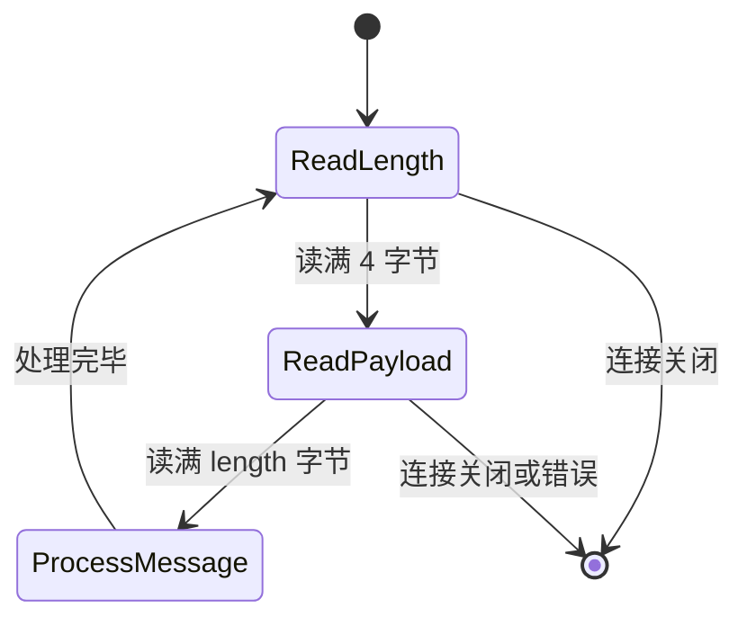
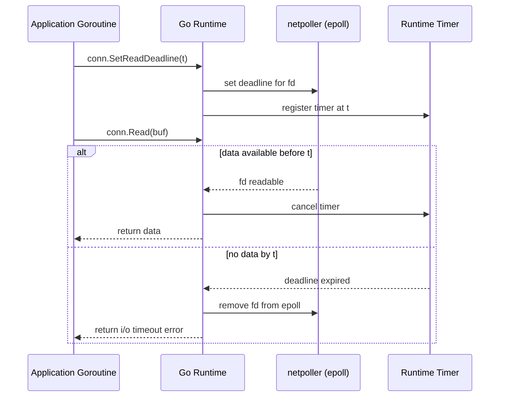

# 传输层网络协议设计——TCP 字节流无边界性与 Framing 协议

**摘要：**

TCP 是面向字节流的协议，这一基本事实决定了应用层协议设计的全部复杂性。字节流意味着传输层只承诺"按序、可靠地交付字节"，至于"一条消息从哪里开始、到哪里结束"，则是应用层必须自己回答的问题。这一缺失的边界信息，正是网络编程中粘包与拆包问题的物理根源——发送端连续调用两次 `write()`，接收端可能一次 `read()` 就拿到两次的数据，也可能需要三次 `read()` 才能凑齐一次的数据。本文从 TCP 字节流的物理本质出发，剖析粘包与拆包在 Nagle 算法、MSS 分段、内核缓冲区合并与延迟确认等机制下的具体成因；系统介绍应用层成帧（Framing）协议的三种经典方案——定长协议、分隔符协议（含转义处理）与长度前缀协议（TLV），逐一分析其解析状态机与工程代价；深入 `SetDeadline`/`SetReadDeadline`/`SetWriteDeadline` 的底层原理，揭示其并非操作系统的 socket 超时，而是 Go 运行时基于 netpoller 定时器实现的抽象，以及超时后连接状态的正确处置方式；最后讨论缓冲边界与协议向后兼容演进的工程智慧。整篇文章的叙事主线是：传输层放弃的"消息边界"，必须由应用层以协议的形式重新建立——这一重建过程，是每一对通信端点必须达成的契约，也是理解所有应用层协议设计的钥匙。

---

## 第 1 章 TCP 字节流的物理本质

### 1.1 字节流与消息流的根本分野

要理解 TCP 协议设计的全部逻辑起点，必须先厘清一个被长期忽视的基本事实：**TCP 是字节流（byte stream）协议，不是消息（message）协议**。这一区分看似语义游戏，实则决定了应用层协议设计的全部复杂性。

所谓字节流，是指传输层只承诺"按发送顺序、可靠地交付字节"，至于"一条应用消息从哪里开始、到哪里结束"，则完全不在 TCP 的语义范围之内。TCP 不关心、也不知道、也不需要知道应用层正在传递什么——它只看到一个连续的字节序列，从发送端的应用缓冲区流向接收端的应用缓冲区。这与 UDP 形成鲜明对比：UDP 是数据报协议，每个 `sendto()` 对应一个独立的数据报，接收端每个 `recvfrom()` 返回一个完整的数据报，消息边界在网络传输过程中被天然保留。

不妨用一个生活化的比喻来理解这一分野。TCP 字节流好比家庭供水管道——自来水公司以恒定水压向管道注水，用户打开水龙头就接到水，管道不关心"这一次打开水龙头是要接一杯水还是一桶水"，它只保证水流连续、不中断、不污染。而 UDP 数据报则好比快递包裹——每次寄件都有一个独立的包裹编号，收件人一次签收一个包裹，包裹之间天然有边界。供水管道无法告诉你"第几滴水属于第几次开水龙头"，这正是 TCP 字节流的本质特征。

从协议栈的分层视角看，这一分野是刻意的架构选择。TCP 的设计目标是提供"可靠的、有序的、无差错的字节传输"（RFC 793, 1981），它将"什么是一个完整消息"的解释权完全交给了应用层。这一设计让 TCP 具备了极强的通用性——HTTP、FTP、SMTP、SSH、Redis 协议、MySQL 协议，所有应用层协议都构建在同一条字节流之上，各自定义自己的消息边界。但代价是，**每一条基于 TCP 的应用协议都必须自己实现成帧（Framing）**——在发送端将消息切分为带边界的帧，在接收端从字节流中识别出帧的边界。

从网络协议栈的整体视角看（参见 [[Linux/网络协议栈与IO/00 专栏导览|网络协议栈与 IO]]），TCP 位于传输层，向上为应用层提供字节流抽象，向下依赖 IP 层的数据报传输。IP 层本身也是无连接的、尽力而为的数据报服务，TCP 通过序列号、确认、重传等机制在 IP 之上构建了可靠的字节流。这一"在不可靠之上构建可靠"的设计思路，与 Go 运行时的网络编程模型有着异曲同工之妙——正如 [[Golang/Go并发编程/12 Go 网络编程——netpoller 与 Goroutine-per-Connection]] 中所讨论的，Go 在操作系统的异步 I/O（epoll/kqueue）之上构建了同步的编程模型，用抽象屏蔽了底层的复杂性。TCP 在 IP 之上构建字节流，与 Go 在 epoll 之上构建同步 API，都是"用抽象层屏蔽底层复杂性"的经典范例。

### 1.2 字节流在协议栈中的具体表现

从 Linux 内核的实现看，TCP 字节流的物理形态体现在以下几个层次。

**发送端**。应用程序调用 `write(fd, buf, len)` 时，内核将 `buf` 中的 `len` 个字节追加到该 socket 的发送缓冲区（send buffer，由 `sndbuf` 控制，默认通常在 4KB 到数 MB 之间，可通过 `SO_SNDBUF` 调整）。这些字节并不立即被发送，而是等待以下条件之一触发：发送缓冲区积累到一定量、TCP 窗口允许、定时器到期（如延迟确认定时器）、或应用显式调用 `flush`（在 Go 中对应 `bufio.Writer.Flush()`）。发送时，内核将发送缓冲区的数据按 MSS（Maximum Segment Size，最大报文段大小，以太网场景下通常为 1460 字节）分段，每段加上 TCP 头部与 IP 头部后交给网络层。

**传输过程**。一个应用层 `write()` 调用写入的字节，可能被分段成多个 TCP segment 发送；而多次 `write()` 调用的字节，也可能被合并到一个 TCP segment 中发送。这种"合并与分段"完全是内核基于当前网络状况、拥塞窗口、MSS 大小等因素动态决定的，应用程序对此毫无控制权。

**接收端**。内核将收到的 TCP segment 中的载荷字节按序追加到接收缓冲区（receive buffer，由 `rcvbuf` 控制）。应用程序调用 `read(fd, buf, len)` 时，内核从接收缓冲区中拷贝最多 `len` 个字节到 `buf`——如果接收缓冲区的数据不足 `len` 字节，则返回实际可用的字节数（在非阻塞模式下）或阻塞等待（在阻塞模式下）。接收端的一次 `read()` 调用，拿到的数据可能来自发送端的多次 `write()`，也可能只是一次 `write()` 的一部分。

这一过程中有两个关键的协议机制会进一步模糊应用层写入与接收之间的对应关系：**Nagle 算法** 与 **延迟确认（Delayed Acknowledgment）**。

### 1.3 Nagle 算法与延迟确认的合并效应

Nagle 算法（1984 年，John Nagle）的设计初衷是减少网络中小报文的数量。其核心规则是：当发送端有尚未被确认的小数据（小于 MSS）在途时，后续的小数据写入将被延迟，直到收到确认或积累到 MSS 大小。这一机制在交互式应用（如 Telnet）中可以显著减少网络拥塞——每敲击一个键盘字符就发送一个 41 字节（TCP 头部 + IP 头部 + 1 字节数据）的报文是极其浪费的，Nagle 算法将这些小报文合并发送。

但 Nagle 算法的副作用是：**应用程序连续两次 `write()` 的小数据，可能被合并到一个 TCP segment 中发送**。接收端一次 `read()` 拿到的数据，可能对应发送端的两次 `write()`——这就是"粘包"现象的一种成因。

延迟确认（Delayed Acknowledgment）是 TCP 的另一项优化。RFC 1122 规定接收端不必每收到一个 segment 就立即发送 ACK，可以等待一段时间（通常 40ms 到 200ms，Linux 默认 40ms）再发送，以便将 ACK 与反向数据合并（piggybacking）。这一机制在请求-响应式协议中会引入额外的往返延迟——接收端收到数据后等待 40ms 才发 ACK，如果这段时间内没有反向数据要发送，ACK 单独发出，发送端才能继续发送后续数据。

Nagle 算法与延迟确认的组合效应更加显著。设想这样一个场景：发送端 A 向接收端 B 发送一个小的请求（小于 MSS），B 收到后因为延迟确认并未立即发送 ACK；A 此时要发送后续数据，但因为前一个 segment 的 ACK 未收到，Nagle 算法阻止了后续小数据的发送——A 必须等到 B 的 ACK 到达，或者延迟确认定时器到期（40ms）。这一"等待"在某些延迟敏感的协议中（如高频交易系统、数据库复制协议）会成为性能瓶颈，因此这些协议通常会在 socket 层禁用 Nagle 算法（`TCP_NODELAY`）。

> [!info] 小结：字节流的物理含义
> TCP 字节流只承诺字节按序交付，不承诺消息边界。发送端的一次 `write()` 可能对应接收端的多次 `read()`，也可能与多次 `write()` 合并后只对应一次 `read()`。这一物理事实，是理解粘包与拆包问题的基础。

从 Go 程序员的视角看，理解这一物理事实尤为重要。Go 的 `net.Conn` 接口封装了 TCP socket，`Read()` 和 `Write()` 方法看似简单，但底层的物理行为与 C 语言的 `read()`/`write()` 系统调用并无本质区别。Go 运行时通过 netpoller 将非阻塞 I/O 封装成同步阻塞的编程模型（详见 [[Golang/Go并发编程/12 Go 网络编程——netpoller 与 Goroutine-per-Connection]]），但这只是执行模型的抽象，**字节流的语义并未改变**——`Read()` 仍然可能返回部分数据，`Write()` 仍然可能被内核合并发送。这一认知是理解本专栏后续章节（如 [[Golang/Go网络编程与持久化/00 专栏导览|Go 网络编程与持久化]] 中讨论的连接池、优雅停机等机制）的基础。

---

## 第 2 章 粘包与拆包：成因、表现与反事实

### 2.1 粘包与拆包的定义

在基于 TCP 的应用层协议开发中，"粘包"与"拆包"是两个被广泛使用但定义不够严谨的术语。笔者在此给出明确界定：

**粘包（Sticky Packet / Coalescing）**：发送端连续发送的两条或多条逻辑消息，在接收端的一次 `read()` 中被同时读取，导致接收端无法区分消息边界。譬如发送端依次发送消息 A 和消息 B，接收端一次 `read()` 拿到了 A+B 的拼接数据。

**拆包（Split Packet / Segmentation）**：发送端发送的一条逻辑消息，在接收端需要多次 `read()` 才能完整读取。譬如发送端发送消息 A，接收端第一次 `read()` 只拿到 A 的前半部分，第二次 `read()` 才拿到后半部分。

需要指出的是，"粘包"与"拆包"并非 TCP 的 bug，而是 TCP 字节流本质的自然表现。TCP 从未承诺过消息边界，应用层自然也没有权利期望 `write()` 与 `read()` 之间一一对应。这两个术语更多是应用层开发者站在"我希望消息有边界"的立场上，对 TCP 字节流行为的描述。

不妨用一个比喻来加深理解。TCP 字节流好比一条传送带，工厂（发送端）在传送带上放置产品（字节），仓库（接收端）从传送带上取走产品。传送带不关心"哪些产品属于同一批订单"——它只保证产品按放置顺序被取走。工厂可能一次放了 10 个产品，仓库可能一次取走 3 个，也可能一次取走 15 个（其中 5 个是下一批的）。"一批订单"的边界是工厂和仓库之间的业务约定，传送带本身不知道这个约定。粘包就是"仓库一次取走了两批订单的产品"，拆包就是"仓库只取走了一批订单的部分产品"——传送带没有错，它只负责传送。

### 2.2 粘包与拆包的具体成因

粘包与拆包的成因可以归纳为以下四类。

**其一，MSS 分段导致拆包**。当应用层 `write()` 的数据大于 MSS（典型 1460 字节）时，内核会将其分成多个 TCP segment 发送。如果接收端的 `read()` 缓冲区较小或内核调度时机不利，一次 `read()` 可能只拿到一个或几个 segment 的数据，无法凑齐完整的消息。

**其二，内核缓冲区合并导致粘包**。发送端连续多次 `write()` 的数据，可能被内核合并到同一个 TCP segment 中发送（尤其当数据小于 MSS 且 Nagle 算法未禁用时）。接收端一次 `read()` 可能拿到多次 `write()` 的数据拼接。

**其三，接收缓冲区积累导致粘包**。如果接收端的应用进程读取数据的速度慢于数据到达的速度，接收缓冲区会积累多个 segment 的数据。此时一次 `read()` 可能拿到多个逻辑消息的拼接。

**其四，网络分包与乱序重组导致拆包**。IP 层可能对 TCP segment 进行分片（fragmentation），接收端内核需要重组后才能交付给应用层。在重组完成前，`read()` 只能返回部分数据。此外，TCP 的乱序重传机制也可能导致接收端暂时只拿到部分数据。

### 2.3 不处理粘包拆包会怎样

如果应用层协议设计者忽视字节流的无边界性，假定 `read()` 总能返回完整的消息，会发生什么？

**最常见的问题**是数据解析错乱。假设协议采用简单的"每次 `write()` 发送一条 JSON 消息"的方式，接收端用"每次 `read()` 读取一条 JSON 消息"的方式解析。当粘包发生时，接收端拿到的数据可能是 `{"a":1}{"b":2}`——这不是合法的 JSON，解析器会报错。更糟糕的情况是拆包：接收端拿到 `{"a":`——同样不是合法 JSON，解析失败。

**更隐蔽的问题**是协议状态机的错位。假设协议的消息格式是"4 字节长度 + N 字节载荷"，接收端先 `read()` 4 字节获取长度，再 `read()` 长度指定的字节数获取载荷。如果第一次 `read()` 只拿到 3 字节（拆包），接收端用这 3 字节拼凑出一个错误的长度值，后续解析全部错乱。这种错误往往在低并发、低延迟的测试环境中不会出现（因为数据恰好能按预期对齐），却在线上高并发环境中频繁触发——因为高并发下网络延迟抖动更大，内核缓冲区行为更复杂。

**最严重的问题**是安全漏洞。攻击者可以故意构造粘包或拆包的数据，诱导接收端的解析器进入错误状态，进而执行未预期的代码路径。这种"协议混淆攻击"在早期的 IMAP、SMTP 服务器中曾被广泛利用。

还有一个常被忽视的问题是**调试困难**。当粘包或拆包发生时，问题的表现往往是"解析失败"或"数据损坏"，但根因可能隐藏在协议栈的多个层次——Nagle 算法、内核缓冲区、网络延迟、接收端调度时序等。调试这类问题需要同时观察应用层数据、TCP 报文、内核缓冲区状态，工具链的复杂性使得定位根因极其耗时。这就是为什么生产级的网络协议实现必须配备完善的日志与诊断机制——在解析器的每个关键步骤记录接收到的字节数、缓冲区状态、解析状态，才能在问题发生时快速定位。

> [!warning] 反事实论证
> 如果 TCP 是消息协议而非字节流协议，那么每个 `send()` 都对应一个独立的消息，接收端每个 `recv()` 都返回完整的消息——应用层就不需要自己成帧。但这样的 TCP 会失去通用性：它必须预设消息的最大长度、必须处理消息丢失（一个消息的丢失不应阻塞后续消息）——这些复杂性使得"可靠的消息传输"在传输层实现起来极其困难。UDP 加应用层可靠性（如 QUIC）是一条替代路径，但工程复杂度并不更低。TCP 选择字节流而非消息，是刻意的架构简化——把复杂性的控制权留给应用层。

---

## 第 3 章 应用层成帧协议的三种经典方案

既然 TCP 不提供消息边界，应用层就必须自己定义边界——这一过程称为**成帧（Framing）**。成帧协议的任务是：在发送端为每条消息添加足够的元信息，使得接收端能够从字节流中无歧义地识别出每条消息的边界。

经典成帧方案有三种：**定长协议**、**分隔符协议**、**长度前缀协议**。三者的核心区别在于"如何表达消息边界"这一信息的编码方式。

### 3.1 定长协议

定长协议（Fixed-Length Framing）是最简单的成帧方案：**每条消息的长度固定为 N 字节**，接收端每次 `read()` N 字节即得到一条完整消息。

这种方案的解析状态机极其简单——只需一个计数器，读满 N 字节即解析一条消息。HTTP/1.0 的早期实现中，某些固定格式的头部字段（如 `Content-Length` 指定的定长 body）可以视为定长协议的特例。工业控制协议（如 Modbus 的部分变体）、某些嵌入式系统的串口通信协议也采用定长帧。

定长协议的优点是**解析逻辑极其简单**，不需要状态机，不需要查找边界，甚至可以用 `memcpy` 直接将定长数据拷贝到结构体中。其缺点是**灵活性极差**——所有消息必须等长，短消息浪费带宽（需要填充），长消息无法表达（需要拆分成多条定长消息）。

```go
// 定长协议解析器（伪代码）
const FRAME_SIZE = 128

func parseFixedLength(conn net.Conn) {
    buf := make([]byte, FRAME_SIZE)
    for {
        _, err := io.ReadFull(conn, buf)  // 必须读满 FRAME_SIZE 字节
        if err != nil {
            return
        }
        processMessage(buf)
    }
}
```

注意上例中使用了 `io.ReadFull` 而非 `conn.Read`——前者保证读满指定字节数或返回错误，后者可能返回部分数据。这是定长协议解析的关键：**必须使用循环读取直到满足条件**，因为即使是定长协议，一次 `read()` 也可能只返回部分数据（拆包）。

定长协议的适用场景非常有限：消息长度天然固定（如传感器采样值、固定格式的控制指令），或者协议设计者愿意为简化解析逻辑而牺牲带宽灵活性。

### 3.2 分隔符协议

分隔符协议（Delimiter-Based Framing）使用一个特殊的字节序列作为消息的结束标记。接收端逐字节或逐块扫描，直到找到分隔符即认为一条消息结束。

最典型的是以换行符（`\n` 或 `\r\n`）作为分隔符。HTTP/1.1 的头部字段、SMTP 协议、IRC 协议、Redis 的 RESP 协议（部分）都采用分隔符成帧。SMTP 使用 `\r\n.\r\n` 作为邮件正文的结束标记；IRC 使用 `\r\n` 作为命令分隔符。

分隔符协议的核心挑战是：**如果消息内容本身包含分隔符字节，如何处理？** 这引出了两种处理策略。

**策略一：转义（Escaping）**。发送端扫描消息内容，将分隔符字节替换为转义序列。譬如 Telnet 协议（RFC 854）使用 `IAC`（Interpret As Command，字节值 255）作为命令前缀，如果数据中需要出现字面值 255，则发送两个连续的 255（`IAC IAC`）。接收端扫描时，遇到单个 255 知道后面跟着命令字节，遇到连续两个 255 知道这是一个字面值 255。

**策略二：限制字符集**。协议规定消息内容不能包含分隔符字节。HTTP/1.1 的头部字段值不允许包含裸 `\r\n`（必须编码为 `\r\n SP` 或 `\r\n HT`），这就是通过限制字符集避免分隔符冲突。

```go
// 以 \n 为分隔符的协议解析器（伪代码）
func parseDelimited(conn net.Conn, delim byte) {
    reader := bufio.NewReader(conn)
    for {
        line, err := reader.ReadBytes(delim)
        if err != nil {
            return
        }
        // line 包含分隔符，需要去除
        line = line[:len(line)-1]
        processMessage(line)
    }
}
```

上例使用了 `bufio.Reader.ReadBytes`，它在内部维护一个缓冲区，逐字节扫描直到找到分隔符。这是分隔符协议解析的典型实现。但需要注意：**`ReadBytes` 会一直读取直到找到分隔符**——如果发送端 bug 导致没有发送分隔符，接收端将无限等待（或直到内存耗尽）。生产实现必须设置最大长度限制或超时机制。

分隔符协议的优点是**实现简单、可读性好**（文本协议通常采用分隔符成帧，便于人类调试）。缺点是**二进制数据需要转义**（转义增加数据体积，转义逻辑增加代码复杂度），且**不适合包含任意字节的消息**（必须通过编码如 Base64 将二进制数据转换为安全字符集）。

### 3.3 长度前缀协议（TLV）

长度前缀协议（Length-Prefixed Framing），也称为 TLV（Type-Length-Value）协议，是二进制协议中最主流的成帧方案。其帧格式为：

```
┌─────────────┬──────────────┬────────────────────┐
│  Length (N) │  Type/Meta   │  Value (N bytes)   │
└─────────────┴──────────────┴────────────────────┘
```

发送端在每条消息前附加一个长度字段（通常为 2 字节或 4 字节的无符号整数，大端或小端编码），接收端先读取长度字段，再根据长度值读取后续的载荷数据。

长度前缀协议的优势在于：**不需要转义，不需要扫描，不需要限制字符集**——消息内容可以是任意字节序列，长度字段明确告知接收端需要读取多少字节。MySQL 协议、PostgreSQL 协议、Redis 的 RESP2 批量数组、gRPC 的 Length-Prefixed Message、Thrift 的 Binary Protocol、Protocol Buffers 的变长整数编码（在更高层面）都采用长度前缀成帧。

```go
// 长度前缀协议解析器（4 字节大端长度 + 载荷）
func parseLengthPrefixed(conn net.Conn) error {
    lenBuf := make([]byte, 4)
    for {
        // 第一步：读取 4 字节长度字段
        if _, err := io.ReadFull(conn, lenBuf); err != nil {
            return err
        }
        length := binary.BigEndian.Uint32(lenBuf)
        
        // 安全性检查：防止恶意长度值导致 OOM
        if length > MAX_MESSAGE_SIZE {
            return fmt.Errorf("message too large: %d", length)
        }
        
        // 第二步：读取指定长度的载荷
        payload := make([]byte, length)
        if _, err := io.ReadFull(conn, payload); err != nil {
            return err
        }
        
        processMessage(payload)
    }
}
```

长度前缀协议的解析状态机可以用下图描述：



状态机的核心是两个循环：第一个循环读取长度字段（4 字节），第二个循环读取载荷（length 字节）。每个循环都必须使用 `io.ReadFull` 保证读满，因为 TCP 字节流可能拆包。

值得深入讨论的是 `io.ReadFull` 的内部实现。它本质上是一个循环读取器——每次调用底层 `Read()`，如果返回的数据不足，则继续调用直到读满或出错。这一实现看似简单，但有一个重要的性能特性：对于 `bufio.Reader` 包装的连接，`io.ReadFull` 通常只需一次底层 `Read()` 就能读满（因为 `bufio.Reader` 的缓冲区默认 4KB，而长度字段只有 4 字节，载荷如果小于 4KB 通常也能一次读完）。这就是为什么 Go 的网络编程实践中强烈建议使用 `bufio.Reader`——它不仅减少系统调用次数，还能让 `io.ReadFull` 的语义更接近"一次性读取完整数据"。对于不使用 `bufio` 的裸 `net.Conn`，`io.ReadFull` 可能需要多次系统调用，在高并发场景下可能成为性能瓶颈。

长度前缀协议还有一个变种值得注意：**变长长度字段**（Varint Length Prefix）。Protocol Buffers 和 Thrift 的紧凑编码使用变长整数（Varint）编码长度——小长度用 1 字节，大长度用多字节。这一设计在消息长度分布不均匀时能显著节省带宽——大多数消息小于 128 字节，只需 1 字节长度字段，而固定 4 字节长度字段则浪费 3 字节。但变长编码的代价是解析复杂度增加——接收端必须逐字节读取直到找到 Varint 的结束标志（最高位为 0 的字节），这引入了一个额外的内层状态机。

长度前缀协议的代价是：
- **发送端必须先知道消息长度**才能填写长度字段——这要求发送端先将消息序列化到缓冲区，计算长度后再发送。对于流式数据（如实时视频），这一约束不适用（需要分块传输）。
- **长度字段本身的字节序与编码**必须协议双方约定一致——大端还是小端，4 字节还是 2 字节，是否包含长度字段自身的长度——这些细节任何一处不一致都会导致解析错乱。
- **恶意长度值**是安全风险——如果接收端不校验长度上限，攻击者可以发送一个超大长度值（如 4GB），接收端尝试分配巨量内存导致 OOM。生产实现必须在读取长度后立即校验其合理性。

### 3.4 三种方案的横向对比

| 维度 | 定长协议 | 分隔符协议 | 长度前缀协议 |
|---|---|---|---|
| **解析复杂度** | 极低 | 中（需扫描/转义） | 中（需状态机） |
| **带宽效率** | 低（短消息需填充） | 中（分隔符占 1-N 字节） | 高（长度字段仅 2-4 字节） |
| **二进制支持** | 好 | 差（需转义或编码） | 好（任意字节） |
| **灵活性** | 差（消息必须等长） | 中（长度可变） | 好（长度可变） |
| **可读性** | 差 | 好（文本友好） | 中（二进制） |
| **典型应用** | 工业控制、固定格式指令 | HTTP/1.1 头部、SMTP、IRC | MySQL、gRPC、Thrift |
| **主要风险** | 带宽浪费 | 分隔符冲突、无限等待 | 恶意长度值 OOM |

这一对比的核心结论是：**没有普适最优的成帧方案，只有适合特定协议需求的方案**。文本协议通常选分隔符（可读性优先），二进制协议通常选长度前缀（灵活性优先），极端性能敏感的场景可能选定长（解析速度优先）。

---

## 第 4 章 超时机制：`SetDeadline` 的底层原理

网络编程中，超时控制是防御性编程的核心。一个没有超时的网络程序，在面对慢速对端、网络分区、对端崩溃等场景时，将无限期阻塞——Goroutine 堆积、内存耗尽、服务不可用。Go 的 `net.Conn` 接口提供了三个超时方法：`SetDeadline`、`SetReadDeadline`、`SetWriteDeadline`，它们的语义清晰，但底层实现却隐藏着 Go 运行时与操作系统交互的精巧设计。

### 4.1 `SetDeadline` 的语义

`SetDeadline(time.Time)` 设置连接的读写截止时间（deadline）。一旦设置，所有后续的 `Read()` 和 `Write()` 调用都会在到达该时间时返回超时错误（实现 `net.Error` 接口，`Timeout()` 返回 `true`）。

`SetReadDeadline` 和 `SetWriteDeadline` 分别只设置读或写的截止时间。三个方法共享同一个底层机制——**Go 运行时的定时器**，而非操作系统的 socket 超时选项（如 `SO_RCVTIMEO`、`SO_SNDTIMEO`）。

这是一个关键区别。许多开发者误以为 `SetReadDeadline` 是设置操作系统的 socket 接收超时（`SO_RCVTIMEO`），实际上 Go 的 `net` 包将 socket 设置为非阻塞模式（`O_NONBLOCK`），由 netpoller 管理 I/O 事件，Go 运行时在用户空间实现超时检测。操作系统的 `SO_RCVTIMEO` 在 Go 的 `net.Conn` 上并不生效——因为 socket 是非阻塞的，`recv()` 系统调用要么立即返回数据，要么返回 `EAGAIN`，不会阻塞等待超时。

这一设计的深层原因在于 Go 运行时的并发模型。如果 Go 使用操作系统的阻塞 I/O + socket 超时，那么每个阻塞在 I/O 上的 Goroutine 都会占用一个 OS 线程（因为阻塞系统调用会阻塞调用线程），这与 Go 的"Goroutine-per-Connection"模型（详见 [[Golang/Go并发编程/12 Go 网络编程——netpoller 与 Goroutine-per-Connection]]）完全矛盾——百万级并发连接需要百万个 OS 线程，内存立即耗尽。因此 Go 必须使用非阻塞 I/O + netpoller，让等待 I/O 的 Goroutine 挂起而非阻塞线程。`SetDeadline` 的运行时实现，是这一并发模型的必然结果。

### 4.2 底层原理：netpoller 与定时器

`SetDeadline` 的底层实现涉及 Go 运行时的两个子系统：**netpoller**（负责 I/O 事件监听）与 **timer**（负责超时检测）。



当 Goroutine 调用 `conn.Read(buf)` 时，运行时执行以下步骤：

1. **尝试非阻塞读**。运行时调用 `syscall.Read(fd, buf)`。如果内核接收缓冲区有数据，立即返回——这是快速路径，没有超时开销。

2. **数据未就绪，注册 epoll 并挂起**。如果 `read()` 返回 `EAGAIN`（无数据），运行时将当前 fd 注册到 epoll（如果尚未注册），然后调用 `gopark()` 挂起当前 Goroutine，释放 P 给其他 Goroutine 使用。

3. **设置定时器**。如果此前调用过 `SetReadDeadline(t)`，运行时会注册一个定时器，到期时间为 `t`。这个定时器由运行时的 timer 子系统管理，与 `time.After` 使用相同的底层机制。

4. **等待事件**。两个事件可能唤醒挂起的 Goroutine：
   - **epoll 通知数据就绪**：netpoller 检测到 fd 可读，唤醒 Goroutine，取消定时器，`Read()` 返回数据。
   - **定时器到期**：deadline 到达，定时器触发，运行时将 Goroutine 标记为超时，从 epoll 中移除该 fd 的注册，`Read()` 返回 `i/o timeout` 错误。

5. **超时后的连接状态**。这里有一个**极其重要但常被忽视**的事实：**超时后，连接的底层 TCP 连接仍然存活**。超时只是 `Read()` 或 `Write()` 调用返回错误，并不意味着连接断开。如果应用程序继续使用这个连接，后续的 `Read()`/`Write()` 仍然可以正常工作（前提是网络恢复正常）。

### 4.3 超时后的连接处置

超时后的连接是否应该继续使用？答案是：**通常不应该**。

原因在于 TCP 字节流协议的语义。假设 `Read()` 因为超时而返回错误，此时可能有以下几种情况：

**情况一：数据在途，尚未到达**。对端已经发送了数据，但数据还在网络中传输，尚未到达本端内核缓冲区。此时如果继续使用连接，后续 `Read()` 可能在稍后拿到数据——但这条数据属于哪个请求？如果应用层是请求-响应协议，超时后应用层可能已经放弃等待并返回错误给客户端，此时再读到数据将导致状态混乱。

**情况二：对端已发送，但本端内核延迟交付**。数据已经到达本端内核，但因为调度或其他原因，Goroutine 尚未被唤醒。这种情况下数据仍然可读，但超时已经发生。

**情况三：对端崩溃或网络分区**。对端已经不可达，数据永远不会到达。此时继续使用连接只会导致后续 `Read()` 继续超时。

**情况四：半开连接**。对端已经关闭了发送方向（发送了 FIN），但本端尚未感知。此时 `Read()` 会返回 0 字节（EOF），而不是超时。但如果网络分区发生，FIN 无法到达，本端会一直等待直到超时。

无论哪种情况，**超时后的连接状态对于应用层协议来说已经不可信**——你不知道字节流中是否还有未读的数据，你不知道后续读到的数据是否属于预期的响应。因此，Go 网络编程的最佳实践是：**一旦发生超时错误，立即关闭连接，不要复用**。

```go
conn.SetReadDeadline(time.Now().Add(5 * time.Second))
n, err := conn.Read(buf)
if err != nil {
    if netErr, ok := err.(net.Error); ok && netErr.Timeout() {
        // 超时后，连接状态不可信，应当关闭
        conn.Close()
        return errTimeout
    }
    // 其他错误（如 EOF），也应关闭
    conn.Close()
    return err
}
// 正常处理数据
```

> [!note] 核心概念：`SetDeadline` 不是 socket 超时
> Go 的 `SetDeadline` 是运行时的用户空间超时，通过 netpoller + timer 实现，而非操作系统的 `SO_RCVTIMEO`/`SO_SNDTIMEO`。超时后 TCP 连接仍然存活，但应用层协议状态已不可信，应当关闭连接而非复用。

### 4.4 超时阶梯：多层防御

在实际的网络服务中，单一的超时往往不足以覆盖所有场景。生产级 Go 网络服务通常采用**超时阶梯（Timeout Ladder）**——在不同层次设置不同粒度的超时，形成多层防御。

| 层次 | 超时机制 | 典型值 | 防御目标 |
|---|---|---|---|
| TCP 连接建立 | `Dialer.Timeout` | 5-30s | 对端不可达、DNS 延迟 |
| TLS 握手 | `Dialer.TLSHandshakeTimeout` | 5-10s | TLS 协商卡死 |
| 请求头部读取 | `Server.ReadHeaderTimeout` | 2-5s | Slowloris 攻击 |
| 请求体读取 | `Server.ReadTimeout` | 5-30s | 慢速客户端 |
| 响应写入 | `Server.WriteTimeout` | 10-60s | 慢速客户端、大响应体 |
| 空闲连接 | `Server.IdleTimeout` | 60-300s | Keep-Alive 连接泄漏 |
| 客户端整体 | `Client.Timeout` | 10-60s | 下游服务延迟 |
| 上下文传播 | `context.WithTimeout` | 业务相关 | 请求链路级超时 |

`ReadHeaderTimeout` 与 `ReadTimeout` 的区分值得特别注意。`ReadHeaderTimeout` 只限制读取请求头部的时间，`ReadTimeout` 限制读取完整请求（含 body）的时间。对于大请求体（如文件上传），`ReadTimeout` 必须设置得足够长以允许完整传输；但 `ReadHeaderTimeout` 应当较短，以防止 Slowloris 攻击（慢速发送头部，每秒几个字节，占用 Goroutine）。这一区分是 HTTP 服务端安全配置的关键。

超时阶梯的设计哲学是**纵深防御（Defense in Depth）**——不依赖任何单一超时机制，而是在每个可能的阻塞点设置超时，形成多层防线。即使某一层的超时设置不当（如 `ReadTimeout` 设置过长），其他层的超时（如 `context.WithTimeout`）仍能防止资源无限期占用。这一思想与网络安全中的"不信任任何单一防线"原则一致。在实际生产中，超时阶梯的参数调优是一个持续的过程——需要根据实际的流量模式、下游服务的延迟分布、客户端的行为特征不断调整。过短的超时会误杀正常请求（尤其在网络抖动时），过长的超时会让服务在异常情况下无法及时恢复。

另一个值得讨论的问题是 `SetDeadline` 与 `context.Context` 的关系。在 Go 的网络编程中，有两种超时控制机制：`net.Conn.SetDeadline` 和 `context.WithTimeout`。前者是连接级的超时，后者是请求级的超时。`net/http` 标准库在内部使用 `context.Context` 传播超时——当客户端的 `http.Client.Timeout` 到期时，请求的 `context.Context` 被取消，`net/http` 内部调用 `conn.SetDeadline` 关闭连接。对于直接操作 `net.Conn` 的低层代码，`SetDeadline` 更直接；对于使用 `net/http` 或 gRPC 的高层代码，`context.Context` 更符合 Go 的惯用法，且可以沿请求链路传播。

```go
// 连接级超时：适合直接操作 net.Conn 的低层代码
conn.SetReadDeadline(time.Now().Add(5 * time.Second))
data, err := readFullRequest(conn)

// 请求级超时：适合高层框架，可沿链路传播
ctx, cancel := context.WithTimeout(context.Background(), 30*time.Second)
defer cancel()
req, _ := http.NewRequestWithContext(ctx, "POST", url, body)
resp, err := client.Do(req)
```

两种机制可以结合使用——`context.Context` 控制请求的整体超时，`SetDeadline` 控制单次 I/O 操作的超时。在高并发服务中，通常两者都设置：`context.WithTimeout` 防止整个请求处理时间过长，`SetReadDeadline` 防止单次读取无限阻塞。

---

## 第 5 章 缓冲边界与协议演进

### 5.1 缓冲区的物理存在

在 TCP 字节流的传输路径上，存在多个缓冲区层次，每个层次都可能缓存数据，影响应用层的读写行为。

**应用层缓冲区**。Go 的 `bufio.Reader` 和 `bufio.Writer` 在用户空间维护缓冲区，减少系统调用次数。`bufio.Reader` 默认缓冲区 4KB，`bufio.Writer` 默认 4KB。这些缓冲区会缓存数据——`bufio.Reader` 可能预读了超出当前 `Read()` 请求的数据，`bufio.Writer` 可能缓存了尚未 `Flush()` 的数据。

**内核接收缓冲区**。由 `SO_RCVBUF` 控制，Linux 默认通常在 87KB 到 250KB 之间（根据内核版本与自动调优）。数据从网络到达后，首先进入内核接收缓冲区，等待应用层 `read()` 取走。

**内核发送缓冲区**。由 `SO_SNDBUF` 控制，`write()` 的数据首先进入内核发送缓冲区，等待网络发送。

**网络路径上的缓冲区**。路由器的队列、网卡的 RX/TX ring buffer、交换机的端口缓冲区——这些设备缓冲区可能导致数据包排队延迟（queuing delay），在拥塞时可能导致丢包。

这些缓冲区的存在意味着：**应用层 `write()` 的数据不会立即到达对端应用层**，中间可能滞留在多个缓冲区中。这一物理事实对于协议演进与向后兼容有重要影响。

### 5.2 协议向后兼容的工程智慧

当协议需要演进（增加新字段、改变消息格式）时，必须考虑向后兼容——旧版本的接收端应当能够处理新版本发送端发送的数据，至少不崩溃。

**长度前缀协议天然支持向后兼容**。接收端先读取长度字段，再读取指定长度的载荷——即使载荷中包含接收端不认识的新字段，接收端也可以跳过这些字段（只解析自己认识的部分）。这就是为什么 MySQL 协议、Thrift 协议等在演进时能够保持向后兼容。

**分隔符协议的兼容性较差**。如果新版本在消息中引入了新的分隔符字节，旧版本的解析器会将消息错误地截断。因此分隔符协议的演进通常需要选择新的分隔符（但这又可能与消息内容冲突），或采用转义机制（增加复杂度）。

**定长协议无法兼容长度变化**。如果新版本需要更长的消息，旧版本的接收端无法处理。

一个经典的工程智慧是：**在协议头部保留版本号字段**。接收端根据版本号选择不同的解析逻辑，从而实现多版本共存。HTTP 协议的 `HTTP/1.0` 与 `HTTP/1.1` 共存、TLS 协议的版本协商、SSH 协议的版本交换，都是这一智慧的体现。

```go
// 带版本号的长度前缀协议
type MessageHeader struct {
    Version uint8   // 协议版本
    Type    uint8   // 消息类型
    Length  uint32  // 载荷长度
}

func parseVersioned(conn net.Conn) error {
    headerBuf := make([]byte, 6)  // 1+1+4 = 6 bytes
    for {
        if _, err := io.ReadFull(conn, headerBuf); err != nil {
            return err
        }
        version := headerBuf[0]
        msgType := headerBuf[1]
        length := binary.BigEndian.Uint32(headerBuf[2:6])
        
        payload := make([]byte, length)
        if _, err := io.ReadFull(conn, payload); err != nil {
            return err
        }
        
        switch version {
        case 1:
            processV1(msgType, payload)
        case 2:
            processV2(msgType, payload)
        default:
            return fmt.Errorf("unknown version: %d", version)
        }
    }
}
```

### 5.3 `bufio.Reader` 的缓冲边界陷阱

当使用 `bufio.Reader` 包装 `net.Conn` 时，一个常见的陷阱是**缓冲边界导致的协议混淆**。

`bufio.Reader` 在内部维护一个缓冲区，调用 `Read()` 时会预读数据到缓冲区。如果应用层先使用 `bufio.Reader` 读取了一部分数据（如协议头部），然后想切换到裸 `net.Conn` 继续读取——此时 `bufio.Reader` 的缓冲区中可能还有未消费的数据，切换到裸 `Conn` 会导致这些数据丢失。

解决方案是使用 `bufio.Reader.Reset()` 后将剩余数据写回，或从一开始就约定整个连接的生命周期都由 `bufio.Reader` 管理。HTTP/1.1 的实现中，`net/http` 标准库在整个连接生命周期中使用同一个 `bufio.ReadWriter`，避免了这一问题。

```go
// 错误做法：混用 bufio.Reader 和裸 Conn
reader := bufio.NewReader(conn)
header := readHeader(reader)  // bufio.Reader 可能预读了 body 数据
// 此时切换到裸 conn，bufio 缓冲区中的 body 数据丢失
body := make([]byte, contentLength)
conn.Read(body)  // 错误！数据已经丢失

// 正确做法：始终使用 bufio.Reader
// 或显式获取 bufio.Reader 的剩余数据
```

`bufio.Reader` 的缓冲边界问题在协议升级（如 HTTP 的 WebSocket 升级）时尤为突出。HTTP 请求头部由 `bufio.Reader` 读取后，如果要升级到 WebSocket 协议，需要将底层的 `net.Conn` 移交给 WebSocket 处理器——但 `bufio.Reader` 的缓冲区中可能还有 HTTP 请求体的数据。Go 的 `net/http` 标准库通过 `http.Hijacker` 接口解决这一问题——`Hijack()` 方法返回底层的 `net.Conn` 以及 `bufio.Reader` 缓冲区中的剩余数据，WebSocket 处理器将剩余数据作为 WebSocket 帧的第一部分处理。这一设计的精巧之处在于：它既允许协议升级时切换处理方式，又不丢失已缓冲的数据。关于 `bufio` 的滑动窗口与截断机制的更深入讨论，可以参见 Go 标准库与系统 IO 专栏的相关章节。

缓冲区管理还涉及另一个重要问题：**背压（Backpressure）**。当接收端的处理速度慢于数据到达速度时，内核接收缓冲区逐渐填满，TCP 的滑动窗口机制会通知发送端减少发送速率——这就是背压。背压是 TCP 流量控制的核心机制，它防止了接收端被数据淹没。但在应用层，如果 `Read()` 调用的频率过低，内核缓冲区可能持续处于满载状态，导致发送端的发送速率被限制在很低的水平。在高性能协议设计中，接收端通常使用专门的读取 Goroutine（或线程）持续读取数据到应用层队列，处理 Goroutine 从队列中消费——这一生产者-消费者模型可以解耦读取与处理的速度，充分利用内核缓冲区。

---

## 第 6 章 边界与反例

### 6.1 成帧协议的适用前提

三种成帧方案各有其适用前提，忽视这些前提会导致协议设计失败。

**定长协议的前提**是消息长度天然固定或可以填充到固定长度。对于长度变化范围大的消息（如 JSON 文档、图片数据），定长协议极其浪费带宽。

**分隔符协议的前提**是消息内容可以限制为不包含分隔符字节，或可以接受转义的开销。对于任意二进制数据（如加密后的密文、压缩后的数据），分隔符协议需要额外的编码层（如 Base64），增加 33% 的体积开销。

**长度前缀协议的前提**是发送端在发送前知道消息的完整长度。对于流式数据（如实时音视频、日志流），发送端无法预知总长度，需要采用分块传输（chunked transfer）——HTTP/1.1 的 Chunked Transfer-Encoding 就是为这一场景设计的，它以分块长度+分块数据的方式实现流式成帧。

### 6.2 常见误区

**误区一："TCP 会保证消息边界"**。这是最常见的误解，源自开发者在测试环境中观察到的"巧合"——低延迟、低并发的测试环境下，`write()` 和 `read()` 往往一一对应，因为数据量小、网络快、缓冲区充裕。这种"巧合"在生产环境中会被打破，导致难以复现的 bug。

**误区二："设置了 `TCP_NODELAY` 就不会粘包"**。`TCP_NODELAY` 禁用 Nagle 算法，阻止小数据合并发送，但它不阻止其他形式的粘包——内核缓冲区积累、接收端读取延迟等都可能导致粘包。`TCP_NODELAY` 解决的是"小数据延迟发送"问题，不是"消息边界"问题。

**误区三："`SetDeadline` 后连接自动关闭"**。如前所述，`SetDeadline` 超时后连接仍然存活，应用层必须主动关闭。如果忘记关闭，后续对连接的读写可能继续成功（数据在途），导致协议状态混乱。

**误区四："使用 `bufio.Reader` 后，每次 `ReadLine()` 就是一条消息"**。`bufio.Reader.ReadBytes('\n')` 确实会在遇到换行符时返回，但它**必须读满到换行符**——如果发送端没有发送换行符（bug 或恶意），接收端将无限等待。生产实现必须配合 `SetReadDeadline` 或 `bufio.Reader` 的 `Peek` 方法限制最大长度。

### 6.3 反例：HTTP/1.0 的 Content-Length 困境

HTTP/1.0 使用 `Content-Length` 头部字段告知响应体的长度——这本质上是一种长度前缀协议（虽然长度字段在头部而非帧头部）。但 HTTP/1.0 没有持久连接（persistent connection）时，响应结束后服务器直接关闭连接，客户端通过"连接关闭"（EOF）来判断响应结束。

这一设计的代价是：**客户端无法区分"响应完整结束"和"网络中断导致的连接关闭"**。如果响应传输过程中网络中断，客户端收到部分数据后连接断开，客户端无法知道是响应已经结束还是传输被中断。

HTTP/1.1 引入了持久连接（`Connection: keep-alive`），必须精确知道响应体的长度以复用连接——因此 `Content-Length` 成为必需。对于无法预知长度的响应（如动态生成的内容），HTTP/1.1 引入了 Chunked Transfer-Encoding——将响应体分成多个块，每块以十六进制长度+`\r\n`+数据的方式编码，最后一块长度为 0 表示结束。这本质上是一种分块长度前缀协议，牺牲了简单性以换取流式传输能力。

HTTP/2 则彻底抛弃了文本格式的成帧方式，采用二进制帧（Binary Frame）机制。HTTP/2 将连接分为多个流（Stream），每个流上的数据被切分为多个帧，每个帧有 9 字节的帧头（包含长度、类型、标志位、流标识符）。这一设计解决了 HTTP/1.1 的多个痛点：队头阻塞（Head-of-Line Blocking，HTTP/1.1 的管线化中前一个请求的响应延迟会阻塞后续请求）、头部压缩（HPACK 算法避免重复传输相同的头部字段）、服务器推送（Server Push，服务端可以主动向客户端推送资源）。HTTP/2 的帧机制可以看作是一种更复杂的长度前缀协议——它不仅编码了长度，还编码了帧类型与流标识符，实现了多路复用。关于 HTTP 服务端的架构细节，包括 Handler 链与路由树的实现，可以参见本专栏的前序章节。

从协议演进的视角看，成帧方案的选择与演进反映了应用需求的变化。早期协议（如 HTTP/1.0）采用简单的文本格式，因为网络带宽充足、消息结构简单；中期协议（如 HTTP/1.1 的 Chunked、Thrift 的 Binary Protocol）采用长度前缀，因为需要支持流式传输与二进制数据；现代协议（如 HTTP/2、gRPC、QUIC）采用复杂的二进制帧，因为需要支持多路复用、头部压缩、流量控制等高级特性。每一次演进都是在简单性与功能性之间寻找新的平衡点——没有最优方案，只有适合当下需求的方案。

---

## 结论：字节流之上的契约

行文至此，TCP 字节流的物理本质与应用层成帧协议之间的关系已经清晰。TCP 放弃了消息边界，换取了极强的通用性与可靠性；应用层协议必须在字节流之上重新建立边界，这一建立过程就是成帧协议的设计。

**定长协议**以简单性取胜，适合长度固定的场景；**分隔符协议**以可读性取胜，适合文本协议；**长度前缀协议**以灵活性取胜，适合二进制协议。三者没有高下之分，只有适用场景的差异——协议设计者的任务是理解每种方案的代价，根据协议的特定需求选择最合适的方案。

`SetDeadline` 的底层原理揭示了 Go 运行时在用户空间实现超时控制的精巧设计——netpoller 与 timer 的协作，让 Goroutine 可以在 I/O 等待时挂起、在超时或数据就绪时唤醒，对上层代码完全透明。但透明不等于无形——超时后连接状态的处置、超时阶梯的多层防御、缓冲边界的协议混淆，都是应用层必须面对的物理事实。

协议的向后兼容演进是工程智慧的体现——版本号、长度前缀、分块传输，这些机制让协议可以在不破坏现有实现的前提下持续演进。HTTP 从 1.0 到 1.1 到 2 到 3 的演进史，就是一部成帧协议的演进史——从 Content-Length 到 Chunked 到二进制帧，每一步演进都是在新需求与向后兼容之间寻找平衡。

由此可见，传输层网络协议设计的核心，不在于选择哪种成帧方案，而在于理解**字节流与消息流的根本分野**，理解**应用层必须在传输层放弃的边界上重新建立秩序**，理解**每一种选择都有其代价，因地制宜地权衡才是唯一有效的做法**。TCP 字节流的"无边界"不是缺陷，而是刻意的架构简化——它把复杂性的控制权留给了应用层，让每一条应用协议都可以按照自己的需求定义边界。这一设计哲学，是 TCP 能够在过去四十年中承载几乎所有应用层协议的根本原因。

---

## 参考资料

1. RFC 793, *Transmission Control Protocol*, J. Postel, 1981. TCP 协议的权威规范，定义了字节流语义。
2. RFC 896, *Congestion Control in IP/TCP Internetworks*, J. Nagle, 1984. Nagle 算法的原始论文。
3. RFC 1122, *Requirements for Internet Hosts - Communication Layers*, 1989. 延迟确认（Delayed ACK）的规范。
4. RFC 7230, *Hypertext Transfer Protocol (HTTP/1.1): Message Syntax and Routing*, 2014. HTTP/1.1 的消息语法与成帧机制（Content-Length、Chunked）。
5. W. Richard Stevens, *TCP/IP Illustrated, Volume 1: The Protocols*, Addison-Wesley, 1994. TCP 字节流与缓冲机制的经典教材。
6. W. Richard Stevens, *UNIX Network Programming, Volume 1: The Sockets Networking API*, 3rd Edition, 2003. 粘包拆包与成帧协议的工程实践。
7. Go 源码：`net/net.go`、`internal/poll/fd_poll_runtime.go`、`runtime/netpoll.go`——`SetDeadline` 与 netpoller 的实现。
8. Calvin Rose, *The TCP Checklist*, 2020. TCP 网络编程常见陷阱与最佳实践。

---

> [!note] 思考题
> 1. TCP 字节流协议放弃了消息边界，UDP 数据报协议保留了消息边界。从应用层协议设计的角度分析，为什么大多数应用层协议（HTTP、MySQL、Redis）选择构建在 TCP 之上而非 UDP 之上？QUIC 协议如何在 UDP 之上重新实现可靠传输与成帧？这种设计的代价是什么？
> 2. Nagle 算法与延迟确认的组合会导致"数据打包延迟"（data packet buffering delay），在某些延迟敏感的场景（如高频交易）中需要禁用。禁用 Nagle 算法（`TCP_NODELAY`）后，粘包问题是否会消失？为什么？请从内核缓冲区的角度分析。
> 3. `SetDeadline` 超时后，TCP 连接仍然存活，但应用层协议状态已不可信。假设一个请求-响应协议，客户端发送请求后 `Read()` 超时，此时可能有哪几种物理状态（数据在途、对端崩溃、网络分区等）？为什么最佳实践是"超时后立即关闭连接"而非"重试读取"？
> 4. HTTP/1.1 的 Chunked Transfer-Encoding 是一种分块长度前缀协议。与 HTTP/2 的二进制帧（frame）机制相比，两者在成帧策略上有什么本质区别？HTTP/2 为什么要放弃 Chunked 而采用帧机制？这一演进解决了什么问题，又引入了什么新的复杂性？
> 5. 设计一个二进制协议，要求支持：(a) 变长消息，(b) 向后兼容演进，(c) 流式传输（发送端不必预知总长度）。你会选择哪种成帧方案？请给出帧格式设计，并分析其解析状态机与版本兼容策略。
