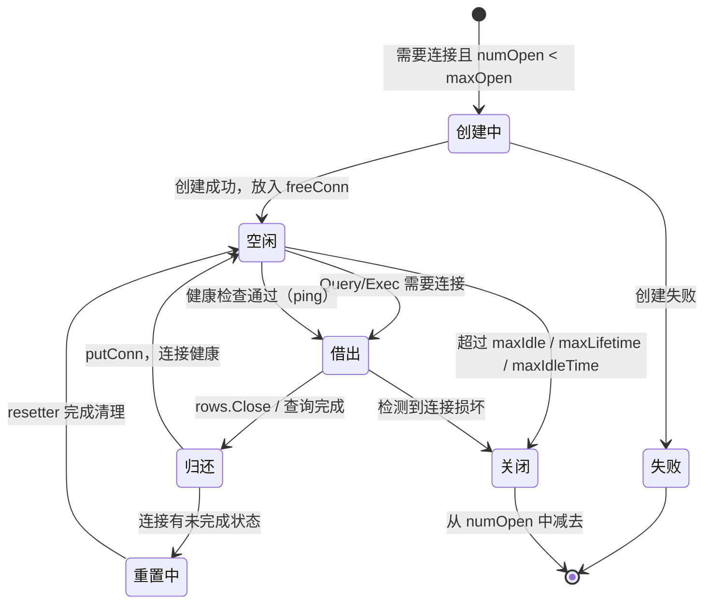

# database-sql 连接池抽象与状态机原理

**摘要：**

Go 标准库的 `database/sql` 包在 2015 年随 Go 1 一同发布，但它在设计思路上与多数语言的数据库访问层有一个根本性的差异：连接池不在驱动里，而在标准库。这意味着任何第三方驱动——无论是 MySQL 的 `go-sql-driver/mysql`、PostgreSQL 的 `jackc/pgx`，还是 SQLite 的 `mattn/go-sqlite3`——只需要实现几条极简的接口（`driver.Driver`、`driver.Conn`、`driver.Stmt`），就能立刻获得一套经过严格并发测试的连接池、事务管理和语句缓存能力。这种"标准库持有状态、驱动只做协议翻译"的分层，把连接生命周期管理这一最容易出错的工程问题集中到了一个可验证的地方，但也让 `database/sql` 的内部实现远比大多数开发者想象的复杂——它维护着空闲连接队列、等待请求队列、连接存活计时器、后台清理 goroutine，以及对每一根连接"是否过期、是否健康、是否正在被使用"的细粒度判断。本文从驱动抽象层的设计动机出发，逐步拆解连接池的状态机模型，解释连接的借出、归还、健康检查和重置机制，再沿着 `Rows` 的游标遍历追踪到底层 TCP socket 的物理对应关系，最后讨论 NULL 值在静态强类型语言中的映射困境以及 `Prepare` 语句的取舍。笔者希望本文能回答两个问题：第一，`database/sql` 为什么选择把连接池放在标准库而非驱动层；第二，连接池的四组配置参数（`MaxOpenConns`、`MaxIdleConns`、`ConnMaxLifetime`、`ConnMaxIdleTime`）如何相互作用，以及它们的默认值在什么场景下会成为线上事故的源头。

---

## 第 1 章 驱动抽象层：为什么连接池不该由驱动来管

### 1.1 一个看似简单的接口族

`database/sql` 对外暴露的 API 几乎人人都用过——`sql.Open`、`db.Query`、`db.Exec`、`rows.Scan`。但这些 API 背后，标准库与驱动之间的边界是由 `database/sql/driver` 子包里几个极其精简的接口定义的：

```go
// driver/driver.go（简化）
type Driver interface {
    Open(name string) (Conn, error)
}

type Conn interface {
    Prepare(query string) (Stmt, error)
    Close() error
    Begin() (Tx, error)
}

type Stmt interface {
    Close() error
    NumInput() int
    Exec(args []Value) (Result, error)
    Query(args []Value) (*Rows, error)
}
```

三个接口，十二个方法，就构成了一个驱动需要实现的全部契约。**驱动不知道连接池的存在，不知道并发，不知道超时**——它只知道"给我一条 DSN 字符串，我还你一根能执行 SQL 的连接"。这个设计的精妙之处在于，它把驱动的职责压缩到了最小：协议翻译。驱动的唯一工作是把 Go 的 `Value` 类型转成 MySQL 或 PostgreSQL 的线路协议字节，再把服务器返回的字节流解包成 Go 能理解的行数据。

相比之下，Java 的 JDBC 驱动需要自己实现 `DataSource` 层面的连接池（或者依赖 HikariCP 这种第三方库），Python 的 `psycopg2` 和 `mysql-connector` 各自维护各自的连接管理语义，Node.js 生态里更是每个驱动一套池化策略。这种碎片化的根源在于，连接池管理被当成了驱动的分内之事——但连接池本身与具体的数据库协议其实毫无关系。`database/sql` 的这种分层设计，是[[Golang/Go网络编程与持久化/00 专栏导览|Go 网络编程与持久化]]专栏反复出现的一个主题——把与协议无关的资源管理逻辑上移到框架层，让协议翻译层保持极简。

### 1.2 把状态集中到可信层

Go 的设计者选择把连接池放在标准库，有一个很实际的工程考量：**连接池是一个有状态的、并发的、需要精确管理资源生命周期的组件**。这种组件的正确性极难通过外部测试来保证——你很难模拟出"并发 100 个 goroutine 抢 10 根连接，其中 3 根连接的服务端突然断开"这种场景，然后在驱动层面验证池化逻辑。把这套逻辑下沉到标准库，意味着整个 Go 生态只需要把这一件事做对、做好、持续维护，所有驱动开发者都不必重复发明轮子，也不必各自踩坑。

> [!info] 一个不太精确但直觉有效的比喻
> 可以把 `database/sql` 想象成一家银行的资金调度中心，驱动则是通往各家清算系统（银联、Visa、网联）的适配器。调度中心不关心银联的报文格式和网联的报文格式有什么不同——那是适配器的工作。调度中心只管一件事：账户余额、交易流水、并发扣款的安全边界。把"有多少钱可以动用"这件事交给每家清算系统各自去管，必然导致总账对不上。连接池就是数据库访问的"总账"——它必须是一个全局单一可信源。

这种分层也带来一个常见的误解：很多开发者以为 `sql.Open` 之后真的建立了一条到数据库的 TCP 连接。实际上，`sql.Open` 只做了两件事——在全局的 `drivers` map 里找到对应名字的 `driver.Driver`，调用一次 `Open(dsn)` 拿到一根"种子连接"验证 DSN 的合法性，然后立即把它放回空闲队列。真正的连接建立发生在第一次 `Query` 或 `Exec` 时，而且可能是惰性的：如果空闲队列里有可用连接，根本不需要新建。

### 1.3 扩展接口族：当基本契约不够用时

`driver.Driver`、`driver.Conn`、`driver.Stmt` 三个接口构成了最小契约，但在实际应用中，数据库提供的能力远不止"执行 SQL 和返回结果"这么简单。为了在不破坏向后兼容性的前提下支持更多特性，Go 在后续版本中引入了一系列"可选接口"——驱动可以选择性地实现它们，标准库在运行时通过类型断言检测驱动是否支持：

```go
// 驱动可选实现的扩展接口（部分列举）
type ConnPrepareContext interface {
    PrepareContext(ctx context.Context, query string) (Stmt, error)
}

type ExecerContext interface {
    ExecContext(ctx context.Context, query string, args []NamedValue) (Result, error)
}

type QueryerContext interface {
    QueryContext(ctx context.Context, query string, args []NamedValue) (*Rows, error)
}

type ConnBeginTx interface {
    BeginTx(ctx context.Context, opts TxOptions) (Tx, error)
}

type SessionResetter interface {
    ResetSession(ctx context.Context) error
}

type Validator interface {
    IsValid() bool
}
```

这种"接口组合 + 运行时类型断言"的模式在 Go 标准库里反复出现——它允许标准库在不强迫所有驱动实现全部功能的前提下，对实现了特定能力的驱动提供更精细的服务。譬如 `SessionResetter` 接口直到 Go 1.10 才引入，它的作用是在连接归还连接池时清理 session 级别的状态（MySQL 的 session 变量、临时表、字符集设置等）。如果一个老驱动没有实现这个接口，`database/sql` 就无法在归还时做 session 清理，可能把脏状态带入下一次使用——这是升级 Go 版本时需要关注的兼容性细节。

`Validator` 接口更值得关注：它允许驱动主动告诉连接池"这根连接是否还活着"。在 `database/sql` 尝试从空闲队列中取出一根连接时，如果驱动实现了 `Validator`，标准库会先调用 `IsValid()` 做一次轻量级的健康检查——这比发一条真正的 `SELECT 1` ping 要廉价得多，因为它不需要网络往返，驱动可以根据内部状态（譬如最后一次收到数据的时间、TCP 连接的状态标志）做出判断。

> [!info] 接口组合的工程设计哲学
> `database/sql/driver` 的扩展接口族体现了一种务实的渐进式设计：核心接口保持稳定（十二年未变），扩展接口随需求逐步增加，驱动按需实现。这种模式的前提是 Go 的类型断言是运行时的、开销可忽略的操作。如果语言层面不支持这种轻量级的接口检测（譬如 Java 需要用 instanceof 或者泛型约束），扩展接口的引入就会变得更加谨慎，标准的碎片化风险也会更高。

### 1.3 Register 机制与全局驱动注册表

`sql.Register` 的实现对理解这套分层至关重要：

```go
// database/sql/sql.go（简化）
var drivers = make(map[string]driver.Driver)

func Register(name string, driver driver.Driver) {
    driversMu.Lock()
    defer driversMu.Unlock()
    if _, dup := drivers[name]; dup {
        panic("sql: Register called twice for driver " + name)
    }
    drivers[name] = driver
}

func Open(driverName, dataSourceName string) (*DB, error) {
    driversMu.RLock()
    driveri, ok := drivers[driverName]
    driversMu.RUnlock()
    if !ok {
        return nil, fmt.Errorf("sql: unknown driver %q", driverName)
    }
    // ...
}
```

这是一个典型的**控制反转（Inversion of Control）**模式：驱动通过 `init()` 函数调用 `sql.Register` 把自己挂到全局注册表，应用层通过字符串名字来查找。应用代码与驱动实现之间唯一的耦合点就是一个字符串——这意味着切换数据库往往只需要换一个 import 路径和一行 DSN。

但这种便利也有代价：驱动是全局单例的，同名注册会 panic；而且全局 map 意味着在极早期（`init` 阶段）就必须完成注册，这给某些需要动态加载驱动的场景（譬如插件化架构）带来了不便。Go 1.10 之后引入了 `sql.OpenDB(connector)` 来绕开全局注册表，允许通过 `driver.Connector` 接口直接传入一个连接器实例，但绝大多数应用仍然使用 `sql.Register` + `sql.Open` 的经典路径。

---

## 第 2 章 连接池状态机：DB 结构体的核心字段

### 2.1 DB 不是连接，是连接的监护人

`sql.DB` 是 `database/sql` 的核心类型，但它的名字极具误导性——它不是一条数据库连接，它是**一个连接池的句柄**。一个 `*sql.DB` 对象内部可能管理着 0 到 `MaxOpenConns` 条活跃连接，这些连接的状态随时在变化。正确的理解方式是：`sql.DB` 是一个有状态的资源调度器，它自己从不执行 SQL，它只负责在正确的时机把正确的连接交给正确的 goroutine。

```go
// database/sql/sql.go（简化，核心字段）
type DB struct {
    connector driver.Connector
    // 或者旧式的：
    driver driver.Driver
    dsn    string

    mu           sync.Mutex
    freeConn     []*driverConn   // 空闲连接队列
    connRequests map[uint64]chan connRequest  // 等待连接的 goroutine 队列
    nextRequest  uint64          // 分配给等待请求的递增 key

    numOpen      int             // 当前已打开（含借出和空闲）的连接数
    openerCh     chan struct{}    // 通知 connectionOpener 创建新连接
    resetterCh   chan *driverConn // 异步重置队列

    // 配置
    maxOpen       int           // 最大打开连接数，0 = 无限制
    maxIdle       int           // 最大空闲连接数，0 = 继承 maxOpen
    maxLifetime   time.Duration // 连接最大存活时间
    maxIdleTime   time.Duration // 空闲连接最大空闲时间
    cleanerCh     chan struct{}  // 通知 connectionResetter/cleaner

    // 统计
    waitCount    int64  // 累计等待获取连接的次数
    waitDuration time.Duration  // 累计等待时间
}
```

> [!warning] 默认值陷阱
> `MaxOpenConns` 默认值是 0，意味着**无上限**。这在开发环境的低并发场景下毫无问题，但在生产环境中，一旦数据库服务端对连接数有限制（MySQL 的 `max_connections` 默认 151，PostgreSQL 的 `max_connections` 默认 100），而应用实例又有很多个，每个实例都无限制地创建连接，很快就会触发服务端的连接数上限，表现为"too many connections"错误。因此，生产环境**必须显式设置** `MaxOpenConns`。关于数据库侧的连接管理细节（MySQL 的连接线程模型、连接数上限的内部实现），参见[[中间件/MySQL/MySQL架构与底层原理/00 专栏导览|MySQL 架构与底层原理]]专栏。

`DB` 结构体的设计哲学可以用一句话概括：**用一把互斥锁保护所有状态变更，用 channel 做异步通知，用后台 goroutine 做生命周期清理**。它没有使用无锁数据结构，因为连接池的状态变更频率远低于人们的直觉——一次数据库查询动辄毫秒级，连接池的锁竞争在这种时间尺度上几乎可以忽略，而它换来的是实现上的清晰和正确性上的可验证性。

### 2.2 driverConn：连接的"可过期"封装

`DB` 并不直接使用 `driver.Conn`，而是把它包在 `driverConn` 里：

```go
// database/sql/sql.go（简化）
type driverConn struct {
    ci        driver.Conn    // 底层驱动连接
    locked    bool           // 是否被 Tx 锁定（事务期间不可共享）
    inUse     bool           // 是否正被某个 goroutine 使用
    mu        sync.Mutex     // 保护关闭状态
    closed    bool           // 是否已关闭
    finalizing bool          // 是否正在被 finalizer 处理
    reusedAt  time.Time      // 上次被借出的时间（用于 maxIdleTime 判断）
    createdAt time.Time      // 连接创建时间（用于 maxLifetime 判断）
    // ...
}
```

`driverConn` 为每根连接引入了两个时间戳：`createdAt` 和 `reusedAt`。前者用于判断连接是否已经活了太久（`ConnMaxLifetime`），后者用于判断空闲连接是否空闲了太久（`ConnMaxIdleTime`）。这两个字段是连接池"时间维度"状态管理的核心——一根连接不是"要么活着要么死了"的二元状态，它在时间轴上有一个逐渐老化的过程，到达某个阈值后就应该被优雅地替换，而不是等到它真正出错才被发现。

> [!note] 老化替换的工程直觉
> 为什么需要主动丢弃没坏的连接？因为数据库侧的连接可能因为网络中间设备（NAT 超时、负载均衡器空闲连接清理、防火墙状态表过期）的静默丢弃而变成"半死"状态——客户端这边觉得连接还在，服务端那边早已释放了 socket 资源。当应用下次拿起这根"僵尸连接"去执行查询时，才会收到一个 broken pipe 或 connection reset 错误。`ConnMaxLifetime` 的本质是用主动轮换规避被动检测——在连接老化到可能被中间设备丢弃之前，就先把它换掉。这类似于航空公司对飞机发动机的定期更换策略：不是等到发动机空中停车才修，而是在运行小时数到达阈值之前就先换。

### 2.3 后台 goroutine  trio：opener、resetter、cleaner

`DB` 内部有三个常驻的后台 goroutine，它们各自监听不同的 channel，在需要时被唤醒执行特定任务：

**`connectionOpener`**：监听 `openerCh`，收到信号后调用 `driver.Open` 创建新连接，然后把新连接通过 `connRequest` channel 传给等待的 goroutine。把连接创建放在后台 goroutine 而非应用 goroutine 中执行，有一个重要的好处——TCP 连接建立（包括 DNS 解析、三次握手、TLS 握手、数据库认证）可能阻塞数秒，如果这个过程发生在应用 goroutine 里，不仅这个 goroutine 被阻塞，它占用的系统线程也会被占用。在连接创建特别慢的场景（譬如跨洋链路的数据库），这种阻塞可能导致大量系统线程被耗尽，进而影响整个 Go 运行时的调度效率。后台 opener goroutine 把这种阻塞隔离在一个独立的 goroutine 里，对应用 goroutine 的影响被降到最低。

**`connectionResetter`**：监听 `resetterCh`，收到连接后执行 session 清理（调用 `driver.SessionResetter.ResetSession` 或关闭未关闭的 `rows`），然后把清理后的连接放入空闲队列或传给等待者。resetter 的存在使得连接池具备自愈能力——即使应用代码有 bug（譬如忘记关闭 rows），连接也能在被下一个用户使用之前被清理干净，避免数据错乱。

**`connectionCleaner`**：监听一个定时器，定期扫描空闲队列，关闭超过 `maxIdle` 数量的多余空闲连接，以及超过 `ConnMaxLifetime` 或 `ConnMaxIdleTime` 的老化连接。cleaner 的扫描频率与 `ConnMaxLifetime` 的设置有密切关系——如果 `ConnMaxLifetime` 设得很短（譬如 1 分钟），cleaner 就需要更频繁地扫描，这会增加一定的 CPU 开销。在大多数场景下，cleaner 的开销可以忽略不计。

三个后台 goroutine 的设计体现了"把阻塞操作从关键路径上移开"的原则——应用 goroutine 只负责从空闲队列取连接、归还连接到空闲队列、或通过 channel 通知后台 goroutine 执行异步操作。这种架构让连接池的关键路径（借出和归还）的延迟几乎完全由锁竞争和内存操作决定，不受网络 I/O 或清理逻辑的影响。

### 2.4 状态机模型的全景视图

连接池内的连接在不同状态之间流转，可以用一张状态图来描述：



这个状态机有几个关键点值得展开：

1. **创建是异步的**。当空闲队列没有可用连接，且 `numOpen < maxOpen` 时，`DB` 不会在当前 goroutine 同步创建连接，而是通过 `openerCh` 通知后台的 `connectionOpener` goroutine 去创建。创建好的连接通过 `connRequest` channel 传给等待的 goroutine。这种设计避免了在应用 goroutine 里执行可能阻塞的 TCP 连接建立。

2. **归还是分叉的**。一根连接从应用 goroutine 归还到连接池时，如果它处于"干净"状态（没有未读完的 rows，没有未完成的事务），直接进入空闲队列；如果它有"未完成状态"（譬如 rows 没有 Close，连接上有未清理的 session state），则先交给 `resetterCh`，由后台 goroutine 异步执行清理。

3. **关闭是多触发源的**。连接可能因为空闲队列满了（超过 `maxIdle`）、活了太久（超过 `maxLifetime`）、空闲了太久（超过 `maxIdleTime`）或检测到损坏而被移除。所有触发源最终都调用 `(*driverConn).close()` 并递减 `numOpen`。

---

## 第 3 章 借出与归还：连接的生命周期流转

### 3.1 conn 的获取：等待队列的精妙设计

当一个 goroutine 调用 `db.Query` 时，`DB` 首先需要获取一根可用连接。这个过程在 `(*DB).conn` 方法中实现，它的逻辑可以概括为：

1. 加锁，检查空闲队列是否有可用连接。如果有，取出一根，验证未过期，标记为 inUse，释放锁，返回。
2. 如果空闲队列为空，检查 `numOpen < maxOpen`。如果是，分配一个 `connRequest` channel，通过 `openerCh` 通知后台创建新连接，释放锁，等待 channel。
3. 如果 `numOpen >= maxOpen`，说明连接池已满，同样分配一个 `connRequest` channel 放入 `connRequests` map，释放锁，等待其他 goroutine 归还连接时唤醒。

```go
func (db *DB) ctxDriverConn(ctx context.Context) (*driverConn, error) {
    // ... 省略部分代码
    db.mu.Lock()
    
    // 1. 尝试从空闲队列拿
    if c := db.freeConn; len(c) > 0 {
        conn := c[0]
        copy(c, c[1:])
        db.freeConn = c[:len(c)-1]
        conn.reusedAt = time.Now()
        db.mu.Unlock()
        // 验证未过期...
        return conn, nil
    }
    
    // 2. 能否新建
    if db.maxOpen <= 0 || db.numOpen < db.maxOpen {
        req := make(chan connRequest, 1)
        db.connRequests[db.nextRequest] = req
        db.nextRequest++
        db.mu.Unlock()
        // 通知 opener 创建
        select {
        case db.openerCh <- struct{}{}:
        default:
        }
        // 等待...
    }
    
    // 3. 只能等
    req := make(chan connRequest, 1)
    db.connRequests[db.nextRequest] = req
    db.mu.Unlock()
    // ...
}
```

等待队列使用了一个 map（`connRequests`）而不是 slice 或链表，这是一个精心考量的设计选择。当一根连接被归还时，`DB` 需要唤醒**最早的那个等待者**（FIFO 公平性）。如果用 slice，需要 O(n) 时间找到并删除最小的 key；用链表需要维护头尾指针；而用 map 配合递增的 `nextRequest` key，归还者只需遍历 map 找到最小的 key（在实践中，map 通常很小，而且 Go 的 map 遍历在少量元素时效率足够），然后从对应 channel 发送连接唤醒等待者。这种"map + 递增 key"的组合，在保持 FIFO 顺序的同时，让归还路径的锁持有时间尽可能短。

> [!info] 关于公平性的工程选择
> 等待队列的 FIFO 顺序不是学术洁癖，它有实际意义：如果后来的请求总是优先被满足，某些 goroutine 可能长时间饥饿，在超时触发前一直拿不到连接。FIFO 保证了最坏情况下的等待时间是有界的。这与操作系统调度器中的公平队列思想如出一辙。

### 3.2 putConn 归还：不是简单的 append

连接的归还由 `(*DB).putConn` 方法完成。它的工作远比"把连接 append 到 freeConn 切片"复杂：

1. **验证连接的合法性**。检查连接是否已关闭、是否仍在 inUse 状态（防止重复归还）。
2. **检查连接是否过期**。如果 `createdAt + maxLifetime` 已过，或者 `reusedAt + maxIdleTime` 已过，直接关闭连接而不放入空闲队列。
3. **检查是否有等待者**。如果有 goroutine 在 `connRequests` 里等待，直接把连接通过 channel 传给等待者，跳过空闲队列——这是一条**快速路径**，避免了连接进入空闲队列后又被立即取出的无效往返。
4. **检查空闲队列长度**。如果 `len(freeConn) >= maxIdle`，直接关闭多余连接。
5. **放入空闲队列**。以上条件都不满足时，把连接 append 到 `freeConn`。

这条快速路径（step 3）是高并发场景下的关键优化。设想 100 个 goroutine 在等待连接，此时一根连接被归还——如果先放入空闲队列，再让等待者从空闲队列里取，多了一次锁竞争和一次内存写入；直接把连接传给等待者，省去了中间的缓冲步骤。这种"生产者直接交付给消费者"的模式，在 Channel 的底层实现（参见[[Golang/Go并发编程/03 Channel 的底层结构与阻塞唤醒机制|Channel 的底层结构]]）中也有类似的设计，叫做"直接交付（direct send）"。

### 3.3 健康检查：ping 与验证的成本谱

从空闲队列取出的连接并不总是可用的。在连接空闲期间，可能发生了以下情况：

1. **服务端主动关闭了连接**：MySQL 的 `wait_timeout`（默认 8 小时）到期后，服务端会单方面关闭空闲连接，但客户端不一定知道——TCP 的 FIN 包可能因为网络原因丢失或延迟到达。
2. **网络中间设备丢弃了连接状态**：NAT 网关、负载均衡器、防火墙都可能在连接空闲一段时间后，静默地删除状态表条目。此时 TCP 连接在两端都还存在，但中间的设备已经不再转发数据包——这就是"半死连接"。
3. **数据库重启或网络分区**：更极端的情况下，数据库整体不可达。

`database/sql` 的健康检查机制分为两个层次：

**轻量级验证（`Validator` 接口）**：如果驱动实现了 `driver.Validator`，`database/sql` 在从空闲队列取出连接时会调用 `IsValid()`。这个方法不需要网络往返，驱动可以根据内部状态做出判断——譬如检查上一次操作是否有错误标志、TCP 连接的文件描述符是否仍然有效。它的开销接近于零，但检测能力有限——它无法发现"中间设备丢弃了状态但两端都不知道"的半死连接。

**主动 ping（`driver.Pinger` 接口）**：更可靠的检查方式是发一条真正的查询（通常是 `SELECT 1` 或 `PING`）给服务端，看能否收到响应。`database/sql` 提供了 `db.Ping()` 和 `db.PingContext()` 方法供应用层主动调用，但在连接池的内部逻辑中，是否对每根空闲连接做 ping 取决于配置——Go 在 `connRequest` 的获取路径中，对于长时间空闲的连接（空闲时间超过某个阈值）会做一次 ping 验证，但这会增加一次网络往返的延迟。

这两个层次构成了一个成本-覆盖率的谱系：`Validator` 廉价但覆盖窄，`Ping` 昂贵但覆盖广。在生产环境中，通常的策略是依赖 `ConnMaxLifetime` 来主动轮换连接，使得"半死连接"的存活窗口被限制在一个可接受的范围内——与其花额外的网络往返去检测每根连接是否存活，不如在连接还没死之前就换掉它。

### 3.3 resetter：被忽视的异步清理通道

一根连接在被归还时，可能处于"不干净"的状态。最常见的情形是 `rows` 没有完全读完就被关闭（或者根本没 Close），此时连接上还有未消费的行数据悬挂在 TCP socket 的接收缓冲区里。如果直接把这样的连接放回空闲队列给下一个用户使用，用户会读到上一次查询残留的数据——这是一种极其隐蔽的数据错乱。

`database/sql` 的解决方案是引入 `resetterCh` 和后台 `connectionResetter` goroutine。当 `putConn` 发现连接有未清理状态时，不把它放入空闲队列，而是发送到 `resetterCh`，由 `connectionResetter` 在后台完成清理：

- 如果有未关闭的 `rows`，调用 `rows.Close()` 把剩余数据读完并丢弃。
- 如果连接处于某个事务中间（理论上不应该发生，因为事务有独立的 `Tx` 锁定机制），回滚事务。
- 如果驱动实现了 `driver.SessionResetter` 接口，调用 `ResetSession` 让驱动清理 session-level 状态（譬如 MySQL 的 session 变量、临时表）。

清理完成后，连接才被放入空闲队列。这条异步清理路径的存在，意味着即使应用代码有 bug（譬如忘记 `rows.Close()`），连接池也能在绝大多数情况下自我修复，不会让脏状态污染下一个使用者——但代价是这根连接在清理期间不可用，而且丢弃了未读完的数据，这在数据量大的查询里会浪费带宽。

---

## 第 4 章 参数矩阵：四组配置的相互作用与调优

### 4.1 参数含义与默认值

`database/sql` 的连接池行为由四组参数控制：

| 参数 | 默认值 | 含义 |
|:---|:---|:---|
| `MaxOpenConns` | 0（无限制） | 同时打开的最大连接数（含空闲和借出） |
| `MaxIdleConns` | 2（Go 1.17+）| 空闲队列的最大连接数 |
| `ConnMaxLifetime` | 0（永不过期）| 连接从创建到被强制关闭的最大时长 |
| `ConnMaxIdleTime` | 0（永不超时）| 空闲连接从最后一次使用到被强制关闭的时长 |

这四个参数的相互作用相当微妙，值得逐一展开：

**`MaxOpenConns` 是总闸门**。它控制的是 `numOpen` 的上限——包括正在被使用的连接和空闲在队列里的连接。设为 0 意味着连接池会按需无限创建，直到数据库服务端拒绝。生产环境几乎总是要设一个正值。

**`MaxIdleConns` 是空闲队列的容量**。注意它不是"保持空闲的最小连接数"，而是"允许保持空闲的最大连接数"。如果设为 0，意味着连接用完后不会被保留在空闲队列——每次查询都会新建连接，用完即关。这在短连接场景下是合理的（譬如批处理脚本），但在长期运行的服务里，这意味着每次查询都要承担一次完整的 TCP 三次握手和认证过程，性能损失巨大。

**`ConnMaxLifetime` 是主动老化机制**。它解决的是"连接静默失效"的问题——即前文提到的网络中间设备丢弃空闲连接的场景。设为 0 意味着连接永远不会因为老化被关闭，只有出错或空闲队列溢出才会被移除。在稳定的内网环境中，这个值可以设得很长；在经过 NAT 或负载均衡器的环境中，通常需要设得比中间设备的空闲超时略短（譬如中间设备 300 秒超时，这里设 240 秒）。

**`ConnMaxIdleTime` 是空闲维度的老化**。它与 `ConnMaxLifetime` 的区别在于，它只计算连接**空闲**的时间，而不是连接的总生命周期。一根一直在被使用的连接不会触发 `ConnMaxIdleTime`，但会触发 `ConnMaxLifetime`。这两个参数的组合提供了两个维度的老化控制：总寿命和空闲寿命。

### 4.2 参数之间的约束与边界

几个容易忽略的约束：

1. `MaxIdleConns` 不能大于 `MaxOpenConns`。如果设置的 `MaxIdleConns > MaxOpenConns`，`database/sql` 会自动把 `MaxIdleConns` 降到 `MaxOpenConns`。
2. 如果 `MaxOpenConns` 为 0（无限制），但 `MaxIdleConns` 设为正数，空闲队列有上限但总连接数无上限——这意味着突发并发可以创建大量连接，用完后只有前 `MaxIdleConns` 根被保留。
3. `ConnMaxLifetime` 和 `ConnMaxIdleTime` 都为 0 时，连接池退化为一个只有 `MaxOpenConns` 和 `MaxIdleConns` 控制的简单池——没有主动老化，连接只在出错或空闲队列溢出时被替换。
4. `MaxIdleConns` 默认值在 Go 1.17 之前是 2，之后改为 `min(2, MaxOpenConns)`。这意味着如果你的 `MaxOpenConns` 设为 1，`MaxIdleConns` 会自动降到 1。

> [!warning] 一个常见的生产事故模式
> 应用实例数 × `MaxOpenConns` > 数据库 `max_connections`。假设数据库 `max_connections = 200`，有 10 个应用实例，每个实例 `MaxOpenConns` 默认 0（无限制），在高并发期间每个实例创建 30 根连接，总共 300 根——数据库直接拒绝新连接，服务雪崩。正确的做法是根据数据库容量和应用实例数反推每个实例的 `MaxOpenConns` 上限，并留有余量。

### 4.3 调优的起点

一个相对保守的生产环境起点配置：

```go
db, err := sql.Open("mysql", dsn)
if err != nil {
    log.Fatal(err)
}

db.SetMaxOpenConns(50)      // 根据数据库容量和实例数计算
db.SetMaxIdleConns(10)      // 通常小于等于 MaxOpenConns
db.SetConnMaxLifetime(30 * time.Minute)  // 根据网络拓扑调整
db.SetConnMaxIdleTime(5 * time.Minute)   // 防止空闲连接被中间设备丢弃
```

这些数字不是银弹——它们需要根据实际的并发量、查询延迟、数据库容量和网络拓扑来调整。`database/sql` 提供了 `db.Stats()` 方法来观察连接池的实时状态：

```go
stats := db.Stats()
// stats.OpenConnections  // 当前 numOpen
// stats.InUse            // 正在被使用的连接数
// stats.Idle             // 空闲队列里的连接数
// stats.WaitCount        // 累计等待次数
// stats.WaitDuration     // 累计等待时长
// stats.MaxIdleClosed    // 因空闲队列满而关闭的连接数
// stats.MaxLifetimeClosed // 因超过 MaxLifetime 而关闭的连接数
// stats.MaxIdleTimeClosed // 因超过 MaxIdleTime 而关闭的连接数
```

`Stats()` 的返回值是累积值（`WaitCount`、`WaitDuration`）和瞬时值（`OpenConnections`、`InUse`、`Idle`）的混合。在高并发场景下，`WaitCount` 的增速和 `WaitDuration` 的增量是判断连接池是否成为瓶颈的关键信号——如果 `WaitCount` 持续增长且 `WaitDuration` 的增量很大，说明 `MaxOpenConns` 可能设得太小，或者数据库的查询响应太慢导致连接长期被占用。

---

## 第 5 章 Rows 游标与底层 TCP Socket 的物理关联

### 5.1 Rows 不是数据集合，是游标

很多从 Python 或 Java 转过来的开发者会直觉地把 `sql.Rows` 理解为一个"查询结果的列表"。但在 `database/sql` 的实现里，`Rows` 是一个**游标**——它指向的是底层 TCP socket 接收缓冲区里尚未消费的数据流。每次调用 `rows.Next()` 都会从 socket 里读取并解析下一行数据，而不是从一个已经加载到内存里的切片中取值。

这意味着：

1. **在 `rows.Next()` 返回 false 之前，查询结果并没有全部传输完毕**。数据库服务端可能还在发送数据，这些数据暂存在 TCP 接收缓冲区、`database/sql` 的内部缓冲区、以及驱动的解码缓冲区里。
2. **在 `rows` 关闭之前，连接不能被复用**。因为连接上的数据流没有结束——还有未消费的行数据挂在 socket 上。如果此时把连接交给下一个查询使用，新查询的响应数据和旧查询的残留数据会混在一起，导致不可预测的行为。
3. **`Rows.Close()` 不只是释放内存，是归还连接**。`Close()` 会读取并丢弃 socket 上所有剩余的未消费数据（如果驱动实现了相应接口），直到服务端发送的"结果集结束"标记被消费完毕，连接才恢复到"干净"状态，可以被归还给连接池。

```go
// database/sql/sql.go（Rows.Close 的简化逻辑）
func (rs *Rows) close(err error) error {
    // ...
    // 把所有未读完的行读完并丢弃
    for {
        err1 := rs.closeerr()
        if err1 != nil {
            // ...
        }
        if !rs.rowsi.HasNext() {
            break
        }
        var row []driver.Value
        err1 = rs.rowsi.Next(row)
        if err1 != nil {
            break
        }
        // 丢弃 row
    }
    // 归还连接到连接池
    rs.dc.releaseConn(err)
    return err
}
```

### 5.2 忘记 Close 的后果：连接泄漏

如果开发者忘记调用 `rows.Close()`，连接永远不会被归还到连接池。从连接池的视角，这根连接仍然处于"借出"状态，`inUse = true`。随着泄漏的连接越来越多，`numOpen` 持续增长，最终触达 `MaxOpenConns` 上限，此后所有新的查询请求都会阻塞在等待队列里——直到 context 超时或 `ConnMaxLifetime` 到期。

这就是为什么 Go 的惯用法几乎总是用 `defer` 来保证 `Close` 被调用：

```go
rows, err := db.Query("SELECT id, name FROM users WHERE status = ?", "active")
if err != nil {
    return err
}
defer rows.Close()  // 必须 defer，即使下面有 panic 也要保证归还

for rows.Next() {
    var id int
    var name string
    if err := rows.Scan(&id, &name); err != nil {
        return err  // defer 会在这里执行
    }
    // 处理数据...
}
if err := rows.Err(); err != nil {
    return err  // defer 也会在这里执行
}
```

> [!warning] 一个微妙的陷阱
> `rows.Err()` 检查必须在 `rows.Next()` 循环结束后调用。`Next()` 返回 false 有两种可能：正常到达结果集末尾，或者迭代过程中发生了错误。只有调用 `Err()` 才能区分这两种情况。如果忽略 `Err()` 检查，迭代中途的错误会被静默吞掉——应用以为查询成功，实际上只处理了部分数据。

### 5.3 Next、Scan 与 TCP 字节流的物理对应

每一次 `rows.Next()` 调用，底层发生的事情远比表面看起来复杂：

1. 驱动从 TCP socket 的接收缓冲区读取下一个数据包（可能涉及多次 `read` 系统调用，取决于 TCP 分片）。
2. 驱动按照数据库的线路协议（譬如 MySQL 的 COM_QUERY Response）解析数据包，提取出下一行的列值。
3. 驱动把列值转成 `driver.Value` 类型（一种受限的类型集合：`int64`、`float64`、`bool`、`[]byte`、`string`、`time.Time`、`nil`）。
4. `rows.Scan` 把这些 `driver.Value` 拷贝到用户提供的目标变量的内存地址里。

这个链条中，步骤 1 是真正的 I/O 操作——它会阻塞当前 goroutine，直到 TCP 缓冲区里有数据可读。在 Go 的运行时里，这种阻塞被 netpoller 转化为 goroutine 的挂起（参见[[Golang/Go并发编程/12 Go 网络编程——netpoller 与 Goroutine-per-Connection|Go 网络编程与 netpoller]]），让出底层线程给其他 goroutine 使用。步骤 2 和 3 是 CPU 操作，步骤 4 是内存拷贝。

理解这个链条有助于解释一些性能现象：

- **大结果集的内存占用是恒定的**：因为 `Rows` 是游标，不是全量加载，无论结果集有一行还是一百万行，内存占用都只和单行大小有关。
- **`rows.Next()` 的延迟包含了网络延迟**：如果数据库服务端和应用跨机房，每一行数据的读取都受网络往返时间影响。对于大结果集，逐行读取的累计网络延迟可能很可观。
- **`Scan` 的目标类型必须匹配**：如果数据库返回的列类型和 `Scan` 的目标类型不兼容（譬如把 `VARCHAR` scan 到 `int`），会产生运行时错误。

### 5.4 连接与 HTTP 连接池的物理类比

`database/sql` 的连接池与 `net/http` 的 Transport 连接池（参见[[Golang/Go网络编程与持久化/03 HTTP 客户端连接池物理生命周期与超时阶梯|HTTP 客户端连接池物理生命周期与超时阶梯]]）在物理层面有着深刻的相似性：两者都是在应用层维护一个"可复用 TCP 连接"的集合，两者的泄漏机制都源于"忘记归还"（HTTP 是忘记读尽 Body 或调用 `resp.Body.Close()`，`database/sql` 是忘记调用 `rows.Close()`），两者的健康检查都需要应对"连接中间被静默丢弃"的半死状态。

但两者有一个关键差异：HTTP 连接池的连接在物理上是"无状态的"——同一个 TCP 连接可以发送不同用户的不同 HTTP 请求，因为 HTTP 协议本身在应用层提供了请求-响应的边界（Content-Length 或 Chunked Transfer-Encoding）。而数据库连接是有状态的——一次查询的结果可能跨越多个 TCP 数据包，而且数据库连接的 session 状态（事务、字符集、临时表）在查询之间持续存在。这种"有状态性"使得数据库连接的归还必须更加谨慎——不仅要归还连接本身，还要确保连接的 session 状态已经被清理干净。这也是 `database/sql` 需要 `resetter` goroutine 而 HTTP Transport 不需要对应机制的根本原因。

### 5.5 大结果集的处理策略

当查询结果集很大（譬如百万行级别）时，游标式的 `Rows` 设计虽然内存友好，但有以下需要注意的问题：

**总延迟可能很长**。每一行 `Next()` 都涉及网络读取，百万行数据即使每行只需 0.1ms 的网络延迟，总计也需要 100 秒。在这 100 秒内，连接一直被占用，连接池的可用连接数减少。如果并发查询很多，可能导致连接池耗尽。

**服务端的资源占用**。数据库服务端在发送大结果集时，需要维护结果集的游标状态、锁定相关的数据页、消耗网络缓冲区。如果客户端读取很慢（因为应用处理慢或网络拥塞），服务端的资源被长时间占用，可能影响其他查询。

对于大结果集的处理，通常的策略包括：

- **分页查询**：用 `LIMIT` + `OFFSET`（或基于主键的范围查询）分批获取，每批只取数千行。这样每批查询使用连接的时间较短，服务端的压力也更小。
- **流式处理**：如果必须一次性获取全部数据，考虑在应用层用 worker 模式——一个 goroutine 负责读取 rows，把每行数据通过 channel 传给下游处理 goroutine，避免读取和处理串行化导致的连接占用时间过长。
- **使用驱动特有的大批量接口**：譬如 MySQL 的 `LOAD DATA`、PostgreSQL 的 `COPY`，这些接口绕过标准的 `Query` + `Rows` 路径，直接在协议层做批量传输，效率远高于逐行 `Next()` + `Scan()`。但这些接口是驱动特有的，不走 `database/sql` 的标准抽象——需要通过类型断言获取驱动的原生连接。

---

## 第 6 章 NULL 值的类型系统困境

### 6.1 关系代数的三值逻辑 vs 编程语言的二值逻辑

SQL 的 NULL 不是"空字符串"，不是"零值"，不是"空指针"——它是关系代数中的**未知值（Unknown）**。在 C.J. Date 的关系模型中，NULL 的引入使得 SQL 的布尔逻辑从经典的两值（True / False）变成了三值（True / False / Unknown），任何与 NULL 的比较运算结果都是 Unknown，而不是 True 也不是 False。这就是为什么 `WHERE x = NULL` 永远不会匹配任何行——因为 `x = NULL` 的结果是 Unknown，不是 True，正确的写法是 `WHERE x IS NULL`。

Go 是一门静态强类型语言，它的变量要么是零值，要么是有效值，没有"未知"这个中间状态。当数据库里的 NULL 要映射到 Go 的类型系统时，就出现了一个根本性的张力：Go 的类型没有表达"未知"的语法位置。

`database/sql` 提供了两套解决方案，每套各有取舍。

### 6.2 第一套方案：NullXxx 结构体族

```go
type NullString struct {
    String string
    Valid  bool  // true 如果非 NULL
}

// 类似地还有 NullInt64、NullFloat64、NullBool、NullTime
```

`NullString` 的设计思路是：用一个 `Valid` 字段显式标记"这个值是否来自数据库的 NULL"。使用时必须检查 `Valid`：

```go
var name sql.NullString
err := row.Scan(&name)
if err != nil {
    return err
}
if name.Valid {
    fmt.Println("name:", name.String)
} else {
    fmt.Println("name is NULL")
}
```

这种方案的优点是**显式**——代码的读者能清楚地看到"这里可能是 NULL"。缺点是繁琐——每种基本类型都需要一个对应的 `NullXxx`，而且每次使用都要多一层 `if Valid` 检查。`database/sql` 内置的 `NullXxx` 族只覆盖了有限的几种类型，对于用户自定义类型或者数据库驱动特有的类型，就需要自己写 `NullXxx`。

### 6.3 第二套方案：指针

```go
var name *string
err := row.Scan(&name)
if err != nil {
    return err
}
if name != nil {
    fmt.Println("name:", *name)
} else {
    fmt.Println("name is NULL")
}
```

用指针表达 NULL 的好处是通用——任何类型 `T` 都可以用 `*T` 来表达"可能为 NULL"，不需要为每种类型定义一个 `NullXxx`。缺点是**隐式**——从函数签名 `func(row *sql.Row)` 里看不出哪些列可能为 NULL，只有到了运行时的 `Scan` 才知道。而且指针的解引用在性能敏感的循环里会有微小但可测量的开销。

### 6.4 类型转换的隐藏成本

无论选择哪种 NULL 映射方案，`rows.Scan` 在底层都需要做类型转换——从驱动的 `driver.Value` 类型（一种受限的类型联合）转换成用户指定的 Go 类型。这个过程使用反射（`reflect`），在性能敏感的批量扫描场景中可能成为瓶颈。

`driver.Value` 的允许类型是：`int64`、`float64`、`bool`、`[]byte`、`string`、`time.Time`、`nil`。注意这里没有 `int`（只有 `int64`），没有 `uint` 系列，没有 `float32`（只有 `float64`）。这意味着驱动从数据库读取一个 `INT`（32 位整数）时，必须先提升为 `int64`，然后在 `Scan` 时再截断为 `int`。这种"统一提升再截断"的设计是为了简化 `Scan` 的类型匹配逻辑——它只需要处理 7 种源类型，而不是每种数据库的每种类型。

对于 `[]byte` 类型有一个需要特别注意的陷阱：驱动返回的 `[]byte` 通常是驱动内部缓冲区的引用，而不是独立的拷贝。这意味着在两次 `Next()` 调用之间使用这个 `[]byte` 是安全的，但如果你把它保存到某个 slice 或 map 里留待后续使用，下一次 `Next()` 调用可能会覆盖它的内容。正确的做法是在 `Scan` 之后立即拷贝 `[]byte` 的内容。

### 6.5 第三套方案：Scanner 和 Valuer 接口

对于需要精细控制 NULL 处理逻辑的场景，`database/sql` 提供了 `Scanner` 和 `Valuer` 接口：

```go
type Scanner interface {
    Scan(src interface{}) error
}

type Valuer interface {
    Value() (Value, error)
}
```

实现 `Scanner` 接口的类型可以在 `Scan` 方法里自定义 NULL 的处理逻辑——譬如把 NULL 转成零值、转成自定义的"未知"标记、或者根据业务上下文选择不同的默认值。实现 `Valuer` 接口的类型可以在写入数据库时自定义如何把 Go 的零值转成 SQL 的 NULL。

```go
// 一个自定义类型，NULL 映射为空字符串
type MyString string

func (s *MyString) Scan(src interface{}) error {
    if src == nil {
        *s = ""  // NULL -> 空字符串
        return nil
    }
    switch v := src.(type) {
    case string:
        *s = MyString(v)
    case []byte:
        *s = MyString(string(v))
    default:
        return fmt.Errorf("unsupported type %T", src)
    }
    return nil
}

func (s MyString) Value() (driver.Value, error) {
    if s == "" {
        return nil, nil  // 空字符串 -> NULL
    }
    return string(s), nil
}
```

> [!note] NULL 的处理是一个设计决策，不是技术问题
> 选择哪种 NULL 映射方案，本质上是在回答一个业务问题：NULL 在你的领域模型里代表什么？如果 NULL 代表"未知"（譬如用户的中间名尚未填写），用 `sql.NullString` 的 `Valid` 标记是最忠实的表达。如果 NULL 只是历史数据的遗留，业务上等同于空字符串或零值，用 `Scanner` 接口把 NULL 转成零值可以减少大量样板代码。如果用指针，好处是代码简洁且类型通用，但代价是把"可能为空"的信息从类型系统中移除了——这个信息只存在于运行时的 nil 检查里，编译器无法帮你验证是否所有可能的 NULL 都被正确处理。

关于数据在 Go 程序与外部系统之间序列化时的类型边界问题，在[[Golang/Go标准库与系统IO/04 数据序列化语义与边界——encoding-json 的元数据解析与流式编解码|数据序列化语义与边界]]中有更深入的讨论——JSON 的 `null` 与 SQL 的 `NULL` 在语义上有微妙的差异，两套序列化机制对"缺失"与"为空"的处理方式不同，这在 API 层同时涉及 JSON 和 SQL 时需要格外小心。

---

## 第 7 章 Prepare 与语句缓存：取舍而非最佳实践

### 7.1 什么是 Prepared Statement

Prepared Statement（预编译语句）是数据库提供的一种机制：客户端先把 SQL 模板（带占位符）发送给服务端，服务端解析、校验、生成执行计划并缓存，之后客户端只需要发送参数值和服务端引用的执行计划 ID，就可以重复执行同一条 SQL，而无需重复解析和优化。

在 `database/sql` 中，使用 `Prepare` 方法创建 prepared statement：

```go
stmt, err := db.Prepare("SELECT id, name FROM users WHERE email = ?")
if err != nil {
    return err
}
defer stmt.Close()  // 注意：必须 Close

// 可以重复使用
row1 := stmt.QueryRow("alice@example.com")
row2 := stmt.QueryRow("bob@example.com")
```

### 7.2 连接的绑定问题

`sql.Stmt` 有一个经常被忽视的特性：**它绑定到创建它的那根物理连接**。当调用 `db.Prepare` 时，`database/sql` 从连接池借出一根连接，在这根连接上执行 prepare 命令，然后把返回的 statement handle 和连接信息一起保存在 `sql.Stmt` 里。

这意味着：

1. 每次使用 `stmt` 执行查询时，`database/sql` 必须把请求路由到**原来那根连接**上。如果那根连接已经被借给其他 goroutine、或者已经被回收（因为过期或损坏），`sql.Stmt` 需要在另一根连接上重新 prepare——这个过程对调用方是透明的，但有性能开销。
2. `stmt.Close()` 也必须路由到原来的连接上执行。如果原来的连接已经不可用，`Close()` 会静默失败（无法通知服务端释放 statement handle），但这通常不是严重问题——服务端的 prepared statement 通常在连接关闭时自动释放。

这种"绑定到特定连接"的设计，使得 `db.Prepare` 在连接池场景下的收益不如直觉中那么大。很多人以为 prepared statement 能显著提升性能（因为省去了重复解析），但在连接池环境下：

- 如果并发量高，`stmt` 频繁需要在不同连接上重新 prepare，反而可能比直接每次发送完整 SQL 更慢。
- 如果 `MaxOpenConns` 设得较大，`stmt` 绑定的连接被复用的概率较高，prepared statement 的收益才能体现。

### 7.3 语句缓存的折中

Go 1.9 引入了 `sql.Stmt` 的语句缓存机制：当 `stmt.Close()` 被调用时，`database/sql` 不会真的通知服务端释放 statement handle，而是把它放入一个内部缓存。下次使用同一个 SQL 模板的 `Prepare` 时，如果能从缓存中找到匹配的 statement，就直接复用，省去了服务端的重新 prepare。

这种设计在"反复执行相同 SQL 模板"的场景下（譬如 ORM 框架生成的固定查询）能带来一定的性能收益，但它的收益大小高度依赖于具体的工作负载和数据库的特性：

- **MySQL** 的服务端 prepared statement 有较大的开销，且受 `max_prepared_stmt_count` 限制（默认 16382）。在高并发场景下，滥用 prepared statement 可能导致"Can't create more than max_prepared_stmt_count statements"错误。
- **PostgreSQL** 的 prepared statement 开销较小，而且支持参数化查询（parameterized query）作为轻量替代——参数化查询不缓存执行计划，但省去了客户端拼接 SQL 字符串的开销和 SQL 注入风险。
- **SQLite** 是嵌入式数据库，没有网络往返，prepared statement 的收益主要体现在解析和编译的节省上。

### 7.4 实践建议

对大多数应用来说，直接使用 `db.Query` 和 `db.Exec`（它们内部会自动使用参数化查询，如果驱动支持）就足够了，不需要显式调用 `db.Prepare`。只有在以下场景才值得考虑 prepared statement：

1. 同一条 SQL 模板在短时间内被高频执行（譬如每秒数千次），且性能测试证明确实有可测量的提升。
2. 需要批量插入大量数据，prepared statement 可以避免重复发送 SQL 模板。
3. 使用的数据库对参数化查询的支持有限，必须通过 prepared statement 来防止 SQL 注入。

在不确定是否需要 prepared statement 时，先用 `db.Query` + 参数占位符，再做基准测试，用数据说话。

---

## 第 8 章 边界与反例：database/sql 不做什么

### 8.1 它不是 ORM

`database/sql` 没有对象关系映射能力——它不关心你的 Go struct 对应哪张表，不自动生成 INSERT / UPDATE 语句，不处理关联关系。它只提供最底层的"发送 SQL、接收结果"的能力。如果需要更高层次的抽象，需要在 `database/sql` 之上构建或引入 ORM 框架（关于 Go 生态中数据持久层架构的取舍，参见[[Golang/Go生态与框架设计/00 专栏导览|Go 生态与框架设计]]专栏中对 Active Record 与 Data Mapper 模式的讨论）。

### 8.2 它不处理事务嵌套

`database/sql` 的 `sql.Tx` 提供的是单层级的事务——Begin、Commit、Rollback。它不支持嵌套事务（nested transaction）。如果业务需要嵌套事务语义，需要依赖数据库的 Savepoint 机制手动实现，或者使用支持嵌套事务的上层框架。关于事务抽象的深层原理和一致性边界，将在[[07 数据库事务抽象与一致性物理边界|数据库事务抽象与一致性物理边界]]中展开。

### 8.3 连接池不是万灵药

连接池解决的是"连接创建的开销"问题，但它不解决"查询慢"问题。如果数据库的查询本身需要 500ms，连接池再高效也无济于事。连接池的调优应该建立在数据库性能调优的基础上，而不是替代它。此外，连接池引入了一层间接性和状态管理，使得某些问题（譬如连接泄漏、死锁）的排查变得更加困难——`db.Stats()` 和 pprof 的 goroutine 堆栈是排查这类问题的主要工具。

### 8.4 驱动的合规性风险

`database/sql` 的抽象层依赖于驱动正确实现 `driver` 包的接口契约。如果驱动实现有 bug（譬如 `Rows.Next` 在错误情况下不返回 false，`Conn.Close` 不释放底层资源），连接池的状态机可能被拖入不一致的状态。选择社区活跃、测试覆盖完善的驱动（譬如 `go-sql-driver/mysql`、`jackc/pgx`）是降低这类风险的主要手段。

### 8.5 Context 的超时传播

Go 1.8 引入了 Context 感知的 API（`QueryContext`、`ExecContext`、`PingContext` 等），允许在获取连接、执行查询的整个生命周期中传播超时和取消信号。Context 的引入解决了一个长期痛点：在 `Query` 的时代，如果数据库响应很慢，应用 goroutine 只能通过 `SetDeadline` 来设置超时，但 `SetDeadline` 是连接级别的，无法精确控制单次查询的超时。`QueryContext` 把超时控制从连接级别细化到了查询级别，而且与 goroutine 的取消机制（参见[[Golang/Go并发编程/07 Context 的设计与取消传播机制|Context 的设计与取消传播机制]]）无缝集成——当 context 被取消时，正在等待连接的 goroutine 会立即返回 `context.Canceled` 错误，正在等待数据库响应的 goroutine 会尝试取消底层查询。

不过 Context 的取消并不总是能真正中止数据库侧的执行。如果查询已经在数据库服务端开始执行，取消 context 只会让客户端不再等待结果——数据库侧的查询会继续执行直到完成（除非驱动特别实现了取消协议，譬如 PostgreSQL 的 cancel request）。这意味着取消 context 并不能替代数据库侧的超时控制（`max_execution_time` 或 `statement_timeout`），两者需要配合使用。

### 8.6 连接池的监控盲点

`db.Stats()` 提供了连接池的实时状态，但它有几个监控盲点：

1. **没有 per-query 的延迟统计**。`Stats()` 只记录等待连接的延迟（`WaitDuration`），不记录查询本身的延迟。查询延迟需要用其他方式监控（中间件、ORM 层的 hook、数据库侧的慢查询日志）。
2. **没有连接失败的分类统计**。连接创建失败可能因为网络不通、认证失败、服务端连接数满等多种原因，`Stats()` 不区分这些原因。在生产环境的告警系统中，通常需要额外监控驱动返回的具体错误类型。
3. **累积值需要差分计算**。`WaitCount` 和 `WaitDuration` 是从 `DB` 对象创建以来的累积值，计算速率需要定期采样并做差分。直接使用累积值做告警阈值判断是不正确的。

---

## 第 9 章 权衡与取舍

行文至此，可以把 `database/sql` 的设计决策汇总为几组核心取舍，每组取舍背后都有值得品味的工程哲学。

**标准库持有连接池 vs 驱动持有连接池**。Go 选择了前者，换来的是统一的正确性保证和驱动开发的极简接口，付出的代价是 `database/sql` 内部实现的复杂性，以及某些驱动特有特性（譬如 PostgreSQL 的 `COPY` 协议、MySQL 的 `LOAD DATA`）无法通过标准接口表达，必须通过类型断言（`driverConn` 或 `*mysql.Conn`）来绕过标准库直接使用驱动的原生能力。这种"标准抽象 + 逃生舱口"的双层设计，是 Go 标准库处理"通用性与特殊性"矛盾的惯用手法——`net/http` 对 `http.Hijacker` 的处理也是同样的思路。

**一把全局互斥锁 vs 无锁数据结构**。`DB` 用一把 `sync.Mutex` 保护所有状态变更，这在连接池的操作频率下完全够用（一次查询毫秒级，锁竞争的概率极低），但如果未来出现微秒级查询的场景（譬如嵌入式数据库或内存数据库），这把锁可能成为瓶颈。Go 社区里曾有过用 atomic 操作或分片锁替代全局锁的讨论，但迄今为止，简单性和可验证性战胜了极端性能的追求。这种选择与 Go 运行时本身的并发设计哲学一脉相承——goroutine 调度器也是用少量大粒度锁而非大量细粒度无锁结构，在工程实践中证明"简单且可验证"的方案往往比"复杂且微妙"的方案活得更久。

**游标式的 Rows vs 全量加载的 Rows**。`database/sql` 选择了游标，好处是内存恒定、适合大结果集，代价是必须记得 `Close()`，且每行的 `Next()` 都有网络延迟。某些驱动（譬如 `pgx`）提供了替代的全量加载 API，但那是驱动特有的，不走 `database/sql` 的标准接口。游标式设计的真正代价不在于性能，而在于**正确性的负担**——开发者必须记住在每一个使用 `Query` 的地方 `defer rows.Close()`，这是一个无法被编译器强制执行的契约。Go 没有 Rust 那样的 RAII 或析构函数来自动保证资源释放，`defer` 是最接近的替代，但它依赖于程序员的纪律。

**显式 NULL 标记 vs 隐式指针 nil**。这不是技术问题，是团队偏好和业务语义的表达问题。`NullXxx` 让 NULL 的存在在类型层面可见，指针让代码更简洁但把检查推迟到运行时。在安全敏感的系统（金融、医疗）中，显式优于隐式的原则通常占上风；在 CRUD 应用中，指针方案因其简洁性而更受欢迎。没有一种方案在所有场景下都是最优的，选择取决于团队对"错误应该在编译期还是运行期被发现"这个永恒问题的回答。

**主动老化 vs 被动检测**。`ConnMaxLifetime` 的设计意味着"不等连接坏掉就主动替换"——这是一种有资源浪费的防御策略。替换一根还没坏的连接，浪费了建立连接的成本（TCP 握手、认证、可能的 TLS 协商），但避免了"连接突然坏掉导致查询失败"的风险。这种取舍在分布式系统中普遍存在——CAP 定理中放弃一致性换取可用性、熔断器中放弃成功率换取系统整体韧性，本质都是在"局部效率"和"全局稳定性"之间做权衡。

**抽象的泄漏与逃生舱口**。`database/sql` 试图提供一个"数据库无关"的抽象层，但数据库之间的差异（类型系统、事务语义、锁模型、查询优化器行为）远比接口所能掩盖的多。连接池是抽象层可以成功掩盖的部分——因为连接管理的本质与数据库协议无关。但事务隔离级别、锁行为、索引策略、查询计划等，都无法通过标准接口统一。当应用触及这些层面时，必须"穿透"标准库的抽象，直接面对特定数据库的物理现实。这种"抽象能在哪里止住"的边界认知，是使用任何框架或库时最重要的工程判断。

这些取舍没有绝对的对错，它们反映的是 Go 的设计哲学——**在常见场景下提供足够好的默认行为，在边界场景下保留逃生舱口**。`database/sql` 不是一个完美的抽象——没有任何数据库访问层可以是——但它在"标准库的简洁性"和"覆盖绝大多数使用场景"之间找到了一个经过十五年生产验证的平衡点。理解这套机制的底层工作原理，不是为了推翻它，而是为了在它漏出抽象的时候，知道该怎么做。

---

## 参考资料

1. Go 官方文档，`database/sql` 包：https://pkg.go.dev/database/sql
2. Go 官方文档，`database/sql/driver` 包：https://pkg.go.dev/database/sql/driver
3. Go 源码，`database/sql/sql.go`：https://cs.opensource.google/go/go/+/master:src/database/sql/sql.go
4. Andrew Gerrand, "Go database/sql tutorial", 2015：https://go.dev/database/sql/
5. Daniel Nichter, "Go database/sql: advanced topics", 2019
6. `go-sql-driver/mysql` 文档：https://github.com/go-sql-driver/mysql
7. `jackc/pgx` 文档：https://github.com/jackc/pgx
8. C.J. Date, "SQL and Relational Theory: How to Write Accurate SQL Code", O'Reilly, 2010

---

> [!note] 思考题
> 1. `MaxOpenConns` 设为 0（无限制）在生产环境中可能导致什么问题？如何根据数据库容量和应用实例数反推合理的上限？
> 2. 为什么 `database/sql` 选择把 `Rows` 设计为游标而不是全量加载？这种设计在什么场景下会成为瓶颈？
> 3. `ConnMaxLifetime` 和 `ConnMaxIdleTime` 的区别是什么？在什么样的网络拓扑下需要同时设置两者？
> 4. 如果忘记调用 `rows.Close()`，连接池的行为会如何演变？`db.Stats()` 的哪些指标能帮助发现这种泄漏？
> 5. `sql.Stmt` 绑定到特定连接的设计，在连接池环境下有什么性能含义？为什么 `db.Prepare` 不一定比 `db.Query` 快？
> 6. NULL 的三值逻辑与 Go 的二值类型系统之间存在什么根本张力？`sql.NullString` 和指针方案各自的取舍是什么？
