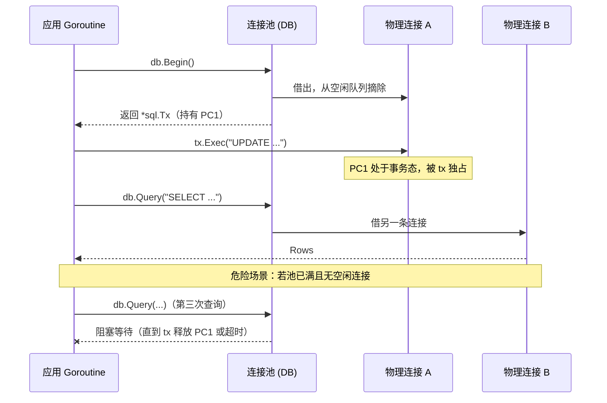
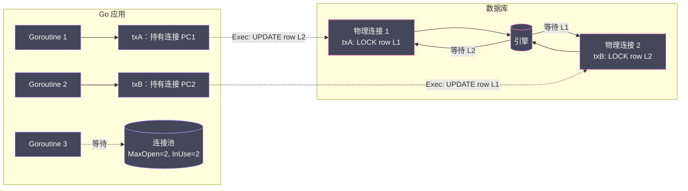

# 数据库事务抽象与一致性物理边界

**摘要：**

数据库事务是关系型系统四十余年演进中最稳定的契约之一，但应用开发者对它的直觉理解，往往与它在物理层面的真实行为之间隔着一道抽象的裂缝。`database/sql` 用 `sql.Tx` 把事务包装成一个看似轻量的 Go 对象，但它的底层却绑定着一条从连接池中借出的、不能被任何其他操作染指的物理连接；开发者以为在操作一个"逻辑概念"，实际上在独占一份操作系统级别的资源。本文从 ACID 的物理含义切入，逐层拆解 `sql.Tx` 的连接绑定机制、事务嵌套为何是一个伪命题以及 Savepoint 如何在单一连接上模拟嵌套边界、`defer tx.Rollback()` 的幂等性如何在 panic 与 context 取消时兜底、连接借还冲突如何引发池耗尽与死锁，最后把视角拉到隔离级别与分布式事务——前者由数据库独自承担语义，后者则揭示本地事务在跨库场景下的物理不可达。行文始终围绕两条主线：事务的抽象边界在哪里，以及抽象漏出时应用该如何接住后果。这两条主线的交汇点，正是 [[Golang/Go网络编程与持久化/00 专栏导览|Go 网络编程与持久化]] 专栏反复强调的一个认知——线上事故大多发生在抽象漏出的地方。

---

## 第 1 章 从事务的起源说起——ACID 是一份物理契约

### 1.1 1970 年代的遗产与一个被滥用的词

"事务"这个词被用得太随意了。前端开发者说"提交一个表单事务"，消息队列说"处理一条事务消息"，Redis 说"Pipeline 是一种事务"——这些用法大多与关系型数据库语境下的事务（Transaction）没有半毛钱关系。为了避免后面的论述建立在流沙上，有必要先把范围严格限定下来：**本文所谓的事务，专指由关系型数据库管理系统（RDBMS）实现的、满足原子性（Atomicity）、一致性（Consistency）、隔离性（Isolation）、持久性（Durability）四性质的操作序列**，也就是 1970 年代末 Jim Gray 与 IBM System R 团队逐步形式化的 ACID 模型。关于事务从 ACID 到分布式事务（Distributed Transaction）的演进脉络，可参见 [[分布式架构/数据密集型系统架构实战/07 事务：从 ACID 到分布式事务的隔离级别]]，本文聚焦的是 Go 应用层视角下事务抽象与物理连接的绑定关系。

ACID 不是一份哲学宣言，而是一份工程契约。它承诺的是：无论你程序里发生什么——断电、进程崩溃、磁盘坏道、并发冲突——只要 `COMMIT` 返回成功，数据就一定落在持久存储上，且不会与约束冲突；只要 `COMMIT` 尚未返回，所有中间状态对外部观察者都不可见。这份契约的代价极高：写放大（Write Amplification）、锁竞争、序列化开销、崩溃恢复时的前滚与回滚。代价如此之高，以至于上世纪 90 年代一度出现"NoSQL"运动的反扑——但二十年过去，关系型事务依然是金融、库存、订单、账务等核心系统的最后一道防线。MySQL 的 InnoDB 引擎通过 redo log + undo log + MVCC 的组合实现了这份契约的完整语义，这套机制的细节在 [[中间件/MySQL/MySQL架构与底层原理/03 InnoDB 日志系统——WAL 协议与崩溃恢复的工程实现]] 与 [[中间件/MySQL/MySQL架构与底层原理/04 Undo Log 与 MVCC——多版本并发控制的实现真相]] 中已有详尽剖析，此处不再赘述，只聚焦"应用层抽象如何与这份物理契约对接"的边界问题。

不妨用一个物理类比来理解事务的本质：事务是应用与数据库之间的一份"时间隔离契约"。在契约生效期间（从 `BEGIN` 到 `COMMIT`），外部世界看不到契约内部的任何变化——好像这段时间被"折叠"了起来；一旦 `COMMIT` 完成，所有变化瞬间对外可见，仿佛折叠的时间被"展开"。这份契约的物理支撑是数据库的锁、日志、MVCC 版本链——它们共同确保了"折叠期间"的修改不会泄漏到外部视图。应用层的事务抽象（`sql.Tx`）则是这份契约在 Go 进程中的代理——它本身不持有数据，只负责把应用的"折叠/展开"意图传递给数据库。

> [!info] 一个被忽视的事实
> ACID 的四条性质里，**隔离性（Isolation）** 是唯一一条语义由数据库单方面定义、应用只能被动接受的性质。原子性、一致性、持久性都有明确的物理判据——要么都成功、要么都失败、要么写进了 WAL——但隔离性在不同级别下呈现出完全不同的可见性规则，而 Go 的 `database/sql` 对这套规则几乎不置一词。关于 InnoDB 在隔离级别上的具体实现工程，参见 [[中间件/MySQL/MySQL架构与底层原理/08 InnoDB 事务隔离级别——从脏读到幻读的防御工程]]。

### 1.2 为什么 Go 必须把事务抽象成 `sql.Tx`

回到 Go 的视角。`database/sql` 是 2011 年 Go 1.0 就带有的标准库，它的设计目标并不是做一个 ORM，而是做一层**驱动抽象**——让同一套应用代码能跑在 MySQL、PostgreSQL、SQLite、Oracle 上，只换驱动、不改业务。这层抽象在普通查询场景下是透明的：`db.Query` 内部借一条连接、发 SQL、收结果、归还连接，应用感受不到底层物理连接的存在。关于连接池的状态机模型与连接借还的细节（空闲队列、等待队列、`MaxOpen` / `MaxIdle` / `MaxLifetime` 的相互作用、`Rows` 游标与底层 TCP socket 的关联），将在本专栏下一篇中系统展开。

但事务打破了这种透明性。事务的语义决定了它必须跨越多个 SQL 语句保持上下文——`BEGIN` 之后的所有语句都跑在同一条会话（session）里，直到 `COMMIT` 或 `ROLLBACK`。如果每次 `Exec` 都随机从池中拿一条连接，那么第二条 `INSERT` 可能跑到另一条物理连接上，前一条连接上的事务状态就与当前会话彻底脱节。这就是 `sql.Tx` 存在的根本原因：**它把一个事务周期内对数据库的所有交互，钉死在同一条物理连接上**。

这条设计决策的影响远比表面看起来更深。它意味着事务不是连接池之上的一个"逻辑视图"，而是对物理资源的一份排他租约。理解这一点，是理解后续所有陷阱的起点。

---

## 第 2 章 `sql.Tx` 的物理绑定——一条连接被独占的完整生命周期

### 2.1 从 `db.Begin()` 到 `driverConn`

调用 `db.Begin()` 的瞬间，`database/sql` 做了一系列连贯的动作：

1. 从连接池（`DB.freeConn` 空闲队列）取一条空闲连接，或新建一条；
2. 向该连接发送 `BEGIN`（或驱动自定义的起始语句）；
3. 将该连接包装成一个 `*driverConn`，并**从池的空闲队列中摘除**——这一步是核心，它意味着这条连接在事务结束前**不再对任何其他操作可见**；
4. 返回 `*sql.Tx`，内部持有这个 `*driverConn`。

注意第 3 步。在普通查询路径中，`db.Query` 借出连接、发语句、读结果、归还连接，整个过程在一次调用内闭环；但 `sql.Tx` 借出连接后，**直到 `Commit` 或 `Rollback` 显式调用之前，这条连接不会回到池中**。这是事务与单条查询在资源占用上的本质区别——前者是持续占用，后者是瞬时借用。

可以把它想象成图书馆借书：单条查询像翻一页参考书，看完放回书架；事务像把一整本书抱回座位，在你决定"还"或"续借"之前，这本书对其他读者完全不可见。如果图书馆总共只有 N 本书（连接池大小），同时有 N 个读者各抱一本，第 N+1 个读者就只能坐在桌边干等——这正是生产环境中"长事务引发连接池耗尽"的经典机理。

```go
// 事务期间，tx 独占一条物理连接。
// 任何通过 db 发起的查询都走另一条连接，
// 绝不会与 tx 共享——这是 SQL 会话模型的硬约束。
tx, err := db.Begin()
if err != nil {
    // 借连接失败：池耗尽或驱动报错
    return err
}
// 从此刻起，这条连接被 tx 独占
_, _ = tx.Exec("UPDATE accounts SET balance = balance - 100 WHERE id = 1")
_, _ = tx.Exec("UPDATE accounts SET balance = balance + 100 WHERE id = 2")
return tx.Commit() // 或 tx.Rollback()——连接才会归还
```

从源码层面看，`*sql.Tx` 内部持有一个 `*driverConn` 指针以及一个 `ctx`（来自 `BeginTx` 的 context），这个 `driverConn` 在事务生命周期内被 `tx.txi`（驱动级事务接口）引用，不会被 `DB` 的 `putConnDBL` 放回空闲队列。只有当 `tx.close()` 被调用（无论是通过 `Commit` 还是 `Rollback`），才会触发 `tx.dc = nil` 并把连接归还给 `DB.putConnDBL`。这段源码逻辑是理解"事务独占连接"的关键，也是为什么忘记 `Rollback` 会造成连接泄漏的根本原因。

值得一提的是 `driver.Tx` 接口——这是数据库驱动必须实现的底层事务接口，包含 `Commit()` 和 `Rollback()` 两个方法。`*sql.Tx` 是对这个驱动层接口的高层封装，负责连接的生命周期管理、context 传播与错误转换。应用代码从不直接与 `driver.Tx` 打交道，但理解这层分离有助于看清"Go 的事务抽象到底做了哪些事、把哪些事留给了驱动"：**Go 负责连接借还与 context 取消，驱动负责把 `BEGIN` / `COMMIT` / `ROLLBACK` 翻译成具体数据库的协议**。

### 2.2 一个常见误区：同一事务内混用 `db` 与 `tx`

初学者最常犯的错误之一，是在事务上下文中不小心调用了 `db.Exec` 而非 `tx.Exec`。这种错误不会报编译错误，不会立刻报运行时错误，但会在你毫无察觉的情况下，把事务的一部分操作泄漏到事务之外。

```go
tx, _ := db.Begin()
_, _ = tx.Exec("UPDATE ... SET ... WHERE id = 1")      // 在事务内
_, _ = db.Exec("UPDATE ... SET ... WHERE id = 2")      // 走了另一条连接！不在事务内
_ = tx.Commit()
// 第二条 UPDATE 不受事务保护——若第一条回滚，第二条不会跟着回滚
```

这种错误的隐蔽性在于：两条 UPDATE 都成功了，应用层看到的 error 是 nil，但 ACID 的原子性已经在物理层面被打破。排查此类问题的唯一可靠方法是**结合连接池指标与数据库服务端日志**——在 MySQL 侧用 `SHOW PROCESSLIST` 或 Performance Schema 观察会话，会发现同一个业务操作里出现了两条不同的 connection id，对应的事务上下文也分离。Go 侧可以用 `database/sql` 的 `DB.Stats()` 观察 `InUse` 是否异常偏高。

> [!warning] 代码审查建议
> 在团队代码规范中，应当明确一条规则：**事务上下文中禁止出现 `db.Exec`、`db.Query`、`db.QueryRow` 等通过 `*sql.DB` 发起的操作**。这条规则可以通过 lint 工具或 git hook 部分自动化，但最根本的还是开发者理解"事务 = 物理连接独占"这一底层事实。

### 2.3 事务期间的连接不可被其他操作复用

这条规则看起来显而易见，但它的推论值得展开：

- **事务期间，不能通过同一个 `*sql.DB` 的其他查询借用这条连接**——即便应用层代码没有显式使用 `tx`，这条连接也已被占用；
- **事务期间，不能在同一个 `*sql.Tx` 上并发执行语句**——`sql.Tx` 不是并发安全的，驱动层对底层连接的写操作大多不是线程安全的；
- **事务期间，如果应用再发起一个通过 `db` 的查询，而池已满，该查询将阻塞等待**——这正是"长事务 + 嵌套查询 = 死锁"的经典配方，第 5 章将详细展开。



这张图展示了事务期间连接的状态分布：`tx` 独占 PC1，其他通过 `db` 发起的查询只能走池里的其他连接。当池容量耗尽时，后续查询将被迫等待——这正是连接泄漏与死锁的温床。关于 Goroutine 泄漏与死锁的系统性排查方法，可参考 [[Golang/Go并发编程/11 并发陷阱与调试——Goroutine 泄漏、死锁与 Race Detector]]，虽然那篇文章聚焦于 Goroutine 层面的问题，但连接池耗尽引发的 Goroutine 堆积是其最常见的诱因之一。

### 2.4 `sql.Tx` 的方法集合与设计约束

`*sql.Tx` 提供的方法集合是 `*sql.DB` 的一个严格子集——`Exec`、`Query`、`QueryRow`、`ExecContext`、`QueryContext`、`QueryRowContext`，加上 `Commit` 与 `Rollback`。它**不提供** `Begin`、`Ping`、`Prepare`（但有 `PrepareContext`）、`Stats`、`SetMaxXXX` 等"管理性"方法。这种刻意的方法裁剪传递了一个清晰的语义：**事务是一个操作上下文，不是一个新的连接管理器**。应用层不能通过 `*sql.Tx` 调整池参数、不能嵌套事务、不能探测数据库可达性——这些都属于 `*sql.DB`（连接池）的职责。

如果把数据库连接池比作一个出租车车队，`db.Query` 像打一次车——从上车到下车，一辆车为你服务一次，结束后车回到车队等下一个乘客。`sql.Tx` 则像包一辆车一整天——车从被你包下的那一刻起就专属为你服务，哪怕中间你大部分时间在开会（执行本地逻辑）没有用车，车也不能去接其他单。如果车队只有 10 辆车，同时 10 个人各包一辆，第 11 个人就只能排队等——**即便其中 5 个人实际上只是占着车在打盹**。这就是长事务独占连接的物理本质：占用的时长比实际需要更长，因为事务边界往往被业务边界拖着变长。

这种设计意味着：当你拿到一个 `*sql.Tx`，你拿到的是"在某条连接上做数据库操作的权力"，而不是"一个新的数据库抽象"。任何试图在事务内做"事务之外的事"（譬如调整池参数、启动新事务、跨连接查询），都是对这条设计边界的违反。

---

## 第 3 章 事务嵌套的伪命题与 Savepoint 机制

### 3.1 为什么"嵌套事务"是一个概念陷阱

在展开 Savepoint 机制之前，有必要先破除一个根深蒂固的直觉误区：事务可以嵌套。这个直觉的来源是可以理解的——日常编程中，函数可以嵌套调用，try-catch 可以嵌套，作用域可以嵌套，那么事务为什么不能嵌套？答案是：因为事务不是一个语言层面的控制结构，而是一个物理层面的资源占用状态。函数调用的嵌套靠的是调用栈，try-catch 的嵌套靠的是异常处理表，作用域的嵌套靠的是词法环境——这些都可以自由叠加，因为它们不独占外部资源。但事务的"嵌套"意味着同时占用多条数据库会话或者在一条会话上维护多个事务状态机——这与数据库的会话模型直接冲突。

很多框架——Spring 的传播行为（Propagation）、Django 的 `atomic()` 嵌套、某些 ORM 的 `with Transaction` 堆叠——给人一种印象：事务可以像函数调用一样嵌套，内层事务独立提交或回滚，不影响外层。

这是一个错觉。关系型数据库的物理世界里，**一个会话（session）在同一时刻只能有一个活跃事务**。`BEGIN` 之后再发 `BEGIN`，不同数据库的处理方式不同：

| 数据库 | `BEGIN` 之后再 `BEGIN` 的行为 |
|--------|-------------------------------|
| PostgreSQL | 发出 `WARNING: there is already a transaction in progress`，忽略第二次 `BEGIN` |
| MySQL (InnoDB) | 隐式 `COMMIT` 当前事务，再开启新事务（DDL 语句也会触发隐式提交） |
| SQL Server | 递增 `@@TRANCOUNT`，`COMMIT` 递减计数器，归零时才真正提交 |
| SQLite | 返回 `cannot start a transaction within a transaction` 错误 |

这些行为都不是"嵌套"，而是各自对冲突语义的妥协。`database/sql` 在驱动抽象层并没有试图抹平这些差异。调用 `tx.Begin()` 是编译错误——`*sql.Tx` 没有 `Begin` 方法。这意味着 Go 标准库从一开始就拒绝提供"嵌套事务"的语法糖。这是符合物理事实的设计：**既然数据库没有真正的嵌套事务，应用层抽象就不应该假装它有**。

### 3.2 Savepoint——在单一事务内切分回滚边界

虽然不能嵌套事务，但 SQL:2003 标准引入了 **Savepoint** 机制，允许在一个活跃事务内"打书签"，后续可以选择回滚到某个书签而非整个事务。这相当于在单一事务的长轴上切出若干段，每段可以独立撤销，但提交仍然是整体的。

```sql
BEGIN;
INSERT INTO orders (id, total) VALUES (1, 100);
SAVEPOINT sp_items;
INSERT INTO order_items (order_id, sku) VALUES (1, 'A001');
INSERT INTO order_items (order_id, sku) VALUES (1, 'A002');
-- 发现 A002 有问题，只回滚到 sp_items
ROLLBACK TO SAVEPOINT sp_items;
INSERT INTO order_items (order_id, sku) VALUES (1, 'A003');
COMMIT;  -- orders 与 order_items(A001, A003) 一起提交
```

在 Go 中，`database/sql` 从 Go 1.14（2020 年 2 月）开始通过 `sql.Tx` 的 `Conn` 暴露底层连接，结合驱动的特定接口可以实现 Savepoint 操作——但标准库本身没有提供 `Savepoint()` 的高层封装。常见的做法是直接通过 `tx.Exec` 发 SQL：

```go
tx, _ := db.Begin()
_, _ = tx.Exec("INSERT INTO orders ...")
_, _ = tx.Exec("SAVEPOINT sp_items")

// 内层操作
_, err := tx.Exec("INSERT INTO order_items ...")
if err != nil {
    // 只回滚到 savepoint，事务本身继续
    _, _ = tx.Exec("ROLLBACK TO SAVEPOINT sp_items")
    // 可继续插入替代数据
}

_, _ = tx.Exec("RELEASE SAVEPOINT sp_items")
_ = tx.Commit()
```

> [!warning] Savepoint 的三个物理约束
> 1. **Savepoint 不能跨连接**——它依附于当前事务的会话状态，连接释放则 savepoint 失效；
> 2. **Savepoint 不是隔离边界**——内外层看到的依然是同一份事务视图，其他并发会话在 `COMMIT` 之前看不到任何 savepoint 内的修改（取决于隔离级别）；
> 3. **不是所有数据库都支持**——MySQL 5.7+ 支持、PostgreSQL 支持、SQLite 3.24+ 支持，但实现细节与嵌套 savepoint 的覆盖语义有差异，跨数据库移植时必须验证。

### 3.3 框架的"嵌套事务"是如何模拟的

理解了 Savepoint，就能看穿 Spring `@Transactional(propagation = Propagation.NESTED)` 等机制的本质：框架在第一次进入事务时发 `BEGIN`，检测到"已存在事务"时改发 `SAVEPOINT`，退出时对应发 `RELEASE SAVEPOINT` 或 `ROLLBACK TO SAVEPOINT`。这层包装给了开发者"嵌套"的心理模型，但物理上依然是单一连接、单一事务、一系列 savepoint 书签。

这种模拟有一个隐含代价：**savepoint 之间的所有操作，在数据库侧仍然是同一条 undo log / rollback segment 上的连续记录**。回滚到 savepoint 不会释放之前占用的锁，也不会减少 undo 空间消耗——它只是在逻辑上把一部分修改"擦掉"。如果内层操作修改了大量行，这些行的锁依然被外层事务持有，直到 `COMMIT`。这正是"嵌套事务让并发更差"这一经验判断的物理来源。关于 InnoDB 行锁与间隙锁在并发场景下的行为，参见 [[中间件/MySQL/MySQL架构与底层原理/07 InnoDB 锁机制——从记录锁到间隙锁的底层实现]]。

### 3.4 Savepoint 的工程适用场景

虽然 Savepoint 在 Go 中没有高层封装，但在特定工程场景下它非常有用：

- **批量操作的部分失败处理**：向一张表批量插入 1000 行数据，如果希望"失败的行跳过、成功的行保留"，可以在每行插入前设置 savepoint，失败时回滚到该 savepoint 而不是整个事务。这比"先全部插入再删除失败行"更高效，因为后者需要额外的 DELETE 操作与额外的 undo 消耗；
- **校验-执行两步流程**：先在事务中做数据校验（可能修改临时表或标记位），校验通过后再正式执行业务逻辑。如果校验失败，回滚到校验前的 savepoint 即可，不必放弃整个事务；
- **框架层的重试边界**：某些 ORM 框架在遇到特定错误（如唯一键冲突）时，会回滚到 savepoint 而不是整个事务，然后在 savepoint 之后继续执行替代逻辑——这种模式在 Django 的 `atomic()` 中已经成熟，Go 生态的框架可以借鉴。

不过 Savepoint 也有明确的边界：**它不是并发隔离的边界**。Savepoint 内外看到的仍然是同一份事务级视图，其他并发事务在 `COMMIT` 之前看不到任何 savepoint 内的修改。把 Savepoint 误当作"小事务"来使用——譬如在 savepoint 内部做外部 I/O 然后依赖"回滚 savepoint"撤销——是错误的，因为回滚 savepoint 只影响数据库的修改，不影响已经发出的 HTTP 请求或消息。

---

## 第 4 章 原子性的物理代价——异常、崩溃与连接泄漏

### 4.1 `defer tx.Rollback()` 的兜底哲学

`database/sql` 的官方文档里有一个著名的代码范式：

```go
tx, err := db.Begin()
if err != nil { /* ... */ }
defer tx.Rollback()  // 幂等的保险丝

// ... 业务逻辑 ...

return tx.Commit()
```

`defer tx.Rollback()` 看起来有些反直觉：如果 `Commit` 成功了，再 `Rollback` 不会把提交的数据回滚吗？答案是不会。`*sql.Tx` 内部维护了一个 `done` 标志位，一旦 `Commit` 或 `Rollback` 中任意一个被调用过，后续的 `Rollback` 调用直接返回 `sql.ErrTxDone`，不再向数据库发送任何语句。这种**幂等性**是这段惯用法成立的前提。

这条 `defer` 的真正意义不是"常规路径的回滚"，而是**异常路径的保险丝**。当业务逻辑中途 panic、context 被取消、网络中断、或者任何未预期的错误导致函数提前返回时，`Commit` 不会被调用；如果没有 `defer tx.Rollback()`，那条被 `Tx` 独占的物理连接就永远无法归还到池中——它既没被提交也没被回滚，数据库侧的事务状态悬挂，应用侧的连接池里少了一条可用连接。这就是所谓的**连接泄漏**。

可以把 `defer tx.Rollback()` 想象成消防员进火场前系的救生绳：正常撤离时（`Commit`）用不上，但一旦坍塌（panic / 早期 return），这根绳子是唯一的退路。没有它，人（连接）就埋在废墟（池）里，越埋越多，直到整栋楼（服务）因资源耗尽而瘫痪。

### 4.2 panic 路径下的资源清理

Go 的 panic 机制会沿着调用栈反向执行所有 `defer`，这意味着即便业务代码 panics，`defer tx.Rollback()` 依然会被触发。这是 Go 的资源管理模型对事务安全的天然支撑——前提是开发者**必须记得写这条 defer**。这条 defer 的位置也有讲究：它必须紧跟在 `Begin` 成功返回之后、任何可能 panic 的代码之前，形成一道"无论发生什么都会执行"的安全网。关于 `defer` 的底层实现、执行顺序与编译器优化（从堆分配到栈分配再到开放编码的三次演进），参见 [[Golang/Go语言核心/09 函数、闭包与 defer 的实现]] 与 [[Golang/Go运行时进阶与底层机制/02 defer 的演进史与编译优化——堆分配、栈分配到开放编码]]。

```go
func transfer(tx *sql.Tx, from, to int64, amount int64) (err error) {
    // 注意：这里接收的是 *sql.Tx，而不是 *sql.DB
    // 调用方负责 Begin 与 defer Rollback，函数本身不再重复
    _, err = tx.Exec("UPDATE accounts SET balance = balance - ? WHERE id = ?", amount, from)
    if err != nil { return }
    _, err = tx.Exec("UPDATE accounts SET balance = balance + ? WHERE id = ?", amount, to)
    return
}

func runTransfer(db *sql.DB, from, to, amount int64) (err error) {
    tx, err := db.Begin()
    if err != nil { return err }
    defer tx.Rollback() // 兜底：无论 panic 还是 return 都尝试回滚

    if err = transfer(tx, from, to, amount); err != nil {
        return err // defer 会触发 Rollback
    }
    return tx.Commit() // Commit 成功后，defer 的 Rollback 是 no-op
}
```

但如果 panic 发生在 `defer tx.Rollback()` 注册**之前**呢？譬如 `db.Begin()` 本身内部 panic（极罕见但理论上可能）——此时事务根本没建立，没有连接被占用，没有泄漏风险。真正的危险区是 `Begin` 成功之后、`defer` 注册之前的那几行代码，譬如：

```go
tx, err := db.Begin()
if err != nil { return err }
// 危险区：这里如果 panic，连接已借出但无人归还
validateInputsOrPanic()  // 假设这里有 panic
defer tx.Rollback()
```

这段代码把 `defer` 放在了一个会 panic 的调用之后，是错的。正确做法是**把 `defer tx.Rollback()` 紧贴 `Begin` 成功后**——这是 Go 事务代码的铁律，任何中间语句都可能成为泄漏的缺口。

### 4.3 context 取消与事务超时

Go 1.8（2017 年 2 月）引入了 `db.BeginTx(ctx, opts)`，允许把 [[Golang/Go并发编程/07 Context 的设计与取消传播机制|Context]] 与事务绑定。当 context 被取消（超时、客户端断开、父级 cancel），`database/sql` 会尝试向数据库发送取消信号——具体行为依赖驱动：

- **PostgreSQL（pq / pgx）**：向服务端发送 `CancelRequest`，服务端中止当前查询，事务进入 aborted 状态，必须 `ROLLBACK`；
- **MySQL（go-sql-driver/mysql）**：通过关闭底层 TCP 连接强制中断，MySQL 服务端检测到连接断开后自动回滚该事务；
- **SQLite**：在单进程场景下直接中断，回滚由引擎自动完成。

无论哪种情况，`defer tx.Rollback()` 都不可或缺——context 取消后，Go 侧的 `Tx` 对象仍然需要被显式关闭，以释放它所持有的 `driverConn` 回到池中（或标记为废弃）。如果漏掉 defer，即便数据库侧已经回滚，应用侧的连接池里那条连接依然处于"被占用"状态，成为幽灵。

```go
// 推荐的事务超时写法：把 context 超时与 defer Rollback 结合
ctx, cancel := context.WithTimeout(context.Background(), 5*time.Second)
defer cancel()

tx, err := db.BeginTx(ctx, nil)
if err != nil { return err }
defer tx.Rollback()  // 始终兜底

// 业务逻辑
_, err = tx.ExecContext(ctx, "UPDATE ...")
if err != nil { return err }  // 超时或其他错误，defer Rollback 兜底

return tx.Commit()
```

这段代码值得细品：`context.WithTimeout` 保证数据库侧不会无限等待，`defer cancel()` 释放 context 资源，`defer tx.Rollback()` 保证连接归还。两道 defer 构成完整的资源安全网，缺一不可。

### 4.4 进程崩溃时的最终防线

进程崩溃（kill -9、OOM killer、segfault）是最极端的路径。此时没有任何用户态代码能执行，`defer` 不会跑，连接池不会清理。这种场景下靠什么保证数据一致性？

答案在数据库侧。关系型数据库的 **WAL（Write-Ahead Log）** 协议保证了：**未 `COMMIT` 的事务，即便已经写入数据页，在崩溃恢复时也会被 undo**。MySQL 的 redo log + undo log、PostgreSQL 的 WAL、SQLite 的 journal，都遵循这一原则。Go 应用侧能做的只是"尽可能及时地告诉数据库要不要提交"——最终的一致性裁判权在数据库，不在应用。关于 WAL 协议的工程实现，参见 [[中间件/MySQL/MySQL架构与底层原理/03 InnoDB 日志系统——WAL 协议与崩溃恢复的工程实现]]。

这正是事务抽象的一个深刻边界：**应用层能控制的是"提交意图"的传递，而物理层保证的是"提交意图"之外的所有中间状态必然可撤销**。理解这一边界，才能在系统设计中把应用崩溃视为常态、而非异常。

### 4.5 一个容易被忽略的细节：`Rows` 未关闭对事务的影响

在事务内使用 `tx.Query` 会返回一个 `*sql.Rows`，这个对象与底层的 TCP 连接及驱动的行游标（cursor）强绑定。如果 `Rows` 没有被正确关闭（通过 `Rows.Close()` 或读尽所有行），它所持有的连接不会被释放回 `Tx` 的内部状态机——这意味着事务内部会出现"连接被占用但不可用"的诡异状态：`Tx` 认为自己仍然持有这条连接，但实际上一条子连接被 `Rows` 占用，无法执行下一条 SQL。

```go
tx, _ := db.Begin()
defer tx.Rollback()

rows, _ := tx.Query("SELECT id FROM users WHERE status = ?", "pending")
// 错误示例：只读第一行就退出循环，Rows 未关闭
var firstID int64
if rows.Next() {
    _ = rows.Scan(&firstID)
}
// 此时 rows 仍然持有驱动层的行游标
// 下一条 tx.Exec 可能会阻塞或失败

_, err := tx.Exec("UPDATE users SET status = 'processed' WHERE id = ?", firstID)
// 在某些驱动下，这里会报错：
// "Error 1305: SAVEPOINT ... does not exist" 或驱动层 "connection busy"
```

正确做法是用 `defer rows.Close()` 或在读完所有行后显式调用 `Close()`。`database/sql` 内部会在 `Rows` 读尽（`rows.Next()` 返回 false）时自动关闭，但提前跳出循环的场景必须显式处理。这个细节在单条查询中只是资源浪费的问题，在事务中却会破坏后续 SQL 的执行——因为事务的所有 SQL 都依赖同一条物理连接的串行状态。

---

## 第 5 章 连接借还冲突——池耗尽、长事务与死锁的排查理论

### 5.1 死锁的三种配方

"数据库死锁"这个词在应用开发者口中常常被误用。严格意义上的数据库死锁（Deadlock）是两条事务互相等待对方持有的行锁，由数据库的锁检测器挑出一个牺牲者回滚。但 Go 应用中更常见的"卡死"其实不是数据库层面的死锁，而是**应用层连接池耗尽引发的自我阻塞**。三种经典配方：

**配方一：长事务占池**。事务从 `Begin` 到 `Commit` 跨越了整个 HTTP 请求生命周期，包括调用下游服务、渲染模板、甚至等消息队列 ACK。这条事务持有的连接在整个请求期间无法被其他请求复用。假设池大小 50、平均 QPS 200、下游 P99 延迟 500ms，那么任意时刻有约 100 条连接被长事务占用，池瞬间枯竭，新请求全部阻塞。

**配方二：事务内嵌套同池查询**。这是第 2.3 节提到的场景：事务 `tx` 占用一条连接，事务内的业务逻辑又通过 `db.Query` 发起查询，而 `db` 与 `tx` 共享同一个连接池。如果池已满，这次 `db.Query` 将等待 `tx` 释放连接——但 `tx` 在等 `db.Query` 返回后才能继续执行到 `Commit`。两边都在等对方，这就是应用层的死锁。Go 1.8 之后 `database/sql` 对此有一定缓解：当检测到请求来自一个已持有本池某连接的 Goroutine 时，驱动会优先尝试把该连接重新分配给请求者，避免"自己等自己"；但这只在特定的同步调用路径上生效，异步路径或跨 Goroutine 的依赖仍然会触发死锁。

**配方三：多事务交叉等待**。Goroutine A 持有 `txA`、等待获取行 L2；Goroutine B 持有 `txB`、等待获取行 L1；而行 L1 已被 `txA` 锁定、行 L2 已被 `txB` 锁定。这是真正的数据库死锁，通常由数据库引擎检测并回滚其中一个事务，Go 侧会收到 `Error 1213: Deadlock found when trying to get lock; try restarting transaction`（MySQL）或 `could not serialize access due to concurrent update`（PostgreSQL）。

### 5.2 排查手段与指标

排查连接池相关的"假死锁"需要双视角：

**Go 侧**：通过 `DB.Stats()` 定时采集并暴露以下指标——

| 指标 | 含义 | 异常信号 |
|------|------|----------|
| `MaxOpenConnections` | 池容量上限 | 配置过小 |
| `InUse` | 当前被借出的连接数 | 接近或等于 `MaxOpen` 时阻塞在即 |
| `Idle` | 池中空闲连接数 | 长期为 0 意味着所有连接被长期占用 |
| `WaitCount` | 累计因借连接而阻塞的次数 | 持续增长即问题存在 |
| `WaitDuration` | 累计等待时长 | 斜率反映严重程度 |
| `MaxIdleClosed` / `MaxLifetimeClosed` | 因各策略被关闭的连接数 | 异常高意味着池抖动 |

**数据库侧**：通过 `SHOW PROCESSLIST`（MySQL）、`pg_stat_activity`（PostgreSQL）观察每个连接的当前状态与最后执行的 SQL。如果大量连接处于 `Sleep` 但 `Time` 值很大，说明应用侧事务未及时提交；如果状态是 `Sending data` 或 `Locked`，说明事务正在等待锁或网络 I/O。



图中展示了真正的数据库死锁：两条事务各持有一行锁、同时等待对方持有的行。应用层的池耗尽与这种数据库死锁经常并发出现——长事务占着池不释放的同时，也增加了数据库侧事务交叉等待的概率。关于 TCP 层面的连接状态对事务行为的影响——譬如 TCP 半开连接、FIN_WAIT2 状态对事务提交的影响——将在本专栏传输层协议的篇目中详细展开。

### 5.3 配置原则与缓解路径

针对上述三类问题，缓解手段可以归纳为几条工程原则：

- **事务时长边界化**：事务内不做外部 I/O（HTTP、RPC、消息队列），只包含数据库操作。所有外部调用都应在 `Begin` 之前或 `Commit` 之后完成；
- **池容量与负载匹配**：`MaxOpenConns` 不是越大越好——过大的池会压垮数据库的连接处理能力（MySQL 默认 `max_connections=151`，过多连接反而引发上下文切换灾难）。经验值通常是 CPU 核数的 2-4 倍，再根据实测调整；
- **`SetConnMaxLifetime` 必须设置**：默认情况下连接永久存活，但数据库侧可能因 `wait_timeout`（MySQL）或 `idle_in_transaction_session_timeout`（PostgreSQL）主动断开，导致应用侧拿到一条已失效的连接。设置 `MaxLifetime` 略小于数据库侧的超时阈值，是避免这种"僵尸连接"的标准做法；
- **避免事务内嵌套同池查询**：如果事务中必须查数据，一律通过 `tx.Query` 而非 `db.Query`，让查询复用事务已持有的连接，而非向池申请新连接；
- **死锁重试**：对于数据库检测到的真死锁，在应用层捕获特定错误码并做有限次数重试（通常 3 次，指数退避）是标准做法。Go 的 `errors.Is` 与驱动自定义错误类型的结合，让这种重试逻辑可以写得比较干净。关于 Go 错误处理的哲学与 `errors.Is` / `errors.As` 的使用，参见 [[Golang/Go工程实践/03 Go 错误处理哲学——从 error 到 errors.Is 与 errors.As]]。

### 5.4 一个实务案例：长事务引发的雪崩

一个典型的线上事故场景如下：某订单服务在事务内调用下游支付服务，支付服务 P99 延迟 2 秒。峰值 QPS 500，池大小 100。按照 Little's Law，任意时刻有 500 × 2 = 1000 条请求在等待支付响应——但池只有 100 条连接。结果是：前 100 条请求的事务占用了全部连接，后续 900 条请求在 `db.Begin()` 处阻塞，等待池释放连接。等到支付响应返回、事务提交、连接归还，被阻塞的请求才开始处理——但此时下游支付服务可能已经因为突发流量雪崩。整个系统的恢复时间被"事务持有连接"的锁死效应拉长到分钟级。

解决这个场景的关键不是"增大池"，而是**把事务边界收窄到只包含数据库操作**：先在事务外调用支付服务，拿到结果后再开事务更新本地数据库。这样事务的时长从"2 秒（支付调用）+ 几毫秒（数据库操作）"缩短到"几毫秒"，池的占用从"1000 连接-秒/请求"降到"几毫秒/请求"，整个系统的容量与恢复能力都会大幅提升。

---

## 第 6 章 隔离级别——Go 只传递，数据库决定

### 6.1 一个被动的信使

`sql.TxOptions` 允许在 `db.BeginTx(ctx, &sql.TxOptions{Isolation: sql.LevelSerializable})` 中声明期望的隔离级别。但这份声明只是**应用传递给驱动的一个参数**，驱动再把它翻译为对应数据库的 `SET TRANSACTION ISOLATION LEVEL` 语句。Go 自身对隔离级别的语义不做任何执行——它不知道什么是"可重复读"，也不关心"幻读"如何在 MVCC 中通过版本链实现。

这种设计是合理的：隔离语义的完整定义涉及存储引擎的锁策略、MVCC 实现、间隙锁（Gap Lock）范围，这些是数据库内核的专属领域，应用层语言没有能力也没有权力去重新解释。Go 的克制，恰恰是对数据库专业性的尊重。

| 隔离级别 | SQL 常量 | InnoDB 默认行为 | PostgreSQL 默认行为 |
|----------|----------|------------------|----------------------|
| Read Uncommitted | `sql.LevelReadUncommitted` | 近似 Read Committed（InnoDB 不真正实现 RU） | 不支持，回退到 RC |
| Read Committed | `sql.LevelReadCommitted` | 每条 SELECT 看到语句开始时的快照 | 默认级别，语句级快照 |
| Repeatable Read | `sql.LevelRepeatableRead` | **InnoDB 默认**，MVCC + 间隙锁防幻读 | 事务级快照，无间隙锁 |
| Serializable | `sql.LevelSerializable` | 类似 RR + 锁强化 | SSI（可序列化快照隔离） |

> [!note] 隔离级别的关键认知
> 同一隔离级别在不同数据库中的实现可能截然不同。MySQL InnoDB 的 `REPEATABLE READ` 通过间隙锁防幻读，PostgreSQL 的 `REPEATABLE READ` 通过 MVCC 快照实现，二者对并发插入的可见性规则并不等价。**可移植代码不应假设隔离级别的语义跨库一致**——要么固定使用一个数据库，要么在迁移时重新验证隔离行为。关于 MySQL 隔离级别的具体防御工程，参见 [[中间件/MySQL/MySQL架构与底层原理/08 InnoDB 事务隔离级别——从脏读到幻读的防御工程]]。

### 6.2 `IsolationLevel` 不可用时的退化

并非所有驱动都支持所有隔离级别。当驱动不认识请求的隔离级别时，`db.BeginTx` 会直接返回 `driver.ErrSkip` 或特定错误。应用层必须处理这种失败，而不是假设"设置一定会生效"。SQLite 只支持 Serializable（实际等价于其他库的 RR），PostgreSQL 对 Read Uncommitted 会默默降级为 Read Committed——这些数据库侧的妥协，Go 既不阻止也不提示。

这种"被动信使"角色提醒我们：**事务的隔离语义是数据库的契约，不是 Go 的契约**。在跨库迁移、在数据库升级、在使用代理或中间件（如 Vitess、CockroachDB 的 MySQL 兼容层、ProxySQL）时，必须重新验证隔离行为，不能想当然地认为 Go 代码里的 `sql.LevelRepeatableRead` 在任何地方都是同一个意思。

这种"传递而非执行"的设计哲学，在 Go 标准库的其他地方也能看到。譬如 `net/http` 的 `http.Server` 对 TCP 连接的超时只做设置、不做解释——`ReadTimeout`、`WriteTimeout`、`IdleTimeout` 分别作用于 TCP 连接的不同阶段，但 HTTP 协议本身并不规定这些超时的语义，那是应用层要回答的问题。Go 的这种"薄抽象"风格既是优点（不隐藏物理事实）也是挑战（需要开发者理解底层），在事务抽象这一点上体现得尤为明显。

### 6.3 隔离级别对应用行为的影响

从应用开发者的视角，隔离级别的选择直接影响业务逻辑的正确性假设：

- **Read Committed 下**：同一个事务内两次 `SELECT` 可能看到不同的数据（因为其他事务可能已经 `COMMIT`）。这意味着"先读后写"模式（Check-then-Act）在 RC 下是不安全的，必须依赖数据库的 `SELECT ... FOR UPDATE` 或乐观锁（版本号比对）来保证一致性；
- **Repeatable Read 下**：MySQL InnoDB 通过 MVCC 快照保证同一事务内多次读取一致，但间隙锁又引入了死锁的新可能（两个事务分别插入相邻键，可能互相等待对方的间隙锁释放）；
- **Serializable 下**：理论上最安全，但代价也最高——PostgreSQL 的 SSI 实现会检测"危险结构"（dangerous structure），检测到读写依赖环时主动中止一个事务，应用层需要重试。

这些行为差异在 Go 侧是**不可见的**——`database/sql` 不会告诉你"你的 UPDATE 因为隔离级别的原因失败了"，驱动只会返回数据库给的错误码。应用层必须理解自己依赖的数据库在该隔离级别下的真实行为，才能写出正确的代码。

### 6.4 一个常见的性能误区：盲目追求最高隔离级别

许多团队在初始化数据库连接池时，会不假思索地把隔离级别设置为 `SERIALIZABLE`——"反正最安全"。但这种做法的代价往往超出预期：

- **吞吐量下降**：Serializable 在大多数数据库中意味着更多的锁或更频繁的冲突检测，PostgreSQL 的 SSI 会监控"危险结构"并在检测到读写依赖环时主动中止事务，高并发场景下重试率会显著上升；
- **死锁概率增加**：MySQL InnoDB 在 RR 及以上级别会使用间隙锁（gap lock），两条事务如果分别在相邻的键范围内插入，可能互相等待对方的间隙锁释放，形成死锁；
- **延迟不可预测**：Serializable 下的冲突检测（无论是锁等待还是 SSI 中止重试）会让事务延迟出现长尾（tail latency），对实时性要求高的接口（如支付回调、用户登录）影响明显。

实务中的经验是：**大多数 OLTP 场景在 Read Committed 或 Repeatable Read 下，配合应用层的乐观锁（版本号 / CAS）或悲观锁（`SELECT ... FOR UPDATE`），就足以保证业务一致性**。把隔离级别作为"兜底"而非"主力"，才是更符合工程直觉的选择。

---

## 第 7 章 分布式事务的物理边界——本地抽象无法跨越的鸿沟

### 7.1 一条连接只能服务一个数据库

`sql.Tx` 绑定的是**一个 `*sql.DB` 对应的一个数据库实例中的一条物理连接**。这意味着：

- 两个不同的 `*sql.DB`（指向不同的数据库主机、甚至同一主机的不同数据库名），无法被同一个 `sql.Tx` 覆盖；
- 跨库的事务一致性，无法通过 Go 标准库的 `database/sql` 直接实现。

这是物理事实，不是设计缺陷。ACID 事务的实现依赖数据库内核的日志协议、锁管理器、恢复流程，这些机制天然局限于单个数据库实例的进程边界。任何声称"本地事务可以跨库"的抽象，最终都只是一种幻觉，或者是在更复杂的分布式协议上做的包装。关于分布式事务的本质挑战，参见 [[分布式架构/分布式事务/01 分布式事务的本质与挑战]]。

### 7.2 从 XA 到 Saga——分布式一致性的多种面貌

要跨越这条物理边界，业界在过去四十年里发展出若干方案，它们的取舍构成了另一个庞大的话题，此处只能勾勒轮廓：

- **XA / 两阶段提交（2PC）**：X/Open 在 1990 年代制定的标准，由一个事务管理器协调多个资源管理器，经历"Prepare → Commit/Rollback"两阶段。强一致，但阻塞式：Prepare 之后所有参与者持有锁等待最终决议，任一参与者宕机则全局阻塞。Go 侧需要驱动支持 XA 协议，`database/sql` 本身不提供；
- **TCC（Try-Confirm-Cancel）**：业务层实现三阶段，把"锁资源"下沉到业务语义，譬如冻结库存、扣减余额、完成转账。灵活但侵入业务代码。关于 TCC 的实现细节，参见 [[分布式架构/分布式事务/04 TCC 柔性事务模型原理与实践]]；
- **Saga**：1987 年由 Hector Garcia-Molina 提出，把长事务拆成一系列本地事务，每个本地事务有对应的补偿操作。失败时按反序执行补偿。最终一致，不持有跨节点锁，但存在"补偿未完成"的中间可见状态。关于 Saga 模式的具体编排，参见 [[分布式架构/分布式事务/05 Saga 长事务编排模式深度解析]] 与 [[分布式架构/数据密集型系统架构实战/12 分布式事务工程化：Saga 模式与一致性方案的选择框架]]；
- **本地消息表 + 消息队列**：应用把业务操作与消息写入同一条本地事务，由独立进程消费消息并投递到下游。用消息队列的 at-least-once 语义 + 下游幂等，换最终一致性。

每一种方案都有各自的代价与适用场景，没有银弹。但它们有一个共同点：**都放弃了在应用层用单一 `sql.Tx` 解决一切的天真想法**，转而接受"一致性是一个需要被设计、被拆解、被显式管理的系统级属性"。

### 7.3 Go 生态的现状与选型建议

Go 生态里，seata-go 等框架尝试提供分布式事务的应用层抽象，支持 AT、TCC、Saga 等模式。但这些框架无一例外地在 `database/sql` 之上叠了一层协调逻辑——它们清楚地知道 `sql.Tx` 的物理边界在哪里，然后在那个边界之外搭建自己的协议。这是正确的工程态度：**不要试图让 `database/sql` 做它做不到的事，而是在它的边界之外，用合适的协议补上缺失的那一块**。

选型时可以遵循一个简单的决策框架：

| 场景 | 推荐方案 | 理由 |
|------|----------|------|
| 单库单实例 | 本地事务 + `sql.Tx` | 最简单、最强一致、最低延迟 |
| 单库分库（中间件代理） | 依赖中间件的分布式事务能力（如 Vitess 的 2PC） | 应用层无需感知分片 |
| 微服务多库 | Saga + 补偿 | 服务自治、最终一致、可演化 |
| 强一致的跨库需求 | 2PC / 共识协议（如 CockroachDB 的并行提交） | 代价高，仅在必要时使用 |
| 异步最终一致 | 本地消息表 + 消息队列 | 解耦、可扩展、容忍延迟 |

这些选择没有高下之分，只有基于业务场景的权衡。

值得强调的是，**分布式事务的引入往往不是为了"解决一致性问题"，而是为了"解决组织边界问题"**。微服务架构的本质是服务自治——每个服务由不同的团队拥有、独立部署、独立演进。当两个服务需要共享数据一致性时，真正的困难不在技术层面（2PC、Saga 都是成熟方案），而在组织层面：谁负责协调？谁承担补偿失败的风险？数据所有权的边界在哪里？数据在跨服务流动时的格式、版本与语义由谁来定义与维护？这些问题的答案决定了分布式事务的具体形态，而不是反过来。关于数据所有权在微服务架构中的核心地位，参见 [[分布式架构/数据密集型系统架构实战/12 分布式事务工程化：Saga 模式与一致性方案的选择框架]] 与 [[译书/分布式/Software Architecture - The Hard Parts/08 数据所有权与分布式事务：微服务时代的数据一致性困局]]。

### 7.4 一个被过度简化的论断："微服务必须用分布式事务"

"微服务 = 分布式事务"是一句被过度简化的口号。事实上，许多微服务架构并不需要跨服务的强一致性：

- **大多数业务流程是天然补偿的**：订单创建失败 → 释放库存；支付超时 → 取消订单。这些操作可以通过事件驱动 + 幂等消费来实现，不需要两阶段提交；
- **读扩散比写扩散更常见**：微服务之间的数据关联大多通过 API 调用在应用层组装（BFF 模式），而不是通过数据库层的 JOIN。这种架构天然规避了跨库写事务的需求；
- **最终一致性在绝大多数业务场景下是可接受的**：用户下单后看到的"库存已扣减"与实际磁盘上的扣减之间，存在几百毫秒到几秒的延迟，对用户体验没有影响。真正需要强一致的只有金融结算、对账等少数场景。

把"分布式事务"作为微服务架构的默认配套，往往会引入不必要的复杂性、延迟与故障模式。更审慎的做法是：**先用本地事务 + 事件驱动解决大多数场景，只在明确需要强一致的边界上引入分布式事务协议**。

---

## 结语 在抽象的物理边界上做决策

行文至此，可以回头审视贯穿全文的那条主线：事务抽象的物理边界究竟在哪里。这条边界不是技术限制的产物，而是物理事实的忠实映射——ACID 的承诺建立在日志、锁与版本链之上，应用层的抽象必须如实地反映这些物理约束，否则就会在故障面前暴露出与预期不符的行为。

`sql.Tx` 不是魔法——它是一条物理连接的租约，独占、排他、有生命周期；事务嵌套不是嵌套——它要么不存在、要么是 Savepoint 在同一事务内的书签；`defer tx.Rollback()` 不是冗余——它是 panic 路径上唯一的保险丝；隔离级别不是 Go 的承诺——它是数据库的承诺，Go 只是转述；分布式事务不是本地事务的延伸——它是另一种完全不同的协议栈。

这些边界不是 `database/sql` 的缺陷，而是物理事实。Go 标准库选择如实呈现这些事实，而不是用更厚的抽象掩盖它们，这恰好是 Go 设计哲学的一贯体现——**透明优于魔法，显式优于隐式**。对应用开发者而言，这意味着更多的心智负担，但也意味着当抽象漏出时（而它一定会漏出），你有足够的知识去接住它，而不是对着一个失控的连接池或一条悬挂的事务手足无措。

最终，事务设计的智慧不在于"如何写出看起来最简洁的事务代码"，而在于**看清每一层抽象的物理成本，并因地制宜地选择恰好的抽象层**。短事务还是长事务，单库还是分库，强一致还是最终一致，Savepoint 还是业务补偿——这些问题没有标准答案，只有基于对物理边界的理解、对业务代价的权衡、对故障场景的预判之后，做出的具体决策。

由此可见，事务从来不是一个可以被"学会"的 API，而是一个需要被"理解"的物理系统。理解得越深，抽象漏出时的慌乱就越少；敬畏得越多，系统就越能在故障面前保持韧性。这种对物理边界的敬畏，或许是关系型事务历经半个世纪仍然屹立不倒的真正原因。

---

## 参考资料

1. Jim Gray, "The Transaction Concept: Virtues and Limitations", 1981
2. C. Mohan et al., "ARIES: A Transaction Recovery Method Supporting Fine-Granularity Locking and Partial Rollbacks Using Write-Ahead Logging", ACM TODS, 1992
3. Hector Garcia-Molina & Kenneth Salem, "Sagas", ACM SIGMOD Record, 1987
4. Go `database/sql` 官方文档：https://pkg.go.dev/database/sql
5. Go `database/sql` 源码：https://github.com/golang/go/tree/master/src/database/sql
6. MySQL InnoDB 事务模型：https://dev.mysql.com/doc/refman/8.0/en/innodb-transaction-model.html
7. PostgreSQL 事务隔离：https://www.postgresql.org/docs/current/transaction-iso.html
8. Percona Blog, "Demystifying InnoDB Transaction Isolation", 2017
9. Caitie McCaffrey, "Sagas vs. Process Managers", 2016

---

> [!note] 思考题
> 1. 如果一个 `sql.Tx` 在 `Commit` 返回之前，底层 TCP 连接被防火墙无声断开，应用侧会观察到什么？数据库侧呢？这种场景下 `defer tx.Rollback()` 还能发挥作用吗？
> 2. 为什么 `database/sql` 拒绝提供 `tx.Begin()`（嵌套事务语法）？如果它提供，驱动层需要承担哪些它目前不必承担的复杂性？
> 3. 在长事务不可避免的场景（譬如批量数据迁移）中，如何在保留事务原子性的同时避免连接池耗尽？Savepoint 分段提交是正确做法吗，还是它破坏了事务的初衷？
> 4. 考虑这样一个场景：事务内调用了外部 HTTP 服务，该服务超时 30 秒。数据库侧的 `innodb_lock_wait_timeout` 是 50 秒。这种配置组合会导致什么可观察的问题，应如何调整？
> 5. 如果需要在 PostgreSQL 与 MySQL 之间移植同一段使用 `sql.LevelRepeatableRead` 的 Go 代码，哪些隔离行为需要重新验证？间隙锁的差异会带来什么业务影响？
