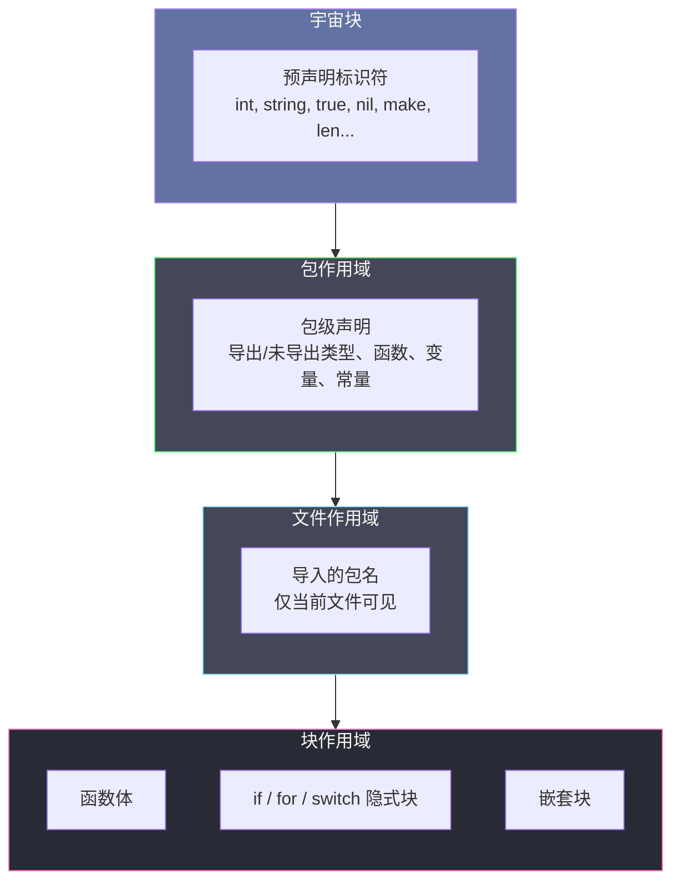
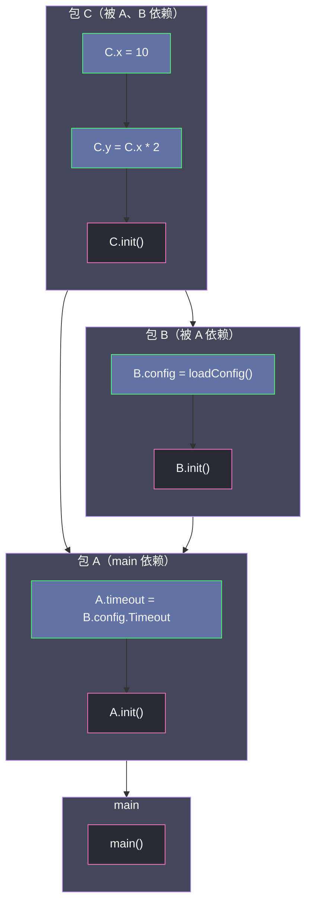

# 变量声明、作用域与包级初始化依赖拓扑

**摘要：**

任何一门语言的变量系统，本质上都在回答三个问题：未赋值的变量拿什么、名字在多大的范围内有效、多个变量之间的初始化顺序由谁决定。C 与 C++ 给出的答案是"未初始化变量是未定义行为的温床"，Java 以类加载器的复杂时序换取字段默认值的确定性，而 Go 在 2009 年诞生之初便把零值保证（zero-value guarantee）、词法块作用域（lexical block scope）与包级初始化的拓扑排序（topological sort）作为语言语义的三根支柱。本文沿着"零值的硬件根基 → 变量声明的四种姿态 → 作用域的隐式块 → 变量遮蔽的陷阱 → 无类型常量的编译期折叠 → 包级初始化的 DAG 与 init 函数的确定性"这条主线，逐层拆解 Go 变量系统的机制、边界与工程权衡，最终回答两个贯穿性问题：**Go 的零值保证究竟建立在哪些硬件与运行时契约之上**，以及**包级初始化为何必须是一张有向无环图且其顺序不可被优化掉**。作为 [[Golang/Go语言核心/00 专栏导览|Go 语言核心]] 专栏的第二篇，本文承接第 1 章的设计哲学，把"简单"的抽象承诺落实为可验证的语义规则。

---

## 第 1 章 零值——从零开始的安全承诺

### 1.1 未定义行为：C 留给 Go 的反面教材

要理解 Go 为何把"零值"写进语言规范，不妨先回望它试图告别的那个世界。在 C 语言里，一个未初始化的局部变量存放的是栈帧上残留的脏数据——可能是上一次函数调用的返回地址碎片，可能是某个临时缓冲区的末尾字节，也可能恰好是某个攻击者精心构造的值。C99 标准对此的措辞极为克制：局部自动变量若未被显式初始化，其值是**indeterminate**，对其进行读取即构成**未定义行为（undefined behavior）**。这意味着编译器可以把未初始化变量的读取优化成任何结果——返回 0、返回栈上残留值、甚至直接删除该分支——而程序在法律意义上仍然是"正确的"。

Java 在 1995 年第一次试图纠正这种混乱：类成员字段由虚拟机在分配时自动置零（数值类型为 0、引用为 null、布尔为 false），局部变量则仍要求显式赋值，否则编译失败。这是一次折中——它承认了"零值"在安全性上的价值，又保留了局部变量强制初始化的严格性。Go 在 2009 年把这条边界进一步推到了极致：**无论变量处于何种作用域、无论它是全局还是局部、无论是基本类型还是指针与切片，只要声明时未赋予初值，它就一定是其类型的零值**。int 是 0，float64 是 0.0，bool 是 false，指针、切片、map、channel、函数、接口全部是 nil。

> [!note] 零值不是"编译器的善意"，而是语言规范的硬契约
> 在 Go 中，零值不是某个编译器实现者决定给的方便，而是《The Go Programming Language Specification》明确规定的语义。任何符合规范的 Go 实现都必须保证这一点，否则它就不是 Go。这一契约让 Go 程序在推理变量状态时获得了一种确定性——拿到一个变量，即使没有显式赋值，也能确切知道它此刻是什么。

### 1.2 零值的硬件根基：mmap 零页与 span 清零

零值保证听起来简单，其实现却深深扎根于操作系统的内存分配机制。当 Go 运行时向操作系统申请新内存时，最终要调用 Linux 的 `mmap` 系统调用。现代 Linux 内核在把物理页映射到进程虚拟地址空间时，会**保证映射的页面内容是零**——这不是内核的善意，而是安全刚需：如果新分配的页面保留了上一个进程的残留数据，用户态程序就能读到别的进程的密钥、cookie 乃至内核数据结构，这在多租户环境下是不可容忍的安全漏洞。因此 `mmap` 返回的匿名页天然就是零页，Go 的堆分配器直接利用了这一硬件契约。

但这只解决了"新申请的大块内存是零"的问题。Go 的堆分配器（详见 [[Golang/Go运行时进阶与底层机制/00 专栏导览|Go 运行时进阶与底层机制]] 专栏中关于 mcache、mcentral 与 mheap 的讨论）采用 tcache/mcache/mcentral/mheap 的分层结构，细小的对象从 mcache 的 span 中分配，而 span 在被释放回 mcentral 后会被**重新清零**，确保下一次分配出去的对象仍然是零值起点。换言之，Go 的零值保证建立在两层契约之上：一是操作系统 `mmap` 保证的新页为零，二是运行时分配器保证的 span 回收后清零。这两层契约共同构成了零值确定性的硬件与运行时根基。

当然，对于栈上的局部变量，情况还要更精细一些。Go 的栈内存由 goroutine 的栈帧管理，新扩栈时由运行时负责清零；而栈帧复用的场景则由编译器在函数序言中插入必要的清零指令。逃逸分析（escape analysis）的结果决定了一个变量究竟分配在栈上还是堆上，但无论分配在哪里，零值保证都成立——这也是为什么笔者在前面强调，零值不是编译器的善意，而是规范契约。

> [!info] 零值的物理实现：三层清零契约
> 把零值保证的物理根基拆开，可以看到三层契约在协同工作：第一层是操作系统内核的 `mmap` 语义——内核在分配匿名页时主动清零，这是出于安全隔离的硬需求（详见 [[Golang/Go运行时进阶与底层机制/00 专栏导览|Go 运行时进阶与底层机制]]）；第二层是 Go 运行时分配器对 span 的回收清零——当 mcache 中的 span 被释放回 mcentral 时，运行时对该 span 的内存块执行清零，确保下一次分配出去的微小对象依然以零值起步；第三层是编译器为栈帧插入的清零指令——函数序言（prologue）根据逃逸分析结果，对分配到栈上的变量插入 `MOV QWORD [RSP+offset], 0` 这类指令。这三层契约从内核到运行时再到编译器，层层衔接，才构成了"零值是确定的"这一看似简单实则深厚的语义保证。

### 1.4 零值与"nil 不等于空"的微妙区分

许多从 C++ 或 Java 转来的开发者会把 Go 的零值 `nil` 等同于"空"或"不存在"，这是一种危险的误读。在 Go 中，**nil 是一个类型相关的概念**——指针的 nil 表示"不指向任何对象"，切片的 nil 表示"没有底层数组"，map 的 nil 表示"未初始化的哈希表"，channel 的 nil 表示"未初始化的通道"，函数的 nil 表示"没有可调用的函数值"，接口的 nil 表示"既没有类型也没有值"。每种类型的 nil 含义不同，行为也不同，它们之间不能混用：

```go
var p *int         // p == nil，对 p 解引用会 panic
var s []int        // s == nil，len(s) == 0，append(s, 1) 合法
var m map[string]int // m == nil，m["key"] 返回 0（零值），m["key"] = 1 会 panic
var c chan int     // c == nil，向 c 发送或从 c 接收都会永久阻塞
```

注意切片与 map 的不对称行为：对 nil 切片 append 是合法的（运行时会自动分配底层数组），对 nil map 写入则直接 panic。这种不对称源于两者的底层数据结构差异——切片的 append 可以容忍底层数组为空并重新分配，而 map 的写入必须访问具体的桶（bucket），nil map 没有桶结构可供访问。理解这一点，才能在处理 nil 时做出正确的判断，而不是把所有 nil 都当作"空"来对待。

### 1.3 各类零值的语义含义

| 类型 | 零值 | 语义含义 |
|---|---|---|
| `int` / `int8` / `int16` / `int32` / `int64` | `0` | 数值起点，加法单位元 |
| `uint` / `uintptr` | `0` | 无符号起点，同时是"无效地址"的表示 |
| `float32` / `float64` | `0.0` | IEEE 754 的正零（注意：`-0.0 == 0.0` 在浮点比较中成立） |
| `complex64` / `complex128` | `(0+0i)` | 实部与虚部均为零 |
| `bool` | `false` | 逻辑否定起点 |
| `string` | `""`（空串） | 长度为 0、数据指针为 nil 的合法字符串 |
| 指针、函数、接口 | `nil` | "不指向任何有效对象" |
| 切片 | `nil` | 长度、容量、底层数组指针均为零 |
| map | `nil` | 未初始化的哈希表，读返回零值，写 panic |
| channel | `nil` | 未初始化的通道，读写永久阻塞 |

这张表值得细看的地方有三处。其一，**string 的零值是空串而不是 nil**——Go 的 string 底层是一个 `{ptr, len}` 的二元结构体，空串是合法的、可操作的字符串，而不是一个"缺失"状态。其二，**nil 切片与空切片 `[]T{}` 并不等价**：前者是零值，后者是一个长度为零但底层数组指针非零的合法切片，对 nil 切片 append 是合法的，但对 nil map 写入则会 panic。其三，**nil channel 的读写会永久阻塞**——这一特性在 select 语句中反而成为屏蔽某个分支的有效手段（详见 [[Golang/Go并发编程/00 专栏导览|Go 并发编程]] 专栏中关于 select 调度与状态屏蔽的讨论），零值在此处不只是"安全默认值"，而是具备主动的语义用途。

> [!info] 零值设计的哲学：把"无意义"变成"有意义的起点"
> Go 把各类零值选得极为讲究——它们不是任意的二进制全零，而是各自类型的**单位元**或**空集**：0 是加法单位元，空串是字符串拼接的单位元，nil 切片是 append 的合法起点，false 是逻辑或的单位元。这使得零值在数学上构成了一个"起点"，任何从零值开始的累积操作都具有天然的合理性。

零值选择的精妙之处还可以从"为什么不是别的值"来反推。为什么 bool 的零值是 false 而不是 true？因为 false 是逻辑或（`||`）的单位元——`false || x == x`——这意味着多个布尔值的累积或运算可以从 false 起步而不影响结果。为什么 string 的零值是空串而不是某个哨兵值？因为空串是字符串拼接的单位元——`"" + s == s`——这意味着字符串的逐步拼接可以从空串起步。这种设计让零值在"未显式初始化"的语义之外，还承担了"累积操作的起点"的数学角色——它既是安全默认值，也是代数起点。

---

## 第 2 章 变量声明的四种姿态

### 2.1 全局 var：包作用域的声明

最传统的变量声明使用 `var` 关键字，它可以在包作用域（package scope）或块作用域（block scope）中使用。在包作用域声明的变量对该包内所有源文件可见，是模块级状态的载体：

```go
// 包作用域变量：对该包所有文件可见
var (
    defaultTimeout = 30 * time.Second
    maxRetries     = 3
    logger         *log.Logger
)
```

包级变量的初始化顺序是一个独立的话题，将在第 6 章讨论。此处要强调的是：包级变量在程序启动时由运行时按依赖关系自动初始化，**其初始化发生在 main 函数执行之前**，并且每个包级变量都保证在首次被使用前已完成初始化——这一保证是由 Go 运行时的包初始化机制强制提供的。

### 2.2 块级 var 与短变量声明

在函数体内部，`var` 与短变量声明 `:=` 都可以用来创建局部变量。两者最显著的差异不在语法，而在语义：`var` 允许省略初值（此时变量取类型零值），而 `:=` 要求等号右边至少有一个表达式来推断类型：

```go
func example() {
    var count int        // 零值 0，类型显式指定
    name := "Alice"      // 类型从右侧字符串字面量推断为 string
    x, y := 1, 2         // 同时声明两个变量
}
```

短变量声明 `:=` 在 Go 代码中出现频率远高于 `var`——根据 Go 团队的统计，标准库中 `:=` 的使用次数大约是 `var` 的 8 倍。它的设计哲学与 Go 整体的"减少视觉噪音"一脉相承：当变量的类型可以从右值推断时，再写一遍类型就是冗余。不过，`:=` 也带来了几条容易被忽视的隐藏规则。

### 2.3 `:=` 的三条隐藏规则

**规则一：至少一个新变量。** 在多变量短声明 `x, y := 1, 2` 中，要求等号左侧至少有一个变量是此前在当前作用域未声明过的。如果 `x` 已经存在而 `y` 是新变量，这条语句合法，`x` 被**赋值**而非重新声明，`y` 被声明：

```go
x := 10
x, y := 20, 30  // 合法：y 是新变量，x 被重新赋值
// 此时 x == 20, y == 30
```

这条规则的直接推论是：`x, x := 1, 2` 非法，因为没有任何新变量；而在全局作用域使用 `:=` 也非法，因为短声明只允许在函数体内部。

**规则二：同名不同类型会遮蔽外层变量。** 当 `:=` 在内层块中声明了一个与外层同名的变量时，它创建的是一个**全新的局部变量**，内层变量遮蔽（shadow）了外层变量——两者在内存中是两个不同的位置，对其中一个的修改不会影响另一个：

```go
x := 10           // 外层 x
{
    x := "hello"  // 内层 x：不同类型，全新变量，遮蔽外层
    fmt.Println(x) // 输出 "hello"
}
fmt.Println(x)     // 输出 10，外层 x 未被修改
```

即便类型相同，内层 `:=` 声明的也是一个新变量。这一点与许多初学者的直觉相悖——他们往往以为内层的 `x := ...` 是对外层 `x` 的赋值，实际上它创建了一个全新的、生命周期仅限于当前块的变量。

**规则三：`:=` 对 struct 字段和 map 元素不适用。** 短声明只能用来声明**新变量**，不能用来给 struct 的字段或 map 的元素赋值：

```go
type Config struct{ Timeout int }
c := Config{}
c.Timeout := 5  // 编译错误：c.Timeout 不是变量名

m := map[string]int{}
m["key"] := 1   // 编译错误：map 元素不能用 :=
```

这两处必须使用普通赋值 `=`。这条限制的本质是 `:=` 的左值必须是标识符，而 `c.Timeout` 与 `m["key"]` 都不是标识符——前者是选择表达式（selector expression），后者是索引表达式（index expression）。

### 2.4 声明 vs 赋值的语义鸿沟

许多从 Python 或 JavaScript 转来的开发者会把 `x := 10` 理解为"把 10 赋给 x"，忽略了这实际上是在**声明一个新变量并初始化**。在 Go 中，声明与赋值是两件不同的事：声明引入一个新的名字并为之分配存储空间，赋值则把一个值写入已存在的存储位置。两者的区分在讨论作用域与遮蔽时至关重要——内层的 `x := ...` 是声明，它创建了一个新的存储位置，与外层的 x 在物理上是两个不同的内存地址，只是名字相同导致外层名字在当前块内暂时不可见。

### 2.5 类型推断与显式类型的选择

`:=` 的类型推断并不总是最符合开发者预期的。字面量 `1` 被推断为 `int`（而不是 `int64` 或 `uint`），字面量 `3.14` 被推断为 `float64`（而不是 `float32`），字面量 `"hello"` 被推断为 `string`。这些默认类型在多数场景下都合理，但在某些对数值范围有严格要求的场景中可能引入隐患——譬如在 32 位平台上 `int` 只有 32 位，而开发者可能隐含地期望它是 64 位。

此时需要使用显式的 `var` 声明或显式类型转换来消除歧义：

```go
var counter int64 = 0      // 显式 int64，跨平台一致
size := int64(len(slice))  // 显式转换，避免 int 在 32 位平台的差异
```

这种选择背后的取舍是：**简洁性 vs 精确性**。`:=` 的推断让 90% 的代码更简洁，但那 10% 需要精确控制类型的场景必须显式声明——这也是为什么 `var` 在 Go 中从未被废弃，它与 `:=` 形成互补，各自覆盖不同的使用场景。

---

## 第 3 章 作用域——名字的生命边界

### 3.1 三种作用域：包、文件、块

Go 的作用域体系比多数语言精细，它区分三种层级：

**包作用域（package scope）** 是最外层。所有在源文件顶层（函数外部）声明的标识符——类型、函数、常量、变量——都属于包作用域。如果标识符的首字母大写（即**导出名**），它对该包的所有导入方也可见；如果首字母小写，它只对本包内部可见，但仍然覆盖整个包的所有源文件。

**文件作用域（file scope）** 是一种较为隐蔽的作用域。Go 的预声明标识符（predeclared identifiers）——`int`、`string`、`true`、`nil`、`make`、`len` 等——实际上位于**宇宙块（universe block）**，对所有包所有文件都可见；而通过 `import` 导入的包名则仅在当前源文件中有效，这可以粗略理解为文件作用域——同一包中另一个文件如果没有导入该包，就不能使用其短名。

**块作用域（block scope）** 是最内层、也最复杂的作用域。Go 的块分为显式块与隐式块：函数体、`if` 语句的分支、`for` 语句、`switch` 语句的每个 case、`select` 的每个分支，都各自形成一个独立的块。块中可以声明同名标识符来遮蔽外层。



### 3.2 隐式块的陷阱：if、for、switch 的作用域屏障

许多语言把 `if (cond) { ... }` 的块作用域仅仅看作花括号围起来的范围，但 Go 的 `if`、`for`、`switch` 语句还各有一个**隐式块**——这个块比花括号可见的范围更大，包含了初始化语句。

以 `if` 为例：`if x := compute(); x > 0 { ... }` 中的 `x` 并不花括号内部才有效，它的实际作用域从 `x := compute()` 开始，延伸到整个 `if-else` 链结束。这意味着 `else` 分支里也能访问 `x`，但 `else` 之后的代码就访问不到了：

```go
if x := compute(); x > 0 {
    fmt.Println(x)  // x 在此可见
} else {
    fmt.Println(x)  // x 在此也可见
}
// fmt.Println(x)   // 此行非法：x 已超出作用域
```

`for` 语句的情况类似：`for i := 0; i < n; i++ { ... }` 中的 `i` 的作用域覆盖整个 for 循环（包括初始化、条件、后置语句与循环体），但不延伸到循环之后。`switch` 的每个 case 子句也都各自形成一个隐式块，在一个 case 中声明的变量不会泄漏到相邻的 case。

### 3.3 名字解析的静态性：编译期确定作用域

Go 的名字解析（name resolution）是**静态的**——编译器在编译阶段就确定每个标识符指向哪个声明，运行时不需要也不参与名字查找。这与 Python、JavaScript 等动态语言截然不同——Python 的名字绑定在运行时通过 LEGB（Local, Enclosing, Global, Built-in）规则查找，JavaScript 的 `var` 声明有变量提升（hoisting）现象，而 Go 的标识符从声明处开始可见，到块结束处不可见，规则简单且完全可在编译期判定。

这种静态性带来一个重要推论：**你不能在声明之前使用一个变量**。这看起来理所当然，但它与 JavaScript 的 `var x; console.log(x); // undefined` 形成对比。在 Go 中，变量在声明点之前完全不可见——连它的零值都访问不到，因为名字在那个位置根本不存在。

```go
func scopeDemo() {
    // fmt.Println(x)  // 编译错误：x 未定义
    x := 10
    fmt.Println(x)     // 10
    {
        // 这个块内，外层 x 被遮蔽
        x := "hello"
        fmt.Println(x) // "hello"
    }
    fmt.Println(x)     // 10，回到外层 x
}
```

这种静态作用域（lexical scoping）也叫词法作用域——变量的可见范围完全由源代码的文本结构决定，不需要看运行时的调用栈。词法作用域是闭包（closure）能够正确工作的前提——闭包捕获的是其定义位置的词法环境，而不是调用位置的动态环境（详见 [[09 函数、闭包与 defer 的实现]]）。

### 3.4 for 循环变量的语义变革（Go 1.22 前后）

循环变量的作用域在 Go 1.22 发生了一次重要的语义变革。在 Go 1.21 及更早版本中，`for` 循环的循环变量是**每轮共享**的——所有迭代都复用同一个变量实例。这导致在循环体中创建的闭包（closure）如果捕获了循环变量，所有闭包会共享同一个变量的最终值：

```go
// Go 1.21 及之前的行为
var funcs []func()
for i := 0; i < 3; i++ {
    funcs = append(funcs, func() { fmt.Println(i) })
}
for _, f := range funcs {
    f()  // 三次都输出 3，而不是 0、1、2
}
```

这个行为困扰了 Go 开发者十余年，成为最常见的闭包陷阱之一。Go 1.22 将循环变量的语义改为**每轮独占**——每次迭代都创建一个新的变量实例，从而让闭包捕获正确的值。这一变更默认由 Go 1.22 的编译器启用，并且可以通过 `go.mod` 中的 `go` 指令控制：当模块声明 `go 1.22` 或更高版本时，新语义自动生效。详细的机制与对旧代码的兼容性处理，参见 [[08 控制流语义深入——循环变量语义变革与迭代器理论]] 与 [[09 函数、闭包与 defer 的实现]]。

### 3.4 遮蔽的工程权衡

遮蔽（shadowing）在 Go 中不是错误，而是一种**合法的名字重用机制**。标准库中随处可见遮蔽的用法，最典型的是 `err` 变量：

```go
func process() error {
    f, err := os.Open("config.json")
    if err != nil {
        return err
    }
    defer f.Close()

    // 这里的 := 创建了一个新的 result 变量，同时复用 err 的名字
    // 但注意：此处的 err 与外层 err 是同一个变量（赋值，不是遮蔽）
    result, err := io.ReadAll(f)
    if err != nil {
        return err
    }
    // ...
}
```

上面这段代码中 `result, err := io.ReadAll(f)` 并不是遮蔽——因为 `result` 是新变量而 `err` 已经存在，按照短声明的规则一，`err` 被**赋值**而非重新声明。真正构成遮蔽的例子是：

```go
func handle() error {
    err := doFirst()
    if err != nil {
        return err
    }
    // 这里创建了一个新的 err，遮蔽了外层的 err
    if err := doSecond(); err != nil {
        return err
    }
    // 回到外层 err 的视角
    return nil
}
```

遮蔽的危险在于：**它让两个不同生命周期、不同存储位置的名字在视觉上看起来是同一个**。当代码变长、嵌套变深时，这种视觉混淆会悄无声息地引入 bug——你以为在给外层变量赋值，实际上在操作一个即将消亡的内层副本。这正是 `go vet shadow` 工具存在的意义。

从认知负荷的角度看，遮蔽之所以危险，是因为它违反了**名字的唯一性假设**——开发者在阅读代码时，通常假设同一个函数内同一个名字指向同一个变量。当这个假设被遮蔽打破时，阅读者必须时刻保持警惕，跟踪每一层块中哪些名字被重新声明了。这种持续的跟踪工作消耗工作记忆（working memory），降低了代码的可读性——尤其在多人协作的大型代码库中，可读性的损失会随时间累积成维护成本的增长。

---

## 第 4 章 go vet shadow 与变量遮蔽实战

### 4.1 shadow 分析器的原理

`go vet` 是 Go 工具链中静态分析（static analysis）的入口之一，其中 `shadow` 子检查器专门用于检测变量遮蔽。它的原理是构建完整的**作用域树（scope tree）**：对每一层块，记录该块内声明的所有名字；当发现内层块声明了与外层块同名的标识符时，发出警告并指出被遮蔽的变量原始声明位置。

启用方式有两种：`go vet -shadow ./...` 对当前模块所有包运行默认 vet 检查并开启 shadow 分析；更严格的做法是将 shadow 检查集成到 CI 流程中，让任何新增的遮蔽都作为构建失败的信号。

### 4.2 三类典型遮蔽陷阱

**陷阱一：error 遮蔽导致的错误丢失。** 这是生产代码中最危险的遮蔽模式。当开发者在 if 初始化语句中使用 `:=` 声明了一个与外层同名的 `err`，而该 if 语句之后的代码继续依赖外层 `err` 时，内层 `err` 的错误状态不会反映到外层：

```go
func risky() (int, error) {
    var err error
    result := 0
    if result, err := fetchValue(); err != nil {
        return 0, err
    }
    // 外层 err 仍然是 nil，外层 result 仍然是 0
    // 如果后续代码依赖 result 或 err，就会产生难以察觉的 bug
    return result, err
}
```

`fetchValue` 返回的错误被内层 `err` 正确接收并处理了，但 `fetchValue` 返回的 `result` 也被赋值给了内层 `result`（一个全新的变量），外层 `result` 从未被更新。这类 bug 在代码审查中极难发现，因为 `:=` 的写法让两个变量在视觉上完全相同。

**陷阱二：defer 语句中的资源遮蔽。** 考虑这样一种模式：

```go
func readFiles() error {
    f1, err := os.Open("a.txt")
    if err != nil { return err }
    defer f1.Close()

    f2, err := os.Open("b.txt")  // 这里 err 被赋值，不是遮蔽
    if err != nil { return err }
    defer f2.Close()
    // ...
}
```

上面的写法其实是安全的，因为 `err` 只是被赋值。但如果写成 `if f2, err := os.Open("b.txt"); err != nil { ... }` 的形式，`f2` 的作用域就被限制在 if 块内部，defer 也就无法放在正确的位置。这种"该用赋值还是该用短声明"的判断，是 Go 工程师必须培养的代码直觉。

**陷阱三：方法接收者与字段名的遮蔽。** 当一个方法接收者的名字与 struct 嵌入字段的名字相同时，会出现微妙的遮蔽：

```go
type Base struct{ Name string }
type Derived struct {
    Base
    Name string
}

func (d Derived) Print() {
    fmt.Println(d.Name)       // 输出 Derived.Name，遮蔽了 Base.Name
    fmt.Println(d.Base.Name)  // 显式访问被遮蔽的字段
}
```

这在嵌入（embedding）的场景中并不罕见，尤其当多个嵌入层级都有同名字段时。Go 的名字解析规则是：**更近的内层名字覆盖外层名字**，这与块作用域的遮蔽规则完全一致——方法接收者可以看作最外层块，嵌入字段次之，直接字段最内层。

### 4.3 遮蔽 vs 重赋值的微妙判断

在讨论 shadow 陷阱时，区分"遮蔽"和"重赋值"是关键。短声明 `x, y := expr1, expr2` 中，如果 `x` 已存在而 `y` 是新变量，则 `x` 被赋值（assignment），`y` 被声明（declaration）。两者在物理上差异显著：赋值写回同一块内存，声明开辟新的内存位置。判断的依据是：**如果左侧所有变量都已经存在于当前作用域，则 `:=` 非法（至少一个新变量的规则违反）；如果至少有一个是新变量，则旧变量被赋值**。

这个规则在单一层级下清晰明了，但在多层嵌套中就变得难以凭直觉判断：

```go
func multiLevel() {
    x := 1
    {
        x := 2        // 新变量，遮蔽外层 x
        {
            x, y := 3, 4  // x 是赋值（当前块的那个 x），y 是新声明
            _ = y
        }
        fmt.Println(x) // 2，中间块的 x 未被内层改变
    }
    fmt.Println(x)     // 1，外层 x 始终未变
}
```

这段代码的执行结果对许多读者来说反直觉——第三层的 `x, y := 3, 4` 看似在修改某个 x，实际上修改的是第二层块的 x。而最外层的 x 在整个过程中从未被触及。这种"同一个名字在不同块中指向不同内存位置"的现象，正是遮蔽带来的认知负担。

### 4.4 shadow 检查的局限与取舍

值得注意的是，`go vet shadow` 并非万能。它只检测**同一函数内的遮蔽**，对于跨函数的全局变量遮蔽（譬如包级变量与局部变量同名）无能为力；它对 `:=` 的"至少一个新变量"规则所导致的"部分赋值、部分声明"行为也不报警。此外，一些开发者认为合理的遮蔽——譬如在 `if err := ...; err != nil` 中短暂重用 `err` 这个名字——会被 shadow 分析器标记为警告，需要在实践中权衡噪声与收益。

由此可见，工具的价值不在于完全消除遮蔽，而在于**让遮蔽成为显式的、经过思考的选择**，而不是不经意的副作用。当审查者看到 shadow 警告时，他被迫思考："这个内层变量与外层同名，是刻意为之还是疏忽？"——这个思考本身就是工具带来的价值。

---

## 第 5 章 无类型常量与编译期折叠

### 5.1 常量的两个维度：类型化与无类型

Go 的常量系统有一个许多其他语言没有的特性：**无类型常量（untyped constant）**。当你写 `const pi = 3.14159` 时，`pi` 并没有被赋予一个具体的类型——它是一个"抽象的数学值"，只在被使用的上下文中才获得类型。这与 `const pi float64 = 3.14159` 不同，后者是**类型化常量（typed constant）**，它从声明那一刻起就绑定了 float64 类型。

无类型常量的存在有一个朴素的目的：**精度保留**。编译器在内部使用**任意精度的有理数**来表示无类型常量——Go 规范要求的最低精度是 256 位，gc 编译器实际使用的精度更高。这意味着 `const big = 1 << 100` 可以精确保留 101 位的整数值而不会溢出；只有当这个常量被赋给一个具体类型的变量时，才发生精度截断或溢出检查：

```go
const huge = 1 << 100         // 合法：无类型整数常量，任意精度
var a int64 = huge            // 编译错误：溢出，int64 最大为 1<<63 - 1
var b float64 = huge          // 合法，但丢失精度：float64 无法精确表示 1<<100
const c int64 = 1 << 100      // 编译错误：类型化常量声明时就已溢出
```

这个设计解决了一个实际问题：在 C 中，`#define HUGE 1 << 100` 在预处理阶段就会被展开成具体类型的整数，立即溢出；在 Go 中，常量在编译期始终保持高精度，直到需要赋予类型的那一刻才接受溢出检查。这把"溢出"从一个运行时的灾难变成了一个**编译期的类型错误**——编译器直接告诉你"这个值无法放进 int64"，而不是悄悄截断后给你一个毫无意义的负数。

### 5.2 编译期常量折叠（constant folding）

无类型常量的另一层威力体现在**常量折叠**上。当常量表达式的所有操作数都是常量时，编译器在编译期完成计算，生成结果常量，运行时零开销。这不单是优化，更是语义的一部分——因为编译期计算使用任意精度，它可以在运行时之前发现溢出：

```go
const (
    a = 1e100              // 无类型浮点常量
    b = 1e-100             // 无类型浮点常量
    c = a * b              // 编译期计算：结果为 10.0（不是 0 也不是 +Inf）
    d = a / b              // 编译期计算：结果为 1e200
    // e = d * d           // 若打开这行：编译期溢出报错（超出 float64 范围）
)
```

常量折叠的范围包括算术运算、位移、字符串连接，甚至一些看似"应该运行时计算"的运算——只要操作数全部是常量。`len("hello")`、`unsafe.Sizeof(someConstant)`、`complex(1, 2)` 这些函数在操作数为常量时也可以在编译期求值，前提是它们属于规范定义的**常量表达式**范畴。

### 5.3 常量表达式的边界：什么能在编译期计算

并非所有函数调用都能成为常量表达式。Go 规范明确限定了能在编译期求值的操作集合：算术运算、逻辑运算、比较运算、字符串连接、位移、复数构造、以及一些内置函数在特定参数下的结果——`len`（作用于字符串或常量数组）、`cap`（作用于常量数组）、`real` 与 `imag`（作用于复数常量）、`complex`（作用于数值常量）、`unsafe.Sizeof` 与 `unsafe.Offsetof`（作用于类型或字段）。其他任何函数调用——包括自定义函数、`fmt.Sprintf`、`time.Now()`——都不是常量表达式，即便它们的参数都是常量。

这一限制的背后是**可判定性**的考量：编译器必须在有限时间内判定常量表达式的值，而任意函数调用的求值可能涉及循环、递归、I/O 甚至非确定性行为。把常量表达式的范围限定在"可机械求值且结果确定"的集合内，才能保证编译的终止性与确定性。

### 5.4 iota：声明枚举的计数器

`iota` 是 Go 中专门为常量枚举设计的标识符。它在每个 `const` 块开始时重置为 0，每出现一行常量声明就自增 1。`iota` 本身是一个无类型整数常量，因此可以参与任意常量表达式：

```go
const (
    Sunday    = iota       // 0
    Monday                 // 1
    Tuesday                // 2
    Wednesday              // 3
    Thursday               // 4
    Friday                 // 5
    Saturday               // 6
)

const (
    _           = iota             // 跳过 0
    KB ByteSize = 1 << (10 * iota) // 1024
    MB                             // 1048576
    GB                             // 1073741824
    TB
)
```

第二个例子展示了 `iota` 与位移运算的结合——`1 << (10 * iota)` 利用 `iota` 的递增产生 10、20、30、40 的位移量，从而生成 KB、MB、GB、TB 的字节数。这种写法在 Go 标准库与众多开源项目中十分常见，它把"枚举值之间的数学关系"直接编码在声明里，而不是分散在多个赋值语句中。

### 5.4 常量 vs 变量：不只是"不可变"

常量与变量的差异远不止"是否可变"。常量是**编译期实体**——它没有内存地址，`&constant` 是非法的；它不占用运行时存储空间；它在被使用时才被"物化"为具体类型并生成对应的指令。变量是**运行期实体**——它有确定的内存地址，可以被取指针，可以在运行时被修改。

这一差异决定了常量在以下场景中不可替代：数组长度（`var arr [N]int` 中的 `N` 必须是常量）、case 标签（`switch` 的 case 值必须是常量）、类型转换中的长度参数（`[16]byte` 的 16 是常量）、map 的初始化（某些场景下）。这些位置要求的是**编译期已知的值**——常量恰好满足这一要求，而变量无论是否被 `const` 修饰都无法胜任。常量与类型系统的交互还体现在定义类型（defined type）的常量声明中——当一个常量被赋予定义类型时，它与其他底层类型相同的常量不再兼容，这为类型安全提供了编译期保障（详见 [[04 类型系统——值类型、引用类型与 struct 组合]] 关于定义类型的讨论）。

---

## 第 6 章 包级初始化的拓扑排序

### 6.1 为什么需要一张有向无环图

当一个包中有多个包级变量时，它们的初始化顺序不能是任意的。考虑下面这段代码：

```go
var a = b + 1
var b = c + 1
var c = 42
```

如果按声明顺序初始化，`a` 初始化时 `b` 还是零值，结果 `a = 1`，`b = 43`，`c = 42`——显然不是开发者的意图。Go 的解决办法是**分析变量之间的依赖关系**，构造一张有向图：`a` 依赖 `b`，`b` 依赖 `c`，然后按依赖关系排序——先初始化 `c`，再 `b`，再 `a`。如果依赖图中存在环，编译直接失败——因为环意味着无法找到一个合法的初始化顺序。

> [!info] 包级初始化的 DAG 是编译期的静态分析结果
> Go 的依赖分析在编译期完成，不依赖运行时的控制流。编译器通过静态扫描每个包级变量的初始化表达式，识别出它引用了哪些其他包级变量，从而构造出依赖图。这张图必须是有向无环图（DAG），否则编译失败。这一设计把"初始化顺序错误"从运行时的随机 bug 变成了编译期的确定错误。

### 6.2 初始化顺序的四条确定性规则

Go 规范对包级变量与 `init` 函数的初始化顺序给出了完全确定性的规则。这些规则共同保证：**无论操作系统、编译器实现还是硬件架构如何，同一个 Go 程序的初始化顺序都是相同的**。这种确定性不是偶然的——它是 Go 语言规范刻意要求的属性，目的是让程序启动行为在所有平台上可复现、可调试。

在深入具体规则之前，不妨先考虑一个反事实：如果初始化顺序是不确定的（譬如由并发 goroutine 随机竞争决定），那么包级变量的状态将变得不可预测，同一份代码在不同机器上可能呈现不同的启动行为，调试将变成一件几乎不可能的事。Go 选择确定性而非性能，正是出于这种工程可维护性的考量。

**规则一：同包内按依赖关系排序。** 编译器首先对包内所有包级变量构造依赖图，对无依赖关系的变量按声明顺序排列，对有依赖关系的变量按拓扑排序（topological sort）确定顺序。

**规则二：同文件内按声明顺序。** 当多个变量位于同一源文件且不存在相互依赖时，它们按源代码中的声明顺序初始化。这一规则保证了同一文件内的初始化顺序对开发者是可预期的。

**规则三：跨文件按文件名字典序。** 当一个包包含多个源文件时，文件按文件名的字典序（lexicographic order）排序——注意是**文件名**，不是文件内容的哈希，也不是文件在磁盘上的物理顺序。`a.go` 中的变量先于 `b.go` 中的变量初始化，同文件内再按声明顺序。这一规则看起来有些随意（为什么是字典序而不是其他顺序），但它的目的是**确定性**：文件名在版本库中是稳定的，因此初始化顺序也是稳定的。

**规则四：跨包按依赖图。** 包之间的初始化顺序由 import 关系决定。如果包 A 导入了包 B，那么包 B 的所有包级变量与 `init` 函数一定在包 A 的任何变量与 `init` 之前完成初始化。这一规则递归应用于整个依赖图——最终形成一个全局的、完全确定的初始化序列。



### 6.3 init 函数的特殊地位

每个源文件可以包含零个或多个 `init` 函数，其签名为 `func init()`——无参数、无返回值。`init` 函数在包级变量初始化完成后按顺序执行，它有几个与众不同的特性：

其一，**`init` 不能被显式调用**。试图写 `init()` 会编译失败——`init` 的名字在 Go 的符号表中是特殊的，它不参与普通的名字解析，只能由运行时在初始化阶段调用。这一限制从语言层面保证了初始化的单向性——包的使用者无法提前或推迟 `init` 的执行，也无法重复执行它，从而让初始化行为成为程序启动的确定性组成部分。

其二，**一个文件中可以有多个 `init` 函数**，它们按在源文件中出现的顺序执行。这与包级变量的"按文件名排序 + 文件内按声明顺序"形成完整的时序链条。

其三，**`init` 常用于注册副作用**——注册数据库驱动、注册图片解码器、注册加密算法等。标准库中 `image/png`、`database/sql` 等包都通过 `init` 完成自注册，使用方通过 `_ "image/png"` 的空白导入（blank import）触发这些 `init` 的执行。这种设计模式把"功能模块的注册"与"业务逻辑的编写"解耦，代价是初始化顺序对开发者变得隐晦——你必须追踪所有被空白导入的包，才能知道程序启动时究竟运行了哪些 `init`。

### 6.4 初始化环（initialization cycle）的编译期检测

当依赖图中出现环时，Go 编译器会直接报错 `initialization loop`。这种错误最常出现在以下几种场景：

其一，**直接引用形成环**。譬如 `var a = b; var b = a`——`a` 依赖 `b`，`b` 又依赖 `a`，形成一个长度为 2 的环。

其二，**函数调用引入的间接环**。当包级变量的初始化表达式调用了某个函数，而该函数内部引用了另一个包级变量时，依赖关系就变得隐晦。编译器对此的处理是保守的：它把函数调用视为**不透明边界**，不追踪函数体内的引用。因此 `var a = f(); var b = a` 中的 `f()` 即使实际上返回了 `b`，编译器也不会报错——但运行时 `b` 在 `f` 执行时还未初始化，取到的是零值。这种"函数调用切断依赖链"的行为既是编译器的能力边界，也是开发者需要警惕的盲区。

其三，**常量与变量的混合环**。常量之间形成环同样导致编译错误，且由于常量在编译期求值，错误信息会明确指出 `constant definition refers to itself`。

> [!warning] 函数调用是依赖分析的边界
> Go 编译器在构造包级变量依赖图时，把函数调用视为黑盒——它不进入函数体分析其中引用了哪些包级变量。这一设计是务实的：函数可能包含控制流、递归甚至并发，对其进行静态分析的成本与复杂度远超收益。但这也意味着开发者必须自己警惕"通过函数间接依赖"的情况——编译器不会替你捕获这类问题。

### 6.5 初始化顺序的不可优化性

一个常被问到的问题是：既然编译器已经静态分析出了依赖图，为什么不能并行初始化那些没有依赖关系的变量以加速启动？答案藏在**副作用（side effect）的语义**中。

Go 允许包级变量的初始化表达式与 `init` 函数包含任意副作用——写文件、开网络连接、注册全局状态、发送 RPC 请求。这些副作用的顺序是**可观测的**：程序崩溃的位置、日志的输出顺序、外部服务的调用次数都依赖初始化顺序。如果运行时擅自并行化初始化，副作用的顺序就变成了非确定性的，这与 Go "程序行为应当可预期"的设计哲学相悖。

因此，Go 选择保留完全确定的、串行化的初始化顺序，把性能优化的责任交给开发者——如果某个包级变量的初始化确实耗时（譬如加载大型配置文件），应当在 `init` 或 `main` 中使用 goroutine 异步加载，并在实际使用前通过同步机制（如 `sync.Once` 或 channel）确保完成。这种取舍的落点是：**确定性的副作用顺序优先于启动性能**。

---

## 第 7 章 初始化顺序的工程权衡

### 7.1 init 函数的争议

`init` 函数在 Go 社区是一个长期存在争议的特性。支持者认为它提供了一种优雅的"自注册"机制，让包的使用者可以通过简单的空白导入获得完整的功能集；反对者则指出 `init` 的隐式执行让程序启动行为变得不透明，调试困难，且难以在测试中隔离。

从工程实践看，`init` 最适宜的场景是**与包本身绑定的、幂等的、无外部依赖的注册操作**——注册一个编码器、注册一个驱动程序、初始化一个只读的数据结构。不适宜的场景包括：需要读取外部配置的初始化、可能失败的初始化（`init` 无法返回 error，失败只能 panic）、需要用户显式控制时序的初始化。在这些场景中，提供一个显式的 `New` 或 `Setup` 函数总是比依赖 `init` 更可预期。

### 7.2 包级变量 vs 惰性初始化（lazy initialization）

包级变量在程序启动时全部初始化，无论它们是否真的会被用到。对于初始化成本较高且使用概率不确定的变量，这种"启动即付费"的模式可能造成资源浪费。替代方案是**惰性初始化**——把变量声明为指针零值 nil，在首次访问时通过 `sync.Once` 完成初始化：

```go
var (
    expensiveConfig *Config
    configOnce      sync.Once
)

func getConfig() *Config {
    configOnce.Do(func() {
        expensiveConfig = loadConfig()
    })
    return expensiveConfig
}
```

这种模式的权衡是：**用运行时的同步开销换取启动时的确定性节省**。对于启动时间敏感的 CLI 工具或 Lambda 函数，惰性初始化往往是必要的；对于长期运行的服务端程序，启动时一次性完成初始化的代价通常可以忽略，显式的包级变量反而更易读。

值得注意的是，`sync.Once` 的惰性初始化也有其自身的陷阱：`Do` 方法接收的函数如果 panic，`Once` 不会重置，后续调用 `Do` 将直接跳过——这意味着初始化失败的实例永远无法通过重试恢复。对于可能失败的初始化，需要更精细的状态管理（譬如把 `sync.Once` 替换为带状态机的并发安全封装），这进一步印证了"显式控制优于隐式初始化"的工程取向。

### 7.3 初始化顺序与测试隔离

包级初始化依赖拓扑的确定性对测试来说既是福音也是诅咒。福音在于：测试中可以确切知道所有包级变量与 `init` 在测试函数执行前已经完成初始化；诅咒在于：**你无法在测试中重置这些状态**。一旦 `init` 执行过，同一进程内的后续测试就无法再次触发它——这意味着依赖包级变量的测试之间可能存在状态耦合。

常见的工程应对包括：把需要在测试中重置的状态从包级变量降级为 struct 字段，通过显式的构造函数创建独立实例；或者使用 `TestMain` 在进程级别统一管理初始化与清理。这些做法的本质都是**把初始化从隐式的包级行为转变为显式的、可控制的应用级行为**——以牺牲一些简洁性为代价，换取测试的可隔离性。

### 7.4 包级状态的组织模式

在实际工程中，包级变量的组织方式反映了一个团队的架构取向。最常见的三种模式各有利弊：

**模式一：分散声明。** 每个变量独立声明，初始化表达式直接写在声明处。这种模式最直观，但当变量数量增多时会让源文件顶部变得冗长。适合变量数量少于 10 个、初始化逻辑简单直接的场景。

**模式二：集中 var 块。** 用 `var (...)` 把所有包级变量聚在一个块中，相关变量通过注释分组。这种模式便于整体审阅，但要求开发者在一个位置理解所有包级状态——当变量数量超过 20 个时，这个块本身就成为一种认知负担。

**模式三：构造函数封装。** 把状态封装在一个 struct 中，通过 `New` 函数返回已初始化的实例，避免使用包级变量。这是依赖注入（Dependency Injection）的朴素形式，它把状态从"包级别的全局单例"降格为"实例级别的受控状态"，换取了更好的可测试性与可替换性。Go 标准库中 `http.Server`、`log.Logger` 等都采用这种模式。

从模式一到模式三的演进，本质上是一个**状态作用域的收敛过程**——从包级全局状态收敛到实例级局部状态，从隐式的初始化顺序收敛到显式的构造参数，从不可测试的单例收敛到可注入的依赖。这种演进与 Go 社区对 `init` 函数的审慎态度一脉相承：当状态可以通过显式参数传递时，就不应依赖隐式的包级初始化。

### 7.5 权衡的落点

行文至此，我们可以把 Go 变量系统的几个核心设计放在一张表里做对比：

| 设计选择 | Go 的做法 | 替代做法 | 取舍点 |
|---|---|---|---|
| 未初始化变量 | 类型零值 | C 的未定义行为 / Java 的强制初始化 | 安全 vs 性能（零值保证需要运行时清零开销） |
| 短变量声明 `:=` | 至少一个新变量，可部分赋值 | Python 的纯赋值语义 | 简洁 vs 遮蔽风险 |
| 作用域层级 | 包/文件/块三级 + 隐式块 | C 的函数/块两级 | 精细控制 vs 认知负担 |
| 常量精度 | 编译期任意精度 | C 的固定类型常量 | 精度 vs 编译期复杂度 |
| 包级初始化 | 静态 DAG + 完全确定性 | Python 的模块顺序执行 | 可预期性 vs 启动性能 |
| `init` 函数 | 隐式执行、不可显式调用 | Java 的静态块（可显式触发） | 解耦 vs 可观测性 |

每一行取舍背后都没有绝对的对错，只有**在不同工程约束下的优先排序**。Go 选择的是一条偏向"确定性、可预期性、简单性"的路径——它宁愿牺牲一些启动性能、一些表达力，也要让程序的行为在编译期就能被最大程度地推断。这种取向与 Go 面向大型工程团队、面向长期维护项目的定位是一致的：当代码要由数十位工程师在十年尺度上共同维护时，**可预测的行为比聪明的优化更有价值**。

由此可见，变量系统看似基础，实则是一门语言工程哲学的微缩投影。零值保证反映了对安全性的偏好，作用域规则反映了对显式性的坚持，常量折叠反映了对编译期检查的信任，包级初始化的确定性则反映了对可预期性的珍视。理解这些设计背后的取舍，才能在具体工程场景中做出"因地制宜"的判断——什么时候依赖零值、什么时候显式初始化，什么时候用 `:=` 简化代码、什么时候用 `var` 避免遮蔽，什么时候用 `init` 解耦注册、什么时候用 `sync.Once` 换取控制力。

---

## 参考资料

1. The Go Programming Language Specification, [Variables](https://go.dev/ref/spec#Variables), [Constant declarations](https://go.dev/ref/spec#Constant_declarations), [Short variable declarations](https://go.dev/ref/spec#Short_variable_declarations), [Package initialization](https://go.dev/ref/spec#Package_initialization)
2. Robert Griesemer, Rob Pike, Ken Thompson. *Go Programming Language (FAQ) — Initialization*. 2012
3. Russ Cox. *Go 1.22 Release Notes — Loop Variable Semantics*. 2024
4. Bryan C. Mills. *Wavy Navy: Go's Loop Variable Fix*. GopherCon, 2023
5. Alan A. A. Donovan, Brian W. Kernighan. *The Go Programming Language*. Addison-Wesley, 2015. Chapter 2 & 8
6. Go team. *go vet — shadow analysis*. [golang.org/x/tools/go/analysis/passes/shadow](https://pkg.go.dev/golang.org/x/tools/go/analysis/passes/shadow)
7. John Arundel. *Constants in Go*. 2022. [constantness](https://bitbucket.org/creachadair/constantness)

---

> [!note] 思考题
> 1. 为什么 Go 选择让 nil 切片的 append 合法而 nil map 的写入 panic，而不是让两者行为一致？这种不对称设计在语义上有什么依据？
> 2. 如果一个包的多个源文件分别位于不同目录但属于同一个包（这在 Go 中是非法的，但假设合法），字典序排序的初始化顺序规则会遇到什么问题？
> 3. `const x = 1 << 100` 合法但 `var y int64 = 1 << 100` 非法，`const z int64 = 1 << 100` 也非法。请分别解释这三种情况在编译期发生了什么。
> 4. 考虑以下代码：外层 `err` 被 if 块内的 `:=` 遮蔽。在不改变语义的前提下，如何重写以消除遮蔽？请给出至少两种写法。
> 5. 为什么 Go 不把包级初始化并行化？如果要在保持副作用顺序确定性的前提下并行化，需要什么样的语言语义改变？
