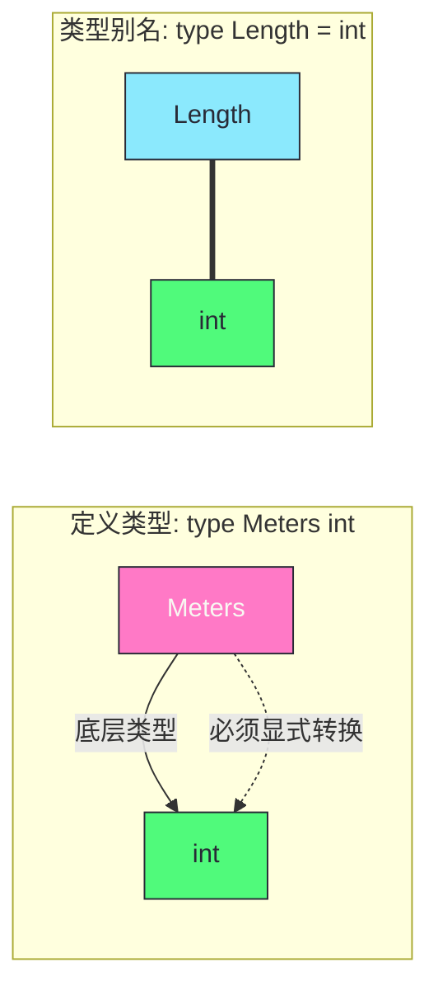

# 基本数值类型与底层表示——溢出截断、浮点精度与定义类型

**摘要：**

数值类型是任何编程语言的基石，却也是最容易让人掉以轻心的领域。大多数开发者在写 `int`、`float64` 时，很少停下来思考：为什么 `int32(-1) + int32(math.MaxInt32)` 会得到一个负数而非触发异常？为什么 `0.1 + 0.2 == 0.3` 在浮点世界里不成立？为什么 `type Meters int` 之后 `Meters` 与 `int` 竟不能直接相加？这三个问题看似彼此独立，实则都指向同一个底层事实——Go 的数值类型不是抽象的数学概念，而是直接映射到 CPU 寄存器与 IEEE 754 标准的物理存在。本文从补码表示（Two's Complement）讲起，剖析有符号整数溢出回绕（Wrap-Around）的设计哲学，再深入到 IEEE 754 浮点格式的符号位、指数、尾数三段结构，揭示精度漂移与 `NaN != NaN` 等反直觉行为的硬件根源，随后讨论 Go 编译器如何在常量表达式中保留任意精度、延迟到赋值时才截断，最后系统梳理定义类型（Defined Type）与类型别名（Type Alias）的语义鸿沟，以及它们对方法集（Method Set）与接口实现的深远影响。两条主线贯穿全文：**类型的本质是内存布局与操作语义的契约**，**Go 的选择始终倾向于可预测的底层行为而非运行时的安全检查**。

---

## 第 1 章 整数：从补码到溢出回绕的工程取舍

### 1.1 为什么是补码而不是原码

要理解 Go 中 `int` 的行为，必须先回到计算机表示负整数的三种历史方案——原码（Sign-Magnitude）、反码（Ones' Complement）与补码（Two's Complement）。原码最直观：最高位为符号位，其余位表示绝对值，于是 `+5` 写作 `00000101`，`-5` 写作 `10000101`。但这种"直观"在硬件上制造了麻烦：`+0`（`00000000`）与 `-0`（`10000000`）是两个不同的编码，加法器必须额外判断符号才能决定做加法还是减法，CPU 的 ALU（Arithmetic Logic Unit）线路因此变得复杂。

反码通过"取反"消除了 `-0` 的歧义——`-5` 编码为 `11111010`，但问题只是从"两种零"变成了"加法需要端绕进位（End-Around Carry）"，依然不够干净。直到补码方案出现，事情才真正简化：一个负数被编码为"模（Modulus）减去其绝对值"，在 8 位宽度下，`-5` 的补码是 `2^8 - 5 = 251`，即二进制的 `11111011`。补码的精妙之处在于它把减法变成了加法——`a - b` 等价于 `a + (2^n - b)`，只要丢弃超出 n 位的进位，结果就自然正确。CPU 只需要一套加法电路就能同时处理加减法，这是补码胜出并成为现代计算机整数表示统一标准的根本原因。

> [!info] 类比：时钟的逆运算
> 想象一个只有 12 个小时刻度的时钟。"倒拨 5 小时"（减 5）与"正拨 7 小时"（加 7）在时钟上到达的位置完全相同——因为 `5 + 7 = 12`，恰好转一圈回到原点。这就是补码把减法变加法的本质：**负数 `-x` 被编码为 `n - x`（n 是模），使得 `a - x` 等价于 `a + (n - x)`，丢弃超出 n 的进位后结果正确**。时钟越转越小的"回绕"现象，恰恰是补码运算的天然隐喻。

> [!info] 补码的对称性与代价
> 补码有一个重要的不对称性：n 位补码能表示的范围是 `[-2^(n-1), 2^(n-1) - 1]`，负数比正数多一个。8 位补码下，`-128` 有合法编码 `10000000`，但 `+128` 无法用 8 位表示。这种不对称不是设计缺陷，而是"模运算自然结果"——`2^(n-1)` 这个值被分配给了负数端。

### 1.2 Go 的有符号整数：溢出是回绕，不是 panic

Go 规范对整数溢出的处理极为明确：**有符号整数运算在溢出时按位宽取模，结果回绕（Wrap-Around）到目标类型的可表示范围内，不会 panic，也不 saturate**。这跟 Swift 在 Debug 模式下对溢出抛异常、Rust 在 Debug 模式 panic + Release 模式回绕的做法截然不同，甚至跟许多初学者的直觉相悖。

```go
var a int8 = 127       // 0111_1111
a = a + 1              // 结果: -128 (1000_0000)
fmt.Println(a)         // 输出 -128，不是 128，更不是 panic

var b int8 = -128      // 1000_0000
b = b - 1              // 结果: 127 (0111_1111)
fmt.Println(b)         // 输出 127
```

这段代码背后的机理极其简单：补码的加法本身就是模 `2^n` 的运算。`127 + 1` 在 8 位宽度下等于 `128`，但 `128` 的二进制 `1000_0000` 在补码解释下恰好就是 `-128`。CPU 的加法指令天然就是如此工作的——它不知道也不关心"溢出"这个概念，它只是忠实地按位相加然后丢弃超出位宽的进位。Go 选择不引入任何运行时检查，而是让语言语义直接贴合硬件行为，这是 Go 设计哲学中"可预测性优先于安全性"的典型体现。

但这种设计并非没有代价。2014 年前后，Go 的 `math` 包维护者 Russ Cox 在多个 issue 中明确表态：引入运行时溢出检查的成本——无论是性能损耗还是语义变更——都不值得。Go 的目标应用场景是系统编程与高并发服务，在这些场景中，性能的可预测性远比"防止新手犯错"重要。如果业务层确实需要检测溢出，Go 提供的方式是**显式检查**，而非隐式拦截：

```go
// 加法溢出检查（适用于有符号整数）
func AddChecked(a, b int) (int, bool) {
    sum := a + b
    // 若 a、b 同号，但 sum 与 a 异号，则溢出
    if ((a ^ b) >= 0) && ((sum ^ a) < 0) {
        return 0, true // overflowed
    }
    return sum, false
}
```

这种"库级防御而非语言级拦截"的思路，与 Go 对待 `nil`、对待 `error` 的思路如出一辙：**把选择权交给程序员，把代价体现在显式代码里**。

值得一提的是 Go 1.24 之后，`math/bits` 包增加了 `Add`、`Sub`、`Mul` 等带进位/借位/高位结果的运算函数，它们直接映射到 x86 的 `ADC`、`SBB`、`MUL` 指令，为需要"手动检测溢出"的场景提供了硬件级的原语。这些函数接受两个操作数和一个进位输入，返回运算结果与进位输出——这实际上把 CPU 的溢出标志通过函数返回值暴露给了 Go 代码，让开发者可以在不牺牲性能的前提下，在关键路径上做精确的溢出检测。这是 Go 对"溢出检查"这个争议给出的折中答案——**语言本身不拦截，但提供零成本的检测工具**。

### 1.3 字面量进制与数字分组

Go 整数字面量支持四种进制前缀：`0b`（二进制）、`0o` 或 `0`（八进制）、无 prefix（十进制）、`0x`（十六进制）。Go 1.13 还引入了下划线数字分组语法——`1_000_000_000` 等价于 `1000000000`，纯粹是为了提升可读性，编译器在词法分析阶段就会把这些下划线剥掉。这种设计借鉴了 Ada、Rust 等语言的同类特性，在表示大整数常量、位掩码、IP 地址分量时特别有用：

```go
const (
    perms     = 0o755              // 八进制，类 Unix 文件权限
    mask      = 0xFF00_FF00        // 十六进制，下划线分组
    billion   = 1_000_000_000      // 十进制，千位分隔
    flags     = 0b1010_0101        // 二进制，位掩码直观展示
)
```

### 1.4 无符号与有符号的转换：位模式不变，解释改变

Go 中 `int8(-1)` 转换为 `uint8` 时得到的是 `255`，而不是 panic 也不是 `0`。这条规则在 Go 规范中有清晰定义：**当在整数类型之间进行转换，且源类型与目标类型的宽度相同时，位模式（Bit Pattern）保持不变，只是解释方式发生变化**。`-1` 的 `int8` 补码是 `1111_1111`，这同样的 8 位作为无符号解释就是 `255`。

如果宽度不同，规则稍有变化：正数零扩展（高位补 0），负数符号扩展（高位补 1）。这条规则保证了数值在非截断场景下的"值不变"语义，而在截断场景下则保留低位。这跟 C/C++ 的行为基本一致，但 Go 把规则写得更清楚，避免了 C 中"signed/unsigned 混用导致隐式提升"的某些臭名昭著的陷阱——尽管 Go 也不允许 `int` 与 `uint` 直接混合运算，强制要求显式转换。

```go
var i int16 = -1           // 1111_1111_1111_1111
var u uint8 = uint8(i)     // 截断高位：1111_1111 -> 255
var i2 int32 = int32(i)    // 符号扩展：1111_1111_1111_1111 -> 0xFFFF_FFFF
```

> [!warning] 常见误区：类型转换不是"值裁剪"
> 把 `int32` 转成 `int8` 不是"把值裁剪到 [-128, 127]"，而是"丢弃高 24 位，用剩下的 8 位按补码重新解释"。如果原来的值超出了 `int8` 的范围，结果会完全不是预期的数值——这是许多从 Java 转过来的开发者最容易踩的坑，因为 Java 连 `uint` 都没有，转换路径要简单得多。

### 1.5 乘法、除法与移位：溢出同样静默

加法只是整数运算中最简单的一种，乘法与减法的溢出行为同样遵循"模 `2^n` 回绕"规则。一个 8 位 `int8` 下 `100 * 100` 的结果是 `16`，而非 `10000`——因为 `10000` 对 `256` 取模等于 `16`。这种结果在业务层面几乎总是错误的，但硬件层面完全合法：CPU 的乘法指令输出一个双倍宽度的中间结果，然后高位被丢弃，低位直接保留为目标值。Go 不做任何额外检查，这与 C 的行为一致。

除法与取模则有一个特殊边界：**整数除以零会 panic**。这是 Go 中少数几个"硬件行为被语言拦截"的例子，因为大多数 CPU 在执行整数除零时会产生硬件异常（x86 的 `#DE` 异常），Go 的运行时将这个硬件异常转译成了 Go 的 panic。注意，这与浮点除以零的行为截然不同——浮点除以零不 panic，而是产生 `±Inf`，因为 IEEE 754 明确定义了这种行为。这种"整数除零 panic，浮点除零返回 Inf"的二分，是硬件传统与浮点标准在 Go 语言语义中共同作用的产物。

移位运算（`<<` 与 `>>`）的溢出规则稍有不同：**移位量本身不需要在目标类型的位宽范围内，但结果会被截断到目标位宽**。`int8(1) << 10` 在编译期作为常量是合法的（结果 1024 是无类型整数），但把 1024 赋给 `int8` 时会因溢出而编译报错。运行时变量移位则按位宽对移位量取模——`int8(1) << 10` 在运行时等价于 `int8(1) << (10 % 8)` 即 `int8(1) << 2`，结果为 `4`。这种"常量严格、运行时宽松"的二分法，是 Go 类型系统一贯的处理方式。

### 1.6 位模式观察：`math/bits` 与 `encoding/binary`

当需要直接观察整数的位模式时，Go 提供了几层工具。**`fmt.Printf("%b", x)`** 可以打印整数的二进制表示，但对负数会输出带负号的绝对值二进制，而不是补码形式——这经常让初学者困惑。**`math.Float64bits` 的整数版本并不存在**，要用 `encoding/binary` 或 `unsafe` 包才能直接读取整数的字节布局：

```go
// 通过 encoding/binary 观察 int32 的补码位模式
var x int32 = -5
buf := make([]byte, 4)
binary.LittleEndian.PutUint32(buf, uint32(x))
fmt.Printf("%08b\n", buf)  // [fb ff ff ff] -> 0xFFFFFFFB 即 -5 的补码
```

Go 1.9 引入的 `math/bits` 包提供了一系列位操作原语——`Len`（最高有效位位置）、`TrailingZeros`（末尾零计数）、`Reverse`（位反转）、`RotateLeft` 等——这些函数直接映射到 CPU 的 `CLZ`、`CTZ`、`ROR` 等指令，是位级编程的基础设施。但要注意，这些函数接受的是无符号整数（`uint`、`uint64` 等），如果要把有符号整数传给它们，必须先显式转换为对应的无符号类型——这个转换是"位模式不变"的安全转换，不会丢失或改变任何位。

---

## 第 2 章 浮点：IEEE 754 的精度幻觉与特殊值

### 2.1 浮点数的三段解剖

如果说整数溢出回绕还只是"对补码不够熟悉导致的直觉偏差"，那么浮点数的行为就真的是"对绝大多数开发者而言完全陌生"的领域。Go 的 `float32` 与 `float64` 直接对应 IEEE 754-2008 标准的 binary32 与 binary64 格式，其本质是把一个实数拆成三段——**符号位 S（1 bit）、指数 E（8/11 bit）、尾数 M（23/52 bit）**——然后用公式 `(-1)^S × 2^(E - bias) × 1.M` 来还原数值。

这里最值得强调的一个细节是：尾数 M 隐含了整数部分的 `1`，实际有效位数是 24（float32）或 53（float64）位。这个"隐含的 1"是 IEEE 754 设计的神来之笔——它用零成本多换了一位精度。但这也意味着浮点数的"精度"不是由 `float32/float64` 的总位数决定，而是由尾数位数决定的——**float32 约有 7 位十进制有效数字，float64 约有 15-17 位十进制有效数字**。超过这个位数的十进制小数，在转成二进制浮点时必然发生舍入。

为什么"隐含的 1"可以做到？因为对于绝大多数非零浮点数，科学计数法下的二进制表示都可以调整到 `[1.0, 2.0)` 区间——整数位必然是 `1`，既然永远是 `1`，就不需要浪费一个比特去存储它。这个技巧让浮点数的精度凭空增加了一位，相当于免费获得了约 30% 的十进制有效数字（从 log10(2^23) ≈ 6.9 提升到 log10(2^24) ≈ 7.2）。代价是：当数值为 0 或者"次正规数"时，隐含的 1 不再成立，编码规则要切换——这是下一小节要讲的内容。

一个值得思考的问题是：**为什么 IEEE 754 选择二进制而不是十进制或更高进制？** 答案纯粹是硬件层面的——CPU 的 ALU 天然按二进制工作，二进制的移位、截断、舍入操作都能用简单的位操作实现；如果用十进制表示，每次运算都需要做额外的进制转换，性能会显著下降。这也是"十进制浮点"（decimal floating point，IEEE 754-2008 也定义了 decimal32/64/128 格式）始终只在金融与会计领域被有限使用的原因——它解决了"0.1 能精确表示"的问题，但牺牲了硬件效率。

| 字段 | float32（binary32） | float64（binary64） |
|---|---|---|
| 总位数 | 32 | 64 |
| 符号位 | 1 | 1 |
| 指数位 | 8（bias 127） | 11（bias 1023） |
| 尾数位 | 23（隐含 1，有效 24） | 52（隐含 1，有效 53） |
| 十进制精度 | ~7 位 | ~15-17 位 |
| 指数范围 | -126 到 +127 | -1022 到 +1023 |

### 2.2 0.1 + 0.2 为什么不等于 0.3

这是浮点数领域最著名的"反直觉"案例。在 Go 中运行 `fmt.Println(0.1 + 0.2 == 0.3)` 会输出 `false`，而 `fmt.Printf("%.20f\n", 0.1+0.2)` 会打印 `0.30000000000000004441`。这并非 Go 的 bug，也不是 CPU 的计算误差——这是二进制浮点表示法本身的能力边界。

问题的根源在于：**十进制下的"有限小数"在二进制下可能是无限循环小数**。`0.1` 的二进制展开是 `0.000110011001100...`（`1100` 循环），永远无法用有限的尾数位精确表示。CPU 在把 `0.1` 载入浮点寄存器时，就已经把它舍入到最接近的可表示值——一个略大于或略小于 0.1 的二进制数。`0.2` 和 `0.3` 各自也经历了一次舍入。三次舍入的结果叠加起来，`0.1 + 0.2` 的最终值就跟 `0.3` 的最接近浮点表示差了 1 个最低有效位（Unit in the Last Place，ULP）。

> [!note] 类比：十进制下的三分之一
> 想象你在一个只用三位小数做运算的系统里计算 `1/3 + 1/3 + 1/3`。`1/3` 在三位小数下必须舍入成 `0.333`，三次相加得到 `0.999`，而不是 `1.000`。浮点世界的 `0.1 + 0.2 != 0.3` 与此完全同构——**不是计算错了，而是表示本身就带舍入误差**。

工程上的正确做法是：**永远不要用 `==` 比较浮点数**，而是检查两个浮点数的差的绝对值是否小于一个合理的 epsilon。Go 1.21 起 `math` 包未直接提供 epsilon 比较函数，但社区惯用的模式是：

```go
const epsilon = 1e-9

func almostEqual(a, b float64) bool {
    diff := math.Abs(a - b)
    return diff < epsilon
}
```

对于更严谨的场景，应当根据数值的量级来动态调整 epsilon，或者直接使用 `math/big` 包的高精度有理数运算——当然，代价是性能。

### 2.3 精度的"波动"：数值越大，绝对误差越大

浮点数的精度不是恒定的——**尾数位数决定的是相对精度，而不是绝对精度**。这意味着，一个浮点数能精确表示的"最小变化量"（即 1 ULP 对应的绝对值）随着数值本身的增大而增大。在 `float64` 下，数值在 `[1.0, 2.0)` 区间内，1 ULP 约为 `2.22e-16`；而数值在 `[1024.0, 2048.0)` 区间内，1 ULP 已经是 `2.22e-13`，放大了 1000 倍。换句话说，**一个很大的浮点数加上一个很小的数，小数可能被完全吞没**。

```go
var big float64 = 1e16
var small float64 = 1.0
fmt.Println(big + small)          // 1e+16，small 完全丢失
fmt.Println(big + small == big)   // true
```

这个现象的工程后果是严重的：当你对一个很大的累加器加一个小数时，小数可能完全不起作用。如果你在做"先排序再累加"的数值求和，从小到大排序后累加的结果通常比从大到小累加的结果更精确——因为让较小的数先互相累积到足够"显著"，再与大数相加，可以减少舍入误差的累积。Kahan 求和算法（Kahan Summation）是更彻底的解决方案，它通过维护一个"补偿变量"来记录每次加法丢失的尾部位，在下次加法时补回。

> [!info] 类比：把一分钱存进百万富翁的账户
> 想象一个只能保留 7 位有效数字的记账系统。一个百万富翁的账户余额是 `1000000`，你存入 `1` 元。系统会先对齐小数点——`1000000.0 + 0000001.0 = 1000001`，结果还是 7 位，看似没问题。但如果余额是 `10000000`（七位数），存入 `1` 元时对齐后变成 `10000000 + 0000000.1`，而后者在 7 位精度下必须舍入为 `0`——于是存款凭空消失。浮点数的 ULP 放大效应与此完全同构。

### 2.4 次正规数：填补零附近的"空隙"

在 IEEE 754 的编码规则中，当指数位 E 全为 0 且尾数位 M 不全为 0 时，表示的是"次正规数（Subnormal Number，又称 Denormal Number）"。次正规数的关键特征是：**它放弃了"隐含的整数位 1"，让有效位数从 24 位降到 23 位（float32）或从 53 位降到 52 位（float64）**，但换来了"零附近没有空隙"的特性——没有次正规数时，最小正正规数（约 `2.22e-308` 对于 float64）与零之间会有一道巨大的空隙，次正规数把这段空隙均匀地填充上了可表示的值。

次正规数的存在带来了一个令人不快的副作用：**"突然下溢"（Abrupt Underflow）变成了"渐进下溢"（Gradual Underflow），但代价是精度损失**。次正规数的运算在许多 CPU 上比正规数慢一个数量级（有些 CPU 甚至会触发 microcode 异常），因此在高性能计算中，次正规数通常被视为需要规避的性能陷阱。Go 的 `math` 包在 Go 1.23 之前并未提供直接禁用次正规数刷新的接口，但可以通过编译标志（GOEXPERIMENT=nocheckptr 等）或运行时库进行控制。对于大多数业务应用，次正规数的存在只是数学上的优雅补充，不会实际影响性能。

### 2.5 NaN 与 ±Inf：浮点世界的"异常值"

IEEE 754 还定义了几类特殊的浮点值，它们在 Go 中都有直接对应。**正无穷（+Inf）** 出现在正数除以 `0.0`、或正溢出时；**负无穷（-Inf）** 出现在负数除以 `0.0`、或负溢出时；**NaN（Not a Number）** 出现在 `0.0 / 0.0`、`±Inf - ±Inf`、`±Inf × 0.0`、负数开平方等"无定义"运算时。

NaN 有一个极为反直觉但极其重要的性质：**NaN 与任何值都不相等，包括它自己**。`math.NaN() == math.NaN()` 的结果是 `false`。这不是 bug——IEEE 754 这样设计的目的是让 NaN 携带"计算过程中某处出错"的语义，如果 `NaN == NaN` 为真，就会破坏"NaN 是污染源"的隐喻：一段代码可能在某处产生了 NaN，但后续比较时误以为它等于某个合法值。

```go
x := math.NaN()
fmt.Println(x == x)          // false
fmt.Println(math.IsNaN(x))   // true——这是判断 NaN 的唯一可靠方式
```

`+Inf` 与 `-Inf` 的行为相对符合直觉：它们参与大小比较，`+Inf > 任意有限浮点数`，`-Inf < 任意有限浮点数`，两个 `+Inf` 之间相等。但要注意，`+Inf - +Inf` 的结果是 `NaN` 而非 `0`——这是"无穷大没有确定差值"的数学语义在 IEEE 754 中的直接反映。

NaN 还有一个更隐蔽的特性：**NaN 是"污染性"的**。一旦浮点运算的操作数中有任何一个是 NaN，结果必然是 NaN——加法、减法、乘法、除法、平方根、比较运算，所有浮点操作都遵守这条规则。这意味着 NaN 一旦在某处产生，它会像放射性污染一样沿着数据流扩散到所有下游计算。如果你的代码中某处出现了一个 NaN，但直到输出端才发现异常，追踪它的来源可能非常困难。调试这类问题的标准做法是在关键计算节点插入 `math.IsNaN` 检查，或者使用 `math.Float64bits` 直接观察位模式，通过 NaN 的 payload（尾数位中除了"quiet NaN 标志位"之外的部分）来追溯它的产生位置。

IEEE 754 实际上定义了两类 NaN：**Signaling NaN** 与 **Quiet NaN**。Signaling NaN 在被用于浮点运算时会触发一个"无效操作"异常（在 CPU 层面），而 Quiet NaN 则安静地传播。Go 的运行时默认屏蔽了浮点异常（通过设置 CPU 的 MXCSR 寄存器），所以 Signaling NaN 在 Go 中实际上等同于 Quiet NaN——这个选择是为了避免"浮点异常中断整个进程"的灾难性后果，符合 Go 一贯的"不要让我意外死掉"的设计哲学。

Go 的 `math` 包提供了 `IsNaN`、`IsInf`、`Float64bits`、`Float64frombits` 等函数用于位级观察与构造，是调试浮点异常时的利器：

```go
bits := math.Float64bits(math.NaN())
fmt.Printf("%064b\n", bits)
// 0111111111111000000000000000000000000000000000000000000000000000
// 符号位 0，指数全 1，尾数非全 0 -> 这就是 NaN 的编码特征
```

---

## 第 3 章 常量：编译期的任意精度庇护所

### 3.1 无类型常量：Go 对精度丢失的一次制度性补救

如果说变量层面的 `float64` 和 `int` 是"物理存在"，那么常量层面的 Go 则展现了截然不同的面貌。**Go 的无类型常量（Untyped Constant）在编译期使用任意精度的数值表示，只有在赋值给一个有类型变量时，才会被"截断"或"舍入"到目标类型的精度**。这条规则看起来像个技术细节，实则深刻影响了 Go 程序中能写出怎样的表达式。

```go
const big = 1 << 100        // 1267650600228229401496703205376
// 这是一个合法的常量，没有任何类型可以容纳这么大的整数
// 但它作为"数值"参与编译期计算时是完全精确的

var n int64 = big           // 编译错误：常量溢出 int64
var f float64 = big         // 合法：big 被舍入到 float64 的最接近值
```

这段代码揭示的关键事实是：常量 `big` 并不是 int64，也不是 float64，而是一个"无类型的大整数"——它在编译期拥有完整的数学值。只有当它被赋值给具体类型的变量时，Go 才会检查该值是否能被目标类型精确或合理地表示。这条规则避免了"中间计算溢出"的问题，也是为什么 `time.Nanosecond * 1e9` 能精确等于 `time.Second` 的底层原因。

Go 规范明确规定，无类型整数常量的精度至少要有 256 位，无类型浮点常量要能容纳 IEEE 754 的 maximum float64 值并保留完整的尾数精度。编译器实际上使用软件任意精度算术来实现这一点——`go/constant` 包就是这套实现的公开版本，第三方工具（如静态分析器、代码生成器）可以直接复用。

> [!info] 类比：数学草稿纸 vs 印刷表格
> 把常量想象成你在草稿纸上做计算——草稿纸没有格子限制，你可以写下任何大小的数字，精确地保留所有小数位。但当你想把结果抄进一个有固定列宽的印刷表格（变量）时，就必须截断或舍入。Go 的无类型常量系统就是保证"草稿纸阶段"的精度不会丢失，只有"抄进表格"的那一刻才发生精度取舍。这种设计避免了 C 语言中"宏展开后常量溢出"的经典问题，也让 `1e9 * time.Nanosecond` 这类表达式能得出精确结果。

### 3.2 常量表达式的编译期求值

Go 的常量表达式在编译期求值，且求值过程完全精确——既没有整数溢出回绕，也没有浮点舍入。这意味着一些在运行时必然溢出的表达式，作为常量却可以合法存在：

```go
const (
    a = 100000 * 100000     // 10^10，超出 int32 范围
    b = a / 3               // 3333333333.333... 但在整数常量除法中截断为 3333333333
    c = 1 << 62             // 合法的无类型整数常量
)
var x int64 = c             // OK：c 在 int64 范围内
var y int32 = c             // 编译错误：常量 c 溢出 int32
```

这种"延迟截断"策略的哲学意义值得玩味：**Go 在设计层面明确区分了"数学上的数值"与"某个具体类型的数值"**。常量代表前者，变量代表后者。这种区分在 C/Java 中是不存在的——C 的 `#define` 只是文本替换，Java 的 `final int` 已经绑定到具体类型。Go 选择用"无类型常量"这个概念来保留完整的数学语义，是语言设计上的一种克制与优雅。

> [!warning] 陷阱：常量除法不产生浮点
> `const c = 7 / 2` 的结果是 `3`，不是 `3.5`。常量除法依然遵循"整数相除结果仍是整数"的规则——只不过这个整数是无类型的大整数，后续可以被赋值给浮点类型。这个行为经常让从 Python 3 转过来的开发者感到意外。

### 3.3 有类型常量：当常量被绑定到具体类型

一旦常量声明时显式指定了类型，它就变成了"有类型常量（Typed Constant）"，其行为与同类型的变量几乎一致——包括溢出回绕与精度截断：

```go
const i int8 = 200          // 编译错误：200 超出 int8 范围 [-128, 127]
const f float32 = 1.1       // OK：1.1 被舍入到 float32 精度
const g = int8(200)         // 编译错误：int8(200) 作为常量转换，值必须可表示
```

注意最后一行的微妙之处：`int8(200)` 作为常量转换时，Go 要求目标值必须在目标类型的可表示范围内，否则编译报错。这与运行时变量的转换规则（位模式保留，值可能变化）完全不同。**常量的类型转换是"值语义"，变量的类型转换是"位语义"**——这是 Go 类型系统中一条容易被忽略但极其重要的分界线。

### 3.4 iota：编译期枚举的微妙工具

Go 用 `iota` 关键字为常量组（const block）提供递增计数器的能力。`iota` 本身是一个无类型整数常量，在每个常量组的第一行初始化为 0，之后每行递增 1。它的值同样是任意精度的，可以参与常量表达式运算，这让 `iota` 成为定义枚举与位掩码的利器：

```go
const (
    Sunday = iota       // 0
    Monday              // 1
    Tuesday             // 2
    // ...
    Saturday            // 6
)

// 位掩码模式
const (
    ReadPerm    = 1 << iota  // 1 (二进制 001)
    WritePerm                  // 2 (二进制 010)
    ExecutePerm                // 4 (二进制 100)
)
// ReadPerm | WritePerm == 3，三者互不重叠
```

这里再次体现了"延迟截断"的威力：`1 << iota` 在 `iota = 62` 时会产生 `2^62`，这个值作为无类型常量完全合法，但如果你把它绑定到 `int32` 类型，编译就会报错。`iota` 的值本身不受类型约束，约束只发生在最终赋值时——这正是常量"数学语义"的又一例证。

需要警惕的是 `iota` 的"沉默递增"：常量组中每一个声明（无论该声明是否显式使用了 `iota`）都会让 `iota` 自增一次。这意味着如果你在中间插入了一个没有显式使用 `iota` 的常量，后面的 iota 值会"跳过"你预期的编号。一个常见的防御模式是在每个常量后面显式写 `iota` 表达式，而不是依赖隐式递增。

---

## 第 4 章 整数宽度与平台相关性的暗礁

### 4.1 int 与 uint：32 位还是 64 位取决于平台

Go 的 `int` 与 `uint` 不是固定宽度类型——**它们的位宽等于目标平台的指针宽度**，在 32 位系统上是 32 bit，在 64 位系统上是 64 bit。这条规则的初衷是让 `int` 成为"最自然的整数类型"，与 CPU 的寄存器宽度保持一致，从而在大多数场景下获得最优性能。

但这也意味着，同样的 `int` 代码在不同平台上可能有不同的行为。考虑以下场景：

```go
// 一段在 64 位机器上"工作正常"的代码
var counter int
for i := 0; i < 5_000_000_000; i++ {
    counter++
}
// 在 64 位平台上，int 是 64 位，能容纳 5e9
// 在 32 位平台上，int 是 32 位，最大只能到约 2.1e9，会溢出
```

这种平台依赖性在桌面与服务器几乎全面 64 位化的今天，已经不那么容易踩到——但嵌入式、WebAssembly、以及某些遗留 32 位系统仍然是现实存在的目标平台。Go 1.17 起在 64 位 ARM（arm64）与 64 位 x86 上全面采用 64 位 `int`，进一步收敛了平台差异，但规范文本依然保留"int 宽度等于指针宽度"的表述，以便未来支持非标准位宽的架构。

> [!warning] 工程建议：对宽度敏感的代码显式使用 `int32`/`int64`
> 如果你的代码依赖"整数能容纳超过 2^31 的值"——譬如处理时间戳毫秒、大文件偏移量、或者计数器上限——**显式使用 `int64` 而非 `int`**。这条规则在序列化（JSON、Protobuf）、网络协议、文件格式解析等跨平台场景下尤为重要，因为你无法保证序列化后的值在 32 位平台上还能被正确反序列化。

### 4.2 用 `unsafe.Sizeof` 在编译期核实宽度

当你对类型的实际宽度存疑时，`unsafe.Sizeof` 可以在编译期给出精确答案（单位是字节）。虽然使用 `unsafe` 包意味着离开类型安全的舒适区，但 `unsafe.Sizeof` 的参数实际上不会被求值——它只是编译器的一个"查询接口"，运行时不会产生任何代码：

```go
import "unsafe"

var _ uint64 = unsafe.Sizeof(int(0))  // 64 位平台编译通过
var _ uint32 = unsafe.Sizeof(int(0))  // 32 位平台编译通过
// 这意味着你可以用编译期断言来防止平台差异导致的静默错误
```

这种技巧在一些跨平台项目的测试文件中被广泛使用——用一行编译期断言，在 CI 矩阵中自动捕获平台差异。与之配套的是 `unsafe.Alignof`（对齐要求）和 `unsafe.Offsetof`（struct 字段偏移），它们是深入理解 Go 内存布局的三件套。`unsafe.Offsetof` 在反射、序列化库、以及与 C 通过 cgo 共享数据结构时尤为关键——struct 的对齐与填充规则直接决定了内存中相邻字段之间是否有"空洞"，而这些空洞在跨进程、跨网络传输时会被当作垃圾数据。关于 unsafe 包与内存布局的系统讨论，可以参见 Go运行时进阶系列相关篇目。

### 4.3 跨平台序列化中的整数宽度陷阱

当 Go 服务与其他语言的服务通过网络协议（gRPC、JSON、自定义二进制协议）通信时，整数宽度不一致是常见 bug 源。JSON 标准没有区分整数类型——JavaScript 把所有数字都当作 float64 处理，这导致超过 `2^53` 的整数在 JSON 往返过程中可能丢失精度。Go 的 `encoding/json` 包在序列化 `int64` 到 JSON 时默认直接输出数字字面量，如果接收方是 JavaScript，超过 `Number.MAX_SAFE_INTEGER` 的值就会被截断。常见的解决方案是把大整数序列化成字符串——Go 1.8+ 支持在 struct tag 里写 `json:",string"` 来启用这种转换。这种"协议层妥协"再次印证了**数值类型不仅仅是内存布局问题，它还会沿着数据流传播到整个系统边界**。

### 4.3 rune 与 byte：语义别名背后的设计

`rune` 与 `byte` 并不是独立的类型，而是 **`int32` 与 `uint8` 的类型别名（Type Alias）**。这层别名关系通过 `type rune = int32` 与 `type byte = uint8` 在语言规范中直接定义，它们之间是**完全等价**的——方法集、转换规则、接口实现全部共享，没有任何隔离。

| 别名 | 真实类型 | 典型用途 |
|---|---|---|
| `byte` | `uint8` | 表示 ASCII 字符或原始字节 |
| `rune` | `int32` | 表示 Unicode 码点（Code Point） |

这种设计让 `[]byte` 与 `[]rune` 成为 Go 处理文本的两大基本容器——前者是 UTF-8 编码的字节序列，后者是解码后的码点序列。关于 `rune` 与 UTF-8 编码的进一步讨论，可以参见 [[05 string 与 rune——UTF-8 编码与不可变性]]，这里只强调别名关系对类型系统的含义：**`byte` 与 `uint8` 是同一个类型的两个名字，可以互相赋值、互相替换，不需要任何转换**。

`rune` 使用 `int32`（有符号）而不是 `uint32`（无符号）是一个值得玩味的设计选择。Unicode 的有效码点范围是 `0` 到 `0x10FFFF`（约 111 万），远小于 `uint32` 的 `4.29 × 10^9`，也小于 `int32` 的正数范围 `2.14 × 10^9`——从容量上看，无符号或有符号都绑绑有余。选择有符号的好处是：当函数返回 "未找到" 或 "无效字符" 时，可以用 `-1` 作为哨兵值（sentinel），这与 C 的 `getchar()` 返回 `EOF = -1` 的惯例一脉相承。如果用了 `uint32`，就不得不引入额外的 error 返回值或者单独的 bool 标志来表达"无效"状态——在早期的 Go 标准库设计中，这种简洁性是有价值的。

### 4.4 类型转换的溢出语义一致性

回顾整章，Go 在整数转换上的核心原则是**位模式保留**——无论是相同宽度的 signed↔unsigned 转换，还是不同宽度的扩展或截断，转换规则都遵循"保留位模式，重新解释"的逻辑。这种一致性让底层行为完全可预测，但也要求开发者对"位模式"与"数学值"的区别有清晰认识。一个值得记住的经验法则是：**任何可能丢失信息的整数转换（宽度变窄、signed↔unsigned 跨越、负数转 unsigned），都应该在代码中留下显式转换的痕迹**——这既是给编译器的指令，也是给未来读者的文档。

---

## 第 5 章 定义类型与类型别名：形似神异的两种 type 声明

### 5.1 语法上的细微差异，语义上的天壤之别

Go 提供了两种看似相似的类型声明方式：

```go
type Meters int           // 定义类型（Defined Type）
type Length = int         // 类型别名（Type Alias），Go 1.9 引入
```

`type A B` 创建了一个**全新的、独立的类型** `A`，它以 `B` 作为底层类型（Underlying Type），但 `A` 与 `B` 是两个完全不同的类型，互不兼容，必须显式转换才能互相赋值。`type A = B` 则只是给 `B` 取了个别名 `A`，`A` 与 `B` 是同一个类型的两个名字，完全等价，可以自由混用。



> [!note] 类比：艺名与本名
> 类型别名就像一个歌手的"艺名"——无论叫艺名还是本名，指向的是同一个人，唱片公司、合约、版权全部共享。定义类型则像是"收养关系"——孩子有自己的姓名与法律身份，与原生家庭有血缘（底层类型）联系，但财产、户籍、合同都是分开的，要转移权利必须经过正式手续（显式转换）。

### 5.2 定义类型的方法集隔离

定义类型最重要的语义后果是**方法集（Method Set）的独立性**。Go 允许为定义类型声明方法，但这些方法**不会**传播到底层类型，底层类型的方法也**不会**传播到定义类型：

```go
type Meters int

func (m Meters) String() string {
    return fmt.Sprintf("%dm", int(m))
}

var m Meters = 10
var i int = 10

fmt.Println(m.String())   // OK：Meters 有 String 方法
fmt.Println(i.String())   // 编译错误：int 没有 String 方法

m2 := Meters(i)           // 必须显式转换
// m3 := i                 // 编译错误：不能把 int 赋给 Meters
```

这种隔离是有意为之的——它让开发者可以基于现有类型创建"语义不同"的新类型，譬如 `type UserID int64`、`type UnixTime int64`，并在其上绑定各自的方法，而不用担心这些方法污染到其他 `int64` 用户。这正是 Go 类型系统"组合优于继承"哲学的微观体现：类型之间的关系通过显式组合与显式转换表达，而不是通过继承隐式传播。

> [!note] 类比：专业执照 vs 通用技能
> 把底层类型 `int` 想象成一个具备基础计算能力的"普通人"。`Meters`、`Seconds`、`UserID` 是三种不同的专业执照——它们的基础能力相同（都基于 int 的运算），但各自绑定了特定的职业规范（方法集）。一个持有"米数执照"的人不能直接去干"秒数"的活，即使底层能力完全一样——必须先经过"重新认证"（显式转换）。这种设计避免了"一个什么都会但什么都不精"的万能类型，让每个类型都有清晰的职责边界。

这种隔离还有一个常被忽略的副作用：**它让 String()、MarshalJSON() 等接口的实现不会泄漏到无关类型**。如果你给 `Meters` 实现了 `String()` 方法，`fmt.Println(m)` 会输出 `10m`；但 `fmt.Println(int(10))` 依然输出 `10`——即使 `Meters` 与 `int` 有相同的底层表示。这种"方法集不污染"的特性是 Go 的 duck-typing 接口系统能安全运作的基础，关于接口实现的更深入讨论，可以参见 [[10 接口的实现原理——iface、eface 与鸭子类型]] 与 [[04 类型系统——值类型、引用类型与 struct 组合]]。

### 5.3 接口实现的连锁反应

定义类型的独立性在接口场景下会产生连锁反应——即使两个定义类型的底层类型相同，它们实现的接口也可能完全不同，因为它们各自的方法集不同：

```go
type Stringer interface {
    String() string
}

type Meters int
type Seconds int

func (m Meters) String() string { return fmt.Sprintf("%dm", int(m)) }

var _ Stringer = Meters(10)  // OK：Meters 实现了 Stringer
var _ Stringer = Seconds(10) // 编译错误：Seconds 没有 String 方法
```

更微妙的是指针接收者方法的情况。根据 Go 的规范，**一个类型的指针方法集包含该类型的值方法集**，但反过来不成立。这意味着 `*Meters` 实现所有 `Meters` 实现的接口，还可能更多。但这条规则对接口值的赋值有特殊限制——一个不可寻址的 `Meters` 值不能调用指针接收者方法：

```go
func (m *Meters) Add(n Meters) { *m += n }

func example() {
    m := Meters(10)
    m.Add(5)              // OK：m 可寻址
    
    Meters(20).Add(5)     // 编译错误：常量 Meters(20) 不可寻址
    // 等价于 (&Meters(20)).Add(5)，但无法对临时值取地址
}
```

### 5.4 类型别名的历史场景与适用边界

类型别名（`type A = B`）是 Go 1.9 才引入的语法特性，它的引入动机非常具体——**为大规模的包重构提供平滑迁移路径**。当一个类型需要从旧包迁移到新包时，旧包可以用 `type OldName = newpkg.NewName` 保留别名，让现有代码继续编译，逐步完成过渡而不引发"一次性大爆炸"。

类型别名的使用场景应当严格限定在这几类"过渡性、兼容性"需求上。把类型别名用作"缩短长类型名"的手段——譬如 `type StringMap = map[string]string`——虽然在技术上合法，但违背了 Go 社区的惯用法，会让代码读者困惑"这到底是一个独立类型还是一个别名"。**当需要语义隔离时，用定义类型；当需要过渡兼容时，才用类型别名**。这是 Go 类型系统设计中一条清晰的工程准则。

### 5.5 转换规则的完整图景

定义类型与底层类型之间的转换规则可以用一张表概括：

| 场景 | 是否允许 | 备注 |
|---|---|---|
| `Meters` → `int`（定义类型 → 底层类型） | 显式转换允许 | `int(m)` |
| `int` → `Meters`（底层类型 → 定义类型） | 显式转换允许 | `Meters(i)` |
| `Meters` → `Seconds`（相同底层类型的两个定义类型） | 显式转换允许 | `Seconds(m)` |
| `Length` → `int`（别名 → 原始类型） | 隐式允许，无需转换 | `Length` 就是 `int` |
| `Meters` → `string`（无底层关系） | 不允许 | 必须通过中间步骤 |

这张表的核心规律是：**定义类型之间永远需要显式转换，别名与原始类型之间永远无需转换**。这条规律在复杂的泛型场景下依然成立，关于泛型对类型系统的影响，可以参见 [[11 Go 泛型——类型参数与实现机制]]。

### 5.6 定义类型与复合类型的交互陷阱

定义类型的独立性在复合类型（slice、map、channel、pointer）场景下会产生更微妙的行为。**定义类型不会"穿透"到复合类型内部**——`type Meters []int` 的底层类型是 `[]int`，但 `[]Meters` 与 `[]int` 是完全无关的类型，不能互相赋值或转换：

```go
type Meters []int
type Ints []int

var m Meters = []int{1, 2, 3}    // OK：[]int 是 Meters 的底层类型
var i []int = []int{1, 2, 3}
// var m2 Meters = i             // 编译错误：[]int 不能直接赋给 Meters
var m3 Meters = Meters(i)        // OK：显式转换，要求底层类型相同

// 但 []Meters 与 []int 的底层类型不同，不能直接转换
var ms []Meters = []Meters{{1}, {2}}
// var is []int = []int(ms)     // 编译错误：切片内部元素类型不同
```

> [!note] 类比：盒子与内容物
> 把 `[]int` 想象成一箱苹果，`[]Meters` 是一箱"标注为米数的苹果"。虽然每个苹果本身一样，但"箱子的标签"不同——Go 不允许你直接把一箱普通苹果当成一箱"米数苹果"交付，即使箱子里装的是同一种东西。你必须逐箱重新打包（显式循环转换）或者在整箱层面做一次有意识的声明（整片 slice 的强转，仅当元素类型可转时允许）。

这种限制在序列化、数据库扫描、泛型函数签名等场景下经常出现。最常见的规避模式是**显式循环转换**——虽然啰嗦，但语义清晰。Go 1.17 放宽了部分转换规则：如果两个 slice 的元素类型可以互相转换（通过显式类型转换），那么整个 slice 也可以互相转换，但这种转换会共享底层数组——修改一个 slice 的元素会影响另一个。这条规则是性能优化，但也引入了新的 aliasing 陷阱。

### 5.7 类型系统的哲学：显式优于隐式

把定义类型、类型别名、转换规则放在一起审视，可以发现 Go 类型系统的核心哲学：**类型的语义边界必须通过显式代码表达，不能通过隐式规则绕过**。定义类型强制显式转换，是因为"语义不同的两个概念"不应被混用；类型别名不需要转换，是因为"它本来就是同一个类型"；复合类型不穿透，是因为"外层与内层的语义是独立的层次"。这些规则看起来繁琐，但它们的共同目标是——**让代码的读者不需要通过推断"编译器会怎么做"来理解代码，而是能从代码的字面意义直接把握行为**。

这条原则与 Go 的许多其他设计一脉相承：错误必须显式处理（而不是异常隐式传播），import 必须显式使用（而不是允许未使用的依赖），变量必须显式声明（而不是允许隐式创建）。在系统级编程语言中，**"隐式的惊喜"是最危险的东西**，因为它的后果可能体现在内存损坏、数据错位、安全漏洞等难以调试的层面。

---

## 第 6 章 权衡：可预测性 vs 安全性

### 6.1 溢出回绕：设计争议的两端

行文至此，一个核心争议已经浮出水面：Go 选择让整数溢出静默回绕，到底是对是错。这个问题的答案取决于你站在哪一端。

**支持回绕的一派认为**：首先，这是硬件的自然行为，语言应当忠实反映硬件而不是掩盖它；其次，引入运行时检查会带来不可忽视的性能成本——在热点循环中，每次加法都做边界检查足以让性能下降 10-30%；第三，真正的安全不在于"捕获溢出"，而在于"让溢出在业务层面不可能发生"——通过选择足够宽的整数类型、通过输入验证、通过不变量维护。Russ Cox 与 Rob Pike 多次在公开场合表达过类似立场。

**反对回绕的一派则认为**：现代 CPU 的溢出标志（Overflow Flag）几乎是"免费"的，语言层完全可以利用这个标志做零成本或近零成本的检查；Swift 与 Rust 的经验表明，Debug 模式下 panic、Release 模式下回绕的"混合策略"既能在开发期暴露 bug，又不会牺牲生产性能；更重要的是，**绝大多数整数溢出都是 bug 而不是有意设计**，让 bug 静默发生是比 panic 更糟糕的结果。

横向比较其他语言的处理方式，可以看到一条清晰的光谱。**Java** 选择完全静默回绕——与 Go 类似，但 Java 根本没有无符号整数，减少了出错空间但也减少了表达力。**Swift** 在 Debug 构建时对溢出 panic、Release 构建时使用"可溢出运算符" `&+`、`&-`、`&*` 显式表达回绕意图，把选择权以运算符形式交给了程序员。**Rust** 与 Swift 类似，但提供了 `wrapping_add`、`checked_add`、`saturating_add` 三套方法，分别对应回绕、检查、饱和三种语义，让开发者在调用点明确选择。**C/C++** 则走得更远——有符号整数溢出是"未定义行为"（Undefined Behavior），编译器可以据此做任何优化假设，这在实践中引发了无数安全漏洞（2014 年前后 Linux 内核与多个安全研究团队反复就此问题发声）。

Go 的位置在这条光谱的中间偏"性能"一端：它比 C/C++ 更可预测（回绕是明确定义的行为，不是 UB），但比 Swift/Rust 更少运行时保护。这个位置与 Go 的核心应用场景一致——**大规模后端服务、网络基础设施、容器运行时**，这些场景对延迟的稳定性要求远高于"防止开发者写错代码"。但在加密算法实现、数值模拟、金融计算等场景中，Go 的设计要求开发者自行承担更多防御责任。

| 语言 | 有符号整数溢出 | 无符号整数溢出 | 设计取向 |
|---|---|---|---|
| Go | 静默回绕 | 静默回绕 | 性能与可预测性 |
| C/C++ | 未定义行为 | 静默回绕 | 极致优化空间 |
| Java | 静默回绕 | 无该类型 | 简单一致 |
| Swift | Debug panic | 静默回绕 | 开发期保护 |
| Rust | Debug panic / Release 回绕 | 静默回绕 | 灵活分层 |

### 6.2 浮点精度的工程妥协

浮点精度问题没有银弹。`float64` 足以应对绝大多数科学与工程计算——它的 53 位尾数提供了 15-17 位十进制精度，对金融计算之外的应用绑绑有余。但对于货币、账目、审计日志这类"分毫不差"的场景，浮点数是错误工具。Go 的标准库提供了 `math/big` 包的高精度浮点与有理数运算，以及 `database/sql` 对 `DECIMAL` 类型的字符串化支持——**把精度敏感的计算留给高精度库，让浮点数做它擅长的近似计算**，这是工程上的正确分工。

工程实践中还有一些值得记住的数字：**`float64` 可以精确表示所有不超过 `2^53` 的整数**——这意味着在 `2^53` 以下，整数运算与浮点运算结果完全一致；超过 `2^53` 后，相邻可表示的浮点数之间的间隔超过 1，整数精度开始丢失。这也是为什么 JavaScript 把 `Number.MAX_SAFE_INTEGER` 定义为 `2^53 - 1`——JS 的 Number 类型本质上就是 IEEE 754 的 float64，Go 的 float64 与它共享同样的精度边界。对于需要超过 `2^53` 整数精度的场景（譬如全球唯一 ID、雪花算法、高精度时间戳），必须使用 `int64` 或者 `math/big.Int`。

### 6.3 定义类型：为语义付费

定义类型的代价是显式转换的繁琐——你不能再把 `Meters` 与 `int` 随意混用，不能把 `UserID` 直接传给期望 `int64` 的函数。但这种代价恰恰是它存在的理由：**通过强制显式转换，代码中的每一次类型跨越都变成了一次有意识的决策**。当你看到 `processUser(UserID(uid))` 时，你知道这里发生了一次语义上的跨越；当你看到 `processUser(uid)` 时，你知道 `uid` 的类型本就匹配——这种"类型即文档"的价值，在大型代码库中尤为显著。

这种设计还有一个较少被讨论的好处：**定义类型为 IDE 与静态分析工具提供了更丰富的语义信息**。当你在代码中搜索 `UserID` 时，找到的所有出现位置都真的是"用户 ID"，而不是泛泛的 `int64`——这大幅提升了 grep、重构、静态类型检查的有效性。在几十万行的 Go 项目中，这种"把语义写进类型系统"的实践，比注释更可靠，比命名约定更强制。

### 6.4 结论：因地制宜的选择

由此可见，Go 在数值类型与类型系统上的设计，始终围绕着一个核心权衡——**是让语言在运行时保护程序员，还是让程序员通过理解底层来保护自己**。Go 一贯选择了后者：溢出回绕而不是 panic，浮点近似而不是高精度默认，定义类型隔离而不是隐式转换。这种选择不是"对"或"错"，而是在特定应用场景下的工程取舍——对于系统编程、高并发服务、性能敏感的基础设施，Go 的选择是合理的；对于金融计算、密码学、形式验证等场景，Go 的设计可能需要额外的纪律与工具来弥补。

理解这些设计的来龙去脉，才能在具体场景中做出因地制宜的判断，而不是盲目地抱怨"为什么 Go 要这样设计"。一门成熟语言的类型系统，从来不是"理论最优解"的产物，而是**在性能、安全、表达力、可读性、历史包袱、目标场景等多重约束下，反复权衡、妥协、沉淀后的工程结晶**。补码的取舍、IEEE 754 的精度边界、常量系统的延迟截断、定义类型的方法集隔离——每一个看似枯燥的技术细节背后，都有一整条设计理由链。把这条理由链看清楚，才算真正掌握了数值类型与类型系统，而不只是记住了"Go 的 int 会回绕"、"0.1 + 0.2 不等于 0.3"这些零散的事实。

下一篇文章将讨论 Go 类型系统更宏观的结构——值类型与引用类型的区分、struct 的组合机制、以及这些机制如何塑造了 Go 的数据建模方式。关于类型系统的更广泛图景，可以参见 [[04 类型系统——值类型、引用类型与 struct 组合]]。

---

## 参考资料

1. IEEE Computer Society. *IEEE Standard for Floating-Point Arithmetic (IEEE 754)*. IEEE, 2008.
2. Griesemer, R., Pike, R., Cox, R. *The Go Programming Language Specification*. golang.org.
3. Knuth, D. *The Art of Computer Programming, Volume 2: Seminumerical Algorithms*. Addison-Wesley, 1997.
4. What Every Computer Scientist Should Know About Floating-Point Arithmetic. *ACM Computing Surveys*, 1991.
5. effective Go. https://go.dev/doc/effective_go

---

> [!note] 思考题
> 1. 为什么 Go 不允许 `int` 与 `uint` 直接相加，却允许 `int8` 与 `int16` 通过显式转换相加？这两条规则背后的共同设计原则是什么。
> 2. 设计一个"安全整数"包装类型，让它在加法溢出时返回 error 而非静默回绕，你会如何定义其方法集与类型转换接口。
> 3. `math.Float64bits(math.NaN())` 的结果有多少种不同的位模式？为什么 IEEE 754 要保留这么多 NaN 编码（提示：silent NaN vs signaling NaN）。
> 4. 如果把 `type Length = int` 改成 `type Length int`，现有代码中有哪些地方会编译失败？请列出具体的场景。
