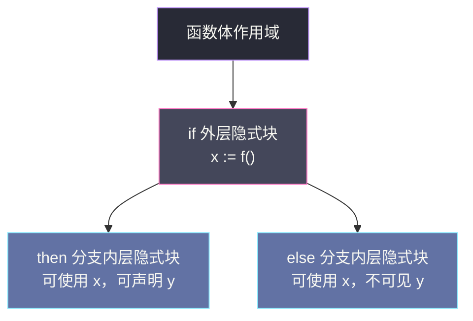
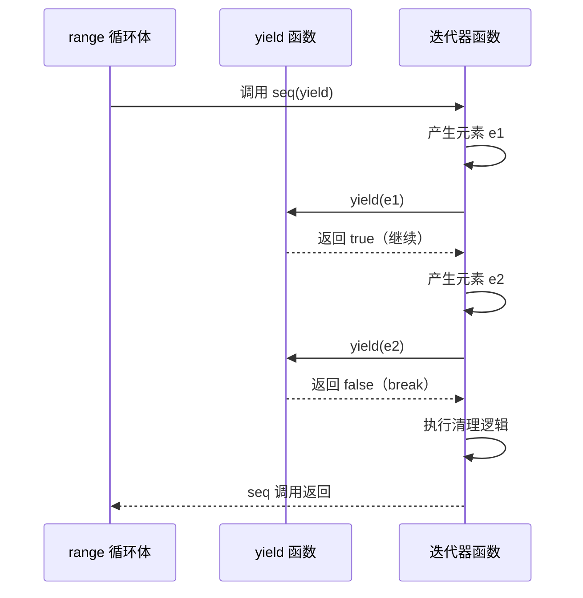

# 控制流语义深入——循环变量语义变革与迭代器理论

**摘要：**

控制流语句是任何命令式语言的骨架，但 Go 在 `if`、`for`、`switch`、`select` 这些看似平常的构造中埋藏了一套精心设计的**隐式块（implicit block）与作用域屏障**规则，它们决定了变量在哪里可见、在哪里被捕获、在哪里逃逸。这套规则在 Go 诞生之初便已定型，却在 Go 1.22（2024 年 2 月）经历了一次影响深远的语义修正——**循环变量从"每次迭代共享同一存储"变为"每次迭代独立分配"**（per-iteration variable），一举解决了十余年来困扰并发编程的闭包捕获陷阱。这次修正并非凭空而来，它由 `go.mod` 中的 `go` 指令控制，体现了 Go 团队在"向后兼容"与"语义正确"之间的精密权衡。而紧接着的 Go 1.23（2024 年 8 月）又引入了**迭代函数（iterator function）**——`iter.Seq[V]` 与 `iter.Seq2[K, V]`——将 `range` 语句的语义从"遍历底层数据结构"扩展到"遍历任意计算过程"，其本质是**延续传递风格（Continuation-Passing Style, CPS）** 与协程化协作模型在主流语言中的首次大规模落地。本文从控制流的隐式块与作用域规则出发，依次剖析 Go 1.22 循环变量语义变革的动机、机制与兼容性代价，再深入 Go 1.23 迭代器的类型定义、yield 协议、资源清理与标准库实现，最后回到跳转语句（`break`/`continue`/`label`/`goto`/`fallthrough`）的精细控制边界。文章试图回答两个核心问题：一门以"简单"著称的语言，如何在保持语法表面不变的前提下，完成一次语义层面的重大修正，并在此基础上引入一套全新的抽象层；以及这种演进策略对于其他追求稳定性的语言设计有何借鉴意义。

---

## 第 1 章 隐式块与作用域屏障——控制流的地理学

### 1.1 什么是隐式块

在 Go 中，**块（block）** 是用花括号 `{}` 包裹的一组语句序列，它同时也是一道**作用域屏障**——在块内声明的变量，离开块之后便不可见。显式的块容易识别：函数体、`{}` 代码块。但 Go 的控制流语句还会创建**隐式块（implicit block）**——没有花括号，却同样构成作用域边界。这种设计初看反直觉，细想却极为优雅：它让"变量的生命周期"与"控制流的逻辑结构"精确对齐，不需要额外的语法符号来标注。

不妨把作用域想象成一座多层建筑，每一层都有独立的房间。显式块是用砖墙隔出来的房间，一眼可见；隐式块则是用玻璃幕墙围起来的区域——从外面能看到里面的变量声明，但一旦走出这个区域，那些变量便不再可达。Go 规范（The Go Programming Language Specification）用"implicit block"这一术语统摄这些不可见却真实存在的边界。理解这些边界，是理解闭包捕获、逃逸分析、变量遮蔽等一系列后续话题的前提——可以说，[[09 函数、闭包与 defer 的实现]] 中讨论的闭包变量逃逸行为，根源就藏在控制流的隐式块规则里。

### 1.2 if 与 for 的隐式块

`if` 语句的结构是：

```go
if x := f(); x > 0 {
    // x 在这里可见
}
// x 在这里不可见
```

`x := f()` 这个**初始化语句（initialization statement）** 的变量 `x`，其作用域并非函数体，而是**整个 `if` 语句（包括条件、then 分支和 else 分支）所构成的隐式块**。换言之，`if` 创建了两层嵌套的隐式块：外层包裹整个 `if-else` 结构（`x` 在此声明），内层是 `{}` 花括号包裹的 then 或 else 分支。这种双层结构的工程意义在于：`else if` 链中的每个分支都能访问初始化的变量，但分支内部声明的变量不会泄漏到外层。

`for` 语句类似。经典三句式 `for i := 0; i < n; i++` 中，`i := 0` 的初始化语句位于 `for` 的外层隐式块，`i` 在整个 `for` 语句（包括条件、post 语句和循环体）中可见。而 `for range` 的形式中，迭代变量的作用域同样是整个 `for` 语句的隐式块——这个细节在 Go 1.22 前后有着截然不同的含义，后文将详述。

### 1.3 switch 与 select 的隐式块

`switch` 语句的隐式块规则更为精巧。每个 `case` 子句并不是独立的作用域——**整个 `switch` 语句共享一个隐式块**，但每个 `case` 的子句列表（clause body）本身又是一个隐式块。这意味着：

```go
switch tag {
case 1:
    x := "one"
    // x 在本 case 内可见
case 2:
    // x 在这里不可见——每个 case 有独立的隐式块
}
```

`switch` 的初始化语句（`switch x := f(); x { ... }`）与 `if` 的初始化语句遵循相同的规则：变量的作用域覆盖整个 `switch` 语句。

`select` 的语义与 `switch` 类似，但它的每个 `case` 包含的是一个通信操作（send 或 receive）加一个语句块。`select` 的隐式块同样覆盖所有分支——不过由于 `select` 的每个 `case` 必须包含通信操作，实践中很少在 `select` 中使用初始化语句。关于 `select` 的优先级与状态屏蔽机制，详见 [[Golang/Go并发编程/00 专栏导览|Go 并发编程]] 专栏中的讨论。

### 1.4 作用域的嵌套结构图

下面的 Mermaid 图展示了 `if` 语句中隐式块的嵌套关系——外层隐式块包裹初始化语句与整个分支结构，内层隐式块对应每个分支的花括号体。变量 `x` 在外层声明后，可在 then 分支和 else 分支中均可见；但 then 分支内声明的 `y` 只在该分支体内可见。



### 1.5 作用域屏障的工程意义

隐式块的设计不是语法糖，它直接影响**变量遮蔽（shadowing）** 与**闭包捕获（closure capture）** 的行为。当一个内层块声明了与外层同名的变量，外层的变量被"遮蔽"——在内层块中访问该名字，得到的是内层的变量。这种遮蔽在 `if err := f(); err != nil` 这样的惯用法中极为常见：`err` 的作用域被精确限制在 `if` 语句内，不会污染外层函数体。

考虑下面这个更复杂的例子，它展示了 `switch` 语句中初始化变量与 case 分支变量的作用域关系：

```go
func processResponse(resp *http.Response) error {
    switch statusCode := resp.StatusCode; {
    case statusCode >= 200 && statusCode < 300:
        body, err := io.ReadAll(resp.Body)
        if err != nil {
            return err  // 这里的 err 是 ReadAll 返回的
        }
        // body 在这里可见
    case statusCode >= 400:
        // statusCode 在这里可见（来自 switch 初始化）
        // 但 body 和上面的 err 在这里不可见
        return fmt.Errorf("client error: %d", statusCode)
    }
    // statusCode、body、err 在这里都不可见
    return nil
}
```

在这个例子中，`statusCode` 的作用域覆盖整个 `switch` 语句（包括所有 case 分支），而 `body` 和 `err` 的作用域仅限于第一个 case 的花括号块内。这种设计使得每个 case 分支可以声明自己的局部变量而不互相干扰，同时又能在需要时访问 switch 初始化语句中的变量。

### 1.6 意外遮蔽与编译器辅助

遮蔽也是一把双刃剑。如果外层已经有同名变量，内层的 `:=` 会创建一个全新的变量，而不是赋值给外层的。这种"意外遮蔽"是 Go 新手最常踩的陷阱之一，而 Go 1.22 之前的循环变量语义，则是这个陷阱在并发场景下的极致体现。

Go 编译器对此并非完全沉默。`go vet` 工具中的 `shadow` 分析器可以检测变量遮蔽的情况——尽管它默认不启用（因为遮蔽本身并非错误，在很多场景下是有意为之），但在持续集成流水线中启用 `-vettool=shadow` 可以有效捕获这类问题。更重要的是，`shadow` 分析器能够区分"无意的遮蔽"（譬如在 `if err := f()` 中意外遮蔽了外层的 `err`）和"有意的遮蔽"（譬如在循环中用 `v := v` 创建新的绑定），为开发者提供了细粒度的警告。

本章所述的隐式块与作用域规则，是理解后续所有话题的基础——无论是闭包捕获陷阱（第 2 章）、循环变量语义变革（第 3 章），还是迭代器中的 yield 协议（第 5-6 章），都与"变量在哪里可见、在哪里被捕获"这个核心问题紧密相关。关于变量声明与包级初始化的更完整作用域规则，可以参考 [[Golang/Go语言核心/00 专栏导览|Go 语言核心]] 专栏的整体脉络。

---

## 第 2 章 循环变量的历史陷阱——共享存储的代价

### 2.1 Go 1.22 之前的语义：每次迭代共享同一变量

在 Go 1.22 之前，`for` 循环语句（包括 `for range`）的迭代变量——循环控制变量和 `range` 产生的键值变量——在整个循环过程中**共享同一块内存存储**。这意味着：每一次迭代并不是创建一个新的变量，而是**复用同一个变量，只是更新它的值**。

这个语义选择源于 Go 的早期设计哲学：简单、可预测、与硬件模型贴近。循环变量就是一个普通变量，`for` 语句不过是在每次迭代开始时对它赋值。从编译器的角度看，这几乎不增加任何复杂性——循环变量就像函数中的一个局部变量，分配在栈帧上，地址固定。

但这套语义在与闭包、goroutine 和指针结合时，产生了大量反直觉的行为。

### 2.2 闭包捕获陷阱

最经典的例子是启动 goroutine 时使用闭包捕获循环变量：

```go
// Go 1.22 之前的行为
for _, v := range []string{"a", "b", "c"} {
    go func() {
        fmt.Println(v)
    }()
}
```

直觉上，三个 goroutine 应该分别打印 `a`、`b`、`c`。但由于循环变量 `v` 在整个循环过程中共享同一存储，三个 goroutine 捕获的是**同一个 `v` 的引用**。当 goroutine 实际执行时，循环很可能已经结束，`v` 的最终值是 `c`——于是三个 goroutine 全部打印 `c`。

这不是 bug，而是语言规范的精确语义。但对绝大多数开发者而言，这是**反直觉**的。Go 团队的官方 FAQ 在多年间一直保留着专门的条目解释这一行为，并给出两种变通方案：

**方案一：将变量作为参数传入闭包**。参数传递是值拷贝，每次调用都会创建独立的副本：

```go
for _, v := range []string{"a", "b", "c"} {
    go func(val string) {
        fmt.Println(val)  // val 是每次迭代的独立副本
    }(v)
}
```

**方案二：在循环体内创建局部变量**。利用块作用域创建新的绑定：

```go
for _, v := range []string{"a", "b", "c"} {
    v := v  // 创建新的局部变量，遮蔽外层的 v
    go func() {
        fmt.Println(v)  // 捕获的是新变量的引用
    }()
}
```

这两种方案都有效，但都要求开发者"记住"循环变量的特殊语义，并在每次需要捕获时手动规避。这违反了"简单语言应该直觉正确"的设计目标。

### 2.3 取址陷阱

循环变量共享存储的另一个后果是对它取地址（`&v`）时，所有迭代得到的是**同一个指针**：

```go
// Go 1.22 之前的行为
var ptrs []*int
for _, v := range []int{1, 2, 3} {
    ptrs = append(ptrs, &v)
}
// ptrs[0]、ptrs[1]、ptrs[2] 指向同一个 v，值为 3
```

这在构建对象切片、注册回调函数、组装 HTTP handler 时都会引发隐蔽的错误。`go vet` 工具在后续版本中加入了对此模式的静态检查（`loopclosure` analyzer），它能够检测"goroutine 内引用循环变量"这种最常见的问题模式。但静态检查只能覆盖部分模式——譬如，当循环变量被捕获到一个 struct 字段中、而 struct 在 goroutine 中被使用时，`vet` 的分析器可能无法识别。静态检查终究是启发式的，无法从根本上消除问题。

### 2.4 为什么这个陷阱存在了这么久

一个自然的问题是：既然这个问题如此普遍，为什么 Go 的设计者在最初不直接采用"每次迭代独立变量"的语义？

答案在于**向后兼容的权重**。Go 对兼容性的承诺极为严格——Go 1 的兼容性保证（Go 1 Compatibility Promise）要求 Go 1.x 系列的所有版本在语言语义上保持完全一致。修改循环变量的语义意味着：所有依赖"共享存储"行为的现有程序——包括那些刻意利用共享存储来实现"所有 goroutine 看到最新值"模式的程序——都可能在升级后出现行为变化。

更深层次的原因是，在 Go 诞生的年代（2009 年宣布，2012 年 Go 1 发布），"循环变量共享存储"是大多数命令式语言的共同语义。C、C++、Java、Python 的 `for` 循环都采用这种语义——循环变量在循环结束后仍然可见（C/C++ 在 for 作用域内可见，Java/Python 在循环结束后仍保留最后一次迭代的值）。Go 的设计者遵循了这一惯例，并没有预料到 goroutine 的广泛使用会让这种语义变成一个陷阱。当 goroutine 成为 Go 程序的标配时，循环变量的共享语义才从一个"中性的设计选择"变成了一个"广泛存在的 bug 源头"。

这个历史教训提醒我们，语言设计的决策往往需要在未来的使用模式尚不明确时做出——而当使用模式发生变化时，原本中性的设计可能变成负担。Go 团队最终修正了这一语义，但这个过程用了十余年，足见语言演进的谨慎与艰难。

这个权衡在 Go 的前十年一直被保守地维持：文档警告、`vet` 检查、社区约定，但语义不变。直到 Go 1.22，条件才成熟——社区对此问题的共识已经足够强烈，而受影响的"刻意依赖旧语义"的代码极为罕见，使得修正的代价变得可以接受。

> [!info] 一个真实的工程案例
> 在 Go 1.21 的标准库 `net/http` 包中，曾有一处代码因为循环变量共享存储的问题，导致 HTTP handler 注册时意外捕获了相同的变量。这个 bug 在内部测试中潜伏了数月，直到用户在生产环境中观察到路由行为异常才被发现。修复方法是显式地将循环变量作为参数传入闭包——但这次事件成为推动 Go 1.22 语义修正的催化剂之一。

值得注意的是，即使在新语义下，某些边缘情况仍然需要开发者保持警惕。譬如，当循环变量被闭包捕获但闭包在循环结束后才被调用时，如果循环变量的值是引用类型（譬如 slice 或 map），闭包仍然会共享底层数据结构——因为 per-iteration 语义只保证变量绑定本身是独立的，不保证引用类型指向的底层数据被复制。这是一个微妙但重要的边界，后文在第 9 章将进一步讨论。

---

## 第 3 章 Go 1.22 的语义变革——per-iteration variable

### 3.1 新语义：每次迭代独立分配

Go 1.22（2024 年 2 月发布）修改了 `for` 循环的语义规范：**每次迭代现在会创建一组新的局部变量**，循环变量在每次迭代中被独立初始化（用当前迭代的值）。这些变量在迭代之间互不共享，就像在每次迭代开始时执行了一次 `:=` 声明。

```go
// Go 1.22+ 的行为
for _, v := range []string{"a", "b", "c"} {
    go func() {
        fmt.Println(v)  // 每个 goroutine 捕获独立的 v
    }()
}
// 正确打印 a、b、c（顺序不保证）
```

这个修改同时影响经典三句式 `for i := 0; i < n; i++` 和 `for range` 形式。在经典句式中，`i` 在每次迭代中是独立变量；在 `for range` 中，键变量和值变量都是独立变量。

### 3.2 机制细节：编译器如何实现

从编译器的角度看，这个语义修改的实现并不复杂。在 Go 1.22 之前，编译器把循环变量当作一个普通的局部变量，在整个函数栈帧上分配一次。Go 1.22 之后，编译器在每次迭代的隐式块中为循环变量创建新的绑定——逻辑上等价于在循环体的最外层插入了变量声明。

对于逃逸分析而言，这意味着每次迭代中捕获的循环变量地址指向不同的堆对象。闭包不再需要"共享同一个逃逸到堆上的变量"，而是各自持有独立的副本。这对内存分配有一定影响——每次迭代可能产生新的堆分配——但 Go 的逃逸分析和垃圾回收器能够高效处理这种模式，尤其是当闭包本身的生命周期短暂时，这些对象会在 young generation 中被快速回收。

值得注意的是，新语义下 `&v` 的行为也变得直觉正确：每次迭代得到的指针指向不同的内存位置，存储着不同的值。

### 3.4 与 Go 内存模型的关系

循环变量语义的变革还隐含着与 Go 内存模型（Go Memory Model）的交互。在 Go 1.22 之前的语义下，所有 goroutine 共享同一个循环变量，因此对这个变量的读写天然存在数据竞争（data race）——这正是 [[Golang/Go并发编程/00 专栏导览|Go 并发编程]] 专栏中讨论的 Happens-Before 关系无法建立的情况。新语义下，每次迭代的变量独立，不同 goroutine 访问的是不同变量，数据竞争自然消失。这是一个有趣的附带收益：语义修正不仅修复了"闭包捕获所有打印 c"的逻辑错误，还消除了底层的数据竞争问题。

不过，这并不意味着新语义下所有循环相关的并发代码都是安全的。如果循环体内对某个共享资源（譬如一个全局 map 或一个非线程安全的计数器）进行了写操作，数据竞争仍然存在——per-iteration 语义只保证循环变量本身的安全，不保证循环体内访问的其他共享资源的安全。开发者仍然需要正确使用 `sync` 包中的同步原语来保护共享状态。

### 3.3 对现有代码的影响

新语义对绝大多数现有程序是**行为无感的**——那些不捕获循环变量地址或引用、不启动 goroutine 捕获循环变量的代码，在新旧语义下完全等价。只有以下模式会出现行为变化：

1. 闭包或 goroutine 捕获循环变量（不带参数传递）
2. 对循环变量取地址 `&v` 并保存指针
3. 通过 `reflect` 或 `unsafe` 依赖循环变量地址不变性的代码

对于这些模式，新语义修复了绝大多数"bug"，但也可能破坏极少数"刻意利用共享存储"的程序。Go 团队在决策时评估了这一点，认为后者在实际代码库中极为罕见，而前者是广泛存在的痛点。这次修正与泛型（[[11 Go 泛型——类型参数与实现机制]] 中讨论）类似，都是在不改变语法表面的前提下，扩展语言的表达能力与语义正确性。

---

## 第 4 章 兼容性的精密权衡——go.mod 的版本控制

### 4.1 由 go.mod 控制语义

Go 1.22 的循环变量语义变革引入了一个前所未有的机制：**新语义的生效由 `go.mod` 文件中的 `go` 指令控制**。只有当 `go.mod` 声明 `go 1.22`（或更高版本）时，循环变量才采用 per-iteration 语义；声明 `go 1.21` 或更低版本的模块，继续使用旧的共享存储语义。

```go
module example.com/myproject

go 1.22  // 此模块中的所有 .go 文件采用 per-iteration 循环变量语义
```

这个设计是 Go 兼容性策略的一次重要演进。Go 1 Compatibility Promise 要求同一 `go 1.x` 大版本内的所有小版本在语言语义上保持兼容，但 Go 团队面对的现实是：某些语义修改是如此重要（修复广泛存在的陷阱），以至于"完全不动"的代价大于"有条件地动"。

解决方案是：**把语义变更的开关交给模块级别，而不是工具链级别**。同一个 Go 1.22 编译器，在编译 `go 1.22` 模块时用新语义，在编译 `go 1.21` 模块时用旧语义。这意味着：

- 升级工具链不会自动改变现有模块的行为
- 模块作者可以自主选择何时迁移
- 依赖关系不会引发级联的语义变化

### 4.2 go:build 约束的配合

`//go:build` 约束可以与 `go.mod` 的 `go` 指令配合，为同一代码库提供针对不同语言版本的条件编译。虽然实践中极少有人这样做——大多数模块在升级到 Go 1.22 工具链后，会同步将 `go.mod` 更新到 `go 1.22`——但这个机制为极端保守的迁移策略提供了可能。

### 4.3 兼容性权衡的认知框架

这次语义修正可以看作是对"兼容性"概念的一次重新定义。传统的兼容性观是**二元的**：要么完全不变，要么打破一切。Go 1.22 引入的是**分层的兼容性**：

| 层次 | 含义 | 约束 |
|---|---|---|
| 工具链兼容性 | Go 1.22 编译器能编译 Go 1.0 以来的所有代码 | Go 1 Compatibility Promise 的底线 |
| 语义兼容性 | 代码的运行时行为取决于 `go.mod` 的版本声明 | 同一模块内语义一致，跨模块不干扰 |

这种分层策略的代价是语言规范变得稍微复杂——"循环变量是什么语义"现在需要同时看代码和 `go.mod`。但收益是巨大的：一个已被识别十余年、影响无数开发者的语义陷阱，最终以几乎零破坏的方式被修复。

> [!note] 迁移实践建议
> 对于大多数项目，升级到 Go 1.22 工具链后，应当同步将 `go.mod` 中的 `go` 指令更新到 `go 1.22`。这不仅能获得新的循环变量语义，还能让代码库中的 `v := v` 惯用法被识别为冗余（可以通过 `gofmt` 或 `gopls` 的 suggested fix 自动清理）。对于依赖大量第三方模块的项目，需要等待主要依赖也完成迁移，以避免同一二进制中不同模块使用不同语义带来的混淆。

从认知框架看，这是**"语义正确性"与"兼容性承诺"之间的一次精密妥协**——不是非此即彼，而是在两者之间找到一个足够窄的楔入点，使得修正的代价可以忽略不计，而修正的收益可以惠及几乎所有使用者。这次修正也为后续的语言演进提供了范式——如果未来需要修正其他语义陷阱，`go.mod` 的版本控制机制将是一个可复用的工具。

---

## 第 5 章 Go 1.23 迭代器——从数据结构到计算过程

### 5.1 range 的语义扩展

Go 的 `range` 语句在诞生之初只能遍历三种底层数据结构：数组/slice（按索引迭代）、map（按键随机迭代）、channel（按接收顺序迭代）。这些遍历的共同特征是：**被遍历的对象是一个具体的数据结构，range 知道如何从它的底层表示中逐个取出元素**。

但这种设计有一个根本限制：`range` 只能遍历"已经存在的数据"，不能遍历"正在计算的过程"。当需要从文件中逐行读取、从数据库中分页查询、从网络流中逐个接收消息时，开发者不得不退回到手动循环 + 错误返回的传统模式，失去了 `range` 语法带来的简洁与清晰。

Go 1.23 引入的**迭代函数（iterator function）**——通过 `iter` 包定义的 `iter.Seq[V]` 和 `iter.Seq2[K, V]`——将 `range` 的语义从"遍历数据结构"扩展到"遍历任意计算过程"。这是 Go 语言自诞生以来在抽象层面最大胆的一步。

### 5.2 iter.Seq 与 iter.Seq2 的形式化定义

`iter` 包定义了两个核心类型，它们都是函数类型：

```go
// 单值迭代器：每次迭代产出一个值
type Seq[V any] func(yield func(V) bool)

// 双值迭代器：每次迭代产出一对键值
type Seq2[K, V any] func(yield func(K, V) bool)
```

理解这两个类型的关键在于**yield 参数**。`yield` 本身也是一个函数，它由 `range` 语句在每次迭代时调用，将当前迭代的值传递给 `range` 的循环变量，并返回一个 `bool` 值：`true` 表示继续迭代，`false` 表示提前终止（由 `break`、`return` 或循环条件触发）。

`range` 语句与迭代器的交互规则如下：

```go
// 语法糖
for v := range seq {
    // 使用 v
}

// 等价于
seq(func(v V) bool {
    // 使用 v
    // 如果循环体正常结束，返回 true（继续迭代）
    // 如果有 break/return，返回 false（提前终止）
    return true
})
```

这个等价关系揭示了 `range-over-func` 的本质：**迭代器是一个接受"如何处理每个元素"的函数，它自己控制元素的产生过程，通过调用 `yield` 把元素交给 `range` 的循环体处理**。

### 5.3 为什么是 CPS——延续传递风格

迭代函数的类型签名 `func(yield func(V) bool)` 是**延续传递风格（Continuation-Passing Style, CPS）** 的典型形式。在 CPS 中，函数不直接返回值，而是把值交给一个"延续"（continuation）——即 `yield`——由延续决定下一步做什么。

把迭代器想象成一条流水线。流水线的设计者决定了"零件以什么顺序、以什么节奏被生产出来"，但他不关心零件被生产出来之后用在哪里——这个决定权交给了流水线的使用者，即 `yield`。`yield` 是流水线与使用者之间的**协作协议**：生产者每次生产一个零件，递给使用者；使用者检查零件后告诉生产者"继续"（返回 `true`）还是"停止"（返回 `false`）。



这种设计的精妙之处在于**控制权的分离**：元素的产生逻辑（由迭代器持有）和元素的处理逻辑（由 `range` 的循环体持有）是独立的，它们通过 `yield` 这个狭窄的接口协作。这意味着同一个迭代器可以被不同的 `range` 循环体使用，而一个 `range` 循环体也可以接收不同来源的迭代器——这正是抽象的价值。

### 5.4 一个简单的迭代器实现

下面是一个产生斐波那契数列前 N 项的迭代器：

```go
func fibonacci(n int) iter.Seq[int] {
    return func(yield func(int) bool) {
        a, b := 0, 1
        for i := 0; i < n; i++ {
            if !yield(a) {
                return  // yield 返回 false，提前终止
            }
            a, b = b, a+b
        }
    }
}

// 使用
for v := range fibonacci(10) {
    fmt.Println(v)  // 打印前 10 个斐波那契数
    if v > 50 {
        break  // 提前终止：yield 将返回 false
    }
}
```

在这个例子中，`fibonacci` 函数返回一个闭包（迭代器），闭包内部通过循环产生斐波那契数。每次迭代调用 `yield(a)` 把当前值交给 `range` 的循环体。如果循环体触发了 `break`，`yield` 返回 `false`，`fibonacci` 的循环随即退出。

### 5.5 yield 返回 bool 的设计动机

为什么 `yield` 的返回类型是 `bool` 而不是 `struct{}` 或 `error`？答案是**提前终止（early termination）**。

在许多场景中，`range` 循环并不需要遍历全部元素——找到目标就 `break`，遇到错误就 `return`。如果没有提前终止机制，迭代器将被迫产生所有元素，即使调用者已经不再需要它们。这对于昂贵的计算（数据库查询、文件读取、网络请求）是不可接受的浪费。

`yield` 返回 `bool` 的设计让迭代器能够感知调用者的意愿：`true` 表示"我还需要更多"，`false` 表示"我已经满足了，你可以停止"。这是一种**协作式终止（cooperative termination）**——不是迭代器单方面决定何时结束，也不是调用者单方面打断，而是双方通过 `yield` 的返回值达成共识。

---

## 第 6 章 迭代器中的资源清理与协程化模型

### 6.1 资源清理的必要性

当迭代器内部持有资源（文件句柄、数据库游标、网络连接）时，提前终止带来了一个严肃的问题：**如果调用者在迭代中途退出，迭代器持有的资源如何释放？**

在传统的 `defer` 模型中，资源清理由 `defer` 语句在函数返回时自动执行。但迭代器是一个闭包，它的生命周期与 `range` 循环的生命周期并不完全对齐——`range` 可能因为 `break` 提前结束，而迭代器闭包可能还有后续计算被跳过。

Go 的 `range-over-func` 机制通过**运行时协作**解决了这个问题。当 `range` 循环因为 `break`、`return` 或 `panic` 而提前退出时，Go 运行时确保迭代器函数本身也会被"唤醒"，让它有机会执行清理逻辑。具体机制是：`yield` 返回 `false` 后，迭代器函数中的后续代码继续执行——这意味着迭代器可以在 `yield` 调用之后的代码中放置清理逻辑（包括 `defer`）。

```go
func readFileLines(path string) iter.Seq[string] {
    return func(yield func(string) bool) {
        f, err := os.Open(path)
        if err != nil {
            return  // 打开失败，直接返回
        }
        defer f.Close()  // 资源清理：无论迭代是否完整，都会执行

        scanner := bufio.NewScanner(f)
        for scanner.Scan() {
            if !yield(scanner.Text()) {
                return  // 提前终止：defer 仍然会执行
            }
        }
    }
}
```

在这个例子中，`defer f.Close()` 确保文件句柄在迭代器函数返回时被关闭。无论 `range` 循环是正常结束还是提前 `break`，`yield` 返回 `false` 后迭代器函数继续执行到结束（或遇到 `return`），`defer` 在这个过程中被触发。

### 6.2 协程化协作模型

从更高的抽象层次看，`range-over-func` 的 yield 协议本质上是一种**协程化（coroutine-like）的协作模型**。迭代器和 `range` 循环体是两个交替执行的"逻辑协程"：

1. 迭代器执行，产生一个值，调用 `yield` 把值交给循环体
2. 循环体执行，处理这个值，然后返回（隐式地，通过 `yield` 的返回值）
3. 迭代器继续执行，产生下一个值，再次调用 `yield`
4. 循环体再次执行……

这种交替执行不需要操作系统线程或 goroutine 的参与——它是**协作式的（cooperative）**，每次控制权转移都由一方主动让出（yield 调用或循环体返回）。因此，它的开销极低，不涉及线程切换、栈拷贝或调度器介入。

但这也意味着迭代器不能把 `yield` 的调用"存起来"留到以后使用——`yield` 必须在迭代器函数的当前调用栈帧中同步调用。试图把 `yield` 传给另一个 goroutine 异步调用，会导致未定义行为。Go 的 `vet` 工具会检测这种误用模式。

这种同步约束的根源在于 Go 的栈管理模型。Go 的 goroutine 栈是可伸缩的——当栈空间不足时，运行时会将其内容复制到更大的内存区域，并更新所有指向栈帧的指针。如果 `yield` 被保存到另一个 goroutine 中异步调用，那么当原 goroutine 的栈被复制时，异步调用方持有的 `yield` 引用可能指向已被释放的旧栈内存。这种复杂的生命周期管理是 Go 团队有意避免的——他们选择了"简单、同步、可预测"的迭代器模型，而不是像 Python 的生成器或 JavaScript 的 async iterator 那样支持异步 yield。

### 6.4 panic 安全与迭代器

迭代器的资源清理机制还需要考虑 panic 的情况。如果 `range` 的循环体触发了 panic，Go 的运行时保证迭代器函数也会被正确清理——这与 `defer` 在 panic 传播中的行为一致。具体而言，当 panic 发生时，Go 运行时会沿着调用栈向上回溯，执行沿途所有的 `defer` 语句。对于迭代器，运行时会确保 `yield` 返回 `false`（模拟提前终止），然后让迭代器函数继续执行到结束，触发其中的 `defer` 清理逻辑。

这意味着开发者可以放心地在迭代器中使用 `defer` 管理资源，而不必担心 panic 导致资源泄漏。这与传统函数中 `defer` 的行为完全一致——迭代器并没有引入新的 panic 安全问题。

### 6.3 与 channel 的对比

迭代器和 channel 都可以用来"逐个产出元素"，但它们的设计目标和适用场景截然不同。channel 是**并发原语**，生产者和消费者在不同的 goroutine 中运行，通过 channel 同步；迭代器是**顺序抽象**，生产者和消费者在同一个 goroutine 中交替运行，通过 `yield` 协作。

| 维度 | channel | 迭代函数（iter.Seq） |
|---|---|---|
| 并发模型 | 生产者与消费者并行 | 生产者与消费者交替（同一 goroutine） |
| 同步机制 | channel 操作阻塞等待 | yield 同步调用，无阻塞 |
| 提前终止 | 关闭 channel 或 context 取消 | yield 返回 false |
| 资源清理 | 消费者退出后生产者需自行检测 | 运行时保证迭代器函数执行到结束 |
| 性能开销 | goroutine + channel 操作 | 函数调用，接近零开销 |
| 适用场景 | 真正并发的生产者-消费者 | 惰性遍历、分页查询、流式处理 |

这个对比揭示了一个重要认知：**并非所有"逐个产出"的场景都需要并发**。当元素可以按顺序产生、且生产者与消费者不需要并行时，迭代器是比 channel 更高效、更安全的选择。

---

## 第 7 章 标准库中的迭代器：slices 与 maps

### 7.1 slices 包提供的迭代器

Go 1.23 的 `slices` 包新增了多个返回迭代器的函数，覆盖了最常见的集合遍历需求：

**`slices.Values`**：返回单值迭代器，按顺序产出 slice 的每个元素。

```go
names := []string{"alice", "bob", "charlie"}
for name := range slices.Values(names) {
    fmt.Println(name)
}
```

**`slices.All`**：返回双值迭代器（`iter.Seq2`），产出索引和元素。

```go
for i, name := range slices.All(names) {
    fmt.Printf("%d: %s\n", i, name)
}
```

**`slices.Backward`**：返回双值迭代器，按逆序产出索引和元素。

```go
for i, name := range slices.Backward(names) {
    fmt.Println(i, name)  // 2: charlie, 1: bob, 0: alice
}
```

这些函数的实现都很简洁——它们各自返回一个闭包，闭包内部用传统 `for` 循环遍历底层 slice，每次迭代调用 `yield`。值得深入思考的是，这些迭代器函数与直接 `range` 遍历 slice 在性能上的差异。从编译器优化的角度看，`for v := range slice` 会被编译为对底层数组的直接索引访问，几乎没有额外开销；而 `for v := range slices.Values(slice)` 涉及一个函数调用（调用迭代器闭包）和一次 `yield` 回调——这是两层间接调用。在当前的 Go 编译器实现中，这种间接调用可能无法被完全内联优化，因此在微基准测试（microbenchmark）中，基于迭代器的遍历会比直接 `range` 慢几个百分点。

不过，这种性能差异在绝大多数应用场景中可以忽略不计——循环体内的处理逻辑通常远慢于迭代器本身的开销。只有在极端性能敏感的热路径（hot path）上，才需要考虑使用直接 `range`。这是一个典型的"抽象 vs 性能"权衡，也是 Go 团队在设计迭代器 API 时反复讨论的议题。最终他们选择了"提供迭代器抽象，但保留直接 `range` 作为性能优化手段"的双轨策略。

### 7.2 maps 包提供的迭代器

`maps` 包同样提供了迭代器函数：

**`maps.Keys`**：返回 map 所有键的迭代器（顺序随机，与 `range` 遍历 map 一致）。

**`maps.Values`**：返回 map 所有值的迭代器。

值得注意的是，这些迭代器产出元素的顺序与直接 `range` 遍历 map 的顺序相同——都是随机的（Go map 的迭代顺序随机化是有意设计，防止代码依赖特定顺序）。如果需要有序遍历，应当先收集键到 slice，排序后再用 `slices.Values` 遍历。

### 7.3 自定义迭代器：组合与变换

迭代器的真正威力在于**组合（composition）**。由于迭代器就是函数，可以方便地编写变换函数，将一个迭代器转换为另一个迭代器：

```go
// Map：将迭代器的每个元素经过 f 变换
func Map[V, W any](seq iter.Seq[V], f func(V) W) iter.Seq[W] {
    return func(yield func(W) bool) {
        for v := range seq {
            if !yield(f(v)) {
                return
            }
        }
    }
}

// Filter：过滤迭代器的元素
func Filter[V any](seq iter.Seq[V], pred func(V) bool) iter.Seq[V] {
    return func(yield func(V) bool) {
        for v := range seq {
            if pred(v) && !yield(v) {
                return
            }
        }
    }
}

// 组合使用
nums := slices.Values([]int{1, 2, 3, 4, 5})
evens := Filter(nums, func(n int) bool { return n%2 == 0 })
squares := Map(evens, func(n int) int { return n * n })
for sq := range squares {
    fmt.Println(sq)  // 4, 16
}
```

这种模式与函数式编程中的 `map`/`filter` 管道同构，但关键区别在于**惰性求值（lazy evaluation）**：每个元素在被 `range` 循环体请求时才经过整条管道变换，不存在中间 slice 的分配。这与 `slices` 包中的 `slices.Clone` + 手动循环相比，在内存效率上有本质优势。

> [!warning] 组合迭代器的错误处理
> 在实际项目中，迭代器管道通常需要处理错误。但 `iter.Seq[V]` 的类型签名不允许在 `yield` 中传递错误——`yield` 只接受一个值和一个 bool 返回值。常见的解决方案有两种：一是将错误编码为值的一部分（譬如返回 `Result[T]` 类型，包含 `Value` 和 `Err` 两个字段）；二是使用 `iter.Seq2[V, error]` 的形式，让迭代器同时产出值和错误。后者在标准库的一些提案中被讨论，但尚未被采纳——Go 团队倾向于保持 `iter.Seq` 的简洁性，让错误处理由应用层自行设计。

### 7.4 迭代器与泛型的协同

迭代器的类型签名中使用了类型参数（`V any`、`K, V any`），这使得迭代器天然与 Go 的泛型系统（[[11 Go 泛型——类型参数与实现机制]]）协同工作。当编写通用的迭代器变换函数（如前述的 `Map` 和 `Filter`）时，类型参数让函数能够处理任意类型的元素，而不需要为每种类型编写特化版本。

泛型的引入（Go 1.20）是迭代器（Go 1.23）得以实现的前提——没有类型参数，`iter.Seq` 就无法表达"产出任意类型的值"这一抽象。从这个角度看，Go 的语言演进是渐进的：先引入泛型作为基础设施，再在此基础上构建更高层次的抽象（迭代器）。这种"每一步都建立在前一步基础之上"的演进策略，是 Go 团队控制语言复杂性增长的核心手段。

---

## 第 8 章 跳转语句的精细控制

### 8.1 break 与 continue 的标签语义

`break` 和 `continue` 在 Go 中可以带**标签（label）**，用于跳出多层嵌套循环。标签是标识符，放在 `for`、`switch` 或 `select` 语句之前：

```go
outer:
for i := 0; i < n; i++ {
    for j := 0; j < m; j++ {
        if matrix[i][j] == target {
            break outer  // 跳出外层循环
        }
    }
}
```

没有标签的 `break` 只跳出最内层的 `for`/`switch`/`select`；带标签的 `break` 可以跳出任意指定的外层语句。`continue` 类似，但只能用于 `for` 循环（跳到指定标签的循环的下一次迭代的 post 语句）。

标签的作用域是从标签声明处到其标注的语句结束。标签不能跨越函数边界，也不能指向非循环/非 switch/非 select 的语句。这种限制是有意为之——Go 的设计者认为，过度使用标签会降低代码可读性，应当谨慎使用。

### 8.2 goto 的限制

`goto` 语句在 Go 中存在，但受到严格限制。`goto` 可以跳转到同一函数内的任意标签处，但有以下约束：

1. **不能跳过变量声明进入块内**。如果 `goto` 的目标在某个块内，而源位置在该块外，则跳转非法——因为那会跳过变量的初始化。
2. **不能跨函数跳转**。
3. **不能从外层块跳入内层块**（同上，避免跳过初始化）。

```go
// 合法：在同一层
goto end
// ...
end:
fmt.Println("done")

// 非法：跳过变量声明
goto inner
if true {
inner:
    fmt.Println(x)  // x 的声明被跳过
}
x := 10
```

这些限制的本质是**保护作用域的完整性**——`goto` 不能破坏变量的声明-使用关系，不能进入一个变量的作用域却不经过它的初始化。这是 Go 在保留低级控制能力的同时，防止内存不安全行为的重要手段。

实践中，`goto` 极少使用。最常见的场景是错误处理中的集中清理（类似 C 语言中的 `goto cleanup`），但 Go 的 `defer` 机制已经优雅地覆盖了这一需求，使得 `goto` 的使用频率进一步降低。

### 8.3 switch 的 fallthrough

`switch` 的 `case` 默认不会"穿透"到下一个 `case`——这与 C/Java 的 `switch` 不同，也是 Go 设计者刻意为之（C 的 switch 穿透是大量 bug 的来源）。如果确实需要穿透行为，Go 提供了显式的 `fallthrough` 关键字：

```go
switch {
case condition1:
    doA()
    fallthrough  // 显式穿透到下一个 case
case condition2:
    doB()
}
```

`fallthrough` 的语义是：**无条件执行下一个 `case` 的语句块**，不检查下一个 `case` 的条件是否满足。这意味着 `fallthrough` 只能出现在 `case` 的最后一个语句，且不能穿透到 `default` 之后的 `case`（`default` 可以在任何位置，但 `fallthrough` 只能按源码顺序穿透到下一个 case）。

这种设计迫使开发者明确表达"我确实要穿透"的意图，而不是依赖"忘记写 `break`"的默认行为。从认知角度看，这是 Go"显式优于隐式"设计哲学的又一体现。

### 8.4 跳转语句与 defer 的交互

`break`、`continue`、`goto` 与 `defer` 的交互遵循一个统一的规则：**当控制流离开某个包含 `defer` 语句的块时，该块的 `defer` 会被触发**。这意味着，如果 `break` 跳出了包含 `defer` 的 `for` 循环，`defer` 会在 `break` 之后、跳出循环之前被执行。`return` 语句同理——函数返回前，所有 `defer` 按照注册的逆序执行。

```go
func process() {
    defer fmt.Println("cleanup")
    for i := 0; i < 10; i++ {
        defer fmt.Println("loop defer", i)  // 每次迭代注册一个 defer
        if i == 3 {
            break  // 触发 loop defer(3)，然后 cleanup
        }
    }
}
// 输出顺序：loop defer 3, cleanup
// 注意：只有 i=0,1,2,3 时注册的 defer 会被执行
// 因为 break 发生在 i=3 时，i=4-9 的 defer 从未注册
```

这个例子展示了 `defer` 的注册时机——每次循环迭代时 `defer` 语句被执行，注册一个新的延迟调用。当 `break` 跳出循环时，所有已注册的 `defer`（i=0,1,2,3）按逆序执行。这种机制与迭代器中的资源清理（第 6 章）是同一个原理的不同表现。

---

## 第 9 章 权衡与边界——控制流语义的演进认知

### 9.1 语义修正的代价与收益

Go 1.22 的循环变量语义变革是一个罕见的案例：一门已经发布十余年、以兼容性承诺著称的语言，修改了一条基础控制流语句的语义。回顾这次修正，可以梳理出以下权衡：

**收益**：消除了 Go 中最广泛的反直觉陷阱。闭包捕获循环变量、`&v` 取址、goroutine 启动——这些场景从"需要记住特殊规则并手动规避"变为"直觉即正确"。这降低了新手的认知负担，也减少了老手的疏忽风险。根据 Go 团队在提案讨论中引用的数据，在 GitHub 上搜索到的 Go 代码中，超过 90% 的"循环变量捕获"模式实际上是期望 per-iteration 语义的——也就是说，绝大多数开发者直觉上认为循环变量应该是每次迭代独立的。这个数据为语义修正提供了强有力的实证支撑。

**代价**：语言规范稍微复杂化——"循环变量的语义"现在依赖 `go.mod` 的版本声明。编译器需要维护两套语义路径，文档需要解释版本差异，开发者需要理解 `go.mod` 版本对语义的影响。

Go 团队的选择是：**以极小的兼容性代价（编译器内部复杂性、文档复杂性）换取极大的直觉正确性收益**。这个权衡是否值得，取决于对"兼容性"的理解——如果兼容性意味着"行为永远不变"，那么这次修正打破了兼容性；如果兼容性意味着"现有正确程序不受影响"，那么这次修正只影响那些"依赖 bug 行为"的程序，而这类程序本身就是需要修复的。

### 9.2 迭代器的适用边界

Go 1.23 的迭代器引入了 CPS 模型，但它并非万能。以下场景不适合使用迭代器：

1. **需要并发消费**：迭代器是同步的，如果消费者需要并行处理元素，应当使用 channel + worker goroutine 模式。
2. **需要随机访问**：迭代器只能顺序遍历，不支持按索引访问。如果需要随机访问，应当使用 slice。
3. **需要多次遍历**：迭代器是**一次性的（one-shot）**——一旦遍历结束（或被提前终止），不能重新开始。如果需要多次遍历，应当在每次遍历时重新获取迭代器（调用返回迭代器的函数），或者先将元素收集到 slice。
4. **yield 的异步使用**：`yield` 必须在迭代器函数的当前调用栈帧中同步调用，不能传递给其他 goroutine。

这些边界并非设计缺陷，而是有意的取舍。Go 团队在设计迭代器时，明确拒绝了 Python 生成器（generator）和 JavaScript 异步迭代器（async iterator）的模型——那些模型允许迭代器暂停执行并在外部事件触发后恢复，但代价是显著增加运行时的复杂性（需要保存和恢复栈帧、处理异步异常等）。Go 选择了"同步、协作、一次性"的迭代器模型，将复杂性控制在可预测的范围内。

如果需要真正的异步迭代（譬如从网络流中逐个接收消息，每次接收之间可能有其他 goroutine 运行），推荐的方案仍然是传统的 channel + goroutine 模式。迭代器解决的是"惰性遍历同步数据源"的问题，channel 解决的是"跨 goroutine 的消息传递"问题——两者的边界清晰，不应混用。

### 9.3 引用类型循环变量的陷阱延续

即使 Go 1.22 的 per-iteration 语义修正了变量绑定的问题，引用类型（slice、map、pointer）的循环变量仍然可能引发意外。考虑以下场景：

```go
type Task struct {
    ID   int
    Name string
}

tasks := []*Task{{1, "a"}, {2, "b"}, {3, "c"}}
var handlers []func()

for _, t := range tasks {
    handlers = append(handlers, func() {
        t.Name = strings.ToUpper(t.Name)  // 修改了底层 Task 对象
    })
}

for _, h := range handlers {
    h()
}
// tasks[0].Name 现在是 "A"，tasks[1].Name 是 "B"，tasks[2].Name 是 "C"
```

在这个例子中，每次迭代中 `t` 是独立的变量绑定（Go 1.22 语义），但 `t` 是一个指针，指向的是底层同一个 `Task` 对象。闭包捕获的 `t` 虽然在每次迭代中不同，但它们指向的底层数据是共享的。这不是 per-iteration 语义的 bug，而是引用类型（指针）的固有特性——它提醒开发者，**变量绑定的独立性不等于底层数据的独立性**。

### 9.3 从控制流到抽象层：一门"简单"语言的演进

从 Go 1.0 的 `if`/`for`/`switch`/`select` 到 Go 1.22 的循环变量语义修正，再到 Go 1.23 的迭代器，Go 的控制流语义经历了一条清晰的演进路径：**从"贴近硬件的简单控制流"到"语义直觉正确的控制流"再到"支持高阶抽象的控制流"**。

这条路径的核心张力是**简单性与表达力之间的权衡**。Go 的设计者在每个节点上都选择了最小化语法变化——`for` 的关键字没有变，`range` 的关键字没有变，新增的 `iter.Seq` 只是函数类型的别名——但语义的丰富度却在持续增长。这种"语法不变、语义演进"的策略，是 Go 在保持"简单语言"定位的同时，适应现代编程需求的独特路径。

由此可见，语言的演进不是通过不断添加新语法来实现的，而是通过对既有语法赋予更深层的语义来实现的。Go 的控制流语义史，是一部"用最小的语法代价换取最大的语义正确性"的权衡史——而 `go.mod` 的版本控制机制，则为这种演进提供了不破坏现有代码的安全通道。

### 9.4 与其他语言的横向对比

将 Go 的控制流演进与其他主流语言对比，可以更清晰地看到其独特之处。Java 在引入 lambda 表达式（Java 8，2014 年）时，也面临循环变量捕获的问题——但 Java 的解决方案是**禁止在 lambda 中修改外部变量**（effectively final 约束），而不是修改循环变量的语义。Python 的生成器（generator，PEP 255，2001 年）采用了一种完全不同的路径：通过 `yield` 关键字将函数变为可暂停的协程，每次调用 `next()` 时恢复执行。这种模型功能强大，但引入了"函数可以多次返回"的复杂性。

Go 的迭代器选择了一条中间道路：它没有修改 `for` 循环的语法（只是扩展了 `range` 的语义），没有引入新的关键字（`iter.Seq` 是标准库中的类型别名，不是语言构造），也没有改变函数的基本执行模型（迭代器是普通函数，不是可暂停的协程）。这种"最小侵入"的设计哲学，是 Go 语言性格的一贯体现——它宁愿牺牲一些表达力，也不愿增加语言的认知负担。

值得注意的是，Go 的迭代器设计与 Rust 的 `Iterator` trait 也有本质区别。Rust 的迭代器是 eagerly evaluated 的——调用 `iter.map(f).filter(g)` 会立即创建一个新的迭代器对象，但这个对象在被消费（譬如 `collect`）之前不会执行任何计算。Go 的迭代器则是 lazy evaluated 的——每次 `yield` 调用时，计算才真正发生。这两种设计各有优劣：Rust 的模型允许更多的编译器优化（迭代器融合），Go 的模型则更贴近程序员的直觉（代码的执行顺序与书写顺序一致）。

未来是否会有进一步的语义修正，目前仍然言之尚早；但可以确定的是，Go 团队已经证明了一种可能：**一门以兼容性著称的语言，可以在不背叛过去的前提下，谨慎地走向未来**。

---

## 参考资料

1. The Go Programming Language Specification, [Statements](https://go.dev/ref/spec#Statements) 与 [Range clauses](https://go.dev/ref/spec#RangeClauses) 章节
2. Go 1.22 Release Notes, [Per-iteration loop variables](https://go.dev/doc/go1.22#language)
3. Go 1.23 Release Notes, [Iterators](https://go.dev/doc/go1.23#iterators)
4. Russ Cox, [Range Over Function](https://go.dev/blog/range-functions), Go Blog, 2024
5. `iter` package documentation, [pkg.go.dev/iter](https://pkg.go.dev/iter)
6. `slices` package documentation, [pkg.go.dev/slices](https://pkg.go.dev/slices)
7. Go Compatibility Promise, [Go 1 Compatibility](https://go.dev/doc/go1compat)

---

> [!note] 思考题
> 1. 在 Go 1.22 之前，如果需要启动 N 个 goroutine 分别处理 slice 中的每个元素，除了"将循环变量作为参数传入闭包"和"在循环体内 `v := v`"之外，还有哪些方法可以规避共享存储的陷阱？请分析各方法的优缺点。
> 2. `iter.Seq[V]` 的类型签名是 `func(yield func(V) bool)`。如果尝试把 `yield` 保存到 struct 字段中、在另一个 goroutine 中调用，会发生什么？为什么 Go 禁止这种用法？从运行时栈管理的角度分析。
> 3. 设计一个 `iter.Seq2` 的迭代器函数 `Paginate(items []T, pageSize int)`，实现分页迭代：每次 yield 一个页面（`[]T` 类型的 slice），最后一页可能不满 pageSize。这个迭代器在提前终止时需要做额外清理吗？
> 4. Go 的 `switch` 默认不穿透（与 C/Java 不同），但提供了显式的 `fallthrough`。从"默认行为应当是大多数情况下的正确行为"这一设计原则出发，分析 Go 的选择与 C 的选择各自的优势和代价。
> 5. 如果 Go 未来引入 `iter.Seq` 的并发版本（譬如 `AsyncSeq`，允许 yield 在不同 goroutine 中调用），你认为它的类型签名应该是什么样的？需要解决哪些同步和生命周期问题？
