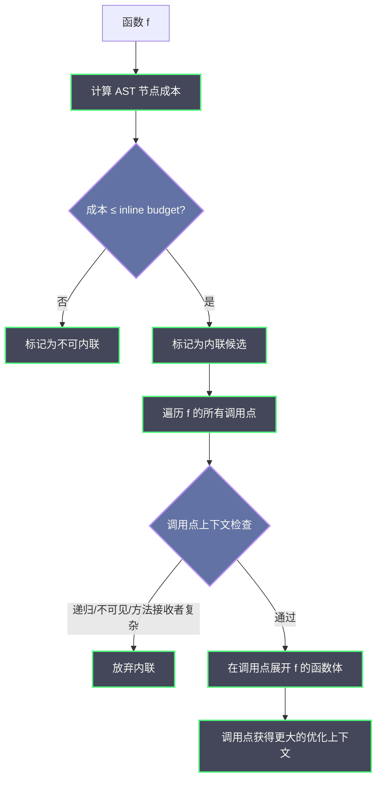

# 编译器 SSA 优化深潜——逃逸分析、内联预算与去虚拟化

**摘要：**

Go 编译器并不是把源码"一步到位"翻译成机器码，而是在中间经历一条层次分明的优化流水线——先由语法分析器构造抽象语法树（AST），再由类型检查与 desugaring 得到较干净的前端中间表示（IR），最后进入以静态单赋值形式（Static Single Assignment，SSA）为核心的后端 pass 链。这条流水线上最关键的三个优化——逃逸分析（Escape Analysis）、函数内联（Function Inlining）、去虚拟化（Devirtualization）——分别回答了三个看似琐碎却深刻影响程序行为的问题：一个对象该分配在栈上还是堆上、一段函数调用是否值得被展开、一次接口方法调用是否真的必须动态派发。它们一个牵着内存分配器（参见 [[03 Go 内存分配器——mcache、mcentral 与 mheap]]）和 GC 的负担，一个牵着 CPU 缓存命中率与调用开销，一个牵着接口抽象的代价，合起来决定了"写出来的 Go 代码"与"跑出来的机器码"之间到底差了多少。

本文从 SSA 优化流水线的全貌出发，逐层剖析这三个核心 pass 的原理、判定条件与工程影响：逃逸分析一节会讲清"为什么取地址不一定导致逃逸"这一直觉反例，以及连接图（Connection Graph）如何把指针可达性变成可解的图论问题；内联一节会拆解 inline budget 的成本预算、mid-stack inlining 与 hot call 放宽的工程取舍，以及内联导致栈帧"消失"对 pprof 与 Delve 调试的连锁影响；去虚拟化一节则聚焦接口方法调用的编译期折叠条件及其边界。行文的目标不是把编译器源码抄一遍，而是让读者在读懂 `-gcflags="-m"` 输出的同时，建立起对"编译器做了/没做什么、为什么这样取舍"的稳定判断框架。

---

## 第 1 章 从 AST 到 SSA——一条被精心分层的流水线

### 1.1 为什么不直接把 AST 翻译成机器码

要理解 Go 编译器为什么需要 SSA，先回到一个最朴素的问题：为什么不直接把语法树翻译成机器码？

原因之一是抽象层错位。AST 直接反映源码结构——一个 `if` 是一个节点，一个 `for` 是另一个节点，变量在不同位置被赋值多次在 AST 里天然成立；但机器码关心的是寄存器、指令与跳转，它不认识"变量"，只认识"在某条指令上某个寄存器承载某个值"。把 AST 直接压成机器码，相当于让翻译官一边查字典一边写诗——每个句子都要重新处理一遍上下文，优化无从下手。

原因之二是优化可组合性。假设我们希望同时做"常量折叠""死代码消除""公共子表达式消除"三种优化，如果每种优化都直接操作 AST，两两之间会互相干扰、难以叠加；而如果能找到一种**所有优化都能共同操作的统一中间表示**，那么每种优化就变成一个独立的 pass，按顺序依次作用，前一个 pass 的输出恰好是后一个 pass 的输入——这就是编译器流水线（pipeline）思想的核心。

SSA 正是这种统一中间表示的主流选择。它最早在 1980 年代由 Cytron 等人提出，到 2000 年代已经被 GCC、LLVM、HotSpot JVM 等主流编译器普遍采用。Go 编译器在 1.7 版本（2016 年）完成了一次彻底的 rewrite，把原来的 Plan 9 风格汇编式后端替换为完整的 SSA 后端，自此所有机器相关代码生成都从 SSA 形态出发——这是 Go 编译器走向现代编译器架构的分水岭。

### 1.2 AST → IR → SSA：三阶段的职责切分

Go 编译器的整体流水线大致可以划分为三段：

1. **前端（Frontend）**：词法分析 + 语法分析 → AST；类型检查 + 导入解析 + 类型推导（含泛型实例化） → **类型化 AST（Typed AST）**。这个阶段的主要产物是完整的类型信息和作用域信息，但形态上仍然是树。
2. **中端（Mid-end）**：类型化 AST 被降格（lower）为一种相对干净的 IR——在 Go 编译器里这个 IR 仍然以函数为单位的节点图形式存在，随后立即转换为 **SSA 形态**。SSA 的核心约束是"每个变量只被赋值一次"——源语言中多次赋值的变量，会被拆成多个带下标的版本（`x₁`、`x₂`…），并通过 Φ（phi）函数在控制流汇合点合并。这个"只赋值一次"的约束看起来苛刻，但它让**使用-定义链（use-def chain）**变得显式，从而让数据流分析（data flow analysis）变得极其简单——这正是后续所有优化的前提。
3. **后端（Backend）**：在 SSA 上跑一连串**机器无关（machine-independent）pass**，再跑一连串**机器相关（machine-dependent）pass**，最后输出汇编。机器无关 pass 做所有 CPU 都一样的优化（死代码消除、常量传播、循环旋转）；机器相关 pass 做与指令集相关的"降级"（把抽象的 `Add64` 操作变成具体的 `ADDQ` 指令、做寄存器分配、做指令调度）。

值得注意的是，SSA 形态本身也有多种变体。Go 编译器使用的是**稠密 SSA（Dense SSA）**——每个基本块内的每个变量赋值都对应一个独立的 SSA 值，变量版本数量与基本块数量成正比。与之相对的是**稀疏 SSA（Sparse SSA）**，它通过在控制流图的"支配边界（dominance frontier）"插入 Φ 函数来减少版本数量。Go 选择稠密 SSA 的原因是实现简单、pass 开发方便——代价是 SSA 图规模更大，编译时间稍长。这种权衡在 Go 的早期版本（1.7–1.10）是合理的，因为编译器团队需要快速迭代优化算法；随着编译器成熟，未来是否会迁移到稀疏 SSA 仍然是开放问题。

用一张图来表达这条流水线：


### 1.3 `GOSSAFUNC`：让优化过程可视化

要真正理解这条流水线，最直观的办法不是读源码，而是让编译器把每一步 pass 之后的 SSA 状态 dump 出来。Go 编译器提供了两个关键的环境变量：

- `GOSSAFUNC=FuncName`：对指定函数 dump 整个 SSA 构建与优化过程，生成一个名为 `f.html` 的 HTML 文件，里面按 pass 顺序给出每一步的 SSA 形态，并把每一步"变化了的部分"高亮出来。
- `GOSSADIR=dir`：指定 dump 文件的输出目录（默认是当前目录）。

打开这个 HTML 文件，读者会看到一列列的 SSA 值——每一列对应一个 pass，每一行对应一个 SSA 值（value），值的颜色代表它在这一步是否被修改。这种可视化是学习 SSA 的捷径，因为你可以**看到一个具体的优化（譬如死代码消除）到底删掉了哪些值、保留了哪些值**，而不只是听人转述。

一个最小例子：

```go
package main

func add(a, b int) int {
    return a + b
}

func main() {
    println(add(1, 2))
}
```

执行 `GOSSAFUNC=add go build -o /dev/null .` 后，在生成的 `f.html` 里，读者会看到 `add` 函数在最初被构造为包含 `Arg`、`Phi`、`Add64`、`Ret` 几个基本 SSA 值，随后经过 `nilcheck`、`deadcode`、`schedule`、`regalloc` 等 pass 的逐步改写，最终变成一条线性的、可以直接生成汇编的指令序列。

> [!info] 关于 Φ 函数的直觉
> 读者第一次看 SSA 最容易卡在 Φ 函数上。把它想象成一个"路口合并信号灯"——两条分支道路各驶来一辆车（两个不同版本的 `x`），在路口汇合时，信号灯（Φ）根据"你从哪条路来"决定放行哪一辆。它的语义**不是计算**，而是**选择**；在控制流图上，Φ 函数总是出现在基本块（basic block）的入口，用来合并来自不同前驱的值。

用一个具体的例子来感受 SSA 形态。考虑下面这段 Go 代码：

```go
func max(a, b int) int {
    var m int
    if a > b {
        m = a
    } else {
        m = b
    }
    return m
}
```

在源码里，`m` 被赋值了两次——一次在 `if` 分支，一次在 `else` 分支。但 SSA 要求每个变量只被赋值一次，因此编译器会把 `m` 拆成两个版本：`m₁`（来自 if 分支）和 `m₂`（来自 else 分支）。在 `if` 和 `else` 汇合的那个基本块入口处，必须放一个 Φ 函数：

```
b1:                         // if 分支
    m₁ = a
    goto b3

b2:                         // else 分支
    m₂ = b
    goto b3

b3:                         // 汇合点
    m₃ = Φ(m₁, m₂)         // 根据"从哪个前驱来"选择值
    return m₃
```

这里 `m₃` 既不是 `m₁` 也不是 `m₂`，而是"根据控制流选择 m₁ 或 m₂ 的那个值"。Φ 函数的参数个数等于前驱基本块的数量——b3 有两个前驱（b1 和 b2），所以 Φ 有两个参数。这个形式看起来啰嗦，但它的价值在后续的 pass 中才会显现：当编译器要做常量传播时，如果 `a` 和 `b` 都是常量，`Φ` 的两个参数也都是常量，整个链条就可以被折叠成一个常量；如果要做死代码消除，一个没被使用的 `m₃` 可以整条链删除。SSA 形态让这类优化可以"局部地、确定地"进行，而不需要像 AST 阶段那样反复遍历。

另一个值得注意的细节是**控制流图的边界**。SSA 的操作单位不是源码行，而是**基本块（Basic Block）**——一段没有分支、没有跳转的直线指令序列。一个函数被划分成多少个基本块，取决于 `if`、`for`、`switch`、`goto` 的数量。基本块越多，Φ 函数越多，优化空间也越大（但编译时间也越长）。Go 编译器在 `looprotate` pass 中会重新组织基本块的结构，目的之一就是让后续的 `cse` 和 `deadcode` 有更大的作用范围。

### 1.4 机器无关 pass 与机器相关 pass 的分工

Go 编译器在 SSA 阶段跑的 pass 有数十个，按照职责可以粗略分为两类：

**机器无关 pass**（与目标 CPU 无关，所有平台共享）——主要包括：

| Pass | 职责 |
|---|---|
| `instcombine` | 指令合并，把连续的简单操作合并成单一操作 |
| `deadcode` | 死代码消除，删除不可达或无用的 SSA 值 |
| `nilcheck` | 显式插入空指针检查，并裁剪冗余检查 |
| `copyelim` | 拷贝消除，把 `x = copy(y)` 形式的值直接替换 |
| `looprotate` | 循环旋转，把 `for` 循环改写成"首遍执行 + 条件判断"形式，利于后续优化 |
| `cse` | 公共子表达式消除（Common Subexpression Elimination） |
| `sched` | 指令调度（schedule），给 SSA 值排一个执行顺序，让后续寄存器分配更优 |

**机器相关 pass**（依赖目标架构）——主要包括：

| Pass | 职责 |
|---|---|
| `lower` | 把抽象 SSA 操作降级为具体指令（譬如 `Add64` → `AMD64ADDQ`） |
| `softfloat` | 在没有硬件浮点的平台上把浮点操作改写为软件实现 |
| `regalloc` | 寄存器分配，把 SSA 值分配到有限的物理寄存器上，是后端最复杂的 pass |
| `schedule` | 指令重排，最大化 CPU 流水线利用率，减少数据冒险 |
| `layout` | 基本块布局，优化分支预测命中率，把热路径放在连续内存 |

寄存器分配（`regalloc`）是整个后端最复杂、也最影响性能的 pass。它的目标是把无限多的 SSA 值映射到有限多的物理寄存器（AMD64 只有 16 个通用寄存器）上，同时最小化"溢出（spill）"到栈上的次数。Go 编译器使用的是 **linear scan** 算法——一种贪心策略，按 SSA 值的"活跃区间（live range）"排序，依次分配寄存器，区间冲突时把最晚使用的值溢出到栈。这种算法比最优的图着色算法快得多，但质量稍逊——这也是为什么某些复杂函数在 Go 里的性能不如预期：寄存器不够用，频繁溢出到栈，内存访问拖慢了执行速度。

> [!note] 设计取舍：为什么把优化分这么多 pass
> 把优化拆成众多小 pass，是一种典型的"正交分解"思路——每个 pass 只负责一件事，彼此通过 SSA 形态解耦。代价是编译器运行时间变长（每个 pass 都要遍历整张 SSA 图），收益是**每个 pass 都可以独立验证、独立替换、独立开关**。Go 编译器在早期（1.7–1.10）频繁调整 pass 顺序、替换具体算法，正是依赖这种结构才得以快速迭代；如果所有优化揉在一起，任何调整都是全局手术。

---

## 第 2 章 逃逸分析——对象该死在哪里

### 2.1 为什么要问"对象该死在哪里"

Go 程序员听到"堆"与"栈"，第一反应往往是性能差异：栈分配几乎零成本（移动栈指针即可），堆分配要走内存分配器（参见 [[03 Go 内存分配器——mcache、mcentral 与 mheap]]）、还要被 GC 扫描回收。但逃逸分析的意义不止于性能——它决定了**谁负责回收**：栈上的对象随函数返回自动消失，堆上的对象必须等 GC 来回收。一个原本可以留在栈上的对象被错误地判为"逃逸到堆"，不仅多了一次分配开销，还会增加 GC 的工作量，并在高并发场景下放大 `mcache`/`mcentral` 的补货压力。

所以逃逸分析要回答的核心问题是：**一个对象的引用，是否会逃出它被创建的那个函数的生命周期？**如果会，它必须放在堆上；如果不会，就可以安心留在栈上。

"逃逸"的常见触发场景包括：

- 函数返回指针（`return &x`）
- 把引用赋给全局变量、包级变量
- 把引用放进接口值（接口的底层 `data` 字段需要承载指针，参见 [[Golang/Go语言核心/10 接口的实现原理——iface、eface 与鸭子类型]]）
- 把引用传给另一个函数，而那个函数会让它逃逸
- 把引用发送到 channel
- 闭包捕获的变量（闭包的生命周期可能长于创建它的函数）
- 对象大小超过栈帧限制（默认单个栈帧最大约 4KB，超过的对象即使不"逃出"也必须放堆上）

### 2.2 连接图分析：把"是否逃逸"变成图论问题

Go 编译器的逃逸分析采用了一种叫**连接图（Connection Graph）**的算法。这种算法最早由 Choi 等人在 1993 年提出，核心思想是把函数内所有指针的指向关系抽象成一张图，然后通过图的可达性（reachability）来判定哪些指针"可能指向一个逃逸的对象"。

图中的节点分三类：

- **对象节点（Object Node）**：每个 `new`、`&T{}`、闭包字面量等分配操作对应一个对象节点。
- **指针节点（Pointer Node）**：每个指针类型的变量、参数、字段对应一个指针节点。
- **调用节点（Call Node）**：每次函数调用对应一个调用节点，用来描述"这个调用可能返回什么、可能修改什么"。

图中的边也分几类，最关键的是**指向边（Points-To Edge）**和**赋值边（Assignment Edge）**。指针节点通过指向边连到对象节点，表示"这个指针可能指向这个对象"；指针节点之间通过赋值边相连，表示"这两个指针的值会互相传递"。

构造完图之后，算法会先标记一些"显然逃逸"的对象节点为 **GloballyEscaped**（譬如被返回、被赋给全局变量、被发送到 channel），然后沿边做传递闭包——**任何与 GloballyEscaped 节点连通的指针节点所指向的对象，也都视为逃逸**。最终，所有没有被标记逃逸的对象节点，就是可以安全放在栈上的对象。

用一个具体的例子演示连接图的构建过程。考虑：

```go
func build() *Item {
    a := &Item{name: "x"}  // 创建对象节点 O_a，指针节点 P_a，边 P_a → O_a
    b := a                  // 创建指针节点 P_b，边 P_b → P_a（赋值边）
    return b                // b 被返回，P_b 被标记为逃逸
}
```

在这个函数里：

1. `&Item{name: "x"}` 创建一个对象节点 `O_a` 和指针节点 `P_a`，加一条从 `P_a` 到 `O_a` 的指向边。
2. `b := a` 创建指针节点 `P_b`，加一条从 `P_b` 到 `P_a` 的赋值边（因为 `b` 的值来自 `a`）。
3. `return b` 触发逃逸：指针节点 `P_b` 的"流出方向"是函数返回值，被标记为 GloballyEscaped。
4. 传递闭包：`P_b` 逃逸 → `P_a`（通过赋值边可达）逃逸 → `O_a`（通过指向边可达）逃逸。

因此 `O_a` 必须分配到堆上——这就是 `go build -gcflags="-m"` 会报告 "moved to heap: a" 的原因。

再看一个**不逃逸**的例子：

```go
func useLocally() int {
    a := &Item{name: "x"}  // 对象节点 O_a，指针节点 P_a
    b := a                  // 指针节点 P_b → P_a
    return b.value          // 只读取字段，不传出 b 本身
}
```

这里 `b.value` 只是读取操作，指针 `b` 本身没有传出函数。在连接图里，`P_b` 没有触发任何"流向函数外"的边，因此 `O_a` 不会被标记逃逸——可以安心放在栈上。这个例子说明**指针在函数内被传递、被解引用，都不构成逃逸，逃逸的判定依据是"指针值是否离开函数作用域"**。

Go 编译器对连接图的精度在过去几个版本持续提升。Go 1.13 引入了**字段敏感（field-sensitive）**的逃逸分析——在此之前，只要结构体里有一个字段的指针逃逸，整个结构体都被视为逃逸；Go 1.13 之后，编译器会区分不同字段的指针流向，只有真正逃逸的字段才会触发堆分配。这一改进在大量使用复合结构体的代码（譬如 `net/http.Request`、`encoding/json.Encoder`）上带来了可观的栈分配比例提升。

这种方法的精妙之处在于，它把看似主观的"会不会逃出生命周期"变成了一个**纯粹的图可达性问题**——有成熟算法、可判定、可优化（稀疏图传递闭包可以用 union-find 做到几乎线性时间）。

### 2.3 为什么"取地址"不一定逃逸

很多 Go 开发者有一条经验法则："凡是对变量取地址 `&x`，就会逃逸到堆。"这是错的。

更精确的规则是：**取地址只是把变量变成指针节点的起点；只有当这个指针节点的指向信息被传递到函数之外（或无法静态判定范围）时，对象才真正逃逸。**

来看几个例子：

```go
// 例 1：取地址但不逃逸
func localPtr() int {
    x := 42
    p := &x      // 取地址，但 p 只在本函数内使用
    return *p    // p 没有逃出
}

// 例 2：取地址且逃逸
func globalPtr() {
    x := 42
    p := &x
    globalP = p  // 赋给全局变量，逃逸
}

// 例 3：取地址且逃逸（返回指针）
func returnPtr() *int {
    x := 42
    return &x    // 直接返回，逃逸
}
```

例 1 在连接图中：`&x` 创建一个指针节点 `p`，`p` 指向对象节点 `x`。由于 `p` 没有被传出函数，`x` 对应的对象节点没有被标记逃逸，因此可以放在栈上。用 `go build -gcflags="-m"` 验证，会看到**没有任何关于 `x` 的逃逸提示**。

这个优化在工程上的意义非常大——**Go 鼓励你用指针传参以避免拷贝，但不必担心因此被迫堆分配**，只要指针不逃出函数，栈分配仍然是默认选择。这也是为什么在标准库里大量看到 `func (s *Server) Start()` 这样的接收者——接收者用指针是为了避免拷贝 `Server` 结构体，而不是为了让它逃逸。

### 2.4 四类让编译器被迫逃逸的场景

尽管"取地址不必然逃逸"是正确直觉，但以下四类场景几乎必然触发逃逸，需要开发者心中有数：

**第一类：接口赋值**。Go 的接口底层由 `itab`（方法表）+ `data`（数据指针）两个字段组成（参见 [[Golang/Go语言核心/10 接口的实现原理——iface、eface 与鸭子类型]]）。当一个值被赋给 `interface{}` 或任意接口类型时，即使这个值原本是值类型，也必须被"装箱"——编译器会在堆上分配一份副本，把指针放进 `data` 字段。

```go
var x int = 42
var i interface{} = x  // x 被装箱到堆
```

这就是为什么大量使用 `interface{}` 或 `any` 的代码往往 GC 压力更大——**每一个装箱都在制造堆对象**。Go 编译器近年来对小对象（通常 ≤ 4 个字节的基本类型）做了"栈上装箱"的优化，但大对象和复合类型仍然走堆。

**第二类：闭包捕获**。闭包（匿名函数引用外层变量）的生命周期由运行时管理——当闭包被当作值传递、存储、或作为 goroutine 启动时，它引用的外层变量可能活得比外层函数更长，因此必须逃逸到堆。Go 编译器对闭包的判定相对保守：**只要变量被闭包引用，且闭包本身可能逃出，变量就逃逸**。

**第三类：返回指针**。`return &x` 是最直白的逃逸场景。这里没有歧义——函数的返回值要交给调用方，调用方的生命周期显式长于被调用函数的栈帧。

**第四类：栈大小溢出**。即使对象完全本地、没有任何指针传出，如果对象本身太大（超过栈帧上限，Go 1.17 之后单个函数栈帧通常限制在约 4KB），编译器也会把它分配到堆上。这是因为栈帧太大一方面会浪费栈空间，另一方面会让栈分裂（stack splitting）逻辑变得复杂。

来看一个栈大小溢出触发逃逸的具体例子：

```go
func processLargeBuffer() {
    // 假设 8KB 的数组超过栈帧限制
    var buf [8192]byte
    // 即使 buf 只在函数内使用，也可能被分配到堆上
    for i := range buf {
        buf[i] = byte(i)
    }
    // ... 使用 buf
}
```

这个例子里 `buf` 没有逃逸到函数外，但由于体积过大，编译器会选择把它分配到堆上。用 `-gcflags="-m"` 验证，会看到 "moved to heap: buf" 的输出——这不是因为"逃逸"，而是因为"太大不适合栈"。

**第五类：通过 `fmt.Printf` 等变参函数传递**。`fmt.Printf` 的签名是 `func Printf(format string, a ...interface{}) (n int, err error)`，第二个参数是 `...interface{}`。当你写 `fmt.Printf("value: %d", x)` 时，`x` 会被装箱进 `interface{}`，触发堆分配。这就是为什么在高吞吐量的日志或监控代码中，频繁使用 `fmt.Printf` 会带来显著的 GC 压力——**每一次格式化都在制造堆对象**。

Go 1.20 之后，编译器对 `fmt.Printf` 这类常用函数做了特殊优化——如果格式化字符串是常量且参数类型简单，编译器会把 `fmt.Printf` 调用展开为更高效的专用代码路径，避免接口装箱。但这种优化只覆盖有限的模式，复杂的格式化仍然走通用路径。

> [!warning] 常见误区：把"逃逸到堆"等同于"写错了代码"
> 逃逸分析的输出常常被当作性能诊断的判据——看到 `moved to heap` 就认为必须优化。这是过度反应。很多堆分配是合理的（譬如长生命周期的数据结构、跨 goroutine 传递的对象），编译器判定的逃逸并不总是"问题"，它只是告诉你"这个对象必须走堆分配路径"。真正要优化的，是那些在**热路径（hot path）**上反复发生、且本可以留在栈上的逃逸。

### 2.5 `-gcflags="-m"` 输出解读

`go build -gcflags="-m"` 是查看逃逸分析结果的标准入口。`-m` 的级别从 0 到 2（`-m -m` 更详细），输出里会标注每个逃逸点的原因，譬如：

```
$ go build -gcflags="-m" main.go
# command-line-arguments
./main.go:10:6: moved to heap: x
./main.go:11:9: &y escapes to heap:
    0: from *interface{}(heap) (non-contiguous) at main.go:11
    1: from interface{}(heap) (assigned) at main.go:11
./main.go:15:2: moved to heap: buf
```

输出的几个关键模式：

- `moved to heap: x`——`x` 被分配到堆上，通常是"取地址后传给无法静态分析的地方"。
- `escapes to heap`——更详细的报告，给出逃逸的"路径"（从哪个变量、经过哪一步赋值、最终到了哪里）。
- `can inline funcName`——函数满足内联条件（参见第 3 章）。
- `leaking param: p to result`——函数参数 `p` 逃逸到了返回值，意味着调用方传入的指针对象会被返回，因此调用方必须把它当堆对象对待。

`-m=2` 会输出连接图的构造过程，适合学习算法本身；日常开发用 `-m` 即可。

> [!note] 工程实践：把 `-m` 接入 CI 作为回归守护
> 对于性能敏感的模块，可以在 CI 里跑一次 `go build -gcflags="-m"` 并把输出存为 baseline，每次 PR 对比新增的逃逸点。这不是要追求"零逃逸"，而是要让**关键路径上的逃逸变化可见**——任何新增的堆分配都应当是经过审查的权衡，而非无意识的退化。

---

## 第 3 章 函数内联——用空间买时间

### 3.1 内联的直觉与代价

函数调用不是免费的。即使在 Go 这样把调用开销压得很低的语言里，一次函数调用仍然意味着：保存当前寄存器到栈、压栈参数、跳转到函数入口、在函数内再次读取参数、返回、恢复寄存器。对于一条只有几条指令的小函数（譬如一个简单的 getter、一个判空包装），**调用本身的开销可能比函数体还大**。

函数内联（Function Inlining）就是为了解决这个问题：把被调用函数的函数体直接"粘贴"到调用点，消除调用开销。除了减少调用本身的成本，内联还有一个更深远的好处——**让后续的优化看到更大的上下文**。一个 `if` 判断被内联进调用方之后，常量折叠、死代码消除就能基于这个更宽的视野做决策，往往能产生二次优化的连锁效应。

但内联不是免费的午餐。每一次内联都让目标函数的代码被复制一份到调用点，这意味着：

- **二进制体积膨胀**。一个被调用 100 次的函数如果全部内联，它的代码会在二进制里出现 100 份。
- **指令缓存压力**。代码段变大后，L1/L2 指令缓存的命中率下降，在极端场景下反而比"调用一次"更慢。
- **编译时间增加**。内联会让 SSA 图膨胀，后续 pass 的处理量也随之增加。

所以内联优化要回答的核心问题是：**在什么条件下，内联的收益大于代价？**这个问题在 Go 编译器里通过一套"成本预算（inline budget）"模型来回答。

### 3.2 内联预算：用节点数衡量"值不值"

Go 编译器为每个函数计算一个"内联成本（inline cost）"，计算方式是**遍历函数体的 AST 节点并累加权重**——每个节点根据其类型被赋予一个基础成本，譬如：

- 简单的赋值、return、字面量：成本较低（约 1）
- 二元运算、一元运算：成本较低
- 字段访问（`x.f`）：成本较低
- 函数调用（`f(...)`）：成本较高（约 4-7，取决于参数个数）
- `select`、`switch`、`for` 等控制流：成本显著
- `defer`、`recover`、`panic`：成本极高
- `go func()`（开启 goroutine）：成本极高

计算完成后，编译器把这个成本与当前的 **inline budget** 比较——只有成本不超过 budget 的函数，才被认为是"内联候选"。

Go 的 inline budget 在不同版本间有调整。在早期版本（Go 1.17 之前）默认预算较小（约 40 个节点单位），因此只有非常简单的小函数能被内联；从 Go 1.18 开始，**mid-stack inlining** 逐步放开，默认预算提升到约 80 个节点单位，允许中等复杂度的函数在调用链较浅时被内联。

用一个具体的函数来感受成本计算：

```go
func addAndDouble(a, b int) int {
    sum := a + b        // 二元运算，成本约 1
    doubled := sum * 2  // 二元运算，成本约 1
    return doubled      // return 语句，成本约 1
}
```

这个函数总共 3 个 AST 节点贡献成本（粗略估计），远低于默认的 80 单位预算——所以它**几乎一定会被内联**。用 `go build -gcflags="-m"` 验证，会看到 "can inline addAndDouble" 的输出。

再看一个接近边界的例子：

```go
func process(x *Data) error {
    if x == nil {                        // if 判断，成本约 1
        return errors.New("nil")         // 函数调用，成本约 4-7
    }
    y := x.Normalize()                   // 方法调用，成本约 4-7
    if y.Flag {                          // if 判断，成本约 1
        y.Transform()                    // 方法调用，成本约 4-7
    }
    return y.Validate()                  // 方法调用，成本约 4-7
}
```

这个函数有多个方法调用（每个成本 4-7）加上控制流（每个成本 1），总成本很容易超过 80——**大概率不会被内联**。这就是为什么 `process` 类函数在性能剖析中往往表现为"调用开销可见"，而 `addAndDouble` 类函数则"消失"在调用方的机器码里。

开发者可以通过 `go build -gcflags="-m=2"` 查看每个函数的详细成本计算过程，包括每个 AST 节点的权重贡献。这对定位"为什么这个函数没被内联"很有帮助。



### 3.3 hot call 放宽与 mid-stack inlining

Go 编译器并不是用一把尺子量所有函数——它会**根据调用点的频次和上下文动态调整预算**。这就是所谓的 **hot call 放宽**：

- 如果一个函数体虽然稍大，但它的调用点处于"热路径"（可以通过 profile feedback 或启发式判定），编译器会**放宽 inline budget**，允许更大的函数被内联到该点。
- 反过来，如果一个函数的调用点很多，但大多数调用点不在热路径上，编译器会倾向于**不内联**以避免二进制膨胀。

**mid-stack inlining** 是 Go 1.9 引入的另一个重要放宽——在此之前，只有"叶子函数"（不调用其他函数的函数）才能被内联；mid-stack inlining 允许一个函数内联另一个函数，被内联的函数体里又包含另一个被内联的函数，形成**多层嵌套的内联链**。这意味着：

```go
func inner() int { return 42 }
func middle() int { return inner() + 1 }
func outer() int { return middle() * 2 }
```

在 mid-stack inlining 下，`outer` 调用 `middle` 时，`middle` 可能被内联；而 `middle` 内联后的函数体里又调用了 `inner`，`inner` 也可能继续被内联。最终 `outer` 的实际机器码里**可能完全没有函数调用**，三段逻辑合并成几条算术指令。

mid-stack inlining 的实现细节值得展开。当编译器决定内联 `middle` 到 `outer` 的调用点时，它会把 `middle` 的整个函数体（包括 `middle` 对 `inner` 的调用）复制进 `outer`。然后编译器会**重新分析内联后的代码**，发现 `inner()` 调用现在位于 `outer` 的函数体内，于是再次检查 `inner` 是否满足内联条件。如果满足，继续内联。这个过程会一直进行，直到：

1. 剩余预算不足以支持下一层内联；
2. 下一层函数本身不满足内联条件（譬如包含 `defer`、`go`、`recover`）；
3. 检测到递归（A 调用 B，B 调用 A——这种情况下内联会无限展开）。

Go 编译器对递归内联有严格的保护机制——即使两个函数都很小，只要存在循环调用关系，就**不会**内联。这是因为递归内联会让代码膨胀失控，而且递归的本质是"调用自身"，内联后仍然需要保留跳转逻辑，收益有限。

> [!info] 概念限定：mid-stack inlining 不等于无限制
> mid-stack inlining 仍然受预算约束——每一层内联都会消耗调用点的预算，内联链越深、剩余预算越少。所以它不是"所有函数都能互相内联"，而是"在预算允许的范围内，允许内联链延伸"。实测中，两层内联很常见，三层以上就依赖函数足够小。

### 3.4 `//go:noinline`：什么时候要主动拒绝内联

既然内联通常是好事，为什么会有 `//go:noinline` 这个编译指令？

因为内联有几个副作用在特定场景下是不受欢迎的：

1. **基准测试的失真**。如果一个函数被内联，调用点的性能表现就不再反映这个函数本身的成本——基准测试测到的其实是"内联后的融合体"。如果基准测试的目的是衡量函数本身的性能，需要用 `//go:noinline` 阻止内联。
2. **stack trace 的可读性**。内联的函数仍然会以"inlined frame"的形式出现在 stack trace 和 pprof 里（Go 1.10 之后通过 DWARF 信息恢复），但在某些边界情况下（譬如 panic 路径、signal handler），inlined frame 的恢复不一定完整，会给排查带来困扰。
3. **链接符号的大小**。`go:noinline` 强制函数保留独立的符号（symbol），在某些需要精确控制二进制布局的场景下（譬如 `go:linkname` 跨包调用、汇编互操作）是必需的。

```go
//go:noinline
func expensiveHelper(x int) int {
    // ...
}
```

### 3.5 内联对 pprof 与调试的连锁影响

内联让"源码里的函数"与"二进制里的函数"之间不再一一对应，这给调试和性能剖析带来了实质影响：

- **pprof CPU profile**。Go 的 CPU 剖析基于采样——每 10ms 记录一次 PC（程序计数器）。PC 落在一个被内联展开的代码块里时，pprof 会通过 DWARF 的 inline 信息把 PC 还原成**一串 inlined frame**，让用户看到的仍然是源码里那几层函数的名字。这是 Go 1.10 引入的重要改进——在此之前，被内联的函数在 pprof 里会"消失"，让调用栈看起来莫名其妙少了几层。
- **Delve 调试**。Delve 同样依赖 DWARF inline 信息，让用户可以 step into 一个被内联的函数，看到源码里对应的局部变量。但这种"还原"并不完美——**内联函数的变量在寄存器被复用后可能无法显示**，或者 step 的行号偶尔会跳跃。这是内联优化与调试友好性之间的固有权衡。
- **stack 大小估算**。内联让原本多个栈帧合并为一个，**实际栈帧比源码看起来的调用深度更浅**——这是好事，因为减少了栈分裂的概率；但也意味着你不能通过源码里的调用深度来准确预测栈的使用量。

来看一个具体的 pprof 诊断场景。假设你有一个 HTTP 服务器，pprof 火焰图显示 `handleRequest` 函数占据了 80% 的 CPU 时间，但它的子调用只有 `parseRequest` 和 `writeResponse` 两个。然而源码里 `handleRequest` 还调用了 `validateInput`、`authenticate`、`authorize`、`logAccess` 等多个函数——这些函数去哪了？

答案是它们都被内联进了 `handleRequest`。pprof 通过 DWARF 的 inline 信息把这些函数"还原"成 inlined frame，所以在火焰图里它们显示为 `handleRequest` 的子调用。但如果你用 `go tool pprof -no_inlines` 关闭 inline 还原，会看到 `handleRequest` 的物理调用栈确实只有两层——所有被内联的函数在物理栈帧上"消失"了。

这种"消失"在大多数情况下是透明的——DWARF 信息让调试器和剖析工具能够还原源码视图。但在某些边界情况下（譬如使用 `runtime.Caller` 获取调用栈、通过 `reflect` 动态检查函数信息、或者在 signal handler 里收集 stack trace），inlined frame 的恢复可能不完整或不可用。这时候你需要意识到：**源码里的函数调用关系与二进制里的物理调用关系不是一一对应的**——内联让它们产生了偏差。

> [!warning] 生产避坑：pprof 里"看不到"的函数未必没执行
> 如果 pprof 火焰图里某条调用链的中间几层"凭空消失"，不要惊慌——这通常是被内联的函数正在工作，DWARF 信息暂时没被正确解析（常见于老版本 pprof 或未带调试信息的二进制）。用 `go tool pprof -no_inlines` 可以关闭 inline 信息还原，直接看物理调用栈，用于对比诊断。

内联的另一个副作用是**错误堆栈的变化**。当 panic 发生时，runtime 会收集当前 goroutine 的调用栈。如果被内联的函数里发生了 panic，堆栈里仍然会显示这个函数的名字（通过 DWARF inline 信息还原），但行号可能与源码不完全对应——因为内联后的代码位置与源码位置存在偏移。这种偏移在大多数情况下不影响定位问题，但在精确调试（譬如区分"两个相似的内联调用点"）时可能带来困扰。Go 1.13 之后引入了更精确的 inline 信息编码，显著改善了这种情况，但历史版本的二进制仍然可能存在这个问题。

---

## 第 4 章 去虚拟化——接口的编译期魔法

### 4.1 接口调用的代价

Go 的接口是语言最优雅的特性之一——鸭子类型、依赖倒置、测试可替换，几乎所有设计模式都建立在接口之上。但接口调用不是零成本的。

当一个方法通过接口被调用（`iface.Method(x)`），运行时必须：

1. 从 `iface` 的 `itab` 字段读取方法表。
2. 根据方法在接口定义中的索引，从方法表中取出对应的函数指针。
3. 通过该指针跳转执行。

这三步在 CPU 层面意味着**至少一次额外的内存读取（读 itab）和一次间接跳转（indirect jump）**——间接跳转对 CPU 的分支预测器非常不友好，因为预测器依赖"跳转目标的地址模式"来学习，而间接跳转的目标在每次调用时可能不同。现代 CPU 虽然有"间接分支预测器"，但在多态调用（同一个调用点实际类型在变化）场景下准确率显著下降。

所以，**能在编译期把接口调用替换为直接调用，是极有价值的优化**——这就是去虚拟化（Devirtualization）。

### 4.2 去虚拟化的条件

Go 编译器能做的去虚拟化是相对保守的——它只在能**静态证明**接口调用的实际类型时，才会把间接调用替换为直接调用。典型的条件包括：

**条件一：接口值由具体类型字面量直接构造**。

```go
var r io.Reader = strings.NewReader("hello")
data, _ := io.ReadAll(r)  // ReadAll 内部调用 r.Read
```

如果 `r` 在整个作用域内类型信息可以被编译器追踪（没有经过 `interface{}` 中转、没有被函数返回的接口值覆盖），编译器在优化阶段可能识别出 `r.Read` 实际上就是 `(*strings.Reader).Read`，从而把间接调用替换为直接调用。

这个优化的前提是**类型信息的局部可见性**——编译器必须能在调用点确定 `r` 的具体类型。一旦 `r` 被赋值给另一个接口变量、被传给一个接受 `io.Reader` 参数的函数、或者被放进 `[]io.Reader` 切片，类型信息就会"丢失"（从编译器的静态分析视角），去虚拟化也就无法进行。

来看一个更复杂的例子，展示去虚拟化的边界：

```go
func example() {
    // 场景 1：去虚拟化成功
    var r1 io.Reader = strings.NewReader("hello")
    r1.Read(buf)  // 编译器可能优化为直接调用 (*strings.Reader).Read

    // 场景 2：去虚拟化失败
    var r2 io.Reader = strings.NewReader("world")
    passToFunc(r2)  // r2 被传给函数，类型信息丢失
}

func passToFunc(r io.Reader) {
    r.Read(buf)  // 必须是间接调用，无法去虚拟化
}
```

在场景 1 中，`r1` 的类型在 `example` 函数内全程可见，编译器可以做去虚拟化。在场景 2 中，`r2` 被传给 `passToFunc`，在 `passToFunc` 内部 `r` 的类型未知——即使调用方传入的具体类型是 `*strings.Reader`，被调用方的编译单元里无法知道这一点（除非做跨模块链接期优化）。

**条件二：类型断言/类型 switch 已经收敛**。

```go
switch v := x.(type) {
case *bytes.Buffer:
    v.Write(...)   // 这里 x 已经是具体类型，无接口调用
case *strings.Builder:
    v.WriteString(...)
}
```

在类型 switch 的每个分支里，变量已经被编译器降格为具体类型，方法调用天然就是直接的——这不算严格的"去虚拟化"，但体现了同一类思想：**在类型信息最丰富的点做调用决议**。

**条件三：单实现可达**。在某些封闭的程序里，一个接口在链接时可被发现只有一个实现类型——链接时间优化（LTO，或 Go 的 `-buildmode=pie` 配合 linker plugin）可以做跨包的去虚拟化。Go 目前这方面的能力相对有限，但 linker plugin 已在部分场景下生效。

### 4.3 边界与反例：去虚拟化做不到什么

理解去虚拟化的边界同样重要——以下场景编译器**无法**做去虚拟化：

**场景一：接口值来自函数返回或外部输入**。

```go
func process(r io.Reader) {
    // r 的实际类型在编译期未知
    buf := make([]byte, 1024)
    r.Read(buf)  // 必须是间接调用
}
```

`process` 函数被独立编译，它的输入 `r` 可能是任何实现了 `io.Reader` 的类型——编译器在这里没有任何信息可以用来做去虚拟化。这是**抽象的代价**：你用接口换来多态，就必须支付间接调用。

**场景二：同一接口有多个实现且在运行时动态选择**。

```go
var r io.Reader
if cond {
    r = &bytes.Buffer{}
} else {
    r = &os.File{}
}
r.Read(buf)  // 两次可能的实现，必须保留间接调用
```

即使程序里只有两个实现，只要在调用点"到底是谁"无法在编译期确定，就必须走 itab 查找路径。

**场景三：接口值被放进集合、channel、或通过反射构造**。一旦接口的传递路径涉及动态结构或反射，编译器的静态分析链条就断了。

来看一个更微妙的例子，展示"看似可以优化但实际无法优化"的场景：

```go
type Reader interface {
    Read(p []byte) (n int, err error)
}

func processWithConcreteType() {
    // 这个函数的 r 类型在编译期已知
    var r Reader = &bytes.Buffer{}
    buf := make([]byte, 1024)
    r.Read(buf)  // 可能去虚拟化
}

func processWithDynamicType(cond bool) {
    var r Reader
    if cond {
        r = &bytes.Buffer{}
    } else {
        r = &strings.Reader{}
    }
    buf := make([]byte, 1024)
    r.Read(buf)  // 无法去虚拟化：调用点有两个可能的实现
}
```

在 `processWithConcreteType` 中，`r` 的类型在编译期完全确定（`*bytes.Buffer`），编译器可以做去虚拟化。在 `processWithDynamicType` 中，即使程序里只有两个实现，只要在调用点"到底是谁"无法在编译期确定，就必须走 itab 查找路径。

**场景四：接口方法通过函数指针调用**。即使你知道接口值的具体类型，如果方法调用是通过函数指针间接进行的（譬如把方法值存进变量），编译器也无法优化：

```go
func useMethodValue() {
    var r io.Reader = &bytes.Buffer{}
    readFn := r.Read  // 取方法值，底层是函数指针
    buf := make([]byte, 1024)
    readFn(buf)  // 间接调用，无法去虚拟化
}
```

这里 `readFn` 是一个函数值（function value），底层包含一个闭包环境指针和一个函数指针。即使 `r` 的类型已知，`readFn` 的调用仍然是间接的——因为函数值的本质就是"延迟决议"。

> [!note] 设计取舍：抽象 vs 性能
> 接口是 Go 最重要的抽象工具，去虚拟化只是一个"能省则省"的附加红利，而不是你可以依赖的性能保证。工程上的正确姿势是：**在 API 边界使用接口换取抽象，在热路径使用具体类型换取性能**——不要把"反正编译器会去虚拟化"当作写抽象代码的理由。

---

## 第 5 章 权衡与边界——三个 pass 的共同哲学

### 5.1 三个 pass 的共性：以静态分析换动态成本

逃逸分析、内联、去虚拟化，表面上处理的是不同的问题，但背后的哲学是同一套——**尽可能把运行时决策推到编译期，把动态成本转化为静态结构**。

- 逃逸分析把"这个对象要不要走堆"从运行时判断变成编译期判定。
- 内联把"这里要不要跳转到另一个函数"从运行时跳转变成编译期融合。
- 去虚拟化把"这个方法该调用哪个实现"从运行时查表变成编译期决议。

这种"编译期多做一点、运行时少做一点"的思路，是整个静态编译型语言的性能基石。它和 JVM、.NET 的 JIT 思路形成对照——后者在运行时通过 profiling 做更激进的去虚拟化与内联，换取对"运行期才确定"的场景的优化；Go 选择了静态编译路径，因此在静态可达范围内做到极致，但在动态场景下保留保守行为。

### 5.2 工程上的权衡清单

| 维度 | 激进策略 | 保守策略 | Go 的实际选择 |
|---|---|---|---|
| 内联预算 | 全部函数内联，指令缓存压力 | 只内联叶子函数，性能损失 | mid-stack inlining + 节点预算 |
| 逃逸判定 | 所有取地址视为逃逸 | 只允许字面量上栈 | 连接图分析，精细到字段级 |
| 去虚拟化 | 跨包链接期去虚拟化 | 完全不做 | 单函数内静态可达范围内 |
| 编译时间 | 优化越彻底编译越慢 | 几乎不优化 | 默认开 O（优化），提供 `-N` 关闭 |

### 5.3 对开发者的真实建议

1. **不要为了"避免逃逸"而扭曲代码结构**。逃逸分析的判定有明确规则，但优化收益往往不如把算法复杂度降一级来得显著。先让代码清晰，再在热路径上针对性优化。
2. **用 `-gcflags="-m"` 建立直觉，而不是建立焦虑**。读懂输出、知道哪些模块的堆分配是预期的，比追求"零逃逸"更有价值。
3. **基准测试里用 `//go:noinline` 控制变量**。如果你基准测试的是一个被高频内联的小函数，得到的数字其实是"内联融合体"的性能，不代表函数独立运行时的行为。
4. **接口抽象与性能不冲突，冲突的是放置位置**。API 边界、依赖注入点用接口；循环体内的调用、热路径上的方法分派用具体类型。
5. **升级 Go 版本往往是最便宜的性能优化**。Go 编译器的 SSA 优化在每个版本都在迭代（逃逸分析更精细、内联预算更合理、去虚拟化范围更大），**不改一行代码**就能拿到可观的性能收益——这是静态编译器路径的红利。
6. **理解内联对二进制大小的影响**。在嵌入式或 WebAssembly 场景下，二进制体积可能是硬约束。此时可以通过 `go build -ldflags="-s -w"` 剥离调试信息，或者在关键路径上使用 `//go:noinline` 控制哪些函数被内联，以平衡性能与体积。
7. **用 pprof 验证编译优化的实际效果**。理论上的"应该更快"不等于实际上的"确实更快"。CPU profile、内存 profile、分配 profile 三者结合，才能判断某次编译优化是否真的在生产负载下带来了收益。

### 5.4 结语

回到开篇的问题：Go 编译器在 SSA 阶段做了什么、没做什么？

它做了连接图分析、成本预算、单函数范围内的去虚拟化——这些优化的共同特点是**静态、保守、可预测**。它没做跨函数的激进逃逸传播、没做 profile-guided 的内联决策、没做跨包的广泛去虚拟化——这些是 JIT 路径和链接期优化的战场。

这种选择不是技术上的妥协，而是设计哲学的体现。Go 的核心用户是大型服务端项目，这些项目的特点是：编译时间敏感（频繁迭代）、二进制部署简单（静态链接）、运行时行为可预测（低延迟抖动）。SSA 优化流水线的每一个 pass 都在为这三个目标服务——**编译快**（pass 拆分、局部优化优先于全局优化）、**部署简单**（不依赖 JIT 运行时）、**行为可预测**（静态分析保证性能下限，而非依赖运行时 profiling 的概率性优化）。

与之形成对照的是 JVM 的 C2 编译器——它在运行时收集 profile，做激进的去虚拟化和内联，甚至会在运行过程中"反优化"（deoptimization）回退到解释执行。这种路径在长期运行的服务上性能上限更高，但代价是**启动慢、预热期长、行为不可预测**。Go 选择了另一条路：**编译期多做一点，运行时少做一点**——这是静态编译型语言的核心竞争力，也是它与动态编译型语言的根本分野。

由此可见，Go 编译器的优化哲学是"**在静态编译的约束下，把能做的做到极致，把不能做的留给开发者通过代码形态表达**"。没有银弹，也没有免费的午餐——每一次内联都在膨胀二进制，每一次去虚拟化都在收窄抽象，每一次逃逸判定都在划分栈与堆的疆界。理解这些 pass 的工作原理，不是为了迷信编译器，而是为了在它能力范围内与它合作，在它能力边界外保持清醒——**因地制宜地写出与编译器特性契合的代码**，才是工程上的正解。

未来 Go 编译器是否会引入 PGO（Profile-Guided Optimization）来突破静态分析的局限？Go 1.21 已经迈出了第一步——支持基于 CPU profile 的内联决策和 devirtualization。这条路能走多远，是否会改变 Go 编译器"静态优先"的底色，目前仍然言之尚早。但可以确定的是，**理解 SSA 优化流水线的工作原理**——无论未来怎么演进——都是读懂 Go 性能特性的必经之路。

---

## 参考资料

1. Go 语言官方文档：[Compiler SSA](https://go.googlesource.com/go/+/refs/heads/master/src/cmd/compile/internal/ssa) — SSA 后端源码与 pass 定义。
2. Cytron, R., et al. (1991). *Efficiently Computing Static Single Assignment Form and the Control Dependence Graph*. ACM TOPLAS — SSA 形态的奠基论文。
3. Choi, J.-D., et al. (1993). *Efficient Analysis of Pointer Escapes and Their Uses*. — 连接图分析算法的原始论文。
4. Go 语言官方文档：[GOSSAFUNC 与 SSA 可视化](https://go.dev/doc/asm) — 编译器调试环境变量说明。
5. 参见 [[Golang/Go工程实践/08 Go 编译与链接——从源码到二进制]] 对链接阶段与 linker plugin 的延伸讨论。
6. 参见 [[Golang/Go运行时进阶与底层机制/00 专栏导览|Go 运行时进阶与底层机制]] 专栏整体脉络。

---

> [!note] 思考题
> 1. 用 `go build -gcflags="-m"` 检查一个你熟悉的函数，找出其中所有的 `moved to heap` 输出，逐一判断哪些是"必要逃逸"、哪些是"可优化逃逸"。如果要优化后者，代码该如何改写？
> 2. 设计一个基准测试，比较"调用一个简单函数"vs"把该函数内联到调用点"的 CPU 开销差异。在什么调用频率下，内联的指令缓存压力开始抵消调用本身的节省？
> 3. 为什么 Go 编译器不对"接口值经过 `interface{}` 中转"的场景做去虚拟化？如果要做，需要什么额外信息？这种信息是编译期能获得的，还是必须靠运行时 profile？
> 4. 假设你在做一个低延迟服务，发现 pprof 火焰图里某些关键路径的调用栈"看起来不完整"——可能的原因是什么？如何验证是内联导致的 inlined frame 恢复问题，还是真正的逻辑 bug？
