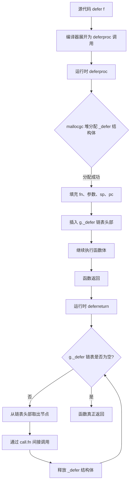
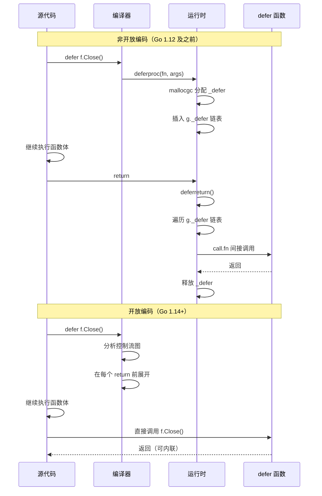

# defer 的演进史与编译优化——堆分配、栈分配到开放编码

**摘要：**

`defer` 是 Go 语言最具辨识度的语义之一，它以一行代码解决了 C 语言中需要多层 `goto` 和手动清理才能保证的资源释放问题，将"确定性清理"从程序员的记忆负担转化为语言层面的契约。然而这个优雅的抽象在编译器和运行时层面并非免费——Go 1.13 之前，每一条 `defer` 语句都需要一次堆分配来创建 `_defer` 结构体并将其插入当前 Goroutine 的 defer 链表，在高频调用的热路径上，这个开销曾经累积到足以影响 P99 延迟的量级。从 Go 1.13 的栈上分配（`deferprocStack`）到 Go 1.14 引入的开放编码（Open-coded defer），Go 团队用了两个版本将 `defer` 的运行时开销从 50 余纳秒压缩到不足 3 纳秒，完成了一次从"有代价的便利"到"几乎零成本的语义保证"的蜕变。本文沿着这条演进脉络，从 `_defer` 结构体的链表组织、`deferproc`/`deferreturn` 的运行时调用约定讲起，经过栈上分配的过渡方案，最终抵达开放编码的位图标记（`deferBits`）与内联寄存器执行机制，并逐一检视开放编码失效的边界条件——超过 8 个 `defer`、循环体内的 `defer`、不可静态判定的分支——以及在这些边界下编译器如何回退到运行时路径。文章同时厘清 `defer` 参数求值时机与具名返回值的交互规则，并与 [[Golang/Go语言核心/09 函数、闭包与 defer 的实现]] 形成分工——那一篇侧重语义与用法，本文侧重编译优化的演进机制与底层实现。

---

## 第 1 章 堆分配时代——`_defer` 结构体与链表插入的代价

### 1.1 从语义到运行时：`_defer` 结构体的诞生

要理解 `defer` 的性能故事，必须先理解编译器如何将一条 `defer f(args)` 语句转化为运行时可操作的数据结构。在 Go 1.13 之前的实现中，这条语句在运行时的身份是一个名为 `_defer` 的结构体，它记录了三类信息：要调用的函数指针、已求值的参数、以及归属的栈帧位置。

```go
// runtime2.go 中 _defer 结构体的简化版（Go 1.12 及之前）
type _defer struct {
    sp     uintptr  // 调用 defer 时的栈指针，用于识别归属的函数帧
    pc     uintptr  // 调用 defer 时的程序计数器
    fn     *funcval // 要延迟执行的函数
    _panic *_panic  // 触发此 defer 的 panic（如果有）
    link   *_defer  // 链表中下一个 defer，指向更早注册的 defer
    heap   bool     // 标记是否堆分配（Go 1.13 引入栈分配时新增）
}
```

这个结构体中 `link` 字段构成了 defer 链表的骨架——每次遇到 `defer` 语句，运行时从当前 Goroutine 的 `g._defer` 字段取出链表头，将新分配的 `_defer` 节点插入到链表头部（即栈顶方向），函数返回时再从头部依次弹出执行。这个"头插法"天然保证了 LIFO（后进先出）的执行顺序，后注册的 `defer` 先执行，符合资源释放的直觉。

不妨将这个 `_defer` 链表想象成餐厅的衣帽寄存处：客人进门时每存一件衣物，服务员就开一张寄存牌挂在钩子上，后挂的牌子靠近出口，取衣时自然从最近的钩子开始取——这就是 LIFO 的物理原型。不过问题在于，**每开一张寄存牌本身是有成本的**：在 Go 1.13 之前，这张"寄存牌"必须从堆上分配（`mallocgc`），而堆分配的代价远高于栈分配，因为它涉及内存分配器的竞争与潜在的 GC 压力。

### 1.2 `deferproc` 与 `deferreturn`：运行时函数调用的双重开销

编译器的处理策略分为两个阶段。在函数体内部遇到 `defer` 语句时，编译器并不直接生成 `defer f()` 的调用，而是将其展开为对运行时函数 `deferproc` 的调用——这个函数负责分配 `_defer` 结构体、填充函数指针与已求值的参数、并将节点插入链表。函数返回时，编译器在尾部插入对 `deferreturn` 的调用——这个函数负责遍历 defer 链表，依次弹出并执行每个节点记录的函数。

```go
// 编译器对 defer 语句的展开（概念性伪代码）
// 源码：defer f(x, y)
// 编译器生成：
x_temp := x          // defer 注册时立即求值
y_temp := y
deferproc(0, &x_temp, &y_temp)  // 0 表示参数占用字节数（实际按 ABI 计算）

// 函数返回时编译器插入：
deferreturn()  // 遍历 g._defer 链表，依次执行
```

这两次运行时函数调用本身就构成了开销——`deferproc` 内部需要做堆分配（`newdefer`）、`deferreturn` 内部需要做链表遍历与函数间接调用（`call.fn`）。在 Go 1.12 的基准测试中，一次 `defer` 的完整周期（注册 + 执行）大约消耗 **50-55 纳秒**，而一个普通函数调用的开销仅在 3-5 纳秒上下。这个 10 倍以上的开销倍数意味着：如果一个 HTTP 请求处理函数注册了 5 条 `defer`（关闭 body、解锁、释放连接、记录日志、更新指标），仅 `defer` 本身的开销就达到了 250-275 纳秒，在百万级 QPS 的服务中这个累积成本不可忽视。

更深层的问题在于堆分配对 GC 的间接影响。每次 `deferproc` 分配一个 `_defer` 结构体，这个对象会在函数返回、链表遍历完成后变成垃圾，需要 GC 回收。在 GC 压力已经较高的服务中，这些短命对象的累积会加剧 GC 的频率与停顿——虽然单个 `_defer` 结构体只有 40-56 字节（取决于指针宽度），但乘以高并发场景下的请求数量，总量并不 trivial。

### 1.3 `sync.Pool` 的尝试：减少堆分配但未消除根因

Go 1.3 引入了 `sync.Pool` 之后，运行时的 `_defer` 分配器曾经尝试使用 Pool 来复用 `_defer` 结构体，减少直接调用 `mallocgc` 的频率。但 `sync.Pool` 本身也有竞争（Per-P 的私有 Pool 在多 P 场景下仍有 steal 操作）和清理时机（每次 GC 会清空 Pool）的局限，它缓解了堆分配的尖锐程度，却没有消除"每个 defer 都需要一个独立对象"这个根本的结构性问题。

```go
// Go 1.12 中 defer 分配器的简化逻辑
func newdefer(siz int32) *_defer {
    var d *_defer
    // 从 per-P 的 defer 缓存中获取
    // 如果缓存为空，调用 mallocgc 分配
    // siz 参数决定 defer 结构体的大小（包含参数空间）
    d = allocateFromPoolOrMalloc(siz)
    d.link = gp._defer
    gp._defer = d
    return d
}
```

这个阶段的优化思路是"复用对象"，但对象的粒度仍然是一个 `_defer` 结构体——每条 `defer` 语句仍然需要一个独立的节点，链表的插入、遍历、间接调用的开销仍然存在。真正要消除这些开销，需要跳出"每个 defer 一个对象"的思维框架，转而问一个更根本的问题：**编译器能不能在编译期就知道哪些 defer 会被执行，从而把 defer 的执行直接展开到函数的返回路径上？**

问题的另一个侧面在于 `defer` 在真实代码中的使用频率。Go 标准库中 `defer` 的使用密度极高——根据 Go 团队的统计，标准库中平均每 100 行代码就有 2-3 个 `defer` 语句，其中绝大多数是 `defer f.Close()`、`defer mu.Unlock()`、`defer wg.Done()` 这样的资源清理模式。这些 `defer` 的存在是 Go 代码健壮性的保障，但在高频调用的热路径上（譬如一个每秒被调用 10 万次的 HTTP handler），每个 `defer` 的 50 纳秒开销累积起来就是每秒钟 5 毫秒的纯 `defer` 开销——对于一个 P99 延迟要求在 10 毫秒以内的服务，这个开销占据了预算的相当比例。

正是这种"语义上不可或缺、性能上不可接受"的张力，驱动了 Go 团队投入大量精力优化 `defer` 的底层实现。优化的目标很明确：消除 `defer` 的运行时开销，同时保持其语义契约不变。

这个问题的答案，要等到 Go 1.13 和 Go 1.14 才逐步揭晓。

下图以 Mermaid 流程图的形式，展示了 Go 1.12 堆分配时代一条 `defer` 语句从编译到执行的完整路径——从源代码中的 `defer f()` 开始，经过编译器的变换，到运行时 `deferproc` 的堆分配与链表插入，再到函数返回时 `deferreturn` 的链表遍历与执行。这条路径上的每一个节点（堆分配、链表操作、间接调用）都是性能开销的来源。



---

## 第 2 章 Go 1.13 的过渡——栈上分配与 `deferprocStack`

### 2.1 从堆到栈的跃迁：条件性栈分配

Go 1.13 引入了一个关键优化：当 `defer` 语句在函数体中被静态地、无条件地执行（即不在循环体内、不在条件分支的仅一侧），且函数的 `defer` 总数较少时，编译器可以将 `_defer` 结构体分配到**调用者栈帧**上，而非堆上。这个优化由新的运行时函数 `deferprocStack` 实现。

栈上分配的优势在于：栈分配是"零成本"的——它只是移动栈指针，不涉及内存分配器的调用，也不产生需要 GC 回收的垃圾。函数返回时，栈帧整体回收，`_defer` 结构体随之消失，无需额外的清理逻辑。

```go
// Go 1.13+ deferprocStack 的简化逻辑
func deferprocStack(d *_defer) {
    // d 已经在调用者的栈帧上分配好了
    // 只需要做链表插入
    gp := getg()
    d.link = gp._defer
    gp._defer = d
    // 不需要分配，不需要 GC
}
```

编译器在函数序言（prologue）中为每个栈分配的 `_defer` 预留空间，并将它们组织成一个固定长度的数组。函数执行到 `defer` 语句时，只需要初始化对应槽位的 `fn` 和参数，然后调用 `deferprocStack` 将已初始化的节点链接到 defer 链表——注意此时传入的 `_defer` 指针已经指向栈上，而非堆上。

### 2.2 栈分配的限制条件

栈分配并非无条件适用。它的核心约束是：**编译器必须能在编译期确定 defer 的数量和位置**。这排除了以下场景：

- **循环体内的 `defer`**：循环执行的次数在编译期未知，defer 的数量无法确定，栈帧大小也就无法确定；
- **条件分支中仅一侧的 `defer`**：虽然数量可以确定，但执行与否取决于运行时条件——这个约束其实栈分配可以处理（通过标记），但早期的实现选择将其排除在外以简化逻辑。

Go 1.13 的栈分配实现有一个重要的数据结构特征：栈上的 `_defer` 节点被组织在一个固定大小的数组中，数组的长度等于函数中栈分配 `defer` 的数量。这个数组嵌入在调用者的栈帧中，因此函数返回时随栈帧一起回收。

这个设计的巧妙之处在于：它不需要修改 `_defer` 结构体的布局——栈分配的 `_defer` 与堆分配的 `_defer` 在结构上完全相同，唯一的区别是分配位置不同。这意味着 `deferprocStack` 可以复用 `deferproc` 的链表插入逻辑（头插法），只是省去了分配步骤。这种"结构相同、位置不同"的设计最小化了代码变更的范围，降低了引入 bug 的风险——这是编译器优化的一个重要工程原则：尽量复用已有的数据结构和算法，只在关键路径上做最小化的修改。

| 版本 | 分配位置 | 分配开销 | GC 压力 | 适用条件 |
|------|---------|---------|---------|---------|
| Go 1.12 及之前 | 堆（`mallocgc`） | ~50ns | 有（每个 defer 产生垃圾） | 无条件 |
| Go 1.13 | 栈（函数序言预留） | ~5-8ns | 无（随栈帧回收） | 静态、无条件、数量少 |
| Go 1.14+ | 无结构体（开放编码） | ~1-3ns | 无 | 见第 4 章边界条件 |

### 2.3 性能数据与过渡性质

Go 1.13 的栈分配将 `defer` 的开销从 50 余纳秒降低到了大约 7-8 纳秒——这是一个数量级的改善，但距离"接近零成本"仍有距离。栈分配仍然需要：维护 defer 链表（头插法的指针操作）、函数返回时调用 `deferreturn` 遍历链表、通过函数指针间接调用 defer 函数。这些运行时开销的残余，促使 Go 团队在紧接着的 Go 1.14 中推出了更激进的方案。

栈分配在这个演进史中扮演了一个"过渡方案"的角色——它证明了 `defer` 的开销可以大幅压缩，也暴露了"仍然需要一个运行时对象（即使是栈上的）"这个限制的天花板。打破这个天花板的关键洞察，是把 `defer` 从"运行时的链表操作"转变为"编译期的代码展开"。

这个洞察的萌芽可以追溯到 2016 年 Rick Hudson 提出的 Issue #14939，其中首次系统性地讨论了"open-coded defer"的概念——将 defer 的注册和执行逻辑直接内联到函数体中，而不是通过运行时的数据结构来管理。不过从提案到实现，Go 团队花了近三年的时间来解决其中的技术难题：如何在不破坏语义的前提下安全地展开 defer、如何处理条件 defer、如何与 panic/recover 机制兼容、如何处理 defer 所在函数被内联的情况。这些问题的解决，最终汇聚成了 Go 1.14 的开放编码实现。

---

## 第 3 章 Go 1.14+ 的开放编码——位图、寄存器与内联执行

### 3.1 什么是开放编码

开放编码（Open-coded defer）是 Go 1.14 引入的 `defer` 实现策略，其核心思想可以用一句话概括：**编译器在编译期将每条 `defer` 语句的执行直接展开到函数的所有返回路径上，消除运行时的 `_defer` 结构体和链表操作**。

"开放"（open-coded）这个术语来自编译器设计中的"open code"——将原本由运行时函数处理的逻辑，在编译期展开为内联的机器指令。与之对应的是"closed code"——通过调用运行时函数（如 `deferproc`/`deferreturn`）来处理。开放编码将 `defer` 从运行时语义"降级"为编译期代码变换：编译器知道函数有几条返回路径、知道有哪些 `defer` 语句，于是它可以在每条返回路径之前插入对应 `defer` 的调用代码——就像程序员手动在每个 `return` 之前写上了清理代码一样。

```go
// 源码
func processFile(path string) error {
    f, err := os.Open(path)
    if err != nil {
        return err
    }
    defer f.Close()
    
    data, err := io.ReadAll(f)
    if err != nil {
        return err  // f.Close() 必须在此 return 之前执行
    }
    return processData(data)  // f.Close() 也必须在此 return 之前执行
}

// 开放编码后（概念性展开）
func processFile(path string) error {
    f, err := os.Open(path)
    if err != nil {
        return err
    }
    
    data, err := io.ReadAll(f)
    if err != nil {
        f.Close()  // 编译器在 return 前插入
        return err
    }
    ret := processData(data)
    f.Close()  // 编译器在 return 前插入
    return ret
}
```

这个展开消除了：`_defer` 结构体的分配（无论堆还是栈）、`deferproc`/`deferreturn` 的运行时调用、defer 链表的指针操作。唯一剩余的成本是 defer 函数本身的调用——而在大多数情况下，这个调用也会被编译器的内联优化进一步消除，使 defer 函数的执行成本趋近于内联代码的成本。内联优化的细节（逃逸分析、内联预算、去虚拟化）将在本专栏的后续章节中深入讨论。

### 3.2 `deferBits` 位图：处理条件 defer 的优雅机制

开放编码面临的一个核心挑战是**条件 `defer`**——当 `defer` 出现在条件分支中，或者函数有多条返回路径时，编译器如何知道哪些 `defer` 在特定的返回路径上应该被执行？

Go 的解决方案是在函数的栈帧上分配一个名为 `deferBits` 的字节（或多字节），用其中的各个比特位标记对应的 `defer` 语句是否已经注册。每当执行到一条 `defer` 语句时，对应的比特位被置为 1；每当函数从某条路径返回时，编译器在返回前检查 `deferBits`，按照位图中为 1 的比特位逆序执行对应的 `defer` 函数。

```go
// 开放编码的概念性展开（含条件 defer 与位图）
func example() {
    var deferBits uint8 = 0  // 最多支持 8 个 defer（1 字节 = 8 位）
    
    // defer A（条件分支中）
    if condition {
        // ... 做一些事
        deferBits |= 1 << 0  // 标记 defer A 已注册
    }
    
    // defer B（无条件）
    deferBits |= 1 << 1  // 标记 defer B 已注册
    
    // 函数返回时的展开（编译器生成）
    // 逆序检查 deferBits：先检查 B（高位），再检查 A（低位）
    exit:
    if deferBits & (1 << 1) != 0 {
        // 执行 defer B
        cleanupB()
    }
    if deferBits & (1 << 0) != 0 {
        // 执行 defer A
        cleanupA()
    }
    return
}
```

这个位图机制的精妙之处在于：它将"哪些 defer 需要执行"这个运行时决策，压缩成了一个字节内的位运算——检查一个比特位只需要一条 `AND` 指令和一条条件跳转，开销在亚纳秒级别。相比链表遍历，位图检查的开销降低了一个数量级以上。

同时，位图的逆序检查天然保证了 LIFO 语义——后注册的 `defer` 对应高位（或编号更大的位），在退出代码中先被检查、先被执行。这个"逆序扫描位图"的实现，是对传统 defer 链表 LIFO 语义的等价替代，但完全在编译期展开，无需运行时的链表结构。

### 3.3 内联寄存器与 defer 函数的调用

开放编码的另一个关键优化是 defer 函数的调用方式。在非开放编码的实现中，defer 函数的调用必须通过 `_defer` 结构体中保存的函数指针进行间接调用（`call.fn`），这个间接调用无法被编译器内联——因为运行时才能知道要调用哪个函数。

开放编码在编译期就知道每条 `defer` 语句要调用的是哪个函数，因此它可以：

1. **直接调用（Direct Call）**：将间接调用替换为直接调用，使 CPU 的分支预测器能更准确地预测目标地址；
2. **内联 defer 函数体**：如果 defer 函数本身满足内联条件（函数体小、无复杂控制流），编译器可以直接将函数体内联到返回路径上，消除函数调用的全部开销；
3. **参数寄存器传递**：Go 1.17+ 使用寄存器传参 ABI 后，defer 函数的参数可以直接通过寄存器传递，而非通过栈——这进一步减少了内存访问。

```go
// 非开放编码：间接调用
d.fn()  // 通过 _defer 结构体中的函数指针调用，无法内联

// 开放编码：直接调用 + 内联
// defer f.Close() 展开后：
// f.Close() 的函数体被内联到此处
// 没有函数调用开销，没有间接调用，没有参数栈传递
```

这三重优化的叠加效果是：在理想情况下（defer 函数可内联、参数通过寄存器传递），一条开放编码的 `defer` 语句的开销几乎等于其函数体的内联代码的执行时间——如果函数体只是简单地调用系统调用（如 `Close` 底层是 `close(2)`），那么总开销可能只有 1-3 纳秒，与普通函数调用处于同一量级。

下图以 Mermaid 时序图的形式，对比了非开放编码（左）与开放编码（右）两种实现在一次 `defer f.Close()` 场景下的执行路径差异。非开放编码需要经过 `deferproc` 的堆分配、链表插入、`deferreturn` 的链表遍历和间接调用；开放编码则直接在返回路径上展开为 `f.Close()` 的直接调用（甚至内联），省去了所有运行时结构的维护。



### 3.4 性能数据与代际对比

Go 团队在 Go 1.14 发布时的基准测试显示，开放编码将 `defer` 的开销降低到了约 **1-3 纳秒**（在 defer 函数可内联的情况下）。与 Go 1.13 之前堆分配时代的 50+ 纳秒相比，这是一个 **15-50 倍的提升**。即使与 Go 1.13 栈分配的 7-8 纳秒相比，也有 2-5 倍的改善。

| 指标 | Go 1.12（堆分配） | Go 1.13（栈分配） | Go 1.14+（开放编码） |
|------|------------------|------------------|---------------------|
| 单次 defer 注册开销 | ~50ns | ~7ns | ~0ns（编译期展开） |
| 单次 defer 执行开销 | ~5ns（间接调用） | ~5ns（间接调用） | ~1-3ns（内联后） |
| GC 影响 | 每个 defer 产生垃圾 | 无 | 无 |
| 运行时结构体 | `_defer`（堆） | `_defer`（栈） | 无（仅 `deferBits`） |
| 函数指针间接调用 | 有 | 有 | 无（直接调用或内联） |

这组数据揭示了一个趋势：**编译器的角色从"生成调用运行时函数的代码"转变为"直接在编译期完成运行时函数的工作"**。开放编码的本质，是编译器接管了原本属于运行时的职责——它不再告诉运行时"这里有一个 defer，你帮我处理"，而是自己直接把 defer 的逻辑展开到正确的位置。

这个趋势在 Go 的演进中并非孤例：逃逸分析将堆分配转为栈分配、内联将函数调用转为代码展开、去虚拟化将接口调用转为直接调用——这些都是编译器逐步接管运行时职责的案例。开放编码 defer 是这条路径上的又一个里程碑。

### 3.5 开放编码的编译器实现细节

从编译器工程师的视角看，开放编码 defer 的实现需要解决几个关键技术问题。首先是**控制流分析**——编译器需要遍历函数的控制流图（CFG），确定每条 `defer` 语句的"支配域"（dominance frontier）：从 defer 语句的注册点到函数所有可能的返回路径，defer 在哪些路径上应该被执行。这个分析是经典的编译器数据流问题，与"活跃变量分析"和"到达定值分析"类似，需要迭代求解直到不动点。

其次是**位图的分配与编码**——编译器需要为每个函数分配一个 `deferBits` 变量（通常是 `uint8`），并将每个 defer 映射到其中的一个比特位。这个映射需要保证：在函数的返回路径上，位图的检查顺序与 defer 的注册顺序相反（LIFO 语义）。如果函数中有多条 defer 在同一个控制流分支中注册，它们的比特位需要在该分支的末尾被同时设置。

最后是**返回路径的代码展开**——编译器需要在函数的每个返回点之前，插入位图检查和 defer 执行的代码。如果一个函数有 N 条返回路径和 M 个 defer，理论上需要插入 N × M 的检查代码。但在实践中，许多返回路径的 defer 执行集合是相同的（譬如函数末尾的正常返回路径和提前返回的错误路径可能共享相同的 defer 集合），编译器可以通过合并相同的执行集合来减少代码膨胀——将所有返回路径先跳转到一个公共的"退出块"（exit block），在退出块中统一执行 defer 检查。这个优化与编译器的"尾部合并"（tail merging）优化密切相关。

---

## 第 4 章 开放编码的失效边界——编译器的能力极限

开放编码 defer 的性能收益令人印象深刻，但它并非在所有场景下都能生效。编译器在以下条件下会放弃开放编码，回退到运行时路径（Go 1.13 的栈分配或更早版本的堆分配）。理解这些边界条件，对于编写高性能 Go 代码、以及理解编译器的决策逻辑，都至关重要。

### 4.1 超过 8 个 defer：位图的容量限制

开放编码使用一个 `uint8`（8 位）作为 `deferBits`，最多只能标记 8 条 `defer` 语句的注册状态。当一个函数中的 `defer` 数量超过 8 时，一个字节不再够用，编译器必须回退到运行时路径。

这个限制并非不可突破——Go 团队完全可以使用更大的整数类型（如 `uint16` 或 `uint64`）来扩展位图容量，但每增加一个位图的字节数，退出路径上的检查代码就会线性增长。在 `defer` 数量较多的场景下，检查 16 个比特位意味着 16 次条件跳转，其累积开销可能超过运行时 defer 链表的遍历。因此 8 是一个经过权衡的阈值——它覆盖了绝大多数函数的 `defer` 数量（根据 Go 团队的统计，99% 以上的函数 defer 数量不超过 8），同时保持了退出路径代码的紧凑性。

```go
// 这个函数可以开放编码（8 个 defer，刚好在阈值内）
func example() {
    defer f1()
    defer f2()
    defer f3()
    defer f4()
    defer f5()
    defer f6()
    defer f7()
    defer f8()  // 第 8 个，仍然可以开放编码
}

// 这个函数无法开放编码（9 个 defer，超出阈值）
func example2() {
    defer f1()
    defer f2()
    defer f3()
    defer f4()
    defer f5()
    defer f6()
    defer f7()
    defer f8()
    defer f9()  // 第 9 个，编译器回退到运行时路径
}
```

### 4.2 循环体内的 defer：数量不可静态确定

循环体内的 `defer` 是另一个编译器无法处理的边界。循环可能执行任意次数（取决于运行时输入），每次迭代都可能注册一条新的 `defer`——defer 的总数在编译期无法确定，`deferBits` 的大小无法预分配，展开到返回路径的代码也无法预知要包含多少次 defer 调用。

```go
func processBatch(paths []string) error {
    for _, path := range paths {
        f, err := os.Open(path)
        if err != nil {
            continue
        }
        defer f.Close()  // 无法开放编码：循环次数未知
    }
    // ... 
    return nil
}
```

这个场景在实践中应该被避免——不仅因为无法开放编码，更因为循环内的 `defer` 会将所有资源（文件句柄）的释放延迟到函数返回时才执行，而非每次迭代结束后立即释放。在循环处理大量文件的场景中，这可能导致文件句柄耗尽（超过 `ulimit -n`）。正确的做法是在循环体内使用匿名函数（闭包）来限制 defer 的作用域：

```go
func processBatch(paths []string) error {
    for _, path := range paths {
        err := func() error {
            f, err := os.Open(path)
            if err != nil {
                return err
            }
            defer f.Close()  // 此 defer 在每次迭代结束时执行，可开放编码
            // ... 处理文件
            return nil
        }()
        if err != nil {
            return err
        }
    }
    return nil
}
```

这个闭包版本不仅让 defer 可以在每次迭代结束时释放资源（避免句柄耗尽），而且由于闭包内的 `defer` 数量是静态已知的（只有一个），编译器可以对它应用开放编码。

### 4.3 不可静态判定的分支：编译器分析的边界

当 `defer` 出现在条件分支中，而分支条件涉及编译器无法在编译期确定的值（如函数参数、全局变量、接口方法返回值）时，编译器仍然可以处理——因为它只需要在分支中设置 `deferBits` 的对应位即可。但如果 defer 的存在本身依赖于运行时才能确定的控制流（譬如 defer 出现在一个由函数指针调用的回调中，或者 defer 所在的代码路径涉及 `recover`/`panic` 的复杂交互），编译器可能选择回退到运行时路径。

Go 编译器的 SSA（Static Single Assignment）后端有一套启发式规则来判断是否可以安全地应用开放编码。这套规则的核心是：如果编译器能在函数的控制流图（CFG）中，为每条 `defer` 语句找到一个确定的"注册点"（执行该 defer 的指令位置）和一个确定的"执行域"（该 defer 生效的返回路径集合），那么开放编码就是安全的。如果控制流过于复杂（譬如 defer 出现在深层嵌套的条件中，或者 defer 与 panic/recover 的交互使得"是否执行"变得不确定），编译器会保守地选择运行时路径。

用 `go build -gcflags="-m"` 可以观察编译器的决策：

```bash
$ go build -gcflags="-m" main.go
# 输出中会出现类似以下的信息：
# ./main.go:10:2: cannot open-code defer in loop
# ./main.go:15:2: open-coded defer
```

### 4.4 defer 所在函数被内联时的处理

一个微妙的边界情况是：当包含 `defer` 的函数本身被内联到调用者中时，defer 的处理如何变化？Go 1.14 之前的规则是"包含 defer 的函数不能被内联"——defer 是内联的阻断因素之一。Go 1.14 之后，编译器可以在内联包含开放编码 defer 的函数时，将 defer 的展开代码一并带入调用者——这使得"小函数 + defer"的组合（如 `defer mu.Unlock()` 这样的常见模式）可以在内联后进一步消除开销。

但当 defer 的数量或复杂度超过内联预算时（内联预算由编译器的启发式规则决定，通常基于函数体的指令数量），编译器必须在"保留开放编码 defer"和"允许内联"之间做出选择——这个选择通常倾向于保留开放编码 defer，因为 defer 的性能收益在大多数场景下大于内联的收益。

这里有一个微妙的交互：当 defer 函数本身（而非包含 defer 的函数）被内联时，情况变得更加有趣。考虑 `defer mu.Unlock()` 这个常见模式——`mu.Unlock()` 的函数体很小（通常是原子的 unlock 操作加上一些状态检查），可以被内联。在开放编码的实现中，`defer mu.Unlock()` 展开后的返回路径代码会包含 `mu.Unlock()` 的内联版本，这意味着整个 defer 的执行成本降低到了 unlock 操作本身的成本——可能只有几个纳秒。这种"defer 展开 + defer 函数内联"的双重优化，是 Go 1.14+ 中 defer 开销接近零的关键原因。

### 4.5 panic 传播路径上的 defer：运行时仍然不可或缺

前述的边界条件都是关于"编译器能否在编译期确定 defer 的执行"。但还有一种 defer 的执行路径是运行时动态触发的——当 panic 发生时，运行时需要沿着调用栈向上展开，在每一层函数帧中执行该层注册的所有 defer。这个"panic 传播路径上的 defer 执行"是运行时机制，无论是否使用开放编码，panic 的传播和 defer 的执行都由运行时（`runtime.panic` 和 `runtime.gopanic`）负责。

对于开放编码的 defer，panic 路径上的 defer 执行需要特殊处理：编译器在展开 defer 代码时，会在函数的入口处预留一个"panic 检查点"——当 panic 传播到该函数帧时，运行时会跳转到这个检查点，然后按照 `deferBits` 中标记的位逆序执行 defer 函数。这个机制确保了开放编码 defer 在 panic 路径上的行为与非开放编码时完全一致——LIFO 顺序、具名返回值的修改、recover 的调用，都保持相同的语义。

这个"panic 路径仍然依赖运行时"的事实，解释了为什么开放编码不能消除所有 defer 的运行时开销——panic 是一种运行时动态事件，编译器无法在编译期预知 panic 何时发生、从哪一层函数帧开始传播。但 panic 在正常执行路径上是罕见事件（Go 的设计哲学是 panic 只用于不可恢复的错误），因此 panic 路径上的运行时开销不影响正常路径的性能指标。

这里有一个值得注意的细节：即使函数没有显式调用 `panic`，它也可能因为运行时错误（如 nil 指针解引用、数组越界、除零）而触发 panic。这意味着任何使用 `defer` 的函数，在理论上都需要处理 panic 路径上的 defer 执行。编译器在优化时，可以假设 panic 是罕见路径，从而将更多的优化精力放在正常路径上——这也是开放编码的设计思路：正常路径上的 defer 通过位图检查和内联执行实现零开销，panic 路径上的 defer 通过运行时的栈展开实现正确的语义。这种"正常路径快、异常路径正确但不一定快"的设计，是 Go 性能优化中的一个常见模式——它承认了异常路径的罕见性，将优化资源集中在高频路径上。

---

## 第 5 章 参数求值时机与具名返回值的交互

开放编码改变了 `defer` 的底层实现，但没有改变它的语义契约——`defer` 的三个核心规则（参数立即求值、LIFO 顺序、可修改具名返回值）在所有实现策略下保持一致。这个语义稳定性是 Go 语言设计的重要特征：编译器可以自由选择实现策略，但程序员观察到的行为不变。

### 5.1 参数求值时机的语义保证

`defer` 语句注册时，传给 defer 函数的**参数**立即求值——这是 Go 语言规范明确规定的语义，与底层实现无关。

```go
x := 10
defer fmt.Println(x)  // x 的值 10 在 defer 注册时立即求值并保存
x = 20
// 函数返回时输出：10（不是 20）
```

在开放编码的实现中，这个语义保证通过代码展开自然实现——编译器在 defer 语句的位置将参数求值并保存到临时变量中，返回路径上的展开代码使用这个临时变量：

```go
// 源码
x := 10
defer fmt.Println(x)
x = 20

// 开放编码展开后（概念性）
x := 10
x_temp := x  // defer 注册时立即求值
x = 20
// ... 函数体 ...
// 返回路径：
fmt.Println(x_temp)  // 使用临时变量，值为 10
```

但对于通过闭包捕获的变量，求值时机是延迟的——闭包在 defer 执行时（即函数返回时）才读取捕获的变量的当前值：

```go
i := 0
defer func() { fmt.Println(i) }()  // 闭包捕获 i 的引用
i = 42
// 函数返回时输出：42（闭包在执行时读取 i 的当前值）
```

这个"参数立即求值，闭包延迟求值"的区别是 Go 中 `defer` 最常见的混淆来源之一。记住规则的关键是区分"传值"与"传引用"：`defer f(x)` 中 `x` 是一个值参数，在 defer 注册时拷贝；`defer func() { ... x ... }()` 中 `x` 是被闭包捕获的引用，在执行时读取。

这个区别在循环中尤为关键。许多开发者在循环中使用 `defer` 时，会无意中陷入"参数立即求值"的陷阱——他们以为 defer 会捕获循环变量的当前值，但实际上如果 defer 使用的是闭包形式，它捕获的是变量的引用，所有 defer 都会看到循环结束时的最终值。这个陷阱与闭包的循环变量共享问题（参见 [[Golang/Go语言核心/09 函数、闭包与 defer 的实现]]）本质相同，都是"引用捕获"语义带来的反直觉行为。

### 5.2 具名返回值的修改：语义不变，实现更隐蔽

`defer` 可以读取和修改具名返回值——这是 Go 中最反直觉的语义之一。在开放编码的实现中，这个语义的实现方式发生了变化，但行为不变。

```go
func addOne() (result int) {
    defer func() {
        result++  // defer 修改了具名返回值
    }()
    return 0  // 等价于：result = 0; defer 执行(result 变为 1); 返回 1
}
```

在非开放编码的实现中，defer 函数通过闭包捕获指向 `result` 的指针，在 defer 执行时修改该指针指向的内存位置（即返回值的栈槽位）。在开放编码的实现中，由于 defer 函数的代码被展开到返回路径上，`result++` 的操作直接出现在 `return` 之前的展开代码中——它修改的就是栈帧上的 `result` 变量，而这个变量正是返回值本身。

这个语义稳定性意味着：无论编译器选择哪种实现策略，程序员都可以依赖 `defer` 修改具名返回值的行为。这个保证对于 `panic`/`recover` 的标准模式（通过 defer 中的 `recover` 将 panic 转为 error 返回值）尤为重要——如果 `defer` 对具名返回值的修改行为依赖于实现策略，这个模式就会在不同编译器版本或不同优化等级下表现不一致，这是不可接受的。

### 5.3 具名返回值与 defer 的交互陷阱

具名返回值与 defer 的交互是 Go 中最容易踩坑的语义之一。许多开发者误以为 `return result` 会立即返回 `result` 的当前值，但实际上 `return result` 在具名返回值的情况下等价于"将 `result` 赋值给返回变量（这里返回变量就是 `result` 自身，所以是空操作），然后执行 defer，然后真正返回"。这个"空操作"的细节让许多开发者困惑——当 `return result` 中 `result` 的值与具名返回值的名字相同时，赋值操作是"自己赋值给自己"，没有效果。但如果具名返回值的名字与 `return` 语句中的变量名不同，赋值操作就会产生实际效果：

```go
func confusing() (result int) {
    x := 42
    defer func() {
        result = result + 10  // defer 修改 result
    }()
    return x  // 等价于：result = x (result 变为 42); defer 执行(result 变为 52); 返回 52
}
// 返回值：52（不是 42）
```

这个例子中，`return x` 先将 `x` 的值 42 赋给 `result`，然后 defer 执行，将 `result` 增加到 52，最后返回 52。如果开发者误以为 `return x` 会直接返回 42，就会被 defer 的修改所 surprise。理解 `return` 的两步本质（赋值 + 返回），是避免这类陷阱的关键。

### 5.3 参数求值时机在开放编码下的实现细节

在非开放编码的实现中，defer 参数的求值和保存是由 `deferproc` 运行时函数完成的——它在分配 `_defer` 结构体时，将已求值的参数拷贝到结构体末尾的可变长参数区域，defer 执行时从该区域读取参数。这个机制简单但代价高昂：每个 defer 的参数都需要堆/栈上的额外空间来保存。

在开放编码的实现中，参数求值时机通过代码展开自然保证——编译器在 defer 语句的位置将参数求值并保存到函数的局部变量（临时变量）中，这些临时变量被返回路径上的展开代码引用。临时变量的分配遵循编译器的逃逸分析规则——如果临时变量只在当前函数内使用（不逃逸），它会被分配到栈上，与普通局部变量一样。这意味着开放编码 defer 的参数保存不需要额外的运行时结构，它复用了函数栈帧上已有的局部变量空间。

```go
// 开放编码下参数求值的实现（概念性）
func example() {
    x := 10
    defer fmt.Println(x)  // defer 注册时求值
    x = 20
    
    // 编译器展开后：
    // x := 10
    // x_temp := x      <- 临时变量，保存 defer 注册时的值
    // x = 20
    // ... 函数体 ...
    // return 路径：
    // fmt.Println(x_temp)  <- 使用临时变量，值为 10
}
```

这个"临时变量 + 代码展开"的机制，使得开放编码 defer 的参数求值时机与非开放编码时完全一致——都是在 defer 语句执行时立即求值。唯一的区别是保存方式：非开放编码将参数保存在 `_defer` 结构体中，开放编码将参数保存在函数的局部变量中。后者的优势在于：局部变量的分配是栈分配（零成本），且不需要运行时的管理开销。

### 5.3 `recover()` 与开放编码的特殊交互

`recover()` 只能在直接 defer 的函数中调用才有效——这个限制在开放编码下有一个微妙的实现细节。当编译器将 defer 展开到返回路径上时，`recover()` 的调用点也随展开代码移动到了返回路径上。编译器必须确保展开后的 `recover()` 仍然满足"在 defer 函数中调用"的语义约束——这在实现上要求编译器在展开代码中插入一个"虚拟的 defer 帧"，使 `recover()` 的行为与非开放编码时一致。

这个实现细节对程序员是透明的，但它解释了为什么 `recover()` 不能在嵌套的闭包中调用（即使该闭包在 defer 函数内部）——因为嵌套闭包不是"直接 defer 的函数"，它的调用帧不在 defer 链上，`recover()` 无法找到需要捕获的 panic 状态。

---

## 第 6 章 演进脉络的审视——代价、收益与工程启示

### 6.1 三代实现的架构对比

从堆分配到栈分配到开放编码，三代实现的演进轨迹揭示了一个清晰的趋势：**编译器逐步接管运行时的职责，将动态决策转化为静态决策，将运行时开销转化为编译时开销**。

| 维度 | 堆分配（Go 1.12） | 栈分配（Go 1.13） | 开放编码（Go 1.14+） |
|------|-------------------|-------------------|---------------------|
| 决策时机 | 运行时 | 编译期 + 运行时混合 | 编译期 |
| 对象分配 | 堆（`mallocgc`） | 栈（序言预留） | 无对象 |
| 执行路径 | `deferreturn` 遍历链表 | `deferreturn` 遍历链表 | 返回路径上的展开代码 |
| 函数调用 | 间接调用（`call.fn`） | 间接调用（`call.fn`） | 直接调用 / 内联 |
| 编译器复杂度 | 低 | 中 | 高（需要控制流分析、位图生成、多返回路径展开） |
| 语义保证 | 完整 | 完整 | 完整 |

这个演进的本质是**用编译器的复杂性换取运行时的简洁性**。开放编码的编译器实现远比堆分配复杂——它需要分析函数的控制流图、确定每个 defer 的注册域和执行域、生成位图检查代码、处理多返回路径的展开——但这些复杂性被封装在编译器内部，对程序员完全透明。程序员看到的是一个简单、一致、语义稳定的 `defer` 关键字，底层实现的复杂性由编译器作者承担。

### 6.2 与《Go 语言核心》09 篇的分工

本文与 [[Golang/Go语言核心/09 函数、闭包与 defer 的实现]] 形成了明确的分工。09 篇从语言使用者的视角出发，讲解 `defer` 的语义规则（参数求值时机、LIFO 顺序、具名返回值的修改）和资源管理惯用模式（defer + Close、defer + Unlock、defer + recover），回答的是"defer 怎么用"和"defer 的行为是什么"。本文则从编译器和运行时的视角出发，讲解这三代实现的技术细节、性能数据、失效边界和演进逻辑，回答的是"defer 是怎么实现的"和"为什么这样实现"。

两篇阅读的建议顺序是：先读 09 篇建立语义直觉，再读本文理解底层机制。理解了底层机制之后，对 09 篇中的许多"规则"会有更深的理解——譬如为什么"避免在循环中使用 defer"不仅是一个语义问题（资源释放过晚），也是一个性能问题（无法开放编码，回退到运行时路径）；譬如为什么 `defer f.Close()` 的开销在 Go 1.14+ 中可以忽略不计（因为 `Close` 的函数体很可能被内联到返回路径上）；譬如为什么 `defer` 的参数立即求值而闭包延迟求值（因为参数在编译期被展开为临时变量的赋值，而闭包捕获的是变量引用，在执行时才读取）。本文是 [[Golang/Go运行时进阶与底层机制/00 专栏导览|Go 运行时进阶与底层机制]] 专栏的第二篇，聚焦于 defer 的编译优化演进；专栏内的其他篇章将覆盖内存分配器、垃圾回收、反射和 unsafe 等运行时核心机制。

### 6.2.1 与内存分配器章节的关联

本文讨论的 defer 堆分配优化，与 [[03 Go 内存分配器——mcache、mcentral 与 mheap]] 中描述的内存分配机制密切相关。在 Go 1.12 的堆分配时代，每个 `_defer` 结构体的分配都需要调用 `mallocgc`，而 `mallocgc` 的内部实现依赖于 per-P 的 mcache、per-C 的 mcentral 和全局的 mheap——这些分配器的设计细节决定了堆分配的开销。理解内存分配器的层次结构，有助于理解为什么 defer 的堆分配代价是 50 纳秒量级而非 1 纳秒量级——因为即使是 per-P 的 mcache（最快的分配路径），也需要从 span 中找一个空闲的内存块，这个操作涉及位图扫描和指针操作，不是零成本的。而栈分配（Go 1.13）和开放编码（Go 1.14+）通过消除对 `mallocgc` 的调用，绕过了整个内存分配器的层次结构，将开销降低到了接近零。

### 6.3 工程启示：何时需要关心 defer 的性能

对于绝大多数 Go 代码，`defer` 的性能开销在 Go 1.14+ 已经完全不是问题——1-3 纳秒的开销在微秒级的网络请求处理中完全可以忽略。但在以下极端场景中，理解 defer 的底层实现仍然有实际价值：

- **基准测试中发现 defer 相关的热点**：使用 `pprof`（参考 [[Golang/Go工程实践/06 Go 性能剖析——pprof、trace 与基准测试]]）如果发现 `deferreturn` 或相关的运行时函数出现在火焰图热点中，说明 defer 没有成功开放编码——此时应检查是否触发了第 4 章的边界条件（超过 8 个 defer、循环体内 defer）。可以通过 `go build -gcflags="-m"` 的输出确认编译器是否对特定的 defer 应用了开放编码；
- **极低延迟的服务**：在 P99 延迟要求在个位数微秒的场景（如高频交易系统、网关代理），每一个纳秒都有意义——此时应确保热路径上的 defer 可以开放编码，避免触发回退条件。实践中，这意味着热路径上的函数 defer 数量不应超过 8 个，且不应在循环体内使用 defer；
- **内存分配敏感的场景**：在非开放编码的路径下，栈分配不产生 GC 压力，但在更早版本的 Go 中堆分配会产生——如果服务运行在旧版本 Go 上，defer 的堆分配可能是 GC 压力的一个隐藏来源。升级到 Go 1.14+ 是解决这个问题的最直接方式；
- **二进制大小敏感的场景**：开放编码会将 defer 的执行代码展开到每个返回路径上，如果一个函数有 N 条返回路径和 M 个 defer，展开后的代码量可能是原来的 N 倍。在极端情况下（多返回路径 + 多 defer + defer 函数不可内联），二进制大小可能显著增加。对于嵌入式系统或对二进制大小有限制的部署场景，这个增加可能需要关注。

### 6.4 权衡取舍：编译器的接管边界

开放编码 defer 是 Go 编译器逐步接管运行时职责的一个典型案例。这个趋势带来了显著的性能收益，但也引入了两个值得思考的权衡：

第一，**编译器的分析能力是有限的**。当 defer 的场景超出编译器的静态分析能力（譬如动态数量的 defer、复杂的控制流），编译器只能回退到运行时路径。这意味着程序员在享受开放编码收益的同时，也需要了解它的边界条件，避免在关键路径上无意识地触发回退。

第二，**编译器的复杂性在增长**。开放编码的实现需要控制流分析、位图生成、多返回路径展开等复杂的编译器变换——这些复杂性增加了编译器的维护成本和出错概率。Go 1.14 发布时，开放编码的实现确实引入了若干 bug（主要在 panic/recover 的交互场景），这些 bug 在后续的 patch 版本中才被修复。编译器的复杂性是一把双刃剑——它能为运行时带来简洁性和性能，但它的正确性需要更多的验证和测试来保证。

由此可见，defer 的演进不是一个单纯的"越来越好"的线性故事，而是一个"编译器的能力边界在哪里"、"运行时和编译器的职责如何分配"的持续权衡。每一代实现都在前一代的基础上压缩了开销，但也引入了新的复杂性。这个权衡没有终点——随着编译器技术的进步（譬如更好的逃逸分析、更强的内联启发式），未来的 Go 版本可能会进一步压缩 open-coded defer 的失效边界，让更多的 defer 场景享受零成本的待遇。但"编译器的复杂性 vs 运行时的简洁性"这个基本张力，会一直存在。

从更宏观的视角看，defer 的优化历程是 Go 语言"编译器接管运行时"趋势的一个缩影。逃逸分析将堆分配转为栈分配、内联将函数调用转为代码展开、去虚拟化将接口调用转为直接调用、开放编码将 defer 从运行时结构转为编译期展开——这些优化的共同特征是：编译器在编译期掌握的信息越多，就能将越多的运行时决策提前到编译期完成，运行时的负担就越轻。这个趋势的极限是"完全的编译期优化"——所有决策都在编译期完成，运行时只是一个被动的执行器。但现实中，编译器的分析能力是有限的（不可判定定理决定了这一点），总会有某些决策只能推迟到运行时。defer 的演进，正是这个"编译期 vs 运行时"的光谱上的一个精确切片。

因地制宜地理解 defer 的实现策略，在关键路径上避免触发回退条件，在非关键路径上保持代码的清晰与可读——这是 defer 演进史给 Go 工程师留下的实践智慧。而对于编译器工程师，defer 的演进则提供了一个经典案例：如何通过渐进式的编译期优化，将一个语义上简单、实现上昂贵的语言特性，打磨成接近零成本的基础设施。这个案例的价值，超越了 defer 本身——它展示了编译器优化的思维方式和权衡方法，这些方法同样适用于其他语言特性的优化。

---

## 参考资料

1. Go Team. "Go 1.14 Release Notes." https://go.dev/doc/go1.14, 2020.
2. Go Team. "Go 1.13 Release Notes." https://go.dev/doc/go1.13, 2019.
3. Rick Hudson. "Open-coded defer." Go Issues #14939, https://github.com/golang/go/issues/14939, 2016.
4. Austin Clements. "cmd/compile: open-coded defer design." Go Proposal, 2019.
5. Go Source. "runtime/runtime2.go: type _defer." https://cs.opensource.google/go/go/+/refs/heads/master:src/runtime/runtime2.go
6. Go Source. "cmd/compile/internal/ssagen: openDeferVisit." https://cs.opensource.google/go/go/+/refs/heads/master:src/cmd/compile/internal/ssagen/
7. Russ Cox. "Performance Improvements in Go 1.14." GopherCon 2020.
8. Go Blog. "Go 1.13 Release Notes: Runtime." https://go.dev/blog/go1.13, 2019.

---

> [!note] 思考题
> 1. 为什么开放编码 defer 使用 `uint8` 作为 `deferBits` 而不是 `uint64`？从代码大小（code size）和退出路径性能两个角度分析这个设计决策的权衡。
> 2. 在 Go 1.13 的栈分配实现中，如果函数的 defer 数量在编译期可以确定但 defer 出现在条件分支的两侧（一侧有一个 defer），编译器能否使用栈分配？为什么？
> 3. 开放编码 defer 将 defer 的执行从运行时转移到了编译期。如果一个函数有两个返回路径，且两个路径都需要执行相同的 3 个 defer，开放编码会在两个返回路径上各展开一次 defer 代码。这是否意味着代码大小（binary size）会膨胀？在什么场景下这个膨胀是值得关注的？
> 4. `defer f(x)` 中 `x` 立即求值，`defer func() { f(x) }()` 中 `x` 延迟求值。在开放编码的实现中，这两种情况的展开代码有什么区别？临时变量是否需要分配在栈上？
> 5. 如果一个函数有 9 个 defer（超过 `deferBits` 的 8 位限制），但其中第 9 个 defer 永远不会被执行（譬如在一个 `if false` 的分支中），编译器能否仍然对前 8 个 defer 应用开放编码？当前的 Go 编译器是否会做这种优化？