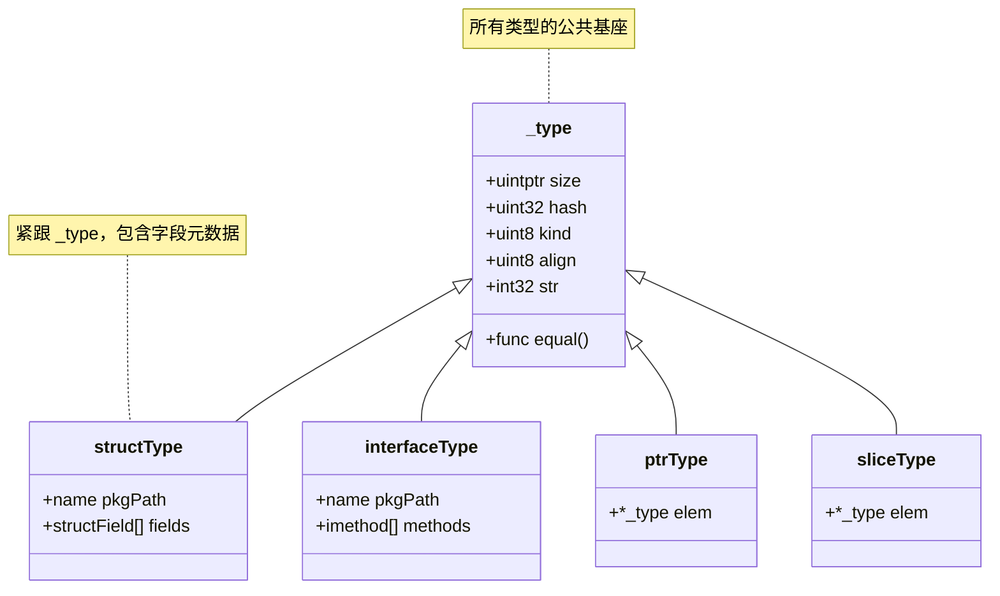

# 反射（Reflection）元编程理论与性能边界

**摘要：**

反射是 Go 语言运行时提供的最接近"元编程"的能力——它允许程序在运行期间审视自身的类型结构、字段布局和函数签名，并据此做出动态决策。对于一门强调静态类型、编译期确定的语言而言，反射的存在看似矛盾，实则不可或缺：`encoding/json` 的序列化、`database/sql` 的字段映射、依赖注入容器的自动装配、ORM 框架的 SQL 生成——这些支撑 Go 工程生态的基础设施，底层都依赖反射提供的类型自描述能力。但反射的代价同样显著：一次 `reflect.Value.Call` 的开销约为直接调用的 50-100 倍，在热点路径上滥用反射足以将一个服务的 P99 延迟从个位数毫秒推升到三位数。

本文从反射的理论基石——Rob Pike 在 2011 年总结的"反射三定律"出发，逐步拆解 `reflect.Type` 与 `reflect.Value` 的底层数据结构（`rtype`、`itab`、`flag` 字段的位编码），推导可寻址性（Addressability）与可设置性（Settability）的因果关系，分析结构体 Tag 的反射解析机制及其在标准库中的元数据缓存优化模式，最后以基准测试数据量化反射在不同操作上的性能代价，并系统梳理代码生成、泛型、接口断言三类替代方案的适用边界。文章试图回答两个核心问题：反射的能力边界由运行时的哪些结构约束决定？以及在工程实践中，如何在"动态性的便利"与"静态类型的性能"之间找到精确的平衡点。

---

## 第 1 章 反射的基本问题：程序能否审视自身

### 1.1 类型系统的自描述能力

一门编程语言的类型系统，在编译期结束后通常就"消失"了——编译器用类型信息来验证赋值兼容性、分配合适的内存布局、生成正确的机器指令，但一旦二进制生成，那些 `type User struct { Name string; Age int }` 的声明就变成了纯粹的内存偏移量，不再以结构化形式保留。C、C++ 和 Rust 大致遵循这一模式：编译完成后，程序对自身类型的认知止步于符号表的调试信息。

Go 做了一个不同的选择。编译器在生成二进制时，将一部分类型元数据（字段的名称与偏移、方法集、结构体 Tag、类型的大小与对齐要求）以"运行时类型描述符"的形式保留在最终的可执行文件中，供程序在运行期间按需查询。这套机制就是反射（Reflection）——程序在运行时审视自身类型结构的能力。

这个选择并非免费。类型元数据会占用二进制空间——在一个中等规模的服务端应用中，所有类型的运行时描述符通常占用 500KB-2MB 的二进制体积。对于追求极致小体积的嵌入式场景（譬如 WebAssembly 或 IoT 设备），Go 的二进制大小一直是被诟病的问题之一，而类型元数据是其中不可忽略的一部分。Go 的设计者选择了"运行时灵活性优先于二进制紧凑性"——这是一个面向服务端生态的明确取舍：在服务端场景中，二进制大小通常不是瓶颈（几十 MB 的二进制在容器化部署中完全可以接受），而运行时类型信息带来的通用基础设施能力（JSON、ORM、依赖注入）则直接降低了开发成本。

这并非 Go 的独创。Smalltalk（1970 年代）最早将"程序审视自身"作为语言的核心特性；Java 在 1998 年通过 `java.lang.reflect` 包提供了反射 API；Python 的 `getattr`、`hasattr` 和 `inspect` 模块同样属于反射范畴；.NET 的 CLR 从设计之初就内建了完整的元数据（Metadata）系统。Go 的反射实现（`reflect` 包，2012 年随 Go 1.0 发布）在哲学上与这些前辈一致——都试图在运行时保留类型信息的可查询性——但在工程取舍上有自己的特色：Go 的反射完全建立在接口的动态分派机制之上，没有独立的"反射对象"概念，`reflect.Value` 和 `reflect.Type` 本质上只是对接口内部结构体的显式访问。

### 1.2 为什么静态类型语言需要反射

Go 是一门静态类型语言，大多数操作在编译期就能确定类型和目标方法。但工程实践中存在一类普遍的需求——编写**与具体类型无关的通用逻辑**。`encoding/json.Marshal` 不知道调用者会传入 `*User`、`*Order` 还是 `*Config`；`fmt.Printf("%+v", x)` 也不知道 `x` 的具体类型；ORM 框架需要根据任意结构体的字段定义来生成 `INSERT` 语句；依赖注入容器需要在运行时扫描构造函数参数并自动装配。

在没有泛型的时代（Go 1.18 之前，2022 年），这类需求只能通过两条路径解决：要么用 `interface{}` 接收任意值，再用类型断言（Type Assertion）逐一判断——这要求调用者穷举所有可能的类型，完全不具备扩展性；要么把类型信息编码为字符串（如模板引擎中的 `{{.Name}}`），在运行时手动解析——这放弃了编译期检查，容易出错。反射提供了第三条路径：接收 `interface{}`，然后用 `reflect` 包程序化地读取类型信息，根据字段的名称、类型、Tag 来决定如何处理。这种方案兼具通用性和类型安全性（至少能拿到正确的类型信息，而非猜测），代价是运行时开销。

Go 1.18 引入泛型（Generics）后，一部分原本需要反射的场景可以用类型参数替代，但泛型解决的是"编译期已知的类型族"的通用化问题——所有可能的类型实例在编译时必须能够枚举（至少在 Go 当前的单态化实现中如此）。而反射解决的是"运行时才确定的任意类型"的通用化问题——譬如一个 HTTP 框架的 JSON 反序列化器，它面对的类型集合是开放的，用户可以在运行时定义新的结构体。两者是互补关系，而非替代关系，后文第 5 章会详细讨论这个边界。

### 1.3 没有反射会怎样

不妨做一个反事实推演：如果 Go 没有 `reflect` 包，工程世界会变成什么样子。

`encoding/json` 无法自动将结构体字段映射为 JSON 键值对——程序员必须为每个结构体手写 `MarshalJSON` 和 `UnmarshalJSON` 方法，或者接受基于 map 的松散类型。`database/sql` 的 `Scan` 方法无法将查询结果的列值按位置填入结构体字段——ORM 层要么退化为手动赋值，要么需要额外的代码生成步骤。`fmt.Printf` 的 `%+v` 动词无法打印字段名——调试体验大幅退化。依赖注入框架（如 Google Wire、Uber Fx）无法在运行时扫描构造函数签名来构建对象图——Wire 选择了编译期代码生成作为替代，但 Fx 的运行时反射注入正是建立在 `reflect` 之上的。

这些场景有一个共同特征：它们都需要**在编写代码时不知道具体类型的情况下，程序化地读取和操作类型信息**。这正是反射提供的核心能力。没有反射，这类通用基础设施要么不存在，要么需要依赖代码生成来预编译所有可能的类型组合——后者在类型集合封闭时可行（譬如 protobuf 的生成代码），但在类型集合开放的场景下不可行。

> [!info] 反射的本质定位
> 反射是"运行时类型自描述"能力的标准化接口。它不创造新的类型信息，只是将编译器原本就保留在二进制中的元数据，以程序可访问的方式暴露出来。理解了这一点，就能理解为什么反射不能"发明"编译时不存在的字段或方法——它只能"查询"已经存在的东西。

---

## 第 2 章 反射三定律：Go 反射的理论基石

Rob Pike 在 2011 年的 Go Blog 文章" The Laws of Reflection"中，将 Go 反射的行为总结为三条定律。这三条定律不是形式化定理，而是对 `reflect` 包设计哲学的高度概括——理解了它们，就能预判反射 API 在绝大多数场景下的行为，而不需要逐一记忆每个方法的细节。

### 2.1 第一定律：从接口值到反射对象

**从 `interface{}` 值可以产生反射对象。**

这一定律的技术基础是：Go 的接口值（interface value）内部已经包含了足够的类型信息——类型描述符（`_type` / `rtype`）和数据指针（`data`）。`reflect.TypeOf` 和 `reflect.ValueOf` 的本质工作，只是将这些已经在接口值中的信息提取出来，包装成 `reflect.Type` 和 `reflect.Value` 结构体。

```go
var x float64 = 3.14
t := reflect.TypeOf(x) // 返回 reflect.Type，描述 float64
v := reflect.ValueOf(x) // 返回 reflect.Value，持有 float64 的副本
```

这里有一个关键细节：当 `x` 被传入 `ValueOf` 时，它首先被隐式转换为 `interface{}` 参数。这个转换过程中，Go 运行时将 `x` 的**值拷贝**到接口值的内部数据区域。因此 `reflect.ValueOf(x)` 持有的是 `x` 的一个副本，而非 `x` 本身。这个细节直接决定了第三定律——你无法通过这个副本修改原始变量 `x`，除非传入的是指向 `x` 的指针。

可以用一个比喻来理解第一定律：接口值就像一个装在快递盒里的物品——快递盒的标签上写着物品的类型（`rtype`），盒子里装着物品本身（`data`）。`reflect.ValueOf` 的工作就是"拆开快递盒，把物品和标签都拿出来仔细端详"。但请注意，你端详的是从快递盒里取出的物品，而不是物品原本所在的位置。

### 2.2 第二定律：从反射对象到接口值

**从反射对象可以还原接口值。**

`reflect.Value.Interface()` 方法执行第一定律的逆操作：将 `reflect.Value` 中保存的（类型、值）重新打包为一个 `interface{}`，然后这个 `interface{}` 可以像普通接口值一样使用——类型断言、传递给其他函数、赋给具体类型的变量。

```go
v := reflect.ValueOf(3.14)
i := v.Interface() // i 是 interface{}，内部类型为 float64，值为 3.14
f := i.(float64)   // f 是 float64，值为 3.14
```

第一定律和第二定律合在一起，构成了反射的"对称性"：接口值 ↔ 反射对象之间的转换是双向无损的（在不涉及修改的前提下）。你可以在接口值和反射对象之间自由往返，每次转换都保留完整的类型和数据信息。这个对称性保证了反射的通用性——任何接口值都能进入反射世界，反射世界的结果也能回到普通代码中。

但"无损"仅限于读取。一旦涉及写入，就触发了第三定律的约束。

### 2.3 第三定律：可设置性与可寻址性

**要修改一个 `reflect.Value`，其值必须是可设置的（settable），而可设置的前提是可寻址（addressable）。**

这是反射三定律中最重要、也最容易让初学者困惑的一条。先看一个典型的失败案例：

```go
x := 3.14
v := reflect.ValueOf(x)
v.SetFloat(6.28) // panic: reflect: reflect.Value.SetFloat using
                 // unaddressable value
```

为什么会 panic？因为 `v` 持有的是 `x` 的一个**副本**（第一定律已经说明了这一点）。如果允许修改这个副本，调用者会以为修改了原始变量 `x`，但实际上 `x` 纹丝未动——这种"虚假修改"比报错更危险，因此 `reflect` 包选择了 panic 来阻止它。

`reflect.Value` 提供了一个查询方法 `CanSet()` 来检查当前值是否可设置。在上面的例子中，`v.CanSet()` 返回 `false`。

正确的做法是传入**指针**：

```go
x := 3.14
v := reflect.ValueOf(&x)        // v 的类型是 *float64
v.Elem()                        // 解引用，得到 float64 的 Value
v.Elem().CanSet()               // true
v.Elem().SetFloat(6.28)         // 成功，x 现在是 6.28
```

为什么 `v.Elem().CanSet()` 返回 `true` 而之前的 `v.CanSet()` 返回 `false`？这涉及**可寻址性（Addressability）**的概念。

`reflect.ValueOf(&x)` 创建了一个持有指针 `*float64` 的 `reflect.Value`。调用 `Elem()` 对这个指针解引用，得到的 `reflect.Value` 指向的是**原始变量 `x` 在内存中的位置**（而非副本）。因为 `reflect.Value` 持有的是原始数据的地址（而非拷贝），所以它是"可寻址的"（`v.Elem().CanAddr()` 返回 `true`）。在 Go 的反射设计中，**可寻址即可设置**——`CanSet()` 的返回值与 `CanAddr()` 一致。

这个设计的深层原因是：反射必须区分"我在操作一个独立副本"和"我在操作原始数据的内存位置"。只有后者才允许修改，因为只有后者能确保修改效果被调用者观察到。这并非 Go 独有——Java 的反射同样要求通过"可访问字段"来修改对象属性，Python 的 `setattr` 也只修改实际绑定的对象而非拷贝。

> [!warning] 可设置性的常见陷阱
> 通过结构体字段的 `reflect.Value` 修改值时，不仅需要结构体本身可寻址，还需要目标字段是导出（Exported）的。未导出的字段（小写开头）即使通过指针传入也不可设置——`CanSet()` 会返回 `false`。这是 Go 的可见性规则在反射层面的延伸：反射不能打破包的封装边界。

一个更微妙的场景是**嵌套结构体的可设置性传递**：

```go
type Inner struct{ Value int }
type Outer struct{ Inner Inner }

o := Outer{Inner: Inner{Value: 10}}
v := reflect.ValueOf(&o).Elem().FieldByName("Inner")
// v.CanSet() == true（Outer 可寻址，Inner 字段导出）
// v.CanAddr() == true

innerVal := v.FieldByName("Value")
// innerVal.CanSet() == true（Inner 可寻址，Value 字段导出）
innerVal.SetInt(20) // 成功，o.Inner.Value 变为 20
```

可设置性在字段链上逐级传递：只要每一级的结构体都可寻址、每一级的字段都导出，最终的字段的 `reflect.Value` 就继承了可设置性。这个传递规则是直觉上可预期的，但在匿名嵌入（Embedded Field）和指针字段的情况下容易出错——如果 `Outer` 中的 `Inner` 字段类型是 `*Inner`（指针），则需要先对指针 `Elem()` 解引用才能设置其内部字段。

---

## 第 3 章 reflect.Type 与 reflect.Value 的底层表示

理解了反射三定律的行为规范之后，有必要深入 `reflect` 包的内部实现——看看 `reflect.Type` 和 `reflect.Value` 在 Go 运行时中到底长什么样。这一章的内容涉及运行时的内部数据结构，理解它们不仅能解释反射 API 的行为约束（譬如为什么某些操作慢、为什么 Tag 解析有开销），还能为性能优化提供直觉。

### 3.1 rtype：类型的元数据描述符

Go 运行时为每一个类型（无论用户定义还是内建）都生成一个**类型描述符**（Type Descriptor），在源码中对应 `runtime._type` 结构体（`reflect` 包将其别名为 `rtype`）。这个结构体是反射的核心——`reflect.Type` 接口的方法最终都路由到 `rtype` 的字段上。

一个简化的 `_type` 结构体（Go 1.21+ 版本）大致如下：

```go
// runtime/type.go（简化）
type _type struct {
    size       uintptr  // 类型占用的字节数
    ptrdata    uintptr  // 包含指针的前缀大小
    hash       uint32   // 类型哈希（用于 map 查找）
    tflag      tflag    // 标志位（是否有额外方法、是否已解析等）
    align      uint8    // 该类型变量的对齐要求
    fieldAlign uint8    // 该类型作为结构体字段时的对齐要求
    kind       uint8    // 类型种类（struct、ptr、func、interface 等）
    equal      func(unsafe.Pointer, unsafe.Pointer) bool // 判等函数
    gcdata     *byte    // GC 标记数据
    str        int32    // 类型名称（指向字符串表）
    ptrToThis  int32    // 指向该类型的 *Type 的指针（用于反射）
}
```

对于结构体类型，`_type` 之后紧跟一个 `structType` 结构，包含字段信息的切片：

```go
type structType struct {
    _type               // 基础类型信息
    pkgPath name        // 包路径
    fields  []structField // 字段描述符切片
}

type structField struct {
    name   name    // 字段名
    typ    *_type  // 字段类型
    offset uintptr // 字段在结构体中的字节偏移
}
```

对于接口类型，则有对应的 `interfaceType`，包含方法集的列表。对于指针类型有 `ptrType`，对于切片类型有 `sliceType`——每种 `kind` 都有对应的扩展结构体，在基础 `_type` 后面追加该类型特有的元数据。



### 3.1.1 name 结构的紧凑编码

`structField` 中的 `name` 字段不是简单的字符串——从 Go 1.9 开始，运行时采用了一种紧凑编码方案，将字段名、tag 和包路径信息编码在一个字节序列中，以最小化元数据占用的二进制空间：

```go
// runtime/name.go（简化）
type name struct {
    bytes *byte // 指向紧凑编码的字节序列
}

// 紧凑编码布局：
// [0]    flags（是否有 tag、是否有包路径）
// [1-2]  名字长度（uint16，小端序）
// [3..3+len-1]  名字内容（UTF-8）
// [随后] tag 长度 + tag 内容（可选）
// [最后] 包路径（可选，int32 偏移指向链接器字符串表）
```

这个设计的工程意义在于：绝大多数结构体字段的名称长度很短（1-15 字节），且多数没有 tag 或包路径（未导出字段没有包路径，导出字段在首次访问后才会解析包路径）。紧凑编码避免了为每个字段分配三个独立的字符串结构体（每个字符串需要 16 字节的头信息），将元数据大小压缩到接近实际内容的大小。`name` 的 `IsExported()` 方法只检查第一个字节的标志位，`Tag()` 方法则在需要时才解析 tag 部分——这种"按需解码"的策略使得 `reflect.Type.Field(n)` 在只需要字段名或类型的场景下，不必为 tag 解析付出任何开销。

### 3.1.2 tflag 的位含义

`_type.tflag` 字段编码了与类型方法集解析相关的状态信息，`reflect` 包在查询方法集时会依据这些标志决定是否需要"延迟解析"：

| 标志位 | 含义 |
|---|---|
| `tflagUncommon` | 是否有"不常见"数据（方法集、嵌入字段等）|
| `tflagExtraStar` | 类型名称中是否包含多余的星号（历史遗留）|
| `tflagNamed` | 是否为命名类型（区别于 `struct{...}` 这类字面量类型）|
| `tflagGCData` | `gcdata` 字段是否包含精确的 GC 扫描程序 |

`reflect.Type.Method(n)` 的实现会检查 `tflagUncommon`：如果该位未设置，说明该类型没有方法集，直接返回零值；如果设置了，才会去解析类型描述符后面的方法数组。这个"先看标志位、再做重活"的设计避免了大多数类型的方法查询开销——Go 中绝大多数类型（`int`、`string`、普通结构体）都没有自定义方法，查询它们的方法集只需要一次位检查。

`reflect.TypeOf(x)` 的内部实现就是：取出 `x`（作为 `interface{}`）内部的 `_type` 指针，将其包装为 `reflect.rtype`（`_type` 的别名），然后返回。这就是为什么 `reflect.TypeOf(nil)` 会 panic——`nil` 的接口值没有 `_type` 信息，运行时无法凭空构造一个类型描述符。

### 3.2 itab：接口值的动态分发表

接口值（interface value）的内部结构在 [[Golang/Go语言核心/10 接口的实现原理——iface、eface 与鸭子类型]] 中已有详述。此处只强调与反射直接相关的部分：一个非空接口值由两个指针组成——`itab`（接口表）和 `data`（数据指针）。

`itab` 的结构：

```go
type itab struct {
    inter *interfacetype // 接口类型的描述符
    _type *_type         // 具体（动态）类型的描述符
    hash  uint32         // _type.hash 的拷贝（加速类型匹配）
    _     [4]byte
    fun   [1]uintptr     // 可变长数组，存放实现方法的地址
}
```

当程序执行接口方法调用（譬如 `w.Write(buf)`），运行时通过 `itab.fun` 找到 `Write` 方法的实际地址并调用。当程序执行类型断言（譬如 `w.(*os.File)`），运行时比较 `itab._type` 与目标类型是否匹配。

`itab` 的构造是有开销的。当程序首次将一个具体类型赋值给某个接口时，运行时需要在堆上分配一个 `itab`，填充方法指针数组，并将其缓存到全局的 `itabTable`（一个带锁的哈希表）中。后续相同接口-类型对的转换会直接从缓存中读取 `itab`。这个"首次构造、后续缓存"的模式与 `typeFields` 类似，但 `itab` 的构造开销更大（需要查找和填充所有方法指针），典型耗时在 100-500ns 之间——这就是为什么在热循环中反复创建接口值（譬如 `fmt.Println` 或日志库的参数传递）会引入额外开销。Go 编译器在某些场景下会通过"去接口化"优化（de-interface）来避免不必要的 `itab` 构造，譬如当编译器能在编译期推断出接口值的具体类型时，直接用直接调用替代接口分派。

反射的 `reflect.TypeOf` 在处理接口类型参数时，实际上做的是"穿透"接口层——它返回的不是接口本身的类型，而是接口所包裹的具体类型。这就是第一定律的实现细节：`reflect.TypeOf(i)` 取出 `i` 的 `itab._type`，将其作为 `reflect.Type` 返回。

### 3.3 reflect.Value 的内部结构

`reflect.Value` 是一个结构体，包含三个字段：

```go
type Value struct {
    typ *rtype         // 类型描述符指针
    ptr unsafe.Pointer // 指向数据的指针
    flag              // 标志位（位域编码）
}
```

`flag` 字段是一个精心设计的位域（bit field），编码了以下信息：

| 位域 | 含义 |
|---|---|
| `flagKindWidth`（低 5 位） | `Kind` 值（0-26），表示类型的基本种类 |
| `flagRO` | 只读标志（来自未导出字段或 map key） |
| `flagAddr` | 可寻址标志——数据指针指向的是原始位置而非副本 |
| `flagMethod` | 是否表示一个方法 |
| `flagIndir` | 数据是否在堆上间接存储（而非直接存在 ptr 字段中） |

`flagAddr` 位直接决定了 `CanSet()` 的返回值：只有当 `flagAddr` 被设置时，`CanSet()` 才返回 `true`。当你调用 `reflect.ValueOf(x)`（非指针），运行时将 `x` 的值拷贝到堆上，`ptr` 指向这个拷贝，`flagAddr` 不被设置——因此不可寻址、不可设置。当你调用 `reflect.ValueOf(&x).Elem()`，`ptr` 指向原始变量 `x` 的栈地址（或逃逸到堆上的地址），`flagAddr` 被设置——因此可寻址、可设置。

这个位域设计的工程意义在于：用一个 `uintptr` 大小的整数同时编码了类型种类、寻址能力、方法索引等多维信息，避免了为每个属性分配一个独立字段，将 `reflect.Value` 的大小压缩到 3 个 word（24 字节 on 64-bit）。在热点路径上频繁创建和传递 `reflect.Value` 时，结构体越小，栈拷贝和 GC 扫描的开销就越低。

```go
// flag 的位布局示意（64 位系统）
// flag 字段是一个 uintptr
// [63..8] 方法索引或保留 | [7..5] flagIndir|flagAddr|flagRO | [4..0] kind
```

### 3.4 Kind 与 Type 的区别

理解 `reflect.Value.Kind()` 和 `reflect.Value.Type()` 的区别是正确使用反射的前提。

**Type** 是完整的类型信息——包含包路径和类型名称，能区分不同包中的同名结构体。`reflect.Type.String()` 对于用户定义的结构体会返回 `main.User` 这样的全限定名。

**Kind** 是类型的基础分类——`reflect` 包定义了 26 种 `Kind`（`Bool`、`Int`、`Struct`、`Ptr`、`Slice`、`Map`、`Func`、`Interface` 等）。Kind 抹去了包信息——两个不同包中定义的结构体，Kind 都是 `reflect.Struct`。

在实际使用中，`switch v.Kind()` 是处理多态逻辑的惯用模式：

```go
func describe(v reflect.Value) string {
    switch v.Kind() {
    case reflect.Int, reflect.Int8, reflect.Int16, reflect.Int32, reflect.Int64:
        return fmt.Sprintf("int(%d)", v.Int())
    case reflect.String:
        return fmt.Sprintf("string(%q)", v.String())
    case reflect.Ptr:
        return "pointer to " + describe(v.Elem())
    case reflect.Struct:
        return fmt.Sprintf("struct with %d fields", v.NumField())
    default:
        return v.Kind().String()
    }
}
```

这个函数能处理任意类型——这正是反射提供的通用性。但请注意，每增加一个 `Kind` 分支，就多一次运行时判断，累积起来就是反射的"分支税"。在性能敏感的代码中，这种 `switch v.Kind()` 的多路分发通常应该在进入反射路径之前用类型断言规避掉。

---

## 第 4 章 结构体 Tag：反射驱动的配置元数据

结构体 Tag（Struct Tag）是 Go 提供的一种在类型定义中嵌入元数据的机制。Tag 本身不影响运行时行为——它们是纯粹的文本标注，只有当程序通过反射主动读取时才有意义。这个设计的精妙之处在于：它将"声明式配置"嵌入了类型系统本身，使得结构体定义同时承载了"数据结构"和"数据描述"两层信息。

### 4.1 Tag 的语法与解析

```go
type User struct {
    Name  string `json:"name" db:"user_name" validate:"required,min=2"`
    Age   int    `json:"age,omitempty" db:"user_age"`
    Email string `json:"-"` // json:"-" 表示序列化时忽略该字段
}
```

Tag 的语法规则：反引号包裹的字符串，内含以空格分隔的 `key:"value"` 键值对，双引号内的值可以包含逗号分隔的子项。`reflect.StructField.Tag` 字段的类型是 `reflect.StructTag`，提供了 `Get(key string) string` 和 `Lookup(key string) (string, bool)` 两个方法来读取特定 key 的值。

```go
t := reflect.TypeOf(User{})
field, _ := t.FieldByName("Name")
tag := field.Tag
fmt.Println(tag.Get("json"))       // "name"
fmt.Println(tag.Get("db"))         // "user_name"
fmt.Println(tag.Get("validate"))   // "required,min=2"
```

`StructTag.Get` 的内部实现并不复杂——它在每次调用时线性扫描 Tag 字符串，逐字节解析 key-value 对。这意味着**每次 `Tag.Get` 调用都涉及字符串解析**，虽然单次开销不大（约 100-200ns），但在循环中对大量字段反复调用会累积成可观的开销。

`Get` 与 `Lookup` 的语义区别值得说明：`Get("json")` 在 key 不存在时返回空字符串，无法区分"key 不存在"和"key 存在但值为空"两种情况；`Lookup("json")` 返回 `(value, ok)` 二元组，`ok` 为 `false` 时表示 key 不存在。在需要精确区分"字段未配置 Tag"和"字段配置了空 Tag"的场景下（譬如 validator 框架的"无约束"与"显式空约束"的区分），应当使用 `Lookup`。这个区别虽然不影响性能，但影响功能正确性——标准库的 `encoding/json` 在判断"是否忽略字段"时使用 `Lookup` 而非 `Get`，以避免误判。

### 4.2 encoding/json 的 Tag 使用模式

`encoding/json` 是反射 Tag 使用最广泛的场景。当调用 `json.Marshal(user)` 时，序列化器的工作流程大致如下：

1. 获取传入值的 `reflect.Type`；
2. 如果类型是结构体，遍历所有字段；
3. 对每个字段，读取 `json` Tag 来决定 JSON key 名称、是否 `omitempty`、是否忽略（`"-"`）；
4. 对每个字段的值，递归执行序列化（嵌套结构体、切片、map 各自有不同的处理逻辑）。

这个流程的核心开销在于：每次 `json.Marshal` 都要遍历结构体的字段并解析 Tag——对于同一个结构体类型，这些字段信息在多次调用之间不会变化（Tag 是编译期固定的），但如果没有缓存，每次调用都要重新解析一遍。

### 4.3 元数据缓存优化：typeFields 模式

Go 标准库的 `encoding/json` 采用了一个精心设计的缓存机制来解决 Tag 重复解析的开销——**`typeFields` 缓存**。

核心思路是：对每个经过反射处理的结构体类型，将其字段信息（包括 Tag 解析结果）缓存起来，下次遇到相同类型时直接读取缓存，跳过重复的反射和解析。

```go
// encoding/json/encode.go（简化）
var fieldCache sync.Map // map[reflect.Type][]field

type field struct {
    name      string        // JSON key
    index     []int         // 字段索引路径（支持嵌套匿名结构体）
    typ       reflect.Type  // 字段类型
    omitEmpty bool          // 是否有 omitempty
    // ...
}

func typeFields(t reflect.Type) []field {
    // 先查缓存
    if cached, ok := fieldCache.Load(t); ok {
        return cached.([]field)
    }
    // 缓存未命中：用反射遍历字段，解析 Tag
    var fields []field
    for i := 0; i < t.NumField(); i++ {
        sf := t.Field(i)
        tag := sf.Tag.Get("json")
        // 解析 tag...
        fields = append(fields, field{...})
    }
    // 写入缓存
    fieldCache.Store(t, fields)
    return fields
}
```

这个模式的关键工程细节：

1. **缓存键是 `reflect.Type`**——同一个类型在运行期间只有一个 `rtype` 实例（编译器去重），所以 `reflect.Type` 可以作为可靠的缓存键。
2. **使用 `sync.Map` 而非 `map + sync.RWMutex`**——因为缓存的写入频率远低于读取频率（典型的"一次写入、多次读取"场景），`sync.Map` 在这种负载下比加锁 map 有更好的性能。
3. **字段冲突解决**——当结构体存在嵌入字段（Embedded Field）时，同名外层字段遮蔽内层字段，`typeFields` 实现了按字段索引路径的优先级排序。

这种缓存模式在 Go 生态中非常普遍——`database/sql` 的列映射、`encoding/xml` 的标签解析、各种 validator 框架的校验规则提取，都采用了类似的"首次反射、后续缓存"策略。性能差异显著：以 `encoding/json` 为例，首次序列化某个结构体类型时（缓存未命中），反射和 Tag 解析的开销约占序列化的 30-40%；后续序列化同类型数据时（缓存命中），这部分开销降至接近零。

### 4.4 缓存一致性：并发场景下的重复计算

`typeFields` 模式存在一个微妙的并发问题：当多个 Goroutine 首次遇到同一个结构体类型时，它们会同时进入缓存未命中分支，各自独立地执行一遍完整的反射和 Tag 解析。`sync.Map.Store` 的语义是"后写入的覆盖先写入的"，因此最终缓存中只保留一份结果——但重复计算的 CPU 开销已经付出。

这个问题在大多数场景下影响很小（缓存未命中只发生一次，后续调用全部命中），但在某些极端场景下值得注意：

- **高并发启动**：服务启动瞬间，数千个 Goroutine 同时处理首次请求，可能触发同一类型的并发反射解析。
- **多租户场景**：每个租户使用不同的结构体类型，缓存需要逐步预热。

`encoding/json` 的应对策略是"接受重复计算"——因为它判断"实现 `sync.Once` 的 per-type 锁"会引入更高的复杂度（需要维护一个 `map[reflect.Type]*sync.Once`），而重复计算的代价只是一次反射遍历（通常在微秒级），在稳态下可以忽略。这是一种典型的"为常见路径优化、容忍极端路径的轻微浪费"的工程取舍。

其他框架的替代方案包括：

- **`sync.OnceValues`**（Go 1.21+）：将函数包装为"只执行一次"的语义，但需要为每个类型维护一个 `Once` 实例，增加了状态管理的复杂度。
- **`singleflight.Group`**（`golang.org/x/sync/singleflight`）：合并并发的相同请求，避免重复计算。Uber 的 `fx` 框架在依赖注入时使用了类似机制，确保同一类型的构造不会被并发执行多次。

> [!note] 缓存模式的设计取舍
> `typeFields` 缓存的代价是内存——每个经过反射处理的结构体类型都会在缓存中保留一份字段描述。对于类型数量有限的服务（典型的服务端应用），这个开销可以忽略（几 KB 到几十 KB）。但对于动态生成大量临时类型的场景（譬如某些模板引擎），缓存会持续膨胀。标准库的选择是"不淘汰"——`sync.Map` 中的条目永远不会被删除，这是一个面向常见场景的简单策略。

### 4.5 Tag 解析的性能基准

为了量化 Tag 解析的实际开销，可以用基准测试对比"每次解析"和"缓存后读取"两种路径：

| 场景 | 单字段耗时 | 20 字段结构体总开销 |
|---|---|---|
| 每次 `Tag.Get("json")` 调用 | 约 100-200 ns | 约 2-4 μs |
| `typeFields` 缓存命中后的字段访问 | 约 1-2 ns | 约 20-40 ns |
| 完全不使用反射，硬编码字段访问 | 0 ns（编译期确定） | 0 ns |

差距是明确的：缓存命中后的字段访问比"每次解析 Tag"快 100-200 倍，但仍然比"不使用反射"慢一个数量级（因为缓存读取本身涉及 `sync.Map.Load` 的原子操作和 map 查询）。在极致性能要求的场景下，`jsoniter` 等第三方库通过代码生成或运行时编译（`go-json` 的 JIT 方案）将字段访问优化到接近硬编码水平，但代价是依赖外部库和更复杂的构建流程。

---

## 第 5 章 性能代价：反射的量化开销

反射的代价不是抽象的"比较慢"，而是可以精确量化的。本节通过基准测试数据，拆解反射在不同操作上的性能开销，并系统梳理替代方案的适用边界。

### 5.1 反射操作的开销分解

反射的性能代价主要来自三个方面：

**第一，接口装箱（Interface Boxing）**。`reflect.ValueOf(x)` 要求参数类型为 `interface{}`，如果 `x` 本身不是接口类型，运行时必须将 `x` 的值（或地址）打包进一个接口值——这个过程涉及堆分配（如果 `x` 的值无法内联到接口的 data 字中，譬如大于 1 word 的结构体，堆分配的机制参见 [[03 Go 内存分配器——mcache、mcentral 与 mheap]]）或栈拷贝。

**第二，动态分派（Dynamic Dispatch）**。`reflect.Value.Method(n).Call(args)` 的执行路径远长于直接方法调用。直接调用在编译期就能确定目标函数地址（或虚表偏移），而反射调用需要经过：取出方法索引 → 在 `itab` 中查找函数指针 → 将 `[]reflect.Value` 参数解包为实际参数 → 通过 `runtime.callXX` 系列汇编函数跳转 → 将返回值重新包装为 `reflect.Value`。这个过程在 CPU 层面意味着多次间接跳转（无法被分支预测器有效预测）和函数调用（无法被内联优化）。

**第三，类型检查与安全性**。反射在每次操作前都执行类型兼容性检查——`SetInt` 检查 Kind 是否为整型、`Set` 检查类型是否可赋值、`FieldByName` 遍历字段列表。这些检查在正常情况下很快（几纳秒），但累积在反射调用链中也构成不可忽视的开销。

| 操作 | 耗时（约） | 相对直接调用 |
|---|---|---|
| 直接方法调用 | 1-2 ns | 1x |
| 接口方法调用（已知类型实现接口） | 3-5 ns | 2-3x |
| `reflect.ValueOf(x)` | 50-100 ns | — |
| `reflect.Value.Field(n)` | 30-50 ns | — |
| `reflect.Value.Method(n).Call(args)` | 200-500 ns | 100-250x |
| `reflect.Value.SetField` | 100-200 ns | — |
| 类型断言 `x.(T)` | 10-20 ns | 5-10x |

> [!info] 数据来源说明
> 以上数据为 Go 1.21 在 AMD64 架构上的典型量级（基于 `reflect` 包的 `Benchmark` 系列和社区的广泛基准测试综合），不同 CPU 微架构和 Go 版本会有浮动，但量级关系稳定。直接调用的数字包含了函数序言和立即返回的开销。

### 5.2 基准测试代码与结果

以下基准测试展示了不同调用方式的性能差异（基于 Go 1.21，AMD64 架构）：

```go
type Adder struct{ x, y int }

func (a Adder) Add() int { return a.x + a.y }

// 直接调用
func BenchmarkDirectCall(b *testing.B) {
    a := Adder{1, 2}
    for i := 0; i < b.N; i++ {
        _ = a.Add()
    }
}

// 接口调用
func BenchmarkInterfaceCall(b *testing.B) {
    type I interface{ Add() int }
    var i I = Adder{1, 2}
    for i := 0; i < b.N; i++ {
        _ = i.Add()
    }
}

// 反射调用
func BenchmarkReflectCall(b *testing.B) {
    v := reflect.ValueOf(Adder{1, 2})
    m := v.MethodByName("Add")
    for i := 0; i < b.N; i++ {
        m.Call(nil)
    }
}

// 泛型调用（Go 1.18+）
func callGeneric[T interface{ Add() int }](a T) int {
    return a.Add()
}
func BenchmarkGenericCall(b *testing.B) {
    a := Adder{1, 2}
    for i := 0; i < b.N; i++ {
        _ = callGeneric(a)
    }
}
```

典型输出（`go test -bench=.`）：

| Benchmark | 耗时/op | 分配/op |
|---|---|---|
| `BenchmarkDirectCall` | ~0.3 ns | 0 B |
| `BenchmarkInterfaceCall` | ~3 ns | 0 B |
| `BenchmarkGenericCall` | ~0.3 ns | 0 B |
| `BenchmarkReflectCall` | ~200 ns | 48 B |

几个关键观察：

1. **泛型调用与直接调用性能一致**——编译器为 `callGeneric[Adder]` 生成了专用代码，运行时调用路径与直接调用相同，没有任何额外开销。这是泛型相对于反射的核心优势：在编译期已知的类型上，泛型提供了零成本抽象。
2. **反射调用有堆分配**——`MethodByName` 返回的 `Value` 和 `Call` 的参数切片 `[]reflect.Value{}` 都逃逸到堆上，引入了 GC 扫描开销。这个分配在热点路径上是比 CPU 时间更严重的问题。
3. **接口调用是反射调用的 1/60**——如果一个类型实现了某个接口，用接口方法调用比反射调用快 60 倍。这再次印证了"能用接口就不用反射"的工程原则。

### 5.3 热点路径上的累积效应

单次反射调用的 200-500ns 在孤立场景下并不构成问题——大多数应用的瓶颈在 IO 而非 CPU。但当反射出现在**热循环**中时，累积效应会变得显著。

典型场景：一个每秒处理 10 万请求的 HTTP 服务，每个请求需要将一个包含 20 个字段的结构体序列化为 JSON。如果序列化路径中的每个字段都要经过完整的反射调用链（无缓存），总反射开销约为 `100000 × 20 × 300ns = 600ms/s`——相当于用掉了 0.6 个 CPU 核心纯粹在反射上。而 `encoding/json` 的 `typeFields` 缓存将字段遍历和 Tag 解析优化到只在首次出现时执行一次，后续调用几乎零开销——这就是为什么标准库的 JSON 性能在实际使用中远优于"朴素反射"方案。

另一个常见陷阱：在 ORM 的 `Scan` 方法中，如果每行数据都要对结构体字段执行完整的反射赋值（无缓存、无批量优化），在大数据量查询场景下，反射开销可能超过 SQL 解析和网络读取。

### 5.2.1 反射在标准库之外的生态应用

Go 生态中大量框架依赖反射来提供通用能力——这些框架的共同特征是"用户定义的类型集合是开放的"：

- **ORM 框架**（GORM、Ent）：通过反射读取结构体的 `gorm` 或 `ent` Tag，将字段映射为数据库列，并在 `Find` 方法中动态填充查询结果。GORM 内部维护了一个 `schema.Parse` 缓存，对每种类型只解析一次字段元数据。
- **依赖注入框架**（Uber Fx、Google Wire）：Fx 在运行时通过反射扫描构造函数的参数类型，自动从容器中查找并提供依赖；Wire 则在编译期通过代码生成完成相同工作，运行时无反射开销。两者的取舍是"运行时灵活性 vs 编译时确定性"（详见 [[Golang/Go生态与框架设计/00 专栏导览|Go 生态与框架设计]] 中 DI 章节的对比分析）。
- **Web 框架的路由参数绑定**（Gin、Echo）：当 HTTP handler 接收 JSON 请求体并绑定到结构体时，框架通过反射将 JSON 字段映射到结构体字段。Gin 的 `ShouldBindJSON` 底层调用 `encoding/json`，因此继承了标准库的 `typeFields` 缓存优化。
- **配置库**（Viper、koanf）：通过反射将 map 结构或 YAML/JSON 配置自动填充到结构体，支持嵌套和类型转换。

这些框架的反射开销大多通过"首次解析、缓存复用"的模式得到控制。在典型的服务端负载下，反射在稳态（缓存命中后）的开销占总请求处理时间的比例通常低于 1%，但在冷启动或缓存未命中阶段可能短暂上升到 10-20%。

### 5.4 替代方案：何时不需要反射

反射的替代方案可以按"动态性 vs 性能"的光谱排列，从最动态（完全运行时决定）到最静态（完全编译期决定）：

| 方案 | 动态性 | 性能 | 适用场景 | 代表案例 |
|---|---|---|---|---|
| 反射（`reflect`） | 完全动态 | 最差 | 通用基础设施、类型集合开放 | `encoding/json`, `database/sql` |
| 接口断言（Type Assertion） | 类型集合封闭 | 接近直接调用 | 已知有限种类型 | `switch v := x.(type)` |
| 泛型（Go 1.18+） | 编译期类型参数化 | 接近直接调用 | 类型无关的通用算法 | `slices.Sort`, `maps.Keys` |
| 代码生成（`go generate`） | 编译期生成 | 零运行时开销 | 性能敏感且类型已知 | `protobuf`, `Wire`, `stringer` |
| `unsafe.Pointer` 转换 | 手动内存操作 | 零开销但危险 | 序列化、系统编程 | `encoding/binary`, `cgo` |

**接口断言**在类型集合有限时是最佳选择。一个处理 `Dog`、`Cat`、`Bird` 三种动物类型的函数，用 `switch v := animal.(type)` 比用反射遍历方法集要快 10-50 倍，而且代码更清晰。接口断言的开销主要来自类型比较（`itab._type == target_type`），在大多数情况下只需要一个指针比较。

**泛型**（Go 1.18 引入，2022 年）解决了一大类原本需要反射的"通用容器"场景。`slices.Sort[T constraints.Ordered](s []T)` 不需要反射来知道 `T` 的类型——编译器为每种实例化类型生成专用代码（monomorphization）。但泛型无法替代反射的场景是"运行时才知道类型"——譬如 JSON 反序列化，目标类型由调用者传入的 `interface{}` 决定，编译器无法预先生成代码。

**代码生成**将反射的运行时工作前移到编译期。`protobuf` 的 `protoc-gen-go` 为每个 `.proto` 消息生成完整的序列化/反序列化代码，运行时无需反射；Google Wire 通过静态分析构造函数的类型签名，在编译期生成依赖注入代码，运行时无需反射扫描。代价是构建流程的复杂性增加——需要维护生成工具和生成代码的同步。

JSON 序列化是代码生成替代反射最成功的案例。`easyjson` 通过 `go generate` 为每个结构体生成专用的 `MarshalJSON` / `UnmarshalJSON` 方法，完全跳过反射和 Tag 解析——生成的代码直接按字段硬编码 JSON key 和序列化逻辑。性能对比：

| 方案 | 序列化 100 字段结构体 | 反序列化 | 是否需要代码生成 |
|---|---|---|---|
| `encoding/json`（标准库） | 基准 | 基准 | 否 |
| `easyjson`（生成代码） | 约 5-10x 快 | 约 5-10x 快 | 是 |
| `jsoniter`（运行时 JIT） | 约 2-4x 快 | 约 2-4x 快 | 否 |
| `go-json`（JIT + 反射缓存） | 约 3-6x 快 | 约 3-6x 快 | 否 |

`easyjson` 的性能优势主要来自：消除了所有反射调用、消除了 Tag 解析、消除了 `switch Kind` 的分支开销。代价是代码膨胀（每个结构体生成数百行代码）和维护负担（结构体变更后需要重新生成）。在生产环境中，如果 JSON 序列化是明确的性能瓶颈（譬如每秒序列化数十万个大对象），代码生成是值得投入的方案；否则，标准库的缓存优化已经足够。

### 5.5 泛型的边界：什么仍然需要反射

Go 的泛型（Type Parameters）当前采用 `stenciling`（模板特化）策略——编译器为每种实际类型参数组合生成独立的代码。这意味着：

1. 泛型函数在编译期必须能够确定所有类型参数的实际值——至少在调用点能够推断出具体类型。
2. 泛型无法处理"类型本身作为参数在运行时传入"的场景。

典型的"泛型做不到但反射能做到"的场景：

- **JSON 反序列化到 `interface{}` 类型的目标**：目标类型在运行时才确定。
- **通用 `DeepCopy` 函数**：需要对任意类型递归复制，包括未导出字段和循环引用。
- **动态代理 / 装饰器**：在运行时为一个类型生成方法调用的日志包装——Go 没有运行时生成代码的能力，但可以通过 `reflect.Value.Call` 做运行时转发。
- **ORM 的自动 Schema 映射**：将任意结构体的字段名映射为数据库列名。

在这些场景中，反射不可替代——泛型提供了编译期的通用化，但无法替代运行时的类型自描述能力。

---

## 第 6 章 反射与 unsafe 的配合边界

`reflect` 和 `unsafe` 是 Go 中两个可以"突破类型系统"的包。它们之间存在精心设计的配合关系——`reflect` 提供类型安全的元数据查询，`unsafe` 提供绕过类型系统的指针操作。两者的配合既强大又危险，理解其边界是正确使用反射的关键。

### 6.1 unsafe.Pointer 的桥梁作用

`reflect.Value` 的 `ptr` 字段类型是 `unsafe.Pointer`——这意味着反射内部已经在用 `unsafe` 操作内存。从用户侧，`reflect.Value` 通过 `unsafe` 暴露了两个能力：

1. **`Value.UnsafeAddr()`**：返回值的内存地址，类型为 `uintptr`（不是 `unsafe.Pointer`，防止直接解引用）。
2. **`Value.Pointer()`**：对于指针、函数、map、chan 类型，返回其内部指针的 `uintptr` 值。

从 `unsafe.Pointer` 到 `reflect.Value` 的反向路径也是存在的——通过 `reflect.NewAt(typ, ptr)` 可以从一个类型描述符和一个 `unsafe.Pointer` 构造出一个 `reflect.Value`。这个能力在序列化库中广泛使用：当你从外部读取了一块原始字节（譬如网络数据包），知道它对应某个 Go 结构体的布局，就可以用 `NewAt` 将其解释为该结构体类型。

### 6.2 合法边界与违规操作

Go 的 `unsafe` 包文档明确列出了"合法使用模式"（Valid Go patterns），反射相关的操作需要遵守这些约束：

1. **`reflect.Value.UnsafeAddr` 返回的 `uintptr` 不应被存储**——GC 不追踪 `uintptr`，如果对象被移动（在紧凑 GC 实现中可能），存储的地址会失效。Go 当前的 GC 不移动对象，但这个约束仍然存在，因为未来的 GC 实现可能改变。
2. **通过 `unsafe.Pointer` 绕过类型系统修改内存时，必须遵守 Go 的内存模型**——并发写入需要同步原语，不能依赖"反射调用本身是原子的"这种假设（它不是）。
3. **`reflect.NewAt` 构造的 Value 所指向的内存，必须在 Value 的生命周期内有效**——如果 `ptr` 指向栈上即将返回的局部变量，结果不可预测。

在实际工程中，`reflect` + `unsafe` 的典型合法用途包括：

- **序列化库**（`encoding/gob`、`encoding/binary`）：在字节流和结构体之间直接转换，跳过字段级反射。
- **`cgo` 互操作**：Go 结构体与 C 结构体的内存布局对齐后，通过 `unsafe.Pointer` 直接传递。
- **零拷贝解析**：将网络缓冲区直接解释为结构体，避免逐字段拷贝。

### 6.2.1 cgo 互操作的具体案例

在 cgo 场景中，`reflect` + `unsafe` 的配合用于在 Go 和 C 之间共享内存：

```go
// 假设 C 结构体
// struct Point { double x; double y; };

type GoPoint struct {
    X float64
    Y float64
}

func processCPoint(cPtr unsafe.Pointer) {
    // 方案一：直接 unsafe 转换（最快，但无类型安全）
    p := (*GoPoint)(cPtr)
    fmt.Println(p.X, p.Y)

    // 方案二：通过 reflect.NewAt（带类型信息，更灵活）
    typ := reflect.TypeOf(GoPoint{})
    v := reflect.NewAt(typ, cPtr).Elem()
    fmt.Println(v.Field(0).Float(), v.Field(1).Float())
}
```

方案一性能最优，但要求开发者手动保证 Go 和 C 的结构体布局完全一致（字段顺序、大小、对齐）。方案二引入了反射层，可以在运行时动态处理不同类型的 C 结构体（譬如根据一个 `reflect.Type` 参数来决定如何解释 C 传来的数据），但开销更大。在 cgo 这种本身就开销巨大的边界上（每次跨越 Go/C 边界都有约 100-200ns 的固定开销），反射的相对开销反而不那么显著。

### 6.2.2 `reflect.NewAt` 的完整使用场景

`reflect.NewAt` 的能力不仅限于 cgo——它也是某些零拷贝序列化库的核心原语。典型用法：

```go
// 从网络缓冲区直接构造结构体
buf := make([]byte, 16) // 假设已从 socket 读取
// buf 中是 float64 X + float64 Y 的内存布局

typ := reflect.TypeOf(GoPoint{})
ptr := unsafe.Pointer(&buf[0])
v := reflect.NewAt(typ, ptr).Elem()

// 现在 v 可以像普通 reflect.Value 一样使用
x := v.FieldByName("X").Float()
```

这种零拷贝方案的性能比逐字段 `binary.Read` 快 10 倍以上，但有严格的前提条件：

1. Go 结构体的内存布局必须与字节流中的布局完全一致（字段顺序、大小、对齐、填充字节）；
2. 字节流的生命周期必须覆盖 `v` 的使用周期（`buf` 不能被提前释放）；
3. 必须考虑字节序问题（Go 使用主机字节序，网络字节序通常是 big-endian）。

违规操作的典型后果：

```go
// 危险：通过 unsafe 修改未导出字段
v := reflect.ValueOf(&someStruct).Elem()
f := v.FieldByName("unexported") // CanSet() == false
// 但通过 unsafe 强行写入——破坏了封装约定，行为未定义
ptr := unsafe.Pointer(f.UnsafeAddr())
*(*int)(ptr) = 42 // 编译通过，运行时可能崩溃或产生数据竞争
```

这种做法的问题不仅在于"不推荐"——它绕过了 Go 的可见性规则，可能导致其他包内代码对未导出字段的不变量假设被破坏，也可能在 GC 扫描、并发访问和栈增长时触发不可预测的行为。

### 6.3 何时该停下来

反射与 `unsafe` 配合使用的决策框架可以归纳为三个问题：

1. **是否可以用纯 `reflect`（不碰 `unsafe`）实现？** 如果可以，不要碰 `unsafe`——`reflect` 的 API 提供了完整的安全性保证，`unsafe` 只在你需要越过这些保证时才使用。
2. **性能收益是否足以证明安全风险的合理性？** 在序列化、cgo 等场景中，`unsafe` 的直接内存操作可以将性能提升 5-10 倍，这个收益通常足以证明风险（但需要充分测试和文档说明）。在普通业务代码中，这个收益通常不值得。
3. **是否有经过验证的库实现了你需要的功能？** 不要自己实现 `reflect` + `unsafe` 的零拷贝解析——用 `encoding/binary`、`binary.ByteOrder` 或成熟的 protobuf 库。手写指针操作的正确性极难验证，尤其是在不同架构和 Go 版本之间。

> [!warning] 反射的哲学边界
> Go 的设计哲学是"显式优于隐式，简单优于强大"。反射是这门语言中"最强大"的特性，但也是最容易滥用的。当发现自己在反射中嵌套三层 Kind 判断来动态构造方法调用时，通常意味着设计层面出了问题——要么应该引入接口来收窄多态的范围，要么应该用代码生成将动态工作前移到编译期。反射的最佳使用场景是"基础设施"——那些为整个生态提供通用能力的底层库，而非业务逻辑本身。

---

## 第 7 章 权衡总结：反射的工程定位

行文至此，可以将反射的工程定位归结为几个清晰的判断。

**反射是不可替代的运行时元编程能力。** 在类型集合开放的场景中——JSON 序列化、ORM 映射、依赖注入——没有反射（或等价机制），通用基础设施无法存在。Go 选择将类型元数据保留在二进制中，是对"静态类型语言的灵活性"这个矛盾的工程解答。

**反射的代价是确定的、可量化的。** 一次完整的反射方法调用比直接调用慢 100-250 倍，在热循环中累积可达数百毫秒。但这个代价主要集中在"首次解析"和"逐字段操作"上——通过元数据缓存（`typeFields` 模式）和批量操作可以有效分摊。

**泛型和代码生成是反射的前置替代方案，但各有边界。** 泛型在编译期解决类型参数化问题，代码生成在编译期完成类型特化工作，两者都不引入运行时开销。但当目标类型在运行时才确定时，反射是唯一选择。

**`unsafe` 是反射的加速器，也是正确性的突破口。** 在序列化、cgo 互操作等场景中，`unsafe.Pointer` 的直接内存操作是必要的性能优化手段。但在业务代码中，`unsafe` 的使用应当被视为"技术债"——它有效，但需要额外的测试和文档来保证其正确性。

由此可见，反射在 Go 工程中的定位是"必要的恶"——它不是日常工具，但在构建通用基础设施时不可或缺。正确的做法是在架构层面限制反射的使用范围——将其隔离在框架层，通过接口和代码生成向业务层暴露类型安全的 API。业务代码不碰反射，框架代码精打细算地使用反射——这是 Go 生态中性能与灵活性之间最成熟的平衡策略。

但未来是否可能完全消除反射？Go 泛型的持续演进（类型参数约束的增强、编译期反射的探索）正在逐步收窄反射的"必要使用范围"。但"运行时类型自描述"作为一种能力，不太可能被完全替代——只要存在"类型集合在运行时才确定"的场景，反射（或其等价物）就不可或缺。Go 的选择是保留这个能力，同时通过设计约束（三定律、可见性规则、`unsafe` 的合法模式）将其危险性控制在可管理的范围内。这是一种务实的工程哲学：不追求理论的纯粹性，而是在简单与强大之间找到可操作的平衡。

从更宏观的视角看，反射与泛型的共存代表了 Go 对"通用编程"问题的双轨解答——泛型处理编译期可枚举的类型族，反射处理运行时开放的类型集合。两条轨道在 `encoding/json` 这样的库中交汇：标准库用反射提供通用性，第三方库用代码生成提供性能，用户根据场景选择。这种"没有银弹、因地制宜"的生态形态，恰恰印证了 Go 设计哲学的核心——简单不是功能的缺失，而是在多种能力之间保持清晰的边界与取舍。

---

## 参考资料

1. Rob Pike, "The Laws of Reflection", Go Blog, 2011.
2. Go 语言源码 `reflect` 包：`src/reflect/type.go`、`src/reflect/value.go`.
3. Go 语言源码 `runtime` 包：`src/runtime/type.go`、`src/runtime/iface.go`.
4. Go 语言源码 `encoding/json` 包：`src/encoding/json/encode.go`（`typeFields` 缓存实现）.
5. Go 官方文档 "unsafe" 包，Valid Patterns 章节.
6. Russ Cox, "Go Data Structures: Interfaces", 2009（`itab` 设计）.
7. Go 1.18 Release Notes: Generics（泛型与反射的关系）.

---

> [!note] 思考题
> 1. 为什么 `reflect.ValueOf(nil)` 会 panic，而 `reflect.ValueOf((*int)(nil))` 不会？两者的接口值内部结构有什么不同？
> 2. 如果一个结构体有 100 个字段，但 `json.Marshal` 只序列化其中 10 个（其余标记了 `json:"-"`），`typeFields` 缓存中保存的是全部 100 个字段还是仅 10 个？这对首次序列化和后续序列化的性能有什么影响？
> 3. Go 泛型能否替代 `encoding/json` 的反射实现？如果不能，瓶颈在泛型的哪些限制上？
