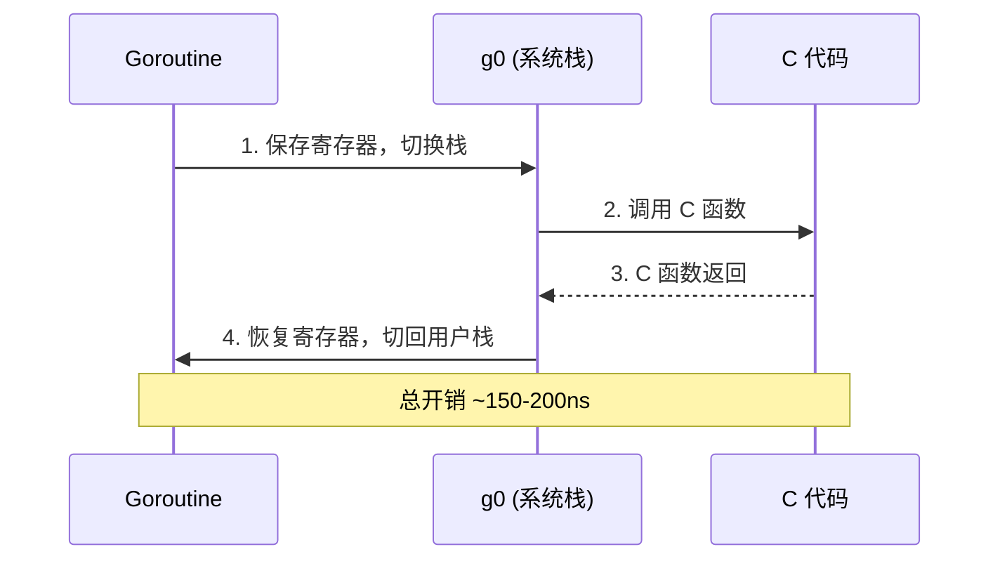

# 系统底层黑魔法——unsafe 内存布局与 cgo 互操作边界

**摘要：**

Go 的设计哲学强调安全与简洁，类型系统与垃圾回收器（GC）共同构成了程序运行的防护网。然而，总有场景需要突破这层防护——譬如直接操作内存布局以满足对齐要求，或者调用积累数十年的 C 语言库。`unsafe` 包与 cgo 便是 Go 留给程序员的两道紧急逃生门。前者允许绕过类型检查、直接操纵指针，后者则打通了 Go 与 C 的互操作通道。本文是 [[Golang/Go运行时进阶与底层机制/00 专栏导览|Go 运行时进阶与底层机制]] 专栏的第六篇，深入探讨 `unsafe` 与 cgo 的底层机制与使用边界。

但这两道门的代价远超表面所见。`unsafe.Pointer` 与 `uintptr` 的混用可能让 GC 在关键时刻丢失对活跃对象的追踪，导致程序崩溃；cgo 调用不仅涉及栈切换、寄存器保存的显式开销，更会悄悄占用系统线程、扭曲 `GOMAXPROCS` 的语义，在高并发场景下引发难以复现的调度饥饿。本文将从内存对齐规则讲起，剖析 `unsafe` 三件套的底层机制与合法转换边界，继而深入 cgo 的线程模型与 GC 屏障危险，最后讨论替代路径与权衡取舍。全文试图回答两个核心问题：何时值得冒险打开这些黑魔法，以及如何在不触发未定义行为的前提下安全地使用它们。

---

## 第 1 章 unsafe 的由来与边界限定

### 1.1 是什么：标准库中的"非标准"例外

`unsafe` 包在 Go 标准库中是一个异类——它的名字本身就是警告。官方文档开篇明义："**Package unsafe contains operations that step around the type safety of Go programs.**" 这个包自 Go 1.0（2012 年 3 月）便已存在，却从未被归入"推荐实践"。它提供的能力包括：通过 `unsafe.Pointer` 在任意指针类型间转换、通过 `unsafe.Sizeof` 与 `unsafe.Offsetof` 查询内存布局、通过 `unsafe.Alignof` 获取对齐要求。这些能力与 [[Golang/Go语言核心/04 类型系统——值类型、引用类型与 struct 组合]] 中讨论的类型系统形成对比——类型系统提供了安全抽象，而 `unsafe` 则允许在必要时绕过这些抽象。

这些能力之所以保留，并非因为 Go 设计者鼓励程序员绕过类型系统，而是因为某些底层工作确实无法在纯类型安全框架内完成。标准库自身的 `runtime`、`reflect`、`sync/atomic` 都深度依赖 `unsafe`；没有它，Go 的并发原语与反射机制都无法实现。甚至在 Go 1.17（2021 年）引入 `unsafe.Slice` 后，这个包的能力边界仍在扩展——它允许将指针转换为切片，以便访问连续内存块，这在处理 C 数组或 mmap 映射时不可或缺。

从内部表示来看，`unsafe.Pointer` 本质上是一个 `*byte`——它存储的是一个内存地址，但编译器将其视为特殊类型，以便在 GC 扫描时识别。`uintptr` 则是一个真正的整数类型，只是恰好用来存储地址值。两者的差异在语法层面不可见，但在 GC 行为上截然不同——这种差异是理解 `unsafe` 安全边界的关键。理解这一点，才能明白为什么 `uintptr` 不能替代 `unsafe.Pointer` 在 cgo 调用中的角色。

### 1.2 为什么出现：填补抽象的最后一公里

任何语言抽象都有成本。Go 的 struct 布局、slice 的连续内存、interface 的动态派发——这些抽象在绝大多数场景下提供了足够的封装，但在追求极致性能或与硬件/系统 API 对接时，抽象本身成为了障碍。

想象你在经营一家物流仓库。Go 的类型系统像是仓库的标准货架——每个货位有明确标签，分拣员（GC）可以按标签快速定位货物。但偶尔，你会收到一批异形设备，必须按特殊尺寸重新排布货架间距（内存对齐），或者直接用手推车（unsafe.Pointer）把货物从标准货架搬到非标准区域（C 内存）。这两种操作都绕过了标准流程，前者可能让分拣员扑空，后者可能让货物被当作废弃物清理掉。

这种权衡在 2015 年 Go 1.5 引入混合写屏障后变得更加微妙——GC 不再需要完全暂停程序，但 `unsafe.Pointer` 的误用仍然可能让并发标记漏掉活跃对象。Go 团队在设计上做出妥协：保留 `unsafe` 作为逃生通道，但通过文档明确合法转换规则，并在运行时引入检查机制（譬如 `GOTRACEBACK=crash` 和 `CGO_CHECK_STRICT` 模式）来提前暴露问题。

从历史视角看，`unsafe` 的存在反映了 Go 设计哲学的务实一面。Go 不是 Haskell——它不追求纯函数的数学完美，而是接受现实世界的复杂性，提供必要的逃生通道。这种设计选择与 C++ 的 `reinterpret_cast`、Rust 的 `unsafe` 块类似——它们都承认了一个事实：在某些场景下，程序员比编译器更了解底层硬件的行为，需要一种机制来绕过语言的安全保护。

### 1.3 不这样会怎样：反事实视角

假设 Go 完全不提供 `unsafe` 能力，会发生什么？

首先，标准库本身将无法实现。`reflect.TypeOf` 需要解析 interface 的内部结构（`iface` 与 `eface`），这要求将 `interface{}` 转换为 `unsafe.Pointer` 再按偏移读取字段。`sync/atomic` 的 64 位原子操作在 32 位平台上需要保证对齐，这也依赖 `unsafe`。甚至 `runtime` 的调度器本身也需要直接操纵栈内存——goroutine 的栈增长、栈复制、寄存器保存，这些操作都要求绕过类型系统直接访问内存。

其次，与操作系统的交互将变得极其困难。cgo 是 Go 调用 C 库的唯一标准途径，而 C 指针与 Go 指针的互转必须经过 `unsafe.Pointer`。没有这个能力，所有依赖 C 库的数据库驱动（MySQL、PostgreSQL）、加密算法（OpenSSL）、图形处理（libpng）都将无法在 Go 中实现。Go 生态将被迫从零实现所有这些基础库，这在工程上是不现实的。

但代价同样真实——**`unsafe` 是未定义行为的温床**。一旦用法超出 Go 规范明确列出的合法转换规则，程序可能在当前版本正常工作，却在下一个 Go 版本或不同的编译器优化级别下崩溃。这种脆弱性是笔者在多个生产项目中亲眼见证过的：某服务在 Go 1.15 上运行正常，升级到 1.16 后因 `unsafe.Slice` 的边界检查增强而 panic；另一个项目在开启 `-race` 检测器后暴露出大量 `unsafe.Pointer` 的非法转换，尽管这些代码在普通构建下从未出过问题。

这种脆弱性的根源在于：`unsafe` 的使用依赖于对底层实现的隐式假设。这些假设可能在当前版本成立，但在未来版本中被打破。Go 团队在演进语言时，会尽量避免破坏现有的 `unsafe` 用法，但并不提供任何保证。这与 C/C++ 的未定义行为类似——编译器优化可能暴露出代码中的隐式假设，导致程序在不同优化级别下表现不同。

---

## 第 2 章 内存对齐规则与 Padding 机制

### 2.1 unsafe 三件套：Alignof、Offsetof、Sizeof

理解 `unsafe` 的第一步是掌握内存布局查询的三件套。它们都是编译期求值的函数（尽管语法上看起来像函数调用），返回值类型为 `uintptr`。这意味着你可以在 `const` 声明中使用它们，编译器会在编译期计算出结果。

`unsafe.Alignof(x)` 返回类型 `T` 的对齐要求——即在内存中，该类型的实例地址必须是该值的整数倍。对于 struct，返回其字段中对齐要求最大的那个值。`unsafe.Offsetof(s.f)` 返回字段 `f` 在 struct `s` 中的偏移量，**这个偏移量已经包含了对齐填充（Padding）**。`unsafe.Sizeof(x)` 返回类型 `T` 的总大小，同样包含尾部填充。

值得注意的是，这三个函数接受的是值参数（`x interface{}`），但编译器会对它们进行特殊处理——不会真正地将参数转换为 interface，而是直接在编译期计算结果。这意味着你不会对一个 nil 指针调用 `unsafe.Sizeof` 时触发 panic——编译器只关心类型，不关心值。

理解这三个函数的关键在于：它们返回的是**类型**的属性，而非**值**的属性。无论传入的变量是什么值，返回的结果都只取决于类型。这种设计使得它们可以在编译期求值，但也意味着它们无法用于动态类型的场景——如果你需要在运行时查询变量的布局，必须使用 `reflect` 包。

```go
type T struct {
    a bool   // 1 byte
    b int64  // 8 bytes
    c int16  // 2 bytes
}

// 在 64 位平台上：
// unsafe.Alignof(T{}) = 8（b 字段决定）
// unsafe.Sizeof(T{}) = 24（不是 11）
// unsafe.Offsetof(T{}.b) = 8（a 后有 7 字节填充）
// unsafe.Offsetof(T{}.c) = 16
```

这个例子揭示了一个关键事实：**struct 的大小不等于各字段大小之和**。编译器会在字段之间插入填充字节，以满足每个字段的对齐要求。上例中 `a`（1 字节）后面跟了 7 字节填充，才能让 `b`（8 字节）从偏移 8 开始。而 `c`（2 字节）后面又有 6 字节填充，使得总大小达到 24 字节（3 × 8），满足 struct 的整体对齐要求。

### 2.2 struct 字段重排以省内存

既然 Padding 是由字段顺序决定的，那么调整字段顺序就能减少总大小。这并非理论游戏——在高性能场景下，struct 可能数百万个实例存储在 slice 中，每减少 8 字节就意味着数 MB 的内存差异。

重排原则很简单：**按对齐要求从大到小排列字段**。以上例为例，最优顺序是 `b int64, c int16, a bool`，总大小从 24 字节降至 16 字节（`b` 占 8 字节，`c` 占 2 字节，`a` 占 1 字节，末尾填充 5 字节以满足 8 字节对齐）。

这种优化在 `runtime` 包中随处可见。`g`（goroutine 结构体）、`m`（机器线程结构体）的字段排列都经过精心计算，以减少缓存行浪费。Go 1.19（2022 年）引入了 `runtime/pprof` 的内存分析增强，让这类优化更容易被验证。你可以用 `go tool pprof -alloc_space` 查看哪些 struct 占用最多内存，进而判断是否需要重排字段。这种内存布局优化与 [[03 Go 内存分配器——mcache、mcentral 与 mheap]] 中讨论的分配器设计相辅相成——分配器负责高效分配内存，而字段重排则确保分配到的内存被充分利用。

但字段重排也有副作用。首先，它可能影响代码可读性——调用者需要查看 struct 定义才能理解字段顺序，而非依赖直觉（譬如按逻辑分组）。其次，如果 struct 的字段顺序是公开 API 的一部分（譬如通过 JSON 序列化暴露），重排字段可能破坏兼容性。因此，这种优化应当限制在高频访问、大数量的内部 struct 上，而非普遍应用于所有 struct。

一个实用的经验法则是：只有当 struct 的实例数量超过 10000 个，且每个实例节省的内存超过 8 字节时，才值得进行字段重排。低于这个阈值，优化的收益不足以抵消可读性的损失。这种权衡体现了系统编程的核心理念——**没有免费的午餐，任何优化都有代价**。

```go
// 优化前：24 字节
type Before struct {
    a bool   // 1 byte + 7 padding
    b int64  // 8 bytes
    c int16  // 2 bytes + 6 padding
}

// 优化后：16 字节
type After struct {
    b int64  // 8 bytes
    c int16  // 2 bytes
    a bool   // 1 byte + 5 padding
}
```

需要注意的是，字段重排可能影响代码可读性——调用者需要查看 struct 定义才能理解字段顺序。因此，这种优化应当限制在高频访问、大数量的 struct 上，而非普遍应用。

### 2.3 原子操作与缓存行对齐

内存对齐的意义不仅限于减少 Padding 浪费——它更是硬件并发原语的前提。现代 CPU 的原子指令（如 x86 的 `LOCK` 前缀指令、ARM 的 `LDREX/STREX`）要求操作数在特定边界上对齐，否则可能触发硬件异常或性能暴跌。

`sync/atomic` 包对此有明确要求。以 `atomic.AddInt64` 为例，文档指出：**"On ARM, x86-32, and 32-bit MIPS, it is the caller's responsibility to arrange for 64-bit alignment of 64-bit words accessed atomically."** 这意味着在 32 位平台上，如果你要对 `int64` 执行原子操作，必须确保该变量在内存中按 8 字节对齐。

为什么硬件有这个要求？因为 64 位原子操作需要在一个总线周期内完成——如果地址未对齐，CPU 可能需要两次内存访问（跨越缓存行边界），这将破坏原子性。x86-64 架构通过硬件保证了对齐访问的原子性，但 32 位架构（尤其是 ARM）没有这个保证，因此需要软件层面的对齐约束。

缓存行对齐（Cache Line Alignment）是另一个常被忽视的问题。现代 CPU 的缓存行通常为 64 字节。如果多个线程频繁访问同一缓存行中的不同变量（即使这些变量本身是对齐的），会导致**伪共享（False Sharing）**——每次一个线程修改变量，整个缓存行都会被标记为失效，其他线程必须重新从内存加载。这种性能损失在高并发计数器等场景中尤为明显。

避免伪共享的一种方法是使用 `padding` 将频繁访问的变量分隔到不同的缓存行。Go 1.19 在 `sync/atomic` 中引入的 `atomic.Int64` 等类型，内部已经包含了适当的 padding，以避免伪共享问题。

### 2.4 64 位原子在 32 位的对齐陷阱

这是一个经典的坑。在 64 位平台上，Go 编译器会自动保证 `int64` 和 `uint64` 的 8 字节对齐；但在 32 位平台（ARM-32、x86-32）上，这些类型只按 4 字节对齐。如果你的 struct 以若干 `bool` 或 `int16` 字段开头，后面的 `int64` 字段可能落在 4 字节但非 8 字节的偏移上。

```go
type Counter struct {
    name   string  // 16 bytes on 64-bit, 8 bytes on 32-bit
    active bool    // 1 byte
    // 这里在 32 位平台上，count 可能从偏移 9 开始，不被 8 整除
    count  int64   // 8 bytes
}
```

在 32 位平台上对此结构体的 `count` 字段执行 `atomic.AddInt64(&c.count, 1)` 会导致未定义行为——在 ARM 上可能触发 `SIGSEGV`，在 x86-32 上可能静默产生错误结果。

Go 官方的建议是：**将需要原子访问的 64 位字段放在 struct 的开头**，或者使用 `runtime` 提供的对齐保证（Go 1.19 在 `sync/atomic` 中引入了 `atomic.Int64` 和 `atomic.Uint64` 类型，它们在分配时自动保证对齐）。这种设计上的不对称（64 位平台无需关心，32 位平台必须警惕）正是抽象泄漏的典型案例——你以为是语言层面的原子操作，实际上受制于硬件的对齐约束。

另一个容易被忽视的问题是栈上的对齐。Go 的栈是动态增长的，栈帧的布局由编译器决定。在 32 位平台上，如果局部变量 `int64` 未被正确对齐，对其执行原子操作同样会导致未定义行为。这种错误在测试中很难暴露，因为栈帧的布局可能因编译器优化级别不同而变化。

> [!warning] 32 位平台的生存法则
> 如果你必须在 32 位平台上使用 64 位原子操作，将 `int64`/`uint64` 字段放在 struct 的第一个位置，或者使用 `atomic.Int64` 类型（Go 1.19+）。不要假设编译器会自动处理对齐——它不会。对于局部变量，确保它们是通过 `new` 或 `make` 在堆上分配的，因为这些函数会保证适当的对齐。

---

## 第 3 章 unsafe.Pointer 与 uintptr 的本质区别

### 3.1 unsafe.Pointer：GC 可见的万能指针

`unsafe.Pointer` 是 Go 中唯一可以绕过类型系统但仍被 GC 追踪的指针类型。它的特殊地位体现在四条合法转换规则中（摘自 Go 规范）：

1. 任意指针可以转换为 `unsafe.Pointer`，反之亦然。
2. `uintptr` 可以转换为 `unsafe.Pointer`，反之亦然。
3. `unsafe.Pointer` 可以转换为 `*struct{ field unsafe.Pointer }`（用于按偏移访问字段）。
4. 可以读取或修改任意内存，只要该内存是由 Go 分配的。

这些规则的边界极其微妙。以规则 2 为例，`uintptr` 转 `unsafe.Pointer` 只有在目标地址仍然指向活跃 Go 对象时才合法——如果 GC 在此期间移动了对象（譬如压缩堆），转换后的指针将指向无效地址。

规则 3 允许你按偏移访问 struct 字段，这在反射实现中不可或缺。但要注意，这种访问绕过了类型检查——如果你计算错了偏移量，或者字段类型不匹配，编译器不会报错，程序可能在运行时崩溃或产生错误结果。这种灵活性是以牺牲安全性为代价的。

规则 4 是最宽泛的——它允许你访问任意 Go 分配的内存，包括 slice 的底层数组、map 的桶、甚至 goroutine 的栈。但这种访问必须谨慎——如果你修改了 runtime 内部的数据结构，可能导致调度器崩溃或 GC 行为异常。这种能力通常只用于实现底层库（譬如 `reflect`、`sync/atomic`），普通应用程序不应直接依赖它。

### 3.2 uintptr：不是指针的整数

`uintptr` 的本质是整数，只是恰好用来存储地址值。GC **不会**扫描 `uintptr` 类型的字段，也不会将其作为活跃引用。这意味着：如果你把一个 Go 对象的地址存为 `uintptr`，然后触发 GC，该对象可能被回收，而你手中的 `uintptr` 变成了一个悬空地址。

```go
// 错误示范
var p uintptr = uintptr(unsafe.Pointer(new(MyStruct)))
runtime.GC()  // MyStruct 可能被回收
// 现在 p 指向的内存是未定义的
```

这种错误在简单测试中几乎不可能暴露（因为 GC 触发时机不确定），但在高内存压力下会随机崩溃——这正是笔者在排查多个 cgo 相关 bug 时遇到的典型模式。问题的隐蔽性在于：`uintptr` 在语法上完全合法，编译器不会报错，静态分析工具也难以检测（因为它需要理解 GC 的触发时机）。

一个常见的误解是认为 `uintptr` 和 `unsafe.Pointer` 在性能上有差异。实际上，两者的底层表示完全相同——都是一个机器字（在 64 位平台上是 8 字节）。差异在于编译器对它们的处理：`unsafe.Pointer` 被视为指针，会参与 GC 扫描；`uintptr` 被视为整数，不会参与 GC 扫描。这种差异不影响性能，但影响正确性——选择错误的类型会导致 GC 行为异常。

### 3.3 GC 扫描屏障与移动风险

Go 的 GC 是三色标记法（详见 [[04 垃圾回收——三色标记与混合写屏障]]），并发执行期间可能移动对象（Go 目前默认不移动，但 `runtime/debug.SetGCPercent` 的压缩模式或未来的紧凑 GC 可能改变这一点）。即使在不移动对象的当前实现中，`unsafe.Pointer` 与 `uintptr` 的混用仍然危险，因为：

- **GC 扫描时机不可预测**：从 `unsafe.Pointer` 转换为 `uintptr` 的那一刻起，GC 就不再追踪该地址指向的对象。如果在转换后、使用 `uintptr` 前触发了 GC，对象可能已被回收。GC 的触发时机取决于堆增长率、GC 周期、以及 `runtime.GC()` 的显式调用——这些因素在运行时是动态变化的，无法在编译期预测。
- **栈扫描的盲区**：`uintptr` 局部变量在栈上不会被识别为指针，即使它存储的是有效地址。这意味着即使对象在堆上仍然活跃，GC 也可能因为找不到活跃引用而回收它。Go 的栈扫描器（stack scanner）会遍历所有 goroutine 的栈帧，识别其中的指针类型变量，并将它们指向的对象标记为活跃。但 `uintptr` 被视为整数，不在扫描范围内——这是设计上的有意为之，目的是避免将随机整数值误认为指针。

> [!warning] 黄金法则
> `unsafe.Pointer` 是 GC 可见的指针，`uintptr` 是整数。在需要保持对象活跃的场景（譬如 cgo 调用期间传递 Go 对象地址），必须使用 `unsafe.Pointer`，不能退化为 `uintptr`。

### 3.4 合法转换的边界案例

让我们用一个具体例子说明合法与非法的边界。假设你要通过 `syscall.Syscall` 传递一个字符串指针给 C 函数：

```go
// 合法用法：在同一个表达式中完成转换，GC 无法在中间插入
str := "hello"
ptr := unsafe.Pointer(&str)
syscall.Syscall(fn, uintptr(ptr), 0, 0)

// 非法用法：将 uintptr 存入变量，GC 可能在两行之间触发
addr := uintptr(unsafe.Pointer(&str))
runtime.GC()  // str 可能被回收
syscall.Syscall(fn, addr, 0, 0)  // 未定义行为
```

区别在于：合法版本中，`ptr` 是 `unsafe.Pointer` 类型，GC 会扫描并标记 `str` 为活跃；非法版本中，`addr` 是 `uintptr`，GC 不知道它指向 `str`，可能在 `runtime.GC()` 后回收 `str`。

这种微妙的时序依赖正是 `unsafe` 被称为"黑魔法"的原因——**代码在语法上完全合法，但在语义上可能随时崩溃**。要安全使用 `unsafe`，你必须理解 GC 的扫描机制、栈帧的布局、以及编译器优化的边界。这种认知负担是大多数项目选择避免 `unsafe` 的根本原因。

一个实用的经验法则是：**永远不要将 `uintptr` 存入变量或结构体字段**。如果你需要在多行代码中使用地址值，保持它为 `unsafe.Pointer` 类型，只在最后一刻（譬如传递给系统调用时）转换为 `uintptr`。这种模式可以确保 GC 在整个使用期间都能追踪到目标对象。

---

## 第 4 章 cgo 跨语言调用的线程模型

### 4.1 是什么：Go 与 C 的互操作通道

cgo 是 Go 调用 C 代码的标准机制，自 Go 1.0 便已存在。它的核心价值在于：允许 Go 程序复用积累数十年的 C 库（譬如 OpenSSL、SQLite、zlib），同时保持 Go 的类型安全与并发模型。但 cgo 的实现并非简单的函数调用——它涉及栈切换、寄存器保存、线程状态同步等一系列底层操作，这些操作的代价远超多数程序员的预期。cgo 的编译和链接过程也与 [[Golang/Go工程实践/08 Go 编译与链接——从源码到二进制]] 中讨论的 Go 编译流程密切相关——理解编译器的行为有助于更好地使用 cgo。

如果把 Go 程序比作一家现代化自动仓库，cgo 调用就像把货物从自动化立体库搬到手推车（C 代码）上运出仓库，再由人工（C 运行时）处理后返回。这个过程不仅需要切换运输工具（栈切换），还需要仓库调度员（Go runtime）暂停对这批货物的追踪（GC 屏障），直到货物安全返回。

cgo 的使用方式是通过 `import "C"` 引入 C 代码。你可以在 Go 源文件中用注释编写 C 代码，然后通过 `C.xxx` 调用 C 函数、访问 C 变量。这种设计看似简洁，但背后隐藏着复杂的编译和链接过程——Go 编译器会先将 C 代码编译为中间文件，然后与 Go 代码一起链接为最终的二进制。这个过程会增加编译时间（通常在数秒到数十秒之间），且需要为每个目标平台配置相应的 C 工具链（gcc、clang 等）。

值得注意的是，`import "C"` 必须是紧挨着的前一行注释中的 C 代码——这是 Go 语法中的一个特殊规则，目的是让编译器能够区分 C 代码和 Go 代码。这种设计虽然略显笨拙，但避免了引入新的语法关键字，保持了 Go 语法的简洁性。

### 4.2 cgo call 切换到系统栈：M 被占用的代价

每次 cgo 调用的第一步是**栈切换**——从 goroutine 的用户栈（gstack）切换到系统线程（M）的系统栈（g0）。g0 是每个 M 的专用栈，用于执行 runtime 内部操作（譬如调度器、GC），它的大小固定（在 64 位平台上通常为 8 MB），不受 goroutine 栈的动态增长机制管理。

栈切换的代价不仅是几次寄存器保存——更严重的是，**执行 cgo 调用期间，该 M 被完全占用，无法服务其他 goroutine**。这意味着如果你的 `GOMAXPROCS` 设置为 8，而有 8 个 goroutine 同时执行 cgo 调用，其他所有 goroutine 都将被阻塞，直到 cgo 返回。

Go runtime 对此的应对策略是：当检测到 M 被 cgo 占用时，新建一个 M 来接管调度队列。但新建 M 涉及操作系统调用（`clone` 或 `pthread_create`），代价高昂（数微秒），且受系统线程数限制（Linux 默认 `ulimit -u` 通常为 32768 或更低）。在高并发 cgo 场景下，这可能触发线程耗尽，导致程序崩溃。

这种线程占用的隐蔽性在于：从 Go 代码的视角看，cgo 调用只是一个普通的函数调用，你以为它像其他 Go 函数一样可以快速返回并释放 M。但实际上，M 在 cgo 调用期间被完全锁定，直到 C 函数返回。如果你的 C 库有阻塞操作（譬如 I/O、锁等待），M 可能被占用数毫秒甚至数秒——这对于要求低延迟的服务而言是灾难性的。

### 4.3 GOMAXPROCS 的失真

`GOMAXPROCS` 的语义是"最多同时执行 Go 代码的 OS 线程数"，但 cgo 调用扭曲了这个语义。当 M 执行 cgo 代码时，它不再执行 Go 代码，但 runtime 仍然将其计入 `GOMAXPROCS` 的占用。这导致**有效并发度下降**——你设置了 8 个并发，但实际只有 4 个在执行 Go 代码，另外 4 个被困在 cgo 里。

Go 1.21（2023 年）对此做了部分改进，允许 runtime 在 cgo 调用期间临时增加 M 的数量，但这一机制有滞后性（需要检测到阻塞才会触发），且受 `GOMAXPROCS` 上限约束。在 Kubernetes 容器环境中，`GOMAXPROCS` 通常由 `GOMEMLIMIT` 或 cgroup 自动设置，cgo 的线程占用可能导致更严重的调度饥饿。

这种失真在高并发场景下尤为危险。假设你的服务处理 HTTP 请求，每个请求需要调用一次 C 库进行加密。如果 QPS 为 10000，而每次 cgo 调用耗时 200 纳秒，理论上需要 2 个 M 即可处理（10000 × 200ns = 2ms）。但如果 C 库有阻塞操作（譬如等待硬件 RNG），每次调用耗时 10 微秒，则需要 100 个 M——这远超 `GOMAXPROCS` 的典型设置（通常等于 CPU 核心数）。结果是大量 goroutine 阻塞在 cgo 调用上，服务的 P99 延迟飙升。

监控这种问题的一个实用方法是观察 `runtime.NumGoroutine()` 和 `runtime.ThreadCreateProfile` 的差异。如果前者远大于后者，说明大量 goroutine 被阻塞在 cgo 调用或系统调用上。

### 4.4 g0 切换与寄存器保存代价

一次 cgo 调用的完整流程包括：

1. 保存当前 goroutine 的寄存器状态到 g0 栈。
2. 切换到 g0 栈。
3. 设置 C 调用约定的参数。
4. 执行 C 函数。
5. C 函数返回后，恢复寄存器状态。
6. 切换回用户栈。
7. 继续执行 Go 代码。

根据 Go 团队的基准测试（2019 年 Ian Lance Taylor 在 GopherCon 的演讲），一次空的 cgo 调用（C 函数什么都不做）的开销约为 **150-200 纳秒**，而同等条件下的 Go 函数调用只需约 2-3 纳秒。这意味着 cgo 调用的开销是普通 Go 调用的 **50-100 倍**。

这个开销的构成可以进一步拆解：栈切换约占 30-40 纳秒，寄存器保存约占 20-30 纳秒，参数设置和返回值处理约占 30-40 纳秒，剩余的是线程状态同步和 runtime 内部操作的开销。值得注意的是，如果 C 函数执行时间较短（譬如小于 100 纳秒），cgo 的调用开销将占据总耗时的主要部分——这种情况下，cgo 的代价可能超过 C 函数本身的执行时间。这也是为什么高频 cgo 调用场景需要考虑批处理或纯 Go 替代方案。



这个开销在单次调用时看似微不足道，但在高频调用场景（譬如每处理一个请求调用 1000 次 cgo）下，累积代价可达毫秒级——对于要求 P99 延迟低于 10ms 的服务而言，这是不可接受的。

### 4.5 不这样会怎样：没有 cgo 的世界

假设 Go 完全不提供 cgo，会怎样？首先，所有依赖 C 库的功能都将无法实现——数据库驱动（MySQL、PostgreSQL）、加密算法（OpenSSL）、压缩库（zlib）、图形处理（libpng）都将缺失。Go 生态将被迫从零实现所有这些基础库，这在工程上是不现实的。

但 cgo 的代价也促使了替代方案的涌现。`syscall` 包提供了直接发起系统调用的能力，无需经过 C 运行时；`x/sys/unix` 进一步封装了跨平台的系统调用接口。对于不需要完整 C 运行时的场景，这些替代方案的开销远低于 cgo（一次系统调用的开销约 10-20 纳秒，是 cgo 的 1/10）。

从历史视角看，cgo 的设计反映了 Go 团队在"纯 Go"理想与工程现实之间的妥协。Go 的初衷是提供一种简单、高效的系统编程语言，但 C 生态的积累是无法忽视的现实——数十年来，数以亿计的代码行和无数的工程经验沉淀在 C 库中。完全抛弃 cgo，意味着 Go 必须从零构建整个生态系统，这在商业上是不可行的。因此，cgo 成为了一个务实的妥协——它允许 Go 程序复用 C 库，同时通过严格的规则限制互操作的风险。

这种妥协的代价是：Go 程序的性能和可移植性受到了 cgo 的制约。但收益同样显著——Go 生态得以快速成长，吸引了大量原本使用 C/C++ 的开发者。从长远来看，随着纯 Go 实现的成熟，cgo 的使用场景将逐步收窄，但它在 Go 发展初期的历史作用是不可替代的。

---

## 第 5 章 C 指针与 Go GC 托管内存的传递安全规则

### 5.1 是什么：内存所有权的边界问题

cgo 最危险的场景不是调用开销，而是**内存传递**。当 Go 代码将指针传递给 C 函数时，必须回答一个关键问题：这块内存由谁管理？如果由 Go GC 管理，C 代码能否在 Go 函数返回后继续持有该指针？如果由 C 代码管理（譬如 `malloc` 分配），Go 代码如何安全释放？

这些问题的答案藏在 Go 1.6（2016 年 2 月）引入的 **cgo pointer passing rules** 中。这些规则的核心原则是：**Go 指针不得在 C 代码中长期存活**。具体而言：

- Go 函数调用 C 函数期间，可以将 Go 指针传递给 C，但 C 不得在函数返回后继续持有这些指针。这条规则的目的是确保 GC 能够正确追踪活跃对象——如果 C 代码在 Go 函数返回后仍然持有 Go 指针，GC 可能误认为该对象不再活跃而将其回收。
- C 代码不得将 Go 指针存储在 C 分配的内存中（譬如 `memcpy` 到 `malloc` 的缓冲区）。这条规则的目的是防止 C 代码绕过 GC 的追踪机制——GC 只扫描 Go 堆上的指针，不会扫描 C 堆上的内存。
- C 代码可以将 C 指针返回给 Go，但 Go 代码必须确保在 C 释放该内存前不再访问。这条规则的目的是防止 Go 代码访问已释放的内存——C 堆上的内存不受 GC 管理，释放后再次访问是未定义行为。

这些规则在 Go 1.6 之前是隐式的——程序员必须自己确保内存传递的安全性。但 Go 1.6 引入了运行时检查，会在检测到违规时立即 panic。这种从"静默错误"到"快速失败"的转变，虽然可能在升级时破坏现有代码，但极大地降低了调试难度。

### 5.2 C.CString 与 C.free：手动内存管理的回归

最常见的 cgo 内存操作是字符串传递。Go 的 `string` 是 UTF-8 编码的不可变序列，而 C 的字符串是 `null-terminated` 的字符数组。两者的内存布局不同，必须通过 `C.CString` 转换：

```go
// C.CString 在 C 堆上分配内存并复制字符串
cStr := C.CString(goStr)
defer C.free(unsafe.Pointer(cStr))  // 必须手动释放

C.some_c_function(cStr)
```

`C.CString` 的底层实现调用 `malloc` 分配内存，因此必须用 `C.free` 释放——Go 的 GC 不会回收 C 堆上的内存。忘记调用 `C.free` 会导致内存泄漏，这种泄漏在短时间测试中不可见，但在长期运行的服务中会累积到 GB 级别。

类似的函数还有 `C.CBytes`（将 Go 的 `[]byte` 转换为 C 的 `void*`）和 `C.GoString`（将 C 的 `char*` 转换为 Go 的 `string`）。注意 `C.GoString` 会从 C 内存复制数据到 Go 内存，因此返回后 C 侧的内存可以立即释放；但 `C.CString` 创建的内存必须由 C 侧释放，Go 侧无法直接访问。

> [!info] 最佳实践
> 将 `C.free` 与 `C.CString` 紧邻放置，并用 `defer` 确保释放。这种模式虽然繁琐，却是避免泄漏的唯一可靠方式。在循环中使用时，务必在循环体内释放，而非循环结束后批量释放。如果需要在循环外使用 C 字符串，考虑在循环内复制到 Go 字符串，然后立即释放 C 内存。

### 5.3 Go 指针不得长期存于 C 内存

这是 cgo 规则中最容易被违反的一条。假设你有一个 C 结构体需要保存 Go 回调函数的上下文：

```go
// 错误示范
type GoContext struct {
    data []byte
}

ctx := &GoContext{data: make([]byte, 1024)}
C.set_context(unsafe.Pointer(ctx))  // C 代码保存了 Go 指针
// Go 函数返回后，ctx 可能被 GC 回收
// C 代码后续访问 ctx 将导致崩溃
```

正确的做法是使用 `runtime/cgo.Handle`（Go 1.17 引入）。`Handle` 是一个不透明整数，C 代码可以安全持有它，而 Go 代码通过 `Handle.Value()` 还原原始指针：

```go
ctx := &GoContext{data: make([]byte, 1024)}
handle := cgo.NewHandle(ctx)
C.set_context(C.uintptr_t(handle))

// C 代码回调时
func callback(handle C.uintptr_t) {
    ctx := cgo.Handle(handle).Value().(*GoContext)
    // 使用 ctx
}

// 不再需要时
handle.Delete()
```

`cgo.Handle` 的实现维护了一个全局映射表，将整数句柄映射到 Go 对象。这个映射表被 GC 视为活跃引用，因此即使 `ctx` 在 Go 代码中不再被引用，只要 `Handle` 未删除，`ctx` 就不会被回收。

`Handle` 的设计巧妙之处在于：它将"对象存活"的责任从 C 代码转移到了 Go 代码。C 代码只持有一个整数，不需要理解 Go 的 GC 机制；Go 代码通过 `Handle` 的生命周期管理（`NewHandle` 和 `Delete`）显式控制对象的存活。这种设计避免了 C 代码误操作 Go 内存的风险，同时保持了接口的简洁性。

但 `Handle` 也有代价：全局映射表的访问需要加锁，高频创建和删除 `Handle` 可能成为性能瓶颈。此外，如果忘记调用 `Delete()`，映射表中的条目会永久占用内存，导致泄漏。这种泄漏在短时间测试中不可见，但在长期运行的服务中会累积到显著规模。监控这种泄漏的一个实用方法是观察映射表的大小——你可以通过反射或调试工具检查 `runtime/cgo` 包内部的映射表条目数，如果它持续增长，说明存在 `Handle` 泄漏。

### 5.4 //export 边界：Go 函数被 C 调用

`//export` 注释允许 C 代码调用 Go 函数，但这引入了新的约束。被导出的 Go 函数**不得返回 Go 指针**，也不得将 Go 指针存储在 C 可见的全局变量中。这是因为 C 代码可能在 Go 函数返回后继续访问这些指针，而 GC 无法追踪 C 持有的引用。

```go
//export GetBuffer
func GetBuffer() unsafe.Pointer {
    buf := make([]byte, 1024)
    // 错误：返回了 Go 指针
    return unsafe.Pointer(&buf[0])
}
```

正确的做法是在 C 侧分配内存，通过参数传递给 Go 函数填充：

```go
//export FillBuffer
func FillBuffer(buf unsafe.Pointer, size C.size_t) {
    goSlice := unsafe.Slice((*byte)(buf), int(size))
    copy(goSlice, []byte("hello"))
}
```

`//export` 的另一个限制是：被导出的函数必须是顶层函数，不能是方法或闭包。这是因为 C 调用约定不支持 Go 的接收者参数和闭包环境。如果你需要在导出的函数中访问对象状态，必须通过参数传递对象指针（使用 `cgo.Handle` 确保安全）。

此外，`//export` 会生成一个 C 头文件（`_cgo_export.h`），其中声明了导出的函数。C 代码需要包含这个头文件才能调用 Go 函数。这种机制虽然简单，但在大型项目中可能导致命名冲突——如果多个 Go 包导出了同名的函数，链接时会报错。避免这种问题的一个方法是为导出的函数添加包名前缀，譬如 `mypackage_MyFunction`。

### 5.5 不这样会怎样：反事实论证

如果不遵守这些规则，会怎样？短期来看，程序可能正常工作——因为 GC 的触发时机不确定，C 持有的 Go 指针可能恰好指向未被回收的内存。但长期来看，这种未定义行为会在最不合时宜的时候爆发：生产环境的高负载下、凌晨三点的告警中、客户演示的关键时刻。

笔者曾排查过一个典型案例：某服务使用 cgo 调用 C 库处理图像，C 代码保存了 Go 切片指针用于异步回调。服务在测试环境运行数周无异常，上线后第三天开始随机崩溃。根因是 GC 在高内存压力下回收了切片底层数组，而 C 代码继续访问已释放的内存，导致堆损坏。这种 bug 的调试难度极高——`runtime/cgo` 的错误信息往往只有 `SIGSEGV` 或 `fatal error: unexpected signal`，没有栈trace，没有明确的错误位置。

另一个常见的错误是忘记释放 C 内存。`C.CString` 和 `C.CBytes` 都会在 C 堆上分配内存，必须用 `C.free` 释放。如果忘记释放，内存会持续泄漏，直到进程被 OOM Killer 杀死。这种泄漏在短时间测试中不可见，但在长期运行的服务中会累积到 GB 级别。监控这种泄漏的一个实用方法是观察 `/proc/self/status` 中的 `VmRSS`（常驻集大小）——如果它持续增长，而 Go 的堆大小（通过 `runtime.ReadMemStats()` 获取）保持稳定，说明 C 堆存在泄漏。

---

## 第 6 章 cgo 的性能代价与替代路径

### 6.1 性能量级分析

cgo 的性能代价可以分为三个层次：

1. **直接调用开销**：一次空 cgo 调用约 150-200 纳秒，主要消耗在栈切换、寄存器保存、线程状态同步。这个开销在单次调用时看似微不足道，但在高频场景下会累积。如果你的服务每秒处理 10000 个请求，每个请求需要 100 次 cgo 调用，那么 cgo 的总开销将达到 150-200 毫秒——这已经占据了典型 P99 延迟预算（10-50 毫秒）的相当比例。
2. **并发吞吐损失**：cgo 调用占用 M，降低有效并发度。在 `GOMAXPROCS=8` 的场景下，8 个并发 cgo 调用即可阻塞所有其他 goroutine。这种影响的隐蔽性在于：从 `runtime.NumGoroutine()` 的视角看，所有 goroutine 都在"运行"，但实际上很多 goroutine 被阻塞在 cgo 调用上，无法推进。监控这种问题的一个实用方法是观察 `runtime.ThreadCreateProfile`——如果活跃线程数远超 `GOMAXPROCS`，说明有大量线程被 cgo 占用。
3. **GC 干扰**：cgo 调用期间可能触发 CGO_CHECK_STRICT 模式下的指针检查，增加 GC 负担。此外，cgo 分配的 C 内存不受 GC 管理，可能导致堆外内存泄漏——这种泄漏无法通过 `runtime.ReadMemStats()` 检测，只能通过系统工具（譬如 `/proc/self/status` 的 `VmRSS`）监控。在高内存压力的场景下，C 堆的泄漏可能与 Go 堆的 GC 压力相互叠加，导致服务被 OOM Killer 杀死。

### 6.2 syscall 替代：绕过 C 运行时

对于系统调用（譬如 `open`、`read`、`write`、`mmap`），可以使用 `syscall` 包或 `x/sys/unix` 直接发起，无需经过 C 运行时。系统调用的开销约 10-20 纳秒，是 cgo 的 1/10，且不占用 M（系统调用期间 M 进入 `_Syscall` 状态，不阻塞其他 goroutine）。

```go
// cgo 方式
C.write(fd, unsafe.Pointer(&buf[0]), C.size_t(len(buf)))

// syscall 方式
syscall.Write(fd, buf)
```

`syscall` 的局限在于：它只能调用内核提供的系统调用，无法调用用户态的 C 库函数。对于 OpenSSL、zlib 等用户态库，cgo 仍然是唯一选择。

另一个替代方案是使用 `//go:linkname` 指令直接链接 C 函数，绕过 cgo 的调用开销。但这种做法极其危险——它绕过了 Go 的类型系统和 GC 追踪，且依赖特定平台的符号解析机制，可移植性极差。Go 团队在 Go 1.23 中已经加强了对 `//go:linkname` 的限制，标准库之外的使用被视为不推荐实践。

还有一种折中方案是使用 `asm` 文件直接编写汇编代码，调用 C 函数。这种方式可以避免 cgo 的栈切换开销，但需要为每个平台编写不同的汇编代码，维护成本极高。只有在对性能要求极端苛刻的场景下（譬如密码学库），才值得考虑这种方案。

### 6.3 纯 Go 实现：长期投资

近年来，Go 生态涌现了大量纯 Go 实现的库，替代传统的 C 库：

- `crypto/tls` 替代 OpenSSL（Go 1.17 后性能已接近 OpenSSL）。
- `compress/gzip`、`compress/flate` 替代 zlib。
- `modernc.org/sqlite` 替代 SQLite 的 C 实现（通过 C-to-Go 转换器）。

这些纯 Go 实现的优势不仅在于性能（避免了 cgo 开销），更在于**可移植性与可调试性**——纯 Go 代码可以在所有平台交叉编译，可以用 `pprof` 分析性能瓶颈，可以用 `delve` 调试。但劣势同样明显：性能可能不及高度优化的 C 实现（譬如 `compress/flate` 比 zlib 慢 20-30%），且生态覆盖有限。

一个典型的权衡案例是数据库驱动。`go-sqlite3`（基于 cgo）的性能比 `modernc.org/sqlite`（纯 Go）高 30-50%，但后者避免了 cgo 的所有代价——编译速度更快、交叉编译更简单、并发性能更稳定。如果你的应用对 SQLite 的读写频率不高（譬如每秒少于 1000 次），纯 Go 实现的综合收益可能超过性能损失。

类似地，`crypto/tls` 在 Go 1.17 后通过引入 AES-GCM 的硬件加速指令，性能已经接近 OpenSSL；对于大多数 Web 服务而言，`crypto/tls` 的性能已经足够，无需依赖 cgo 版本的 OpenSSL。但在需要支持老旧硬件（不支持 AES-NI 指令集）或特殊加密算法的场景下，cgo 版本的 OpenSSL 仍然是唯一选择。

### 6.4 权衡取舍：何时值得用 cgo

| 场景 | 推荐方案 | 理由 |
|---|---|---|
| 调用系统调用 | `syscall` / `x/sys/unix` | 开销低，不占用 M |
| 调用成熟的 C 库（OpenSSL、SQLite） | cgo | 纯 Go 实现性能或功能不足 |
| 高频调用（>10000 次/秒） | 批处理或纯 Go 实现 | cgo 开销累积不可接受 |
| 需要 C 库的特定功能（譬如 SIMD 优化） | cgo | 性能收益超过调用开销 |
| 跨平台要求严格 | 纯 Go 实现 | cgo 需要为每个平台配置 C 工具链 |

这个表格提供了一个简单的决策框架，但实际情况往往更复杂。一个常见的策略是：在开发初期使用 cgo 快速集成 C 库，验证功能正确性；然后在性能瓶颈出现时，逐步替换为纯 Go 实现或批处理优化。这种渐进式的方法可以在不牺牲开发速度的前提下，逐步降低 cgo 的代价。

另一个值得考虑的因素是团队技能。cgo 的使用需要理解 C 语言、内存管理、以及 Go 与 C 的交互机制——这些技能并非所有 Go 程序员都具备。如果团队缺乏相关经验，cgo 代码的维护成本可能超过其性能收益。在这种情况下，优先选择纯 Go 实现，即使性能略有损失，也是更稳妥的选择。

---

## 第 7 章 边界与权衡取舍

### 7.1 unsafe 的适用前提

`unsafe` 的合法使用场景可以归纳为三类：

1. **标准库实现**：`runtime`、`reflect`、`sync/atomic` 等底层包必须使用 `unsafe` 来实现硬件级操作。这些包的使用者（即普通 Go 程序员）不需要直接接触 `unsafe`——标准库已经将 `unsafe` 封装在安全的 API 之下。
2. **高性能数据结构**：某些零拷贝数据结构（譬如 mmap 文件映射）需要直接操纵内存布局，以满足对齐或性能要求。这类场景通常出现在数据库、消息队列等需要高效 I/O 的系统软件中。使用 `unsafe` 可以避免数据复制，直接将磁盘文件映射到内存，但必须确保内存对齐和生命周期管理的正确性。
3. **cgo 互操作**：与 C 代码交互必须经过 `unsafe.Pointer` 转换。这是 `unsafe` 最常见的使用场景，也是最容易出错的地方——cgo 的内存传递规则复杂且微妙，稍有不慎就会触发未定义行为。

超出这三类场景的 `unsafe` 使用，应当被视为技术债——它可能在短期内解决问题，但长期来看会增加维护成本与崩溃风险。一个实用的经验法则是：如果你的代码需要使用 `unsafe`，先问自己"标准库或生态中是否有安全的替代方案？"如果答案是肯定的，优先选择安全方案；如果答案是否定的，确保你充分理解了 `unsafe` 的使用规则，并编写了充分的测试覆盖边界条件。

### 7.2 常见误区与反例

**误区一：`unsafe` 是不安全的，所以永远不要用。**

这种观点过于绝对。`unsafe` 的设计目的是为底层编程提供必要的逃生通道，关键在于**是否在合法规则内使用**。Go 规范明确列出了 `unsafe.Pointer` 的合法转换规则，只要遵守这些规则，`unsafe` 的使用是可预测的。事实上，Go 标准库大量使用 `unsafe`——如果没有它，`reflect`、`sync/atomic`、`runtime` 等核心包都无法实现。问题不在于"用不用 `unsafe`"，而在于"是否在理解代价的前提下使用"。

**误区二：`uintptr` 和 `unsafe.Pointer` 可以随意转换。**

这是最危险的误解。`uintptr` 是整数，`unsafe.Pointer` 是 GC 可见的指针。两者的转换必须在同一个表达式中完成，且目标对象必须在转换期间保持活跃。将 `uintptr` 存入变量或结构体字段，等同于放弃了 GC 的保护。一个常见的错误模式是：将 `unsafe.Pointer` 转换为 `uintptr` 后存入 struct 字段，然后在后续代码中再转换回 `unsafe.Pointer` 使用。这种做法在 GC 触发后会导致悬空指针，引发随机崩溃。

**误区三：cgo 调用的开销可以忽略不计。**

单次 cgo 调用的 150-200 纳秒看似微不足道，但在高频场景下会累积。更严重的是 cgo 对并发度的隐性影响——它占用 M、扭曲 `GOMAXPROCS` 语义，可能导致调度饥饿。在决定是否使用 cgo 时，必须量化这些代价。一个实用的经验法则是：如果 cgo 调用占总耗时的比例超过 10%，或者调用频率超过每秒 10000 次，就应当考虑替代方案。

### 7.3 因地制宜的决策框架

行文至此，笔者试图提炼出一个决策框架，帮助你在具体场景中权衡 `unsafe` 与 cgo 的使用：

1. **能否避免？** 优先寻找纯 Go 替代方案或 `syscall` 接口。如果生态中有成熟的纯 Go 实现，且性能满足要求，优先选用。Go 生态的纯 Go 实现在过去五年中迅速增长——`crypto/tls`、`compress/flate`、`modernc.org/sqlite` 等库已经可以覆盖大多数常见场景。
2. **是否在合法边界内？** 如果必须使用 `unsafe`，确保用法严格遵循 Go 规范列出的合法转换规则。不要依赖"当前版本能工作"的侥幸心理——Go 的编译器优化和 GC 行为可能在不同版本间发生变化，今天的合法用法明天可能变成未定义行为。
3. **是否量化了代价？** 对于 cgo 调用，用基准测试量化其开销与并发影响。如果调用频率高，考虑批处理或缓存结果。一个常见的优化模式是：在 Go 侧批量收集请求，单次 cgo 调用处理多个请求，然后将结果分发回各个 goroutine。这种模式可以将 cgo 调用次数降低 1-2 个数量级。
4. **是否有兜底机制？** 对于 `unsafe` 代码，编写单元测试覆盖边界条件；对于 cgo 代码，使用 `GOTRACEBACK=crash` 和 `CGO_CHECK_STRICT` 模式提前暴露问题。在 CI/CD 流程中加入 `-race` 检测器和 `go vet` 检查，可以在代码合并前发现大部分 `unsafe` 误用。

这种决策框架的核心不是"用或不用"，而是**在充分理解代价的前提下做出知情选择**。`unsafe` 与 cgo 本身不是恶魔——它们是工具，工具的危险性取决于使用者的认知与纪律。

### 7.4 未来的演进

Go 团队也在持续改进这些机制。Go 1.21 引入了 `cgo` 的并发改进，允许 runtime 在 cgo 调用期间更灵活地调度 M；Go 1.22（2024 年 2 月）增强了 `unsafe` 的文档，明确了更多边界案例。未来可能的发展方向包括：

- **更智能的 cgo 调度**：runtime 可能引入预测机制，在检测到 cgo 调用阻塞时主动增加 M 的数量，而非被动等待。这种机制类似于 Go 1.14 引入的异步抢占——runtime 会监控 goroutine 的执行时间，如果超过阈值则强制调度。对于 cgo 调用，runtime 可以监控 M 的占用时间，如果 cgo 调用耗时过长，则主动新建 M 来接管调度队列。
- **更严格的 `unsafe` 检查**：编译器可能引入静态分析，警告潜在的 `uintptr` 误用。Go 1.22 已经引入了 `go vet` 的增强检查，可以检测部分 `unsafe.Pointer` 的非法转换。未来可能进一步引入编译期检查，在编译阶段就拒绝不安全的用法。这种趋势与 Rust 的 `unsafe` 块检查类似——通过编译器强制程序员显式承认不安全操作的边界。
- **纯 Go 实现的生态扩张**：随着 Go 生态成熟，越来越多的 C 库将被纯 Go 实现替代，cgo 的使用场景将逐步收窄。但这种替代并非一蹴而就——对于高度优化的 C 库（譬如 FFmpeg、TensorFlow），纯 Go 实现的性能差距可能长期存在。cgo 在可预见的未来仍将是必要的互操作机制。

但无论技术如何演进，**权衡取舍的本质不会改变**——性能与安全的张力、抽象与控制的矛盾、短期收益与长期维护的博弈，这些是系统编程永恒的议题。理解这些张力，才能在不确定的工程场景中做出负责任的决策。`unsafe` 与 cgo 不是恶魔，也不是万灵药——它们是工具，工具的价值取决于使用者的认知与纪律。在打开这两道逃生门之前，先确认你真的需要它们；在打开之后，确保你知道自己在做什么。

---

## 参考资料

1. Go 官方文档. [Package unsafe](https://pkg.go.dev/unsafe).
2. Go 官方文档. [Command cgo](https://pkg.go.dev/cmd/cgo).
3. Ian Lance Taylor. [RFC: Go channel handle for cgo callbacks](https://github.com/golang/go/issues/46832). 2021.
4. Go 官方博客. [Go 1.6 Release Notes: cgo pointer passing rules](https://go.dev/doc/go1.6#runtime). 2016.
5. Go 官方博客. [Go 1.17 Release Notes: runtime/cgo package](https://go.dev/doc/go1.17#runtime/cgo). 2021.
6. Dmitry Vyukov. [GC-friendly pointer handling in Go](https://docs.google.com/document/d/1vrwU2kU2Ggr7e4v0U7YvJ6yD9U1vQ2p). 2015.
7. Go 官方文档. [sync/atomic: A note about 64-bit atomics on 32-bit systems](https://pkg.go.dev/sync/atomic#pkg-note-BUG).

---

> [!note] 思考题
> 1. 在 32 位 ARM 平台上，如果你有一个 struct 包含 `string`（8 字节）、`bool`（1 字节）、`int64`（8 字节）三个字段，如何重排字段顺序以确保 `int64` 的 8 字节对齐，同时最小化 struct 总大小？
> 2. 假设你有一个高频调用的 cgo 函数（每秒 100000 次），当前 P99 延迟为 5ms。请设计一个批处理方案，将 cgo 调用次数降低到每秒 1000 次，同时保持相同的吞吐量和可接受的延迟。
> 3. 为什么 `runtime/cgo.Handle` 能够防止 GC 回收被 C 代码持有的 Go 对象？它的实现依赖什么机制？如果 Handle 未调用 `Delete()`，会导致什么后果？
> 4. 在什么场景下，`unsafe.Pointer` 的合法转换规则会被打破，但程序仍然"看似正常工作"？这种假象为何危险？
