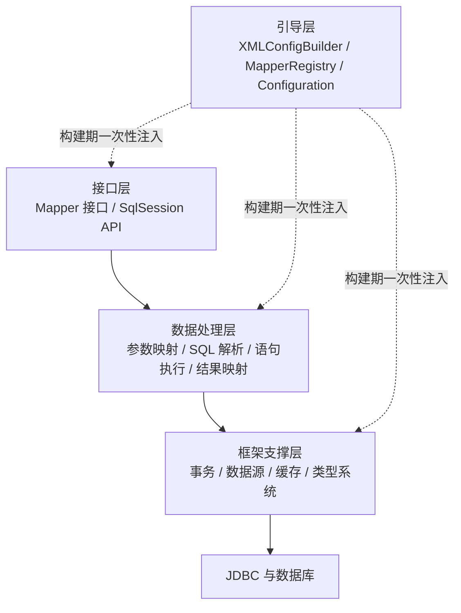
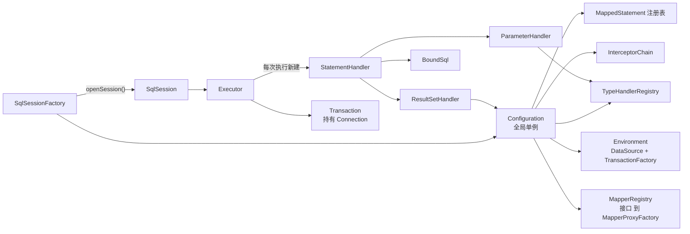
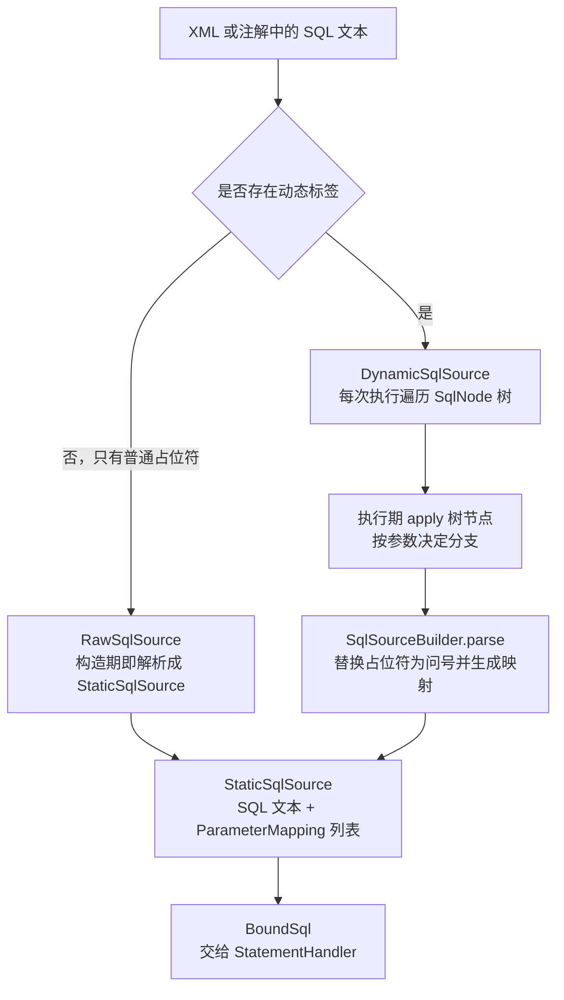
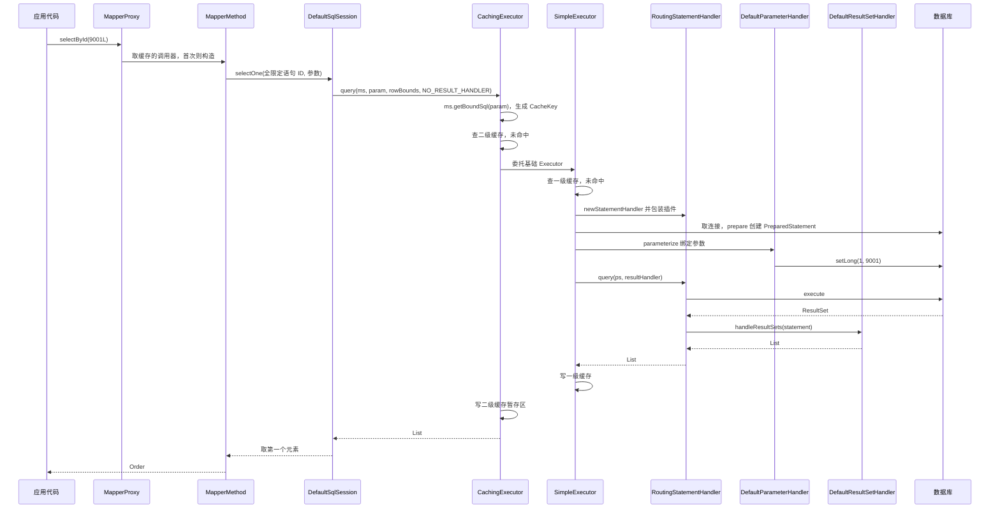
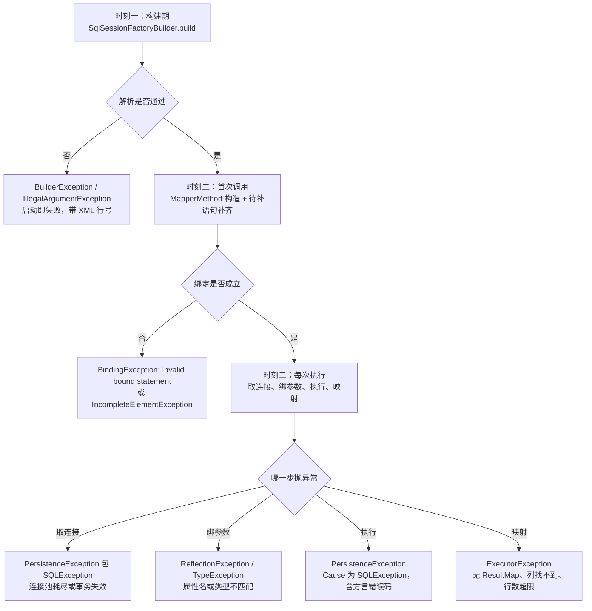

# Mybatis全局架构——从SQL到结果映射的完整链路

**摘要：**

一次看起来平平无奇的 `orderMapper.selectById(9001L)`，在 Mybatis 内部要穿过五类对象、跨越三个时刻：启动期把 XML 或注解编译成 `MappedStatement`，首次调用期把接口方法解析成一条语句 ID 并建立绑定，执行期才真正取连接、绑参数、发 SQL、映射结果。时刻分界是本篇最有用的工具，因为同一个配置在三个时刻被读会得到三种结果，同一类故障落在不同时刻也需要完全不同的排查手段。本文沿这条链路逐段走一遍，先讲清 `Configuration`、`SqlSessionFactory`、`SqlSession`、`Executor`、`StatementHandler`、`ParameterHandler`、`ResultSetHandler` 各自的职责与持有关系，再把 `Configuration` 拆开——它既是全部元数据的单一持有者，也是"改一项配置到底什么时候生效"这个问题的答案所在——然后标注链路上每一环能被什么手段干预，解释官方插件为什么只对四类对象生效、这四类对象分别在什么时机被包装，以及为什么"启动期解析错误"与"执行期绑定错误"的排查路径不能互换。文末用三个反例收束：把 `SqlSession` 当单例、在 `Configuration` 上做并发修改、忽视 `MappedStatement` 的命名空间冲突。读者读完应当能回答两个问题：这条查询到底经过了什么；想在其中插一手，代码应该挂在哪一环。

---

## 第 1 章 一次查询的四个疑问

### 1.1 贯穿案例：订单服务的一次主键查询

后面几章反复用同一段代码做靶子。订单服务的 `order-service` 里有一张 `t_order` 表，Mapper 接口与 XML 都放在 `com.acme.order.mapper` 包下：

```java
public interface OrderMapper {
    Order selectById(@Param("id") Long id);
}
```

```xml
<mapper namespace="com.acme.order.mapper.OrderMapper">
    <select id="selectById" resultType="com.acme.order.domain.Order">
        SELECT id, order_no, user_id, amount, status, created_at
        FROM t_order
        WHERE id = #{id}
          <if test="status != null">AND status = #{status}</if>
    </select>
</mapper>
```

调用点只有一行，`@Service` 里注入 `OrderMapper` 之后直接 `orderMapper.selectById(9001L)`。这行代码背后有四个问题，日常开发大概不会问，但出了事故必须答得上来。

第一个问题：数据库连接是谁取的，什么时候取的。直觉上会答"`SqlSession` 打开的时候"，实际不是。`DefaultSqlSessionFactory.openSessionFromDataSource` 确实创建了 `Transaction`，但连接要到 `Executor` 真正准备语句、调用 `getConnection()` 时才被打开；如果这条语句在缓存里命中，整个执行过程一次数据库都不会碰。

第二个问题：SQL 什么时候定稿。上面那段 XML 里有一个 `<if>`，它的判定只能在拿到参数之后做，所以"最终 SQL"必定在执行期生成；但 `#{}` 到 `?` 的替换、`ParameterMapping` 列表的生成，在只有静态标签的情况下可以提前到启动期完成。同一段 XML，落在两种不同的 `SqlSource` 实现上，代价差一个数量级。

第三个问题：为什么有的错误启动就炸，有的要等线上第一次调用。`<select>` 里把 `resultType` 写成不存在的类名，启动时 `SqlSessionFactoryBuilder.build` 直接抛异常；把 `<mapper>` 的 `namespace` 和接口全限定名写得不一致，启动毫无反应，直到某次请求打到那个方法才抛 `BindingException: Invalid bound statement`。两者的根因都在配置里，报错时机却隔了一整个部署周期。

第四个问题：插件为什么只能拦四类对象。官方文档的表格列了 `Executor`、`StatementHandler`、`ParameterHandler`、`ResultSetHandler`，不多不少。这不是约定，而是 `Configuration` 里恰好只有四处代码把对象交给了 `InterceptorChain`，第五处并不存在。

四个问题的答案分布在同一条链路的四个位置上，这也决定了本文的组织方式：先给全局，再逐段展开，最后回到时机与故障。

### 1.2 Mybatis 要解决什么：原生 JDBC 的七宗罪

理解链路为什么要长成这样，得先看它取代的那段代码。在 Mybatis 出现之前，Java 程序员操作数据库的写法几乎只有一个模板：

```java
Connection conn = null;
PreparedStatement ps = null;
ResultSet rs = null;
try {
    // 1. 注册驱动
    Class.forName("com.mysql.cj.jdbc.Driver");
    // 2. 获取连接（每次都创建新连接，性能极差）
    conn = DriverManager.getConnection(url, user, password);
    // 3. 创建 PreparedStatement
    ps = conn.prepareStatement(
        "SELECT id, name, email FROM users WHERE status = ? AND age > ?");
    // 4. 手动设置参数（参数与 SQL 分离，容易出错）
    ps.setString(1, "ACTIVE");
    ps.setInt(2, 18);
    // 5. 执行查询
    rs = ps.executeQuery();
    // 6. 手动遍历 ResultSet（每列都要手动提取）
    List<User> users = new ArrayList<>();
    while (rs.next()) {
        User user = new User();
        user.setId(rs.getLong("id"));
        user.setName(rs.getString("name"));
        user.setEmail(rs.getString("email"));
        users.add(user);
    }
    return users;
} catch (Exception e) {
    throw new RuntimeException(e);
} finally {
    // 7. 必须手动关闭资源（遗漏则连接泄漏）
    if (rs != null) try { rs.close(); } catch (Exception ignored) {}
    if (ps != null) try { ps.close(); } catch (Exception ignored) {}
    if (conn != null) try { conn.close(); } catch (Exception ignored) {}
}
```

这段代码暴露了七个结构性痛点，注意它们不是"写得丑"，而是每一处都会在生产环境以具体故障形态出现：

1. **连接管理繁琐**：遗漏 `close()` 导致连接泄漏，最终耗尽连接池，症状是应用在低峰期也报 `Connection is not available`；
2. **SQL 与 Java 代码耦合**：SQL 硬编码在字符串里，IDE 不做语法检查，改一个字段要在字符串和实体类两处同步；
3. **参数设置机械重复**：`ps.setString(1, ...)` 的序号手工维护，SQL 中间插入一个条件，后面所有索引都要重排，错位后报的是"参数类型不匹配"而不是"索引写错了"；
4. **结果集映射冗长**：每列一次 `rs.getXxx()`，新增字段必须同步改映射代码，漏改的表现是字段静默为 `null`；
5. **异常处理割裂**：`SQLException` 是受检异常，业务代码被 try-catch 淹没，真正的业务语义被埋在 `finally` 块后面；
6. **无连接池**：`DriverManager.getConnection()` 每次建立物理连接，TCP 握手加认证的开销在 1 到 100 毫秒量级，高并发时是灾难；
7. **缺乏可重用性**：每个 DAO 方法复制整套流程，一百个方法就是一百份几乎相同的样板。

Mybatis 的取舍是把第 1、3、4、5、7 条收进框架，第 2 条与第 6 条交还给开发者：SQL 仍然由人写，连接池交给 `DataSource`。这条"半自动"路线与 Hibernate 的"全自动"路线形成对照：

| 维度 | Mybatis（半自动） | Hibernate（全自动） |
| --- | --- | --- |
| SQL 控制权 | 完全由开发者掌控 | 由框架生成（HQL / Criteria） |
| 复杂查询 | 天然支持，直接写 SQL | 需要原生查询或 Criteria 拼装 |
| 学习成本 | 低，SQL 技能可直接复用 | 高，需掌握 HQL、级联、脏检查 |
| 性能调优 | 简单，优化对象就是那段 SQL | 复杂，要先还原框架生成的 SQL |
| 数据库迁移 | 困难，SQL 方言不同 | 相对容易，方言由框架处理 |
| N+1 问题 | 需手动规避，通常用 JOIN 解决 | 有延迟加载，但不慎触发时更隐蔽 |
| 状态管理 | 无持久化上下文，对象即普通 POJO | 有 Session 与脏检查，对象生命周期受管 |

国内互联网场景偏爱前者，原因不在技术优劣，而在"复杂 SQL 高频变更、DBA 需要直接介入调优"这条现实约束。代价也清楚：框架不管 SQL 好不好，只保证它被执行得正确、参数与结果映射得对。这也正是"链路"这件事值得单独研究的原因——框架兜住的那部分，恰好是出问题时最不透明的那部分。

### 1.3 本文的范围

本篇只做两件事：把一次查询在框架内部的完整路径摊开，以及标出这条路径上每一处可干预的位置。至于 `SqlSession` 与三种 `Executor` 的内部实现、动态 SQL 的 `SqlNode` 树、`TypeHandler` 的类型矩阵、`ResultMap` 的嵌套映射、两级缓存的命中条件、拦截器链的代理构造、`MapperProxy` 的方法分发、以及 Mybatis-Spring 的会话代管，各自由 `[[02 SqlSession与Executor——命令执行的核心引擎]]`、`[[03 动态SQL——OGNL表达式与SqlNode解析树]]`、`[[04 参数处理——ParameterHandler与TypeHandler的类型映射]]`、`[[05 结果映射——ResultMap的嵌套映射与延迟加载]]`、`[[06 一级缓存与二级缓存——命中条件、失效场景与生产陷阱]]`、`[[07 插件机制——Interceptor的责任链模式与分页插件原理]]`、`[[08 Mapper接口的代理实现——MapperProxy与MapperMethod]]`、`[[09 Mybatis-Spring整合原理——SqlSessionTemplate与事务管理]]` 承担。这里提到它们时只讲一件事：在链路上占据哪个位置、暴露了什么干预面。

---

## 第 2 章 五类组件的职责与协作

### 2.1 四层架构鸟瞰

Mybatis 的内部实现习惯上被切成四层，这个切法的价值在于它对应了"什么时候执行"而不是"代码放在哪个包"：



接口层是开发者日常接触的面：`SqlSession` 的 `selectOne`、`selectList`、`insert` 等方法，以及由 JDK 动态代理生成的 Mapper 接口实例。数据处理层是框架的本体，把一次 Java 方法调用拆成参数绑定、语句准备、语句执行、结果映射四段。框架支撑层提供横切能力，事务与数据源决定连接从哪来、什么时候归还，缓存决定这次调用要不要真的访问数据库，类型系统决定 Java 值与 JDBC 值怎么互转。引导层只在启动时活跃，把 XML 与注解翻译成 `Configuration` 里的元数据。

虚线箭头是全图最容易被忽略的部分：引导层注入的是**元数据**，不是对象。启动结束后引导层的解析器对象全部可以被回收，留下的只有 `Configuration` 与它内部的注册表。这条性质决定了后面所有"运行期还能不能改配置"的问题都需要回到一个判断——那项配置是在启动期被读走并固化进元数据的，还是在运行期每次现读的。

### 2.2 谁持有谁：对象之间的静态依赖

四层图讲的是职责，讲不了持有关系。把持有关系画出来，链路就有一半清楚了：



读这张图有两个要点。一个是反向依赖：`StatementHandler`、`ParameterHandler`、`ResultSetHandler` 都是执行期临时对象，但它们几乎每个动作都要回查 `Configuration`，`ParameterHandler` 找 `TypeHandler`，`ResultSetHandler` 找 `ResultMap`。这意味着 `Configuration` 的生命周期必须覆盖整个应用，任何"用完就丢"的用法都会把元数据一起丢掉。

另一个是创建者的分工：`SqlSessionFactory` 只负责造会话，`Executor` 由 `Configuration.newExecutor` 造，三个 Handler 由 `Configuration.newStatementHandler`、`newParameterHandler`、`newResultSetHandler` 造。把工厂方法集中放在 `Configuration` 上不是随手的设计，它让"替换某个组件"有了一个统一的入口——第 3.6 节会用到这一点。

### 2.3 五类核心组件的生命周期

职责之外，生命周期是第二重要的属性，它直接决定了一个对象能不能存实例字段、能不能被复用、线程安全边界在哪：

| 组件 | 职责 | 创建者 | 存活范围 | 线程安全 |
| --- | --- | --- | --- | --- |
| `Configuration` | 持有全部元数据与全局开关 | `SqlSessionFactoryBuilder` 或 `SqlSessionFactoryBean` | 应用级 | 构建后按只读使用，写不安全 |
| `SqlSessionFactory` | 创建 `SqlSession`，持有 `Configuration` | 同上 | 应用级 | 是 |
| `SqlSession` | 门面，聚合一次会话的状态 | `SqlSessionFactory.openSession` | 请求级或方法级 | 否 |
| `Executor` | 缓存判定与语句调度，持有 `Transaction` | `Configuration.newExecutor` | 随 `SqlSession` | 否 |
| `StatementHandler` | 准备 `Statement`、绑定参数、执行、触发映射 | `Configuration.newStatementHandler` | 单次语句执行 | 否 |
| `ParameterHandler` | 把参数值写进占位符 | `Configuration.newParameterHandler` | 单次语句执行 | 否 |
| `ResultSetHandler` | 把 `ResultSet` 转成对象 | `Configuration.newResultSetHandler` | 单次语句执行 | 否 |
| `MappedStatement` | 一条语句的完整定义 | 解析器 | 应用级 | 不可变 |
| `TypeHandler` | Java 与 JDBC 类型的互转 | `TypeHandlerRegistry` | 应用级 | 通常无状态 |
| `BoundSql` | 本次执行的 SQL 文本与参数映射 | 执行期 | 单次语句执行 | 否 |
| `Transaction` | 事务边界与连接持有 | `TransactionFactory` | 随 `SqlSession` | 否 |

"存活范围"这一列解释了大量实践问题。`SqlSession` 一旦跨请求共享，它持有的 `Executor`、`Transaction`、一级缓存就一起跨请求共享；三个 Handler 是单次执行对象，所以任何写进实例字段的状态都留不到下一次执行，插件想跨语句保存信息只能走 `Invocation` 参数或线程上下文。

### 2.4 一个便于记忆的比喻

把一次查询想成去一家老式餐厅吃饭。`Configuration` 是墙上的菜单与后厨的作业指导书，开店前就定好，客人点单时只被查阅不被重写；`SqlSessionFactory` 是餐厅本身；`SqlSession` 是服务员，一个客人对应一个，负责把客人的话翻译成后厨能懂的工单；`Executor` 是后厨调度台，先看这道菜是不是已经在备餐台上了（缓存），在就直接端走，不在才把工单派下去；`StatementHandler` 是灶台，负责起火、下锅、出锅；`ParameterHandler` 是配料，负责把客人指定的咸淡换成具体克数；`ResultSetHandler` 是装盘，把锅里出来的东西摆成客人认得的样子。

比喻到这里要立刻加限定：餐厅里服务员可以同时招呼好几桌，而 `SqlSession` 不能同时服侍多个线程；后厨调度台会记住备餐台上有什么，而 `Executor` 的一级缓存默认只在同一个 `SqlSession` 内有效，出了这个会话就没了。这两条限定恰好对应后文两个高频事故。

---

## 第 3 章 Configuration：全局配置的单一持有者

### 3.1 它到底装了什么

`org.apache.ibatis.session.Configuration` 是一个非常大的类，字段数量过百（不同小版本有增删，以对应版本源码为准）。按用途归类比逐个列字段有用，四类内容各有各的生效时机：

```java
public class Configuration {
    // 第一类：开关（settings），决定行为分支
    protected boolean cacheEnabled = true;              // 是否装饰二级缓存
    protected boolean lazyLoadingEnabled = false;       // 是否启用延迟加载
    protected boolean aggressiveLazyLoading = false;    // 触发任一方法是否加载全部延迟属性
    protected boolean useGeneratedKeys = false;         // 是否使用 JDBC 自动生成主键
    protected boolean mapUnderscoreToCamelCase = false; // 下划线列名到驼峰属性的自动映射
    protected LocalCacheScope localCacheScope = LocalCacheScope.SESSION;
    protected JdbcType jdbcTypeForNull = JdbcType.OTHER;
    protected ExecutorType defaultExecutorType = ExecutorType.SIMPLE;
    protected Integer defaultStatementTimeout;

    // 第二类：注册表，解析产物落在这里
    protected final Map<String, MappedStatement> mappedStatements; // key 为 namespace.id
    protected final Map<String, Cache> caches;                     // 二级缓存，key 为 namespace
    protected final Map<String, ResultMap> resultMaps;
    protected final Map<String, ParameterMap> parameterMaps;
    protected final Map<String, KeyGenerator> keyGenerators;
    protected final TypeHandlerRegistry typeHandlerRegistry;
    protected final TypeAliasRegistry typeAliasRegistry;
    protected final MapperRegistry mapperRegistry;

    // 第三类：策略与工厂对象
    protected ObjectFactory objectFactory = new DefaultObjectFactory();
    protected ObjectWrapperFactory objectWrapperFactory = new DefaultObjectWrapperFactory();
    protected ReflectorFactory reflectorFactory = new DefaultReflectorFactory();

    // 第四类：环境与拦截链
    protected Environment environment;                 // id + DataSource + TransactionFactory
    protected final InterceptorChain interceptorChain = new InterceptorChain();
    protected String databaseId;                       // 多数据库厂商时用于语句筛选
}
```

四类内容的差别在于"谁消费它们、什么时候消费"。开关类字段被散落在十来个类里现读，`localCacheScope` 由 `BaseExecutor` 每次查询时读，`jdbcTypeForNull` 由参数处理链路在绑定空值时读。注册表类字段在启动期被写入、在运行期被反查，写入者是解析器，读取者是三个 Handler。策略类字段被 `MetaObject`、结果对象创建、属性反射用到。环境字段被 `openSessionFromDataSource` 读取，拦截链则被四个工厂方法读取。

把这张分类记在脑子里，"改配置为什么没反应"就不再是玄学：改的字段属于哪一类，就决定了它能不能立即生效。

### 3.2 四张注册表的分工

| 注册表 | key 的形态 | 写入者 | 运行期读取者 | 冲突时的表现 |
| --- | --- | --- | --- | --- |
| `mappedStatements` | `namespace.id` | `XMLStatementBuilder`、`MapperAnnotationBuilder` | `SqlSession`、`MapperMethod` | 重复注册抛 `IllegalArgumentException` |
| `resultMaps` | `namespace.id` 或短 id | `XMLMapperBuilder`、`MapperAnnotationBuilder` | `ResultSetHandler`、`MappedStatement` | 重复注册抛异常，引用缺失则延迟补齐 |
| `caches` | `namespace` | `XMLMapperBuilder` 的 `<cache>`、`<cache-ref>` | `CachingExecutor` | 同名缓存重复定义抛异常 |
| `typeHandlerRegistry` | Java 类型 × `JdbcType` | 启动期批量注册加自定义注册 | `ParameterHandler`、`ResultSetHandler` | 后注册覆盖同 key，静默生效 |

`mappedStatements` 是四张表里最要紧的一张，一条 SQL 能否被执行，全看这张表里有没有对应的 key。它的 value 是 `MappedStatement`，一个不可变对象，字段在构造时通过内部 `Builder` 一次性赋齐，没有 setter。这个设计是有意的：语句定义一旦进了注册表就不再改动，运行期只读，避免了并发可见性问题。

`typeHandlerRegistry` 的覆盖语义值得单独提一句。自定义 `TypeHandler` 注册时如果 Java 类型与 `JdbcType` 二元组和已有条目相同，新条目直接覆盖旧条目，既不告警也不保留备份。所以"我写了一个自定义 `TypeHandler` 但没生效"的排查方向，第一优先不是看注解写没写对，而是看有没有第二个同 key 的注册把它盖掉了——第 4 章讲解析顺序时会给出这类覆盖的一个具体来源。

### 3.3 StrictMap：短名解析与模糊性

`mappedStatements` 与 `resultMaps` 的声明类型是 `Map`，实际实例是 `Configuration` 的内部类 `StrictMap`。它在 `HashMap` 上补了两件事：拒绝重复 key，以及支持用短名取用。

```java
// StrictMap.put 的核心逻辑（简化）
public V put(String key, V value) {
    if (containsKey(key)) {
        throw new IllegalArgumentException(name + " already contains value for " + key);
    }
    if (key.contains(".")) {
        final String shortKey = getShortName(key);   // 取最后一个点之后的部分
        if (super.get(shortKey) == null) {
            super.put(shortKey, value);
        } else {
            super.put(shortKey, (V) new Ambiguity(shortKey)); // 占位符，标记短名歧义
        }
    }
    return super.put(key, value);
}
```

两件事的后果都容易被低估。重复 key 直接抛异常，意味着同一个 `namespace.id` 被注册两次时，**启动就会失败**——这是好事，属于快速失败。短名机制则相反，它是一个方便功能变成了事故源：注册时把 `selectById` 这样的短名也放进表里，如果两个 namespace 都有 `selectById`，短名位置就被一个 `Ambiguity` 占位符占据，此后任何用短名取用的代码都会得到一个明确的异常，而不是随机返回其中一条。

所以 `sqlSession.selectOne("selectById", 1L)` 这种写法在单 Mapper 工程里能跑，在多 Mapper 工程里一旦撞名就炸，而且炸的位置在调用点，不在注册点。这类问题的排查成本很高，因为异常消息指向的是"名字歧义"，而真正要改的是把调用改成全限定名。结论只有一条：语句 ID 一律写全限定名，短名只用于人读日志。

### 3.4 构建过程：从两份 XML 到一棵元数据树

`Configuration` 由 `XMLConfigBuilder` 解析全局配置文件构建，再由 `SqlSessionFactoryBuilder` 封装成工厂：

```xml
<?xml version="1.0" encoding="UTF-8" ?>
<!DOCTYPE configuration PUBLIC "-//mybatis.org//DTD Config 3.0//EN"
    "http://mybatis.org/dtd/mybatis-3-config.dtd">
<configuration>
    <settings>
        <setting name="cacheEnabled" value="true"/>
        <setting name="lazyLoadingEnabled" value="true"/>
        <setting name="mapUnderscoreToCamelCase" value="true"/>
        <setting name="defaultExecutorType" value="SIMPLE"/>
        <setting name="logImpl" value="SLF4J"/>
    </settings>

    <typeAliases>
        <package name="com.acme.order.domain"/>
    </typeAliases>

    <plugins>
        <plugin interceptor="com.github.pagehelper.PageInterceptor">
            <property name="helperDialect" value="mysql"/>
        </plugin>
    </plugins>

    <environments default="development">
        <environment id="development">
            <transactionManager type="JDBC"/>
            <dataSource type="POOLED">
                <property name="driver" value="com.mysql.cj.jdbc.Driver"/>
                <property name="url" value="jdbc:mysql://localhost:3306/order_db"/>
                <property name="username" value="app"/>
                <property name="password" value="***"/>
            </dataSource>
        </environment>
    </environments>

    <mappers>
        <package name="com.acme.order.mapper"/>
    </mappers>
</configuration>
```

`XMLConfigBuilder.parseConfiguration` 的调用次序与 XML 里的书写次序并不完全一致，3.5.x 的次序大致是：`<properties>`、把 `<settings>` 读成一份 `Properties` 暂存、`<typeAliases>`、`<plugins>`、`<objectFactory>` 与两个 wrapper/reflector 工厂、再把暂存的 settings 真正 apply 到 `Configuration`、`<environments>`、`<databaseIdProvider>`、`<typeHandlers>`、`<mappers>`（次序以对应版本源码为准）。

这个次序里有两处与直觉相反，且都有实际后果。插件在 settings 真正应用之前就完成实例化与 `setProperties`，所以插件若在初始化阶段读 `Configuration` 上的开关，读到的是默认值而非 XML 里配的值；`<typeHandlers>` 排在 `<environments>` 与 `<databaseIdProvider>` 之后、`<mappers>` 之前，所以自定义 `TypeHandler` 的注册早于语句解析，`MappedStatement` 里的 `ParameterMapping` 能正确关联到它。

`<mappers>` 是唯一会触发 Mapper XML 解析的节点。它有三种写法：`<mapper resource>` 按 classpath 路径加载，`<mapper url>` 按绝对 URL，`<mapper class>` 与 `<package>` 按类加载并由 `MapperAnnotationBuilder` 解析注解。无论哪种，最后的落点都是 `Configuration.mapperRegistry` 与 `mappedStatements`。

### 3.5 运行期只读的边界：改配置什么时候有用

这是本章最需要记住的一节。判断一项配置改动有没有用，唯一可靠的办法是找它在源码里被读取的那一行，而读取点按时刻可以分成三类：

| 读取时刻 | 典型配置 | 改动后的效果 | 原因 |
| --- | --- | --- | --- |
| 语句解析期 | `<select>` 上的 `timeout`、`fetchSize`、`statementType`、`resultSetType`、`useCache`、`flushCache`、`resultMap`；`<settings>` 里的 `useGeneratedKeys`、`defaultScriptingLanguage`、`databaseId` | 对已解析的语句无效 | 值被固化进 `MappedStatement` 的不可变字段 |
| 会话创建期 | `cacheEnabled`、`defaultExecutorType` | 对已打开的会话无效，对新会话生效 | `Configuration.newExecutor` 在造 `Executor` 时读 |
| 每次执行期 | `localCacheScope`、`jdbcTypeForNull`、`mapUnderscoreToCamelCase`、`lazyLoadingEnabled` | 可能立即生效 | 每次执行时现读 |

举一个具体的例子说明第一类。`useGeneratedKeys` 既可以写在 `<insert>` 标签上，也可以在 `<settings>` 里配成全局默认值；解析一条 `<insert>` 时，`XMLStatementBuilder` 用 `context.getBooleanAttribute("useGeneratedKeys", configuration.isUseGeneratedKeys())` 取一次值，取到的结果直接固化进该条 `MappedStatement`。也就是说，这个"全局配置"的真实作用方式是"解析期复制一份到每条语句上"，运行期再改全局值，已经解析完的几百条插入语句一条都不会跟着变，主键照样不回填。这就是"配置改了没反应"最典型的形态——配置本身没错，是生效时刻已经过去了。

第二类的例子是 `cacheEnabled`。它在 `Configuration.newExecutor` 里决定要不要把基础 `Executor` 包一层 `CachingExecutor`。已经打开的 `SqlSession` 里，那层装饰早就装好了（或者没装），改开关不会拆掉它；新开的会话才会按新值构造。这也解释了一种偶发现象：改了开关之后"部分请求生效、部分不生效"，差异来自连接池里会话的创建时间。

第三类才是真的能热改的。`localCacheScope` 在 `BaseExecutor` 每次查询时读，把它从 `SESSION` 改成 `STATEMENT`，下一次查询立刻只做语句级缓存。不过热改它同样有前提：你得能拿到 `Configuration` 的可写引用，并且接受"改的瞬间正在执行的查询看到的是旧值或新值之一"这种边界不确定性。

还有一条常被忽略的性质：`Configuration` 并非严格的冻结对象。解析时若遇到 `<resultMap>` 跨文件引用尚未定义的情况，语句会被放进 `incompleteStatements` 之类的待补集合，等到 `getMappedStatement(id, true)` 触发 `buildAllStatements()` 时才补齐。也就是说，"首次执行某条语句"这个动作可能引起一次隐式写入。官方对 `Configuration` 的线程安全承诺是"构建完成后只读"，这是一条使用纪律，不是类型系统给出的保证。

### 3.6 被忽略的扩展通道：工厂方法

`Configuration` 上有四个工厂方法，链路上所有的可包装对象都由它们创建：

```java
public Executor newExecutor(Transaction transaction, ExecutorType executorType) { /* ... */ }
public StatementHandler newStatementHandler(Executor executor, MappedStatement mappedStatement,
        Object parameterObject, RowBounds rowBounds, ResultHandler resultHandler, BoundSql boundSql) { /* ... */ }
public ParameterHandler newParameterHandler(MappedStatement mappedStatement,
        Object parameterObject, BoundSql boundSql) { /* ... */ }
public ResultSetHandler newResultSetHandler(Executor executor, MappedStatement mappedStatement,
        RowBounds rowBounds, ParameterHandler parameterHandler, ResultHandler resultHandler,
        BoundSql boundSql) { /* ... */ }
```

这四个方法都是 `public` 且非 `final`，意味着继承 `Configuration` 覆写它们是一条合法的扩展路径——而且是这四类链上对象唯一能被换成另一种实现、而不是只加一层代理的路径。插件用 JDK 动态代理包装，只能改方法的前后行为；覆写工厂方法可以直接换成另一个类，甚至换掉整个 `Executor` 策略。

Spring Boot 场景下这条通道被封在一个配置钩子里：`ConfigurationCustomizer` 可以在自动配置构建 `SqlSessionFactory` 之前拿到 `Configuration` 并做修改，`SqlSessionFactoryBean` 也允许直接注入一个自定义 `Configuration`。这比写一个插件省事，代价是它绑定在 Spring 的装配顺序上，纯 Mybatis 工程用不了同一套代码。

---

## 第 4 章 启动期：SQL 如何变成 MappedStatement

### 4.1 两条入口与一条硬约束

Mapper 的定义有两个来源，注解与 XML。注解由 `MapperAnnotationBuilder` 解析，XML 由 `XMLMapperBuilder` 解析，两条通道最终写入同一张 `mappedStatements` 表，因此它们之间会互相冲突。

硬约束只有一条：XML 的 `namespace` 必须等于 Mapper 接口的全限定名。这条约束不写在任何 XSD 里，因为它跨越了两个文件系统对象——一边是 XML 属性，一边是 Java 类型。框架在运行期验证它：`MapperMethod` 构造时用 `接口全限定名 + "." + 方法名` 拼出语句 ID 去查表，查不到就抛 `BindingException: Invalid bound statement (not found)`。

这条约束的失败形态值得单独描述，因为它是 Mybatis 工程里出现频率最高的启动期问题，而且报错时机被推迟了：

- **命名空间拼写不一致**：接口是 `com.acme.order.mapper.OrderMapper`，XML 写成 `com.acme.order.mapper.orderMapper`（大小写）或少了某一段包名。启动无异常。
- **XML 没被打包进产物**：Maven 默认只把 `src/main/java` 下的 `.java` 编译进 `target/classes`，`*.xml` 除非放在 `src/main/resources` 或配置了 `resource` 过滤，否则被丢弃。本地 IDE 直接读源码目录能跑，打成 jar 之后失效。
- **`mapper-locations` 通配符用错**：`classpath:mapper/**/*.xml` 只会取第一个匹配的 classpath 根，多模块工程里其余 jar 中的同名目录不会被扫描；必须写 `classpath*:mapper/**/*.xml`。
- **`@MapperScan` 包范围不含**：`MapperRegistry` 里没有这个接口，`MapperProxyFactory` 也就没被创建，注入点会先报 `NoSuchBeanDefinitionException`。

四种形态的运行期症状高度相似，排查时先看启动日志里有没有这个 namespace 的解析记录，再看 jar 里有没有对应的 XML 文件，最后才去怀疑代码。这个顺序能省掉大部分无谓的调试。

### 4.2 解析顺序与"未完成解析"机制

`XMLMapperBuilder` 解析一个 Mapper XML 的次序是：先处理缓存节点（`<cache-ref>`、`<cache>`）与 `<parameterMap>`，再处理 `<resultMap>`，然后处理 `<sql>` 片段，最后才处理四条语句标签。这个次序不是随意的，`<resultMap>` 必须先于语句，否则语句解析时找不到它引用的映射。

即便如此，跨文件的引用仍然可能先于定义出现：A 文件里的 `<select>` 引用了 B 文件里的 `<resultMap>`，而 B 的解析排在后面。框架对这种情况的处理不是报错，而是把当前解析器对象挂进 `Configuration` 的待补集合（`incompleteStatements`、`incompleteResultMaps`、`incompleteCacheRefs` 等），捕获 `IncompleteElementException` 之后继续往下走。

补齐发生在两个时刻：解析完全部 Mapper 后调用的 `parsePending*` 方法，以及任何一次带 `validateIncompleteStatements` 的元数据访问。如果补齐仍然失败，异常会在那一刻抛出，而不是在解析那一刻。这解释了一类很让人困惑的现象：`IncompleteElementException: Could not find result map 'xxx'` 会出现在"应用启动完成之后的第一条查询"上，日志的时间戳与真正的根因（XML 里少写一个 `<resultMap>`）隔了几十秒甚至几分钟。

### 4.3 SqlSource：SQL 的三种编译形态

`<select>` 标签内的 SQL 文本被解析成 `SqlSource`，这是决定"SQL 何时定稿"的字段。三种实现对应三种时机：



`StaticSqlSource` 是最终产物，只持有两样东西：已经替换好 `?` 的 SQL 文本，以及与之等长的 `ParameterMapping` 列表。`RawSqlSource` 在构造时就调用 `SqlSourceBuilder.parse` 得到它，`DynamicSqlSource` 则在每次 `getBoundSql` 里先遍历 `SqlNode` 树拼出文本、再解析一次。

| 形态 | 何时解析 `#{}` | 每次执行的额外工作 | 适用面 |
| --- | --- | --- | --- |
| `StaticSqlSource` | 由上游在构造期完成 | 无 | 内部产物，不直接配置 |
| `RawSqlSource` | 构造期 | 无 | 只有 `#{}`、没有 `<if>` 的语句 |
| `DynamicSqlSource` | 每次执行 | 遍历 `SqlNode` 树、重新解析文本、生成 `BoundSql` | 含动态标签或 `${}` 的语句 |

表格第三列是性能差异的根源。一条纯静态的语句，从第二次执行开始就没有任何 SQL 构建成本；一条带 `<if>` 的语句，每次执行都要遍历树、拼字符串、跑一次解析器。对于每秒数千次调用的查询，这个差别的量级不小，而消除它的手段往往很简单——把不必要的动态标签去掉，或者用 `<where>` 之类的结构避免手写 `1=1`。

上一段提到的案例里那段 XML 带一个 `<if>`，所以它是 `DynamicSqlSource`，每次调用都会走一遍树。这段"每次"的开销究竟有多大，取决于 `SqlNode` 树有多少节点、`#{}` 有多少个，不做实测无法给数，但机制上的结论是确定的：动态标签的数量与每次查询的构建成本成正比。

### 4.4 MappedStatement：被固化的那些值

`MappedStatement` 是 `Configuration` 里最重的存储单元，每一个 `<select>`、`<insert>`、`<update>`、`<delete>` 标签，或每一个 `@Select`、`@Insert` 注解，都产出这样一个对象：

```java
public final class MappedStatement {
    private String id;                        // "com.acme.order.mapper.OrderMapper.selectById"
    private SqlCommandType sqlCommandType;    // SELECT / INSERT / UPDATE / DELETE
    private SqlSource sqlSource;              // 静态或动态，决定 SQL 何时定稿
    private List<ResultMap> resultMaps;       // 结果映射定义
    private ParameterMap parameterMap;        // 参数映射定义（多为空壳）
    private Cache cache;                      // 关联的二级缓存，可为 null
    private boolean useCache;                 // 是否允许结果进二级缓存
    private boolean flushCacheRequired;       // 执行后是否清缓存，写语句默认 true
    private StatementType statementType;      // STATEMENT / PREPARED / CALLABLE
    private ResultSetType resultSetType;
    private Integer fetchSize;
    private Integer timeout;
    private KeyGenerator keyGenerator;        // 主键生成策略
    private LanguageDriver lang;              // 动态 SQL 的方言驱动
    private Log statementLog;                 // 该语句专属的日志对象，解析期创建
}
```

这份字段清单是理解"启动期"的钥匙，因为它们的共同点是**全部在构造时定值、此后只读**。`statementType` 决定了运行期创建哪一个 `StatementHandler` 实现，`resultSetType` 与 `fetchSize` 会被直接传给 `Connection.prepareStatement`，`timeout` 会成为 `Statement` 的查询超时，`statementLog` 在构造时就绑定了 logger——换句话说，日志对象的选取发生在解析期而非执行期，一条语句用哪个 logger 从它被解析那一刻就定了。

`id` 的格式是 `namespace.statementId`。它不是给开发者用的标识符，而是运行期查表的唯一键：`sqlSession.selectOne("com.acme.order.mapper.OrderMapper.selectById", 1L)` 的整个语义就是拿这个字符串去 `mappedStatements` 里取对象。所有命名空间冲突问题的本质，都是"两条不同的语句产出了同一个字符串键"。

### 4.5 启动期的失败形态

启动期错误有一个共同特征：抛出点都在 `SqlSessionFactoryBuilder.build()` 内部，异常类型多为 `BuilderException`、`IllegalArgumentException`、`TypeException`，外层再包一层带上下文的说明。把常见形态列出来，比记住异常类名更有用：

| 首行错误（形如） | 抛出点 | 根因方向 | 处置 |
| --- | --- | --- | --- |
| `BuilderException: Error parsing Mapper XML` + `SAXParseException` | `XMLMapperBuilder` | XML 语法或 DTD 不合规，标签未闭合、属性拼错 | 按 `SAXParseException` 给的行号定位 |
| `BuilderException: Error resolving class ... Could not resolve type alias 'Xxx'` | `TypeAliasRegistry` | `resultType` 或 `parameterType` 用了未注册的别名 | 写全限定类名，或补上 `<typeAliases>` 扫描包 |
| `IllegalArgumentException: ... already contains value for ...` | `StrictMap.put` | 同一 `namespace.id` 被注册两次，常见于注解与 XML 双写、或两个 XML 的 namespace 重名 | 删掉重复定义，或改用不同 id |
| `BuilderException: Could not find result map 'xxx'` | `StrictMap.get` | `<resultMap>` 未定义或 id 拼错 | 补定义；若为跨文件引用则检查待补集合 |
| `TypeException: Could not set parameters for mapping` | `ParameterMapping` 构建 | `jdbcType` 与 Java 类型不匹配 | 显式指定 `jdbcType` 或换 `TypeHandler` |
| `PersistenceException: Error building SqlSession` | `SqlSessionFactoryBuilder` | 以上之一的统一外壳，`Cause` 才是真凶 | 一律往 `Cause` 深处读三层 |

读这类日志有个固定技巧：`PersistenceException`、`BuilderException` 都是包装层，真正的根因在 `Cause` 链的最里层，而最里层的消息通常只有一行、信息极少，真正有用的是中间那一层的"上下文"消息（`The error occurred in ...`、`The XML location is ...`）。三层一起看才能定位文件与行号。

---

## 第 5 章 执行期：一次查询的逐步展开

### 5.1 全链路时序

`orderMapper.selectById(9001L)` 从代理对象到结果对象，中间经过的对象与方法：



这张图上有四个"回流点"值得盯住，它们是排查性能问题时的第一现场：`getBoundSql` 在缓存查询之前，所以动态 SQL 的构建成本无法被缓存省掉；`newStatementHandler` 在连接获取之后，所以构造 `StatementHandler` 本身不触碰数据库；`parameterize` 在 `prepare` 之后，所以 `StatementHandler.prepare` 拦截点看不到参数值；写缓存分别在 `SimpleExecutor` 与 `CachingExecutor` 两级完成，位置不同、作用域不同。

### 5.2 第一段：Mapper 接口到语句 ID

`orderMapper` 是 `MapperRegistry` 在启动期用 `MapperProxyFactory` 造出来的 JDK 动态代理对象，`OrderMapper` 并没有实现类。代理的 `invoke` 把方法调用翻译成两件事：找到这个方法对应的语句 ID，以及把零散参数整理成一个参数对象。这两件事都很轻，且结果被缓存——同一个方法第二次调用不再重复分析签名。

这一段在链路上是"只读"的：它不碰连接，不碰缓存，只做查表与参数封装。它的失败形态也很集中，全部是"查不到"或"参数整理不了"，前者是 `Invalid bound statement`，后者是 `ReflectionException: There is no getter for property named 'xxx'`。方法分发的完整规则见 `[[08 Mapper接口的代理实现——MapperProxy与MapperMethod]]`。

### 5.3 第二段：SqlSession 是门面，不是引擎

`DefaultSqlSession` 的查询方法短得几乎没有逻辑：

```java
public <T> T selectOne(String statement, Object parameter) {
    List<T> list = this.selectList(statement, parameter);
    if (list.size() == 1) {
        return list.get(0);
    } else if (list.size() > 1) {
        throw new TooManyResultsException("Expected one result but found: " + list.size());
    }
    return null;
}

public <E> List<E> selectList(String statement, Object parameter, RowBounds rowBounds) {
    MappedStatement ms = configuration.getMappedStatement(statement);
    return executor.query(ms, wrapCollection(parameter), rowBounds, Executor.NO_RESULT_HANDLER);
}
```

`selectOne` 的实现方式揭示了一个常被忽略的事实：框架并不知道"这条查询只会返回一条"，它老老实实执行了一次 `selectList`，拿到列表再判断大小。所以主键查询在 Mybatis 里天然是"先取全量、再取第一个"，如果 SQL 忘了写 `LIMIT 1` 又碰巧命中了多行，得到的是 `TooManyResultsException` 而不是第一条。这个设计选择保证了语义严格，代价是一次多余的结果集遍历。

`wrapCollection(parameter)` 处理的是单参数场景：参数是 `List` 或数组时，包成一个带 `collection` 或 `array` 键的 `Map`，供 `<foreach>` 使用。这个包装发生在会话层，所以 `<foreach collection="list">` 里的 `list` 之类名字并不是用户定义的，而是框架在这里塞进去的。

`SqlSession` 自身的状态只有三样：持有的 `Executor`、`dirty` 标志、以及 `configuration` 引用。`dirty` 在每次写操作后置真，`rollback(force)` 依据它决定是否真的回滚——这是"没有写操作就不发回滚语句"的优化。三样状态都不做并发保护，这是 `SqlSession` 不具备线程安全性的直接原因。

### 5.4 第三段：Executor 的两级缓存与调度

`Executor` 是链路上承上启下的枢纽，它的查询逻辑分两层。外层是 `CachingExecutor`，负责二级缓存：

```java
public <E> List<E> query(MappedStatement ms, Object parameterObject,
                         RowBounds rowBounds, ResultHandler resultHandler) {
    BoundSql boundSql = ms.getBoundSql(parameterObject);
    CacheKey key = createCacheKey(ms, parameterObject, rowBounds, boundSql);
    return query(ms, parameterObject, rowBounds, resultHandler, key, boundSql);
}

public <E> List<E> query(MappedStatement ms, Object parameterObject, RowBounds rowBounds,
                         ResultHandler resultHandler, CacheKey key, BoundSql boundSql) {
    Cache cache = ms.getCache();
    if (cache != null) {
        flushCacheIfRequired(ms);                     // 写语句先清缓存
        if (ms.isUseCache() && resultHandler == null) {
            List<E> list = (List<E>) tcm.getObject(cache, key);
            if (list == null) {
                list = delegate.query(ms, parameterObject, rowBounds, resultHandler, key, boundSql);
                tcm.putObject(cache, key, list);      // 事务提交前只进暂存区
            }
            return list;
        }
    }
    return delegate.query(ms, parameterObject, rowBounds, resultHandler, key, boundSql);
}
```

内层是基础 `Executor`（默认 `SimpleExecutor`，由 `BaseExecutor` 统一实现一级缓存与模板流程）：

```java
public <E> List<E> query(MappedStatement ms, Object parameter, RowBounds rowBounds,
                         ResultHandler resultHandler, CacheKey key, BoundSql boundSql) {
    if (closed) {
        throw new ExecutorException("Executor was closed.");
    }
    List<E> list = resultHandler == null ? (List<E>) localCache.getObject(key) : null;
    if (list != null) {
        handleLocallyCachedOutputParameters(ms, key, parameter, boundSql);
    } else {
        list = queryFromDatabase(ms, parameter, rowBounds, resultHandler, key, boundSql);
    }
    return list;
}
```

这段代码里有三个细节，比"三级缓存"这个说法有用得多。第一行 `if (closed)` 说明会话关闭后用同一个 `Executor` 会得到一个明确异常，这是第 10 章反例一的直接证据。第二行 `resultHandler == null` 的三元表达式说明自定义 `ResultHandler` 的查询压根不走一级缓存——逐行回调的语义与"缓存整个列表"不兼容。`queryFromDatabase` 内部在拿到结果后立刻 `localCache.putObject`，所以一级缓存的写入位置在 `BaseExecutor`，二级缓存的写入位置在 `CachingExecutor`，两者不在同一层。

三种基础 `Executor` 的差异（`SimpleExecutor` 每次新建语句、`ReuseExecutor` 在会话内复用语句、`BatchExecutor` 攒批）与 `CachingExecutor` 的装饰器结构属于 `[[02 SqlSession与Executor——命令执行的核心引擎]]` 的范围，这里只需要记住它们在链路上的位置：`Executor` 是唯一同时持有 `Transaction` 与缓存的组件，因此"连接从哪来"和"这次要不要访问数据库"这两个决定都发生在这里。

### 5.5 第四段：从语句准备到参数绑定

`SimpleExecutor` 真正干活的方法只有几行：

```java
// SimpleExecutor.doQuery 的主干
Statement stmt = null;
try {
    Configuration configuration = ms.getConfiguration();
    StatementHandler handler = configuration.newStatementHandler(
            this, ms, parameter, rowBounds, resultHandler, boundSql);
    stmt = prepareStatement(handler, ms.getStatementLog());
    return handler.query(stmt, resultHandler);
} finally {
    closeStatement(stmt);
}

// prepareStatement 的三步
private Statement prepareStatement(StatementHandler handler, Log statementLog) throws SQLException {
    Statement stmt;
    Connection connection = getConnection(statementLog);   // 连接在这里才真正打开
    stmt = handler.prepare(connection, transaction.getTimeout());
    handler.parameterize(stmt);                            // 绑定参数
    return stmt;
}
```

三步的次序是理解拦截点的关键。连接获取在最前，`handler.prepare` 在中间，`handler.parameterize` 在最后。这也回答了第 1 章的第一个问题：连接是懒开的，第一次需要发语句时才从 `Transaction` 里取，在此之前 `SqlSession` 只持有一个未打开连接的 `Transaction` 对象。

`StatementHandler` 按 `MappedStatement.statementType` 分三种实现，但运行期实际被创建的永远是 `RoutingStatementHandler`，它按类型把调用委托给真正的实现。真正的 `prepare` 在 `BaseStatementHandler` 里，它按顺序做三件事：让子类实例化语句、设置查询超时、设置 `fetchSize`。实例化这一步由子类覆写，`PreparedStatementHandler` 的实现是：

```java
protected Statement instantiateStatement(Connection connection) throws SQLException {
    String sql = boundSql.getSql();   // 占位符已替换成问号的最终文本

    if (mappedStatement.getKeyGenerator() instanceof Jdbc3KeyGenerator) {
        String[] keyColumnNames = mappedStatement.getKeyColumns();
        if (keyColumnNames == null) {
            // 需要取回自动生成的主键，必须显式声明 RETURN_GENERATED_KEYS
            return connection.prepareStatement(sql, PreparedStatement.RETURN_GENERATED_KEYS);
        } else {
            return connection.prepareStatement(sql, keyColumnNames);
        }
    } else if (mappedStatement.getResultSetType() == ResultSetType.DEFAULT) {
        return connection.prepareStatement(sql);
    } else {
        return connection.prepareStatement(sql,
            mappedStatement.getResultSetType().getValue(),
            ResultSet.CONCUR_READ_ONLY);
    }
}
```

实例化拿到的 `sql` 已经是最终文本，占位符已就位、参数值还没绑定。`Jdbc3KeyGenerator` 那个分支解释了"插入后主键为 null"的一个技术原因：只有当 `MappedStatement` 的 `keyGenerator` 是 `Jdbc3KeyGenerator` 时，`prepareStatement` 才会要求驱动返回生成键；用 `SELECT LAST_INSERT_ID()` 之类的方式取值，走的是另一条路。

`parameterize` 一步把控制权交给 `ParameterHandler`：

```java
public void setParameters(PreparedStatement ps) {
    List<ParameterMapping> parameterMappings = boundSql.getParameterMappings();

    for (int i = 0; i < parameterMappings.size(); i++) {
        ParameterMapping parameterMapping = parameterMappings.get(i);
        if (parameterMapping.getMode() != ParameterMode.OUT) {   // OUT 参数由结果映射处理
            Object value;
            String propertyName = parameterMapping.getProperty();

            if (boundSql.hasAdditionalParameter(propertyName)) {
                value = boundSql.getAdditionalParameter(propertyName);  // <foreach> 产生的临时变量
            } else if (parameterObject == null) {
                value = null;
            } else if (typeHandlerRegistry.hasTypeHandler(parameterObject.getClass())) {
                value = parameterObject;                                // 参数本身就是标量
            } else {
                MetaObject metaObject = configuration.newMetaObject(parameterObject);
                value = metaObject.getValue(propertyName);              // 走反射取属性
            }

            TypeHandler typeHandler = parameterMapping.getTypeHandler();
            JdbcType jdbcType = parameterMapping.getJdbcType();
            typeHandler.setParameter(ps, i + 1, value, jdbcType);       // JDBC 下标从 1 开始
        }
    }
}
```

四个分支的次序不能换：`additionalParameter` 优先，因为 `<foreach>` 生成的变量不在参数对象上；标量判断在反射之前，因为 `Long` 这类值不需要 `MetaObject`；`MetaObject` 是最后手段，它包装了 `ReflectorFactory` 与 `ObjectWrapper`，比直接反射快，因为属性读写方法被缓存成 `Invoker`。最后一行 `i + 1` 是 JDBC 下标从 1 开始的直接后果，也是"参数错位"类故障的常见成因。参数与类型的完整映射规则见 `[[04 参数处理——ParameterHandler与TypeHandler的类型映射]]`。

### 5.6 第五段：执行与结果映射

`PreparedStatementHandler.query` 只有三行，但第三行是整个框架里代码量最大的地方：

```java
public <E> List<E> query(Statement statement, ResultHandler resultHandler) throws SQLException {
    PreparedStatement ps = (PreparedStatement) statement;
    ps.execute();                                       // 注意是 execute 而非 executeQuery
    return resultSetHandler.handleResultSets(ps);
}
```

这里用 `execute` 而不是 `executeQuery`，是为了兼容存储过程与多结果集：调用方拿不到 `ResultSet`，由 `ResultSetHandler` 从 `Statement` 上逐个取。这也解释了为什么自写插件想在 `query` 之外拿到结果集很别扭——结果集从来没有离开过 Handler。

`DefaultResultSetHandler.handleResultSets` 的骨架：

```java
public List<Object> handleResultSets(Statement stmt) throws SQLException {
    final List<Object> multipleResults = new ArrayList<>();
    int resultSetCount = 0;
    ResultSetWrapper rsw = getFirstResultSet(stmt);
    List<ResultMap> resultMaps = mappedStatement.getResultMaps();

    while (rsw != null && resultMaps.size() > resultSetCount) {
        ResultMap resultMap = resultMaps.get(resultSetCount);
        handleResultSet(rsw, resultMap, multipleResults, null);
        rsw = getNextResultSet(stmt);       // 存储过程的多结果集
        resultSetCount++;
    }
    return collapseSingleResultList(multipleResults);
}
```

对每一行数据，`handleRowValues` 会依次做四件事：用 `ObjectFactory` 造结果对象实例，遍历 `ResultMap` 的映射项从 `ResultSetWrapper` 取值，用 `TypeHandler.getResult` 完成 JDBC 到 Java 的转换，用 `MetaObject.setValue` 写回对象属性。自动映射（没有显式 `<result>` 时按列名匹配属性）与嵌套映射（`association`、`collection`）的分支都在这一层，细节见 `[[05 结果映射——ResultMap的嵌套映射与延迟加载]]`。

`ResultSetWrapper` 值得单独提一句，它在构造时做了一次性能优化：一次性读出 `ResultSetMetaData` 里的列名、JDBC 类型与 Java 类名，并按 `ResultMap` 与 `columnPrefix` 把"已映射的列名"缓存起来，后续每一行都不再访问元数据，也不重复判断某列是否已被显式映射。结果映射在大结果集上不至于太慢，靠的就是这层预处理；一个顺带的后果是，`ResultSet` 关闭之后元数据仍留在包装对象里，但任何按列取值都会失败。

### 5.7 一次查询里新建了什么

把执行期的新建对象数一遍，可以建立对开销的直觉。一次未命中任何缓存的查询，会新建 `BoundSql`（动态 SQL 时）、`CacheKey`（内含参数值引用）、`RoutingStatementHandler`、具体 `StatementHandler`、`ParameterHandler`、`ResultSetHandler`、`ResultSetWrapper`、结果对象列表以及每个结果对象，加上 JDBC 层的 `Statement` 与 `ResultSet`。

以下是一组**示例推算**，只用于建立量级感，不是实测值：假设单次查询在框架层新建 10 个对象，QPS 为 3000，则每秒约 3 万个短生命周期对象；按每个对象平均 48 字节估算，每秒约 1.4MB 的年轻代分配。这个速率本身不会造成停顿，但它决定了年轻代回收频率，进而影响对延迟敏感的接口。可优化的点因此也很明确：减少动态标签以消除 `BoundSql` 重建，命中缓存以减少整条链路，或者把 `ResultSetHandler` 的自动映射改成显式映射以降低反射开销。真实的分配数据以 JFR 或分配采样结果为准。

---

## 第 6 章 插件只在这四类对象上生效

### 6.1 四个 pluginAll 调用点

插件机制的官方说明会给出一个四行表格，但"为什么是这四个"的答案在 `Configuration` 的四个工厂方法里：

```java
public Executor newExecutor(Transaction transaction, ExecutorType executorType) {
    executorType = executorType == null ? defaultExecutorType : executorType;
    Executor executor;
    if (ExecutorType.BATCH == executorType) {
        executor = new BatchExecutor(this, transaction);
    } else if (ExecutorType.REUSE == executorType) {
        executor = new ReuseExecutor(this, transaction);
    } else {
        executor = new SimpleExecutor(this, transaction);
    }
    if (cacheEnabled) {
        executor = new CachingExecutor(executor);
    }
    executor = (Executor) interceptorChain.pluginAll(executor);
    return executor;
}

public StatementHandler newStatementHandler(Executor executor, MappedStatement ms, Object parameterObject,
        RowBounds rowBounds, ResultHandler resultHandler, BoundSql boundSql) {
    StatementHandler handler = new RoutingStatementHandler(
            executor, ms, parameterObject, rowBounds, resultHandler, boundSql);
    handler = (StatementHandler) interceptorChain.pluginAll(handler);
    return handler;
}
// newParameterHandler 与 newResultSetHandler 结构相同，末尾同样是一次 pluginAll
```

`InterceptorChain.pluginAll` 是唯一的包装入口，被调用的地方总共四处。`SqlSession` 不经过它，`MapperProxy` 不经过它，`TypeHandler` 不经过它，`Transaction` 也不经过它。这不是框架不愿意支持更多拦截点，而是这四类对象构成了"必须允许改写"的最小集合：`Executor` 控制整条语句的执行决策，`StatementHandler` 控制 SQL 文本与语句属性，`ParameterHandler` 控制入参，`ResultSetHandler` 控制出参。

扩展 `TypeHandler` 的路径完全不是插件——它走注册表，注册进去之后对全局生效。想替换 `ObjectFactory`、`ReflectorFactory`、`ObjectWrapperFactory`，改的是 `Configuration` 的字段。想把 `Executor` 换成完全不同的实现，走的是第 3.6 节的工厂方法覆写。这四条路径各有各的生效范围，混用会得到"改了没反应"或"改了两处重复生效"的结果。

### 6.2 包装发生在什么时候

四个对象的包装时机不同，这直接决定了拦截器能保存什么状态：

| 对象 | 包装时机 | 每会话次数 | 实例字段能否跨语句保存 | 拦截点能拿到的上下文 |
| --- | --- | --- | --- | --- |
| `Executor` | `openSession` 内构造时 | 1 | 能，但仅限本会话内 | `MappedStatement`、参数对象、`RowBounds`、部分重载里的 `BoundSql` |
| `StatementHandler` | 每次语句执行 | 每条语句 1 | 不能 | `Connection`、`BoundSql`、`MappedStatement` |
| `ParameterHandler` | 每次语句执行 | 每条语句 1 | 不能 | `PreparedStatement`、`BoundSql`、`ParameterMapping` |
| `ResultSetHandler` | 每次语句执行 | 每条语句 1 | 不能 | `Statement`、`MappedStatement`、`ResultMap` |

第三列是这章最实用的一列。给 `StatementHandler` 写插件，拦截器实例虽然是单例，但被包装的目标对象每次都新建，所以插件想"记住上一次的 SQL"只能靠自己的字段，不能靠目标对象。给 `Executor` 写插件，目标对象在一个会话内是同一个，可以在它上面挂状态，但会话一关就没了，跨请求累计只能靠静态字段或线程上下文——这也是分页插件普遍用 `ThreadLocal` 传递分页参数的结构性原因。

`Executor` 那一行的"部分重载"还有一层含义。`Executor` 接口上 `query` 有两个重载：四参版本（`MappedStatement`、`Object`、`RowBounds`、`ResultHandler`）与带 `CacheKey`、`BoundSql` 的六参版本。`DefaultSqlSession` 调的是四参版本，`CachingExecutor` 在内部分发时调的是六参版本。插件的 `@Signature` 只写了四参，就只能看到会话层那一次调用；想同时看到 `BoundSql`，必须把六参版本也写进 `@Signature`。这是"插件写对了但拿不到想要的信息"最常见的成因。

### 6.3 拦截点能看到什么、看不到什么

把这四类对象的签名摊开，能做的事与做不到的事就清楚了：

| 可拦截对象 | 可拦截方法 | 拿得到的关键信息 | 拿不到的信息 | 典型用途 |
| --- | --- | --- | --- | --- |
| `Executor` | `query`、`update`、`commit`、`rollback` | 语句定义、参数对象、缓存 key 与 `BoundSql` | 连接与语句（尚未创建） | 分页改写、读写分离路由、SQL 审计 |
| `StatementHandler` | `prepare`、`parameterize`、`batch`、`query`、`update` | `Connection`、最终 SQL 文本、语句属性 | 绑定后的参数值（`prepare` 阶段尚未绑定） | SQL 改写、统一加 hint、设置超时 |
| `ParameterHandler` | `setParameters` | `PreparedStatement`、`ParameterMapping` 列表 | 执行结果、SQL 执行计划 | 参数加密、脱敏、审计 |
| `ResultSetHandler` | `handleResultSets`、`handleCursorSet`、`createResultObject` | `Statement`、`MappedStatement`、`ResultMap` | 原始 SQL 文本（需从 `BoundSql` 反查） | 结果解密、字段脱敏、动态加字段 |

第三列与第四列合起来才构成选点的依据。举个例子：想在 SQL 后面统一追加一条注释（用于数据库侧的慢查询归因），该挂在 `StatementHandler.prepare`，因为那里有最终文本与 `Connection`；想加密某个参数，该挂在 `ParameterHandler.setParameters`，因为那里才拿得到 `PreparedStatement` 与具体下标；想按租户改写 WHERE 条件，两条路都行——在 `Executor` 上改要自己重建 `BoundSql`，在 `StatementHandler.prepare` 上改只要替换 `BoundSql` 里的 SQL 字符串，后者侵入更小但拿不到分页信息。

### 6.4 RoutingStatementHandler 与签名匹配的现实

这个细节经常让第一次写插件的人怀疑人生：`@Signature` 里把 `type` 写成 `PreparedStatementHandler.class`，插件编译通过、注册成功、启动无异常，然后什么都不发生。

原因是 `Plugin.wrap` 拿目标对象的 `getClass()` 去找它实现的接口，判断依据是接口而非类：

```java
public static Object wrap(Object target, Interceptor interceptor) {
    Map<Class<?>, Set<Method>> signatureMap = getSignatureMap(interceptor);
    Class<?> type = target.getClass();
    Class<?>[] interfaces = getAllInterfaces(type, signatureMap);
    if (interfaces.length > 0) {
        return Proxy.newProxyInstance(type.getClassLoader(), interfaces, new Plugin(target, interceptor, signatureMap));
    }
    return target;   // 没有匹配到任何接口，原样返回，插件被静默跳过
}
```

被包装的实例是 `RoutingStatementHandler`，它的接口是 `StatementHandler`，`PreparedStatementHandler` 既不是它的接口也不是它的父类型，映射表里查不到，于是走最后一行原样返回。正确写法是把 `type` 写成 `StatementHandler.class`。同样的道理适用于 `Executor`、`ParameterHandler`、`ResultSetHandler`，它们被包装的实例本身就实现了这些接口，所以直接写接口名即可。

拦截器链的构造、多个插件的嵌套顺序、`Plugin.wrap` 的代理层次与 `PageHelper` 的完整实现见 `[[07 插件机制——Interceptor的责任链模式与分页插件原理]]`。

---

## 第 7 章 每段的可干预点全景

### 7.1 一张全链路干预表

把第 5 章的链路与本章前文的结论合并，可以得到一张"想在哪个环节做事，应该挂在哪里"的表。这张表是本篇的核心交付物之一：

| 链路环节 | 干预手段 | 生效范围 | 能做什么 | 代价与风险 |
| --- | --- | --- | --- | --- |
| Mapper 接口调用 | Spring AOP、包装 `MapperProxyFactory` | 指定接口 | 调用计时、参数校验、异常翻译 | 在 Mybatis 之外，拿不到 `MappedStatement` |
| `MapperMethod` | 无官方扩展点 | — | — | 只能改源码或用替换 `MapperRegistry` 的非常规手段 |
| `SqlSession` | 包装实现（`SqlSessionTemplate` 的做法） | 全部 | 会话代管、重试、只读切换 | 要自己实现整个接口，改动面大 |
| `Executor` | `@Intercepts` 插件或覆写 `newExecutor` | `query` 全量 | 分页、路由、强制刷新缓存、审计 | 改 SQL 需重建 `BoundSql`，易与分页插件冲突 |
| `StatementHandler` | `@Intercepts` 插件或覆写 `newStatementHandler` | `prepare`、`query` | 改最终 SQL、加 hint、设超时 | 拿不到参数值；被 `RoutingStatementHandler` 包一层 |
| `ParameterHandler` | `@Intercepts` 插件或覆写 `newParameterHandler` | `setParameters` | 参数加密、脱敏、类型兜底 | 拿不到结果；改错下标直接报类型异常 |
| `ResultSetHandler` | `@Intercepts` 插件或覆写 `newResultSetHandler` | `handleResultSets` | 结果脱敏、动态补字段 | 大结果集上开销与行数成正比 |
| `TypeHandler` | 注册表注册 | 全局或指定类型 | 类型转换的定制 | 二元组同 key 会静默覆盖 |
| `ObjectFactory` | 替换 `Configuration` 字段 | 全局 | 用容器管理结果对象 | 影响所有结果映射，出错面广 |
| `Configuration` | 自定义子类、`ConfigurationCustomizer` | 全局 | 换组件、改开关、注册映射 | 运行期修改与并发读存在竞争 |

### 7.2 三条非插件通道

插件是最有名的通道，但不是唯一的，而且往往不是最好的。

第一条是自定义 `Configuration` 子类，覆写第 3.6 节那四个工厂方法。它比插件强的地方在于可以**替换实现**而不只是**增强行为**：把 `SimpleExecutor` 换成自研的执行器、把 `RoutingStatementHandler` 换成带熔断的版本、把 `DefaultResultSetHandler` 换成流式映射器，这些插件做不到，覆写工厂方法可以。代价是这段代码与框架版本耦合更紧，升级时要重新核对父类实现。

第二条是替换策略对象。`TypeHandler`、`ObjectFactory`、`ReflectorFactory`、`ObjectWrapperFactory` 都是 `Configuration` 的字段或注册表条目，替换它们不需要任何代理，也没有性能损耗。想解决"结果对象需要由 Spring 容器创建"这类问题，换 `ObjectFactory` 是正解；想解决"某个枚举要按 code 而不是 name 落库"，注册 `TypeHandler` 是正解。这两类需求用插件做，都属于杀鸡用牛刀且引入代理开销。

第三条是框架之外的包装。在 Mapper 接口上做 Spring AOP，得到的切面在 Mybatis 整条链路之外，它的优势是能看到业务语义（方法名、参数注解），劣势是拿不到 SQL 与执行结果。做调用耗时统计、按接口维度打点、把 `PersistenceException` 翻译成业务异常，这层比插件更合适。

### 7.3 选点的三条判据

第一，看你要改的是**语义**还是**数据**。改语义（这条查询该怎么执行、走哪个库、要不要分页）挂在 `Executor`，因为那是唯一能看到整条语句决策的位置。改数据（SQL 文本、参数值、结果值）挂在后三个 Handler，因为那里才有具体的数据对象。

第二，看你能接受多大的生效范围。`Executor` 插件拦截所有查询，包括框架自己发起的（譬如某些插件的 count 查询），容易自我递归；`StatementHandler.prepare` 只拦截真正要发出去的语句，范围更窄、副作用更小。范围越小，越容易测试与回滚。

第三，看你要不要跨语句保存状态。需要累计统计、需要把上一次的值带到下一次，只能挂在 `Executor`（会话内）或自己做全局存储；挂在后三个 Handler 上，实例每次新建，字段留不住。

### 7.4 叠用时的相互影响

多个插件落在同一对象上时，`pluginAll` 按注册顺序逐个包装，最后注册的在最外层，先被调用。这个顺序有实际后果：一个在 `Executor` 上改 SQL 的分页插件，与一个在 `StatementHandler.prepare` 上往 SQL 后面拼注释的插件，如果前者依赖"SQL 里已经有 LIMIT"，而后者在更外层先执行，拼接位置就会错位。

更常见的冲突是同一条链路上两层都在改 SQL。`Executor` 层的改写产生新的 `BoundSql`，`StatementHandler` 层再改一次，最终发出去的语句可能是两次改写的叠加结果，而这两次改写各自都认为自己是唯一的改写者。这类问题的症状是"分页不生效"或"LIMIT 位置不对"，排查时要把所有已注册插件按顺序列出来，逐个关掉验证。

---

## 第 8 章 时机分段与故障归因

### 8.1 三个时刻

一次查询的生命周期里有三个可以失败的时刻，它们的排查路径完全不同：



时刻一的错误最友好：进程起不来，日志里有文件与行号，改完重启验证。时刻二的错误最阴险：部署成功、健康检查通过，直到某条请求命中才炸，而炸的时候现场信息只有一个语句 ID。时刻三的错误最常见，一般有完整的 SQL 与参数，但根因可能在 SQL、在映射、在连接池配置。

### 8.2 为什么两段排查路径不能互换

时刻一的问题，排查对象是**文件**。XML 语法、DTD 顺序、别名、类型解析、重复 ID，全都在构建产物里，与运行环境无关。判据是"换一台机器、换一份配置是否照样失败"，如果照样失败，就是定义问题。

时刻二的问题，排查对象是**类路径**。命名空间与接口是否一致、XML 是否被打进产物、`mapper-locations` 是否覆盖了所有模块、`@MapperScan` 的包是否包含，这些都与打包方式有关，与 SQL 内容无关。判据是"本地能跑、打 jar 不能跑"，这条线索几乎可以直接锁定时刻二。

时刻三的问题，排查对象是**数据与执行计划**。参数是不是 null、`jdbcType` 对不对、列名与属性名是否对得上、结果集有多少行、连接池够不够，这些都要看运行期现场。

把三者混起来的典型错误，是拿时刻三的症状去改时刻一的文件。譬如线上报 `Column 'user_id' not found`，第一反应是去 XML 里改 `resultMap`，实际问题可能出在 SQL 里给这一列起了别名而映射没跟着改；再譬如报 `ExecutorException: A query was run and no Result Maps were found`，看着像运行期数据出了问题，实际是 XML 里那句话既没写 `resultType` 也没写 `resultMap`——一个纯粹的定义期遗漏，却在第一次执行到它的时候才现形。

### 8.3 故障形态速查

| 症状 | 首行异常或消息 | 抛出点 | 判据 | 根因方向 |
| --- | --- | --- | --- | --- |
| 启动失败，指向 Mapper XML | `BuilderException: Error parsing Mapper XML` | `XMLMapperBuilder` | `Cause` 里看 `SAXParseException` 行号 | XML 语法、DTD 顺序、标签属性拼错 |
| 启动失败，指向类型 | `Could not resolve type alias` | `TypeAliasRegistry` | 别名是否注册、包是否扫描 | `resultType` 用别名但未注册 |
| 启动失败，指向重复 | `already contains value for` | `StrictMap.put` | 搜同一 `namespace.id` 的所有定义 | 注解与 XML 双写、两个 XML 重名 |
| 启动成功，首次调用失败 | `Invalid bound statement (not found)` | `MapperMethod` 构造 | jar 里有没有 XML、namespace 是否等于接口名 | 打包遗漏、命名空间不一致、扫描包不含 |
| 启动成功，首次调用失败 | `Could not find result map` | `StrictMap.get` | 待补集合是否已补齐 | `<resultMap>` 缺失或 id 拼错，跨文件引用 |
| 调用时参数异常 | `There is no getter for property named` | `MetaObject` | 参数名与 `#{}` 里的名字是否一致 | 未加 `@Param`、属性名拼错 |
| 调用时映射异常 | `A query was run and no Result Maps were found` | `DefaultResultSetHandler` | 该语句的 `resultType` 与 `resultMap` 是否都为空 | 既未声明结果类型也未声明结果映射 |
| 调用时行数异常 | `Expected one result but found` | `DefaultSqlSession` | SQL 是否真的唯一 | `selectOne` 语义与 SQL 不一致 |
| 会话复用后异常 | `Executor was closed` | `BaseExecutor` | 会话是否已 `close` 又被使用 | 会话被提前关闭后仍持有引用 |
| 连接耗尽 | `Connection is not available` 类消息 | 连接池 | 活跃连接数与并发数、是否有泄漏 | 会话未关闭、事务未结束、连接未归还 |

这张表里最后两行属于会话生命周期问题，下一章展开。

### 8.4 三类"报错位置与根因错位"

第一类是绑定错误指向调用点。`Invalid bound statement` 抛出在 `MapperMethod` 构造时，位置是业务代码第一次调用 Mapper 的地方，而根因在打包与命名空间。看到这个异常时不要在业务代码里找问题，直接去 jar 里翻 XML。

第二类是补齐错误指向首次访问。`IncompleteElementException` 的抛出点在 `buildAllStatements` 或元数据访问路径上，时间点是"应用启动完成后的某次查询"，根因是某条语句引用了尚未定义的 `<resultMap>` 或 `<sql>` 片段。判据是查一下这两个异常的时间差，如果它出现在启动日志之后很久，基本可以确定属于这一类。

第三类是主键错误指向驱动。`ExecutorException: Error getting generated key or setting result to parameter object` 的根因通常是 `keyProperty` 写成了不存在的属性、或者驱动不支持返回生成键，而报错位置在 `Jdbc3KeyGenerator` 处理结果的循环里。

---

## 第 9 章 会话的生命周期与 Spring 整合后的位移

### 9.1 openSession 的参数矩阵

`SqlSessionFactory` 上有六个 `openSession` 重载，参数组合决定了三件事：执行器类型、是否自动提交、事务隔离级别。

| 重载 | 执行器 | 自动提交 | 隔离级别 | 典型用途 |
| --- | --- | --- | --- | --- |
| `openSession()` | `defaultExecutorType` | `false` | 数据库默认 | 标准读写，需显式 `commit` |
| `openSession(boolean autoCommit)` | `defaultExecutorType` | 传入值 | 数据库默认 | 只读查询、自动提交场景 |
| `openSession(ExecutorType type)` | 传入值 | `false` | 数据库默认 | 批量操作指定 `BATCH` |
| `openSession(ExecutorType type, boolean autoCommit)` | 传入值 | 传入值 | 数据库默认 | 批量写入且自动提交 |
| `openSession(TransactionIsolationLevel level)` | `defaultExecutorType` | `false` | 传入值 | 只调隔离级别的查询 |
| `openSession(ExecutorType type, TransactionIsolationLevel level)` | 传入值 | `false` | 传入值 | 批量与隔离级别同时指定 |

不传自动提交时默认是 `false`，这是新手最容易踩的坑：插入一条数据、程序跑完、数据库里没有。原因不是事务没走，而是会话关闭时未提交的内容被丢弃。

关闭路径也值得记住。`DefaultSqlSession.close()` 调用 `executor.close(isCommitOrRollbackRequired(false))`，`BaseExecutor.close` 再次确认是否需要回滚，然后 `transaction.close()` 把连接归还给数据源。整条关闭链路上没有任何一处自动 `commit`，唯一的提交入口是显式 `sqlSession.commit()`。这个设计把事务控制权完整交给了调用方，代价是"忘了提交"成为一类静默故障。

### 9.2 关闭之后再用

`BaseExecutor` 在 `query` 与 `update` 的入口都检查 `closed` 标志，关闭后再用会得到 `ExecutorException: Executor was closed.`。这个异常信息很清楚，但它的成因往往不是"忘记关闭"，而是"关闭得太早"：把 `SqlSession` 声明在 `try` 的括号里、在 try 之外访问它的代理对象、或者在事务传播过程中提前关掉了会话。Spring 整合之后这类问题会变形，因为真正被关闭的不是注入的那个 `SqlSessionTemplate`，而是它内部取到的那次会话。

### 9.3 Spring 整合之后谁持有会话

裸 Mybatis 里答案很简单：谁 `openSession` 谁负责 `close`。Spring 整合之后，`SqlSession` 的实现换成了 `SqlSessionTemplate`，它是一个线程安全的应用级单例，内部持有一个 JDK 动态代理，每次方法调用时通过 `SqlSessionUtils` 从当前事务上下文取会话，取不到就新建；关闭动作被转换为"在事务中则减少引用计数，不在事务中则真正关闭"。

这层转换带来两个直接后果。第一，注入到业务代码里的 `SqlSession` 或 Mapper 代理对象是单例，跨线程共享安全，因为真正带状态的会话每次动态获取。第二，会话的关闭时机由事务边界决定，而不是由调用方决定，因此"手动 commit 与 Spring 事务叠加"这类错误会让提交发生在错误的时刻。

| 维度 | 裸 Mybatis | Mybatis-Spring |
| --- | --- | --- |
| 会话持有者 | 业务代码 | `SqlSessionTemplate` 与事务上下文 |
| 会话生命周期 | 显式 `openSession` / `close` | 随事务边界，或随单次调用 |
| 关闭时机 | 业务代码决定 | `SqlSessionUtils` 与事务同步回调决定 |
| 关闭后症状 | `Executor was closed` | 通常表现为提交时机错误或连接提前归还 |
| 事务边界 | `sqlSession.commit()` | `@Transactional` 与 `DataSourceTransactionManager` |
| 一级缓存作用域 | 同一个 `SqlSession` | 与事务边界对齐，无事务时退化为语句级 |

最后一行是很多"一级缓存不生效"疑问的答案：缓存作用域挂在会话上，而会话生命周期被 Spring 改成了与事务对齐，没有事务的查询每次都会得到一个新会话，一级缓存自然等于不存在。这条链路的完整机制见 `[[09 Mybatis-Spring整合原理——SqlSessionTemplate与事务管理]]`，两级缓存的命中条件见 `[[06 一级缓存与二级缓存——命中条件、失效场景与生产陷阱]]`。

---

## 第 10 章 三个反例

### 10.1 把 SqlSession 当单例复用

把 `SqlSession` 存进一个静态字段，或者用 `@Bean` 把它声明成单例，是这套框架最典型的能力误用。

它同时破坏四件事。第一，`Executor` 里的一级缓存跨请求共享，请求 A 查到订单 9001 放进缓存，请求 B 查同一主键直接命中——如果这中间请求 C 更新了这条记录，B 拿到的是过期数据，而这次"命中"连数据库都不会访问，日志里完全看不到痕迹。第二，`Transaction` 与 `Connection` 跨线程共享，同一连接被多个线程交替使用，事务边界互相污染，提交与回滚的归属无法确定。第三，`dirty` 标志是全局的，一个线程的写操作会让另一个线程的 `rollback` 判定为"需要回滚"。第四，连接永远不会被归还，连接池活跃连接数只增不减，最终在低峰期也报连接获取超时。

判据很好找：线程 dump 里同一个 `Connection` 实例出现在多个线程栈上；连接池活跃连接数长期等于并发线程数且不下降；业务偶发"读到自己写之前的数据"。处置也很直接：`SqlSession` 的生命周期应当与一次业务操作对齐，请求级或方法级，用 try-with-resources 保证关闭；在 Spring 环境下根本不应该手动持有它。

### 10.2 在 Configuration 上做并发修改

第二个反例的动机通常很正当：SQL 热更新、动态注册租户 Mapper、运行期给某条语句换缓存策略。做法是拿到 `sqlSessionFactory.getConfiguration()`，然后往 `mappedStatements` 里 `put` 一条新的 `MappedStatement`。

这条路的问题有三个层次。最浅的一层是并发安全：`mappedStatements` 的底层是 `HashMap`，运行期有读有写，读写并发下的表现是丢失更新、读到半成品、极端情况下扩容期间的异常，而 `StrictMap` 额外维护的短名表也会跟着不一致。中间一层是缓存失效：`MappedStatement` 一旦被执行过，它可能已经被 `CacheKey` 引用、被二级缓存关联，替换定义并不会让已有缓存失效，旧结果会继续从缓存里返回。最深的一层是语义断裂：替换只换了语句定义，`MappedStatement` 里固化的 `timeout`、`statementType`、`resultMap` 一起被换掉，而调用方持有的 `MapperMethod` 里缓存的还是旧的语句 ID 与返回类型推断，两边可能对不上。

相对安全的迭代姿势是重建而不是修改：构建一个新的 `SqlSessionFactory`，用 `AtomicReference` 原子替换，新会话走新工厂，旧会话跑完旧工厂自然退出。代价是一段时间内两个版本并存，需要接受这种短暂的双版本状态，好处是所有修改都发生在"构建期"，读侧完全无锁。

### 10.3 忽略 MappedStatement 的 id 命名空间冲突

第三个反例最隐蔽，因为它经常以"偶发"的面貌出现。冲突有三种形态。

第一种是同 `namespace` 同 `id`。两个 XML 写了同一个 `namespace`，又都有 `id="selectById"`，`StrictMap.put` 在第二次注册时抛 `IllegalArgumentException`，启动失败。这类冲突反而好处理，因为它是硬失败。

第二种是注解与 XML 双写。接口方法上标了 `@Select`，同时 XML 里也有一条同 `id` 的语句，两条通道产出同一个 `namespace.id`，同样在启动期冲突。分歧在于有些团队认为"注解写简单语句、XML 写复杂语句"是优雅的分工，而框架并不支持同一个方法有两种定义。

第三种是 XML 的 `namespace` 与接口不一致，或者短名调用撞车。前者不冲突、不报错，只是那条语句永远不会被 Mapper 接口命中，接口调用抛 `Invalid bound statement`；后者在 `StrictMap` 里留下一个 `Ambiguity` 占位，任何用短名的调用都会得到一个"名字歧义"异常。

处置靠约定而不是靠工具：`namespace` 一律等于接口全限定名；语句 ID 一律用全限定名引用；`mapper-locations` 一律用 `classpath*:`；CI 里加一条"启动上下文并调用每个 Mapper 方法一次"的冒烟测试，把时刻二的问题提前到时刻一暴露。第三条的价值最高，因为它是唯一能在部署前抓住 `Invalid bound statement` 的手段。

### 10.4 配置与用法速查

| 关注点 | 推荐做法 | 反模式 | 后果 |
| --- | --- | --- | --- |
| 会话生命周期 | 一次业务操作一个会话，try-with-resources | 静态字段或单例 Bean 持有 | 缓存串号、连接泄漏、事务污染 |
| 语句引用 | 全限定 `namespace.id` | 短名 | 多 Mapper 下抛歧义异常 |
| `namespace` | 等于接口全限定名 | 手写简称 | 运行期 `Invalid bound statement` |
| 资源扫描 | `classpath*:mapper/**/*.xml` | `classpath:` 单星 | 多模块只加载第一个 |
| 配置修改 | 重建工厂后原子替换 | 运行期改 `Configuration` | 并发不安全、缓存不失效 |
| 自定义类型 | 注册 `TypeHandler` | 用插件包裹参数处理 | 全局覆盖、代理开销 |
| 热更新需求 | 接受双版本重建 | 运行期替换 `MappedStatement` | 语义断裂、新旧不一致 |

---

## 总结

Mybatis 的架构可以还原成一条判断链：所有元数据都收进 `Configuration`，所有对象都由 `Configuration` 的工厂方法创建，所有执行都沿同一条从 `SqlSession` 到 `ResultSetHandler` 的路径走。这条设计的收益是可预测——只要知道对象在哪一层被创建，就知道插件能拦到哪里、配置能生到什么程度、异常会从哪里抛出；代价是时机被拆散在三个时刻，同一个"配置"在两个时刻读会得到两种结果。

因此排查这类问题时，第一个动作不是读配置，而是确定时刻：这是构建期就能发现的问题，还是要等到首次调用，还是只在某次具体执行中发生。时刻定了，观察对象就定了——文件、类路径、还是运行期现场。把时刻判断错，后面所有动作都是在错误的层面上做无用功。

至于在哪一环插入扩展，同样落在权衡上。插件生态成熟、写法统一，但它只能增强行为不能替换实现，且有代理层次与顺序耦合；覆写工厂方法能换实现，但绑死了框架版本；框架之外的 AOP 看得懂业务却看不见 SQL。三者都能解决问题，选哪个取决于团队愿意把维护成本放在哪一侧，没有普适的答案。

---

## 参考资料

1. MyBatis 3 官方文档「Getting started」与「Configuration」：[mybatis.org](https://mybatis.org/mybatis-3/configuration.html)
2. MyBatis 3 官方文档「Mapper XML Files」：[mybatis.org](https://mybatis.org/mybatis-3/sqlmap-xml.html)
3. MyBatis 3 官方 FAQ（含 `Invalid bound statement` 的常见成因）：[mybatis.org](https://mybatis.org/mybatis-3/faq.html)
4. 源码 `org.apache.ibatis.session.Configuration`（含内部类 `StrictMap`）：[GitHub](https://github.com/mybatis/mybatis-3/blob/master/src/main/java/org/apache/ibatis/session/Configuration.java)
5. 源码 `org.apache.ibatis.builder.xml.XMLConfigBuilder` 与 `XMLMapperBuilder`：[GitHub](https://github.com/mybatis/mybatis-3/blob/master/src/main/java/org/apache/ibatis/builder/xml/XMLMapperBuilder.java)
6. 源码 `org.apache.ibatis.executor.BaseExecutor` 与 `SimpleExecutor`：[GitHub](https://github.com/mybatis/mybatis-3/blob/master/src/main/java/org/apache/ibatis/executor/BaseExecutor.java)
7. 源码 `org.apache.ibatis.executor.statement.RoutingStatementHandler` 与 `PreparedStatementHandler`：[GitHub](https://github.com/mybatis/mybatis-3/blob/master/src/main/java/org/apache/ibatis/executor/statement/PreparedStatementHandler.java)
8. 源码 `org.apache.ibatis.scripting.defaults.RawSqlSource` 与 `DynamicSqlSource`：[GitHub](https://github.com/mybatis/mybatis-3/blob/master/src/main/java/org/apache/ibatis/scripting/defaults/RawSqlSource.java)
9. 源码 `org.apache.ibatis.mapping.MappedStatement` 与 `BoundSql`：[GitHub](https://github.com/mybatis/mybatis-3/blob/master/src/main/java/org/apache/ibatis/mapping/MappedStatement.java)
10. 源码 `org.apache.ibatis.binding.MapperMethod`（`Invalid bound statement` 的抛出点）：[GitHub](https://github.com/mybatis/mybatis-3/blob/master/src/main/java/org/apache/ibatis/binding/MapperMethod.java)
11. 源码 `org.apache.ibatis.plugin.Plugin` 与 `InterceptorChain`：[GitHub](https://github.com/mybatis/mybatis-3/blob/master/src/main/java/org/apache/ibatis/plugin/Plugin.java)
12. 源码 `org.apache.ibatis.executor.resultset.DefaultResultSetHandler`：[GitHub](https://github.com/mybatis/mybatis-3/blob/master/src/main/java/org/apache/ibatis/executor/resultset/DefaultResultSetHandler.java)
13. MyBatis-Spring 官方文档「SqlSessionTemplate」与事务管理：[mybatis.org](https://mybatis.org/spring/transactions.html)

---

> [!note] 思考题
> 1. 一条查询在框架内部经过 `SqlSession`、`Executor`、`StatementHandler`、`ParameterHandler`、`ResultSetHandler` 五个对象，如果要在执行前后统计"这条 SQL 花了多久"，挂在 `Executor.query` 与挂在 `StatementHandler.query` 上分别会得到什么不同的耗时口径？
> 2. `Configuration` 的字段按生效时刻可以分成三类，请为你手上工程里最常改的五项配置各判定一次类别，并解释为什么把 `useGeneratedKeys` 从 `false` 改成 `true` 之后，已经上线的那批插入语句仍然不回填主键。
> 3. 插件只能拦四类对象这一结论来自 `InterceptorChain.pluginAll` 的四个调用点。如果要拦截 `SqlSession` 的方法，除了包装实现之外还有别的合法路径吗？成本各是什么？
> 4. 启动期错误与首次调用期错误在排查上有本质区别。请设计一条 CI 检查，把 `Invalid bound statement` 这类问题从时刻二提前到时刻一暴露。
> 5. 把 `SqlSession` 声明成单例之后，一级缓存、事务边界、`dirty` 标志、连接归还四个问题会以什么顺序暴露出来？哪一个是最后才被发现、也最难定位的？
> 6. 若产品要求"改一条 SQL 不重启即生效"，在重建 `SqlSessionFactory` 与运行期替换 `MappedStatement` 之间，你会如何权衡？需要接受哪些可见的中间状态？