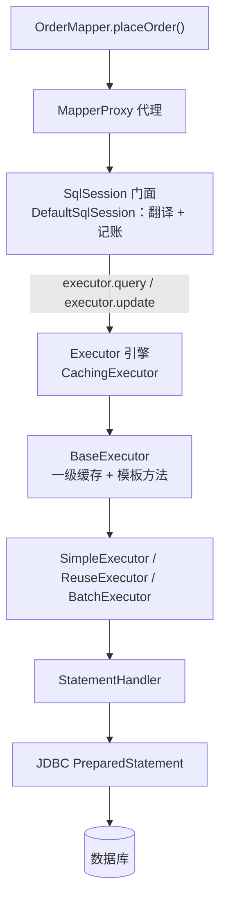
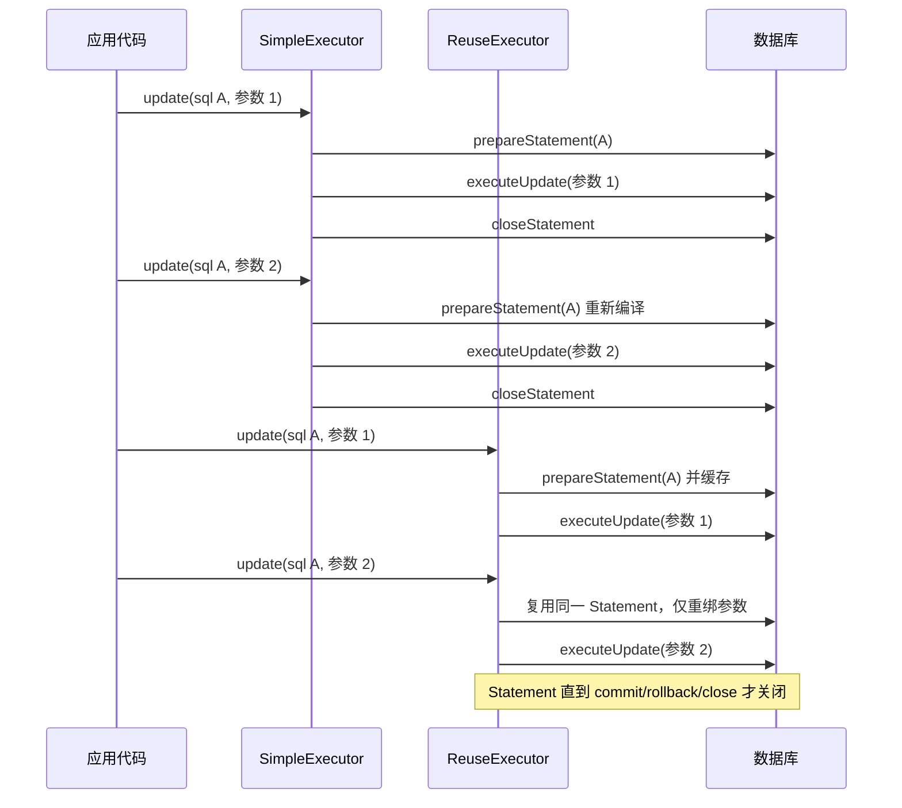
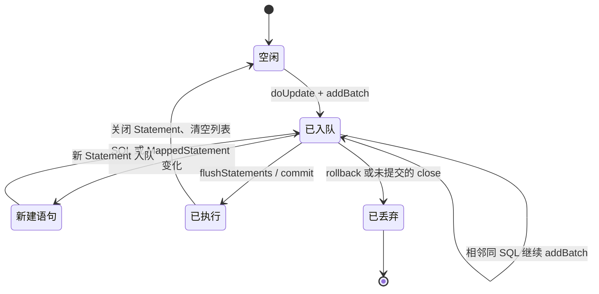
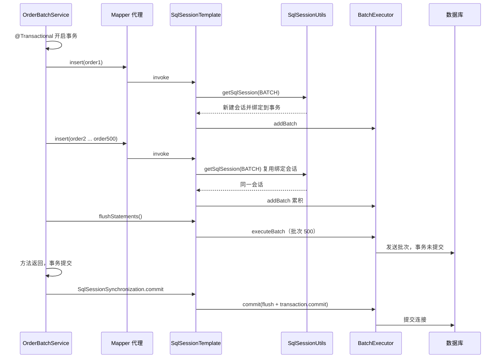
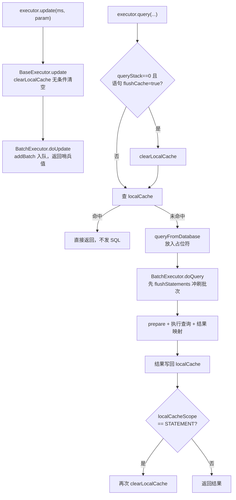

# SqlSession与Executor——命令执行的核心引擎

**摘要：**

Mybatis 把一次 SQL 调用拆成两半：`SqlSession` 收参数、管事务状态、把接口方法翻译成 statementId，`Executor` 拿连接、过缓存、发语句、收结果，前者是门面，后者是引擎。本文以订单服务的下单与万级批量插入为贯穿案例，先拆开两层接口的职责边界，再逐一比对 `SimpleExecutor`、`ReuseExecutor`、`BatchExecutor` 在 Statement 创建、关闭与复用上的差异，重点回答一个反复出现的疑问：把 `ExecutorType` 改成 `BATCH` 之后，批处理为什么不生效。答案分布在四处：`commit()` 之前是否真的冲刷了批次、Spring 事务是否让同一个会话贯穿整个循环、循环里是否夹了 `select`、驱动是否把批次合并成一次网络往返。三种实现的差异最终收敛到同一组问题：Statement 何时创建、何时复用、批次何时冲刷、缓存在哪一层被清空；把这组问题答清楚，配置项与反例清单才有判断依据。文章后半段把一级缓存放回 `BaseExecutor` 的位置，解释批处理模式下缓存语义为何变形，再沿 `CachingExecutor` 与 `InterceptorChain` 的装配顺序说明插件能否看到缓存命中，最后收束到会话生命周期、延迟加载的触发时机与一张可对照的配置清单。

---

## 第 1 章 门面与引擎：一次下单请求经过的两层入口

### 1.1 从一行 Mapper 调用说起

设想一个订单服务，`placeOrder` 做四件事：按 SKU 查一次库存、插一张订单主表、插若干条订单明细、回写库存。开发者写下来的代码朴素得近乎没有框架痕迹：

```java
@Transactional
public void placeOrder(Order order) {
    Sku sku = skuMapper.selectBySku(order.getSkuCode());   // 查询一
    orderMapper.insert(order);                             // 写一
    for (OrderItem item : order.getItems()) {
        orderItemMapper.insert(item);                      // 写二到写 N
    }
    skuMapper.deductStock(order.getSkuCode(), order.getQty()); // 写 N+1
}
```

这几行代码进入框架之后，实际发生的事被切成了两段。前一段负责“把这次调用认出来”：根据 Mapper 接口与方法的映射关系找到 `MappedStatement`，把 `order`、`item` 这些参数对象按 `#{}` 占位符的需要整理成 Map，算出一个能代表“这次查询”的缓存键，再决定这条语句该走查询还是走更新。后一段负责“把这条语句送出去”：拿连接、查缓存、按 SQL 模板准备 `PreparedStatement`、绑定参数、执行、映射结果，并在事务边界上决定提交还是回滚。

前一段的承载者是 `SqlSession`，后一段的承载者是 `Executor`。笔者倾向于把它们叫作门面与引擎：门面负责把应用语义翻译成框架语义，引擎负责把框架语义落到 JDBC 上。这个划分不是命名上的偏好，它决定了后面所有的坑长在哪里——批处理不生效，多半是引擎被门面的生命周期切碎了；插件看不到缓存命中，多半是包装顺序把插件放错了层。

### 1.2 SqlSession：只做翻译与记账

`SqlSession` 接口的方法数量不少，`selectOne`、`selectList`、`selectMap`、`select`、`insert`、`update`、`delete`、`commit`、`rollback`、`getMapper`、`getConnection`、`clearCache`、`close`，看上去像一个大而全的数据库客户端。但拆开唯一的内置实现 `DefaultSqlSession` 之后会发现，它真正自己做的事情只有两件：**翻译**与**记账**。

```java
// org.apache.ibatis.session.defaults.DefaultSqlSession（节选）
public class DefaultSqlSession implements SqlSession {
  private final Configuration configuration;
  private final Executor executor;      // 引擎，所有 SQL 最终都交给它
  private final boolean autoCommit;     // openSession(true) 的结果
  private boolean dirty;                // 有没有未提交的写操作
  private List<Cursor<?>> cursorList;

  @Override
  public <E> List<E> selectList(String statement, Object parameter, RowBounds rowBounds) {
    try {
      MappedStatement ms = configuration.getMappedStatement(statement);
      // wrapCollection：List/数组参数被包装成 Map，key 为 "list"/"array"，
      // 这就是 <foreach collection="list"> 能工作的原因
      return executor.query(ms, wrapCollection(parameter), rowBounds, Executor.NO_RESULT_HANDLER);
    } catch (Exception e) {
      throw ExceptionFactory.wrapException("Error querying database.  Cause: " + e, e);
    } finally {
      ErrorContext.instance().reset();
    }
  }

  @Override
  public int update(String statement, Object parameter) {
    try {
      dirty = true;                      // 记账：会话已经脏了
      MappedStatement ms = configuration.getMappedStatement(statement);
      return executor.update(ms, wrapCollection(parameter));
    } finally {
      ErrorContext.instance().reset();
    }
  }

  @Override
  public void commit(boolean force) {
    try {
      executor.commit(isCommitOrRollbackRequired(force));
      dirty = false;
    } catch (Exception e) {
      throw ExceptionFactory.wrapException("Error committing transaction.  Cause: " + e, e);
    } finally {
      ErrorContext.instance().reset();
    }
  }

  private boolean isCommitOrRollbackRequired(boolean force) {
    return (!autoCommit && dirty) || force;
  }
}
```

翻译指的是 `wrapCollection` 和 statementId 的解析：`selectList(String statement, ...)` 的第一个参数就是 XML 里 `namespace.id` 拼出来的字符串，`getMapper` 返回的代理对象最终也是把方法签名翻译成这个字符串。记账指的是 `dirty` 位：任何一次 `insert`/`update`/`delete` 都会把它置真，`commit()` 与 `close()` 在决定要不要真正提交或回滚时，读的正是这一位。

这里有一个容易被忽略的细节：`DefaultSqlSession` 的查询方法里有一行 `dirty |= ms.isDirtySelect()`。它针对的是配置了 `flushCache="true"` 的查询语句——这种语句虽然只读，却会清掉一级缓存，于是会话的“脏”状态也需要被记录，否则在自动提交关闭的会话里，一次这样的查询之后直接 `close()` 可能绕过本应发生的提交。记账这件事看似琐碎，但它是 `SqlSession` 唯一无法下推给引擎的状态，因为它描述的是“调用者想不想提交”，而不是“SQL 怎么执行”。

门面不碰 JDBC 的证据也很直接：`DefaultSqlSession.getConnection()` 的实现是 `executor.getTransaction().getConnection()`，连接的所有权在引擎手里。

### 1.3 Executor：把“怎么执行”收成一层可替换的策略

`Executor` 接口的方法族比 `SqlSession` 更能说明引擎的职责边界（Mapper 接口到 `StatementHandler` 的逐跳展开见 [[01 Mybatis全局架构——从SQL到结果映射的完整链路]]）：

- `update(MappedStatement, Object)`：执行写语句；
- `query(...)` 两个重载与 `queryCursor(...)`：执行查询、游标查询；
- `flushStatements()`：把累积的批次真正发送出去，返回 `List<BatchResult>`；
- `commit(boolean required)` / `rollback(boolean required)`：在事务边界上收尾，`required` 决定要不要真的提交连接；
- `createCacheKey(...)`：为一次查询算出缓存键；
- `clearLocalCache()` / `isCached(...)`：一级缓存的清空与探测；
- `deferLoad(...)`：把一个延迟加载属性登记到待加载队列；
- `getTransaction()` / `close(boolean)` / `isClosed()`：事务与生命周期的查询。

真正干活的是抽象类 `BaseExecutor`。它把“查缓存、放占位符、调子类、写回缓存、处理延迟加载”这一整套流程写成模板方法，把与 JDBC 相关的四件事留给子类：`doUpdate`、`doQuery`、`doQueryCursor`、`doFlushStatements`。三种 Executor 的差异，全部落在这四个方法里。

```java
// org.apache.ibatis.executor.BaseExecutor（节选，MyBatis 3.5.x）
@Override
public <E> List<E> query(MappedStatement ms, Object parameter, RowBounds rowBounds,
    ResultHandler resultHandler, CacheKey key, BoundSql boundSql) throws SQLException {
  if (closed) { throw new ExecutorException("Executor was closed."); }
  // 查询语句自己声明了 flushCache=true 时，先清一级缓存
  if (queryStack == 0 && ms.isFlushCacheRequired()) { clearLocalCache(); }
  List<E> list;
  try {
    queryStack++;
    list = resultHandler == null ? (List<E>) localCache.getObject(key) : null;
    if (list != null) {
      handleLocallyCachedOutputParameters(ms, key, parameter, boundSql);
    } else {
      list = queryFromDatabase(ms, parameter, rowBounds, resultHandler, key, boundSql);
    }
  } finally {
    queryStack--;
  }
  if (queryStack == 0) {
    for (DeferredLoad deferredLoad : deferredLoads) { deferredLoad.load(); }
    deferredLoads.clear();
    if (configuration.getLocalCacheScope() == LocalCacheScope.STATEMENT) {
      clearLocalCache();               // STATEMENT 作用域：一次查询后就清
    }
  }
  return list;
}

private <E> List<E> queryFromDatabase(...) throws SQLException {
  localCache.putObject(key, EXECUTION_PLACEHOLDER);  // 防止嵌套查询无限递归
  try {
    list = doQuery(ms, parameter, rowBounds, resultHandler, boundSql);
  } finally {
    localCache.removeObject(key);
  }
  localCache.putObject(key, list);
  return list;
}
```

这段模板方法里藏了三个后面会反复用到的机关。`queryStack` 是查询嵌套深度：只有最外层查询（`queryStack == 0`）才处理延迟加载队列与 `STATEMENT` 级缓存清理，嵌套查询不会误清外层缓存。`EXECUTION_PLACEHOLDER` 是防递归的哨兵：在真正执行 SQL 之前先在缓存里占位，若同一次查询在映射过程中又触发了相同的查询，第二次会看到占位符而不是无限递归。`deferredLoads` 是延迟加载队列，只有在最外层查询结束时才统一加载。

### 1.4 为什么必须分成两层

把这两层合起来做一个大对象，技术上完全可行，`JdbcTemplate` 就是另一种合并方式。Mybatis 之所以坚持分开，有三个互相支撑的理由。

第一是变化频率不同。门面面对的是“接口方法如何映射到语句标识”“集合参数如何包装”这类稳定问题，几年不变一次；引擎面对的是“缓存怎么管”“批次怎么攒”“连接什么时候拿”这类可替换策略，`ExecutorType` 一个枚举就能切。把稳定的部分与易变的部分放在同一个类里，等于让每次策略调整都去动最不该动的代码。

第二是装饰的切入点。二级缓存、插件、分页拦截，全都包在 `Executor` 外面，而不是包在 `SqlSession` 外面。原因很实际：`SqlSession` 的 API 是给应用看的，包一层就要重新实现几十个方法；`Executor` 的 API 只有十来个方法，且所有 SQL 都从这里过，装饰成本极低。

第三是状态的归属。一次会话里有两类状态：调用者意图（要不要提交、是否自动提交）属于门面，执行资源（连接、缓存、待发送批次、Statement）属于引擎。分开之后，`DefaultSqlSession` 可以在不碰 JDBC 的情况下完成提交判定，引擎也可以在不理解业务语义的情况下完成批次与缓存管理。

代价同样存在：排障时要在两层之间来回跳。看到“两次相同查询只发了一条 SQL”，要去引擎里确认 `localCache` 是否命中；看到“批量插入只有一条 insert 生效”，要去门面确认 `commit` 与 `close` 的调用顺序。图 1-1 把这两层的相对位置固定下来，后面的讨论都以此为坐标。



门面与引擎的职责划分可以用一张表固定下来，表里每一行都是一个后面会展开的坑位。

| 维度 | `SqlSession`（门面） | `Executor`（引擎） |
| --- | --- | --- |
| 输入 | statementId、参数对象、`RowBounds`、`ResultHandler` | `MappedStatement`、`BoundSql`、`CacheKey` |
| 参数处理 | `wrapCollection` 包装集合为 Map | 交给 `ParameterHandler` 绑定 |
| 事务状态 | `dirty`、`autoCommit`，决定是否提交 | 持有 `Transaction`，执行 commit/rollback |
| 缓存 | 只暴露 `clearCache()` | 一级缓存 `localCache` 的读写与清空 |
| Statement | 完全不感知 | 三种实现各自决定创建、复用、累积 |
| 生命周期 | `openSession` 到 `close` | 随会话创建，随会话关闭 |
| 线程安全 | 不安全 | 不安全，且持有连接与事务 |

---

## 第 2 章 Statement 的两种命运：SimpleExecutor 与 ReuseExecutor

### 2.1 SimpleExecutor：一次一建，一次一关

`SimpleExecutor` 是 `defaultExecutorType` 的默认值（`Configuration` 中 `protected ExecutorType defaultExecutorType = ExecutorType.SIMPLE;`），也是绝大多数 Spring 应用里真正在跑的实现。它的两个方法短到可以整段读完：

```java
// org.apache.ibatis.executor.SimpleExecutor（节选）
@Override
public int doUpdate(MappedStatement ms, Object parameter) throws SQLException {
  Statement stmt = null;
  try {
    Configuration configuration = ms.getConfiguration();
    StatementHandler handler = configuration.newStatementHandler(this, ms, parameter,
        RowBounds.DEFAULT, null, null);
    stmt = prepareStatement(handler, ms.getStatementLog());
    return handler.update(stmt);
  } finally {
    closeStatement(stmt);     // 无论成功失败，Statement 就地关闭
  }
}

@Override
public <E> List<E> doQuery(...) throws SQLException {
  Statement stmt = null;
  try {
    StatementHandler handler = configuration.newStatementHandler(wrapper, ms, parameter,
        rowBounds, resultHandler, boundSql);
    stmt = prepareStatement(handler, ms.getStatementLog());
    return handler.query(stmt, resultHandler);
  } finally {
    closeStatement(stmt);
  }
}
```

`prepareStatement` 在 `BaseExecutor` 里，做两件事：从 `Transaction` 取连接，再让 `StatementHandler.prepare` 调 `connection.prepareStatement(sql)`；绑定参数由 `handler.parameterize(stmt)` 完成。执行结束后 `closeStatement` 关闭的是 `Statement`，而不是连接——连接归 `Transaction` 管，会话结束才还。

这种**一次一建一关**的代价，需要区分数据库端与客户端两侧来算。数据库端，`prepareStatement` 通常意味着一次语法解析与执行计划生成（Connector/J 默认在客户端模拟服务端预编译，即 `useServerPrepStmts=false`，此时数据库端未必真的发生一次服务端预编译；是否启用真实的服务端语句缓存，以驱动版本与连接参数为准）；客户端侧，每次执行都要新建对象、绑定参数、关闭对象，开销远小于一次网络往返，但在万级循环里会累积成可观的 CPU 与 GC 压力。

`SimpleExecutor` 之所以成为默认，不是因为快，而是因为可预测：没有跨语句的状态，异常路径简单，任何一个 `Statement` 泄漏都只影响当前这一次调用。批量场景下它显然不合适，但它在“一次请求几条 SQL”的常规 CRUD 里几乎没有短板。

### 2.2 ReuseExecutor：以 SQL 文本为 key 的 Statement 缓存

`ReuseExecutor` 的想法很直接：同一个会话里，如果反复执行 SQL 模板相同的语句（参数不同），编译结果可以复用。它用一个 `HashMap` 保存“SQL 文本 → Statement”的映射：

```java
// org.apache.ibatis.executor.ReuseExecutor（节选）
private final Map<String, Statement> statementMap = new HashMap<>();

@Override
public int doUpdate(MappedStatement ms, Object parameter) throws SQLException {
  Configuration configuration = ms.getConfiguration();
  StatementHandler handler = configuration.newStatementHandler(this, ms, parameter,
      RowBounds.DEFAULT, null, null);
  Statement stmt = prepareStatement(handler, ms.getStatementLog());
  return handler.update(stmt);      // 注意：没有 closeStatement
}

private Statement prepareStatement(StatementHandler handler, Log statementLog) throws SQLException {
  Statement stmt;
  BoundSql boundSql = handler.getBoundSql();
  String sql = boundSql.getSql();
  if (hasStatementFor(sql)) {
    stmt = getStatement(sql);                 // 命中：复用已编译的 Statement
    applyTransactionTimeout(stmt);            // 顺带校正事务超时
  } else {
    Connection connection = getConnection(statementLog);
    stmt = handler.prepare(connection, transaction.getTimeout());
    putStatement(sql, stmt);
  }
  handler.parameterize(stmt);                 // 每次都要重新绑参数
  return stmt;
}

@Override
public List<BatchResult> doFlushStatements(boolean isRollback) {
  for (Statement stmt : statementMap.values()) { closeStatement(stmt); }
  statementMap.clear();
  return Collections.emptyList();
}
```

这套设计里有三个值得停下来想一想的决定。

其一，key 为什么是完整 SQL 文本，而不是 `MappedStatement` 的 id。因为 Mybatis 的 SQL 是动态拼出来的：同一个 `MappedStatement` 在 `<if>`、`<foreach>`、`<include>` 的作用下，可能展开成结构完全不同的语句，`statementId` 无法区分“同一条语句的两种形态”，而 SQL 文本天然区分。反过来，两条不同的 `MappedStatement` 若最终拼出完全相同的 SQL，缓存键相同也无妨，编译结果本来就可复用。

其二，为什么命中之后还要 `parameterize`。缓存的只是 `PreparedStatement` 对象与它承载的编译结果，参数值从不进入缓存。`handler.parameterize(stmt)` 每次重新调用 `setXxx`，把本次参数绑上去。这也解释了一个常见误解：有人以为 `ReuseExecutor` 会“缓存查询结果”，实际它缓存的是语句句柄，结果缓存是 `localCache` 的事，两者互不相干。

其三，Statement 什么时候关。`doFlushStatements` 是统一关闭点，它在 `commit`、`rollback`、`close` 时被调用（`BaseExecutor.commit` 里的 `flushStatements()`、`rollback` 里的 `flushStatements(true)`、`close` 里的 `rollback` 都会走到）。也就是说，一个 `ReuseExecutor` 会话里，Statement 在会话结束前一直活着。

`ReuseExecutor` 的收益边界比想象中窄。它要求三个条件同时成立：同一个会话、SQL 文本完全相同、数据库端确实能复用计划。第二个条件在动态 SQL 稍复杂的 Mapper 里就很难满足，譬如 `<if test="status != null">` 会让“带状态条件”与“不带状态条件”的两次调用拼出两条不同 SQL，各自占用一个 Statement。更实际的问题是会话长度：Mybatis-Spring 在没有事务的方法里每次 Mapper 调用都新建会话、调用后关闭，`statementMap` 刚建好就被清空，复用率为零。

还有一个容易忽略的副作用：Statement 不关，游标就可能不关。若查询使用了 `ResultHandler` 流式处理且没有把结果集读干净，下一次复用同一个 Statement 时，MySQL 驱动会报结果集仍处于流式状态。`ReuseExecutor` 因此更适合“短事务里同一模板反复写”的场景，而不适合长事务里夹杂流式查询。

两种实现放在一起对照，差异集中在生命周期上。

| 维度 | `SimpleExecutor` | `ReuseExecutor` |
| --- | --- | --- |
| Statement 创建 | 每次执行新建 | 首次遇到该 SQL 时新建 |
| Statement 关闭 | 每次执行后立即关闭 | 会话结束（commit/rollback/close）时统一关闭 |
| 缓存键 | 无 | 完整 SQL 文本（含 `?`） |
| 参数处理 | 每次绑定 | 每次重新绑定 |
| 内存占用 | 恒定，单条语句 | 随不同 SQL 数量增长 |
| 适合场景 | 常规 CRUD，默认选择 | 短会话内同一模板高频执行 |
| 主要风险 | 重复编译 | Statement 与结果集未释放 |

图 2-1 把两种实现对同一个 `SqlSession` 内连续两次相同 `update` 的处理拆开画，可以直观看到“关闭点”被推迟到了哪里。



---

## 第 3 章 BatchExecutor：把 addBatch 藏进 update

### 3.1 批次到底省掉了什么

JDBC 的批次接口只有两个动作：`addBatch()` 把一条已绑好参数的语句排进队列，`executeBatch()` 把队列一次性交给驱动。省下来的第一样东西是往返：逐条执行时每条语句都要“发送—等待—接收”，批次执行时整批共用一次发送与一次返回；省下来的第二样东西是驱动与数据库端的重复准备，同一模板的语句只需准备一次。

用示例推算来量化，只算网络往返、忽略 CPU 与日志成本：10,000 条 `insert`，逐条执行是 10,000 次往返；按每 500 条一批，是 20 次 `executeBatch`，往返次数按批次大小线性下降。这一句是示例推算，真实收益取决于网络 RTT、驱动是否重写为多值语句、数据库端的日志与锁行为，不能直接当成压测结论。

第三样东西不那么直观：事务日志与锁的形态。逐条执行时，每条 `insert` 独立产生一次语句级开销，行锁在每条语句结束时也不会释放（锁要到事务提交才释放），所以对锁竞争而言批次几乎没有帮助；但在支持批量日志合并的数据库上，批次能把多次小写入并成更大的顺序写，减少刷盘次数。这也是为什么批处理在“大事务 + 同构写入”场景收益明显，在“高并发 + 短事务”场景收益有限。

### 3.2 累积结构：三个字段加两个列表

`BatchExecutor` 用一个非常朴素的写法承载批次：`statementList` 保存待执行的 Statement，`batchResultList` 保存与之一一对应的结果账本，`currentSql` 与 `currentStatement` 记录“上一条语句是什么”，用来判断能否继续往同一个 Statement 里加批。

```java
// org.apache.ibatis.executor.BatchExecutor（节选，MyBatis 3.5.x）
public static final int BATCH_UPDATE_RETURN_VALUE = Integer.MIN_VALUE + 1002;

private final List<Statement> statementList = new ArrayList<>();
private final List<BatchResult> batchResultList = new ArrayList<>();
private String currentSql;
private MappedStatement currentStatement;

@Override
public int doUpdate(MappedStatement ms, Object parameterObject) throws SQLException {
  final Configuration configuration = ms.getConfiguration();
  final StatementHandler handler = configuration.newStatementHandler(this, ms, parameterObject,
      RowBounds.DEFAULT, null, null);
  final BoundSql boundSql = handler.getBoundSql();
  final String sql = boundSql.getSql();
  final Statement stmt;
  if (sql.equals(currentSql) && ms.equals(currentStatement)) {
    int last = statementList.size() - 1;
    stmt = statementList.get(last);
    applyTransactionTimeout(stmt);
    handler.parameterize(stmt);                       // 重绑本次参数
    BatchResult batchResult = batchResultList.get(last);
    batchResult.addParameterObject(parameterObject);  // 账本记下参数对象
  } else {
    Connection connection = getConnection(ms.getStatementLog());
    stmt = handler.prepare(connection, transaction.getTimeout());
    handler.parameterize(stmt);
    currentSql = sql;
    currentStatement = ms;
    statementList.add(stmt);
    batchResultList.add(new BatchResult(ms, sql, parameterObject));
  }
  handler.batch(stmt);                 // 关键：addBatch，而不是 execute
  return BATCH_UPDATE_RETURN_VALUE;    // 影响行数此刻并不存在
}
```

`handler.batch(stmt)` 走到 `StatementHandler` 的实现里，最终就是一句 `stmt.addBatch()`。参数并没有被立即发送，它被绑定在 `Statement` 的批次参数位上，等着 `executeBatch()`。

### 3.3 复用判据：相邻、同 SQL、同 MappedStatement

`if (sql.equals(currentSql) && ms.equals(currentStatement))` 这行判据决定了批次的合并粒度，它的语义比字面看起来更严格：**只与“上一条”比较**，不查表，不归并。

于是行为是这样的：连续插入 10,000 条订单，SQL 模板相同、`MappedStatement` 相同，全部落入同一个 `Statement`，一个批次装 10,000 条；反过来，如果循环里先插订单主表、再插订单明细、再插主表，A、B、A、B 交替，那么每次切换都会新建一个 Statement，“批次”退化成每个 Statement 里只有一条语句，`executeBatch()` 仍然被调用 N 次，网络往返一次没省，还额外付出了 N 个 Statement 与 N 个账本的内存。

这也是批处理优化里最容易被忽略的改造动作：把“按业务对象交替写”改成“按表分组写”。同一个事务内，先集中插主表，再集中插明细，最后集中回写库存，批次才会真正变厚。

### 3.4 返回值的谎言：`BATCH_UPDATE_RETURN_VALUE`

`doUpdate` 返回的是 `Integer.MIN_VALUE + 1002`，一个**与真实影响行数毫无关系**的常量。原因在于时序：`addBatch()` 只是入队，数据库此刻还没执行，影响行数客观上不存在。等 `executeBatch()` 返回后，每条的计数才以 `int[]` 的形式进入 `BatchResult.updateCounts`。

这个常量会造成两类误判。第一类是业务判断：`if (orderMapper.insert(order) == 1)` 在批处理模式下永远为假，代码静默走进“插入失败”的分支；第二类是日志与监控：把返回值累加当写入量统计，会得到一个巨大的负数。若要真实计数，只能取 `flushStatements()` 返回的 `List<BatchResult>`，遍历其中的 `getUpdateCounts()`。

```java
try (SqlSession session = sqlSessionFactory.openSession(ExecutorType.BATCH)) {
    OrderMapper mapper = session.getMapper(OrderMapper.class);
    for (Order order : orders) {
        mapper.insert(order);                 // 返回值不可用，只能当“已入队”
    }
    List<BatchResult> results = session.flushStatements();
    int affected = 0;
    for (BatchResult result : results) {
        for (int count : result.getUpdateCounts()) {
            affected += count;
        }
    }
    session.commit();
}
```

注意 `getUpdateCounts()` 返回的 `int[]` 里，元素不一定都是正整数：驱动给不出确切计数时会填入 `Statement.SUCCESS_NO_INFO`（-2），批次中某条失败而驱动继续执行后续语句时可能填入 `EXECUTE_FAILED`（-3）。把每个元素直接相加会把负数带进统计，稳妥写法是只累加大于零的计数，把 -2 单独计入“成功但未知行数”。

### 3.5 flush：真正执行与收尾

`doFlushStatements` 是批次唯一的出口，它做四件事：逐个 `executeBatch()`、回填自增主键、包装批次异常、清理现场。

```java
// org.apache.ibatis.executor.BatchExecutor#doFlushStatements（节选）
@Override
public List<BatchResult> doFlushStatements(boolean isRollback) throws SQLException {
  try {
    List<BatchResult> results = new ArrayList<>();
    if (isRollback) {
      return Collections.emptyList();          // 回滚路径：直接丢弃，不执行
    }
    for (int i = 0, n = statementList.size(); i < n; i++) {
      Statement stmt = statementList.get(i);
      applyTransactionTimeout(stmt);
      BatchResult batchResult = batchResultList.get(i);
      try {
        batchResult.setUpdateCounts(stmt.executeBatch());
        MappedStatement ms = batchResult.getMappedStatement();
        List<Object> parameterObjects = batchResult.getParameterObjects();
        KeyGenerator keyGenerator = ms.getKeyGenerator();
        if (Jdbc3KeyGenerator.class.equals(keyGenerator.getClass())) {
          Jdbc3KeyGenerator jdbc3KeyGenerator = (Jdbc3KeyGenerator) keyGenerator;
          jdbc3KeyGenerator.processBatch(ms, stmt, parameterObjects);
        } else if (!NoKeyGenerator.class.equals(keyGenerator.getClass())) {
          for (Object parameter : parameterObjects) {
            keyGenerator.processAfter(this, ms, stmt, parameter);
          }
        }
        closeStatement(stmt);                  // 关闭游标，见 issue #1109
      } catch (BatchUpdateException e) {
        StringBuilder message = new StringBuilder();
        message.append(batchResult.getMappedStatement().getId())
               .append(" (batch index #").append(i + 1).append(")").append(" failed.");
        if (i > 0) {
          message.append(" ").append(i)
                 .append(" prior sub executor(s) completed successfully, but will be rolled back.");
        }
        throw new BatchExecutorException(message.toString(), e, results, batchResult);
      }
      results.add(batchResult);
    }
    return results;
  } finally {
    for (Statement stmt : statementList) { closeStatement(stmt); }
    currentSql = null;
    statementList.clear();
    batchResultList.clear();
  }
}
```

三个细节决定了排障时看到的现象。第一，`BatchUpdateException` 被包装成 `BatchExecutorException`，异常消息里带 `batch index #n failed` 与“前 n-1 个子执行器已成功但会被回滚”——这句话说明批次失败不是“整批原子回滚”，前面的 Statement 在数据库端已经执行过，是否回滚取决于外层事务。第二，`isRollback=true` 时直接返回空列表，不执行任何批次，这正是“忘记 commit 直接 close”导致数据静默消失的机制。第三，`finally` 里无论成功失败都会关闭并清空全部 Statement，所以一次 flush 之后会话可以继续累积新的批次。

图 3-1 把批次从入队到执行的流转画成状态图，可以看到“已入队”与“已执行”之间只隔一个 `flushStatements`，而这个动作有三个触发源。



---

## 第 4 章 陷阱一：flushStatements 与 commit 的时序

### 4.1 commit 会自动 flush 吗

会。`BaseExecutor.commit` 的顺序写得明明白白：

```java
@Override
public void commit(boolean required) throws SQLException {
  if (closed) { throw new ExecutorException("Cannot commit, transaction is already closed"); }
  clearLocalCache();
  flushStatements();                 // 先冲刷批次，再提交连接
  if (required) { transaction.commit(); }
}

@Override
public void rollback(boolean required) throws SQLException {
  if (!closed) {
    try {
      clearLocalCache();
      flushStatements(true);         // 回滚路径：丢弃批次
    } finally {
      if (required) { transaction.rollback(); }
    }
  }
}
```

所以“`ExecutorType.BATCH` 必须手动 `flushStatements()`，否则 `commit()` 也不发”这个说法是错的。真正的风险在另一侧：`commit()` 会 flush，`close()` 却走 `rollback` 路径，**批次被丢弃**。`DefaultSqlSession.close()` 调用 `executor.close(isCommitOrRollbackRequired(false))`，`BaseExecutor.close` 转手调 `rollback(forceRollback)`，`rollback` 里的 `flushStatements(true)` 在 `BatchExecutor.doFlushStatements` 里直接返回空列表——数据库端从未见到这些语句。

这条路径在两种写法里最容易踩中：

```java
// 反例一：以为 close 会自动提交
SqlSession session = sqlSessionFactory.openSession(ExecutorType.BATCH);
try {
    OrderMapper mapper = session.getMapper(OrderMapper.class);
    for (Order order : orders) { mapper.insert(order); }
    // 没有 flushStatements，也没有 commit
} finally {
    session.close();   // 回滚路径，批次被丢弃，数据一条没进库
}

// 反例二：try-with-resources 但漏掉 commit
try (SqlSession session = sqlSessionFactory.openSession(ExecutorType.BATCH)) {
    for (Order order : orders) { session.insert("insertOrder", order); }
}   // 自动 close → rollback → flushStatements(true) → 空
```

第二种写法尤其具有欺骗性：代码看起来用了现代写法，执行不报错，日志里只有一条回滚记录，业务侧却以为插入成功。排查时若只看 `insert` 是否抛异常，会得到“全部成功”的结论。

`autoCommit=true` 的会话里还有一处细微差别。`openSession(true)` 之后 `commit()` 算出的 `required` 为假，`BaseExecutor.commit` 仍然会 `flushStatements()`，只是不再调 `transaction.commit()`；而连接本身处于自动提交模式，`executeBatch()` 结束即提交。也就是说，自动提交模式下批次照样会发出去，只是每批一次提交，与逐条提交的边界不同。

### 4.2 手动 flush 的真实理由

既然 commit 会兜底，为什么文档与经验都强调手动 `flushStatements()`？因为“兜底”发生在事务末尾，而问题往往在事务中间就已经产生。

第一个理由是内存。`BatchResult` 用 `List<Object> parameterObjects` 持有每一个入队参数对象的引用，10,000 条订单就是 10,000 个 `Order` 对象在会话期间无法回收；如果这些对象还带着明细集合，实际占用远超订单本身。分批 flush 让这些引用在每批结束时被释放。

第二个理由是语句句柄。Statement 直到 flush 才关闭，一个长事务里若累积了几十个不同 SQL 的 Statement，数据库端与驱动端的句柄都会持续占用；某些数据库对单连接打开的游标数有限制，超过之后报的是“打开游标过多”而不是“内存不足”，排查方向容易跑偏。

第三个理由是失败粒度。一个 10,000 条的批次中途失败，`BatchExecutorException` 说明前面的子批次已执行但会被回滚，整个事务仍然要重来；按 500 条一批，失败最多损失一批，且能定位到具体批次。对可以重试的导入任务，这个粒度差别直接影响恢复成本。

第四个理由是读己之写。批次入队之后，同事务内的 `select` 看不到这些行——除非先 flush。`BatchExecutor.doQuery` 的第一行就是 `flushStatements()`，所以“先 insert 后 select 同一条数据”能查到，但这个 flush 是隐式的、整批的，不由调用者控制。需要精确控制时，显式 flush 更清楚。

表 4-1 是对 10,000 条插入在不同批次大小下的静态估算，只算会话内的对象与往返数量，不含数据库端成本。

| 批次大小 | `executeBatch` 次数 | 单批参数对象数 | 会话内 Statement 峰值 | 失败时最多损失的已入队数据 |
| --- | --- | --- | --- | --- |
| 不分批（10,000） | 1 | 10,000 | 1（同构 SQL） | 10,000 |
| 1,000 | 10 | 1,000 | 1 | 1,000 |
| 500 | 20 | 500 | 1 | 500 |
| 100 | 100 | 100 | 1 | 100 |
| 逐条（SIMPLE 等价） | 10,000 | 1 | 1 | 1 |

表里的“Statement 峰值”在 SQL 同构时恒为 1，因为 flush 会清空列表、下一次 `addBatch` 重新建 Statement；真正影响峰值的是 SQL 种类数，不是批次大小。批次大小的选择因此没有普适最优值：它是在往返次数、单批失败损失、数据库端日志与锁压力之间取一个折中，常见的起点是几百到几千，最终要以目标数据库与驱动的实测为准。

### 4.3 自增主键在批次里如何回填

`doFlushStatements` 里对 `Jdbc3KeyGenerator` 调用了 `processBatch`，这是 MyBatis 3.5.x 对批量主键回填的支持：`executeBatch()` 之后，驱动把生成的主键放在 `Statement.getGeneratedKeys()` 里，`processBatch` 按参数对象顺序逐个 `setValue` 回去。因此“批处理拿不到自增主键”是一个需要限定条件的说法：同构 SQL、驱动支持批量返回生成键、参数对象顺序与批次顺序一致时，主键能回填。

限制来自驱动与数据库。部分驱动在批次模式下只返回第一行或最后一行的主键，部分数据库（如某些版本的 Oracle）需要 `RETURNING INTO` 或序列预取才能批量拿键。“以对应驱动文档为准”在这里不是免责声明，而是排查清单的一项：先确认 `getGeneratedKeys()` 在批次下返回了几行，再决定要不要退回“先取序列、再批量插入”的方案。

---

## 第 5 章 陷阱二：Spring 事务里的 BATCH

### 5.1 SqlSessionTemplate：一个线程一个会话的真相

Spring 环境下，应用代码拿到的 `SqlSession` 通常不是 `DefaultSqlSession`，而是 `SqlSessionTemplate` 内部的 JDK 动态代理。`SqlSessionTemplate` 在构造时创建代理，把所有方法调用交给 `SqlSessionInterceptor`：

```java
// org.mybatis.spring.SqlSessionTemplate.SqlSessionInterceptor（节选，mybatis-spring 3.x）
@Override
public Object invoke(Object proxy, Method method, Object[] args) throws Throwable {
  SqlSession sqlSession = getSqlSession(SqlSessionTemplate.this.sqlSessionFactory,
      SqlSessionTemplate.this.executorType, SqlSessionTemplate.this.exceptionTranslator);
  try {
    Object result = method.invoke(sqlSession, args);
    if (!isSqlSessionTransactional(sqlSession, SqlSessionTemplate.this.sqlSessionFactory)) {
      // 非事务上下文：强制提交，某些数据库要求 close 前必须 commit/rollback
      sqlSession.commit(true);
    }
    return result;
  } finally {
    if (sqlSession != null) {
      closeSqlSession(sqlSession, SqlSessionTemplate.this.sqlSessionFactory);
    }
  }
}
```

`getSqlSession` 的行为分两种情况：当前线程存在 Spring 事务时，从 `TransactionSynchronizationManager` 绑定的 `SqlSessionHolder` 里取已有会话，取不到才新建并注册事务同步；没有事务时，每次调用都新建一个会话。`closeSqlSession` 同样分两种：事务上下文里递减持有计数、不真正关闭；非事务上下文里直接关闭。

这段逻辑解释了“Spring 里一级缓存时有时无”的全部原因（第 6 章展开），也解释了批处理为什么不生效：没有事务时，每一次 Mapper 方法调用都是一个独立的 `SqlSession` 生命周期，**批次大小恒为 1**。

### 5.2 无事务场景：批处理退化为逐条

把上一节的逻辑代入一个 `BATCH` 类型的 `SqlSessionTemplate`，循环插入 10,000 条的执行序列是：第 1 次 `mapper.insert` 进入拦截器，新建会话，`addBatch` 入队一条，`commit(true)` 触发 `flushStatements()` 把这一条 `executeBatch` 出去，关闭会话；第 2 次重复。批次从头到尾只有一条语句，却额外付出了每次会话创建、事务开启、Statement 准备与关闭的成本，结果比默认的 `SIMPLE` 更慢。

这是“我明明配置了 `ExecutorType.BATCH`，压测却没有变化”的第一号原因。要直接判断会话是否被复用并不方便，更简单的探针是看 SQL 日志里 `Preparing` 与 `Parameters` 出现的次数——批处理生效时，`Preparing` 每条 SQL 模板只出现一次，`Parameters` 成批出现，`Updates` 在 flush 时成批出现；退化时三者逐条交替。

### 5.3 有事务场景：一个会话贯穿，但 select 会打断

加上 `@Transactional` 之后，第一次 Mapper 调用创建会话并绑定到事务，后续调用复用同一个会话，批次可以真正累积到事务末尾（或显式 flush 点）。此时仍然有两个打断点。

第一个打断点是循环里的 `select`。`BatchExecutor.doQuery` 第一行就 `flushStatements()`，所以“插一条、查一条”的循环会把批次切成一串单条批次，同时把 flush 的成本乘以循环次数。常见的错误模式是：批量插入之后需要回查生成的记录，于是循环里逐条 `selectById`；或者为了拼业务主键，在插入前逐条查重。前者应改为 flush 后按批次查询或一次性 `IN` 查询，后者应改为一次性把待查键集合查出来在内存里比对。

第二个打断点是没有真正开启事务。`@Transactional` 加在同类内部被自调用的方法上不会经过代理，事务不生效，于是退化成 5.2 节的无事务场景。这类问题在日志上几乎看不出来，只能靠“方法调用是否跨代理”来判断。另一种情况是事务管理器配置成了只读或 `PROPAGATION_NOT_SUPPORTED`，同样会把会话切碎。

还有一个 Spring 特有的约束：`SqlSessionTemplate` 把 `commit()`、`rollback()`、`close()` 全部实现为抛 `UnsupportedOperationException`（消息为 `Manual commit is not allowed over a Spring managed SqlSession`），事务边界归 Spring。但 `flushStatements()` 没有拦，它直接委托给代理，所以在事务中间手动冲刷批次是允许的：

```java
@Service
public class OrderBatchService {
    private final SqlSessionTemplate batchSqlSessionTemplate;  // ExecutorType.BATCH
    private final OrderMapper orderMapper;

    @Transactional
    public void importOrders(List<Order> orders) {
        // orderMapper 必须来自 @MapperScan(sqlSessionTemplateRef) 绑定的批处理模板，
        // 否则 flush 的是一个会话、addBatch 进的是另一个会话
        for (int i = 0; i < orders.size(); i++) {
            orderMapper.insert(orders.get(i));
            if ((i + 1) % 500 == 0) {
                batchSqlSessionTemplate.flushStatements();   // 分批冲刷，不提交事务
            }
        }
        // 事务提交时 SqlSessionSynchronization 调 session.commit()，
        // 剩余批次再 flush 一次，最后由 Spring 提交连接
    }
}
```

`flushStatements()` 之后批次进入数据库但事务未提交，其他事务看不到这些行（隔离级别决定），本事务内可见。这个语义正是“分批发送、整体提交”想要的：既控制了内存与失败粒度，又保留了事务的原子性。

### 5.4 三种配置落地方式

| 方式 | 写法 | 作用范围 | 注意点 |
| --- | --- | --- | --- |
| 全局属性 | `mybatis.executor-type: batch` | 自动装配的 `SqlSessionTemplate` 与 `SqlSessionFactory` 默认值 | 全局生效，所有 Mapper 都走批次，查询也会触发 flush |
| 专用模板 | `new SqlSessionTemplate(factory, ExecutorType.BATCH)` | 显式注入该模板的 DAO | 需配合 `@MapperScan(sqlSessionTemplateRef = "...")` 或手动注入 |
| 手动会话 | `factory.openSession(ExecutorType.BATCH)` | 非 Spring 或需要精细控制的代码 | 必须自己 commit 与 close，事务不归 Spring 管 |
| 工厂默认值 | `configuration.setDefaultExecutorType(...)` | 该 `SqlSessionFactory` 的全部会话 | 与 Spring 自动装配的模板叠加时以模板的 `executorType` 为准 |

`mybatis.executor-type` 这个属性属于 mybatis-spring-boot-starter 的 `MybatisProperties`，它同时影响自动装配的 `SqlSessionTemplate` 与 `SqlSessionFactoryBean`；如果项目里又手工声明了 `SqlSessionTemplate`，以手工声明的为准。属性名与默认值以对应版本文档为准，版本之间有过调整。

图 5-1 把事务内外的两条路径画在一起，差别只在于 `getSqlSession` 是取绑定会话还是新建会话。



表 5-1 把“配置了 BATCH 却看不到批次”的四种组合整理成判据，排查时按行核对即可。

| 事务 | 循环内有 select | 实际批次大小 | 现象 | 处置 |
| --- | --- | --- | --- | --- |
| 无 | 无 | 1 | 每条 insert 独立往返，比 SIMPLE 更慢 | 加 `@Transactional` 或手动会话 |
| 有 | 无 | 累积到 flush/提交 | 批次生效，`Updates` 成批出现 | 按需分批 flush |
| 有 | 有 | 1 | 每次 select 前都 flush，批次被切碎 | 把 select 移出循环或改批量查询 |
| 有（未生效） | 任意 | 1 | 与无事务相同，但代码上写着 `@Transactional` | 检查自调用、传播行为、代理方式 |

---

## 第 6 章 陷阱三：select 强制 flush，一级缓存也随之变形

### 6.1 一级缓存为什么长在 Executor 里

`BaseExecutor` 的字段声明里有三个与缓存、延迟加载相关的成员：

```java
protected PerpetualCache localCache;
protected PerpetualCache localOutputParameterCache;
protected ConcurrentLinkedQueue<DeferredLoad> deferredLoads;
```

`localCache` 就是一级缓存，底层是 `PerpetualCache`，内部一个 `HashMap<Object, Object>`，键是 `CacheKey`，值是查询结果列表或 `EXECUTION_PLACEHOLDER`。`localOutputParameterCache` 服务于存储过程（`StatementType.CALLABLE`）的 OUT 参数回填，`deferredLoads` 是延迟加载队列。

**缓存落在引擎里**而不是门面，有三个具体原因。第一，`DefaultSqlSession` 只是门面的一个实现，缓存若是门面的字段，任何绕过门面的执行路径都会漏掉缓存；而所有查询——包括 Mapper 方法、`selectList` 直调、结果映射里的嵌套查询、延迟加载触发的那次查询——最终都汇聚到 `Executor.query`。第二，缓存的读写必须紧贴 `doQuery` 的前后，`queryFromDatabase` 里的占位符写入、结果写回、异常时的清理，都在模板方法里完成，放在门面就得把模板方法复制一遍。第三，`Executor` 实例的生命周期与 `SqlSession` 实例严格一致：`DefaultSqlSessionFactory.openSessionFromDataSource` 每次 `openSession` 都会调 `configuration.newExecutor(tx, execType)` 新建引擎，缓存随引擎创建与销毁，作用域天然是“一次会话”。

这也解释了一个常见误解：“一级缓存是 `SqlSession` 的缓存”。从作用域看这句话没错，从实现归属看，它是 `Executor` 的字段，`SqlSession.close()` 只是间接地让引擎连同缓存一起被丢弃。

### 6.2 两次相同查询只有一条 SQL，前提是什么

在 `@Transactional` 方法里连续调用两次 `selectById(1L)`，日志里通常只看到一条 `Preparing`，第二次从缓存返回，且两次拿到的是同一个对象引用。把同样的调用放到没有事务的方法里，会看到两条 `Preparing`。差别不在缓存实现，而在会话是否被复用。

`CacheKey` 的构成（`MappedStatement` id、`RowBounds` 的 offset 与 limit、最终 SQL 文本、逐个参数值、环境 id）决定了“什么算同一个查询”，这部分细节属于缓存专篇的范畴，见 [[06 一级缓存与二级缓存——命中条件、失效场景与生产陷阱]]。这里只需要记住一条：命中判定的第一前提是同一个 `Executor` 实例，也就是同一个 `SqlSession`。跨会话没有一级缓存可言，跨线程更没有。

### 6.3 flushCache 的触发点

一级缓存的失效不是随机的，触发点可以列成一张确定的表。表 6-1 按源码位置整理，`queryStack` 与 `localCacheScope` 两个条件一并标注，避免把“查询语句配了 `flushCache`”误当成“任何查询都会清缓存”。

| 触发点 | 源码位置 | 条件 | 影响范围 |
| --- | --- | --- | --- |
| 写操作 | `BaseExecutor.update` 首行 `clearLocalCache()` | 无条件 | 整个 `localCache` 清空 |
| 查询语句自带 `flushCache="true"` | `BaseExecutor.query` 开头 | `queryStack == 0` 时 | 整个 `localCache` 清空 |
| 提交 | `BaseExecutor.commit` | 无条件 | 先清缓存再冲刷批次 |
| 回滚 | `BaseExecutor.rollback` | 未关闭时 | 先清缓存再丢弃批次 |
| `STATEMENT` 作用域 | `BaseExecutor.query` 结尾 | `localCacheScope == STATEMENT` | 每次查询后清空 |
| 手动调用 | `SqlSession.clearCache()` → `executor.clearLocalCache()` | 无条件 | 整个 `localCache` 清空 |
| 会话关闭 | `BaseExecutor.close` | 无条件 | `localCache` 置空，随引擎丢弃 |
| 二级缓存失效 | `CachingExecutor.flushCacheIfRequired` | 语句 `flushCache=true` | 清 `TransactionalCache` 暂存区 |

表里第一行值得单独说明。`BaseExecutor.update` 的第一行就是 `clearLocalCache()`，不看语句配置、不看表名、不看影响行数，任何写操作都会**无条件清空**整个一级缓存。这是保守设计的必然结果：Mybatis 无法从一条 `UPDATE orders SET status = ? WHERE id = ?` 推断出哪些查询结果受到影响，只能全部作废。代价是“一次写操作之后，同会话里所有查询都要重新回库”，收益是绝不返回脏数据。

第二行与第五行的区别容易被混淆：查询语句配置 `flushCache="true"` 是在查询前清缓存（保证这次查询读到最新数据），`localCacheScope=STATEMENT` 是在查询后清缓存（保证缓存不跨语句存活）。前者是局部选择，后者是全局降级，两者叠加时缓存基本等于关闭。

还有一个版本差异需要标注：部分资料称 `flushStatements()` 也会清一级缓存，在 MyBatis 3.5.x 的 `BaseExecutor` 源码里，`flushStatements` 只做冲刷，不调 `clearLocalCache()`；清缓存发生在 `update`、`commit`、`rollback` 三处，外加 `query` 入口的 `flushCache` 判定与 `STATEMENT` 作用域的收尾。以对应版本文档或源码为准，不要凭记忆写死。

### 6.4 批处理模式下的缓存语义为什么不同

把前面几节的事实叠起来，批处理会话里的缓存语义就变得与常规会话明显不同。

第一，批量写入的循环本身就**在持续清缓存**。每一次 `mapper.insert()` 进入 `BatchExecutor.doUpdate` 之前，先经过 `BaseExecutor.update` 的 `clearLocalCache()`。也就是说，10,000 条插入的循环里，一级缓存被清空 10,000 次。如果循环中间夹了查询，这些查询几乎不可能命中上一轮的结果。

第二，任何 `select` 都会在真正执行前冲刷整个批次。`BatchExecutor.doQuery` 的第一行是 `flushStatements()`，因为查询必须看到“本事务已经写进去的数据”，而批次若还留在内存里，数据库根本不知道这些行存在。这个 flush 是整批的、不可跳过的，也无法只冲刷某一个 Statement。于是“插一条、查一次”的循环等价于“每插一条就冲刷一次批次”，批处理的两个收益（减少往返、攒厚批次）同时归零。

第三，`flushStatements()` 之后数据对其他事务仍不可见。批次只是发送到数据库执行，事务尚未提交；其他连接在默认隔离级别下读不到这些行。这一点在批量导入后立刻用另一个线程统计行数时会造成“导入失败”的误判。

图 6-1 把一次批处理会话里 query 与 update 的交互画出来，可以看到 flush 与清缓存分别发生在哪些位置。



### 6.5 一个具体的反例

批量导入订单时最常见的一段“防重”代码：

```java
@Transactional
public void importOrders(List<Order> orders) {
    for (Order order : orders) {
        // 反例：循环内逐条查重
        Order existing = orderMapper.selectByOrderNo(order.getOrderNo());
        if (existing == null) {
            orderMapper.insert(order);
        }
    }
}
```

这段代码在批处理会话里的执行形态是：`select` 前 flush 上一轮批次，`select` 走数据库（缓存被上一条 `insert` 的 `clearLocalCache` 清掉了），`insert` 入队并再清一次缓存；下一轮重复。10,000 条数据产生 10,000 次 `executeBatch`（每次一条）、10,000 次查询往返、10,000 次缓存清空，批处理配置完全失效。

改造的方向不是“把 `ExecutorType` 换回 `SIMPLE`”，而是把查询从循环里拿出来：先把这一批订单号收集起来，一次 `selectByOrderNos` 查出已存在的集合，在内存里做差集，再对差集批量插入。查询次数从 10,000 降到 1，批次从 1 条恢复到整批，缓存也不再被无意义的写操作反复清空。

---

## 第 7 章 包装链：CachingExecutor、插件与可见性

### 7.1 newExecutor 的装配顺序

`Executor` 不是直接 `new` 出来就用的，`Configuration.newExecutor` 决定了它的装配顺序：

```java
// org.apache.ibatis.session.Configuration（节选，MyBatis 3.5.x）
public Executor newExecutor(Transaction transaction, ExecutorType executorType) {
  executorType = executorType == null ? defaultExecutorType : executorType;
  Executor executor;
  if (ExecutorType.BATCH == executorType) {
    executor = new BatchExecutor(this, transaction);
  } else if (ExecutorType.REUSE == executorType) {
    executor = new ReuseExecutor(this, transaction);
  } else {
    executor = new SimpleExecutor(this, transaction);
  }
  if (cacheEnabled) {
    executor = new CachingExecutor(executor);            // 装饰第一层
  }
  return (Executor) interceptorChain.pluginAll(executor); // 装饰第二层，插件在最外
}
```

这段代码的三步顺序就是本章要讲的结论：先造基础引擎，再用 `CachingExecutor` 包一层，最后用插件链包一层。`cacheEnabled` 默认为 `true`（`Configuration` 字段初始化），所以除非显式关闭，任何会话的 Executor 都是“插件 → CachingExecutor → Simple/Reuse/BatchExecutor”的结构。

`InterceptorChain.pluginAll` 的包裹方式是迭代而非一次性，注册顺序决定嵌套深度：

```java
public Object pluginAll(Object target) {
  for (Interceptor interceptor : interceptors) {
    target = interceptor.plugin(target);
  }
  return target;
}
```

先注册的拦截器先生效于 `target`，随后被后注册的拦截器包住，于是**最后注册的插件位于最外层**，它的 `intercept` 最先被调用。这一点在排查“两个插件谁先执行”时经常被记反。

### 7.2 包装顺序为什么不能交换

`CachingExecutor` 必须位于 `BaseExecutor` 之外，插件必须位于更外层，这两个结论各有各的理由。

`CachingExecutor` 在外的理由：它要在委托之前判断二级缓存是否命中，命中就直接返回，不再往下走。如果把它包在内侧，就得让 `BaseExecutor` 反过来委托一个负责二级缓存的对象，这既把模板方法的封闭性打破了，也让三种子类各自承担二级缓存职责；从职责上说，一级缓存的读写属于基础引擎的模板方法，二级缓存的读写属于外包装，两者是“外层先查跨会话缓存、内层再查会话内缓存”的自然层次。

**插件在更外层**的理由：插件要能看到“每一次 Executor 调用”，包括那些一级缓存或二级缓存命中、根本没有发 SQL 的调用。若插件位于 `CachingExecutor` 与 `BaseExecutor` 之间，缓存命中时请求根本不会走到插件，分页插件、SQL 日志插件就无法统计命中率，也无法在命中路径上做统一处理。插件对外层可见，才能同时观察到“命中”与“未命中”两种路径。

### 7.3 各层能看到什么

| 层次 | 能观察到 | 看不到 | 典型用途 |
| --- | --- | --- | --- |
| 插件（最外） | 全部 `query`/`update`/`flushStatements`/`commit` 调用，含缓存命中 | 物理 SQL 是否真正发送（需拦 `StatementHandler`） | 分页、SQL 审计、租户隔离、执行耗时统计 |
| `CachingExecutor` | 二级缓存命中、`useCache`、`flushCache` 配置 | 一级缓存内部状态 | 二级缓存读写、事务性暂存 |
| `BaseExecutor` | 一级缓存命中、延迟加载队列、查询嵌套深度 | 批次是否存在 | 缓存管理、延迟加载、事务边界 |
| 三种子类 | Statement 的创建、复用、累积 | 缓存是否命中（模板方法已处理） | JDBC 交互、批次管理 |

表 7-1 的第三列是排障时的关键：在 `Executor` 插件里看不到“SQL 是否真的发给了数据库”，因为这个决定发生在 `BaseExecutor.query` 内部的缓存查找。如果要判断一次查询有没有回库，要么看 JDBC 日志，要么把插件拦到 `StatementHandler` 上。分页插件 PageHelper 正是拦在 `StatementHandler.prepare` 与 `Executor.query` 两处，前者用来改写 SQL，后者用来处理 `count` 查询与分页参数——完整机制见 [[07 插件机制——Interceptor的责任链模式与分页插件原理]]。

图 7-1 把包装链与一次查询的穿透顺序画在一起。请求从最外层进入，逐层向内，命中缓存的层直接返回，未命中的层把调用交给下一层。


### 7.4 批处理会话里的二级缓存

`CachingExecutor.update` 的第一步是 `flushCacheIfRequired(ms)`：若该写语句配置了 `flushCache="true"`（插入、更新、删除的默认值就是 `true`），先把该 namespace 的 `TransactionalCache` 清空，再委托下层 `addBatch`。也就是说，批量写入循环里，二级缓存的暂存区同样被逐条清空——批处理不会因为“攒着没提交”就保住二级缓存。

提交时 `CachingExecutor.commit` 先调 `delegate.commit(required)`（其中含批次冲刷与连接提交），再调 `tcm.commit()` 把暂存区写入真正的二级缓存。回滚时 `tcm.rollback()` 丢弃暂存区。这个顺序保证了“批次已发送但事务回滚”时，二级缓存不会被写入未提交的数据。

---

## 第 8 章 生命周期与线程安全：SqlSession 为什么不能当成员变量

### 8.1 三层状态与销毁顺序

一个会话里同时存在三层状态，它们的归属与销毁顺序决定了线程安全的边界：

- 门面层：`Configuration` 引用、`Executor` 引用、`autoCommit`、`dirty`、游标列表；
- 引擎层：`Transaction`、`localCache`、延迟加载队列、以及三种实现各自的 Statement 容器（`statementMap` 或 `statementList`）；
- 事务层：一条 `Connection` 与它的提交、回滚、超时状态。

销毁顺序是自外向内：`DefaultSqlSession.close()` 调 `executor.close(isCommitOrRollbackRequired(false))`，`BaseExecutor.close` 先 `rollback(forceRollback)`（其中清缓存、按需丢弃批次、按需回滚连接），再 `transaction.close()`，最后把 `localCache`、`localOutputParameterCache`、`deferredLoads` 置空并标记 `closed = true`。此后任何 `executor.query`、`update`、`flushStatements` 都会抛 `ExecutorException("Executor was closed.")`。

这个顺序说明：`SqlSession` 不是一个可以随意跨方法传递的“数据库客户端句柄”，它绑定了一条连接与一份缓存，关闭动作带着事务语义（可能回滚），因此它的生命周期必须与“一次工作单元”对齐。

### 8.2 非线程安全的具体竞争点

“`SqlSession` 不是线程安全的”这句话在文档里只是一句结论，落到源码上至少有五个具体的竞争点。

第一，`dirty` 是一个普通 `boolean`。线程 A 写入置真，线程 B 在提交判定时读到真，可能替 A 提交一个它并不想提交的事务。

第二，`localCache` 是 `HashMap`。`PerpetualCache` 内部直接使用 `HashMap`，多线程并发读写在扩容阶段会产生结构破坏，表现为查询结果错乱或死循环；这不是“偶发脏读”，而是容器级的未定义行为。

第三，`Transaction` 与 `Connection` 是独占资源。两个线程同时通过同一个执行器取连接、`prepareStatement`，JDBC 规范并不保证 `Connection` 的并发安全，驱动实现差异会让问题表现为“随机报错、事务互相串扰”。

第四，三种实现的容器都不是并发容器。`BatchExecutor` 的 `statementList`、`batchResultList` 是 `ArrayList`，`currentSql` 是普通字段；`ReuseExecutor` 的 `statementMap` 是 `HashMap`。并发写入会让批次账本与 Statement 顺序错位，`executeBatch` 的结果与参数对象对不上，轻则影响行数错乱，重则主键回填到错误的记录上。

第五，`queryStack` 与 `deferredLoads` 依赖调用栈。嵌套查询深度、延迟加载队列的时机都建立在“同一条线程自上而下执行”的假设上，跨线程共享会让 `queryStack` 永远回不到 0，延迟加载队列永远不被消费。

`SqlSessionFactory` 则是另一个极端：它是线程安全的，构造完成后应作为单例长期持有，它的职责是创建会话，不持有连接（连接在 `Environment` 的 `DataSource` 里）。

### 8.3 Spring 如何做到每线程一个会话

Spring 的解法不是让 `DefaultSqlSession` 变成线程安全，而是**让应用永远拿不到裸会话**。`SqlSessionTemplate` 内部持有代理，所有 Mapper 调用都经 `SqlSessionInterceptor` 转一道，`SqlSessionUtils.getSqlSession` 在事务上下文里从 `TransactionSynchronizationManager` 取绑定的 `SqlSessionHolder`，取不到才新建并注册 `SqlSessionSynchronization`。

`SqlSessionSynchronization` 实现了 Spring 的 `TransactionSynchronization`，在事务挂起时 `suspend`、恢复时 `resume`、提交前 `commit`、完成时注销并关闭会话。于是同一事务内的多个 Mapper 调用共享同一个会话与同一条连接，不同线程因为各自的事务（或各自的 `ThreadLocal`）互不干扰。

```java
// org.mybatis.spring.SqlSessionUtils（节选，mybatis-spring 3.x）
public static SqlSession getSqlSession(SqlSessionFactory sessionFactory, ExecutorType executorType,
    PersistenceExceptionTranslator exceptionTranslator) {
  SqlSessionHolder holder = (SqlSessionHolder) TransactionSynchronizationManager.getResource(sessionFactory);
  SqlSession session = sessionHolder(executorType, holder);
  if (session != null) {
    return session;
  }
  session = sessionFactory.openSession(executorType);
  registerSessionHolder(sessionFactory, executorType, exceptionTranslator, session);
  return session;
}
```

`registerSessionHolder` 里有一个前置判断：只有当前存在 Spring 事务时才绑定 `SqlSessionHolder` 并注册同步；没有事务时它什么也不做，会话交给调用方（拦截器）用完即关。这段判断就是“无事务时批处理失效、一级缓存消失”的共同源头。

把 `SqlSession` 存成单例成员变量之所以危险，不在于 Mybatis 的 API 会立刻报错，而在于它在单线程测试里完全正常，一上并发就表现为事务串扰、缓存错乱、连接泄漏，且这些症状与业务无关，很难通过代码审查发现。

### 8.4 反例清单

表 8-1 收集了这一类生命周期错误在排障时的典型形态，症状与根因之间的对应关系比“不要这么写”更有用。

| 反例 | 典型症状 | 根因 | 处置 |
| --- | --- | --- | --- |
| 把 `SqlSession` 注入为单例字段 | 低并发正常，压测时事务串扰、结果错乱 | 多线程共享 `localCache`、`dirty`、`Transaction` | 只注入 `SqlSessionFactory` 或 `SqlSessionTemplate` |
| 手动 `new SqlSessionFactoryBuilder().build(...)` 后不 `close` 会话 | 连接池等待超时（如 HikariCP 报 `Connection is not available`） | 每次调用泄漏一条连接 | try-with-resources 或交由 Spring 管理 |
| 每次请求 `builder.build()` 新建工厂 | 启动后内存持续增长、解析 XML 的耗时出现在请求路径 | 工厂与 `Configuration` 应单例 | 工厂只建一次，容器级复用 |
| `ExecutorType.BATCH` 但不 flush 也不 commit | 插入无异常但数据不存在，日志只有回滚 | `close` 走回滚路径，批次被丢弃 | 显式 `flushStatements()` + `commit()` |
| 批处理循环里逐条 `select` 查重 | `executeBatch` 次数等于数据条数 | `doQuery` 首行 flush | 批量查询 + 内存差集 |
| 有 `@Transactional` 但同类自调用 | 事务注解“失效”，批处理退化为逐条 | 自调用绕过代理 | 拆类或注入自身代理 |
| 长事务里复用 `ReuseExecutor` 并做流式查询 | 结果集仍打开、下一次复用同一 Statement 报错 | Statement 不关，游标未消费完 | 缩短会话，流式查询单独会话 |
| 在异步线程里使用主线程的会话 | `Executor was closed.` 或结果集已关闭 | 会话已随主线程事务结束 | 异步任务内自开会话，或先物化数据 |

---

## 第 9 章 延迟加载：代理触发时才轮到 Executor

### 9.1 三个配置项的关系

延迟加载由三个配置共同决定，默认值在 `Configuration` 的字段初始化里就能看到：

| 配置项 | 3.5.x 默认值 | 作用 |
| --- | --- | --- |
| `lazyLoadingEnabled` | `false` | 总开关；关闭时嵌套查询立即执行 |
| `aggressiveLazyLoading` | `false` | 开启时访问任一属性即加载全部延迟属性；关闭时按属性逐个触发 |
| `lazyLoadTriggerMethods` | `equals`、`clone`、`hashCode`、`toString` | 这些方法被调用时也被视为“访问”，会触发加载 |

`aggressiveLazyLoading` 的默认值在历史版本里改动过，3.5.x 的字段默认是 `false`，行为是按属性懒加载；若项目从更早版本升级，建议以当前版本源码为准重新确认，不要沿用旧文档。

### 9.2 代理触发到 Executor 的路径

延迟加载的实现分两步。第一步在结果映射阶段：`DefaultResultSetHandler` 发现某个属性配置了嵌套查询（`<association select="...">` 或 `<collection select="...">`），并不立即执行，而是为结果对象创建代理，把待加载的查询登记为 `ResultLoader`。第二步在属性访问时：代理的 getter 被调用，`ResultLoader.loadResult()` 用保存的参数与 `MappedStatement` 调 `executor.query(...)`，走的是同一套引擎逻辑——缓存、批次 flush、连接获取，一个不少。

`BaseExecutor.deferLoad` 还提供了一条优化路径：若嵌套查询所需的 `CacheKey` 已经在一级缓存里，`DeferredLoad.canLoad()` 返回真，直接从事先算好的缓存里取值，不再发 SQL；否则把 `DeferredLoad` 放入队列，等最外层查询结束（`queryStack == 0`）时统一加载。这是“嵌套查询结果复用外层缓存”的实现基础，也是延迟加载与缓存耦合最深的一处。

### 9.3 会话关闭之后再触发会怎样

延迟加载把“查询时机”从结果映射阶段推迟到了属性访问阶段，代价是**会话必须存活到访问发生**。会话关闭后触发加载，`BaseExecutor.deferLoad` 与 `ResultLoader` 都会碰到 `Executor was closed.`；若是通过 `SqlSessionTemplate` 代理访问，异常会被翻译成 `PersistenceException` 或 `MyBatisSystemException`。

在 Spring 的 Web 应用里，这个错误的典型场景是：事务方法返回了带延迟属性的对象，事务提交时会话关闭，Controller 或视图层再访问该属性就报错。解决办法只有三个方向——在事务内把需要的属性访问完（或显式初始化）、用 `@Transactional` 扩大边界（不推荐扩大到视图层）、改写查询用一次 join 把数据取全。第三条通常是性能与可维护性更好的选择。

### 9.4 延迟加载会 flush 批次

延迟加载触发的那次查询，仍然走 `Executor.query`；在批处理会话里，`BatchExecutor.doQuery` 的第一行照样是 `flushStatements()`。于是“批量插入到一半，某个对象的延迟属性被访问”会让批次提前冲刷，批次大小被打断。批处理任务里若结果对象带延迟属性，应在 flush 之前避免访问这些属性，或者先把结果对象与延迟属性解耦。

这一节的落点仍是权衡：延迟加载把一次大 join 拆成多次按需查询，省掉了不必要的数据传输，代价是把会话生命周期、批次边界、N+1 风险都绑在了“什么时候访问属性”这个不确定的时点上。结果映射侧的完整机制见 [[05 结果映射——ResultMap的嵌套映射与延迟加载]]。

---

## 第 10 章 选型、配置与收束

### 10.1 三种 Executor 的选型

| 场景 | 选择 | 理由 | 需要接受的代价 |
| --- | --- | --- | --- |
| 常规 CRUD，请求内几条 SQL | `SIMPLE`（默认） | 无状态、异常路径简单、会话短 | 重复编译，但量级可忽略 |
| 单事务内同一模板高频写 | `REUSE` | 语句句柄复用，省掉重复准备 | Statement 到会话结束才关 |
| 千级以上同构写入 | `BATCH` + 分批 flush | 减少往返、攒厚批次 | 返回值不可用、需管 flush 时机、驱动需支持 |
| 导入/同步类离线任务 | `BATCH` + 手动会话 | 可精确控制批次与提交边界 | 需自己管事务与生命周期 |
| 读多写少且禁用二级缓存 | `SIMPLE` + `cacheEnabled=false` | 语义最简单，避免缓存脏读 | 失去二级缓存收益 |
| 需要审计每一次 SQL 执行 | 任意 + `Executor` 插件 | 插件在最外层，可见缓存命中 | 插件增加调用开销 |

### 10.2 配置项之间的覆盖关系

| 配置 | 作用位置 | 覆盖关系 | 排障时的观察点 |
| --- | --- | --- | --- |
| `defaultExecutorType` | `Configuration` | 被 `openSession(type)` 与 `SqlSessionTemplate` 的 `executorType` 覆盖 | 会话实际类型 |
| `mybatis.executor-type` | starter 属性 | 装配进自动配置的模板与工厂 | 启动日志中模板类型 |
| `cacheEnabled` | `Configuration` | 为 `false` 时完全不套 `CachingExecutor` | 二级缓存整体失效 |
| `localCacheScope` | `Configuration` | `STATEMENT` 时一级缓存退化为语句级 | 同会话两次查询是否只有一条 SQL |
| 语句级 `flushCache` | `MappedStatement` | 写语句默认 `true`，查询默认 `false` | 查询前是否清缓存 |
| 语句级 `useCache` | `MappedStatement` | 仅对二级缓存生效 | 二级缓存是否写入 |
| `lazyLoadingEnabled` | `Configuration` | 关闭时嵌套查询立即执行 | 是否出现 N+1 |
| `aggressiveLazyLoading` | `Configuration` | 影响触发粒度，不改变总开关 | 访问一个属性是否加载全部 |

### 10.3 收束

回到开头那个问题：把 `ExecutorType` 改成 `BATCH`，批处理为什么没有按预期生效。本文给出的答案不是一个开关，而是**一条链上的四个耦合点**。会话必须被真正复用，否则每个 Mapper 调用都会开启并结束一个批次；批次必须攒到一定厚度，否则 `executeBatch` 的次数与逐条执行无异；循环里不能夹 `select`，否则每次查询前的 flush 会把批次切成单条；驱动必须支持把批次合并发送，否则网络往返的节省只存在于 JDBC 接口的语义里。

这四点的共同特征是：它们都不在 `BatchExecutor` 的代码里，而在“谁持有会话、谁决定事务边界、谁在循环里调了什么”这些框架之外的决定里。`Executor` 的三种实现只回答了“语句怎么发”，`SqlSession` 与 Spring 的事务同步回答的是“会话活多久”，两者叠加才决定批处理的实际形态。理解了这条链，`SimpleExecutor`、`ReuseExecutor`、`BatchExecutor` 就不再是三个可以随手切换的枚举值，而是三种需要配套使用方式的执行策略；同理，一级缓存也不是一个“默认开启所以一定会命中”的优化，而是一个作用域被会话生命周期严格限定的会话内缓存。

---

## 参考资料

1. MyBatis 3 官方文档，配置（settings 与 `defaultExecutorType`、`localCacheScope`、`lazyLoadingEnabled`）：https://mybatis.org/mybatis-3/configuration.html
2. MyBatis 3 官方文档，Java API（`SqlSession`、`openSession(ExecutorType)`、`flushStatements`）：https://mybatis.org/mybatis-3/java-api.html
3. MyBatis 3.5.19 源码，`org.apache.ibatis.executor.BaseExecutor`：https://github.com/mybatis/mybatis-3/blob/mybatis-3.5.19/src/main/java/org/apache/ibatis/executor/BaseExecutor.java
4. MyBatis 3.5.19 源码，`org.apache.ibatis.executor.BatchExecutor` 与 `ReuseExecutor`：https://github.com/mybatis/mybatis-3/tree/mybatis-3.5.19/src/main/java/org/apache/ibatis/executor
5. MyBatis 3.5.19 源码，`org.apache.ibatis.session.Configuration#newExecutor`：https://github.com/mybatis/mybatis-3/blob/mybatis-3.5.19/src/main/java/org/apache/ibatis/session/Configuration.java
6. mybatis-spring 3.0.4 源码，`org.mybatis.spring.SqlSessionTemplate` 与 `SqlSessionUtils`：https://github.com/mybatis/spring/tree/mybatis-spring-3.0.4/src/main/java/org/mybatis/spring
7. mybatis-spring 3.0.4 源码，`org.mybatis.spring.transaction.SpringManagedTransaction`：https://github.com/mybatis/spring/blob/mybatis-spring-3.0.4/src/main/java/org/mybatis/spring/transaction/SpringManagedTransaction.java
8. Java SE 17 API，`java.sql.Statement#executeBatch`：https://docs.oracle.com/en/java/javase/17/docs/api/java.sql/java/sql/Statement.html
9. MySQL Connector/J 连接配置属性（`rewriteBatchedStatements`）：https://dev.mysql.com/doc/connector-j/en/connector-j-reference-configuration-properties.html
10. PostgreSQL JDBC 驱动文档（`reWriteBatchedInserts`）：https://jdbc.postgresql.org/documentation/use/

---

> [!note] 思考题
> 1. `BatchExecutor` 的 `doUpdate` 返回 `Integer.MIN_VALUE + 1002`，如果一个 Mapper 方法声明返回 `int` 并在业务里用 `== 1` 判断成功，这个缺陷会在什么阶段暴露？如何在不改 Mapper 签名的前提下拿到真实影响行数？
> 2. 在没有 `@Transactional` 的服务方法里配置 `ExecutorType.BATCH`，批次大小实际是多少？如果给这个类加上 `@Transactional` 但通过 `this.method()` 自调用，结果会不同吗，为什么？
> 3. 一次 `@Transactional` 方法内先 `insert` 再 `selectById` 同一条记录，能查到吗？这次查询对批次的厚度有什么影响，如果数据量是十万级，代价如何估算？
> 4. 若把分页插件注册在 `Executor` 之后、`CachingExecutor` 之前，缓存命中的查询还会经过它吗？这对分页插件的正确性有什么影响？
> 5. 同一 `SqlSession` 内两次相同查询只发一条 SQL，把代码从 `@Transactional` 方法挪到同类普通方法后变成两条，缓存的哪一层发生了变化？这个现象与 `localCacheScope=STATEMENT` 的表现有何异同？
> 6. 延迟加载的对象在事务提交后访问会抛异常，把 `@Transactional` 扩展到 Controller 层能“解决”问题，但会带来什么新的代价，替代方案有哪些？
