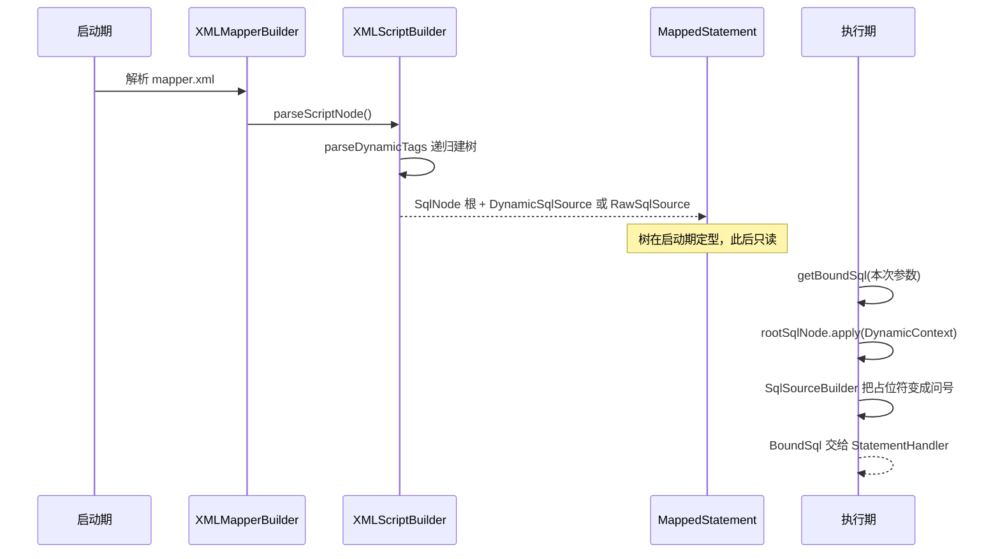
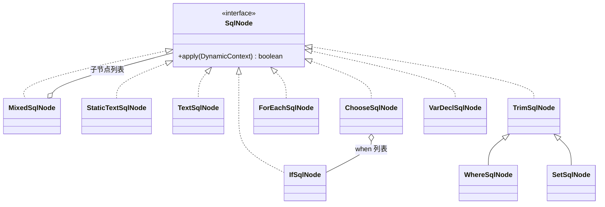
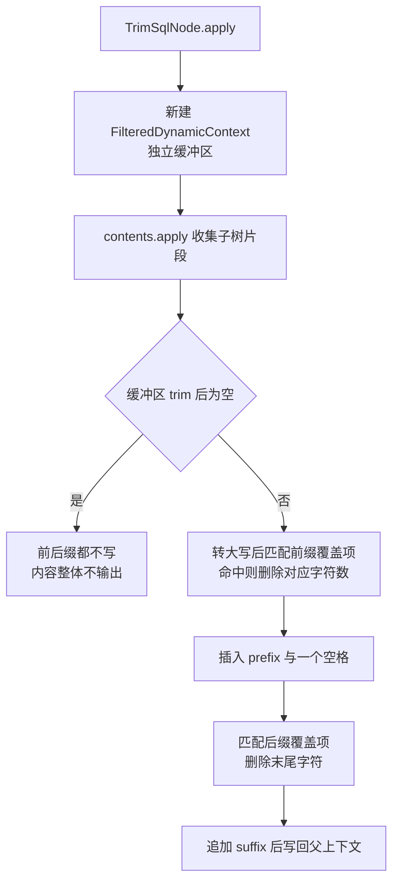
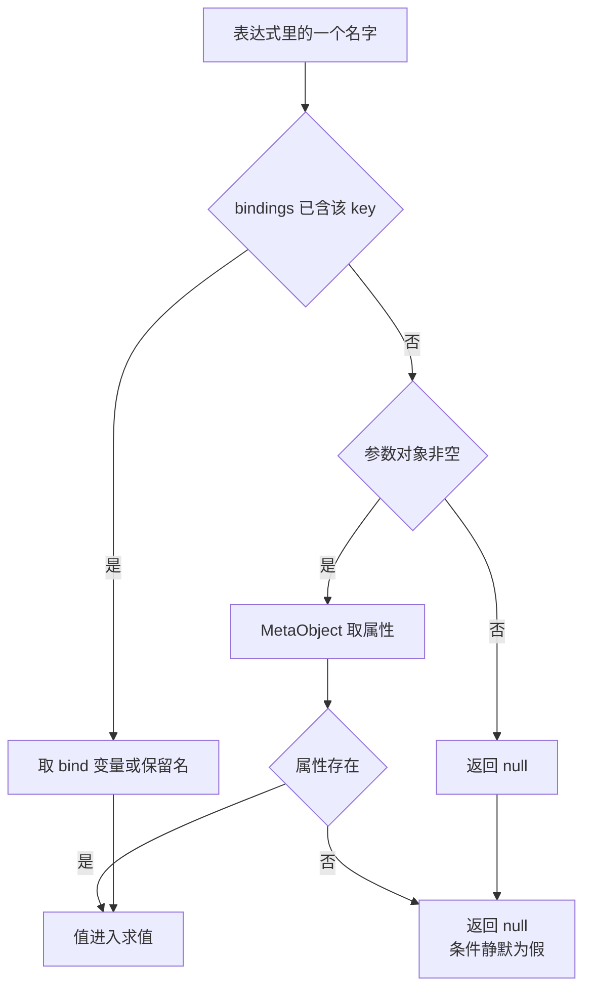

# 动态SQL——OGNL表达式与SqlNode解析树

**摘要：**

动态 SQL 常被当成一组 XML 标签来背，背完 `<if>`、`<foreach>`、`<where>` 之后，仍然说不清为什么某段拼接错误要到线上才暴露、又为什么有些错误连异常都没有。真正决定这些行为的是两个互相分离的时刻：构建 `SqlSessionFactory` 时，mapper 里的标签体被编译成一棵 `SqlNode` 树；执行时，才用这一次的参数把这棵树求值成 SQL 文本。本文沿这条分界线展开——先给出解析期与求值期的职责切分，并用一张判定表说明各类拼写错误在哪一刻暴露、哪些根本不暴露；再逐个拆开 `SqlNode` 家族的十个节点，把 `TrimSqlNode` 的 `prefixOverrides` 语义与 `WhereSqlNode` 的八项预置覆盖列表讲透，顺带解释 `where 1=1` 为何在 MyBatis 里是多余的一行；接着区分 `#{}` 与 `${}` 这两条通道，给出"值走参数、标识符走白名单"的判据与校验写法；随后进入 OGNL 的求值上下文，处理单字符比较、布尔求值的非类型转换、`_databaseId` 的多库适配；再解剖 `<foreach>` 的参数名改写、空集合与 Oracle 千条上限；末章收敛到"什么时候不该用它"，给出反例清单、约束表与一条可执行的判据。全文只回答一个问题：一条动态 SQL 的哪些部分应当由启动期负责、哪些应当由求值期负责、哪些根本不该交给运行期——这个划分比记住标签属性更能挡住生产事故。

---

## 第 1 章 两个时刻：解析与求值的分离

### 1.1 一条写错的 `<if>` 会在什么时候报错

笔者见过三次同类事故，症状截然不同。第一次是把 `<if test="status != null">` 敲成了 `<if test="status =! null">`，本地启动毫无异常，自测只跑了无条件查询，直到联调环境第一个带状态过滤的请求打进来，抛出 `BuilderException: Error evaluating expression 'status =! null'`。第二次是参数名拼错，`userName` 写成了 `username`，这次连异常都没有：SQL 少了一段过滤条件，接口返回全量数据，两小时后由一条慢查询告警暴露。第三次最干脆，`<if>` 被写成 `<iff>`，应用启动即失败，日志第一行是 `BuilderException: Unknown element <iff> in SQL statement.`。

三件事的差别不在代码质量，而在错误被发现的位置：一个在构建 `SqlSessionFactory` 时就被 XML 解析器挡住，一个在第一次执行该语句时才被 OGNL 求值器挡住，还有一个在任何时刻都挡不住。要把这三个时刻分清楚，得先承认 MyBatis 把动态 SQL 的工作切成了泾渭分明的两段。

### 1.2 解析期：从 `XNode` 到 `SqlNode` 树

解析的入口是 `XMLScriptBuilder.parseScriptNode()`，它在 `SqlSessionFactory` 构建期被 `XMLMapperBuilder` 调用，把一条 `<select>` 的标签体递归翻译成节点树。递归过程集中在 `parseDynamicTags(XNode)`：遍历子节点，文本或 CDATA 节点交给 `TextSqlNode.isDynamic()` 探测一次——只要文本里出现 `${`，整条语句就被标记为动态；元素节点去 `nodeHandlerMap` 里查处理器。这张映射表一共九项，是整个动态 SQL 语法的全集：

```java
// XMLScriptBuilder.initNodeHandlerMap —— 语法全集只有这九项
nodeHandlerMap.put("trim",      new TrimHandler());
nodeHandlerMap.put("where",     new WhereHandler());
nodeHandlerMap.put("set",       new SetHandler());
nodeHandlerMap.put("foreach",   new ForEachHandler());
nodeHandlerMap.put("if",        new IfHandler());
nodeHandlerMap.put("choose",    new ChooseHandler());
nodeHandlerMap.put("when",      new IfHandler());        // when 复用 IfHandler
nodeHandlerMap.put("otherwise", new OtherwiseHandler());
nodeHandlerMap.put("bind",      new BindHandler());

// 查不到处理器时，失败发生在这里，而不是执行期
if (handler == null) {
    throw new BuilderException("Unknown element <" + nodeName + "> in SQL statement.");
}
```

两处细节值得记住。其一，`<when>` 复用了 `IfHandler`，所以 `ChooseSqlNode` 内部持有的是一组 `IfSqlNode`，而不是专门的 `WhenSqlNode`；`<otherwise>` 更特殊，它不产生独立节点，`OtherwiseHandler` 只把子树的 `MixedSqlNode` 直接放进列表，由 `ChooseHandler` 在启动期校验数量，超过一个就抛 `Too many default (otherwise) elements in choose statement.`。其二，只要出现任意一个元素节点，`isDynamic` 就被置为真，最终产物是 `DynamicSqlSource`；反之，全部是静态文本、且不含 `${}` 时，产物是 `RawSqlSource`。这个二选一在解析期就定死了，运行期没有回旋余地。

树的根是一个 `MixedSqlNode`，它连同 `SqlSource` 一起被塞进 `MappedStatement`，此后在进程生命周期内不再变化。这条链路如何汇入 `Configuration`，见 [[01 Mybatis全局架构——从SQL到结果映射的完整链路]]。

### 1.3 求值期：一次 `apply` 走完整棵树

执行期的主角是 `DynamicSqlSource.getBoundSql()`。它做的事比表面看起来多：先造一个 `DynamicContext` 装参数，再让根节点把这棵树走一遍，最后还要把走出来的文本再送进 `SqlSourceBuilder` 做一次 `#{}` 到 `?` 的翻译。

```java
public BoundSql getBoundSql(Object parameterObject) {
    DynamicContext context = new DynamicContext(configuration, parameterObject);
    rootSqlNode.apply(context);              // 第一趟：树 → 含 #{} 的 SQL 文本

    SqlSourceBuilder sqlSourceParser = new SqlSourceBuilder(configuration);
    Class<?> parameterType = parameterObject == null ? Object.class : parameterObject.getClass();
    SqlSource sqlSource = sqlSourceParser.parse(context.getSql(), parameterType, context.getBindings());
    BoundSql boundSql = sqlSource.getBoundSql(parameterObject);   // 第二趟：#{} → ? + ParameterMapping

    // foreach 生成的 __frch_*、bind 生成的变量，靠这一行挂进 BoundSql
    context.getBindings().forEach(boundSql::setAdditionalParameter);
    return boundSql;
}
```

这个顺序决定了 `${}` 的命运：它的替换发生在第一趟，由 `TextSqlNode.apply()` 用字符串直接拼进 SQL 文本，比第二趟的占位符参数化更早。等到 `SqlSourceBuilder` 开始工作时，`${}` 的内容早已是 SQL 语法的一部分，再也没有机会变成参数。第 4 章会把这条分岔讲到底。

`RawSqlSource` 走的是另一条路。它的构造器用空参数把树跑一遍拿到文本，然后在**构造期**就把 `#{}` 解析完，产出一个固定的 `StaticSqlSource`；执行期只需要新建一个 `BoundSql` 对象，既不走树也不扫字符。这也顺带解释了为什么含 `${}` 的语句不可能被优化成 `RawSqlSource`：空参数求值只会把它替换成空串，等于在启动时就把这段 SQL 删掉了。

### 1.4 分离带来的判定表

把错误按"依赖什么信息"分类，落在哪一刻就一目了然：只依赖 XML 字面形状的，启动期就能抓住；依赖参数值的，只能推到执行期；而依赖参数值、又不触发异常的，落进第三类——静默错误。下面这张表是排查动态 SQL 问题的第一把钥匙。

| 错误形态 | 发现时刻 | 典型症状或异常 | 判据 |
| --- | --- | --- | --- |
| 标签未闭合、XML 不合法 | 启动期 | `BuilderException` 或 `SAXParseException`，带 mapper 行号 | 应用起不来 |
| 未知标签，如 `<iff>` | 启动期 | `Unknown element <iff> in SQL statement.` | 应用起不来，指向 mapper 文件 |
| `<choose>` 里两个 `<otherwise>` | 启动期 | `Too many default (otherwise) elements in choose statement.` | 应用起不来 |
| `test` 表达式语法错 | 执行期首次命中该语句 | `Error evaluating expression '...'` | 只有走到该语句才报，日志无参数字面量 |
| `test` 引用的属性名拼错 | 执行期，静默 | 条件恒假，SQL 少一段，无异常 | 开 `DEBUG` 打 SQL，与预期比对 |
| `test` 单字符比较踩 char 坑 | 执行期，静默 | 同上，且仅在某取值下复现 | 换双引号字符串后行为改变 |
| `<foreach collection>` 为 `null` | 执行期 | `The expression 'ids' evaluated to a null value.` | 只在集合为空指针时出现 |
| `<foreach>` 收到空集合 | 执行期 | 外层 `IN` 后没有括号，`SQLSyntaxErrorException` | 日志里的 SQL 结尾是 `IN` |
| `#{prop}` 属性名拼错 | 执行期 | `There is no getter for property named '...' in 'class ...'` | 与 `test` 里拼错相反，这条会抛异常 |
| `<where>`/`<set>` 内容全空 | 执行期 | `SELECT ... ` 缺 `WHERE` 或 `UPDATE ... WHERE` 缺 `SET`，数据库报语法错 | 同一语句换参数就正常 |
| 注解里写 `<if>` 未包 `<script>` | 执行期 | SQL 里出现字面量 `<if test=...>`，数据库报语法错 | 日志中原样可见尖括号 |
| `${}` 拼了用户输入 | 任何时刻都不报 | 注入成功或被注入的数据污染 | 只有审计与代码评审能发现 |

表格里有两条最容易被忽略。一条是"属性名拼错但 `test` 静默为假"：`ContextMap.get()` 在参数对象上找不到 getter 时，`MetaObject.getValue()` 返回 `null`，OGNL 拿到的就是 `null`，`!=` 判断为假，整段内容被安静地跳过，不抛任何异常——第 5 章会给出这行源码。另一条是"注解里写动态标签"：`XMLLanguageDriver.createSqlSource(String script, ...)` 只在脚本以 `<script>` 开头时才把它当 XML 解析，否则整段字符串被当成 `TextSqlNode`，尖括号原样留在 SQL 里，这个坑在启动期完全看不出来。

### 1.5 为什么必须分成两段

如果每次执行都重新解析 XML，成本会高得离谱：DOM 遍历、`XPathParser` 求值、属性 `Properties` 复制，全部要按次摊销，而 SQL 结构在编译之后根本不会变。MyBatis 的选择是把不变的部分一次性做完——节点树建一次，OGNL 表达式文本也解析一次。`OgnlCache` 用一个静态的 `ConcurrentHashMap<String, Object>` 按表达式字符串缓存 `Ognl.parseExpression()` 的结果，执行期只剩下 `Ognl.getValue()` 这一步求值。

代价随之而来。树在启动期固化，运行期想改变 SQL 的**结构**（不是内容），只有三条路：`${}` 文本拼接、`SqlSource` 的 Provider 实现、或者直接换 `MappedStatement`。前两条把控制权交回开发者手里，也把风险一并交了回去；第三条在业务代码里几乎不可行。换言之，这个两段式设计的收益是启动期一次性成本与执行期可预测的开销，代价是动态能力必须走字符串通道——而字符串通道既无法参数化，也无法被预编译保护。

按一个可以自行验算的口径做示例推算（非实测数据）：一条语句的树有 40 个节点、最终 SQL 约 2 KB 字符，服务在数百 QPS 下每请求命中 3 条动态语句，那么每秒要做数千次树遍历、数千次 O(2 KB) 的字符扫描、外加数千次 `ParameterMapping` 构建。这些开销相对一次网络往返可以忽略，真正的成本在别处：每一条执行期生成的 SQL 文本都是一个可能不同的 PreparedStatement 模板，语句缓存与执行计划缓存的命中率会被集合长度、条件组合直接稀释。第 6 章讨论 `<foreach>` 时会看到这一点的极端形态。

下面这张图把两个时刻分开画在一起，注意后半段是每请求重复一次，前半段全进程只有一次。



---

## 第 2 章 `SqlNode` 家族的十个成员

### 2.1 一行接口承担的职责

`SqlNode` 只有一个方法，整个动态 SQL 的执行语义都压在这一个签名上：

```java
public interface SqlNode {
    boolean apply(DynamicContext context);
}
```

参数 `DynamicContext` 是这一趟求值的全部状态：变量表 `bindings`、拼装中的 `sqlBuilder`、以及给 `<foreach>` 生成唯一后缀用的 `uniqueNumber`。十个实现类各有各的写法，但共同约定只有一条——向 `context` 追加片段，或者不追加。

返回值 `boolean` 常被教程解释成"本节点是否产生了有效内容"，这个说法在实践中会误导人。`MixedSqlNode.apply()` 遍历完子节点后**无条件返回 `true`**，`StaticTextSqlNode` 和 `TextSqlNode` 也恒返回 `true`；真正判断"这段到底有没有内容"的地方在 `TrimSqlNode` 内部，它不看返回值，而是看收集到的字符串 `trim()` 之后是否为空。返回值的实际作用范围比想象中窄：`IfSqlNode` 在条件为假时返回 `false`，`ChooseSqlNode` 靠这个 `false` 继续试下一个 `<when>`——这是它唯一被正式使用的场合。

### 2.2 叶子节点：静态文本与 `${}`

`StaticTextSqlNode` 直接把文本交给 `context.appendSql()`。这一步看似平凡，但 `DynamicContext` 内部用的是一个 `StringJoiner(" ")`，也就是每两次 `appendSql` 之间自动插一个空格，`getSql()` 再来一次 `trim()`。这件事解释了一个常见疑问：为什么 `<if>` 里手写的 `AND name = ?` 不必和上一行的换行、缩进对齐，SQL 依然合法——空白由容器统一处理，模板里的缩进只影响肉眼阅读。`<trim>` 里的 `FilteredDynamicContext` 采用同样的策略，`appendSql` 之前先补一个空格。

`TextSqlNode` 是 `${}` 的载体。它的 `isDynamic()` 用一个 `GenericTokenParser("${", "}")` 扫一遍文本，命中任意一个 token 就把整条语句标成动态；`apply()` 则用同一个解析器真正做替换，`null` 值替换成空串而不是字符串 `"null"`。

### 2.3 门控节点：`if` 与 `choose`

`IfSqlNode` 的结构极其朴素：一个表达式字符串、一个子节点、一次布尔求值。语义上它是短路门——条件为假，子树整段不执行，子树里的 `<foreach>`、`<bind>` 也一并跳过，不会有任何副作用。

`ChooseSqlNode` 则是"第一个成立者胜出"的语义：它按 `whenSqlNodes` 的顺序逐个调用 `apply()`，谁先返回 `true` 就立刻返回，后面的 `<when>` 不再求值。这个短路有两层含义，一层是逻辑上的互斥，另一层是**求值成本上的节省**——如果第三个 `<when>` 里写了 `orderNo.startsWith(...)`，而第一个 `<when>` 已成立，这个调用不会发生。反过来也成立：把昂贵的判断放在第一个 `<when>` 上，就是让后面所有分支都为它买单。

### 2.4 装饰节点：`trim` 一族

`TrimSqlNode` 是唯一带"后处理"能力的节点：它不直接往父上下文写，而是开一个子缓冲区收集子树产物，收完再统一做前/后缀修饰，最后一次性写回。`WhereSqlNode` 与 `SetSqlNode` 都是它的子类，只用不同的构造参数把"加 `WHERE` 并去掉开头 `AND`/`OR`"和"加 `SET` 并去掉结尾逗号"这两件事固化下来。第 3 章单独拆解这一族，因为它的语义偏差是动态 SQL 里最贵的一类 bug。

### 2.5 迭代与声明：`foreach`、`bind`

`ForEachSqlNode` 负责集合展开，它同时承担三件事：写 `open`/`close`、按 `separator` 分隔、把 `#{item}` 改写成带唯一后缀的参数名。因为改写的对象是 SQL 文本里的 token，它必须提供一个自己的 `FilteredDynamicContext` 来拦截 `appendSql()`。`VarDeclSqlNode` 更简单：用 `OgnlCache.getValue()` 求出表达式结果，`context.bind(name, value)` 写进 `bindings`，后续任何 `#{}` 或 `test` 都能读到这个名字。

十个成员的分工可以收敛成一张表，其中"关键状态"一列是排查时最该盯住的东西。

| 实现类 | 对应标签 | `apply` 返回值 | 关键状态与副作用 |
| --- | --- | --- | --- |
| `MixedSqlNode` | 容器（根） | 恒 `true` | 持有子节点列表，顺序决定片段顺序 |
| `StaticTextSqlNode` | 纯文本 | 恒 `true` | 无条件追加，依赖容器补空格 |
| `TextSqlNode` | 含 `${}` 的文本 | 恒 `true` | 触发 `DynamicSqlSource`；`null` 变空串 |
| `IfSqlNode` | `<if>`、`<when>` | 条件为真时 `true` | 为假时子树完全不执行，无副作用 |
| `ChooseSqlNode` | `<choose>` | 命中时 `true` | 顺序求值，命中即停 |
| `TrimSqlNode` | `<trim>` | 子树返回值 | 子缓冲区 + 前/后缀修饰，两阶段 |
| `WhereSqlNode` | `<where>` | 同上 | 预置 `WHERE` 与八项前缀覆盖 |
| `SetSqlNode` | `<set>` | 同上 | 预置 `SET` 与末尾逗号覆盖 |
| `ForEachSqlNode` | `<foreach>` | 恒 `true` | 唯一参数名、`__frch_` 前缀、分隔符时机 |
| `VarDeclSqlNode` | `<bind>` | 恒 `true` | 往 `bindings` 写变量，影响后续 OGNL |

结构关系用类图更清楚，重点看两处：`TrimSqlNode` 的两个子类承载了全部语义差异，`ForEachSqlNode` 之所以要自带 `DynamicContext` 子类，是因为它必须拦截写 SQL 的动作。



---

## 第 3 章 `TrimSqlNode`：被误解最深的一个节点

### 3.1 两阶段：先收集，后修饰

`TrimSqlNode.apply()` 只有四行，但它把"拼接"拆成了两个物理阶段，这是理解整个 trim 族的前提：

```java
public boolean apply(DynamicContext context) {
    FilteredDynamicContext filtered = new FilteredDynamicContext(context);
    boolean result = contents.apply(filtered);   // 阶段一：子树往私有缓冲区写
    filtered.applyAll();                         // 阶段二：修饰后一次性写回父上下文
    return result;
}
```

为什么要多一层缓冲区，而不是边拼边删？因为"删除开头多余的 `AND`"这个动作需要看到**整段**内容才能判断开头是什么，而子树在遍历到第二个节点之前根本不知道第一个节点会不会产出内容。`<where>` 内三个 `<if>` 里只有第二个成立时，缓冲区里从空到 `" AND status = ?"` 的变化是渐进的，只有等子树走完，才能确定开头到底是什么。这也解释了另一个常被忽略的现象：`<trim>` 的修饰是**一次性**的，`prefix` 只在第一次非空写入时插入，`prefixesToOverride` 也只匹配一次。

### 3.2 `prefixOverrides` 的精确语义

`applyAll()` 的实现只有十行左右，但它定义了四条容易被记错的规则：

```java
public void applyAll() {
    sqlBuffer = new StringBuilder(sqlBuffer.toString().trim());     // 规则一：先整体 trim
    String trimmedUppercaseSql = sqlBuffer.toString().toUpperCase(Locale.ENGLISH);  // 规则二：大写比较
    if (!trimmedUppercaseSql.isEmpty()) {
        applyPrefix(sqlBuffer, trimmedUppercaseSql);                 // 规则三：只在开头匹配一次
        applySuffix(sqlBuffer, trimmedUppercaseSql);
    }
    delegate.appendSql(sqlBuffer.toString());                        // 空内容则什么都不写
}

private void applyPrefix(StringBuilder sql, String trimmedUppercaseSql) {
    if (prefixApplied) return;
    prefixApplied = true;
    prefixesToOverride.stream().filter(trimmedUppercaseSql::startsWith).findFirst()
        .ifPresent(toRemove -> sql.delete(0, toRemove.trim().length()));   // 规则四：删的是字符数
    if (prefix != null) sql.insert(0, " ").insert(0, prefix);
}
```

四条规则逐条落地。规则一是先对整段 `trim()`，所以开头有多少换行、缩进都不影响匹配；规则二是匹配时把整段转成大写，因此 `and`、`And`、`AND` 一视同仁，也意味着覆盖项不需要为大小写各写一遍；规则三是 `findFirst()`，命中第一个就停，而且只在字符串下标 0 处判断，**绝不处理中间位置**；规则四是删除 `toRemove.trim().length()` 个字符，对 `"AND "` 就是删三个字符，留下的那个空格由随后的 `insert(0, " ")` 补上。

把四条合起来，就能推出几个实践结论。`prefixOverrides="AND"` 与 `prefixOverrides="AND "` 效果相同，因为长度都按 `trim()` 后计算；`ANDX` 不会被误删，因为 `"ANDX..."` 不以 `"AND "` 开头；写 `<trim prefixOverrides=",">` 想删掉列表中所有多余逗号是行不通的，因为它只看开头那一个，内部分隔符必须交给 `<foreach separator>` 处理；把 `WHERE` 写进覆盖列表也没用，`WhereSqlNode` 的预置列表里没有它，真写了只会得到 `WHERE WHERE a = ?` 这种运行期语法错误。

### 3.3 `WHERE` 与 `SET` 的预置参数

两个子类的构造参数把全部差异表达完了，`WhereSqlNode` 的八项覆盖列表尤其值得背下来：

```java
// WhereSqlNode：prefix 是 WHERE，覆盖 4 个词 × 4 种空白
private static final List<String> prefixList = Arrays.asList(
    "AND ", "OR ", "AND\n", "OR\n", "AND\r", "OR\r", "AND\t", "OR\t");

public WhereSqlNode(Configuration configuration, SqlNode contents) {
    super(configuration, contents, "WHERE", prefixList, null, null);
}

// SetSqlNode：prefix 是 SET，覆盖的是末尾逗号
public SetSqlNode(Configuration configuration, SqlNode contents) {
    super(configuration, contents, "SET", null, null, Collections.singletonList(","));
}
```

八个覆盖项看着啰嗦，其实是在补 XML 里空白的四种形态：空格、换行、回车、制表符。由于规则二会先把整段转大写，这里不必重复大小写变体；由于规则一已经对整段 `trim()` 过，开头的空白已被剥掉，那些带 `\n`、`\t` 的项只在 `AND` 与后续内容之间出现换行时才可能命中，属于防御性冗余。

`SET` 一侧的语义与 `WHERE` 不完全对称，这一点常被讲错。`<set>` 的内容全为空时，`applyAll()` 里 `trimmedUppercaseSql.isEmpty()` 成立，于是连 `SET` 都不写，最终 SQL 变成 `UPDATE t_order WHERE id = ?`——MyBatis 自己不抛异常，是数据库在执行时抛语法错误。它也不会替你去掉**中间**多余的逗号：`name = ?, , email = ?` 这种病态输入，只有末尾那个逗号会被处理。

### 3.4 为什么 `where 1=1` 在 MyBatis 里是多余的

`1=1` 不是 MyBatis 的用法，它是手写 `StringBuilder` 时代的遗产：那时每个片段都要自己带 `AND` 前缀，为了让第一个片段也能无脑带 `AND`，得先在 `WHERE` 后面垫一个恒真条件。`<where>` 把这个责任接了过去——它判断内容是否为空，决定写不写 `WHERE`；它删掉开头多余的 `AND`/`OR`。于是模板里的每一段都可以统一写成 `AND xxx`，不必区分"我是不是第一段"。

保留 `1=1` 的代价是实打实的：SQL 文本多了一个恒真谓词，执行计划里可能多一次条件求值（部分优化器会消去，部分不会）；日志与实际执行之间多了一层噪声；更要紧的是它掩盖了一个信号——`<where>` 内容全空时本该生成一条语义可疑的 SQL（没有过滤条件的全表扫描），`1=1` 会让这条 SQL 看起来"合理"，从而让"这个接口缺了必填条件"这件事更难被发现。

有一类场景确实需要手动垫条件：当过滤条件的第一段是一个可选的整体 `(a = ? OR b = ?)`，而这组条件自身不以 `AND` 开头时，`<where>` 不会替你补 `AND`。此时的正解是在条件组内部统一带 `AND`，而不是退回 `1=1`。

### 3.5 双空格：一个可观测的指纹

`applyPrefix()` 先 `delete(0, 3)` 删掉 `AND`，再 `insert(0, " ")` 补空格，再 `insert(0, "WHERE")`，得到的文本是 `WHERE  name = ?`——`WHERE` 与列名之间有两个空格。这不是 bug，而是"删字符数 + 补分隔"两个动作叠加的自然结果。

这个指纹有实用价值：排查"到底走没走 `<where>`"时，打开 SQL 日志看 `WHERE` 后面是不是双空格，比翻 XML 快得多。同样是双空格的还有 `<set>` 后紧跟字段、`<trim prefix=...>` 插入位置，凡是"被覆盖过的前缀"都会留下这个痕迹。反过来，如果日志里是单空格的 `WHERE name = ?`，说明这段 `WHERE` 是模板里手写的，根本没经过 `WhereSqlNode`。

### 3.6 边界：`trim` 帮不上的五种情况

| 场景 | `trim` 的实际行为 | 正确做法 |
| --- | --- | --- |
| 第一段以括号包裹的 `OR` 组开头 | `(` 开头，不匹配任何覆盖项，`OR` 留在原处 | 组内每段显式带 `AND`，或把括号写进 `<trim prefix="AND (">` |
| 第一段刻意以 `OR` 开头、承接外层条件 | 被当作多余前缀删掉，语义静默改变 | 不要把条件跨 `<where>` 边界续写，整组条件放进同一个 `<where>` |
| 第一段以 `NOT`、`EXISTS`、`(` 开头 | 不做任何处理，也不补 `AND` | 模板里显式写 `AND` |
| 需要处理多个位置的分隔符（如列清单里的逗号） | 只匹配开头一次，中间的原样保留 | 用 `<foreach separator>` 或改结构 |
| 除 `WHERE`/`SET` 外的关键字 | 需要自己配 `prefixOverrides`/`suffixOverrides` | 用 `<trim>` 显式声明，注意只生效一次 |

最后一行值得展开。`<trim>` 的四类覆盖都只作用于**首尾各一次**，所以它能处理"多余的连接词"，不能处理"多余的分隔符"；能把 `AND` 删掉，不能把两个 `AND` 之间的空条件补上。一旦模板里的条件组合开始需要"依赖前一段状态"的判断，就不该继续往 `<trim>` 上加参数了——那是把状态机塞进字符串处理，正确的位置在 Java 侧。

把这一族的两阶段流程画出来，前面那些"只生效一次"的行为就有了位置感：所有修饰都发生在缓冲区收满之后，而且只发生一次。



---

## 第 4 章 `#{}` 与 `${}`：两条不同的通道

### 4.1 `${}` 的两次命运

`${}` 在 MyBatis 里有两条互不相同的解析路径，混在一起谈是这个话题最常见的信息损失。

第一条路径在启动期。`XNode` 在构造时就把节点文本交给 `PropertyParser`：

```java
private String getBodyData(Node child) {
    if (child.getNodeType() == Node.CDATA_SECTION_NODE || child.getNodeType() == Node.TEXT_NODE) {
        String data = ((CharacterData) child).getData();
        // 用 mybatis 配置里的 variables 解析 ${...}
        return PropertyParser.parse(data, variables);
    }
    return null;
}
```

如果 `${schema}` 里的名字在 `mybatis-config.xml` 的 `<properties>` 或外部配置源里存在，它在启动期就被替换成配置值；不存在则原样保留，留给第二条路径。分库分表场景常见的 `${schema}.t_order_${shard}` 属于这条路径的一半——`schema` 来自配置，`shard` 来自参数。

第二条路径在求值期，由 `TextSqlNode.BindingTokenParser` 完成：

```java
public String handleToken(String content) {
    Object parameter = context.getBindings().get("_parameter");
    if (parameter == null) {
        context.getBindings().put("value", null);
    } else if (SimpleTypeRegistry.isSimpleType(parameter.getClass())) {
        context.getBindings().put("value", parameter);   // 单参数时可用 ${value}
    }
    Object value = OgnlCache.getValue(content, context.getBindings());
    // 注意：这里没有做任何输入校验，null 输出空串，其余 String.valueOf 后直接拼进 SQL
    return value == null ? "" : String.valueOf(value);
}
```

这段代码决定了 `${}` 的全部性质：它用 OGNL 求值（还能写表达式，不只是取属性），求值结果被 `String.valueOf()` 转成文本，然后直接拼进 SQL 字符串。没有任何转义、没有任何校验。等到 `SqlSourceBuilder` 把 `#{}` 换成 `?` 时，这段文本已经和 `SELECT`、`FROM` 处于同一层级——它是语法，不是值。

### 4.2 `#{}` 的旅程

`#{}` 走的是另一条完全不同的通道，它在第二趟被 `SqlSourceBuilder` 的 `ParameterMappingTokenHandler` 处理：把每个 `#{...}` 替换成 `?`，同时按 `property, javaType=, jdbcType=, typeHandler=, mode=` 这些选项构造一个 `ParameterMapping`。执行期 `DefaultParameterHandler` 按固定优先级取值：先查 `BoundSql.additionalParameters`（`<bind>` 与 `__frch_*` 变量在这里），再判断参数对象本身是不是简单类型，最后才用 `MetaObject` 取属性，取到的值交给对应的 `TypeHandler.setParameter()` 按占位符下标绑定。

两条通道的分岔点很清楚：`#{}` 的值最终进入 `PreparedStatement` 的参数槽，永远不参与 SQL 文本的拼接；`${}` 的值进入 SQL 文本，永远不进入参数槽。前者由 JDBC 驱动负责转义与类型化，后者依赖开发者自己保证安全。参数映射的细节见 [[04 参数处理——ParameterHandler与TypeHandler的类型映射]]。


### 4.3 判据：值走参数，标识符走白名单

判断一个插值该用 `#{}` 还是 `${}`，可以用一句可操作的话：把值当作字符串常量加引号写进 SQL，如果语义不变，它就是"值"，走 `#{}`；如果加引号之后语义变了，它就是"语法"，只能走 `${}`，而一旦走 `${}`，来源必须是白名单。

`ORDER BY` 是这条判据最锋利的例子。`ORDER BY ?` 传 `create_time`，数据库收到的是一个字符串常量排序键，等价于按常量排序，全部行同键、顺序未定义，不报错；`ORDER BY create_time` 才按该列排序。这就是"动态排序列必须用 `${}`"的根因——不是 MyBatis 的限制，是 SQL 语法的限制。同理的还有表名、列清单、`LIMIT` 的字面量部分（部分数据库允许 `LIMIT ?`，但 `LIMIT ?,?` 的两个参数位置在预编译下行为依驱动而异）、`UNION` 分支。`IN` 列表是另一种情况：元素个数属于结构，但 MyBatis 用 `<foreach>` 把它展开成若干个占位符来表达，因此那部分是"结构由框架生成、值仍走参数"，不该用 `${}` 手工拼。

### 4.4 白名单的写法与放置层次

`${}` 的安全前提是白名单，而白名单要满足三个条件：只接受已知集合、拒绝时抛异常而不是降级、校验位置在参数入口而不是控制器。满足条件之后，写法上还有强弱之分：

```java
// 写法一：枚举映射，最安全——用户输入到 SQL 片段之间没有直接的字符串通路
public enum OrderSort {
    CREATE_TIME("create_time"), AMOUNT("amount"), ID("id");
    private final String column;
    OrderSort(String column) { this.column = column; }
    public String column() { return column; }
}

// 写法二：集合白名单；写法三：正则约束，适用于结构固定的标识符（如两位分表后缀）
private static final Set<String> SORT_COLUMNS = Set.of("create_time", "amount", "id");
private static final Set<String> SORT_ORDERS  = Set.of("ASC", "DESC");
private static final Pattern SHARD_SUFFIX = Pattern.compile("^[0-9]{2}$");

public List<Order> listOrders(String sortColumn, String sortOrder, String shard) {
    if (!SORT_COLUMNS.contains(sortColumn)) {
        throw new IllegalArgumentException("非法排序字段: " + sortColumn);   // 拒绝，不降级
    }
    if (!SORT_ORDERS.contains(sortOrder.toUpperCase(Locale.ROOT))) {
        throw new IllegalArgumentException("非法排序方向: " + sortOrder);
    }
    if (!SHARD_SUFFIX.matcher(shard).matches()) {                          // 分表后缀只允许两位数字
        throw new IllegalArgumentException("非法分表后缀: " + shard);
    }
    return orderMapper.listOrders(sortColumn, sortOrder.toUpperCase(Locale.ROOT), shard);
}
```

三种写法的差别在"失控半径"。枚举映射最好，因为从用户输入到 SQL 片段之间根本没有直接通路，任何非法输入在类型层面就不存在；集合白名单次之，需要保证集合本身是常量、且后续不再被改动；正则最弱，但对付分表后缀这类"结构固定、取值有限"的标识符够用。三者都不能靠黑名单实现——过滤掉引号与分号在标识符场景毫无意义，注释符、大小写、编码、空格组合都能绕过，而标识符本来就允许字母数字下划线，黑名单连正常值都会误伤。

放置层次比写法更容易出问题。校验要放在 Service 层的 Mapper 调用入口，而不是 Controller，理由很朴素：同一个 Service 方法可能被定时任务、消息消费者、内部 RPC 调用，这些入口没有经过 Controller 的 DTO 校验；反过来，把校验写进 Controller 等于给每个入口各写一遍，漏一个就是缺口。

> [!warning] 白名单不是拦截器能代替的事
>
> 用 MyBatis 拦截器或 `SqlSource` 装饰器去"事后检查 SQL 里有没有注入特征"是不成立的：拦截器拿到的是已经拼好的 SQL 文本，此时 `'` 与 `;` 已经与语法混在一起，无法区分哪一段来自用户、哪一段来自模板。校验只能发生在值进入 `${}` 之前，也就是 Java 侧。

### 4.5 四个常见反例

```xml
<!-- 反例一：排序方向直接来自前端，注入面最大 -->
SELECT * FROM t_order ORDER BY ${sortColumn} ${sortOrder}

<!-- 反例二：分表后缀未做约束，values 里可以塞任意 SQL -->
SELECT * FROM t_order_${shard} WHERE user_id = #{userId}

<!-- 反例三：把列表拼成文本，失去参数化，也失去长度控制 -->
SELECT * FROM t_order WHERE id IN (${ids})

<!-- 反例四：把整段过滤条件当参数传，模板彻底失去审计能力 -->
SELECT * FROM t_order WHERE ${whereClause}
```

反例三与反例四的伤害不止于注入。`IN (${ids})` 让每个不同长度的列表产生不同文本，语句缓存命中率归零；`${whereClause}` 让"这条 SQL 到底查了什么"必须回到 Java 代码里读字符串拼接，SQL 日志、慢查询分析、审计全部失效。这两条已经越过了"用错占位符"的范畴，属于把框架当字符串模板用——第 7 章会把这条边界完整划出来。

`#{}` 与 `${}` 的差别可以压成一张表。

| 维度 | `#{}` | `${}` |
| --- | --- | --- |
| 解析阶段 | 求值期第二趟 `SqlSourceBuilder`（静态语句提前到启动期） | 启动期 `PropertyParser`（配置变量）或求值期 `TextSqlNode`（参数） |
| 产物 | `?` + `ParameterMapping` 列表 | 直接进入 SQL 文本 |
| 是否预编译 | 是，值走 JDBC 参数槽 | 否，值成为语法的一部分 |
| 防注入 | 由驱动负责转义与类型化 | 完全依赖调用方白名单 |
| 对 `SqlSource` 的影响 | 无 | 只要出现就使语句变成 `DynamicSqlSource` |
| 可否用于标识符 | 不可以，`ORDER BY ?` 语义错误 | 可以，但必须白名单 |
| 失败形态 | 类型转换异常或绑定异常，显式报错 | 语法错、注入成功或静默错误，常常无异常 |

---

## 第 5 章 OGNL：求值上下文与类型边界

### 5.1 上下文里到底有什么

每次求值新建的 `DynamicContext` 干了两件事：把参数对象包装成 OGNL 能访问的根对象，再塞进两个保留名。

```java
public static final String PARAMETER_OBJECT_KEY = "_parameter";
public static final String DATABASE_ID_KEY = "_databaseId";

public DynamicContext(Configuration configuration, Object parameterObject) {
    if (parameterObject != null && !(parameterObject instanceof Map)) {
        MetaObject metaObject = configuration.newMetaObject(parameterObject);
        boolean existsTypeHandler = configuration.getTypeHandlerRegistry().hasTypeHandler(parameterObject.getClass());
        bindings = new ContextMap(metaObject, existsTypeHandler);
    } else {
        bindings = new ContextMap(null, false);
    }
    bindings.put(PARAMETER_OBJECT_KEY, parameterObject);      // 整个参数对象
    bindings.put(DATABASE_ID_KEY, configuration.getDatabaseId());  // 数据库厂商标识
}
```

于是 `<if test="...">` 里能访问四种东西：参数对象的属性（单参数 POJO 时直接写属性名）、`_parameter`（整个参数对象，用于 `_parameter != null` 这类判断）、`_databaseId`（当前数据库标识，多库适配用）、以及 `<bind>` 与 `<foreach>` 写进 `bindings` 的变量（`__frch_*` 系列）。多参数方法由 MyBatis 包装成 `Map`（加 `@Param` 时 key 是注解值，否则是 `param1`、`arg0` 这类名字），此时属性访问退化到 Map 取值。

### 5.2 查找顺序决定了静默失败

`bindings` 的真实类型是 `ContextMap`，它重写了 `get()`，这是"参数名拼错为什么不报错"的答案：

```java
@Override
public Object get(Object key) {
    String strKey = (String) key;
    if (super.containsKey(strKey)) return super.get(strKey);   // 保留名与 bind 变量优先
    if (parameterMetaObject == null) return null;              // 参数是 Map 或为 null
    if (fallbackParameterObject && !parameterMetaObject.hasGetter(strKey)) {
        return parameterMetaObject.getOriginalObject();        // 简单类型参数的兜底
    }
    // 属性不存在时 MetaObject 返回 null，而不是抛异常
    return parameterMetaObject.getValue(strKey);
}
```

顺序是：先查 `bindings` 自身的键（`_parameter`、`_databaseId`、`<bind>` 变量、`__frch_*`），未命中再交给参数对象的 `MetaObject`，而 `MetaObject.getValue()` 在属性不存在时返回 `null`。所以 `<if test="userName != null">` 里把 `userName` 写成 `username`，OGNL 拿到 `null`，条件恒假，整段内容被安静跳过。日志里没有任何异常，SQL 少了一段过滤，结果多了一批不该返回的行。

还有一层补偿机制：OGNL 通过 `ContextAccessor` 访问这个 Map，当 `map.get(name)` 取不到且 `_parameter` 本身是 `Map` 时，会再去参数 `Map` 里找一次。这就是为什么多参数方法里不写 `@Param` 也能用 `param1`、`arg0` 之外的名字——`Map` 的兜底查找接住了它。这条兜底也解释了另一个现象：同一个 key 在 `<bind>` 与参数 Map 里都存在时，`<bind>` 的值胜出，因为 `bindings` 排在前面。

### 5.3 布尔求值不是类型转换

`ExpressionEvaluator.evaluateBoolean()` 只有三段逻辑，但它与 OGNL 自身的布尔转换规则并不一致：

```java
public boolean evaluateBoolean(String expression, Object parameterObject) {
    Object value = OgnlCache.getValue(expression, parameterObject);
    if (value instanceof Boolean) return (Boolean) value;
    if (value instanceof Number)  return new BigDecimal(String.valueOf(value)).compareTo(BigDecimal.ZERO) != 0;
    return value != null;      // 其余一切类型：非空即为真
}
```

第三行是关键。`<if test="flag">` 在 `flag` 是字符串 `"false"` 时判为成立，因为 `"false"` 不是 `null`；`<if test="count">` 在 `count` 是 `Integer 0` 时判为不成立，因为走的是 `Number` 分支与零比较。字符串里的 `"0"` 同样非空即真。这条规则与"OGNL 会把字符串转布尔"的印象相反，实际生效的是 MyBatis 自己的三行判断，**非空即真**这四个字才是它的准确描述。

实践含义是：`test` 里不要依赖隐式转换，把意图写全——`flag == 'Y'`、`count > 0`、`status != null`。布尔字段要留意 `false` 与 `null` 的区分：`test="enabled"` 在 `enabled` 为 `false` 时走第一段返回 `false`，在 `enabled` 为 `null` 时走第三段返回 `false`，两者结果相同而成因不同，日志里看不出差别；如果业务上"未设置"与"明确关闭"要分开处理，就得写成 `enabled != null and enabled`，并把"未设置"的分支单独实现。

### 5.4 字符、字符串与空串

OGNL 的字面量规则是：单引号包一个字符是 `Character`，包多个字符是 `String`，双引号始终是 `String`。`'VIP'` 是字符串，所以 `<if test="type == 'VIP'">` 通常能正常工作；`'Y'` 是 `Character`，与 `String` 类型的参数比较时，OGNL 的 `==` 走的是 `OgnlOps` 的等值比较与数值转换，而不是 `String.equals()`。

```xml
<!-- 高危：参数是 String，字面量却是 Character，比较结果依赖 OGNL 的转换路径 -->
<if test="flag == 'Y'"> AND audited = 1 </if>

<!-- 安全：显式声明为字符串，XML 属性用单引号包，内部用实体引用双引号 -->
<if test='flag == &quot;Y&quot;'> AND audited = 1 </if>
```

这类比较的失败形态很隐蔽：条件恒假、不抛异常、SQL 少一段。如果某个值恰好落在转换路径上抛了 `NumberFormatException`，反而更容易被发现——真正的麻烦是那些"恰好能跑"的取值，让问题在测试环境长期潜伏。稳妥的写法有三条：单字符比较统统改成双引号字符串；把这类字段改成枚举或 `int` 常量，用 `@com.example.OrderStatus@AUDITED` 这样的静态引用比较；或者直接在参数对象里提供一个 `boolean isAudited()` 之类的派生方法，让 `test` 只做布尔判断。

`null` 与空串是同一类问题的另一面。`name != ''` 单独使用**不会**排除 `null`（`null` 与空串比较为不等，条件是成立的），必须写成 `name != null and name != ''`；`name.trim()` 与 `name.length()` 对 `null` 会抛异常，写进 `test` 等于把一个必失败点埋进模板。空串与空白的差别也常被忽略：只有空格串能通过 `!= ''` 的检查，真正需要"非空白"语义时，得用 `@org.apache.commons.lang3.StringUtils@isNotBlank(name)` 这类静态调用——注意它把模板与工具类耦合在一起，取舍见 5.6。

### 5.5 `_databaseId` 与多数据库适配

`Configuration.getDatabaseId()` 的值来自 `DatabaseIdProvider`，MyBatis 自带的 `VendorDatabaseIdProvider` 拿数据库产品的元数据（`DatabaseMetaData.getDatabaseProductName()`）去匹配一张 `Properties` 别名表，把 `MySQL`、`Oracle`、`PostgreSQL` 之类映射成自己定义的短名。声明在 `mybatis-config.xml` 里之后，同一个参数就能在模板里判断：

```xml
<select id="pageOrders" resultType="Order">
    SELECT * FROM t_order WHERE status = #{status}
    <if test="_databaseId == 'mysql'">
        LIMIT #{offset}, #{limit}
    </if>
    <if test="_databaseId == 'oracle'">
        OFFSET #{offset} ROWS FETCH NEXT #{limit} ROWS ONLY
    </if>
</select>
```

两个坑要提。其一是未配置 `DatabaseIdProvider` 时 `_databaseId` 为 `null`，上面两个 `<if>` 全部为假，生成的 SQL 缺少分页子句且**不报错**——一条"分页参数不生效"的诡异现象。其二是方言差异较大的场景，用语句级 `databaseId` 属性比用 `<if>` 更可读：`<select id="pageOrders" databaseId="mysql">` 与同名 `oracle` 版本各写一条完整 SQL，启动期按当前库各取一条，模板里不留分支。前者省代码、后者省认知负担，规模上去了选后者。

### 5.6 表达式也是一条代码执行通道

OGNL 在 MyBatis 里不是受限的模板语法，而是完整的表达式引擎：能访问静态字段、调用静态方法、构造对象。MyBatis 通过 `OgnlMemberAccess` 与自定义的 `OgnlClassResolver` 规定了成员访问与类解析策略，`@java.lang.Runtime@getRuntime()` 这样的写法在 `test` 里是可执行的。这带来两个必须知道的边界。

`test` 绝对不能拼接用户输入。把前端传来的表达式片段拼进 `test`，等于把一段任意代码执行能力交给调用方——这是 OGNL 注入的经典形态，与 SQL 注入同源、危害更大，因为它发生在 SQL 发往数据库之前，且不依赖数据库的权限模型。

`OgnlCache` 的表达式缓存在类加载期创建、进程内常驻，key 是表达式字符串，没有淘汰策略。模板文件里的表达式基数有限（一个 mapper 里的 `test` 数量），不会成为问题；但如果用 `SqlSource` 的 Provider 在运行期按参数生成不同的表达式字符串，缓存会随字符串多样性单调增长——这是"动态 SQL 当模板引擎"的又一项隐性成本。

| 陷阱 | 实际语义 | 典型症状 | 改写 |
| --- | --- | --- | --- |
| `test="type == 'A'"` 且 `type` 是 `String` | `'A'` 为 `Character`，比较走 OGNL 转换 | 条件恒假，SQL 少一段 | 改双引号字符串或改枚举 |
| `test="flag"` 且 `flag` 是 `String "false"` | 非 `Boolean` 非 `Number`，非空即真 | 分支恒成立 | 写 `flag == 'false'` 或改布尔字段 |
| `test="count"` 且 `count` 为 `Integer 0` | 走 `Number` 分支与零比较 | 分支恒假 | 显式写 `count > 0` |
| `test="userName != null"` 属性名拼错 | `ContextMap` 返回 `null` | 静默恒假，无异常 | 打开 SQL 日志比对，或写单元测试覆盖各分支 |
| `test="name != ''"` 且 `name` 为 `null` | `null != ''` 成立 | 空值进入 SQL | 加 `name != null and` |
| `test` 里拼用户输入 | OGNL 可执行静态方法 | 任意代码执行 | 永不拼接，表达式来自模板 |

上表里的六种陷阱最后都收敛到同一条路径上，下面这张图把那次查找画完整：所有静默失败都停在其中某个返回 `null` 的分支里。



---

## 第 6 章 `<foreach>`：三个坑与一套索引机制

### 6.1 参数名改写：`__frch_item_0`

`<foreach>` 要解决一个别的标签都不用解决的问题：同一个 `#{id}` 在一次执行里出现多次，每次要绑定到不同的占位符。MyBatis 的答案是给每次迭代生成一个唯一参数名，前缀固定为 `__frch_`：

```java
public static final String ITEM_PREFIX = "__frch_";
private static String itemizeItem(String item, int i) { return ITEM_PREFIX + item + "_" + i; }

// FilteredDynamicContext 拦截写 SQL 的动作，改写占位符里的名字
public void appendSql(String sql) {
    GenericTokenParser parser = new GenericTokenParser("#{", "}", content -> {
        String newContent = content.replaceFirst("^\\s*" + item + "(?![^.,:\\s])", itemizeItem(item, index));
        if (itemIndex != null && newContent.equals(content)) {
            newContent = content.replaceFirst("^\\s*" + itemIndex + "(?![^.,:\\s])", itemizeItem(itemIndex, index));
        }
        return "#{" + newContent + "}";
    });
    delegate.appendSql(parser.parse(sql));
}
```

正则里的负向前瞻 `(?![^.,:\s])` 是这段改写的边界条件：`#{id}`、`#{id, jdbcType=BIGINT}`、`#{item.name}` 会被改写，而 `#{itemId}` 不会（`I` 属于 `[^.,:\s]`），所以 `item` 名恰好是另一个参数名的前缀时不会误伤。改写后的 `#{__frch_id_0}` 由 `DefaultParameterHandler` 从 `BoundSql` 的附加参数里取到，附加参数正是 `DynamicSqlSource` 末尾那行 `context.getBindings().forEach(boundSql::setAdditionalParameter)` 挂上去的。

这套机制有一个反直觉的副作用：**`item` 名会遮蔽同名外层参数**。`<foreach collection="ids" item="id">` 里的任何 `#{id}` 都会被改写成 `#{__frch_id_0}`，如果外层本来还有一个 `id` 参数（比如 `<select id="x" parameterType="map">` 里的主键），在 `foreach` 内部就取不到了。给 `item` 起一个有辨识度的名字（`orderId`、`it`），比事后排查"为什么主键绑定成了列表元素"便宜得多。

### 6.2 `index` 与 `item` 的语义

`index` 的含义随集合类型而变，这一点在模板里几乎无法从字面看出：

| 集合类型 | `item` 取到 | `index` 取到 | 备注 |
| --- | --- | --- | --- |
| `List`、`Set` | 元素本身 | 从 0 开始的序号 | `Set` 的序号依赖迭代顺序，不保证稳定 |
| 数组（含基本类型数组） | 元素本身 | 从 0 开始的序号 | 走 `Array.get` 包装，避免 `Arrays.asList` 的原始类型陷阱 |
| `Map` | `entry.getValue()` | `entry.getKey()` | 迭代的是 `entrySet()`，顺序取决于 Map 实现 |
| `Iterable` 其他实现 | 元素本身 | 从 0 开始的序号 | 直接迭代 |

`Map` 一行需要格外注意：`<foreach collection="map" item="v" index="k">` 的语义是遍历键值对，但如果业务上期望"按插入顺序遍历"，只有 `LinkedHashMap` 能保证；`HashMap` 的顺序在不同容量、不同 JDK 上可能不同，把顺序写进业务语义（比如按顺序生成序号）就会得到偶发错乱。批量插入里用 `index` 生成行号、或用 `item` 顺序依赖，都属于把自己绑死在实现细节上。

### 6.3 `open`、`close`、`separator` 的组合

`apply()` 的执行顺序是：先写 `open`，再逐元素写内容，最后写 `close`；`separator` 不是"元素之间写一次"，而是通过 `PrefixedContext` 在每次迭代**第一次真正写入内容前**补上。两种理解在正常路径上结果相同，但在空集合与空白内容上不等价：

```java
final Iterable<?> iterable = evaluator.evaluateIterable(collectionExpression, bindings, nullable);
if (iterable == null || !iterable.iterator().hasNext()) {
    return true;                    // 空集合：连 open 与 close 都不写，直接返回
}
```

这行早退是"`IN` 后面什么都没有"这类语法错误的根源，而且错的位置很微妙：`<foreach>` 自己什么都没输出，模板里手写的 `IN` 仍在，最终 SQL 结尾就停在 `IN` 上，数据库报 `SQLSyntaxErrorException`；如果括号是手写在 `<foreach>` 外面的（`IN (<foreach ...>)`），得到的则是 `IN ()`，同样是语法错误，只是文本形态不同。所以 `<foreach>` 必须被"集合非空"的条件包住，`<if test="ids != null and ids.size() > 0">` 是最小写法。`null` 与空集合的处理还不一样：3.5.9 起 `<foreach>` 有了 `nullable` 属性、`Configuration` 也有 `nullableOnForEach` 开关，默认情况下集合为 `null` 会抛 `The expression 'ids' evaluated to a null value.`，属于显式失败；空集合则是静默早退，属于隐性失败。前者好查，后者难查。

`separator` 与空白的关系也值得记一笔：`PrefixedContext` 只在被写入的内容非空白时才补分隔符，所以 `<foreach>` 内如果只有空白（比如整段被 `<if>` 挡掉），不会多出一个孤立的逗号。这个细节让"`<foreach>` 内再套条件"成为可行写法，但代价是可读性——一层套一层的标签，最终谁在控制逗号很难一眼看清。

### 6.4 大集合：不是性能问题，是硬限制

把 10,000 个 ID 塞进 `<foreach>`，问题不是"慢一点"，而是几种性质完全不同的失败。

第一类是数据库的硬上限。Oracle 的 `IN` 列表最多一千个表达式，超出直接报 `ORA-01795: maximum number of expressions in a list is 1000`，这是拒绝执行而不是变慢，必须改结构。第二类是协议与内存层面的限制：MySQL 一侧没有条目数上限，但受 `max_allowed_packet` 约束，几千个占位符对应的 SQL 文本与参数流会把包撑大；连接池的语句缓存与数据库的执行计划缓存都是按"SQL 文本"作 key 的，列表长度一变文本就变，缓存条目成倍膨胀，Oracle 一侧的典型形态是游标数耗尽（`ORA-01000: maximum open cursors exceeded`），阈值取决于 `open_cursors` 与连接池的语句缓存配置。第三类是执行计划的退化：占位符太多时优化器可能放弃索引回退全表扫描，或者选择成本估算完全失真的计划；这一条没有确定阈值，取决于表规模、统计信息与具体数据库版本，只能实测。

还有一类影响容易被忽略：参数映射的构建成本随占位符数量线性增长，`BoundSql` 与 `ParameterMapping` 列表每次执行都要重建，列表上万时这部分开销会从噪声变成可观。它不会体现在数据库侧的慢查询里，而是体现为应用侧 CPU 与 GC 压力，排查时常常被归因到"连接池不够"。

### 6.5 分批、临时表与 BATCH 的代价

四种替代方案放在同一张表里比较，注意"需要额外处理"这一列——它才是这些方案真正的分界线，代价往往不在第一次实现，而在后续每一次维护。

| 方案 | 适用条件 | 主要代价 | 需要额外处理 |
| --- | --- | --- | --- |
| 单条 `IN`，限制条目数 | 列表规模有上界且较小，通常在数百以内 | 条目数接近上限时计划退化 | 入口处校验上限，超限直接拒绝 |
| 客户端分批查询 | 列表长度不可控，但可接受多次往返 | N 次往返、结果去重与排序 | 分批大小、跨批一致性 |
| 临时表 + `JOIN` | 列表很大且需要与主表做复杂关联 | 建表与写入成本、事务与清理 | 会话级临时表生命周期、并发隔离 |
| 子查询替代 | 列表本身可由其他查询得出 | 依赖数据模型 | 语义是否真的等价 |
| `ExecutorType.BATCH` | 批量写入而非 `IN` 查询 | 无法拿到逐条结果、事务边界变大 | 批次大小与失败的定位 |

分批查询的隐性成本常被低估：它不是"把一次查询拆成 N 次"这么简单，跨批之间没有一致性保证——第一批查完到第二批查完之间，数据可能已被其他事务改动；如果业务要求"要么全看到、要么全不看到"，分批就得配上快照读或版本号，复杂度立刻上升。临时表方案把一致性交给数据库事务，代价是建表、写入、清理三段开销，以及"临时表的会话绑定"在连接池环境下必须小心处理，否则会把上一轮的残留数据带进下一轮。这两条路都不便宜，所以真正该先做的是把入口的上限校验补上：能拒绝的请求，比能处理的请求更安全。


---

## 第 7 章 动态 SQL 不该做的事

前面六章都在讲它怎么工作，这一章讲它什么时候不该工作。动态 SQL 的设计定位很明确：它解决的是"SQL 的**形状**随参数变化"的问题，而不是"业务规则随参数变化"的问题。越过这条线，它就从省事变成负债。

### 7.1 把业务规则写进 `<if>`

订单服务的查询接口是这类越界最典型的现场。起初只是"按状态过滤"，接着加了"按金额区间过滤"，然后出现"会员只能看自己订单、客服可以看全部"，再后来是"导出场景要放宽时间范围、列表场景要收紧"。半年之后，这条 SQL 里有十四个 `<if>`，嵌套三层，`test` 里出现了 `userType == 'CS' and (status != 'CLOSED' or canViewClosed)` 这种以字段做逻辑运算的表达式。

这种模板的问题不是难看，而是四件事同时发生。它不可单测——要覆盖分支组合得准备几十个参数对象，而任何一次改动都可能打破某个组合；它不可读——理解一条 SQL 需要先在心里把十四个条件走一遍；它不可优化——这么多可选条件意味着执行计划只能靠数据库猜，DBA 看到的是一条文本随参数变化的怪物；它不可复用——同一套业务规则在导出接口里会再抄一遍，两份逐渐分叉。判断标准可以量化：单条语句的 `<if>` 超过六处、嵌套超过两层、或者 `test` 里出现两个以上业务字段之间的逻辑运算，就该考虑换成 `SqlSource` 的 Provider 实现，把条件组装搬回 Java——那里有分支、有单测、有断点、有类型检查。参数映射与 Provider 的接驳方式见 [[08 Mapper接口的代理实现——MapperProxy与MapperMethod]]。

### 7.2 把动态 SQL 当模板引擎

把表名、列清单、整段 `WHERE`、甚至 `UNION` 分支都交给 `${}` 拼，等于在 XML 里重写一个没有类型、没有转义、没有编译检查的模板引擎。这类代码的共同特征是：SQL 文本在日志里看不全（参数被内联之后与语法混在一起）、慢查询分析抓不到规律（每次文本都不同）、语句缓存命中率极低（长度一变文本就变）、审计与合规检查失效（无法静态确认这条语句访问了哪些表）。

对模板引擎的边界，笔者的判断标准是"输入域是否可枚举"。表名在分库分表里属于可选集合（`t_order_00` 到 `t_order_63`），列名在报表里属于可选集合（十几个固定字段），排序字段同样可枚举——这些都可以用白名单收住。一旦出现"由用户决定拼接什么条件"或"由用户决定列表达式"，输入域就不可枚举了，此时正确的做法是引入真正的查询构建层（Criteria API、JOOQ、QueryDSL），把"结构"用类型表达出来，而不是用字符串表达。

### 7.3 为"可能"付出的退化代价

第 1 章说过，只要出现一个元素节点或 `${}`，整条语句就是 `DynamicSqlSource`；否则是 `RawSqlSource`，在构造期就把占位符解析完，执行期只造对象。差别落在每请求一次还是每请求零次上。

很多模板的 `<if>` 是"为了将来可能的条件"预先加的，而那个条件从未到来：

```xml
<!-- 退化：id 是必传主键，<if> 永远不会为假，却让整条语句变成动态 -->
<select id="selectById" resultType="Order">
    SELECT * FROM t_order
    <where>
        <if test="id != null"> AND id = #{id} </if>
    </where>
</select>

<!-- 静态：直接写，走 RawSqlSource，构造期解析完 -->
<select id="selectById" resultType="Order">
    SELECT * FROM t_order WHERE id = #{id}
</select>
```

判据很简单：这个条件在业务上是否恒成立。恒成立就不要 `<if>`；真正可选的才加。这条规则的价值不在那点 CPU，而在可读性——每去掉一个永不生效的分支，模板就少一处需要读者在脑内求值的地方。至于 `RawSqlSource` 在执行期省下的解析开销，单条语句看不出来，但它决定了热点接口是否有额外的一层字符串扫描，规模上去之后这类开销的分布很不均匀。

### 7.4 三个反例与一份约束表

第一个反例是导出接口的排序参数。前端把 `sort=create_time` 直接传给后端，模板写 `ORDER BY ${sort}`，某次安全扫描发现可以向 `sort` 传入一段带注释符的表达式，把排序变成布尔盲注的探测点。修正方式不是过滤关键字，而是把 `sort` 映射到枚举，未命中直接拒绝。

第二个反例是单字符比较。订单状态字段在数据库里是 `CHAR(1)`，Java 侧是 `String`，模板写 `<if test="auditFlag == 'Y'">`。测试环境的样本恰好都是 `Y`，条件"看起来生效"；等到上线后 `N` 的订单进来，分支行为与预期不符——单字符字面量是 `Character`，与 `String` 的比较不走 `equals`，结果可能是恒假，也可能在转换路径上抛异常，两种表现都与"按 Y 过滤"的直觉无关。修正方式就是 5.4 那三种。

第三个反例是大集合。运营侧"按订单号批量查询"的入口没有上限校验，某次导入任务传进来两万个单号，Oracle 直接以 `ORA-01795` 拒绝，重试把连接池打满。修正方式是在入口处校验数量上限、超出走异步任务或临时表，并且把"单次查询上限"写进接口契约而不是留在代码注释里。

三个反例连同几个同源变体列在下表。判据一列是识别它们的抓手——不必读完整段模板，只看向那一个特征就够。

| 反例 | 症状 | 根因 | 判据 | 处置 |
| --- | --- | --- | --- | --- |
| `${}` 拼排序参数 | 安全扫描告警，或查询结果异常 | 值进入 SQL 文本，成为语法 | 模板里出现 `ORDER BY ${` | 改枚举映射，未命中拒绝 |
| `<if test="x == 'Y'">` | 条件恒假或恒真，无异常 | 字面量是 `Character`，比较走 OGNL 转换 | 换双引号字符串后行为改变 | 改字符串字面量或改枚举 |
| 无限量 `<foreach>` | `ORA-01795`、连接池耗尽、慢查询 | 占位符数量超数据库上限 | 日志里 SQL 长度随入参线性增长 | 入口限流 + 分批 + 临时表 |
| 注解里写 `<if>` | SQL 里出现字面量尖括号 | 未用 `<script>` 包裹，`TextSqlNode` 整段当文本 | 日志中原样可见 `<if` | 包 `<script>`，或改用 Provider |
| `<where>` 无兜底条件 | 全表扫描、返回量暴增 | 条件全假时 `WHERE` 不输出 | 换一组参数后 SQL 语义变化 | 在 Service 层做强校验 |
| `<bind>` 变量名与外层参数同名 | 取到意外值 | `bindings` 按键覆盖，`<bind>` 优先 | 改名后行为改变 | 变量名加业务前缀 |

把上面这些收敛成一份可落地的约束表，就能进入代码评审清单，而不是停留在"注意安全"的口号上。

| 约束 | 理由 | 落地手段 | 违约后果 |
| --- | --- | --- | --- |
| 值只用 `#{}`，不用 `${}` | 值进入 SQL 文本即失去参数化与转义 | 静态扫描模板里的 `${`，逐处豁免登记 | 注入面 + 语句缓存失效 |
| `${}` 只接受枚举或白名单成员 | 输入域可枚举才可控 | 参数入口处校验，未命中抛异常 | 注入、越权数据访问 |
| `test` 只做存在性与枚举判断 | 表达式是运行期求值，无编译检查 | 评审关注 `test` 里的算术与跨字段逻辑 | 分支错误且静默 |
| `test` 禁止拼接外部输入 | OGNL 能调用静态方法 | 表达式只来自模板 | 任意代码执行 |
| 单语句 `<if>` 上限、嵌套上限 | 可读性与可测性在此崩塌 | 评审卡点，超限即重构 | 回归风险、不可测 |
| 集合入参在入口校验上限 | 数据库有硬上限，失败是拒绝而非降级 | DTO 校验注解或手工校验 | 生产事故、连接池耗尽 |
| 动态语句必须有 SQL 日志可回放 | 文本随参数变化，无法静态审计 | 打开 `DEBUG` 保留 `Preparing` 与 `Parameters` | 排障时间成倍上升 |

---

## 第 8 章 一条可执行的判据

### 8.1 五条判据

把前面七章的讨论压缩成一张判断表，遇到新写法时逐行过一遍，基本能覆盖绝大多数决策。

| 判据 | 满足时的选择 | 不满足时的选择 |
| --- | --- | --- |
| SQL 形状是否随参数变化 | 用动态标签 | 写静态 SQL，让 `RawSqlSource` 接管 |
| 变化的是"值"还是"结构" | 值走 `#{}`，结构走 `${}` + 白名单 | 两者混用的写法拆开 |
| 条件在业务上是否恒成立 | 恒成立就去掉 `<if>` | 真正可选才保留分支 |
| 分支数量是否超过可测范围 | 拆成多条语句或改用 Provider | 留在 XML 里继续维护 |
| 集合规模是否有上界 | 入口校验上限 | 分批、临时表或异步 |

### 8.2 什么时候根本不该用它

有四种情况，动态 SQL 不是"用得不顺手"，而是"不该出现在这个位置"。

报表类的多表动态聚合是第一种。列数、聚合维度、分组条件都随请求变化，这类需求用 XML 模板表达会变成字符串拼接的迷宫，交给 QueryDSL、JOOQ 或 Criteria API 更合适——它们用类型表达结构，编译期就能发现列名写错。

可变条件超过八个的查询是第二种。此时 `<if>` 的组合爆炸已经超过人能覆盖测试的范围，而 `SqlSource` 的 Provider 实现允许在 Java 里用集合、循环、策略模式组织条件，单测与断点都在。

超大规模 `IN` 是第三种。它不是动态 SQL 的问题，是"把集合塞进 SQL"这个问题本身没有好答案，临时表加 `JOIN` 或者把查询改成异步任务才是正解。

高并发的点查接口是第四种。`selectById` 这类语句的形状恒定，用动态标签只会把它从构造期解析拖成执行期解析，还把 SQL 文本变成每次重建——这类接口该做的是把模板写死，然后把注意力放在连接池、缓存与索引上。

### 8.3 收束

回头看这条主线：解析期把标签编译成树，求值期用参数把树走成文本。这个分工本身没有问题——它是让"每条 SQL 都重新解析 XML"这件蠢事消失的唯一办法，代价是把一部分错误从构建期推到了运行期，而推到运行期的那部分里，又有一半连异常都不会抛。属性名拼错、单字符比较、`_databaseId` 未配置、空集合早退，这四类都属于"沉默的错"，它们不会让应用起不来，只会让 SQL 少一段、多一段、或者在大数据量下突然变慢。

所以判断一个动态 SQL 模板的质量，看的不是标签用得熟不熟，而是它把多少不确定性留在了字面量里。能在启动期确定的（标签、属性、嵌套、`<otherwise>` 数量）交给启动期；能在一次求值里确定的（形状随参数而变）交给树；必须由外部输入决定的（标识符、排序、分表后缀）交给白名单。三者各自归位，剩下的事情才交给运行期——那里没有编译器，只有日志。

---

## 参考资料

1. MyBatis 官方文档，动态 SQL 章节：<https://mybatis.org/mybatis-3/dynamic-sql.html>
2. MyBatis 官方文档，XML 映射器中的 `trim`/`where`/`set`/`foreach`/`bind` 属性说明：<https://mybatis.org/mybatis-3/sqlmap-xml.html>
3. MyBatis 官方文档，`databaseIdProvider` 与多数据库支持：<https://mybatis.org/mybatis-3/configuration.html>
4. MyBatis 源码 `XMLScriptBuilder`（九项 `nodeHandlerMap` 与未知标签校验）：<https://github.com/mybatis/mybatis-3/blob/master/src/main/java/org/apache/ibatis/scripting/xmltags/XMLScriptBuilder.java>
5. MyBatis 源码 `TrimSqlNode`（`FilteredDynamicContext` 的两阶段与覆盖项匹配）：<https://github.com/mybatis/mybatis-3/blob/master/src/main/java/org/apache/ibatis/scripting/xmltags/TrimSqlNode.java>
6. MyBatis 源码 `WhereSqlNode`、`SetSqlNode`、`ForEachSqlNode`、`IfSqlNode`、`ChooseSqlNode`、`VarDeclSqlNode`：<https://github.com/mybatis/mybatis-3/tree/master/src/main/java/org/apache/ibatis/scripting/xmltags>
7. MyBatis 源码 `DynamicContext`（`ContextMap` 查找顺序与 `ContextAccessor`）、`ExpressionEvaluator`、`TextSqlNode`、`OgnlCache`：<https://github.com/mybatis/mybatis-3/tree/master/src/main/java/org/apache/ibatis/scripting/xmltags>
8. MyBatis 源码 `SqlSourceBuilder`（`#{}` 到 `?` 的翻译与 `ParameterMapping` 构建）、`DefaultParameterHandler`：<https://github.com/mybatis/mybatis-3/tree/master/src/main/java/org/apache/ibatis/mapping>
9. MyBatis 源码 `XNode`（文本节点经 `PropertyParser` 解析配置变量）：<https://github.com/mybatis/mybatis-3/blob/master/src/main/java/org/apache/ibatis/parsing/XNode.java>
10. OGNL 项目源码与表达式语法说明：<https://github.com/orphan-oss/ognl>
11. MyBatis-Plus 官方文档，条件构造器（作为动态 SQL 之外的另一条路线）：<https://baomidou.com/>
12. Oracle Database SQL Language Reference，Comparison Conditions（`IN` 列表一千个表达式的上限）：<https://docs.oracle.com/en/database/oracle/oracle-database/19/sqlrf/Comparison-Conditions.html>
13. Oracle Database SQL Language Reference，`SELECT` 与分页行限制子句（`OFFSET ... FETCH`）：<https://docs.oracle.com/en/database/oracle/oracle-database/19/sqlrf/SELECT.html>

---

> [!note] 思考题
> 1. 解析树在启动期定型，如果业务要求运行期切换 SQL 结构（比如按租户启用不同过滤规则），除了 `${}` 与 Provider，还有什么做法，各自的失效边界在哪？
> 2. `ContextMap.get()` 在属性不存在时返回 `null`，这让拼错的参数名变成静默错误。如果让你在框架外补一层检测，你会放在启动期还是执行期，检测成本如何控制？
> 3. `<where>` 的 `prefixOverrides` 只处理开头的 `AND`/`OR`。设计一个同时需要"删开头连接词"和"删末尾逗号"的场景，用 `<trim>` 实现并说明哪些部分仍必须靠模板约定。
> 4. `#{}` 走参数槽、`${}` 走文本通道，判据是"加引号后语义是否改变"。请用这条判据分析 `LIMIT`、`IN` 的元素个数、`INTERVAL` 的时间单位这三个位置。
> 5. Oracle 的 `IN` 一千条上限、MySQL 的包大小、语句缓存的文本 key，三者对 `<foreach>` 的约束方向并不相同。设计一个既能跑在两种数据库上、又不放弃上限校验的方案。
> 6. 文中的约束表把"单语句 `<if>` 上限"作为评审卡点。这个阈值应该由团队规模决定还是由接口复杂度决定，给出你的判断依据。