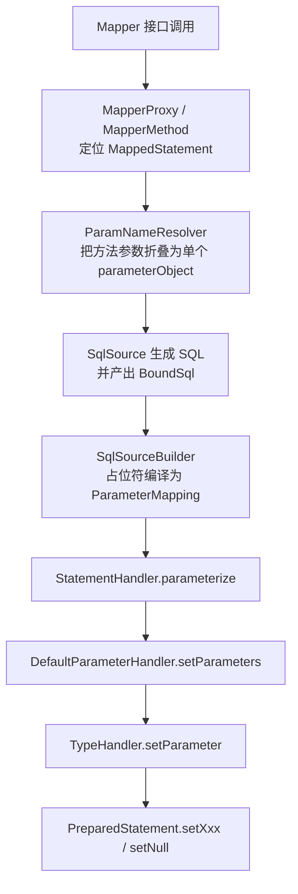
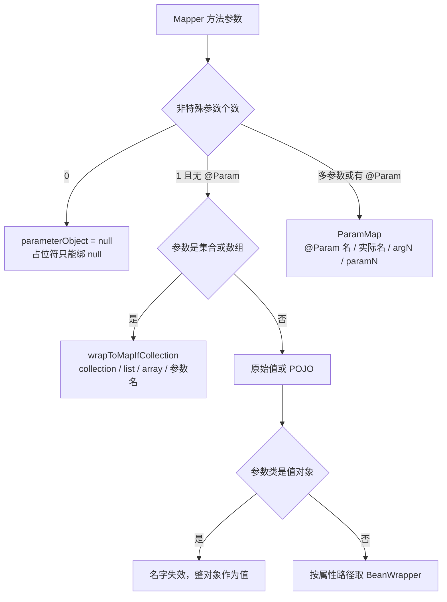
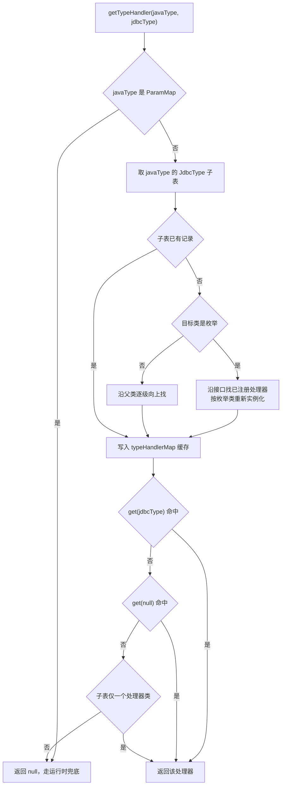
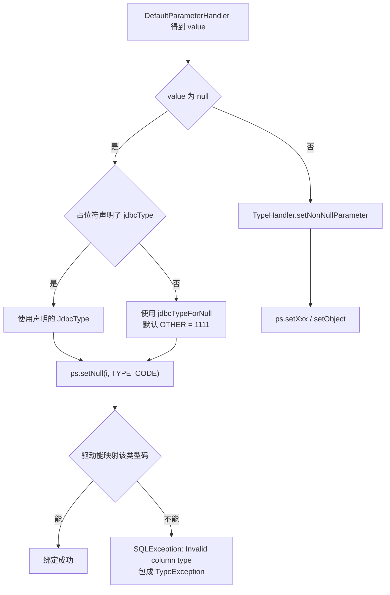
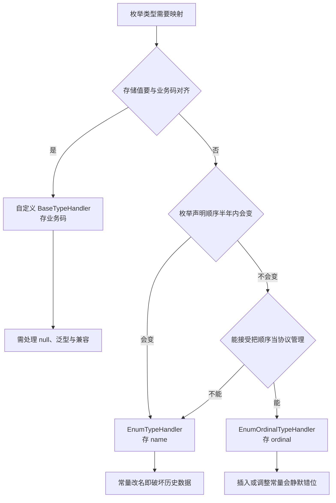

# 参数处理——ParameterHandler与TypeHandler的类型映射

**摘要：**

参数处理是 MyBatis 执行链路上最安静的一段，安静到不少团队直到生产库换成 Oracle、第一次写入 null，才回头翻这一层的代码。本文以订单服务的下单与状态流转为贯穿案例，把 `#{}` 从方法签名到 `PreparedStatement` 的路径拆成四段：`ParamNameResolver` 把方法参数折叠成 MyBatis 能接受的单个对象，`SqlSourceBuilder` 把每个占位符编译成 `ParameterMapping` 并顺带完成 `TypeHandler` 的初选，`DefaultParameterHandler` 在运行时按属性路径取值，`TypeHandler` 最后调用 JDBC 方法把值写进语句。沿着这条链路，文章依次交代四种参数形态的映射后果、注册表的双键查找与两条回退规则、`jdbcType` 与驱动之间的 null 契约、枚举与自定义处理器的三条路，以及 JDBC 4.2 时间类型在时区上的三重改写。全文围绕两个问题展开：同一段 SQL 为什么在不同调用形态下取值规则不同，以及"类型不对"的报错为什么出现在参数绑定而不是 SQL 执行。前者要靠 `ParamMap`、`MetaObject` 与注册表回退机制说清楚，后者要靠 `jdbcType`、`jdbcTypeForNull` 与驱动之间的契约说清楚。文末给出对照反例与一张配置清单，说明自定义 `TypeHandler` 的收益边界与隐式成本。

---

## 第 1 章 参数处理的四段接力

### 1.1 三个症状，三个环节

先看订单服务里的三个方法，它们覆盖了参数处理中最常见的形态：

```java
public interface OrderMapper {

    // 单参数 POJO：属性名必须与 #{} 里的路径一致
    int insert(Order order);

    // 多参数：@Param 决定 ParamMap 的键
    int updateStatus(@Param("orderNo") String orderNo,
                     @Param("target") OrderStatus target,
                     @Param("operator") String operator);

    // 多参数 + 枚举：类型映射与参数名同时在场
    List<Order> selectByUserAndStatus(@Param("userId") Long userId,
                                      @Param("status") OrderStatus status);
}
```

对应的映射片段大致如下，注释里标出了三个真实出现过的故障点：

```xml
<insert id="insert" parameterType="com.example.order.Order">
    INSERT INTO orders (order_no, user_id, amount, status, create_time, remark)
    VALUES (#{orderNo}, #{userId}, #{amount}, #{status}, #{createTime}, #{remark})
</insert>

<update id="updateStatus">
    UPDATE orders SET status = #{target}, operator = #{operator}, update_time = NOW()
    WHERE order_no = #{orderNo}
</update>
```

三处故障分别是：`updateStatus` 把 `target` 传成 null 时，本地 MySQL 一切正常，上了 Oracle 立刻抛 `Invalid column type`；`selectByUserAndStatus` 里有人把 `#{userId}` 写成 `#{user_id}`，报 `Parameter 'user_id' not found`；`insert` 里有人把 `#{createTime}` 写成 `#{create_time}`，报 `There is no getter for property named 'create_time'`。三个症状都发生在参数绑定这一段，但根因分属三个不同的环节：第一个是驱动对 null 的 JDBC 类型要求，第二个是 `ParamMap` 的键集，第三个是 `MetaObject` 的属性解析。把这三个环节拆开，参数处理的轮廓就清楚了。

### 1.2 四段接力的职责划分

从接口调用到 `PreparedStatement.setXxx()`，中间经过了四个职责明确的阶段，下图按调用顺序把它们串起来：



第一个阶段在 `MapperMethod` 里完成。`MapperProxy` 拦截接口调用之后，`MethodSignature.convertArgsToSqlCommandParam()` 委托 `ParamNameResolver.getNamedParams()`，把 `Object[] args` 变成一个对象：可能是原始值，可能是 POJO，也可能是 `ParamMap`。这一步只关心"怎么打包"，不关心 JDBC。

第二个阶段在 `SqlSource` 里完成。`RawSqlSource` 与 `DynamicSqlSource` 都会把 SQL 文本交给 `SqlSourceBuilder.parse()`，由 `GenericTokenParser` 逐个识别占位符，替换成 JDBC 的 `?`，同时为每个 `?` 生成一个 `ParameterMapping`。这一步决定了"每个问号要绑定什么"，包括属性路径、`javaType`、`jdbcType` 以及 TypeHandler 的初选结果。

第三个阶段由 `StatementHandler.parameterize()` 触发，具体执行者是 `DefaultParameterHandler.setParameters(ps)`。它遍历 `BoundSql.parameterMappings`，把每个 `ParameterMapping.property` 当作路径，从 `parameterObject` 里取值。

第四个阶段是 `TypeHandler.setParameter()`，把取到的值转成驱动认识的形式，调用 `setString`、`setObject`、`setNull` 等具体方法。至此参数处理结束，控制权交给驱动。

四个阶段的产物与失败形态可以对照下表：

| 阶段 | 核心参与者 | 产物 | 失败时的典型形态 |
| --- | --- | --- | --- |
| 参数折叠 | `MapperMethod`、`ParamNameResolver` | `parameterObject`（值 / POJO / `ParamMap`） | 名字对不上，`BindingException: Parameter 'x' not found` |
| 占位符编译 | `SqlSourceBuilder`、`ParameterMapping.Builder` | `BoundSql`（SQL 文本 + `ParameterMapping` 列表） | 解析期 `BuilderException`，或 `IllegalStateException: Type handler was null` |
| 运行时取值 | `DefaultParameterHandler`、`MetaObject` | 每个占位符对应的 Java 值 | `ReflectionException: There is no getter`，或静默取到 null |
| JDBC 绑定 | `TypeHandler` 及其子类 | `PreparedStatement` 上的参数槽位 | `TypeException: Could not set parameters for mapping` 包裹的 `SQLException` |

### 1.3 静态 SQL 与动态 SQL：编译发生在两个时刻

`ParameterMapping` 何时生成，取决于 `SqlSource` 的实现。这一点直接决定了类型相关的报错出现在启动期还是执行期，值得单独说清楚。

`RawSqlSource` 的路径是"启动期一次编译"。它构造时就把 SQL 交给 `SqlSourceBuilder`，参数类型取 `MappedStatement` 声明的 `parameterType`，若未声明则退化为 `Object.class`：

```java
// RawSqlSource 构造：解析一次，之后复用同一份 ParameterMapping 列表
Class<?> clazz = parameterType == null ? Object.class : parameterType;
sqlSource = sqlSourceParser.parse(sql, clazz, new HashMap<>());
```

`DynamicSqlSource` 的路径是"每次执行重新编译"。只要 SQL 里出现了 `<if>`、`<foreach>`、`${}` 这类动态元素，`getBoundSql()` 就会在运行时生成最终 SQL，然后按实际传入对象的类重新解析：

```java
// DynamicSqlSource.getBoundSql：参数类型来自运行时对象
Class<?> parameterType = parameterObject == null ? Object.class : parameterObject.getClass();
SqlSource sqlSource = sqlSourceParser.parse(context.getSql(), parameterType, context.getBindings());
```

这两条路径的差别不是性能问题，而是类型信息来源的差别。静态 SQL 下，`#{createTime}` 的 `javaType` 在应用启动、Mapper 加载时就定了，取的是 XML `parameterType` 对应的 getter 类型（或注解方法单一参数的类）；如果 `parameterType` 写成了接口、抽象类，或者干脆没写，`javaType` 会退化成 `Object`，最终落到 `UnknownTypeHandler` 上，运行时才按实际值二次查找。动态 SQL 下，`javaType` 取的是本次调用实际传入对象的类，同一个 `#{amount}` 在传 `BigDecimal` 和传 `Order` 时，解析出的 `javaType` 完全不同。

多参数方法还叠加了一层特殊处理。注解方式的 Mapper 在构建 `MappedStatement` 时，`MapperAnnotationBuilder.getParameterType()` 一旦发现方法有多个非特殊参数，会把 `parameterType` 直接定为 `ParamMap.class`：

```java
// 多参数方法的声明类型被统一为 ParamMap
if (parameterType == null) {
    parameterType = currentParameterType;
} else {
    parameterType = ParamMap.class;   // 第二个参数起即改判
}
```

而 `TypeHandlerRegistry.getTypeHandler(ParamMap.class, null)` 是特意返回 null 的，于是 `SqlSourceBuilder` 的第 3 个判断分支（`Map.class.isAssignableFrom(parameterType)`）把 `propertyType` 归为 `Object.class`，`ParameterMapping` 拿到的是 `UnknownTypeHandler`。换句话说，多参数方法里所有 `#{}` 的类型都是"未知"，真正的 TypeHandler 要等到 `setParameters` 时刻、拿到运行时值才确定。这也解释了为什么多参数场景里的类型问题往往延迟暴露：编译期只记录了"这里有个 `?`"，没有记录"它是 VARCHAR 还是 NUMERIC"。

### 1.4 BoundSql 与 ParameterMapping 的数据结构

`BoundSql` 是参数处理的中间表示，它的五个字段各自承担一件事：

```java
public class BoundSql {
    private final String sql;                                 // 已被替换为 ? 的最终 SQL
    private final List<ParameterMapping> parameterMappings;   // 与 ? 一一对应的映射
    private final Object parameterObject;                     // 折叠后的参数对象
    private final Map<String, Object> additionalParameters;   // <bind>、foreach 生成的变量
    private final MetaObject metaParameters;                  // 上者的反射包装
}
```

`ParameterMapping` 记录一个占位符的全部元信息，其中真正参与运行时的只有几项：

```java
public class ParameterMapping {
    private String property;              // 属性路径，可嵌套、可带索引
    private ParameterMode mode;           // IN / OUT / INOUT，存储过程用
    private Class<?> javaType = Object.class;
    private JdbcType jdbcType;            // 未显式声明时为 null
    private Integer numericScale;         // DECIMAL 的小数位
    private TypeHandler<?> typeHandler;   // 初选结果，可能为 UnknownTypeHandler
    private String resultMapId;           // OUT 参数专用
    private String jdbcTypeName;
    private String expression;            // 预留字段，解析时直接拒绝
}
```

占位符内部允许写的属性是白名单，`SqlSourceBuilder` 里硬编码为 `javaType,jdbcType,mode,numericScale,resultMap,typeHandler,jdbcTypeName`。写错属性名不会静默忽略，而是在解析阶段抛 `BuilderException`，报 `An invalid property 'xxx' was found in mapping #{...}`；写 `expression=` 则会直接得到 `Expression based parameters are not supported yet`，因为该字段至今没有实现。这两条错误信息都出现在语句构建或首次执行阶段，看到它们时不必怀疑数据库。

`ParameterMapping.Builder.build()` 的顺序也值得记住：先 `resolveTypeHandler()`，再 `validate()`。前者只在 `typeHandler` 为空且 `javaType` 非空时查一次注册表；后者在仍为空时抛 `IllegalStateException`，文案里会带上 `javaType` 与 `jdbcType` 的组合。也就是说，"找不到 TypeHandler"是解析期错误，与数据库、连接、数据都无关，看到它就应当去查注册表，而不是查 SQL。

---

## 第 2 章 参数的四种形态

### 2.1 形态一：单参数，名字失效

`ParamNameResolver.getNamedParams()` 的第一个分支最容易被误解：

```java
if (!hasParamAnnotation && paramCount == 1) {
    Object value = args[names.firstKey()];
    return wrapToMapIfCollection(value, useActualParamName ? names.get(names.firstKey()) : null);
}
```

只要方法只有一个参数、且该参数没有 `@Param` 注解，MyBatis 就把这个值原样（或按集合规则包装后）作为 `parameterObject` 传出，不额外包一层 Map。于是 `User selectById(Long id)` 的 XML 里写 `#{id}`、`#{userId}`、`#{whatever}`，结果完全一样。原因在 `DefaultParameterHandler` 的第三个判断分支：它先用 `typeHandlerRegistry.hasTypeHandler(parameterObject.getClass())` 判断参数对象本身是不是"一个可被 TypeHandler 消费的值"，如果是，就直接把这个对象当作值，`propertyName` 根本不参与取值。

这条规则只对"值对象"成立。同一个方法换成 `User selectByCondition(User condition)`，参数对象就是容器而非值，`#{userId}` 会走 `MetaObject.getValue("userId")`，属性名必须真实存在。判断标准不是参数个数，而是参数对象的类有没有注册过 TypeHandler。

还有一处容易踩的边界：单参数一旦加上 `@Param("id")`，`hasParamAnnotation` 变为 true，方法会走多参数分支，参数被包进 `ParamMap`，此时 `#{whatever}` 立即失效并抛 `BindingException`。给单参数加 `@Param` 并不是无害的"补注释"，它改变了取值路径。

### 2.2 形态二：多参数与 ParamMap 的键集

多参数分支构造 `ParamMap`，每个参数会写入两类键：`@Param` 指定的名字（或反射得到的实际参数名），以及 `param1`、`param2` 这样的位置别名。位置别名的写入有一层保护，避免覆盖用户自己声明的名字：

```java
for (Map.Entry<Integer, String> entry : names.entrySet()) {
    param.put(entry.getValue(), args[entry.getKey()]);
    final String genericParamName = GENERIC_NAME_PREFIX + (i + 1);
    if (!names.containsValue(genericParamName)) {   // 不覆盖 @Param("param1") 这类显式声明
        param.put(genericParamName, args[entry.getKey()]);
    }
    i++;
}
```

如果没有 `@Param`，名字从哪里来？`ParamNameResolver` 在构造时先读注解，读不到就尝试 `getActualParamName()`，再读不到才退化为位置字符串。`getActualParamName()` 依赖编译期的 `-parameters` 选项：开了，能拿到 `userId`、`status`；没开，Java 反射只能返回 `arg0`、`arg1`。`useActualParamName` 默认为 true，所以"多参数不加 `@Param` 也能用参数名"这件事，只在编译配置配合时才成立；一旦构建流水线换了编译器参数或经过字节码增强，名字就可能从 `userId` 变成 `arg0`，而 `param1` 始终存在，这也是位置别名必须保留的原因。

`ParamMap` 覆写了 `get()`，键不存在时不会返回 null，而是抛异常：

```java
public V get(Object key) {
    if (!super.containsKey(key)) {
        throw new BindingException("Parameter '" + key + "' not found. Available parameters are " + keySet());
    }
    return super.get(key);
}
```

这条路径把 `BindingException` 的发生条件限定得很死：只有当 `parameterObject` 是 `ParamMap`（多参数方法，或单集合参数被包装之后）、并且占位符的名字不在键集里时，才会命中。`MetaObject` 对 Map 的取值最终委托给 `map.get(name)`，所以嵌套路径也会逐层触发同一逻辑，例如 `#{user.name}` 在 `user` 这个键缺失时同样报错，而不是静默返回 null。附带一提，异常文案里的 `keySet()` 来自 `HashMap`，顺序不保证，不要用日志里的参数顺序去做断言。

### 2.3 形态三与形态四：对象、Map 与集合

POJO 参数的规则最短：`#{属性名}` 走 `MetaObject`，支持嵌套与索引，属性名查找对**大小写不敏感**（`Reflector` 内部维护了一份大写键的映射表），但对下划线不敏感是另一回事——`#{create_time}` 找不到 `createTime`，这一点涉及 `mapUnderscoreToCamelCase` 的适用边界。属性名写错不会返回 null，`BeanWrapper` 会在 `Reflector.getGetInvoker()` 里抛 `ReflectionException: There is no getter for property named 'x' in 'class y'`。

Map 参数则是键访问，`#{key}` 等价于 `map.get("key")`。与 `ParamMap` 不同，普通 `HashMap` 的键缺失会安静地返回 null，绑定一个 null 到语句上，SQL 大概率匹配不到任何行，也不报错。这种"静默失败"在排查时最费时间，因为日志里看不到异常，只能看到一条执行成功但影响 0 行的语句。

集合与数组参数走 `wrapToMapIfCollection()`，这是 3.5.5 之后统一到 `ParamNameResolver` 里的逻辑：

```java
public static Object wrapToMapIfCollection(Object object, String actualParamName) {
    if (object instanceof Collection) {
        ParamMap<Object> map = new ParamMap<>();
        map.put("collection", object);
        if (object instanceof List) {
            map.put("list", object);          // List 额外获得 list 别名
        }
        Optional.ofNullable(actualParamName).ifPresent(name -> map.put(name, object));
        return map;
    }
    if (object != null && object.getClass().isArray()) {
        ParamMap<Object> map = new ParamMap<>();
        map.put("array", object);
        Optional.ofNullable(actualParamName).ifPresent(name -> map.put(name, object));
        return map;
    }
    return object;
}
```

这段代码解释了三件事：`<foreach collection="list">` 与 `collection="collection"` 为什么都可用；数组为什么必须用 `collection="array"`；以及 3.5.5 之后为什么 `#{ids}`（参数名）在开启 `-parameters` 时也能命中——它被作为第三个键写进了包装后的 `ParamMap`。同样地，包装后的对象是 `ParamMap`，写错名字会抛 `BindingException`，而不是静默 null。

把形态判定画成一条决策路径，可以更快看出"名字为什么会失效"发生在哪个分叉上：



四种形态的完整对照如下：

| 调用形态 | `parameterObject` | 可用的 `#{}` 名字 | 写错名字的后果 |
| --- | --- | --- | --- |
| 单参数、无 `@Param`、非集合 | 原始值或 POJO | 值对象：任意名；POJO：真实属性名 | 值对象无事；POJO 抛 `ReflectionException` |
| 多参数 | `ParamMap` | `@Param` 名、实际参数名（需 `-parameters`）、`argN`、`paramN` | `BindingException`，并列出可用键 |
| 单个集合或数组 | 包装后的 `ParamMap` | 参数名（需 `-parameters`）、`list`、`collection`、`array` | `BindingException` |
| 单个 Map | 原始 Map | Map 的键名，支持嵌套路径 | 静默 null，SQL 影响 0 行 |

### 2.4 “Parameter 'xxx' not found” 的排查表

把上面几条规则压缩成一张排查表，遇到绑定类报错时先按文案定位环节，再看根因：

| 报错文案 | 抛出位置 | 根因 | 处置 |
| --- | --- | --- | --- |
| `BindingException: Parameter 'x' not found. Available parameters are [...]` | `MapperMethod.ParamMap.get` | 多参数或集合包装后，名字不在键集：漏写 `@Param`、拿数据库列名当参数名、`<foreach>` 变量名与 `#{...}` 不一致 | 补 `@Param`，或改用 `paramN` / `list` / `collection` / `array` |
| `ReflectionException: There is no getter for property named 'x'` | `Reflector.getGetInvoker` | 单 POJO 参数属性名写错，或把列名（下划线）当属性名，或 Lombok 未生成 getter | 改成真实属性名；下划线问题不要指望 `mapUnderscoreToCamelCase` |
| 无异常，SQL 执行成功但匹配 0 行 | `MapWrapper.get` | Map 参数的键缺失，或嵌套路径的中间对象为 null | 打印 `parameterObject`，对 Map 入参做键校验 |
| `IllegalStateException: Type handler was null on parameter mapping for property 'x'` | `ParameterMapping.Builder.validate` | `javaType` 没有对应处理器：接口/抽象类属性、未注册的自定义类型 | 显式写 `typeHandler=` 或 `javaType=`，或补注册 |
| `TypeException: Could not set parameters for mapping: ...` | `DefaultParameterHandler.setParameters` | 底层 JDBC 异常：null 未给 `jdbcType`、值与处理器不匹配、驱动拒绝绑定 | 看 `Cause` 里的 `SQLException`，回到第 5 章 |

表里前两行是"名字问题"，第三行是"值问题"，后两行是"类型问题"。名字问题靠 `ParamNameResolver` 的规则解释，类型问题要靠注册表与驱动契约解释，这也是后面两章的分工。

---

## 第 3 章 DefaultParameterHandler 的取值路径

### 3.1 循环、序号与 OUT 参数

`setParameters()` 的主循环比大多数开发者想象的简单，真正重要的是循环体里的分支顺序：

```java
for (int i = 0; i < parameterMappings.size(); i++) {
    ParameterMapping parameterMapping = parameterMappings.get(i);
    if (parameterMapping.getMode() != ParameterMode.OUT) {   // OUT 参数由存储过程回填，不在此绑定
        Object value;
        String propertyName = parameterMapping.getProperty();
        if (boundSql.hasAdditionalParameter(propertyName)) {
            value = boundSql.getAdditionalParameter(propertyName);
        } else if (parameterObject == null) {
            value = null;
        } else if (typeHandlerRegistry.hasTypeHandler(parameterObject.getClass())) {
            value = parameterObject;
        } else {
            if (metaObject == null) {
                metaObject = configuration.newMetaObject(parameterObject);
            }
            value = metaObject.getValue(propertyName);
        }
        TypeHandler typeHandler = parameterMapping.getTypeHandler();
        JdbcType jdbcType = parameterMapping.getJdbcType();
        if (value == null && jdbcType == null) {
            jdbcType = configuration.getJdbcTypeForNull();      // null 的兜底类型
        }
        typeHandler.setParameter(ps, i + 1, value, jdbcType);    // JDBC 序号从 1 开始
    }
}
```

序号是 `i + 1`，因为 JDBC 的参数下标从 1 开始，而 `parameterMappings` 从 0 开始。这个细节在手工实现 `StatementHandler` 或写插件时经常被算错一列，后果是"参数整体错位"——所有值都绑到了相邻的槽位上，SQL 不报错但语义全错，属于最难排查的一类。`MetaObject` 的创建被挪到循环内部并做了惰性缓存，源码里用局部变量 `metaObject` 承接，因为只有走到第四个分支才需要它。

`ParameterMode.OUT` 的判断是为存储过程准备的：OUT 参数的绑定发生在 `CallableStatement` 注册之后，由 `ResultSetHandler.handleOutputParameters()` 回填，与入参绑定不是同一条路径。普通 CRUD 不会命中这个分支，但看代码时容易把它当成"参数被跳过"，其实是分流到了结果侧。

### 3.2 分支顺序为什么必须是这个顺序

四个分支的顺序是有意设计的，逐个解释。

`hasAdditionalParameter(propertyName)` 排第一，是因为 `<bind>` 与 `<foreach>` 生成的变量不在 `parameterObject` 上。`DynamicContext` 把 `_parameter`、`_databaseId` 放进 bindings，`<bind>` 把用户定义的变量放进去，`ForEachSqlNode` 则把每个迭代项绑成 `__frch_item_0` 这样的名字，同时把 SQL 里的 `#{item.id}` 改写成 `#{__frch_item_0.id}`。这些名字在 `parameterObject` 里根本不存在，如果用 `MetaObject` 去取，只会得到 `ReflectionException` 或 null。所以判空之前必须先问 bindings。

`parameterObject == null` 排第二，是给"无参数方法"留的短路。无参数方法的 `parameterMappings` 通常为空列表，但如果 SQL 里写了 `#{x}`，这里的 null 分支会安静地把值绑定为 null，而不是抛异常。行为上不优雅，但确实如此。

`hasTypeHandler(parameterObject.getClass())` 排第三，作用是识别"参数对象本身就是值"的情形，也就是 2.1 节讲的单参数短路。这个判断有一个副作用值得知道：对于枚举类型的单参数，`hasTypeHandler()` 会触发注册表的懒注册——`getJdbcHandlerMap()` 发现目标类是枚举、而注册表里没有记录时，会按 `defaultEnumTypeHandler` 自动注册一个处理器再返回。也就是说，一次查询的"判断类型"动作，可能顺带改变了全局注册表的状态。这本身不是问题，但它意味着注册表不是纯只读的，排查注册冲突时要把懒注册算进去。

`MetaObject.getValue(propertyName)` 是最后兜底，处理 POJO 与 Map 的属性路径。它的实现决定了三类行为：嵌套属性、集合索引、以及"取不到值"到底是抛异常还是返回 null。

### 3.3 MetaObject：属性路径的统一入口

`MetaObject` 是 MyBatis 对反射的封装层，它按目标对象类型分派到三种 `ObjectWrapper`：`BeanWrapper` 走 getter/setter，`MapWrapper` 走键访问，`CollectionWrapper` 走索引。`configuration.newMetaObject()` 每次都会创建新实例，但底层的 `MetaObject` 构造并不昂贵，因为 `Reflector` 的类元数据由 `ReflectorFactory` 缓存，默认的 `DefaultReflectorFactory` 开启缓存，同一个类只扫描一次 getter/setter/字段。

按路径取值时，`MetaObject.getValue()` 用 `PropertyTokenizer` 拆解名字，遇到 `user.name` 就先取 `user` 再递归；遇到 `orders[0].amount` 就按索引取集合元素；遇到 `map['key']` 就按键取。中间节点为 null 时不会抛 `NullPointerException`，而是返回 `SystemMetaObject.NULL_META_OBJECT` 并让外层得到 null：

```java
// 嵌套路径的取值：中间节点为空即短路返回 null
MetaObject metaValue = metaObjectForProperty(prop.getIndexedName());
if (metaValue == SystemMetaObject.NULL_META_OBJECT) {
    return null;
}
return metaValue.getValue(prop.getChildren());
```

这个"空值安全"是 `#{user.address.city}` 能在 `user` 为 null 时不炸的原因，但它同时是静默失败的来源：绑定 null 到 `city` 的槽位上，SQL 正常执行，结果却与预期不同。对比 `ParamMap` 缺失键直接抛异常，两种容错策略的差异会直接影响排查成本——容器是 `ParamMap` 时错误更早暴露，容器是 POJO 或普通 Map 时错误更晚、更隐蔽。

`MetaObject` 的另一个用途是让 `<if test="...">` 的 OGNL 表达式能读到参数，但那属于动态 SQL 的职责，`#{}` 与 `${}` 的差别见 [[03 动态SQL——OGNL表达式与SqlNode解析树]]。本文只关心绑定路径，两者的交汇点是 `DynamicContext`：它既给 OGNL 提供求值上下文，也给 `BoundSql.additionalParameters` 提供变量来源。

### 3.4 取值分支的失败形态

把四个分支与三种容器放在一起，可以得到一张"取不到值时会发生什么"的对照表：

| 取值分支 | 命中条件 | 取不到值时的行为 | 排查信号 |
| --- | --- | --- | --- |
| `hasAdditionalParameter` | 名字属于 `<bind>`、`_parameter`、`__frch_*` | 正常返回 bindings 里的对象，嵌套属性仍走 `MetaObject` | `#{__frch_item_0.id}` 这类名字出现在日志里 |
| `parameterObject == null` | 方法无参数 | 静默绑定 null | 无异常，SQL 条件恒不成立 |
| `hasTypeHandler` | 参数对象本身有处理器（数值、字符串、时间、枚举等） | `propertyName` 被忽略，整个对象作为值 | 改了 `#{}` 名字却毫无影响 |
| `MetaObject` + POJO | 容器是 POJO | 属性不存在抛 `ReflectionException`；中间节点为 null 返回 null | 异常文案里有 `There is no getter` |
| `MetaObject` + Map | 容器是普通 Map | 键缺失返回 null | 无异常，影响 0 行 |
| `MetaObject` + ParamMap | 容器是多参数的 `ParamMap` | 键缺失抛 `BindingException` | 文案里列出可用参数名 |

这张表与 2.4 节的排查表互补：前者按"取值路径"组织，后者按"报错文案"组织。定位问题时通常从文案入手，确认环节后再回到本表核对具体分支，能少走很多弯路。

取值结束之后，值交给 `TypeHandler.setParameter(ps, i + 1, value, jdbcType)`。注意这里传入的 `jdbcType` 有两个来源：`ParameterMapping` 上显式声明的，或者 `value == null` 时由 `jdbcTypeForNull` 兜底的。这个兜底值就是后文反复提到的 `OTHER`，也是 Oracle 上大量 `Invalid column type` 的直接来源。至于 `TypeHandler` 本身是怎么在解析期被选出来的，进入下一章。

---
## 第 4 章 TypeHandlerRegistry：双键查找与注册

### 4.1 三张表而不是两张

常被引用的是"Java 类型 × JDBC 类型"的双键结构，实际源码里是三张表，各自服务不同的查询入口：

```java
private final Map<JdbcType, TypeHandler<?>> jdbcTypeHandlerMap      // 只按 JDBC 类型查，结果侧用
        = new EnumMap<>(JdbcType.class);
private final Map<Type, Map<JdbcType, TypeHandler<?>>> typeHandlerMap  // 主索引：Java 类型 → JDBC 类型 → 处理器
        = new ConcurrentHashMap<>();
private final Map<Class<?>, TypeHandler<?>> allTypeHandlersMap      // 处理器类 → 实例，按类反查
        = new HashMap<>();
```

主索引是 `typeHandlerMap`，它的值又是一层 `Map<JdbcType, TypeHandler<?>>`，null 键代表"不区分 JDBC 类型的通用处理器"。`jdbcTypeHandlerMap` 保存的是仅按 JDBC 类型注册的处理器，例如 `register(JdbcType.VARCHAR, new StringTypeHandler())`，查询入口是 `getTypeHandler(JdbcType)`，主要服务结果映射里"只知道列类型、不知道 Java 类型"的场景。`allTypeHandlersMap` 则用于 `getMappingTypeHandler()` 这种按处理器类反查的去重逻辑。

理解三张表的分工，才能理解为什么"同一个 Java 类型可以对应多个处理器"：`String` 在 `typeHandlerMap` 里有一整张子表，`CHAR`、`VARCHAR`、`LONGVARCHAR` 走 `StringTypeHandler`，`NVARCHAR`、`NCHAR` 走 `NStringTypeHandler`，`CLOB` 走 `ClobTypeHandler`，`NCLOB` 走 `NClobTypeHandler`，null 键上是 `StringTypeHandler`。子表里有多项时，null 键就是"没有指定 JDBC 类型时的默认选择"。

### 4.2 查找顺序：五步与两条回退

主查找方法 `getTypeHandler(Type, JdbcType)` 的逻辑不长，但每一步都对应一类真实问题：

```java
private <T> TypeHandler<T> getTypeHandler(Type type, JdbcType jdbcType) {
    if (ParamMap.class.equals(type)) {
        return null;                       // 多参数声明类型，刻意不提供处理器
    }
    Map<JdbcType, TypeHandler<?>> jdbcHandlerMap = getJdbcHandlerMap(type);
    TypeHandler<?> handler = null;
    if (jdbcHandlerMap != null) {
        handler = jdbcHandlerMap.get(jdbcType);   // 精确匹配 Java 类型 + JDBC 类型
        if (handler == null) {
            handler = jdbcHandlerMap.get(null);   // 退到"不区分 JDBC 类型"的通用项
        }
        if (handler == null) {
            handler = pickSoleHandler(jdbcHandlerMap);  // 子表里只有一个处理器时直接用它
        }
    }
    return (TypeHandler<T>) handler;
}
```

`ParamMap` 的短路放在最前面，是为了让多参数方法（`parameterType = ParamMap.class`）不会命中 `Map` 或 `Object` 的处理器，保证后续走"未知类型、运行时再定"的路径。这个判断如果被删掉，多参数方法的所有参数都会被 `ObjectTypeHandler` 或 `UnknownTypeHandler` 以另一条路径处理，行为会变。

`pickSoleHandler` 只比较处理器**类**，不看实例。子表里如果注册了同一个类的多个实例（例如同一处理器同时挂在 `TIMESTAMP` 与 `TIMESTAMP_WITH_TIMEZONE` 键上），仍然算"唯一"，会命中；如果挂了两个不同类，返回 null，交给调用方处理。这条规则正是官方文档所说的"自 3.4.0 起，若某 Java 类型只注册了一个处理器，`ResultMap` 会自动使用它"，也解释了为什么自定义处理器常常"没配 `includeNullJdbcType` 也能在结果映射里生效"。

`getJdbcHandlerMap(type)` 里还有两条回退路径，是自定义类型能"少注册"的关键。第一条是枚举的接口回退：目标类是枚举且自身没注册过，就沿着它实现的接口找已注册的处理器，找到后按当前枚举类**重新实例化**一份：

```java
// 沿枚举实现的接口查找，并为每个枚举类重新构造处理器
for (Class<?> iface : clazz.getInterfaces()) {
    Map<JdbcType, TypeHandler<?>> jdbcHandlerMap = typeHandlerMap.get(iface);
    if (jdbcHandlerMap == null) {
        jdbcHandlerMap = getJdbcHandlerMapForEnumInterfaces(iface, enumClazz);
    }
    if (jdbcHandlerMap != null) {
        HashMap<JdbcType, TypeHandler<?>> newMap = new HashMap<>();
        for (Entry<JdbcType, TypeHandler<?>> entry : jdbcHandlerMap.entrySet()) {
            newMap.put(entry.getKey(), getInstance(enumClazz, entry.getValue().getClass()));
        }
        return newMap;
    }
}
```

注意 `getInstance(enumClazz, handlerClass)`：它会优先找 `(Class)` 单参构造器，找不到再退回无参构造器。所以面向接口注册的处理器必须提供其中之一，否则注册能成功、首次绑定才炸。这个机制在 6.5 节还会用到。

第二条是父类的向上查找：非枚举类型自身没有记录时，沿 `getSuperclass()` 逐级往上找 `typeHandlerMap`，遇到 `Object.class` 停止（`Object` 的处理器不被当作兜底，避免所有类型都被 `ObjectTypeHandler` 接管）。这条路径对自定义基类、继承体系里的类型有用，但也意味着"给父类注册处理器"会隐式覆盖所有子类。

查找流程可以压缩成下面这张图：



### 4.3 javaType 从哪来：解析期的五个分支

注册表的查找依赖 `javaType` 与 `jdbcType` 两个入参，但这两个值不是开发者总能显式提供的。`javaType` 的默认值由 `SqlSourceBuilder.buildParameterMapping()` 推导，逻辑分为五支：

```java
if (metaParameters.hasGetter(property)) {                 // 1. <bind>、foreach 变量、_parameter
    propertyType = metaParameters.getGetterType(property);
} else if (typeHandlerRegistry.hasTypeHandler(parameterType)) {  // 2. parameterType 本身有处理器
    propertyType = parameterType;
} else if (JdbcType.CURSOR.name().equals(propertiesMap.get("jdbcType"))) {  // 3. 游标
    propertyType = java.sql.ResultSet.class;
} else if (property == null || Map.class.isAssignableFrom(parameterType)) {  // 4. Map 与 ParamMap
    propertyType = Object.class;
} else {
    MetaClass metaClass = MetaClass.forClass(parameterType, configuration.getReflectorFactory());
    propertyType = metaClass.hasGetter(property) ? metaClass.getGetterType(property) : Object.class;  // 5. 属性类型
}
```

五个分支对应五种信息充分程度。第一支信息最足，`<bind>` 与 foreach 变量的类型能顺着 `MetaObject` 追到具体属性；第二支适合单参数是基础类型的方法；第三支是存储过程专属；第四支说明"容器是 Map，属性类型不可知"，只能给 `Object`；第五支是常规 POJO 的属性类型推导，`MetaClass` 支持嵌套路径，但属性不存在时同样退化为 `Object`。

这里能直接读出两个结论。其一，`parameterType` 写错或没写，会一路退化到 `Object`，最终由 `UnknownTypeHandler` 在运行时按实际值类型二次查找——能跑，但类型错误从"启动期"推迟到"运行期"，而且 `jdbcType` 的默认值也没了依据。其二，Map 参数与多参数方法天然是 `Object` 类型，想控制处理器只能显式写 `typeHandler=` 或 `javaType=`，这也是为什么 JSON 字段、枚举、加密字段在 Map 参数场景下必须显式声明处理器。

### 4.4 注册的五种入口

注册表暴露的入口比一般想象的多，下表按"作用范围"排序，覆盖范围从上到下递增：

| 注册方式 | 典型写法 | 作用范围 | 注意点 |
| --- | --- | --- | --- |
| 占位符内显式指定 | `#{extra, typeHandler=com.example.JsonHandler}` | 单个占位符 | 优先级最高，绕过注册表查找；类需可实例化 |
| 结果映射/参数映射显式指定 | `<result typeHandler="..."/>` | 单个映射项 | 只影响该项，不污染全局 |
| `register(javaType, handler)` | `registry.register(TagList.class, new TagListTypeHandler())` | 某个 Java 类型（含 null 键） | 未标 `@MappedJdbcTypes` 时注册在 null 键，等于"所有 JDBC 类型" |
| `@MappedTypes` + 包扫描 | `<package name="com.example.handler"/>` 或 `mybatis.type-handlers-package` | 注解声明的 Java 类型 | 扫描顺序不保证；同键冲突时谁生效不可预期 |
| 内置注册 | 构造器里 `register(String.class, JdbcType.VARCHAR, ...)` | 全站默认 | 同名键被自定义注册覆盖后不可逆，除非重新注册 |

`@MappedTypes` 与 `@MappedJdbcTypes` 的组合决定了注册的精确程度，这是最容易配错的地方：没有 `@MappedJdbcTypes` 时，处理器注册在 null 键上，所有 JDBC 类型都会命中它；写了 `@MappedJdbcTypes(JdbcType.VARCHAR)` 时只注册在 VARCHAR 键上，null 键没有它，于是结果映射里"只知道 Java 类型、不知道列类型"的查找（`javaType + jdbcType=null`）就找不到它；想让它同时被结果映射用上，必须标 `includeNullJdbcType = true`，或者依赖"子表唯一处理器"的规则。

这也解释了官方文档里那句容易被略过的话：`@MappedJdbcTypes` 是在**收窄**处理器的适用面，而不是在描述它。收窄得太狠，结果映射读不回来；完全不收窄，又可能把别的 JDBC 类型一起接管。

### 4.5 javaType、jdbcType 与 typeHandler 的优先级

三者的关系可以按"谁先被写进 `ParameterMapping`"来理解，优先级从高到低如下表：

| 优先级 | 来源 | 何时生效 | 对查找的影响 |
| --- | --- | --- | --- |
| 1 | 占位符里的 `typeHandler=` | 解析期直接实例化 | 完全跳过注册表，`javaType`/`jdbcType` 只影响后续 `setParameter` 的入参 |
| 2 | 占位符里的 `javaType=` | 覆盖推导值 | 显式指定后注册表按该类型查；`jdbcType` 仍可为 null |
| 3 | 占位符里的 `jdbcType=` | 只设置 JDBC 类型 | 参与查找（决定子表里取哪一项），也参与 null 绑定 |
| 4 | `parameterType` 的属性类型推导 | 未显式指定时 | 决定默认 `javaType`，失败则退化为 `Object` |
| 5 | `jdbcTypeForNull` | 仅当值为 null 且无 `jdbcType` | 决定 `setNull` 的类型码 |

第 3 条经常被误解为"`jdbcType` 只对 null 有用"，实际上它同时参与处理器选择。最直接的例子是 `String`：默认走 `StringTypeHandler`，写 `#{content, jdbcType=CLOB}` 会命中 `ClobTypeHandler`，改用字符流绑定；写 `#{name, jdbcType=NVARCHAR}` 会命中 `NStringTypeHandler`，调用 `setNString`。同样是 String，JDBC 类型一变，绑定的字节通道就变了。这个能力在跨库迁移、LOB 字段、以及需要让驱动走不同编码路径时有用，但也意味着"随手补一个 `jdbcType`"可能悄悄换掉处理器。

第 1 条与第 2 条的组合还有一个细节：写了 `typeHandler=` 时，`javaType` 只影响 `ParameterMapping` 的元数据与 `setParameter` 的入参，不会再去注册表校验类型是否匹配；处理器内部如果做强转，类型不符会在绑定期抛 `ClassCastException`，被包成 `TypeException`。所以显式指定处理器时，`javaType` 最好一起写清楚，既是文档也是运行时约束。

### 4.6 注册不到处理器时的表现

`ParameterMapping.validate()` 的失败是解析期错误，文案固定：

```text
Type handler was null on parameter mapping for property 'tags'. It was either not specified
and/or could not be found for the javaType (java.util.List) : jdbcType (null) combination.
```

这个错误的典型触发场景是 POJO 里有一个 `List<String>` 或自定义接口类型的属性，XML 里直接写 `#{tags}` 而没有 `typeHandler=`。查找过程是这样的：`javaType` 推导出 `List.class`，`typeHandlerMap` 没有记录，`List` 不是枚举，于是沿父类向上找 `AbstractList`、`AbstractCollection`，到 `Object` 之前停止，得到 null；`jdbcType` 又是 null，`pickSoleHandler` 无表可查，最终返回 null，`validate()` 抛异常。

处置有两条路：如果这个字段本来就需要特殊序列化（例如存 JSON），显式写 `typeHandler=`；如果它是集合且不该出现在单值占位符里（例如应该交给 `<foreach>` 展开），那就是 SQL 写法错了，改结构而不是补处理器。把这两种情况混为一谈，是"给 List 注册一个通用 JSON 处理器"这类方案流行的原因，也是后文反例的伏笔。

---

## 第 5 章 jdbcType：null 与驱动之间的契约

### 5.1 setNull 为什么需要类型码

参数绑定最容易被忽略的一条 JDBC 规则是：绑定 null 不是"什么都不做"，而是必须声明这个 null 属于哪种 SQL 类型。`PreparedStatement.setNull(int parameterIndex, int sqlType)` 的第二个参数就是类型码，驱动据此决定用哪种字面量或协议消息把 NULL 发给数据库。

`BaseTypeHandler.setParameter()` 把这条规则落实得很直接：

```java
public void setParameter(PreparedStatement ps, int i, T parameter, JdbcType jdbcType) throws SQLException {
    if (parameter == null) {
        if (jdbcType == null) {
            throw new TypeException("JDBC requires that the JdbcType must be specified for all nullable parameters.");
        }
        try {
            ps.setNull(i, jdbcType.TYPE_CODE);
        } catch (SQLException e) {
            throw new TypeException("Error setting null for parameter #" + i + " with JdbcType " + jdbcType + " . "
                + "Try setting a different JdbcType for this parameter or a different jdbcTypeForNull configuration property. "
                + "Cause: " + e, e);
        }
    } else {
        setNonNullParameter(ps, i, parameter, jdbcType);
    }
}
```

`jdbcType` 为空时抛的那条 `TypeException` 在正常链路上几乎看不到，因为 `DefaultParameterHandler` 会在调用前兜底填上 `jdbcTypeForNull`。真正会看到的是下面那条：`setNull` 本身失败，被包装成"建议你换一个 JdbcType 或换 jdbcTypeForNull"。

`JdbcType` 是 MyBatis 对 `java.sql.Types` 的枚举镜像，`TYPE_CODE` 直接取自 JDBC 常量。默认兜底值 `OTHER` 对应 `Types.OTHER`，数值是 1111。这个数字在日志里出现的频率，和 Oracle 项目的历史长度成正比。

### 5.2 OTHER 在 Oracle 上的失败链

`Configuration` 的默认值是 `jdbcTypeForNull = JdbcType.OTHER`，官方文档对它的描述是"Some drivers require specifying the column JDBC type but others work with generic values like NULL, VARCHAR or OTHER"。MySQL、PostgreSQL 的驱动对 `setNull(i, Types.OTHER)` 通常能接受，H2 之类测试库更宽松；Oracle 的 ojdbc 则不然，它需要把类型码映射到 Oracle 的具体列类型，`OTHER` 在很多列类型上映射不出来，于是直接抛 `java.sql.SQLException: Invalid column type`，`getErrorCode()` 为 17004，日志里常以 `ORA-17004` 的形式出现。

从异常栈看，这条链有三层，每一层都留下了可定位的信息：

```text
org.apache.ibatis.type.TypeException: Could not set parameters for mapping:
  ParameterMapping{property='remark', mode=IN, javaType=class java.lang.String, jdbcType=null, ...}.
  Cause: org.apache.ibatis.type.TypeException: Error setting null for parameter #6 with JdbcType OTHER .
  Try setting a different JdbcType for this parameter or a different jdbcTypeForNull configuration property.
  Cause: java.sql.SQLException: Invalid column type
```

第一层由 `DefaultParameterHandler` 抛出，`ParameterMapping.toString()` 把 `property`、`javaType`、`jdbcType` 都打了出来，直接告诉你"哪个占位符、什么 Java 类型、有没有声明 JDBC 类型"。第二层由 `BaseTypeHandler` 抛出，指出了实际使用的 `JdbcType` 是 `OTHER`，并给出两个建议。第三层才是驱动的 `SQLException`。再往外，`ErrorContext` 会补上 `### The error occurred while setting parameters` 与 `### SQL:` 两行，把出错的语句一起带出来。

定位这类问题时，第一层里的 `jdbcType=null` 是关键判据：它说明占位符没有显式声明 JDBC 类型，走的是全局兜底；如果 `jdbcType=OTHER` 出现在这里，说明全局配置被改过。

### 5.3 三种处置及其代价

面对 Oracle 的 null 报错，常见处置有三种，代价差别很大：

| 处置 | 写法 | 优点 | 代价 |
| --- | --- | --- | --- |
| 逐字段声明 | `#{remark, jdbcType=VARCHAR}` | 精确，与列类型一致；不依赖全局配置 | 啰嗦，新增字段容易漏；`jdbcType` 与列类型对不上时仍有隐式转换风险 |
| 全局改为 NULL | `jdbcTypeForNull: NULL` | 一行解决多数场景，`Types.NULL` 不带列类型，驱动普遍接受 | 所有 null 丢失列类型信息；对 jsonb、空间类型、自定义 UDT 等需要精确类型的列可能仍不合适 |
| 全局改为 VARCHAR | `jdbcTypeForNull: VARCHAR` | 对字符串列立竿见影 | 把数值、日期、LOB 列的 null 也声明成 VARCHAR，可能触发隐式转换或直接报错；属于用错工具 |

取舍点在于"精确"与"省事"的权衡。字段少、DBA 严格、库表类型混杂的系统，逐字段声明更稳；字段多、表结构统一由框架生成的系统，全局 `NULL` 更现实，但要接受"丢失列类型"这个事实，并在遇到 jsonb 之类的列时单独声明。全局改成 `VARCHAR` 看似折中，实际是把字符串列的解决方案套到所有列上，属于典型的"本地验证通过、边界场景翻车"。

> [!warning] 全局配置的爆炸半径
> `jdbcTypeForNull` 是 `Configuration` 级别的设置，影响该 `SqlSessionFactory` 下所有 null 参数。改成 `NULL` 之后，原本依赖 `OTHER` 才能在 PostgreSQL 上正确绑定的列（例如 `jsonb`、`uuid`、自定义枚举类型）会失去类型信息。PostgreSQL 的 jsonb 列在非 null 场景下常需要 `Types.OTHER` 才能让驱动把字符串交给服务端推断，null 场景虽多数可过，但一旦驱动或服务端版本变化，行为就会漂移。改动前应当把库表里所有非标准类型列清点一遍。

### 5.4 “本地能跑、生产报错”的三个成因

null 绑定问题几乎总是以"本地能跑、生产报错"的形式出现，成因可以归为三类，识别方法各不相同。

第一类是**数据库不同**。开发环境用 MySQL 或 H2，Oracle 只在预发与生产出现；MySQL 接受 `Types.OTHER`，H2 更宽容，于是本地完全无感。判据是异常里的 `Invalid column type` 与错误码 17004，以及"只有某些写库操作失败、读库正常"的分布特征。

第二类是**数据不同**。测试数据里该字段总有值，或者用例从未覆盖"字段为 null"的分支；上线后第一次出现空值才触发。判据是复现条件与具体记录相关，把该字段置空就能稳定重现。这类问题最容易被误判成"环境问题"，因为同一份代码在本地就是跑不出来。

第三类是**驱动与会话不同**。同一个 Oracle，预发用 ojdbc8、生产用 ojdbc11；或者连接池在初始化时改了会话参数。判据是同一库、同一 SQL、不同数据源表现不一致。把 `java.sql.Types.OTHER` 换成 `NULL` 能过，但换驱动版本后又坏，说明问题在驱动对类型码的映射表，而不在 MyBatis。

三类成因的共同点是：它们都不在 SQL 文本里，也不在 Java 类型里，而在"值 + 驱动 + 列类型"的三方契约里。所以排查顺序应当是先看 `ParameterMapping` 的 `jdbcType` 是否为 null，再看驱动对兜底类型码的支持，最后才怀疑列类型或数据。

### 5.5 null 的绑定决策图

把上面的规则串起来，null 参数从取值到落库要经过三次判断：



这张图里唯一由应用掌控的环节是 D 与 F：占位符声明，或全局配置。既然驱动的映射表不由应用决定，那么"能否绑定成功"实际上在写 XML 与写配置时就已决定，运行期只是执行结果。

---

## 第 6 章 枚举与自定义类型的三条路

### 6.1 三条路的定位

枚举的存储方式是一个协议决定，而不只是技术选型：库里那一列存的是名字、序号还是业务码，决定了历史数据能否被未来的代码正确解读。MyBatis 提供两条内置路径，外加一条自定义路径：

| 路径 | 存储值 | 注册方式 | 适用与风险 |
| --- | --- | --- | --- |
| `EnumTypeHandler` | `name()` 字符串 | 默认，无需注册；可改 `defaultEnumTypeHandler` | 可读性最好；枚举常量改名即破坏历史数据 |
| `EnumOrdinalTypeHandler` | `ordinal()` 整数 | 显式注册到具体枚举类 | 省空间；顺序即协议，插入或调整常量会静默错位 |
| 自定义 `BaseTypeHandler` | 业务码（整数或字符串） | 逐类注册、接口回退或全局默认 | 与业务语义对齐；需要自己处理 null、泛型与兼容 |

三条路的取舍可以按两个问题排序：库里那一列是否需要与业务码对齐，以及枚举的声明顺序未来是否会变。下图给出这条判断路径：



三条路没有绝对优劣，只有"协议稳定性"与"可读性"的取舍。真正危险的不是选了哪条，而是选了 ordinal 却没把它当成协议来管理。

### 6.2 EnumTypeHandler：名字即协议

`EnumTypeHandler` 的行为最简单：写入时 `ps.setString(i, parameter.name())`，读取时 `Enum.valueOf(type, value)`。它不需要为每个枚举单独注册，因为注册表对枚举有特殊处理：查不到记录时按 `defaultEnumTypeHandler` 自动注册，而该配置的默认值就是 `EnumTypeHandler.class`。

用名字存储的好处是自解释，DBA 直接看表就知道状态含义；代价是名字成了协议的一部分。把 `PENDING` 改名成 `UNPAID`，新代码读旧数据会抛 `IllegalArgumentException: No enum constant ...`，而且这个异常发生在结果映射阶段，日志里看到的是 `ResultMapException` 包裹的 `IllegalArgumentException`，与参数绑定无关，容易误判方向。名字长度还会受列宽约束，`WAITING_FOR_PAYMENT_CONFIRMATION` 这类常量在 `VARCHAR(16)` 上会直接截断或报错。

### 6.3 EnumOrdinalTypeHandler：顺序即协议

`EnumOrdinalTypeHandler` 存 `ordinal()`，读取时按 `type.getEnumConstants()[ordinal]` 反查。它的注册必须落到具体枚举类，因为同一个处理器对不同枚举的反查目标不同：

```xml
<typeHandlers>
    <typeHandler handler="org.apache.ibatis.type.EnumOrdinalTypeHandler"
                 javaType="com.example.order.OrderStatus"/>
</typeHandlers>
```

注册之后还有一个容易忽略的连带效果：官方文档明确写到，自动映射会使用注册的 `EnumOrdinalTypeHandler`，于是**结果映射里该枚举的所有列都会按序号解读**，哪怕某个查询本意是读名字。想在同一枚举上混用两种存储方式，只能在该查询的 `resultMap` 或占位符上显式指定 `typeHandler`，并因此放弃自动映射。

序号的危险在于它绑定了源码里的声明顺序，而这个顺序在评审时几乎不会被当成接口契约。三种改动都会造成问题：在中间插入新常量，后续所有常量的序号整体后移，历史数据的语义静默错位；调整常量顺序（例如按业务流程重排），效果同上；删除常量，历史数据里的序号可能越界，读取时抛数组下标越界或 `IllegalArgumentException`，具体异常类型取决于版本。最麻烦的是"不越界但错位"——没有异常，业务状态被读成另一个状态，排查要靠对账。

> [!warning] ordinal 的迁移代价
> 一旦用 ordinal 上线，这个枚举的声明顺序就不能再自由调整，必须当作数据库 schema 对待：新增只能追加到末尾，删除只能逻辑废弃，顺序变更需要配数据迁移脚本。把这条约束写进枚举类的注释与团队规范，比事后排查状态错乱便宜得多。

### 6.4 自定义 BaseTypeHandler：业务码路径

多数业务系统希望用业务码而不是名字或序号，例如 `OrderStatus` 用 10、20、30 表示待支付、已支付、已取消。业务码枚举通常抽一个公共接口，把"按码反查"的职责收在一处：

```java
public interface CodeEnum {

    Integer getCode();

    static <T extends Enum<T> & CodeEnum> T fromCode(Class<T> type, Integer code) {
        for (T constant : type.getEnumConstants()) {
            if (constant.getCode().equals(code)) {
                return constant;
            }
        }
        throw new IllegalArgumentException("No enum constant with code " + code + " in " + type.getName());
    }
}
```

`fromCode` 用的是线性扫描，枚举常量通常在十几到几十的量级，这点开销可以忽略；只有当某个枚举膨胀到上百个常量、又在高频路径上反复反查时，才值得预先构建一张 `Map<Integer, E>`。有了接口之后，自定义处理器只需依赖接口，不必为每个枚举复制一份实现。它继承 `BaseTypeHandler`，实现一个写入方法与三个读取方法：

```java
public class CodeEnumTypeHandler<E extends Enum<E> & CodeEnum> extends BaseTypeHandler<E> {

    private final Class<E> type;

    // 注册表按 javaType 实例化时会走这个构造器，泛型信息由此确定
    public CodeEnumTypeHandler(Class<E> type) {
        if (type == null) {
            throw new IllegalArgumentException("Type argument cannot be null");
        }
        this.type = type;
    }

    @Override
    public void setNonNullParameter(PreparedStatement ps, int i, E parameter, JdbcType jdbcType)
            throws SQLException {
        ps.setInt(i, parameter.getCode());       // 存业务码，不存序号也不存名字
    }

    @Override
    public E getNullableResult(ResultSet rs, String columnName) throws SQLException {
        int code = rs.getInt(columnName);
        return rs.wasNull() ? null : CodeEnum.fromCode(type, code);   // 必须自己判 wasNull
    }

    @Override
    public E getNullableResult(ResultSet rs, int columnIndex) throws SQLException {
        int code = rs.getInt(columnIndex);
        return rs.wasNull() ? null : CodeEnum.fromCode(type, code);
    }

    @Override
    public E getNullableResult(CallableStatement cs, int columnIndex) throws SQLException {
        int code = cs.getInt(columnIndex);
        return cs.wasNull() ? null : CodeEnum.fromCode(type, code);
    }
}
```

这段代码有三个必须写对的点。第一，`(Class)` 构造器不是可选的：注册表的 `getInstance()` 优先找单参构造器，找不到才退回无参构造器，而泛型处理器只有拿到具体枚举类才能反查。第二，`wasNull()` 必须自己判：自 3.5.0 起 `BaseTypeHandler` 不再替子类调用 `wasNull()`，null 的处理责任下沉到子类，漏判会把数据库里的 NULL 读成 0 对应的枚举。第三，三个 `getNullableResult` 重载都要实现（按列名、按列索引、`CallableStatement` 各一个），否则存储过程或按列名读取的路径会缺失实现。

注册方式按覆盖范围分三档。最稳的是逐类注册：

```java
// 逐类注册，类型信息明确，排查时一目了然
registry.register(OrderStatus.class, new CodeEnumTypeHandler<>(OrderStatus.class));
```

更省事的是包扫描加 `@MappedTypes`，把每个枚举都列在注解里，让 `type-handlers-package` 自动注册。最省代码的是改全局默认枚举处理器：

```java
// 全局替换默认枚举处理器，所有未显式注册的枚举都走它
configuration.setDefaultEnumTypeHandler(CodeEnumTypeHandler.class);
```

全局方案要求处理器对"不实现 `CodeEnum` 的枚举"有兜底分支，否则一旦项目里存在一个普通枚举，绑定期就会抛 `ClassCastException`。兜底逻辑一般是"实现了 `CodeEnum` 就用业务码，否则回落 `name()`"，用反射或 `instanceof` 判断即可。这种"带兜底的全局默认"是笔者更推荐的做法，因为它把约定集中在一处，且不会因为漏注册而在运行期才暴露。

### 6.5 接口回退：只注册一次的技巧

4.2 节提到的枚举接口回退，可以省掉逐类注册。做法是把处理器注册到枚举共同实现的接口上，注册表在解析具体枚举时会沿接口找到它，并按枚举类重新实例化：

```java
// 只注册到接口一次，所有实现 CodeEnum 的枚举在首次使用时自动获得处理器
typeHandlerRegistry.register(CodeEnum.class, CodeEnumTypeHandler.class);
```

注册时传入的是接口类型，`getInstance(CodeEnum.class, CodeEnumTypeHandler.class)` 会用接口作为构造参数创建一个"原型"实例；这个原型不会被用于真正的绑定（`CodeEnum` 不是枚举），真正生效的是查找时为每个枚举类新建的实例。这也意味着处理器的 `(Class)` 构造器必须能接受任意 `Class`，并在内部做类型检查，而不是假定传进来的就是枚举。

这条路径适合枚举数量多、且都实现同一接口的中大型项目。它的代价是隐式性更强：新人看到一个没有 `@MappedTypes` 的处理器类，很难从代码上推断它会被哪些枚举使用，只能去读注册表规则。团队如果选择这条路，应当把"枚举统一实现某接口即自动走业务码"写进编码规范，并补一个覆盖"新增枚举未实现接口"的单测。

还有一条容易忽略的约束：占位符对应的 Java 类型不要声明成接口本身。如果某个属性写成 `CodeEnum status`，注册表会直接命中接口键上的原型实例，`getEnumConstants()` 返回 null，问题会以 NPE 的形式出现在绑定期，而不是在启动期报错。

至于 MyBatis-Plus，它把默认枚举处理器换成了自己的实现，通过 `@EnumValue` 标注字段或实现 `IEnum` 接口来指定存储值，标准 MyBatis 没有这层约定，能力上等价于"内置的全局默认枚举处理器 + 注解驱动"。选型差异属于框架层，参数绑定的机制并没有变。

### 6.6 反例：覆盖过宽的自定义处理器

自定义处理器最容易出问题的地方不是实现，而是注册范围。假设为了做字段级加密，写了一个对所有字符串透明加解密的处理器：

```java
@MappedTypes(String.class)
@MappedJdbcTypes(JdbcType.VARCHAR)     // 只挂在 VARCHAR 键上
public class EncryptedStringTypeHandler extends BaseTypeHandler<String> { ... }
```

再通过 `mybatis.type-handlers-package` 扫进容器，效果是：所有声明为 VARCHAR 的 String 参数都走加密，所有 VARCHAR 结果列都走解密。登录查询里 `WHERE phone = #{phone}` 的 `phone` 被加密后与库里的密文比对，能命中；但 `LIKE CONCAT('%', #{keyword}, '%')` 的 `keyword` 也被加密，模糊查询直接失效；更隐蔽的是，同一个字段如果在某个查询里写了 `jdbcType=NVARCHAR` 或 `jdbcType=CLOB`，处理器不会被命中，于是同一次请求里出现了"一半加密、一半明文"的两条路径，落库数据从此不一致。

如果连 `@MappedJdbcTypes` 都不写，情况更糟：处理器注册在 null 键上，成为 `String` 的通用处理器，`CHAR`、`VARCHAR`、`LONGVARCHAR`、`NVARCHAR`、`CLOB` 全部被接管，`jdbcType` 兜底也绕不开它。原本"某个字段加密"的需求，被实现成了"所有字符串加密"，而结果是不可逆的。

控制爆炸半径的办法很直接：能写在占位符上的，不要注册到全局；必须全局注册的，用 `@MappedJdbcTypes` 收窄，并接受"结果映射可能找不到它"的后果；`type-handlers-package` 扫描的包要独立，不要和通用工具类混在一起，因为扫描会把包下所有非抽象、非接口的 `TypeHandler` 实现都注册进去，注册顺序又不保证，同键冲突时谁生效取决于类扫描顺序。

---

## 第 7 章 时间类型与 JDBC 4.2

### 7.1 JDBC 4.2 打开的接口面

Java 8 带来的 JSR-310 时间类型，在 JDBC 层对应的是 4.2 规范新增的一组 `setObject`/`getObject(Class)` 重载：`LocalDate`、`LocalTime`、`LocalDateTime`、`OffsetDateTime`、`OffsetTime` 可以直接交给驱动，由驱动映射到 `DATE`、`TIME`、`TIMESTAMP`、`TIMESTAMP_WITH_TIMEZONE` 等 SQL 类型。这套接口的好处是不再需要手工在 `java.util.Date`、`java.sql.Timestamp` 与 JSR-310 之间来回转换，坏处是把"时间语义"的责任推给了列类型与驱动。

`Instant` 不在 JDBC 4.2 的映射清单里，所以 MyBatis 用一个桥接处理器绕过去。三个处理器的实现差异直接决定了时区行为：

```java
// LocalDateTimeTypeHandler：直接交给 JDBC 4.2，由驱动映射 TIMESTAMP
public void setNonNullParameter(PreparedStatement ps, int i, LocalDateTime parameter, JdbcType jdbcType)
        throws SQLException {
    ps.setObject(i, parameter);
}

// InstantTypeHandler：Instant 不是 JDBC 类型，用 Timestamp 桥接
public void setNonNullParameter(PreparedStatement ps, int i, Instant parameter, JdbcType jdbcType)
        throws SQLException {
    ps.setTimestamp(i, Timestamp.from(parameter));
}

// OffsetDateTimeTypeHandler：带偏移的时间直接交给 JDBC 4.2
public void setNonNullParameter(PreparedStatement ps, int i, OffsetDateTime parameter, JdbcType jdbcType)
        throws SQLException {
    ps.setObject(i, parameter);
}
```

MyBatis 自 3.4.5 起内置这些 JSR-310 处理器，注册时只按 Java 类型注册（子表的 null 键），没有绑定具体的 JDBC 类型。后果有两层：其一，在占位符上写 `jdbcType=TIMESTAMP` 或 `jdbcType=TIMESTAMP_WITH_TIMEZONE`，不会改变 `LocalDateTime` 选中的处理器；其二，这几个处理器的 `setNonNullParameter` 都没有把 `jdbcType` 转交给驱动，非 null 路径上写什么类型码都不生效，只有 null 路径会用它去调 `setNull`。想真正切换语义，要换 Java 类型或换列类型，而不是在 `#{}` 里改一个枚举名。

### 7.2 三种时间语义

JSR-310 的设计把时间分成三类语义，MyBatis 的处理器与 JDBC 的映射都围绕这三类展开：

| Java 类型 | MyBatis 处理器 | 绑定方式 | 语义 | 对应列类型 |
| --- | --- | --- | --- | --- |
| `LocalDate` | `LocalDateTypeHandler` | `setObject` | 墙上日期 | `DATE` |
| `LocalDateTime` | `LocalDateTimeTypeHandler` | `setObject` | 墙上时刻，无时区 | `TIMESTAMP`（不带时区） |
| `LocalTime` | `LocalTimeTypeHandler` | `setObject` | 墙上时间 | `TIME` |
| `Instant` | `InstantTypeHandler` | `setTimestamp(Timestamp.from())` | 绝对时刻 | `TIMESTAMP`，语义上要求存 UTC |
| `OffsetDateTime` | `OffsetDateTimeTypeHandler` | `setObject` | 绝对时刻 + 偏移 | `TIMESTAMP WITH TIME ZONE` |
| `ZonedDateTime` | `ZonedDateTimeTypeHandler` | `setObject` | 绝对时刻 + 时区规则 | `TIMESTAMP WITH TIME ZONE` |
| `java.util.Date` | `DateTypeHandler` | `setTimestamp` | 绝对时刻 | `TIMESTAMP` |

"墙上时刻"与"绝对时刻"的区分是这张表的纲。订单的创建时间是一个绝对时刻，跨时区部署时应当在任何节点读出一致的值；营业日的开始时间是一个墙上时刻，业务含义是"当地 9 点"，不应当随部署时区漂移。选错语义，比选错类型更难补救，因为错误不会报错，只会让数据在某个时区下看起来正常。

`jdbcType=TIMESTAMP` 与 `TIMESTAMP_WITH_TIMEZONE` 在语义上分别对应"不带时区的时刻"与"带偏移的时刻"，但对内置的 JSR-310 处理器来说，这两个值在非 null 路径上不会传到驱动，只有 null 路径会以 `setNull` 的类型码出现。真正决定语义的仍然是列类型：列是 `TIMESTAMP` 而 Java 侧是 `OffsetDateTime`，偏移会被丢弃或直接报错；列是 `TIMESTAMP WITH TIME ZONE` 而 Java 侧是 `LocalDateTime`，数据库会按会话时区补一个偏移，读回来的偏移往往不是写入方以为的那个。

### 7.3 时区在三个环节被改写

时间类型的问题很少是 MyBatis 造成的，它发生在三个环节的交接处：


第一个环节是 JVM 默认时区。`Timestamp` 与 `LocalDateTime` 互转、`Instant` 经由 `Timestamp` 桥接，都会读 `user.timezone`。容器镜像默认 UTC、开发机是 Asia/Shanghai 的组合极其常见，于是同一条写入在本地与容器里相差八小时，而代码完全一致。

第二个环节是连接与会话时区。驱动把 `Timestamp` 的绝对时刻转成数据库字面量时，用的是连接参数或会话时区；读回时再反向换算。连接池里这个值可能被三处改写：JDBC URL 参数、连接初始化 SQL、DBA 在库上设置的默认值。三者不一致时，同一个应用的不同连接会给出不同结果，表现为"偶发八小时偏差"，比稳定偏移更难查。

第三个环节是列类型。`TIMESTAMP` 与带时区类型存储的内容不同，数据库会不会做换算也不同。MySQL 的 `TIMESTAMP` 列在服务端按会话 `time_zone` 在 UTC 与本地之间转换，`DATETIME` 列则原样存储；PostgreSQL 的 `timestamptz` 统一存 UTC、按会话时区显示，`timestamp` 存字面量；Oracle 的 `TIMESTAMP` 存字面量，`TIMESTAMP WITH TIME ZONE` 存偏移。列类型选错，前两个环节再怎么对齐也救不回来。

### 7.4 跨库对照表

把常见数据库的列类型放在一起对照，选型时先看语义再看方言：

| 数据库与列类型 | 存储语义 | 推荐 Java 类型 | 主要陷阱 |
| --- | --- | --- | --- |
| MySQL `DATETIME` | 字面量，不做时区换算 | `LocalDateTime` | 语义上不是绝对时刻，跨时区比较会错 |
| MySQL `TIMESTAMP` | 服务端按会话时区在 UTC 与本地间转换 | `Instant`、`java.util.Date` | 会话时区变化导致读回漂移 |
| Oracle `DATE` | 字面量，精度到秒 | `LocalDateTime` | 毫秒被截断，写入值与读回值不等 |
| Oracle `TIMESTAMP` | 字面量，可带小数秒 | `LocalDateTime` | 不带时区，跨时区部署需统一约定 |
| Oracle `TIMESTAMP WITH TIME ZONE` | 带偏移 | `OffsetDateTime` | 用 `LocalDateTime` 写入会被会话时区补偏移 |
| PostgreSQL `timestamp` | 字面量 | `LocalDateTime` | 语义上不是绝对时刻 |
| PostgreSQL `timestamptz` | 统一存 UTC，按会话时区显示 | `Instant`、`OffsetDateTime` | 读回显示的偏移取决于会话设置 |

选型的顺序应当是：先确定这一列要表达"绝对时刻"还是"墙上时刻"，再选列类型，再选 Java 类型，最后固定 JVM 时区、连接时区与会话时区三处配置。反过来做——先看框架默认给什么处理器，再倒推列类型——是时区问题的主要来源。

### 7.5 落地与自检

工程上可执行的做法有四条。其一，把 JVM 时区显式写进启动参数（`-Duser.timezone`），并在应用启动日志里打印一次，不要依赖容器镜像的默认值。其二，连接参数里的时区显式声明，并在连接池初始化后执行一次 `SELECT` 校验会话时区，与预期不符就告警，而不是等业务数据出错。其三，驱动参数以对应版本文档为准：MySQL Connector/J 8 的 `connectionTimeZone`、`preserveInstants`，PostgreSQL 的 `TimeZone` 会话参数，Oracle 的会话时区设置，不同版本默认值有差异，照抄博客很容易踩到旧版本的默认行为。其四，写一个往返测试：固定一个时刻、固定时区配置，写入再读出，断言绝对时刻相等；再补一个"墙上时刻"的用例，断言字面量不变。只断言"不抛异常"的测试，对时区问题没有任何约束力。

`jdbcType` 在这里的作用仅限于 null 绑定与元数据声明。试图用 `#{createTime, jdbcType=TIMESTAMP_WITH_TIMEZONE}` 把 `LocalDateTime` 变成带偏移的时间，方向就是错的：处理器没变，列类型没变，驱动拿到的仍然是一个没有偏移的对象。

---

## 第 8 章 配置清单与反例

### 8.1 与参数处理相关的配置项

参数处理涉及的配置项不多，但每一条都影响面很大。下表按"影响哪一段"归类：

| 配置项 | 默认值 | 作用位置 | 改动的实际后果 |
| --- | --- | --- | --- |
| `jdbcTypeForNull` | `OTHER` | null 绑定 | 决定 `setNull` 的类型码，Oracle 上必须关注 |
| `defaultEnumTypeHandler` | `EnumTypeHandler` | 枚举懒注册 | 全局切换枚举存储协议，影响所有未显式注册的枚举 |
| `typeHandlers` / `type-handlers-package` | 空 | 注册表初始化 | 包扫描会注册包下所有具体处理器，顺序不保证 |
| `mapUnderscoreToCamelCase` | `false` | 结果映射自动映射 | 只影响列名到属性的映射，不影响 `#{}` 取值 |
| `useActualParamName` | `true` | 参数名解析 | 依赖编译期 `-parameters`，缺失时退化为 `argN` |
| `defaultScriptingLanguage` | `XMLLanguageDriver` | 语句解析 | 换语言驱动会改变占位符与动态标签的解析规则 |
| `shrinkWhitespacesInSql` | `false` | SQL 文本生成 | 3.5.5 起可用，会连字面量里的空白一起压缩 |

在 MyBatis-Plus 项目里，配置键的前缀是 `mybatis-plus`，`mybatis.configuration.*` 下的同名项通常不会被读取。升级框架或从原生 MyBatis 迁移到 Plus 之后，"配置写了但没生效"最常见的原因就是前缀不匹配，`jdbcTypeForNull` 正是重灾区。

### 8.2 反例：用 mapUnderscoreToCamelCase 修参数

一个流传很广的经验是"开启 `mapUnderscoreToCamelCase`，下划线字段就能自动映射"。这句话在结果映射上成立，在参数上不成立，而误用的代价是排查方向被带偏。

机制上，这个开关只在"列名到属性名"的映射环节被读取，典型调用点是 `MetaClass.findProperty(name, useCamelCaseMapping)` 与结果映射的自动匹配；而参数侧的取值走的是 `MetaObject.getValue(propertyName)`，内部用 `PropertyTokenizer` 按原样拆解名字，再交给 `Reflector` 做查找。`Reflector` 确实做了容错，但容错的是**大小写**：它维护了一份大写键的映射表，所以 `#{userName}` 与 `#{USERNAME}` 都能命中同一个 getter。下划线不在容错范围内，`#{create_time}` 的 `Reflector.hasGetter("create_time")` 返回 false，`getGetInvoker` 直接抛 `ReflectionException`。

笔者见过的一个案例是：`insert` 报 `There is no getter for property named 'create_time'`，有人在 `application.yml` 里打开了 `map-underscore-to-camel-case: true`，重启后错误依旧，于是转而怀疑 Lombok 没生效、怀疑编译插件版本，浪费了半天。正确的处置只有一步：把 `#{create_time}` 改成 `#{createTime}`。参数名是 Java 侧的属性名，不是数据库列名，两者由 `resultMap` 或自动映射在结果侧建立联系，在参数侧没有这层转换。

这条边界也解释了另一个常见困惑：为什么 `resultType` 自动映射能正常工作，而同一个 XML 里的 `#{...}` 却要写驼峰。因为它们是两套映射：结果侧有列名信息，可以做下划线到驼峰的推断；参数侧只有 Java 对象，没有列名信息，`#{}` 里的字符串就是属性路径，框架没有依据去做转换。

### 8.3 ordinal 反例的补救路径

假设 `OrderStatus` 用 `EnumOrdinalTypeHandler` 上线，半年后为了业务可读性，把新状态插到了枚举中间，历史数据的序号整体后移。发现时线上已经写入了新旧两批语义不同的数据，补救要分四步。

第一步是**冻结写入**。在枚举上加注释与检查，禁止再调整顺序；同时把该类纳入代码评审的敏感清单。第二步是**确认混用范围**，用一条聚合查询统计该列各序号的分布与对应时间段，确定哪些时间段的数据是按旧顺序写入的。第三步是**写迁移脚本**，把旧序号按旧顺序映射到新序号，脚本必须可重复执行（幂等），并在预发用真实数据量的副本演练耗时。第四步是**切换处理器**，趁迁移窗口把存储方式换成业务码或名字，彻底摆脱"顺序即协议"的约束。如果业务无法停机，第四步需要双写与灰度读：新代码同时写新旧两列，读侧按开关切换，观察一段时间后再删旧列。

这个补救路径的成本，远高于上线前多写一个自定义处理器。所以枚举方案的选择标准不应该是"哪个省事"，而应该是"这个协议未来半年会不会变"。会变，就不要用 ordinal。

### 8.4 让参数问题可见

参数问题之所以难查，一半原因是默认日志里看不到"哪个占位符取到了什么值、用了哪个处理器"。补上可观测性有两个成本很低的做法。

第一个是打开 MyBatis 的 JDBC 日志。把 `org.apache.ibatis.logging.jdbc.BaseJdbcLogger` 所在包的日志级别调到 DEBUG，会看到 `==> Preparing:`、`==> Parameters:`、`<== Columns:` 这几行，`Parameters` 行会把每个参数的取值与 Java 类型一起打出来，例如 `13800000000(String), 42(Long)`。类型不符、值被意外替换、参数个数与占位符不一致，都能在这里直接看出来。

第二个是写一个只做观测的 `ParameterHandler` 插件，在 `setParameters` 前后打印 `BoundSql` 的映射表与参数对象的取值：

```java
@Intercepts(@Signature(type = ParameterHandler.class,
                       method = "setParameters",
                       args = PreparedStatement.class))
public class ParamTraceInterceptor implements Interceptor {

    @Override
    public Object intercept(Invocation invocation) throws Throwable {
        Object target = invocation.getTarget();
        // 反射读取 DefaultParameterHandler 的 boundSql 与 parameterObject
        BoundSql boundSql = (BoundSql) readField(target, "boundSql");
        Object parameterObject = readField(target, "parameterObject");
        MetaObject meta = parameterObject == null ? null : SystemMetaObject.forObject(parameterObject);
        for (ParameterMapping mapping : boundSql.getParameterMappings()) {
            String property = mapping.getProperty();
            Object value = boundSql.hasAdditionalParameter(property)
                    ? boundSql.getAdditionalParameter(property)
                    : (meta == null ? null : meta.getValue(property));
            // 打印属性路径、取值、处理器与 jdbcType，定位类型问题时一眼可见
            log.debug("param={} value={} handler={} jdbcType={}",
                    property, value, mapping.getTypeHandler().getClass().getSimpleName(), mapping.getJdbcType());
        }
        return invocation.proceed();
    }
}
```

这个插件的价值在于把三个维度对齐到同一行：占位符、实际取值、处理器。`TypeException` 的日志里只有 `ParameterMapping` 的元数据，没有实际取值；JDBC 日志里有取值，没有处理器。两者对照，才能判断"是处理器选错"还是"值本身就错"。插件只做观测、不改写 `invocation` 的参数，风险可控，建议只在排查环境开启，或按采样率开启。

---

## 第 9 章 边界与取舍

### 9.1 类型映射能解决什么，不能解决什么

`TypeHandler` 的职责边界很清楚：它负责**单值**在 Java 类型与 JDBC 类型之间的转换。凡是超出"单值转换"的需求，它都不该承担。

它解决不了按字段查询。字段级加密之后，`WHERE phone = #{phone}` 能命中，但 `LIKE`、范围查询、排序、`GROUP BY` 全部失效，因为库里存的是密文或序列化后的字符串。类似的，JSON 字段存成一个 `VARCHAR` 之后，想按 JSON 内部字段过滤，只能依赖数据库的 JSON 函数，而参数侧的 `TypeHandler` 对此无能为力。

它也解决不了跨语言契约。数据库不是 Java 应用独占的资源，报表工具、数据同步任务、其他语言的服务都会直连读表。字段加密或自定义序列化之后，这些消费方看到的是密文或私有格式，除非它们实现同样的解密逻辑。把转换逻辑放在应用层的 `TypeHandler` 里，等于把契约藏在了代码里；放在数据库层（视图、生成列、数据库函数）则可见但难改。两种选择都有代价，区别在于谁来承担。

它还解决不了聚合与批量场景的性能。自定义处理器在批量写入时会被逐行调用，序列化、加解密、反射取值都会叠加到每一行上。十万行批量插入里，一个基于 Jackson 的 JSON 处理器带来的额外开销足以让批次时间翻倍，而这类开销在单条写入的压测里完全看不出来。

### 9.2 何时该显式，何时该约定

参数处理的设计张力在于"约定"与"可见"之间。MyBatis 提供了大量约定：单参数名字失效、枚举自动注册、`Object` 类型兜底、`jdbcType` 全局默认。这些约定让常见场景零配置可用，也让异常场景难以推断。

笔者的取舍标准是三条。第一，**跨团队可见的协议必须显式**：枚举存储方式、时间语义、加密字段，这三类约定会被 DBA、报表、其他服务消费，必须写在表结构注释与团队规范里，不能只体现在一个处理器类上。第二，**只影响单条 SQL 的差异用占位符声明**：某个查询需要 `jdbcType=VARCHAR`、某个字段需要专用处理器，写在 `#{}` 上最直观，也最不容易误伤。第三，**全局约定必须有兜底与测试**：改 `defaultEnumTypeHandler`、改 `jdbcTypeForNull`、扫描处理器包，都属于全局改动，必须配一个覆盖"非预期类型"的兜底分支和一组回归用例，否则第一次遇到漏网类型就是线上故障。

这三条不保证不出问题，但能保证出问题时定位得快：显式的东西能在代码里搜到，全局的东西能在配置里搜到，隐式的东西只能靠经验。

### 9.3 与相邻机制的边界

参数侧到此为止，结果侧的映射是另一条链路：`DefaultResultSetHandler` 按 `ResultMap` 把列值取出来，再调用 `TypeHandler.getResult()` 完成反向转换，嵌套关联、延迟加载、N+1 都在那一侧处理，机制见 [[05 结果映射——ResultMap的嵌套映射与延迟加载]]。理解两侧的分工有一个实用价值：自定义处理器的写入与读取必须对称。写入用 `setObject(Types.OTHER)` 而读取用 `rs.getString()`，在 PostgreSQL 的 jsonb 上就会出问题；写入加密而读取忘记解密，表现为"存进去的值查不出来"。这类故障的根因不在参数侧，而在同一个处理器的两个方向不一致。

占位符本身的解析规则则是另一条线：`#{}` 走 `PreparedStatement` 参数绑定，`${}` 走文本替换，两者的分界、注入风险与合法使用场景见 [[03 动态SQL——OGNL表达式与SqlNode解析树]]。本文讨论的所有机制都只适用于 `#{}`；`${}` 不经过 `ParameterHandler`，也不经过 `TypeHandler`，它把值直接拼进 SQL 文本，因此既没有类型映射，也没有 null 处理。

再往外一层，参数对象是怎么从接口调用折叠出来的，属于 `MapperProxy` 与 `MapperMethod` 的职责，见 [[08 Mapper接口的代理实现——MapperProxy与MapperMethod]]；`SqlSessionFactory` 如何装配 `Configuration` 与注册表，见 [[09 Mybatis-Spring整合原理——SqlSessionTemplate与事务管理]]。整条链路的全局视图在 [[01 Mybatis全局架构——从SQL到结果映射的完整链路]]。

### 9.4 收束

参数处理是"把一个任意 Java 对象投影到一组带类型的槽位上"的过程，投影规则由三样东西共同决定：参数对象的形态、注册表的查找结果、驱动的类型契约。三者中只有前两样在应用掌控之内，第三样由数据库与驱动版本决定，这也是为什么同一份 XML 在 MySQL 上安稳、在 Oracle 上翻车。

自动化的收益与隐式性成正比。约定越多，代码越短，出问题时能直接看到的信息越少。可行的做法不是消灭约定，而是给约定配上可见的边界：处理器写在哪个包、注册到什么范围、`jdbcType` 兜底是什么、枚举存的是哪种值，这四件事在架构评审时说清楚，比事后从 `Invalid column type` 的栈里往回推要便宜得多。

---

## 参考资料

1. MyBatis 3 官方文档，《Configuration》中 `settings`、`typeHandlers`、`Handling Enums` 三节，https://mybatis.org/mybatis-3/configuration.html
2. MyBatis 3 官方文档，《Mapper XML Files》中 `parameterType`、`typeHandler` 与 `#{}` 属性说明，https://mybatis.org/mybatis-3/sqlmap-xml.html
3. MyBatis 3 源码：`org.apache.ibatis.scripting.defaults.DefaultParameterHandler`、`org.apache.ibatis.type.TypeHandlerRegistry`、`org.apache.ibatis.mapping.ParameterMapping`、`org.apache.ibatis.builder.SqlSourceBuilder`、`org.apache.ibatis.reflection.ParamNameResolver`、`org.apache.ibatis.binding.MapperMethod`、`org.apache.ibatis.type.BaseTypeHandler`，https://github.com/mybatis/mybatis-3
4. Java SE 8 API：`java.sql.PreparedStatement`（JDBC 4.2 的 `setObject` 重载），https://docs.oracle.com/javase/8/docs/api/java/sql/PreparedStatement.html
5. Java SE 8 API：`java.sql.Types`（`OTHER`、`TIMESTAMP_WITH_TIMEZONE` 等类型码定义），https://docs.oracle.com/javase/8/docs/api/java/sql/Types.html
6. Java SE 8 API：`java.time.LocalDateTime`、`java.time.Instant`、`java.time.OffsetDateTime` 的时区语义说明，https://docs.oracle.com/javase/8/docs/api/java/time/package-summary.html
7. MyBatis-Plus 官方文档（`@EnumValue`、`IEnum` 与默认枚举处理器），https://baomidou.com/
8. MySQL Connector/J 文档（`connectionTimeZone`、`preserveInstants` 等时区相关连接属性），https://dev.mysql.com/doc/connector-j/en/

---

> [!note] 思考题
> 1. 单参数方法加上 `@Param` 之后，`#{whatever}` 立刻失效。这说明"参数形态"是由方法签名决定的，还是由 `ParamNameResolver` 的分支决定的？如果让你设计一个更一致的规则，会从哪里入手？
> 2. `jdbcTypeForNull` 改成 `NULL` 能一行解决 Oracle 的报错，但有人坚持逐字段声明 `jdbcType`。两种做法分别在什么约束下更合适？
> 3. 用 ordinal 存储的枚举上线半年后发现顺序排错，除了直接改数据，还能怎样在不停机的前提下迁移？迁移期间新旧代码如何共存？
> 4. `mapUnderscoreToCamelCase` 只作用于结果映射，这个取舍解决了什么问题、又留下了什么坑？如果让你在参数侧也支持下划线转驼峰，会带来哪些歧义？
> 5. 字段级加密的 `TypeHandler` 一上线，范围查询与排序就失效了。这是实现的缺陷，还是类型映射这一层的能力边界？
