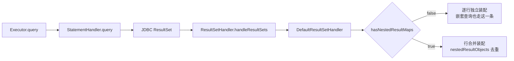
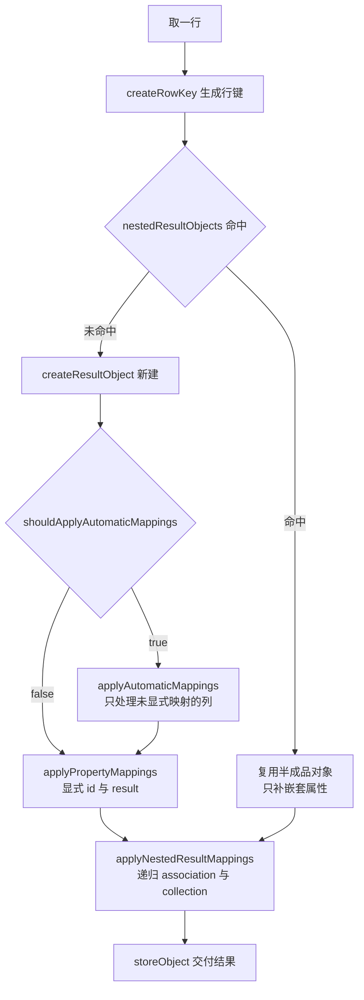
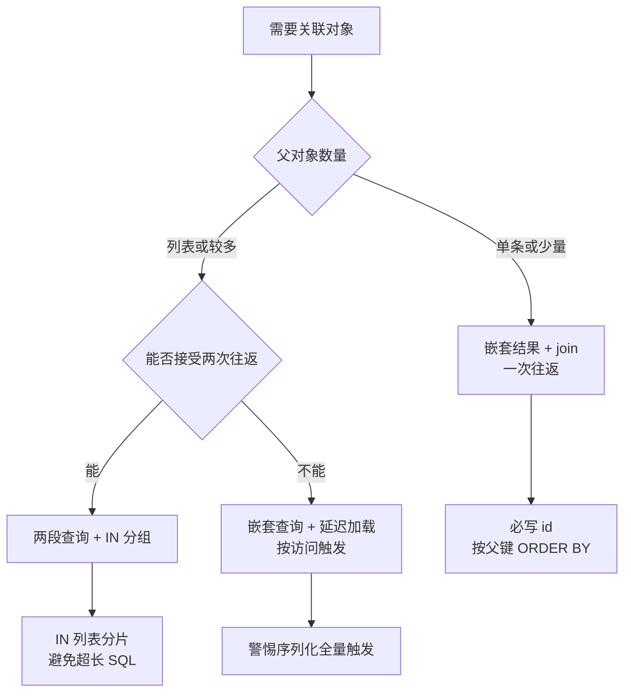
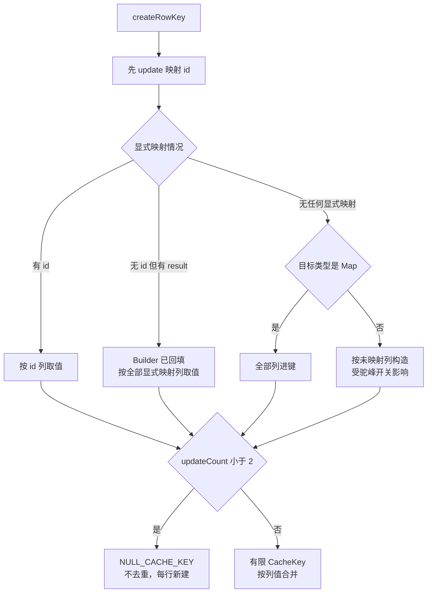
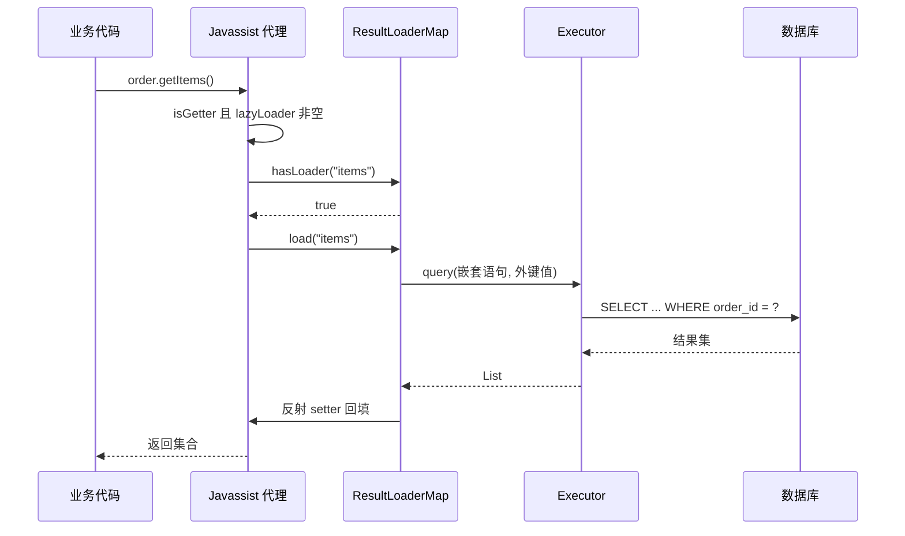
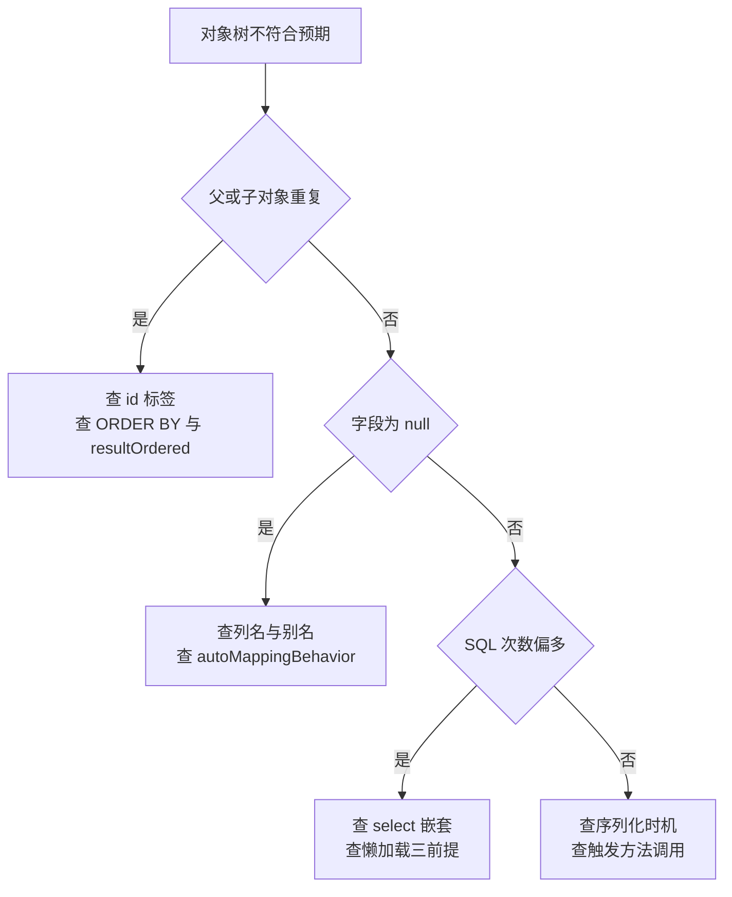

# 结果映射——ResultMap的嵌套映射与延迟加载

**摘要：**

同一条 SQL 交给 Mybatis，结果映射要回答两个问题：这一行该装配成哪个对象，以及哪些行该算作同一个对象。前者由 `ResultMap` 里的 `ResultMapping` 逐列填值，后者由 `<id>` 参与的 `CacheKey` 行合并决定，两件事在代码里分别落在 `applyPropertyMappings` 与 `createRowKey` 上，却是同一个方法 `getRowValue` 的两半。本文沿 `DefaultResultSetHandler` 的调用链把装配拆成分支判定、自动映射、显式映射、嵌套映射、对象复用五段，说明显式映射与自动映射谁先谁后、`autoMappingBehavior` 三档在嵌套路径下为何与直觉相反、`mapUnderscoreToCamelCase` 的作用边界停在哪，再把四种关联写法（嵌套结果、嵌套查询、`<collection>` 的 `ofType` 与 `resultMap`、`<discriminator>`）放进同一张表比较查询次数、去重依据与适用规模。延迟加载部分讲清三个前提、代理拦截规则，以及对象一旦进入 Jackson 序列化，懒加载为何全部触发。文末给出 N+1 的五种治理手段与各自代价，并用四个反例收束：漏写 `<id>`、`aggressiveLazyLoading=true`、用 join 换来的笛卡尔积、`PARTIAL` 下嵌套结果外层字段全空。读者读完应当能判断：这段映射会执行几次 SQL，返回的对象树为什么会重复。

---

## 第 1 章 一次装配要回答的两个问题

### 1.1 贯穿案例：订单详情页

订单服务的详情页要展示一张订单、下单用户、订单明细，以及每条明细指向的商品。库表分四张：`t_order`（订单头）、`t_user`（用户）、`t_order_item`（明细）、`t_product`（商品）。订单头与用户是多对一，订单头与明细是一对多，明细与商品是多对一。

```sql
-- 详情页需要的数据，用一次三表 LEFT JOIN 取回
SELECT o.id            AS order_id,
       o.order_no,
       o.amount,
       o.created_at,
       u.id            AS user_id,
       u.nickname,
       i.id            AS item_id,
       i.quantity,
       i.price,
       p.id            AS product_id,
       p.title         AS product_title
FROM t_order o
LEFT JOIN t_user u       ON u.id = o.user_id
LEFT JOIN t_order_item i ON i.order_id = o.id
LEFT JOIN t_product p    ON p.id = i.product_id
WHERE o.id = 9001;
```

一张有两个明细的订单，这条 SQL 会返回两行，订单头字段完全重复：

| order_id | order_no | user_id | nickname | item_id | quantity | product_id | product_title |
| --- | --- | --- | --- | --- | --- | --- | --- |
| 9001 | SO20261119001 | 77 | 阿吉 | 5001 | 2 | 301 | 机械键盘 |
| 9001 | SO20261119001 | 77 | 阿吉 | 5002 | 1 | 302 | 显示器支架 |

要把这两行还原成"一个 `Order`，里面挂着 `User` 和两个 `OrderItem`，每个 `OrderItem` 再挂一个 `Product`"，就要做两件性质不同的事。第一件是**横向的**：每一行里的十一列，按别名分配到 `Order`、`User`、`OrderItem`、`Product` 四个对象上，谁归谁是映射问题。第二件是纵向的：两行的 `order_id` 相同，理应折叠成同一个 `Order`，而 `item_id` 不同，理应产生两个 `OrderItem`，这个判断是行合并问题。`ResultMap` 之所以比 `resultType` 复杂，正是因为后者只解决第一件事，前者还必须解决第二件。

### 1.2 结果映射在链路中的位置

结果映射不是独立执行的一步，而是 `StatementHandler` 与 `ResultSetHandler` 协作的产物。`Executor.query` 交到 `StatementHandler.query` 之后，语句被准备、参数被绑定、`ResultSet` 被打开，随后 `StatementHandler` 把已执行的 `Statement` 交给 `ResultSetHandler.handleResultSets`。这个顺序解释了为什么参数绑定出错时 SQL 尚未发出，而结果映射出错时 SQL 早已执行完毕，两类问题的排查成本从一开始就不对等。



`hasNestedResultMaps` 的判定口径需要单独强调：它只看结果映射里有没有 `<association resultMap>` 或 `<collection resultMap>` 这类嵌套结果映射，完全不管有没有 `<association select>`。所以一份只用了嵌套查询的映射，在框架眼里是**简单映射**，走的是逐行路径，每一行独立创建对象，根本进不了行合并逻辑。这条边界是后面讨论 `<id>` 的前提，也解释了为什么嵌套查询写不写 `<id>` 都不影响对象是否重复。

还有一个容易被忽略的入口差异：写 `resultType` 时，框架并不会省掉 `ResultMap`，而是在解析 `<select>` 时现造一个内联映射，其 id 是语句 id 拼上 `-Inline`，映射列表为空。空映射意味着所有列都只能靠自动映射，没有任何显式规则兜底，于是 `mapUnderscoreToCamelCase` 与 `autoMappingBehavior` 这两个开关在 `resultType` 场景下的权重，远高于人们通常以为的程度。

### 1.3 ResultMap 与 ResultMapping 的结构

`ResultMap` 是解析产物，不是运行期可变对象。它在 `ResultMap.Builder.build()` 里一次性算好各类索引，之后进入 `Configuration` 的注册表，执行期只读。

```java
// org.apache.ibatis.mapping.ResultMap，字段已按功能归类
public class ResultMap {
  private String id;                          // 命名空间 + id，或 "<语句 id>-Inline"
  private Class<?> type;                      // 目标 Java 类型
  private List<ResultMapping> resultMappings; // 全部映射，含 constructor/nested
  private List<ResultMapping> idResultMappings;       // <id> 标记的映射
  private List<ResultMapping> propertyResultMappings; // 非 constructor 的映射
  private Set<String> mappedColumns;          // 已映射列名，全部转大写
  private Set<String> mappedProperties;       // 已映射属性名
  private Discriminator discriminator;
  private boolean hasNestedResultMaps;
  private boolean hasNestedQueries;
  private Boolean autoMapping;                // resultMap 上的 autoMapping 属性
}
```

`build()` 里有两处行为值得单独记住。其一，`mappedColumns` 统一转成大写，且复合外键的每一列都会被塞进去，这决定了显式映射匹配列名时大小写不敏感，也决定了自动映射的候选池只能从"大写比对之后剩下的列"里选。其二，若一条 `<id>` 都没有，`idResultMappings` 会被回填成全部 `resultMappings`；这个回退不是死代码，它直接决定了漏写 `<id>` 之后行键长什么样。

| 字段 | 来源 | 执行期的读取者 |
| --- | --- | --- |
| `mappedColumns` | `<id>`、`<result>`、复合列 | `ResultSetWrapper` 划分已映射列与未映射列 |
| `mappedProperties` | 映射上的 `property` | `createAutomaticMappings` 排除已被显式映射的属性 |
| `idResultMappings` | `<id>` 标记，空则回填全部 | `getResultMappingsForRowKey` |
| `propertyResultMappings` | 除 `constructor` 外的映射 | `applyPropertyMappings`、`applyNestedResultMappings` |
| `hasNestedResultMaps` | 存在 `nestedResultMapId` 且非 `resultSet` | `handleRowValues` 的分支判定 |
| `autoMapping` | `resultMap` 上的 `autoMapping` 属性 | `shouldApplyAutomaticMappings` 的覆盖值 |

`ResultMapping` 描述单条规则，它有四个互斥的"出口"：普通列值走 `typeHandler`，嵌套查询走 `nestedQueryId`，嵌套结果走 `nestedResultMapId`，多结果集走 `resultSet`。`isSimple()` 的判定就是前三个出口全为空，这个判定在构造行键时被用来过滤非列值映射。另一组常被忽视的字段是 `notNullColumn` 与 `columnPrefix`：前者参与"子对象要不要创建"的判断，后者参与列名前缀的层层拼接。

---

## 第 2 章 逐行装配：DefaultResultSetHandler 的内部次序

### 2.1 handleResultSets：先分结果集，再谈行

一次查询可能返回多个结果集（存储过程、`resultSets` 属性），所以入口方法的第一个循环遍历的是结果集，而不是行。

```java
public List<Object> handleResultSets(Statement stmt) throws SQLException {
  final List<Object> multipleResults = new ArrayList<>();
  int resultSetCount = 0;
  ResultSetWrapper rsw = getFirstResultSet(stmt);
  List<ResultMap> resultMaps = mappedStatement.getResultMaps();
  int resultMapCount = resultMaps.size();
  validateResultMapsCount(rsw, resultMapCount);
  while (rsw != null && resultMapCount > resultSetCount) {
    ResultMap resultMap = resultMaps.get(resultSetCount);
    handleResultSet(rsw, resultMap, multipleResults, null);
    rsw = getNextResultSet(stmt);
    cleanUpAfterHandlingResultSet();   // 清空 nestedResultObjects
    resultSetCount++;
  }
  // resultSets 属性存在时，再按名称取后续结果集
  return collapseSingleResultList(multipleResults);
}
```

`collapseSingleResultList` 在只收集到一个列表时把它展开返回，于是 `selectList` 拿到的仍是 `List`，而不是套了一层的 `List<List>`。`cleanUpAfterHandlingResultSet` 里只有一行 `nestedResultObjects.clear()`，它的位置说明行合并用的缓存生命周期严格限定在**单个结果集**内，跨结果集不共享。这一点在看内存占用时有用：嵌套结果映射的峰值内存，是"一个结果集内的全部父对象"，不是"一次查询的全部父对象"。

`handleResultSet` 还决定结果往哪里去：没有自定义 `ResultHandler` 时，框架自己造一个收集列表；有自定义 `ResultHandler` 时，逐条回调。正是这个分叉，引出了后文的两个安全检查。

### 2.2 handleRowValues：两条路径与两道守卫

分支判定的代码只有几行，但它决定了后面所有行为：

```java
public void handleRowValues(ResultSetWrapper rsw, ResultMap resultMap, ResultHandler<?> resultHandler,
    RowBounds rowBounds, ResultMapping parentMapping) throws SQLException {
  if (resultMap.hasNestedResultMaps()) {
    ensureNoRowBounds();
    checkResultHandler();
    handleRowValuesForNestedResultMap(rsw, resultMap, resultHandler, rowBounds, parentMapping);
  } else {
    handleRowValuesForSimpleResultMap(rsw, resultMap, resultHandler, rowBounds, parentMapping);
  }
}
```

两道守卫都是"防呆"，但**默认只开了一道**。`ensureNoRowBounds` 要在 `safeRowBoundsEnabled=true` 时才检查，而 `RowBounds` 的 limit 限制的是结果行数，不是父对象数，嵌套结果映射下用它分页会把一个订单拆到两页去；`checkResultHandler` 由默认开启的 `safeResultHandlerEnabled=true` 保护，条件是没有设置 `resultOrdered=true`，抛出的提示原文是 `Mapped Statements with nested result mappings cannot be safely used with a custom ResultHandler.`。换句话说，想在大结果集上做流式回调，必须显式声明结果按父键有序，框架才敢放行。

简单路径的循环体只有三步：解析鉴别器得到本次实际使用的 `ResultMap`、`getRowValue` 装配一行、`storeObject` 交付结果。嵌套路径的循环体多了一步取缓存：

```java
// 片段：handleRowValuesForNestedResultMap
while (shouldProcessMoreRows(resultContext, rowBounds) && !resultSet.isClosed() && resultSet.next()) {
  final ResultMap discriminatedResultMap = resolveDiscriminatedResultMap(resultSet, resultMap, null);
  final CacheKey rowKey = createRowKey(discriminatedResultMap, rsw, null);
  Object partialObject = nestedResultObjects.get(rowKey);
  if (mappedStatement.isResultOrdered()) {
    if (partialObject == null && rowValue != null) {
      nestedResultObjects.clear();          // 父键切换，清掉上一组的缓存
      storeObject(resultHandler, resultContext, rowValue, parentMapping, resultSet);
    }
    rowValue = getRowValue(rsw, discriminatedResultMap, rowKey, null, partialObject);
  } else {
    rowValue = getRowValue(rsw, discriminatedResultMap, rowKey, null, partialObject);
    if (partialObject == null) {
      storeObject(resultHandler, resultContext, rowValue, parentMapping, resultSet);
    }
  }
}
```

无序模式靠一个 `HashMap` 记住所有见过的父对象，内存随父对象数量线性增长；有序模式只记住"当前这一组"，前提是 SQL 真的按父键排了序。这两种模式的取舍，是第 6 章讨论 `resultOrdered` 的伏笔。

### 2.3 getRowValue：复用还是新建

装配的核心是 `getRowValue` 的嵌套重载。它先看这一行的行键是否已经有半成品对象，有就只补嵌套属性，没有才完整走一遍。

```java
private Object getRowValue(ResultSetWrapper rsw, ResultMap resultMap, CacheKey combinedKey,
    String columnPrefix, Object partialObject) throws SQLException {
  Object rowValue = partialObject;
  if (rowValue != null) {
    // 同一个父对象的后续行：只继续处理嵌套映射，不重跑列映射
    final MetaObject metaObject = configuration.newMetaObject(rowValue);
    putAncestor(rowValue, resultMap.getId());
    applyNestedResultMappings(rsw, resultMap, metaObject, columnPrefix, combinedKey, false);
    ancestorObjects.remove(resultMap.getId());
  } else {
    final ResultLoaderMap lazyLoader = new ResultLoaderMap();
    rowValue = createResultObject(rsw, resultMap, lazyLoader, columnPrefix);
    if (rowValue != null && !hasTypeHandlerForResultObject(rsw, resultMap.getType())) {
      final MetaObject metaObject = configuration.newMetaObject(rowValue);
      boolean foundValues = this.useConstructorMappings;
      if (shouldApplyAutomaticMappings(resultMap, true)) {
        foundValues = applyAutomaticMappings(rsw, resultMap, metaObject, columnPrefix) || foundValues;
      }
      foundValues = applyPropertyMappings(rsw, resultMap, metaObject, lazyLoader, columnPrefix) || foundValues;
      putAncestor(rowValue, resultMap.getId());
      foundValues = applyNestedResultMappings(rsw, resultMap, metaObject, columnPrefix, combinedKey, true)
          || foundValues;
      ancestorObjects.remove(resultMap.getId());
      foundValues = lazyLoader.size() > 0 || foundValues;
      rowValue = foundValues || configuration.isReturnInstanceForEmptyRow() ? rowValue : null;
    }
    if (combinedKey != CacheKey.NULL_CACHE_KEY) {
      nestedResultObjects.put(combinedKey, rowValue);   // 半成品也要登记，供后续行复用
    }
  }
  return rowValue;
}
```

这段代码里有三个顺序性质。自动映射先于显式映射执行，但结果上显式占优，原因是自动映射的候选池已经剔除了 `mappedProperties` 里的属性，冲突根本不会发生；真正的冲突场景只有一个，就是同一列被自动映射到属性 A，又被显式映射到属性 B，此时两个属性都会拿到值，属于映射写错。`putAncestor` 只在处理嵌套映射期间生效，用来支持自引用结构（如菜单树），用完立刻移除，避免把整棵对象树钉在内存里。`nestedResultObjects.put` 登记的是**半成品**，这就是为什么后续行可以只补嵌套属性。



### 2.4 空行的处理：什么时候不产生对象

`foundValues` 这一串赋值不是在凑代码。它把"这一行至少有一列有值"聚合成一个布尔量，最后用 `rowValue = foundValues || returnInstanceForEmptyRow ? rowValue : null` 决定这一行要不要留下对象。左连接查不到子记录时，子表所有列都是 null，若照原样创建对象，集合里就会多出一个字段全空的元素，业务侧还要写判空代码。

与它配合的是 `notNullColumn`。`applyNestedResultMappings` 在调用 `getRowValue` 之前会先问 `anyNotNullColumnHasValue`，若指定了 `notNullColumn`，只有这些列里有非空值才继续创建对象；没指定则退化为"按前缀找列"。这也解释了另一条容易踩的线：`callSettersOnNulls` 默认关闭，null 值不写回属性，对象字段保持构造后的状态，于是"数据库里是 NULL"与"这一列压根没被查出来"在对象上无法区分，两者都表现为属性没变。

---

## 第 3 章 显式映射与自动映射的优先级

### 3.1 显式映射只认列名

`applyPropertyMappings` 的匹配逻辑朴素得让人意外：取出 `ResultSet` 里所有列名，全部转大写，再逐条比对 `<result>` 与 `<id>` 上写的 `column`。命中的才去取值，没命中的直接跳过，不抛异常、不打日志。

```java
final Set<String> mappedColumnNames = rsw.getMappedColumnNames(resultMap, columnPrefix);
for (ResultMapping propertyMapping : resultMap.getPropertyResultMappings()) {
  String column = prependPrefix(propertyMapping.getColumn(), columnPrefix);
  if (propertyMapping.getNestedResultMapId() != null) {
    column = null;   // 嵌套映射上的 column 属性被忽略
  }
  if (propertyMapping.isCompositeResult()
      || column != null && mappedColumnNames.contains(column.toUpperCase(Locale.ENGLISH))
      || propertyMapping.getResultSet() != null) {
    Object value = getPropertyMappingValue(rsw.getResultSet(), metaObject, propertyMapping, lazyLoader, columnPrefix);
    // ... 写回 metaObject
  }
}
```

两个后果需要记住。列名写错（SQL 里写 `user_name`，映射里写 `username`）时，属性静默为 null，日志里没有任何痕迹，这是最典型的"SQL 查出来了但对象是空"的成因。在嵌套映射上写 `column` 属性时该属性会被代码显式置空，所以 `<association column="user_id" resultMap="userMap"/>` 里的 `column` 不起作用，传参要靠 `select` 那条路径，靠 `columnPrefix` 传前缀要靠另一个属性。

### 3.2 自动映射的候选池

自动映射先从 `ResultSet` 列里剔除所有已映射列，剩下的逐列去找同名属性：

```java
final List<String> unmappedColumnNames = rsw.getUnmappedColumnNames(resultMap, columnPrefix);
for (String columnName : unmappedColumnNames) {
  String propertyName = columnName;
  if (columnPrefix != null && !columnPrefix.isEmpty()) {
    if (!columnName.toUpperCase(Locale.ENGLISH).startsWith(columnPrefix)) {
      continue;                       // 带前缀的嵌套映射只认本前缀的列
    }
    propertyName = columnName.substring(columnPrefix.length());
  }
  final String property = metaObject.findProperty(propertyName, configuration.isMapUnderscoreToCamelCase());
  if (property != null && metaObject.hasSetter(property)) {
    if (resultMap.getMappedProperties().contains(property)) {
      continue;                       // 显式映射优先的直接体现
    }
    final Class<?> propertyType = metaObject.getSetterType(property);
    if (typeHandlerRegistry.hasTypeHandler(propertyType, rsw.getJdbcType(columnName))) {
      autoMapping.add(new UnMappedColumnAutoMapping(columnName, property,
          rsw.getTypeHandler(propertyType, columnName), propertyType.isPrimitive()));
    } else {
      configuration.getAutoMappingUnknownColumnBehavior().doAction(mappedStatement, columnName, property, propertyType);
    }
  } else {
    configuration.getAutoMappingUnknownColumnBehavior().doAction(mappedStatement, columnName,
        property != null ? property : propertyName, null);
  }
}
```

四个条件必须同时成立才会进入候选：属性名能解析出来（这里才用到驼峰开关）、属性有 setter、属性没被显式映射过、类型处理器能覆盖该 JDBC 类型。只读属性（getter 有、setter 无）、`final` 字段、没有对应 `TypeHandler` 的枚举值，都会掉到最后一个分支，交给 `autoMappingUnknownColumnBehavior` 处置。

### 3.3 autoMappingBehavior 的三档与实际语义

很多资料把三档写成"不映射／映射简单列／映射全部列"，这个说法在单层映射下成立，在嵌套结果映射下会给出错误预期。实际判据是下面这个方法：

```java
private boolean shouldApplyAutomaticMappings(ResultMap resultMap, boolean isNested) {
  if (resultMap.getAutoMapping() != null) {
    return resultMap.getAutoMapping();           // resultMap 上的 autoMapping 属性优先
  }
  if (isNested) {
    return AutoMappingBehavior.FULL == configuration.getAutoMappingBehavior();
  } else {
    return AutoMappingBehavior.NONE != configuration.getAutoMappingBehavior();
  }
}
```

关键在于 `isNested` 并不指"当前正在处理的这个映射是嵌套映射"，而是"本次装配走的是嵌套结果的 `getRowValue` 重载"。只要语句的 `ResultMap` 里有嵌套结果映射，连最外层的订单对象都走这个重载，`isNested` 就是 `true`。于是默认的 `PARTIAL` 在嵌套结果场景下**不会做自动映射**，最外层没在 `<id>`／`<result>` 里列出来的列，一律留在 null。

| 配置值 | 简单路径（无嵌套结果映射） | 嵌套结果路径（`isNested=true`） | 典型后果 |
| --- | --- | --- | --- |
| `NONE` | 不自动映射 | 不自动映射 | 所有列都必须显式配置，配置量最大，最不容易出错 |
| `PARTIAL`（默认） | 自动映射未显式列出的列 | 不自动映射 | 嵌套结果语句的外层字段容易静默为空 |
| `FULL` | 自动映射 | 自动映射 | 写起来最省事，但 join 出来的同名列会被意外塞进对象 |
| `resultMap autoMapping="true"` | 覆盖全局，自动映射 | 覆盖全局，自动映射 | 单条映射精确开关，推荐用它替代全局改成 `FULL` |

这个反直觉的设计有个合理内核：嵌套结果映射的列集合里混着多张表的列，全局放开自动映射，`id`、`name`、`status` 这类同名列会被随便塞进某个对象；`PARTIAL` 的保守姿态是"有嵌套结构时，外层的列请你写清楚"。代价是一批"页面上少几个字段"的问题被藏到了运行时。工程上的稳妥做法是给这类映射加 `autoMapping="true"`，把放开范围限制在单条映射内，而不是把全局改成 `FULL`。

### 3.4 autoMappingUnknownColumnBehavior：把静默变成报错

自动映射发现"列有值却没有可写的属性"时，三个档位的行为差别很大：`NONE` 什么都不做；`WARNING` 打一条 warn 日志，日志类名是 `org.apache.ibatis.session.AutoMappingUnknownColumnBehavior`，需要把这个 logger 的级别调到 WARN 才看得见；`FAILING` 直接抛 `SqlSessionException`，消息形如 `Unknown column is detected on '<语句 id>' auto-mapping. Mapping parameters are [columnName=...,propertyName=...,propertyType=...]`。

```xml
<settings>
    <!-- 测试与预发环境建议开到 FAILING，把列名漂移挡在上线前 -->
    <setting name="autoMappingUnknownColumnBehavior" value="FAILING"/>
    <setting name="autoMappingBehavior" value="PARTIAL"/>
    <setting name="mapUnderscoreToCamelCase" value="true"/>
</settings>
```

`FAILING` 的适用边界要说清：它只在自动映射阶段触发，显式映射写错的列名仍然静默；它也只在"找不到属性或类型处理器"时触发，属性存在但语义不对的情况它管不了。把它当作 schema 漂移的**早期报警器**是合适的，当作映射正确性的保证则过度期待了。

### 3.5 构造器映射与 setter 映射的分岔

装配对象的第一步是创建实例，`createResultObject` 在创建方式上还有一个分岔，常被忽略却直接决定"对象能不能装配出来"。若映射里配了 `<constructor>` 元素，框架按 `constructorResultMappings` 逐个取值、按参数顺序调构造器；若目标类没有默认构造器、又没配 `<constructor>`，框架退到"按签名猜测"：单构造器直接用，多构造器时找带 `@AutomapConstructor` 的那一个，再按列顺序与 JDBC 类型逐个匹配，匹配不上则抛 `No constructor found in ... matching ...`。两种构造器路径都会把 `useConstructorMappings` 置为真，从而让 `foundValues` 的初值为真——这意味着哪怕所有列都是 null，对象仍会被创建出来，`returnInstanceForEmptyRow` 对它不起作用。

```xml
<!-- 构造器映射：不可变对象常用它来完成装配 -->
<resultMap id="orderImmutableMap" type="com.acme.order.domain.OrderRecord">
    <constructor>
        <idArg column="order_id" javaType="long"/>
        <arg column="order_no" javaType="string"/>
        <arg column="amount" javaType="java.math.BigDecimal"/>
    </constructor>
</resultMap>
```

与 setter 路径相比，差异有三处。构造器映射不经过 `MetaObject.setValue`，所以 `callSettersOnNulls` 对它无效；构造参数必须数量与类型严格匹配，列顺序错了不会报"映射失败"，而是把值填进错误的参数；构造器里若有副作用（校验、初始化集合），每行都会执行一次，代价随行数线性上升。需要不可变对象时用构造器映射，需要灵活的空值处理与延迟加载时用 setter 路径，两者不宜混用在同一个映射里。

---

## 第 4 章 mapUnderscoreToCamelCase 的作用边界

### 4.1 三个读取点

这个开关在 `DefaultResultSetHandler` 里被读取的地方有三处，各自对应一层能力。第一处是 `createAutomaticMappings` 里的 `metaObject.findProperty(propertyName, isMapUnderscoreToCamelCase())`，作用是让 `user_name` 能找到 `userName`，这是最常用的一处。第二处在 `columnMatchesParam` 里，服务的是"按参数名匹配构造器"这条路径：开启开关时把列名的下划线去掉，再与构造参数名比对，没开启时严格比对，匹配不上会抛 `Constructor auto-mapping of ... failed because ... were not found in the result set`。第三处藏得比较深，在 `createRowKeyForUnmappedProperties` 里：当一个 `ResultMap` 没有任何显式映射、只能靠未映射列构造行键时，框架同样用这个开关把列名翻成属性名，再判断该列是否算进行键。

```java
// createRowKeyForUnmappedProperties 片段
String property = column;
if (columnPrefix != null && !columnPrefix.isEmpty()) {
  if (!column.toUpperCase(Locale.ENGLISH).startsWith(columnPrefix)) {
    continue;
  }
  property = column.substring(columnPrefix.length());
}
if (metaType.findProperty(property, configuration.isMapUnderscoreToCamelCase()) != null) {
  String value = rsw.getResultSet().getString(column);
  if (value != null) {
    cacheKey.update(column);
    cacheKey.update(value);
  }
}
```

第三处的存在意味着：一个只靠自动映射、没有任何 `<id>`／`<result>` 的结果映射，它的行键内容会随驼峰开关而变。开关关掉时 `user_name` 找不到属性，该列不进键，行键可能退化成空键；开关打开时该列进键，行键才有区分度。开关影响的不只是"字段填不填得上"，还影响"行合并按什么字段比"。

### 4.2 它不影响显式映射

`<id column="order_id" property="id"/>` 的匹配走的是 3.1 节那段大写比对，与驼峰开关无关。不要因为打开了 `mapUnderscoreToCamelCase` 就在 `<result>` 里写驼峰列名：`<result column="userName" property="userName"/>` 只有在结果集里真的存在 `userName` 这个列标签时才生效，而绝大多数数据库返回的是 `user_name`，于是属性静默为空。

反过来，显式映射写全下划线列名在任何配置下都正确，因为它是精确匹配，不依赖任何命名策略。这也是笔者建议在嵌套结果映射里坚持写全列名的原因：让显式部分彻底与**全局开关解耦**，读代码的人不需要先确认配置才能判断映射对不对。

### 4.3 它不影响参数绑定

参数侧走的是 `MetaObject` 的属性路径解析，`#{}` 里写的名字必须是 Java 属性名或 `@Param` 指定的名字，与数据库列名毫无关系，自然也不受驼峰开关影响。写 `#{user_name}` 而参数对象上是 `userName`，抛的是 `There is no getter for property named 'user_name' in 'class ...'`，与结果映射层没有关系。参数侧的完整解析路径，包括 `ParamMap`、单参数与 `@Param` 的处理，见 [[04 参数处理——ParameterHandler与TypeHandler的类型映射]]。

| 场景 | 是否受 `mapUnderscoreToCamelCase` 影响 | 原因 |
| --- | --- | --- |
| `resultType` 自动映射 | 是 | `createAutomaticMappings` 用它解析属性名 |
| 无显式映射时的行键构造 | 是 | `createRowKeyForUnmappedProperties` 用同一开关过滤列 |
| `<id>`／`<result>` 显式映射 | 否 | 精确比对列名，大小写不敏感 |
| `#{}`／`${}` 参数绑定 | 否 | 走 `MetaObject` 属性路径，与列名无关 |
| `columnPrefix` 前缀剥离 | 否 | 先剥前缀，剥离动作与命名策略无关 |

---

## 第 5 章 四种关联写法与它们的行为差异

### 5.1 嵌套结果：一次 join，换来行合并

第一种写法把关联对象的列映射直接写进父映射，SQL 只发一次：

```xml
<resultMap id="orderDetailMap" type="com.acme.order.domain.Order">
    <id column="order_id" property="id"/>
    <result column="order_no" property="orderNo"/>
    <result column="amount" property="amount"/>
    <association property="user" javaType="com.acme.order.domain.User">
        <id column="user_id" property="id"/>
        <result column="nickname" property="nickname"/>
    </association>
    <collection property="items" ofType="com.acme.order.domain.OrderItem">
        <id column="item_id" property="id"/>
        <result column="quantity" property="quantity"/>
        <result column="price" property="price"/>
        <association property="product" javaType="com.acme.order.domain.Product">
            <id column="product_id" property="id"/>
            <result column="product_title" property="title"/>
        </association>
    </collection>
</resultMap>
```

行为特征是：走嵌套结果路径，`hasNestedResultMaps=true`，行合并生效，`<id>` 决定父子对象的折叠粒度，`ORDER BY` 影响内存占用（顺序聚集时同一父对象的行相邻，缓存压力小；交错时全部父对象都要驻留）。列名冲突靠 `columnPrefix` 解决，多个嵌套层级的前缀会按 `getColumnPrefix` 的规则逐层拼接后再统一转大写。

### 5.2 嵌套查询：多次查询，靠延迟加载缓解

第二种写法把关联数据交给另一条语句，通过 `column` 把当前行的外键值传过去：

```xml
<resultMap id="orderWithItemsMap" type="com.acme.order.domain.Order">
    <id column="id" property="id"/>
    <result column="order_no" property="orderNo"/>
    <association property="user"
                 column="user_id"
                 select="com.acme.order.mapper.UserMapper.selectById"
                 fetchType="lazy"/>
    <collection property="items"
                column="id"
                select="com.acme.order.mapper.OrderItemMapper.selectByOrderId"
                fetchType="lazy"/>
</resultMap>
```

`column` 可以写成复合形式 `column="{orderId=id,warehouseId=warehouse_id}"`，此时 `ResultMapping` 的 `isCompositeResult()` 为真，框架逐列取出值、按名字构造参数对象，再交给嵌套语句的 `parameterType` 使用。单列形式则直接用该列的 JDBC 值与嵌套语句的参数类型匹配，走 `TypeHandler` 取值。

行为特征是：`hasNestedResultMaps` 仍为 `false`，走简单路径，不发 join，也不需要行合并；每遇到一行就执行一次嵌套语句（除非懒加载把它推迟）。订单详情页若返回 1 个订单，就是 1 次主查询加 2 次嵌套查询；订单列表页若返回 200 条，就是 1 加 400 次，这就是 N+1 的来源。

### 5.3 collection：ofType 与 resultMap 的分工

`<collection>` 上的 `ofType` **只在一个场合被读取**：该节点自己内联定义映射子元素时，框架需要知道集合元素的类型。解析顺序是 `type` → `ofType` → `resultType` → `javaType`，取到第一个非空值作为这个内联 `ResultMap` 的 `type`。

```java
// XMLMapperBuilder#resultMapElement 的类型解析
String type = resultMapNode.getStringAttribute("type",
    resultMapNode.getStringAttribute("ofType",
        resultMapNode.getStringAttribute("resultType",
            resultMapNode.getStringAttribute("javaType"))));
```

因此三种用法要分清。内联定义时 `ofType` 必填，缺了它元素类型无处可寻，启动期就会失败；引用外部 `resultMap` 时 `ofType` 不参与解析，写错也不生效，元素类型由被引用的映射决定；用 `select` 时元素类型由属性本身的 `javaType`（也就是 setter 的参数化类型，通常是 `List`）和嵌套语句的结果共同决定，`ofType` 同样不参与。`javaType` 与 `ofType` 是两个不同层面的东西，前者是容器类型（`List`、`Set`），后者是元素类型，把它们混写是配置错误的常见来源。

### 5.4 discriminator：按列值切换映射

`<discriminator>` 处理单表继承：同一张表按类型列区分不同 Java 子类。它在装配每一行之前先执行，用鉴别列的 `TypeHandler` 取值，据此选出另一个 `ResultMap` 继续装配。

```xml
<resultMap id="orderBaseMap" type="com.acme.order.domain.Order">
    <id column="id" property="id"/>
    <result column="order_no" property="orderNo"/>
    <discriminator javaType="string" column="order_type">
        <case value="PHYSICAL" resultMap="physicalOrderMap"/>
        <case value="VIRTUAL"  resultMap="virtualOrderMap"/>
        <case value="REFUND"   resultMap="refundOrderMap"/>
    </discriminator>
</resultMap>

<resultMap id="physicalOrderMap" type="com.acme.order.domain.PhysicalOrder" extends="orderBaseMap">
    <result column="ship_to" property="shipTo"/>
</resultMap>
```

`resolveDiscriminatedResultMap` 用 `while` 循环而不是递归，`pastDiscriminators` 记录已经走过的映射 id，一旦重复就跳出，防止两个映射互相鉴别造成死循环；`case` 没匹配上时 `getMapIdFor` 返回 null，`hasResultMap(null)` 不成立，循环直接结束，保留基础映射，不报错。子映射通过 `extends` 继承父映射的列配置，`extends` 与 `discriminator` 可以共存，形成"基础列 + 子类列"的分层。

有一个副作用需要注意：行键的第一段是当前生效映射的 id，所以同一张表的父对象若在不同行被判成不同子类型，它们不会合并。鉴别列若来自 join 的子表而不是主表，这种现象就会成片出现。

### 5.5 列前缀与空子对象的处理

join 多表时列名冲突用 `columnPrefix` 解决，它的拼接规则是"父前缀 + 本层前缀"逐层累加，最后统一转大写：

```xml
<resultMap id="orderWithUserMap" type="com.acme.order.domain.Order">
    <id column="order_id" property="id"/>
    <result column="order_no" property="orderNo"/>
    <association property="user" resultMap="userMap" columnPrefix="u_"/>
</resultMap>

<resultMap id="userMap" type="com.acme.order.domain.User">
    <id column="id" property="id"/>          <!-- 实际比对 u_id -->
    <result column="nickname" property="nickname"/>
</resultMap>
```

`columnPrefix` 只影响列的匹配与取值，不改变 SQL 文本；它也会带进行键，因为 `createRowKeyForMappedProperties` 同样先用 `prependPrefix` 拼出带前缀的列名再取值，所以前缀必须与 SQL 里的别名严格一致，否则行键取不到值。多层嵌套时前缀按层叠加，因此给每张表统一一个短前缀（`u_`、`i_`、`p_`）比逐列起别名省事，也能避免三层 join 之后别名长度失控。

空子对象的处理由 `notNullColumn` 控制。左连接查不到子记录时，子表所有列都是 null，框架在创建嵌套对象之前先调 `anyNotNullColumnHasValue`：指定了 `notNullColumn` 就只看这几列，没指定则按前缀找"至少有一个非空前缀列"。判定为假时直接跳过创建，集合里不会出现字段全空的元素，这也是 `returnInstanceForEmptyRow` 保持默认 `false` 的原因。

### 5.6 四种写法的对照

| 写法 | SQL 次数 | 是否需要 `<id>` 去重 | 是否走行合并路径 | 适用规模 |
| --- | --- | --- | --- | --- |
| 嵌套结果 + join | 1 | 需要，缺了会重复建对象 | 是 | 父对象少、层级浅、可接受行放大 |
| 嵌套查询 + `fetchType="eager"` | 1 + N | 不需要 | 否 | 单条主记录查询 |
| 嵌套查询 + `fetchType="lazy"` | 1 + 实际访问数 | 不需要 | 否 | 关联数据多数不被访问 |
| 手写两段查询 + `IN` | 2 | 不需要 | 否 | 列表页、层级深、需分页 |

选型的分水岭是"这次请求要展示多少父对象"和"关联数据是否都要"。一条订单的详情页，四次查询（订单、明细、商品、用户）也在可接受范围内；两百条订单的列表页，join 后的行数会放大到几千行，分页还会错位，这时两段查询更稳。



---

## 第 6 章 `<id>`：行合并的钥匙

### 6.1 行键是怎么造出来的

行合并的全部依据是一个 `CacheKey`。它由两部分拼成：`ResultMap` 的 id 与若干组"列名 + 列值"，两者都在 `createRowKey` 里构造：

```java
private CacheKey createRowKey(ResultMap resultMap, ResultSetWrapper rsw, String columnPrefix) throws SQLException {
  final CacheKey cacheKey = new CacheKey();
  cacheKey.update(resultMap.getId());
  List<ResultMapping> resultMappings = getResultMappingsForRowKey(resultMap);
  if (resultMappings.isEmpty()) {
    if (Map.class.isAssignableFrom(resultMap.getType())) {
      createRowKeyForMap(rsw, cacheKey);                    // Map 类型：全部列都进键
    } else {
      createRowKeyForUnmappedProperties(resultMap, rsw, cacheKey, columnPrefix);
    }
  } else {
    createRowKeyForMappedProperties(resultMap, rsw, cacheKey, resultMappings, columnPrefix);
  }
  if (cacheKey.getUpdateCount() < 2) {
    return CacheKey.NULL_CACHE_KEY;                         // 只有映射 id，无区分度
  }
  return cacheKey;
}
```

`createRowKeyForMappedProperties` 只处理 `isSimple()` 的映射，逐列取出值，非 null 时把列名和值各 `update` 一次。两处细节决定了行键的强弱：**列值为 null 时这一组不进入键**，所以复合主键里有 null 列时行键会变窄；`updateCount` 小于 2 时直接返回 `CacheKey.NULL_CACHE_KEY`，而 `getRowValue` 里对空键的登记是**跳过**的，于是空键等价于"这一行永远不复用"。

### 6.2 回退链：没有 `<id>` 时按什么合并

`getResultMappingsForRowKey` 只有四行，但它决定了漏写 `<id>` 的后果：

```java
private List<ResultMapping> getResultMappingsForRowKey(ResultMap resultMap) {
  List<ResultMapping> resultMappings = resultMap.getIdResultMappings();
  if (resultMappings.isEmpty()) {
    resultMappings = resultMap.getPropertyResultMappings();
  }
  return resultMappings;
}
```

配合 `ResultMap.Builder.build()` 里那句 `if (resultMap.idResultMappings.isEmpty()) resultMap.idResultMappings.addAll(resultMap.resultMappings);`，回退链实际是三级：有 `<id>` 就只按 `<id>` 列合并；没有 `<id>` 就按全部显式映射里能取值的列合并；连一个显式列映射都没有（譬如父对象的字段全靠自动映射），就按未映射列去找能对上属性的列。还有两种边角情况会直接掉出这个链条：映射里只有嵌套映射而没有列映射时，`createRowKeyForMappedProperties` 的 `isSimple()` 过滤会把它们全部跳过，键只剩映射 id；未映射列一列都对不上属性时，键同样只剩映射 id。两种情况下 `updateCount` 都是 1，行键退化为空键，合并彻底失效。



### 6.3 漏写 `<id>` 的三种结局

第一种结局最惨：父映射里一个显式映射都没有，父字段全靠自动映射，行键只剩映射 id，`updateCount` 为 1，返回空键，`nestedResultObjects` 一次都不会登记，每一行都新建一个父对象。两行明细就得到两个内容相同的 `Order`，JSON 序列化之后前端看到两条重复记录。

第二种结局是碰巧正确：父映射里有 `<result column="order_no" property="orderNo"/>` 之类的列，且这些列在同一父对象的所有行里取值相同，行键事实上等价于订单号，合并照常工作。这种"碰巧正确"最危险，因为它会在某天有人把某个 join 子表的列误映射到父对象上时突然失效。

第三种结局是错误合并：多个 `<id>` 被写成 `<result>`，或复合主键漏了其中一列，行键变窄，不同的父对象算出相同的键，后一行的数据覆盖前一行的字段，集合里还会混入不属于自己的子元素。

| 写法 | 行键依据 | 现象 | 判据 |
| --- | --- | --- | --- |
| 只写 `<id>` | 主键列 | 正常 | 父对象数 = 去重后主键数 |
| 只写 `<result>` | 全部显式映射列 | 多数情况"碰巧正确" | 父对象的某个映射列一旦在子行间变化就裂开 |
| 什么都不写 | 未映射列，或空键 | 完全重复 | 父对象数 = SQL 行数 |
| 复合键漏列 | 部分主键列 | 静默覆盖 | 明细数量少于实际，字段值是后一行的 |

### 6.4 父键与子键的组合

嵌套对象不使用自己的行键，而是使用"子键 + 父键"的组合键：

```java
private CacheKey combineKeys(CacheKey rowKey, CacheKey parentRowKey) {
  if (rowKey.getUpdateCount() > 1 && parentRowKey.getUpdateCount() > 1) {
    CacheKey combinedKey = rowKey.clone();
    combinedKey.update(parentRowKey);
    return combinedKey;
  }
  return CacheKey.NULL_CACHE_KEY;
}
```

这条逻辑说明了两件事。同一个商品被多个订单引用时，`Product` 对象在各订单下分别创建，不会被跨父对象复用，这是正确的语义，因为对象树不应交叉引用。任一方的键退化为空键时，组合键也为空，嵌套对象同样失去复用能力，于是重复问题会从父对象蔓延到子对象，形成"每行一个完整对象树"的局面。

自引用结构（菜单树、组织架构）走的是另一套保护。`applyNestedResultMappings` 在进入嵌套映射之前先查 `ancestorObjects`，如果当前映射 id 已经在祖先链上，说明出现了循环引用，此时只做对象链接、不再递归装配；`putAncestor` 与 `ancestorObjects.remove` 的成对出现保证了这条链只在装配过程中有效。源码注释里还留了一个限制：只有当嵌套映射没有指定 `columnPrefix` 时才做循环引用的补链，指定了前缀就跳过，原因是用同一张表自连接时前缀会把父子列分开，祖先判定失去依据。

### 6.5 resultOrdered：有序让内存可控

`resultOrdered=true` 时，框架假设结果按父键有序，于是可以在父键切换时清掉整张缓存表，把内存占用压到"当前一组"。代价是它把正确性押在了 SQL 的 `ORDER BY` 上：结果若按主键交错（譬如 `ORDER BY created_at` 恰好不按主键聚簇），同一个订单的行会被拆成不连续的几段，每段都产生一个新的 `Order`，重复问题反而更难发现。

有序模式还承担着另一个职责：`checkResultHandler` 只在 `!resultOrdered` 时报错，所以想用自定义 `ResultHandler` 做流式消费，这是唯一的合法声明方式。它也常和 `resultSetType="FORWARD_ONLY"`、合适的 `fetchSize` 一起出现，构成"大结果集边取边处理"的组合。

---

## 第 7 章 延迟加载：三个前提与代理机制

### 7.1 三个前提

延迟加载不是把嵌套查询换成懒加载就完事，它要同时满足三个条件，缺哪个都会得到"看起来配了却没生效"的结果。

| 前提 | 默认值 | 不满足时的现象 | 配置位置 |
| --- | --- | --- | --- |
| `lazyLoadingEnabled=true` | `false` | 嵌套查询立即执行，日志里 SQL 数是 1 加 N | 全局 `settings`，或映射上 `fetchType="lazy"` |
| `aggressiveLazyLoading=false` | `false`（3.4.1 起） | 访问任意属性都触发 `loadAll`，等价于立即加载 | 全局 `settings` |
| 对象在会话关闭前未被整体遍历 | 取决于用法 | 序列化或 `toString` 把所有属性拉一遍 | 出参设计、DTO 裁剪 |

第一项的生效时机被很多人误判。`lazy` 是 `ResultMapping` 的构造参数，解析 XML 时就已经定下来：

```java
// XMLMapperBuilder#buildResultMappingFromContext
boolean lazy = "lazy".equals(context.getStringAttribute("fetchType",
    configuration.isLazyLoadingEnabled() ? "lazy" : "eager"));
```

也就是说，`lazyLoadingEnabled` 在**构建期被读走并固化**进每个 `ResultMapping`，运行期再改 `Configuration` 里的这个开关，对已经解析完的映射没有任何影响；映射上写了 `fetchType` 时，它以 `fetchType` 为准，全局开关只作为缺省值。至于"只有嵌套查询能懒加载"这条边界，源头在 `createResultObject` 里那个循环：只有 `nestedQueryId != null && isLazy()` 的映射才会触发代理包装，嵌套结果映射没有嵌套查询，自然无从延迟。

### 7.2 代理用谁实现

`Configuration` 里代理工厂的默认值是 `JavassistProxyFactory`，不是 CGLIB。mybatis 的发布包把 Javassist 重定位进了 `org.apache.ibatis.javassist` 包，所以默认路径不需要额外依赖。

| 实现 | 默认 | 依赖 | 备注 |
| --- | --- | --- | --- |
| Javassist | 是 | 无，已随包内嵌 | 构造时探测 `org.apache.ibatis.javassist.util.proxy.ProxyFactory` |
| CGLIB | 否 | 需自行引入 `cglib` | `CglibProxyFactory` 自 3.5.10 起标记 `@Deprecated`，创建代理时打一条 warn |

两者都是子类代理，生成目标类的子类并重写方法。这带来三条硬边界：`final` 类无法被代理；`final` 方法与 `private` 方法不会被拦截，访问这些方法上的属性不会触发加载；目标类没有无参构造器时，框架用 `constructorArgTypes`／`constructorArgs` 按原构造参数重建实例，构造器带副作用就会执行两次。

### 7.3 拦截规则

代理的 `invoke` 方法把调用分成四类处置：

```java
public Object invoke(Object enhanced, Method method, Method methodProxy, Object[] args) throws Throwable {
  lock.lock();
  try {
    if ("writeReplace".equals(method.getName())) {
      // 序列化钩子：返回 SerialStateHolder，保留未加载属性清单（此处省略实现）
    }
    if (!lazyLoader.isEmpty() && !"finalize".equals(method.getName())) {
      if (aggressive || lazyLoadTriggerMethods.contains(method.getName())) {
        lazyLoader.loadAll();                       // equals/clone/hashCode/toString 直接全加载
      } else if (PropertyNamer.isSetter(method.getName())) {
        lazyLoader.remove(PropertyNamer.methodToProperty(method.getName()));
      } else if (PropertyNamer.isGetter(method.getName())) {
        String property = PropertyNamer.methodToProperty(method.getName());
        if (lazyLoader.hasLoader(property)) {
          lazyLoader.load(property);                // 只加载被访问的那个属性
        }
      }
    }
    return methodProxy.invoke(enhanced, args);
  } finally {
    lock.unlock();
  }
}
```

四个分支的含义值得逐个说。`aggressive=true` 时任何方法都触发 `loadAll`，懒加载名存实亡。`aggressive=false` 时，`equals`、`clone`、`hashCode`、`toString` 这四个方法名仍然在 `lazyLoadTriggerMethods` 里，命中即全加载，所以调试时打一行 `log.info("order={}", order)` 就足以让全量查询跑完。setter 会移除该属性的加载任务，赋值即取消，这是"手工补数据"能覆盖懒加载结果的原因。getter 只加载自己那一个属性，这也是懒加载唯一真正省查询的场景。



`ResultLoaderMap` 还有一条启动期就会撞上的约束：同一个 `ResultMap` 里，所有懒加载属性的最左段属性名必须唯一，重复时 `addLoader` 抛 `ExecutorException`，提示 `The leftmost property of all lazy loaded properties must be unique within a result map.`。这是嵌套懒加载（`property="a.b"` 这类路径）容易踩的坑。

### 7.4 为什么一进 Jackson 就全触发

延迟加载的收益依赖"属性不被访问"，而序列化恰好是**全量访问**。Jackson 序列化对象时会遍历所有 getter，代理上的每个 lazy 属性都会被命中一次，于是同一次请求里的 N 条嵌套 SQL，被推迟到序列化阶段集中执行。更糟的是这个时机通常已经越过了事务边界：`ResultLoader.selectList` 在发现执行器已关闭或线程已切换时，不会抛异常，而是新建一个执行器：

```java
private <E> List<E> selectList() throws SQLException {
  Executor localExecutor = executor;
  if (Thread.currentThread().getId() != this.creatorThreadId || localExecutor.isClosed()) {
    localExecutor = newExecutor();     // 用 Environment 里的 DataSource 新建事务与执行器
  }
  try {
    return localExecutor.query(mappedStatement, parameterObject, RowBounds.DEFAULT,
        Executor.NO_RESULT_HANDLER, cacheKey, boundSql);
  } finally {
    if (localExecutor != executor) {
      localExecutor.close(false);
    }
  }
}
```

`newExecutor` 从 `Environment` 取数据源与事务工厂，等于在原来的事务之外另开连接。于是形成一条典型链路：Controller 返回实体，事务已提交，Jackson 开始序列化，代理逐属性开新连接查库，单次请求的连接占用从 1 变成 1 加 N，高并发下连接池被打满。配置里 `Environment` 或 `DataSource` 缺失时，抛的则是 `ResultLoader could not load lazily. DataSource was not configured.`。

原生 Java 序列化是另一条路径：代理实现了 `writeReplace`，把自身打包成 `SerialStateHolder` 并记录未加载属性，反序列化时重建代理，懒加载状态得以保留。JSON 序列化没有这个钩子，走的还是 getter 遍历，所以"序列化后代理失效"这个说法只对 JSON 成立，对 Java 序列化并不准确。

### 7.5 与缓存、延迟队列的交互

`getNestedQueryMappingValue` 在创建 `ResultLoader` 之前，先问一句嵌套语句的结果是否已在缓存里。命中缓存时走 `deferLoad`，把加载任务挂进 `deferredLoads`；未命中且属性标记为懒加载时，才挂进 `ResultLoaderMap` 等业务访问。两条分支的差别在于触发者：前者由框架在查询收尾时统一执行，后者由业务代码的 getter 触发。

```java
final CacheKey key = executor.createCacheKey(nestedQuery, nestedQueryParameterObject, RowBounds.DEFAULT, nestedBoundSql);
if (executor.isCached(nestedQuery, key)) {
  executor.deferLoad(nestedQuery, metaResultObject, property, key, targetType);   // 收尾统一加载
  value = DEFERRED;
} else {
  final ResultLoader resultLoader = new ResultLoader(configuration, executor, nestedQuery,
      nestedQueryParameterObject, targetType, key, nestedBoundSql);
  if (propertyMapping.isLazy()) {
    lazyLoader.addLoader(property, metaResultObject, resultLoader);              // 等 getter 触发
    value = DEFERRED;
  } else {
    value = resultLoader.loadResult();                                          // 立即加载
  }
}
```

由此得到一个与直觉相反的观察：即便全局关闭懒加载，只要嵌套查询的结果已经在缓存里，加载也会被推迟到父查询结束，日志里表现为一批 SQL 挤在末尾。`deferredLoads` 的消费点是 `queryStack == 0`，与 `clearLocalCache` 在同一个分支上，说明"延迟队列"的生命周期与一级缓存是绑定的：父查询结束、队列清空、再按作用域决定缓存去留。

`ResultLoader` 保存的 `cacheKey` 是父查询执行时用当时的参数算出来的，缓存的读取却发生在真正加载的那一刻，两次之间若发生写操作并触发缓存失效，加载会重新查库。`isCached` 只查一级缓存，二级缓存不参与这个前置判断，要到真正加载时才可能命中；而二级缓存存的是 namespace 级共享数据，与当前事务的可见性无关，排查"延迟加载读到旧数据"时这是关键线索，也是 [[06 一级缓存与二级缓存——命中条件、失效场景与生产陷阱]] 讨论的主要风险。

### 7.6 延迟加载到底省了什么

它省的是"未被访问属性"的那部分查询，不减少"被访问属性"的查询次数，也不改变查询次数的量级。判据很直接：看一次请求结束时，实际被触发的嵌套 SQL 条数占应触发数的比例。全部属性都被读时，懒加载只增加了一层代理开销和一次时机错位，收益为零。

| 场景 | 是否触发全量 | 是否省查询 | 说明 |
| --- | --- | --- | --- |
| 只读列表页的几个字段 | 否 | 是 | 懒加载的理想场景 |
| Controller 直接返回实体 | 是 | 否 | Jackson 遍历 getter |
| 打日志打印整个对象 | 是 | 否 | `toString` 在触发方法列表里 |
| 放入 Redis 前做 JSON 序列化 | 是 | 否 | 序列化即全量访问 |
| 在 `@Transactional` 内按需读取 | 部分 | 是 | 会话未关，走原执行器 |

---

## 第 8 章 N+1 的治理

### 8.1 先把代价量化

N+1 的成本是 N 次额外往返，每次往返包含获取连接、发送 SQL、数据库解析执行、回传结果、映射对象五段固定开销。做一次示例推算：内网往返 0.2 毫秒、数据库执行 0.4 毫秒、连接池取还与驱动开销 0.3 毫秒，单次约 0.9 毫秒；N 为 200 时，200 次嵌套查询约 180 毫秒，而一次 join 取回全部数据约 3 毫秒。这个数字是**示例推算**，用来说明量级，不是基准测试结果；真实环境受 SQL 复杂度、索引、连接池配置影响，可能相差数倍。

比耗时更早出问题的是连接占用：200 次嵌套查询串行执行，期间一直占着同一个连接，却又反复发起 network round trip。数据库侧的 QPS 也会被这些小查询抬高，慢查询日志里看不出一条慢 SQL，整体吞吐却掉了一半，这类问题的排查难度远高于单条慢 SQL。

### 8.2 治理一：join + 嵌套结果

最直接的做法是把 N 加 1 次查询压成 1 次。除了 5.1 节的写法，还有三个工程约束必须一并处理。结果行数是各层子记录的乘积，父对象越深、子集合越多，行数放大越严重，三层嵌套时行数可能到父对象的几十倍。分页会失效，`LIMIT` 截断的是结果行，一页十条可能只包含三个父对象。`ORDER BY` 必须按父键排序，否则无序模式下的缓存表要把所有父对象一直挂着。

处理办法是把分页拆成两段：先按条件查父键（`SELECT id FROM t_order WHERE ... LIMIT ?`），再用 `IN` 把这一页的父记录连同子记录一次取回。这样既保住了分页语义，又只多了一次很轻的查询。

### 8.3 治理二：两段查询 + IN 分组

列表页最常用的写法是两次查询加内存分组：

```java
List<Order> orders = orderMapper.selectPage(query, offset, size);      // 第 1 次
if (orders.isEmpty()) {
    return orders;
}
List<Long> orderIds = orders.stream().map(Order::getId).collect(Collectors.toList());
List<OrderItem> items = itemMapper.selectByOrderIds(orderIds);         // 第 2 次，IN 查询
Map<Long, List<OrderItem>> byOrder = items.stream()
    .collect(Collectors.groupingBy(item -> item.getOrderId()));
orders.forEach(o -> o.setItems(byOrder.getOrDefault(o.getId(), Collections.emptyList())));
```

两次往返，没有行放大，分页语义正确，代价是关联关系由应用代码维护，`OrderItem` 需要一个 `orderId` 字段。`IN` 列表要分片：Oracle 对 `IN` 列表有 1000 个元素的限制（以所用版本为准），MySQL 虽然没有硬限制，但超长 SQL 会撞上 `max_allowed_packet`，实务上按 500 到 1000 一批切开。

需要明确一点：Mybatis 核心没有内建的批量加载机制，不存在 Hibernate 那种 `@BatchSize` 的等价物。嵌套查询一旦配上去，就是一条一条发；想要批量，只能在应用层合并，或者引入能改写 SQL 的插件。[[07 插件机制——Interceptor的责任链模式与分页插件原理]] 讲的拦截点可以做到，但代价是维护一段对 SQL 结构有假设的插件代码。

### 8.4 治理三：fetchSize 与流式读取

`fetchSize` 控制驱动每次从游标取多少行进客户端。它的优先级是语句上的 `fetchSize` 属性高于全局 `defaultFetchSize`，两者都没配时用驱动默认值：

```java
Integer fetchSize = mappedStatement.getFetchSize();
if (fetchSize != null) {
  stmt.setFetchSize(fetchSize);
  return;
}
Integer defaultFetchSize = configuration.getDefaultFetchSize();
if (defaultFetchSize != null) {
  stmt.setFetchSize(defaultFetchSize);
}
```

MySQL 的流式读取需要结果集为 `TYPE_FORWARD_ONLY` 并把 `fetchSize` 设为 `Integer.MIN_VALUE`，这是 Connector/J 的历史约定；新版本驱动也支持 `useCursorFetch=true` 配合正整数 `fetchSize` 走服务端游标，具体以所用驱动版本文档为准。这里要划清边界：`fetchSize` 减少的是"驱动一次取回多少行"，不减少**总共要映射多少对象**。join 出来的笛卡尔积行数不会因为 `fetchSize` 变小而变少，对象该建多少还是多少，内存该爆还是爆。

### 8.5 治理四：localCacheScope 的真实影响

很多资料把 `localCacheScope=STATEMENT` 当成 N+1 的缓解手段，理由是"每条语句执行后清一级缓存，缓存不会跨语句污染"。这个说法只说了一半。`BaseExecutor.query` 的清理条件是 `queryStack == 0`：

```java
try {
  queryStack++;
  list = resultHandler == null ? (List<E>) localCache.getObject(key) : null;
  if (list != null) {
    handleLocallyCachedOutputParameters(ms, key, parameter, boundSql);
  } else {
    list = queryFromDatabase(ms, parameter, rowBounds, resultHandler, key, boundSql);
  }
} finally {
  queryStack--;
}
if (queryStack == 0) {
  for (DeferredLoad deferredLoad : deferredLoads) {
    deferredLoad.load();
  }
  deferredLoads.clear();
  if (configuration.getLocalCacheScope() == LocalCacheScope.STATEMENT) {
    clearLocalCache();
  }
}
```

嵌套查询发生在父查询的 `ResultSetHandler` 阶段，此时父查询还没返回，`queryStack` 大于 0，所以**父语句执行期间的嵌套查询共享同一份一级缓存**，即便配的是 `STATEMENT`。如果一批订单里有多条指向同一个用户，第二条之后的嵌套查询会命中缓存，实际 SQL 数小于 N 加 1。`STATEMENT` 切掉的是跨语句复用：两次调用同一个查询方法之间不再命中。

再说清另一半：Spring 无事务场景下每次 Mapper 调用都会新建 `SqlSession`，会话级缓存本来就无从跨调用生效，把 `SESSION` 改成 `STATEMENT` 影响不到这类 N+1。一级缓存与二级缓存的命中条件、失效场景，见 [[06 一级缓存与二级缓存——命中条件、失效场景与生产陷阱]]。指望用缓存作用域解决 N+1，方向上就错了一层。

### 8.6 治理五：裁剪出参

最后一种手段不碰映射，改接口形状：列表页只返回列表需要的字段，用专门的 DTO 承接 `resultType`，详情页才用嵌套映射。关联对象不被访问，延迟加载就没有被触发的机会；字段不被查询，join 就没有必要。这条路的代价是 DTO 数量增加、转换代码增加，收益是每次请求的 SQL 数与对象数量都可预期。

| 手段 | 往返次数 | 行放大 | 分页正确性 | 主要代价 |
| --- | --- | --- | --- | --- |
| 嵌套结果 + join | 1 | 有 | 需两段查询保障 | 行数放大、内存峰值高 |
| 两段查询 + `IN` | 2 | 无 | 正确 | 应用层分组、`IN` 分片 |
| 嵌套查询 + 延迟加载 | 1 + 访问数 | 无 | 正确 | 序列化触发全量、时机不可控 |
| `fetchSize` 流式 | 不变 | 不变 | 不变 | 只降取数批次，不治 N+1 |
| DTO 裁剪 | 1 到 2 | 无 | 正确 | 需要额外模型与转换 |

### 8.7 怎么发现 N+1

排查的第一步是把"每条请求的 SQL 数"变成可观测指标，而不是靠翻日志找线索。Mybatis 的语句日志会把每条 SQL 打成 `==>  Preparing:`，结果集读到末尾时再由 `ResultSetLogger` 补一条 `<==      Total:`，按请求 id 聚合这两行的条数，就能得到每个接口的语句数分布；更轻的做法是写一个 `Executor` 插件在 `query` 方法上计数，成本是一个拦截器加一个 ThreadLocal，不侵入业务代码。

判据是语句数与结果集大小的关系。父对象数量增长、语句数同比例增长，就是 N+1 的形状；语句数稳定在个位数而耗时随数据量增长，问题在单条 SQL 而不是 N+1。把这个比值做成告警，比事后从慢查询日志里找证据有效得多，因为 N+1 里的每条 SQL 往往都不慢，慢查询阈值永远抓不到它们。

---

## 第 9 章 四个反例与排错路径

### 9.1 反例一：漏写 `<id>`

```xml
<!-- 错误：父对象没有任何显式映射，行键退化为空键 -->
<resultMap id="orderWrongMap" type="com.acme.order.domain.Order">
    <collection property="items" ofType="com.acme.order.domain.OrderItem">
        <id column="item_id" property="id"/>
        <result column="quantity" property="quantity"/>
    </collection>
</resultMap>
```

这份映射里父对象没有 `<id>`、也没有 `<result>`，父字段期望靠自动映射补上，但嵌套结果路径在 `PARTIAL` 下不做自动映射，父字段本来就是 null，行键也只剩映射 id。SQL 返回两行明细，结果是两个 `Order`，各自挂一个 `OrderItem`，`orderNo`、`amount` 全为 null。修法是补 `<id column="order_id" property="id"/>`，并把父字段显式列出或给映射加 `autoMapping="true"`。

### 9.2 反例二：`aggressiveLazyLoading=true`

从 Mybatis 3.4.1 起这个开关默认是 `false`，一些老项目沿用了早期版本的显式配置，把它写成了 `true`。开启之后，代理对任何方法调用都执行 `loadAll`，业务代码里一次 `order.getOrderNo()` 就会把明细、商品、用户全部查出来。表面现象是"懒加载配了但没用"，深层现象是查询次数比不开懒加载还多，因为开了懒加载却全量加载，等于先延迟、再集中补。

判据是日志时序：所有嵌套 SQL 都出现在第一次 getter 调用之后、且集中在同一毫秒段，就是全量加载的特征。修法是把配置改成 `false`，并检查有没有对实体调用 `toString()`、`hashCode()`、`equals()`，这三个方法无论开关如何都会触发 `loadAll`。

### 9.3 反例三：用 join 换来的笛卡尔积

三层嵌套一起 join，**行数是各层记录数的乘积**。订单 1 条、明细 20 条、每条明细 3 个规格、每个规格 2 张图片，一条订单展开就是 120 行；列表页一次取 200 条订单，返回行数两万四千行，每行都要完整走一遍映射。做一次示例推算：每行按 400 字节的对象开销估算，内存瞬时占用接近 10 MB，加上映射过程中的 `CacheKey`、`MetaObject` 与驱动缓冲区，实际峰值通常是这个数的数倍。并发几十个这样的请求，堆就会顶到上限。

症状是 `java.lang.OutOfMemoryError: Java heap space`，栈顶常落在 `DefaultResultSetHandler.handleRowValuesForNestedResultMap` 或驱动读取 `ResultSet` 的位置，日志里那条 SQL 本身并不慢。判据是拿 SQL 直接跑一遍，比较返回行数与期望的父对象数，比值超过 10 就要警惕。处置是拆查询：父键分页加两段查询，或把深层的嵌套关系改成按需加载。

### 9.4 反例四：`PARTIAL` 下嵌套结果外层字段全空

第 3 章讲过，`PARTIAL` 在嵌套结果路径下不做自动映射。表现是明细、商品这些显式列出的部分完全正确，订单自身的 `orderNo`、`amount` 却全是 null，SQL 里明明查了这些列。因为没有任何异常与日志，容易被误判成"数据库没数据"或"列名写错"。

判据是把映射改成 `autoMapping="true"` 再看，如果字段立刻有值，就确认是这一档行为。处置有两条：给映射加 `autoMapping="true"`，或者把外层列显式写全。前者省事但把整个映射的自动映射都放开了，后者啰嗦但边界清楚。

### 9.5 排错路径

四个反例的共同点是"SQL 没问题、对象不对"，排查顺序应当是先看对象树形状，再看 SQL 次数，最后才怀疑数据库。

| 症状 | 日志或异常关键字 | 根因 | 处置 |
| --- | --- | --- | --- |
| 父对象重复 | 无异常，`List.size()` 大于去重主键数 | 缺 `<id>` 或行键退化为空键 | 补 `<id>`，检查 `ORDER BY` |
| 集合内元素重复 | 无异常，元素 id 相同 | 子映射缺 `<id>`，或 `resultOrdered` 未排序 | 子映射补 `<id>`，按父键排序 |
| 外层字段全 null | 无异常 | `PARTIAL` 下嵌套结果不自动映射 | 加 `autoMapping="true"` 或显式列全 |
| 属性全 null、SQL 有值 | 无异常 | 显式映射列名与结果集列标签不一致 | 对齐别名，用 `autoMappingUnknownColumnBehavior=FAILING` 兜底 |
| 嵌套 SQL 成批出现 | 每次请求 N 条同构 SQL | 嵌套查询未开懒加载，或序列化全量触发 | 改 join、两段查询或 DTO 裁剪 |
| 一次请求一次 SQL 却全量返回 | `toString`、`hashCode` 调用 | `aggressiveLazyLoading=true` 或触发方法 | 关开关，避免打印实体 |
| 启动期解析失败 | `Could not find result map ... referenced from ...` | `resultMap` 引用写错，或 `ofType` 缺失 | 补全限定 id 与元素类型 |
| 自定义 `ResultHandler` 报错 | `cannot be safely used with a custom ResultHandler` | 嵌套结果映射与回调式处理冲突 | 加 `resultOrdered=true` 并保证排序 |



---

## 第 10 章 配置速查与选型边界

### 10.1 配置速查

| 配置项 | 默认值 | 生效时刻 | 常见误用 |
| --- | --- | --- | --- |
| `autoMappingBehavior` | `PARTIAL` | 每次装配现读 | 以为嵌套结果会做自动映射 |
| `autoMappingUnknownColumnBehavior` | `NONE` | 每次装配现读 | 生产开 `FAILING` 导致列漂移直接报错 |
| `mapUnderscoreToCamelCase` | `false` | 每次装配现读 | 以为它能修正显式映射的列名 |
| `lazyLoadingEnabled` | `false` | 解析映射时固化 | 运行期热改，对已解析映射无效 |
| `aggressiveLazyLoading` | `false` | 创建代理时读取 | 沿用旧配置写成 `true` |
| `lazyLoadTriggerMethods` | `equals,clone,hashCode,toString` | 创建代理时读取 | 不知道 `toString` 会触发全量 |
| `proxyFactory` | `JavassistProxyFactory` | `Configuration` 构造时 | 配成 CGLIB 却没引依赖 |
| `localCacheScope` | `SESSION` | 每次查询结束判定 | 指望它治理 N+1 |
| `defaultFetchSize` | 未设置 | 每次设置语句时 | 以为它能减少映射对象数量 |
| `safeResultHandlerEnabled` | `true` | 走嵌套结果路径时 | 想流式回调却未声明 `resultOrdered` |
| `returnInstanceForEmptyRow` | `false` | 每行装配结束 | 开了之后左连接多出空对象 |

### 10.2 选型边界

**四条判断**可以覆盖大多数场景。单条主记录加浅层关联，嵌套结果映射最省事，前提是 `<id>` 写全、`ORDER BY` 按父键、外层列显式写全或 `autoMapping="true"`。列表页加深层关联，两段查询加 `IN` 分组最稳，代价是应用层维护关联关系。关联数据多数不被访问，嵌套查询加延迟加载能省下真实查询，但要保证出参不是实体本身，否则序列化把收益清零。关系形态随行而变（单表继承），用 `<discriminator>`，并接受行键按类型 id 分裂的副作用。

结果映射与参数映射的分界线在数据流向上：进来的参数走 `ParameterHandler` 与 `TypeHandler`，出去的列值走 `ResultSetHandler` 与 `ResultMapping`，两侧共享 `TypeHandlerRegistry` 但装配逻辑完全独立，所以参数侧的驼峰、枚举、JSON 字段经验不能直接套到结果侧。缓存对重复查询的影响是另一条线：一级缓存作用在 `SqlSession` 内，二级缓存作用在命名空间上，它们能减少的是"相同语句相同参数"的重复往返，改变不了"不同参数 N 次调用"的 N+1。

---

## 总结

结果映射的复杂度集中在两个判断上，而这两个判断在源码里分得很开。装配判断回答"这一列该写进哪个属性"，由 `ResultMap` 的显式规则与 `createAutomaticMappings` 的候选池共同决定，`autoMappingBehavior` 决定自动映射要不要参与，`mapUnderscoreToCamelCase` 决定属性名怎么解析；合并判断回答"这一行与上一行是不是同一个对象"，由 `createRowKey` 与 `nestedResultObjects` 共同决定，`<id>` 是主键，`resultOrdered` 是内存与正确性之间的旋钮。

把这两件事分开看，很多"玄学"现象就有了确定解释。漏写 `<id>` 之所以时对时错，是因为回退链让行键的依据从主键换成了全部显式列，正确性成了数据分布的偶然结果。`PARTIAL` 之所以在嵌套结果下"不自动映射"，是因为分支判定把嵌套路径单独划了出去。懒加载之所以"配了没生效"，通常不在开关，而在 `toString`、`hashCode` 或 Jackson 的 getter 遍历，把访问提前到了序列化那一刻。

治理 N+1 的落点同样是权衡，不是选择最优解。join 用行放大换往返次数，两段查询用代码复杂度换内存与分页正确性，延迟加载用时机不可控换无用查询的节省，DTO 裁剪用模型数量换可预期性。真正决定选哪一条的，是这次接口的父对象数量、关联层级深度、是否要求分页、出参是否直接序列化实体这四个事实，配置项只是把选择表达出来的手段。

---

## 参考资料

1. MyBatis 3 官方文档「Mapper XML Files / Result Maps」：[mybatis.org](https://mybatis.org/mybatis-3/sqlmap-xml.html#Result_Maps)
2. MyBatis 3 官方文档「Configuration / settings」：[mybatis.org](https://mybatis.org/mybatis-3/configuration.html#settings)
3. 源码 `org.apache.ibatis.executor.resultset.DefaultResultSetHandler`：[GitHub](https://github.com/mybatis/mybatis-3/blob/mybatis-3.5.19/src/main/java/org/apache/ibatis/executor/resultset/DefaultResultSetHandler.java)
4. 源码 `org.apache.ibatis.mapping.ResultMap` 与 `ResultMapping`：[GitHub](https://github.com/mybatis/mybatis-3/blob/mybatis-3.5.19/src/main/java/org/apache/ibatis/mapping/ResultMap.java)
5. 源码 `org.apache.ibatis.executor.loader.ResultLoader` 与 `ResultLoaderMap`：[GitHub](https://github.com/mybatis/mybatis-3/blob/mybatis-3.5.19/src/main/java/org/apache/ibatis/executor/loader/ResultLoader.java)
6. 源码 `org.apache.ibatis.executor.loader.javassist.JavassistProxyFactory`：[GitHub](https://github.com/mybatis/mybatis-3/blob/mybatis-3.5.19/src/main/java/org/apache/ibatis/executor/loader/javassist/JavassistProxyFactory.java)
7. 源码 `org.apache.ibatis.executor.BaseExecutor`（一级缓存与 `queryStack`）：[GitHub](https://github.com/mybatis/mybatis-3/blob/mybatis-3.5.19/src/main/java/org/apache/ibatis/executor/BaseExecutor.java)
8. 源码 `org.apache.ibatis.builder.xml.XMLMapperBuilder`（`fetchType`、`ofType` 与类型解析）：[GitHub](https://github.com/mybatis/mybatis-3/blob/mybatis-3.5.19/src/main/java/org/apache/ibatis/builder/xml/XMLMapperBuilder.java)
9. 源码 `org.apache.ibatis.builder.xml.XMLStatementBuilder`（`resultType` 生成内联映射）：[GitHub](https://github.com/mybatis/mybatis-3/blob/mybatis-3.5.19/src/main/java/org/apache/ibatis/builder/xml/XMLStatementBuilder.java)
10. 源码 `org.apache.ibatis.session.AutoMappingUnknownColumnBehavior` 与 `AutoMappingBehavior`：[GitHub](https://github.com/mybatis/mybatis-3/blob/mybatis-3.5.19/src/main/java/org/apache/ibatis/session/AutoMappingUnknownColumnBehavior.java)
11. MyBatis-Spring 官方文档「Transactions」（会话与事务边界）：[mybatis.org](https://mybatis.org/spring/transactions.html)
12. 源码 `org.apache.ibatis.logging.jdbc.ResultSetLogger`（`Total` 日志行）：[GitHub](https://github.com/mybatis/mybatis-3/blob/mybatis-3.5.19/src/main/java/org/apache/ibatis/logging/jdbc/ResultSetLogger.java)

---

> [!note] 思考题
> 1. 一个结果映射里同时有 `<id>` 和 `<result>`，`idResultMappings` 与 `propertyResultMappings` 的内容会有重叠，行键取的是前者。如果某个业务表的主键在 join 之后会出现 null（譬如外连接的另一侧），行键会退化成什么，表现是什么？
> 2. `shouldApplyAutomaticMappings` 的 `isNested` 参数由调用它的 `getRowValue` 重载决定，而不是由"当前映射是不是嵌套映射"决定。请举一个例子说明：同一个 `ResultMap` 在什么情况下会以 `isNested=false` 被调用，而在另一条语句里以 `isNested=true` 被调用。
> 3. `resultOrdered=true` 把正确性押在 SQL 的 `ORDER BY` 上，而这个假设在 SQL 层无法被框架校验。如果要在 CI 里为这类语句加一道检查，你会检查什么？
> 4. `ResultLoader` 在会话已关闭时会新建执行器继续加载。这个设计避免了抛异常，但把问题转移到了哪里？在连接池、事务一致性和慢查询归因三个方面分别有什么后果？
> 5. 延迟加载的收益只有在"属性不被访问"时成立。如果产品要求详情页既能返回精简字段、又能在同一个接口里按需返回关联数据，你会用哪种映射写法，代价是什么？
