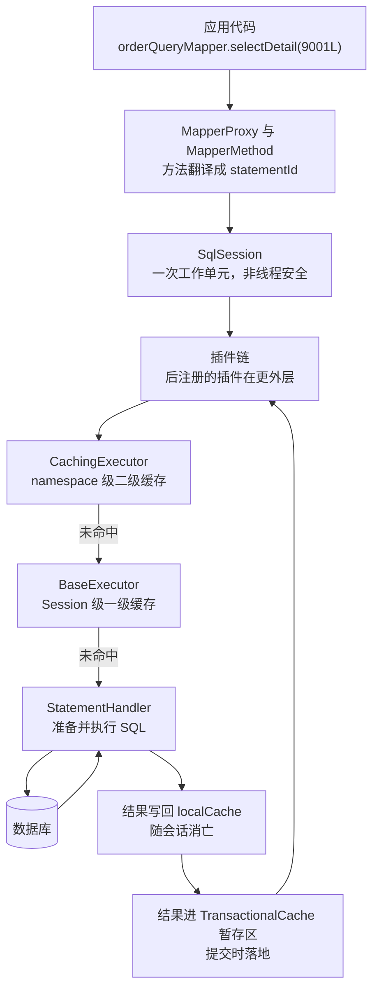
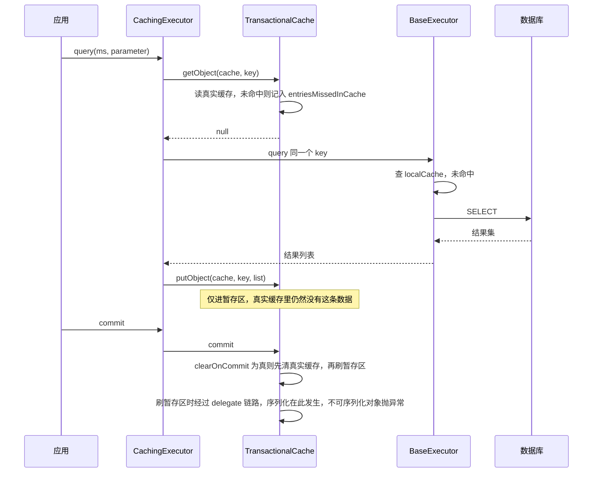
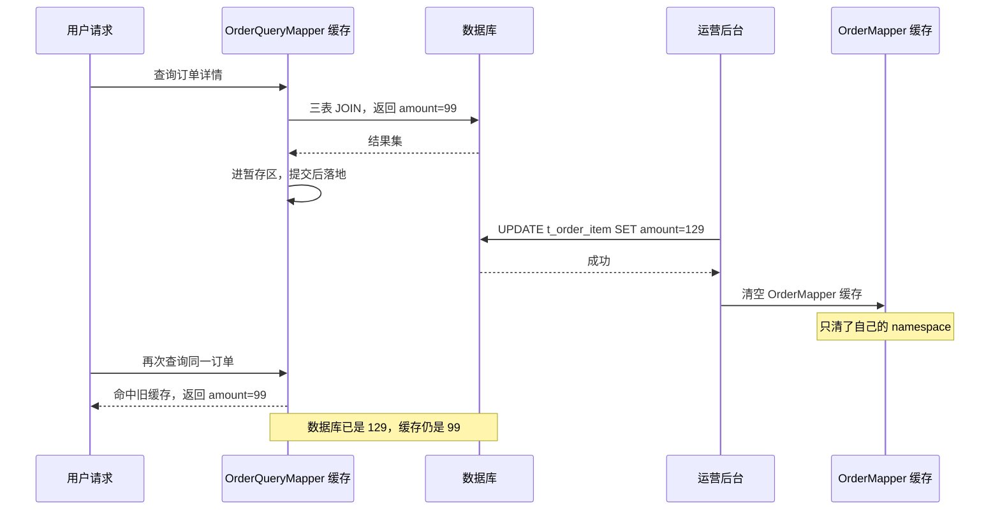
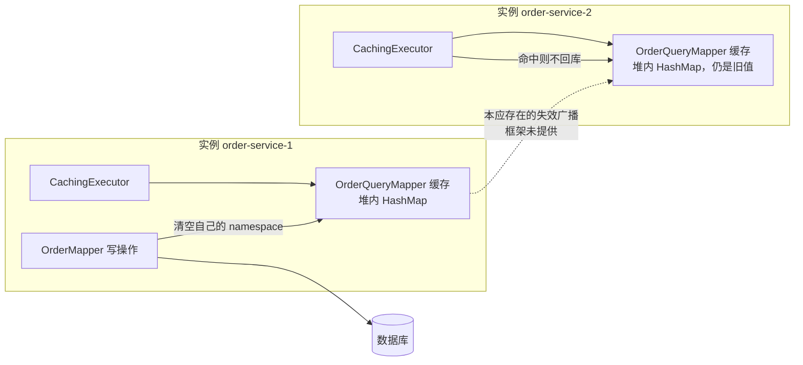
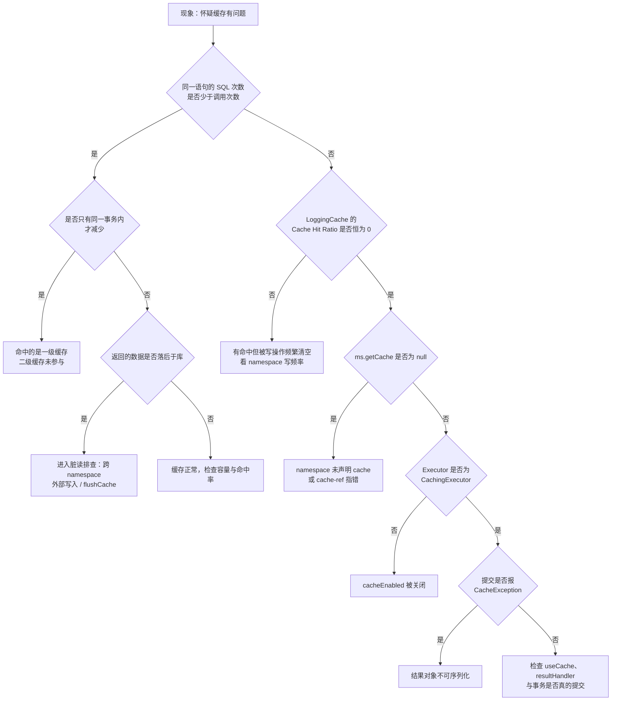

# 一级缓存与二级缓存——命中条件、失效场景与生产陷阱

**摘要：**

Mybatis 的两级缓存常被一句「一级默认开启、二级加个标签就行」带过，真实的边界比这句话窄得多。一级缓存归 `Executor` 所有，作用域就是一次 `SqlSession`，而 Spring 的非事务调用每次都开一个新会话并在关闭前提交一次，缓存寿命被压到一次 Mapper 方法调用；二级缓存按 namespace 隔离，写入发生在事务提交那一刻，读得到它的是后来的会话，不是当前会话。本文以订单服务为贯穿案例，先拆一级缓存的 `CacheKey` 构成、七个失效触发点与 `localCacheScope` 的真实差别，再沿 `<cache/>` 的解析过程、`CacheBuilder` 的装饰器链、`TransactionalCache` 的暂存区，回答「开了却查不到缓存」的四类前提与「生效了却读到旧值」的三种场景。两级缓存的分界线并不复杂：命不命中由 `CacheKey` 决定，脏不脏由失效通道决定。文章末尾给出集群下的判据、一份可直接抄的配置与一张排查顺序图，读完应当能判断三件事：某次查询到底有没有走缓存、缓存里的旧值还能活多久，以及这套缓存该不该留在这套系统里。

---

## 第 1 章 两个现场：一个不生效，一个太生效

### 1.1 贯穿案例与两个事故

订单服务的表结构不复杂：`t_order` 存主单，`t_order_item` 存明细，`t_sku` 存库存。两个 Mapper 分工明确，`OrderMapper` 负责写入与按主键读主单，`OrderQueryMapper` 负责订单详情页那条三表 JOIN 的装配式查询，两者的 XML 都放在 `com.acme.order.mapper` 包下。服务以双实例部署，前置一个负载均衡，数据库是单主单从。

第一个现场发生在压测周。`OrderQueryMapper.xml` 里加了 `<cache/>`，接口 QPS 一动不动，SQL 审计里那条 JOIN 的调用次数与加缓存之前完全一致。团队的第一反应是「缓存放错位置了」，于是把 `LocalCacheScope` 改成 `STATEMENT` 又改回来，把 `size` 从 1024 调到 4096，把 `eviction` 从 `LRU` 换成 `FIFO`，没有任何一个动作改变 SQL 次数。真正的原因埋在配置文件的第三屏：上一轮排查别的缓存问题时，有人加过一行 `mybatis.configuration.cache-enabled: false`，后来忘了删。

第二个现场更贵。缓存生效之后，详情页的金额开始零星对不上：用户看到的是下单时的价格，而运营在后台已经改过两次。排查发现两条独立的失效路径同时断了。一条是多表写入落在别的 namespace，`t_order_item` 的更新由 `OrderMapper.updateItem` 执行，它清的是 `OrderMapper` 的缓存，而详情页的旧结果躺在 `OrderQueryMapper` 的缓存里，两个 namespace 之间没有任何通知机制。另一条是运维直接用客户端改了一条历史数据，Mybatis 根本不知道这件事发生过。

两个现场合起来看，恰好是两级缓存全部的内容：一个回答「为什么没命中」，一个回答「为什么命中了不该命中的东西」。前者是判定条件的问题，后者是失效通道的问题，两者都是机制层面的确定结论，不靠经验猜测。

### 1.2 两级缓存不是同一件事

把两套缓存放在一张表里对比，差异不只是作用域，还有「谁在读、谁在写、什么时候可见」这三件事：

| 维度 | 一级缓存（Local Cache） | 二级缓存（Second Level Cache） |
| --- | --- | --- |
| 归属 | `BaseExecutor.localCache`，`PerpetualCache` | `MappedStatement.cache`，由 `CacheBuilder` 构造的装饰器链 |
| 作用域 | 一次 `SqlSession`，随会话创建与销毁 | 一个 namespace，随 `Configuration` 存活 |
| 是否要配置 | 不需要，天然存在 | 需要 `<cache/>` 或 `@CacheNamespace` |
| 写入时机 | 查询结束立即写入 | 查询结束只进 `TransactionalCache` 暂存区，提交时落地 |
| 读得到它的 | 同一会话的后续查询 | 提交之后新建的其他会话 |
| 线程安全 | 不保证，`HashMap` 裸用 | 由 `SynchronizedCache` 保证 |
| 关闭方式 | `localCacheScope=STATEMENT` | 不写 `<cache/>`，或 `cacheEnabled=false` |
| 失效粒度 | 一次写操作清空全部条目 | 一次写操作清空整个 namespace |

表 1-1 里最容易被误读的两行是「写入时机」和「读得到它的」。一级缓存在查询结束时就生效，所以同一个会话里的第二次查询立刻受益；二级缓存要等到事务提交，因此它服务的对象永远是「后来的人」，当前会话那一轮查询一分钱好处也拿不到。这一点决定了验证方式：想验证二级缓存，必须跨会话、跨请求，在同一段代码里连查两次是验证不出来的。

图 1-1 把两层缓存与它们各自的宿主画在一起。缓存不是独立的一层，它挂在两次不同的对象上，一个是会话级的执行器，一个是全局的 `MappedStatement`。



这张图还有一处值得先记住：**缓存挂在哪个对象上，决定了它能活多久**。一级缓存挂在 `Executor` 的实例字段上，`SqlSession.close()` 一调，执行器连同缓存一起被丢弃；二级缓存挂在 `Configuration` 里的 `MappedStatement` 上，只要 `SqlSessionFactory` 还在，它就还在。

### 1.3 本文的边界

`SqlSession` 与三种 `Executor` 的职责划分、`Configuration.newExecutor` 的装配顺序、插件如何包装执行器，属于 [[02 SqlSession与Executor——命令执行的核心引擎]] 的范围，本篇只在需要说明缓存挂在哪里时提一句。`CacheKey` 里那段 SQL 文本是怎么由动态标签拼出来的，属于 [[03 动态SQL——OGNL表达式与SqlNode解析树]] 的范围，本篇只讲它对命中判定的后果。Spring 如何用 `TransactionSynchronization` 托管会话，属于 [[09 Mybatis-Spring整合原理——SqlSessionTemplate与事务管理]] 的范围，本篇只取它对缓存寿命的影响。

剩下的部分本篇写透：`CacheKey` 的构成与参数引用的代价、一级缓存的七个失效触发点、二级缓存的解析期与运行期两段、`TransactionalCache` 的三条规则、`useCache` 与 `flushCache` 的默认值矩阵、脏读的三种真实场景、集群下的结构性缺陷、以及一张能把「没生效」与「生效但脏」分开的排查顺序图。

---

## 第 2 章 一级缓存：一个会话内的一致视图

### 2.1 它为什么不是一个「缓存开关」

先纠一个流行说法。很多资料写「一级缓存默认开启且无法关闭」，这句话的前半句对，后半句错。`localCacheScope=STATEMENT` 能把一级缓存的寿命压到一条语句，效果上等于关闭；反过来，`cacheEnabled=false` 并不能关掉一级缓存，它只关掉 `CachingExecutor` 这一层装饰，`BaseExecutor` 里的 `localCache` 依然存在、依然读写。两个开关管的是两层不同的东西，把它们混为一谈是后面一连串误判的起点。

`BaseExecutor` 在构造时无条件创建两个 `PerpetualCache`：

```java
// org.apache.ibatis.executor.BaseExecutor（节选，MyBatis 3.5.x）
protected PerpetualCache localCache;              // 查询结果
protected PerpetualCache localOutputParameterCache; // 存储过程的 OUT 参数回填

protected BaseExecutor(Configuration configuration, Transaction transaction) {
    this.transaction = transaction;
    this.deferredLoads = new ConcurrentLinkedQueue<>();
    this.localCache = new PerpetualCache("LocalCache");        // 裸的 HashMap，无淘汰、无日志
    this.localOutputParameterCache = new PerpetualCache("LocalOutputParameterCache");
    this.closed = false;
    this.configuration = configuration;
    this.wrapper = this;
}
```

注意注释里那句「裸的 HashMap」。一级缓存没有 `LruCache`、没有 `LoggingCache`、没有容量上限，也就是说它既不会淘汰，也不会在 DEBUG 日志里打出命中率——`LoggingCache` 只在 `CacheBuilder` 构造二级缓存时才被挂上去。这一点直接决定了排查手段：一级缓存命中与否，只能靠 SQL 日志里 `Preparing` 的条数推断，没有现成的命中率指标可看。

### 2.2 CacheKey：命中判定的全部依据

一级缓存的命中与否完全由 `CacheKey` 决定，而 `CacheKey` 由 `BaseExecutor.createCacheKey` 逐项拼装：

```java
// org.apache.ibatis.executor.BaseExecutor#createCacheKey（节选）
CacheKey cacheKey = new CacheKey();
cacheKey.update(ms.getId());                    // 1. 语句 ID，如 com.acme.order.mapper.OrderMapper.selectById
cacheKey.update(rowBounds.getOffset());         // 2. 分页偏移量
cacheKey.update(rowBounds.getLimit());          // 3. 分页条数
cacheKey.update(boundSql.getSql());             // 4. 最终 SQL 文本，含 ? 占位符
for (ParameterMapping parameterMapping : boundSql.getParameterMappings()) {
    if (parameterMapping.getMode() != ParameterMode.OUT) {
        // 5. 逐个参数值，取值顺序与解析规则对齐 DefaultParameterHandler
        cacheKey.update(value);
    }
}
if (configuration.getEnvironment() != null) {
    cacheKey.update(configuration.getEnvironment().getId());  // 6. 环境 id，区分多数据源
}
```

六个因素里，前五个是显式的，第六个很容易被忽略：`environment` 的 id 进了键，意味着同一份 SQL 在不同 `SqlSessionFactory` 下不会串键——但反过来也提醒一件事，跨数据源的缓存复用根本不可能发生，因为键从一开始就不同。

`CacheKey` 的内部不是一个字符串，而是四样东西：

```java
// org.apache.ibatis.cache.CacheKey（节选）
private static final int DEFAULT_MULTIPLIER = 37;
private static final int DEFAULT_HASHCODE = 17;
private final int multiplier;
private int hashcode;
private long checksum;
private int count;
private List<Object> updateList;   // 参与判定的原始对象，全部保留引用

public void update(Object object) {
    int baseHashCode = object == null ? 1 : ArrayUtil.hashCode(object);
    count++;
    checksum += baseHashCode;
    baseHashCode *= count;
    hashcode = multiplier * hashcode + baseHashCode;
    updateList.add(object);
}
```

`equals` 先比 `hashcode`、`checksum`、`count` 三个快速判据，再逐项比 `updateList`。`updateList` 是真实的判定依据，`hashcode` 只是前置过滤，所以两个不同的键撞了哈希也不会误命中。这套设计的好处是快，代价是 `updateList` **保留了参数对象的引用**：键里存着 `order` 这个实体、存着那条拼好的 SQL 字符串、存着 `Integer` 包装的 offset 与 limit。

代价在这里落地。设想一个对账任务，在同一个 `@Transactional` 里按单号循环查询十万次，每次参数不同：

```java
@Transactional
public void reconcile(List<String> orderNos) {
    for (String no : orderNos) {
        // 反例：同一会话内，每个不同参数都产生一个永不淘汰的缓存条目
        Order order = orderMapper.selectByOrderNo(no);
        // ...
    }
}
```

十万次查询产生十万个 `CacheKey`，每个键引用一个 `String`、一条完整 SQL 文本、以及一份结果列表。`localCache` 是一个没有容量上限的 `HashMap`，这些条目在事务提交之前不会消失（`commit` 时才 `clearLocalCache`）。一条 SQL 文本按 200 字节估、结果列表按每单一行 300 字节估，十万条就是几十兆起步；如果查询返回的是聚合结果或关联对象，量级还要再上一个台阶。这个场景在压测里表现为「事务越长，堆越涨，GC 越频繁」，而堆转储里占位最多的往往就是 `CacheKey` 与它拖着的参数。示例推算，量级仅供估算，实际取决于 SQL 长度与结果行数。

所以一级缓存的第一条使用纪律不是「怎么让它命中」，而是**别让长事务里出现海量不同参数的查询**，批量场景要么分批提交，要么直接把 `localCacheScope` 设成 `STATEMENT`。

### 2.3 七个失效触发点

命中难、失效易，这是保守设计的必然结果。把所有会让一级缓存失效的地方列全，可以列成表 2-1，注意最后一列：同样一次动作，对一级缓存和二级缓存的效果并不相同。

| 触发点 | 源码位置 | 清的是哪一层 | 生效时刻 |
| --- | --- | --- | --- |
| 任意 `insert` / `update` / `delete` | `BaseExecutor.update` 首行 `clearLocalCache()` | 一级缓存全量 | 写操作执行前 |
| `commit()` | `BaseExecutor.commit` | 一级缓存全量 | 提交前清，再冲刷批次 |
| `rollback()` | `BaseExecutor.rollback` | 一级缓存全量 | 回滚前清 |
| 会话关闭 | `BaseExecutor.close` | 缓存对象置空 | 随执行器丢弃 |
| `SqlSession.clearCache()` | 门面转调 `executor.clearLocalCache()` | 一级缓存全量 | 立即 |
| 查询语句 `flushCache="true"` | `BaseExecutor.query` 开头，且 `queryStack == 0` | 一级缓存全量 | 查询前 |
| `localCacheScope=STATEMENT` | `BaseExecutor.query` 结尾 | 一级缓存全量 | 每条顶层语句执行后 |

写操作那一行的源码只有一句话，但它解释了为什么「读多写少」的会话里缓存几乎不可能积累起来：

```java
// org.apache.ibatis.executor.BaseExecutor#update
public int update(MappedStatement ms, Object parameter) throws SQLException {
    ErrorContext.instance().resource(ms.getResource()).activity("executing an update").object(ms.getId());
    if (closed) {
        throw new ExecutorException("Executor was closed.");
    }
    clearLocalCache();          // 不看表名、不看影响行数，无条件全清
    return doUpdate(ms, parameter);
}
```

Mybatis 无法从一条 `UPDATE t_order_item SET amount = ? WHERE order_id = ?` 推断出哪些查询结果受影响，只能全部作废。这里不存在「只清相关的」选项，也没有按表打标签的可能，因为缓存条目里根本没有记录它依赖哪些表。

`commit` 与 `rollback` 那两行更少被提及，但影响同样大。`BaseExecutor.commit(required)` 的第一行就是 `clearLocalCache()`，然后才 `flushStatements()`、才 `transaction.commit()`；`rollback(required)` 在未关闭时同样先清缓存。于是「同一事务内两次相同查询只发一条 SQL」这个现象有一条隐含前提：两次查询之间没有提交动作。在 Spring 的非事务调用里，每次 Mapper 方法结束后都会 `commit(true)`，这意味着一级缓存在无事务场景下连一次复用机会都没有。

还有一个常见误解要顺手澄清。`SqlSession.flushStatements()` 只做批次冲刷，不清一级缓存；清缓存只发生在 `update`、`commit`、`rollback`、`close`、`clearCache`，以及 `STATEMENT` 作用域的收尾处，以对应版本的 `BaseExecutor` 源码为准。批处理场景里「手动 flush 之后查询还是命中」的现象，根因就在这里。

`flushCache` 那一行带了个不起眼的条件 `queryStack == 0`。`queryStack` 是查询嵌套深度，进入 `query` 时自增、退出时自减；只有在最外层查询（深度为 0）时，`flushCache` 才会清缓存。这样设计是为了让「一次逻辑查询」被当成一个整体：结果映射里的 `association` 触发的子查询属于父查询的一部分，不该在父查询执行到一半时把缓存清空，清理只发生在外层语句的边界上。同理，`STATEMENT` 作用域的清理也只在 `queryStack` 归零之后执行——嵌套查询不会各自清一遍，只有最外层语句结束时才清。

### 2.4 SESSION 与 STATEMENT：差在寿命，不在开关

`localCacheScope` 只有两个取值，语义差别可以一句话说清：`SESSION` 让缓存活到会话结束或下一次清空动作，`STATEMENT` 让缓存活到当前这条顶层语句结束。

```xml
<settings>
    <!-- 把一级缓存压缩到语句级，长事务与批处理场景常用 -->
    <setting name="localCacheScope" value="STATEMENT"/>
</settings>
```

这个配置的典型用途不是「提高数据新鲜度」这种模糊理由，而是三类具体场景：一是长事务里的批处理循环，避免 2.2 节那种键无限堆积；二是报表类查询，单条语句返回大结果集，缓存下来毫无意义且占内存；三是同一事务里先写后读、且业务明确要求读库的场景，与其依赖 `flushCache="true"` 逐条配置，不如整体降级——代价是同一会话里任何重复查询都要回库一次。

`STATEMENT` 不等于「每条 SQL 之前都清」，它是「每条 SQL 之后都清」，方向相反。把它和查询语句上的 `flushCache="true"` 叠在一起，就是前后各清一次，缓存寿命压缩到零，徒增两次无意义的 `HashMap.clear()`；这种组合并不算配置错误，但确实没有必要。

### 2.5 Spring 集成下，它几乎不存在

这一节回答那个最常见的困惑：在 Spring Boot 项目里，同一个方法内连续两次调用 `selectById(1L)`，SQL 日志里出现了两条 `Preparing`。

`SqlSessionTemplate` 的内部代理在每次调用结束后做两件事：判断当前会话是否受 Spring 事务管理，不受管就强制提交，然后在 `finally` 里关闭会话：

```java
// org.mybatis.spring.SqlSessionTemplate.SqlSessionInterceptor（节选，mybatis-spring 3.0.x）
var sqlSession = getSqlSession(SqlSessionTemplate.this.sqlSessionFactory,
    SqlSessionTemplate.this.executorType, SqlSessionTemplate.this.exceptionTranslator);
try {
  var result = method.invoke(sqlSession, args);
  if (!isSqlSessionTransactional(sqlSession, SqlSessionTemplate.this.sqlSessionFactory)) {
    // 非事务会话：每次 Mapper 调用后强制提交
    sqlSession.commit(true);
  }
  return result;
} finally {
  if (sqlSession != null) {
    closeSqlSession(sqlSession, SqlSessionTemplate.this.sqlSessionFactory);  // 会话随即关闭
  }
}
```

`isSqlSessionTransactional` 的判断依据是 `TransactionSynchronizationManager` 里有没有绑定到当前线程的 `SqlSessionHolder`，而绑定只发生在 Spring 事务激活时（`SqlSessionUtils.registerSessionHolder` 里那句 `if (TransactionSynchronizationManager.isSynchronizationActive())`）。两个分支的实际后果完全不同：

- 无事务：每次 Mapper 调用，`getSqlSession` 从 `SqlSessionFactory.openSession(executorType)` 新开一个会话，执行、`commit(true)`、`close()`。一级缓存随会话创建、随会话销毁，且中间的 `commit` 还会清一次，两次调用之间没有任何共享状态。
- 有事务：第一次调用时新建会话并注册到事务同步器，后续同线程的 Mapper 调用共享这个会话，直到事务提交时才真正 `commit` 与关闭。整个事务内共享同一个 `Executor`，一级缓存才具备生效条件。

把「调用形态」与「结果」对齐，可以得到表 2-2。这张表是判断「一级缓存为什么不生效」的唯一依据，比任何经验之谈都可靠。

| 调用形态 | 会话数量 | 一级缓存 | SQL 日志表现 |
| --- | --- | --- | --- |
| 无事务方法内两次 Mapper 调用 | 两次调用各一个会话 | 不生效 | 两条 `Preparing` |
| 同事务方法内两次 Mapper 调用 | 一个会话贯穿 | 生效 | 一条 `Preparing` |
| 同事务内两次调用之间夹了写操作 | 一个会话 | 被清空 | 两条 `Preparing` |
| 同类方法自调用（`this.xxx()`） | 注解不生效，退化为无事务 | 不生效 | 两条 `Preparing` |
| 手动 `openSession()` 连续查询后不提交 | 一个会话 | 生效，会话关闭时整份缓存清空 | 一条 `Preparing` |

顺带说一个成本细节。无事务调用里的 `commit(true)` 不是空操作：`SpringManagedTransaction` 在连接不受 Spring 事务托管、且 `autoCommit` 为 `false` 的情况下会真的调用 `connection.commit()`。也就是说，一次普通的只读查询，除了往返数据库执行 SQL，还多了一次提交往返，并且每次都要重新取一次连接。读请求密集的服务如果全程无事务，这笔开销在连接池紧张时会被放大。

最后一条容易踩的坑与注解有关。`@Transactional` 靠代理生效，同类内部自调用不经过代理，事务不会开启，会话也就不会共享，一级缓存自然不生效；这不是缓存的问题，但现象完全一样，排查时容易走错方向。

### 2.6 一级缓存不会脏读，但有两个代价

把一级缓存和「脏读」连在一起是常见的误解。它读不到别的会话写入而未提交的数据，因为缓存里只有**本会话自己查出来的结果**；任何写操作、提交、回滚都会立刻清空它；会话一关它就没了。所以严格意义上，一级缓存的问题不是脏读，而是「同一会话内的旧视图」——在 `REPEATABLE READ` 隔离级别下，这甚至是数据库本身也承诺的行为，只是 Mybatis 把这段快照搬到了堆内存里，在没有事务包裹的场合仍会生效，才让人感到意外。

真正需要记住的是两个副作用。

第一个是对象共享。命中时返回的是缓存里那个 `List` 的同一个引用，列表里的元素也是同一批对象：

```java
@Transactional
public void checkAndFix(Long orderId) {
    Order a = orderMapper.selectById(orderId);   // 查库
    Order b = orderMapper.selectById(orderId);   // 命中一级缓存
    // a == b 为 true，列表元素是同一个实例
    a.setStatus("CANCELLED");                    // b 的状态一起变了
}
```

如果业务在比较前后值时改了对象，第二次读到的「原值」其实已经被改过。做审计、做乐观锁比对、做数据变更前后的差异记录时，要在返回值上手动拷贝一份，或者干脆用 DTO 承载只读视图。

第二个是内存。`localCache` 没有容量上限、没有淘汰策略、条目里挂着参数对象与结果对象，长事务加海量不同参数的查询就是一场慢性的堆膨胀。这类问题不会在功能测试里暴露，只在高负载的长事务里表现为 GC 压力与 Full GC 次数上升，堆转储里能看到大量 `org.apache.ibatis.cache.CacheKey` 实例。把它当成「默认开启的免费午餐」，代价会在压测的第二天送到。

---

## 第 3 章 二级缓存：namespace 级的共享缓存

### 3.1 从 `<cache/>` 到 `MappedStatement.cache`

二级缓存的两段生命分得很清楚：解析期建缓存对象并挂到每条语句上，运行期由 `CachingExecutor` 读写。

解析期在 `XMLMapperBuilder.configurationElement` 里按固定顺序完成，`cacheElement` 先把 `<cache>` 的属性翻译成一组构造参数：

```java
// org.apache.ibatis.builder.xml.XMLMapperBuilder#cacheElement（节选）
String type = context.getStringAttribute("type", "PERPETUAL");
Class<? extends Cache> typeClass = typeAliasRegistry.resolveAlias(type);
String eviction = context.getStringAttribute("eviction", "LRU");
Class<? extends Cache> evictionClass = typeAliasRegistry.resolveAlias(eviction);
Long flushInterval = context.getLongAttribute("flushInterval");
Integer size = context.getIntAttribute("size");
boolean readWrite = !context.getBooleanAttribute("readOnly", false);   // 默认 readOnly=false
boolean blocking = context.getBooleanAttribute("blocking", false);
Properties props = context.getChildrenAsProperties();
builderAssistant.useNewCache(typeClass, evictionClass, flushInterval, size, readWrite, blocking, props);
```

`useNewCache` 把参数交给 `CacheBuilder`，构造出的缓存对象塞进 `Configuration.addCache(cache)`，同时成为 `MapperBuilderAssistant.currentCache`；随后解析每条语句时，`MappedStatement.Builder.cache(currentCache)` 把这个对象挂上去。所以在同一个 namespace 内，所有语句共享同一个 `Cache` 实例——这正是「namespace 级缓存」的实现方式：粒度不是由缓存对象决定的，而是由「哪些语句挂到了它上面」决定的。

运行期由 `CachingExecutor` 负责。它是 `Executor` 的装饰器，在 `Configuration.newExecutor` 里只有 `cacheEnabled` 为真时才被套上（装配顺序的细节见 [[02 SqlSession与Executor——命令执行的核心引擎]]）。核心方法只有十几行，但里面每一个判断都对应一类「缓存不生效」：

```java
// org.apache.ibatis.executor.CachingExecutor#query（节选）
Cache cache = ms.getCache();
if (cache != null) {                       // 前提一：该语句挂了缓存
  flushCacheIfRequired(ms);                // 写语句默认 flushCache=true，先打清空标记
  if (ms.isUseCache() && resultHandler == null) {   // 前提二：useCache 为真且没有自定义结果处理器
    ensureNoOutParams(ms, boundSql);       // 带 OUT 参数的存储过程直接抛异常
    List<E> list = (List<E>) tcm.getObject(cache, key);
    if (list == null) {
      list = delegate.query(ms, parameterObject, rowBounds, resultHandler, key, boundSql);
      tcm.putObject(cache, key, list);     // 只进暂存区，此刻真实缓存里仍然没有
    }
    return list;
  }
}
return delegate.query(ms, parameterObject, rowBounds, resultHandler, key, boundSql);
```

`cache == null` 说明这个 namespace 没写 `<cache/>`，请求直接穿透到下层，插件、日志、SQL 一切正常，看不出任何「配置错了」的痕迹。`resultHandler != null` 时同理完全跳过二级缓存——用 `ResultHandler` 逐行处理结果的场景（导出、大结果集流式读取）本来也不该缓存整份结果。

### 3.2 Cache 接口与六层装饰器

`Cache` 接口只有六个方法：`getId`、`putObject`、`getObject`、`removeObject`、`clear`、`getSize`。`PerpetualCache` 用 `HashMap` 把它实现完，也就是终点的存储介质。真正有意思的是外面那几层，`CacheBuilder.build()` 决定了它们的顺序：

```java
// org.apache.ibatis.mapping.CacheBuilder（节选）
public Cache build() {
    setDefaultImplementations();
    Cache cache = newBaseCacheInstance(implementation, id);
    setCacheProperties(cache);
    // 源码注释标为 issue #352：自定义实现不套标准装饰器
    if (PerpetualCache.class.equals(cache.getClass())) {
        for (Class<? extends Cache> decorator : decorators) {
            cache = newCacheDecoratorInstance(decorator, cache);
            setCacheProperties(cache);
        }
        cache = setStandardDecorators(cache);
    } else if (!LoggingCache.class.isAssignableFrom(cache.getClass())) {
        cache = new LoggingCache(cache);
    }
    return cache;
}

private Cache setStandardDecorators(Cache cache) {
    if (size != null && metaCache.hasSetter("size")) metaCache.setValue("size", size);
    if (clearInterval != null) { cache = new ScheduledCache(cache); ... }   // 配了 flushInterval
    if (readWrite) { cache = new SerializedCache(cache); }                  // readOnly=false 时
    cache = new LoggingCache(cache);
    cache = new SynchronizedCache(cache);
    if (blocking) { cache = new BlockingCache(cache); }                     // 最外层
    return cache;
}
```

整条链自内向外是：`PerpetualCache` ← `LruCache`/`FifoCache` ← `ScheduledCache` ← `SerializedCache` ← `LoggingCache` ← `SynchronizedCache` ← `BlockingCache`；图 3-1 从左到右恰好是反方向，从最外层一直画到存储介质。链只在 `Configuration` 加载时建一次，而最外面那层 `TransactionalCache` 是每个会话各包一个。

```mermaid
%%{init: {'theme': 'dracula'}}%%
flowchart LR
    TC["TransactionalCache<br/>每会话一个，由 CachingExecutor 包裹"] --> BL["BlockingCache<br/>blocking=true 时存在"]
    BL --> SY["SynchronizedCache<br/>方法级同步，始终存在"]
    SY --> LG["LoggingCache<br/>命中率日志，始终存在"]
    LG --> SE["SerializedCache<br/>readOnly=false 时存在"]
    SE --> SC["ScheduledCache<br/>配了 flushInterval 才存在"]
    SC --> EV["LruCache 或 FifoCache<br/>eviction 决定，默认 LRU"]
    EV --> PP["PerpetualCache<br/>HashMap 存储"]
    PP -->|"readOnly=false 时实际存的是 byte 数组"| ST["堆内字节数组"]
```



读这段代码要抓两件事。

第一件是套用顺序。`BlockingCache` 由 `setStandardDecorators` 最后一步创建，因此位于最外层，锁的范围覆盖整条链上所有动作，包括序列化与 LRU 触碰；把顺序记成「BlockingCache 在最里面」是常见的记反。这个顺序有它的道理：锁的意义在于「缓存空缺时只让一个线程回库」，而回库动作发生在最外层 `getObject` 返回 miss 之后，锁必须由最外层的 `putObject` 才能释放。

第二件是自定义实现那条分支：只要 `<cache type="...">` 指定了实现类且它不是 `PerpetualCache`，标准装饰器**全部不套**，只在外面补一个 `LoggingCache`。源码把这条分支标成 issue #352。于是 `<cache type="com.acme.RedisCache" eviction="LRU" size="512" readOnly="false" blocking="true"/>` 里的这些属性会全部失去作用——它们靠标准装饰器实现，而这条分支根本不套装饰器。这是「换成 Redis 之后缓存配置失灵」的根因，不是 Redis 实现的问题。

表 3-1 把每一层的职责与触发条件列清楚，其中「何时存在」一列是排查时的关键。

| 装饰器 | 职责 | 何时存在 | 失效的后果 |
| --- | --- | --- | --- |
| `PerpetualCache` | `HashMap` 存储 | 始终 | 无 |
| `LruCache` / `FifoCache` | 容量控制与淘汰 | 标准实现下始终（默认 LRU，上限 1024 条） | 条目无限增长直至 OOM |
| `ScheduledCache` | 按 `flushInterval` 定时全清 | 仅当配置了 `flushInterval` | 无自动过期，只能靠写操作或重启清 |
| `SerializedCache` | 写入时序列化、读取时反序列化 | 仅当 `readOnly=false`（默认） | 命中返回同一引用，调用方改动会污染缓存 |
| `LoggingCache` | DEBUG 级别命中率日志 | 标准装饰器分支始终存在 | 看不到 `Cache Hit Ratio` |
| `SynchronizedCache` | 方法级 `synchronized` | 标准装饰器分支始终存在 | 并发读写 `HashMap` 不安全 |
| `BlockingCache` | 同 key 串行回库 | 仅当 `blocking=true` | 缓存空缺时并发回库，击穿数据库 |

`SerializedCache` 那一行值得单独展开，因为它是「为什么必须实现 `Serializable`」的真正答案。缓存里存的不是对象，而是整份结果列表序列化后的 `byte[]`；命中时反序列化出一个全新的 `List` 与全新的元素对象。这和磁盘、和远程存储都没有关系，序列化的目的只有一个：让每个调用方拿到自己的副本，互相改不坏。

```java
// org.apache.ibatis.cache.decorators.SerializedCache#putObject
public void putObject(Object key, Object object) {
    if ((object != null) && !(object instanceof Serializable)) {
        throw new CacheException("SharedCache failed to make a copy of a non-serializable object: " + object);
    }
    delegate.putObject(key, serialize((Serializable) object));
}
```

异常信息是 `CacheException: SharedCache failed to make a copy of a non-serializable object`，抛出位置不是查询时，而是**提交时**——因为写入暂存区的动作不序列化，序列化发生在 `commit` 刷暂存区那一刻。这个时序差异是「加了二级缓存后偶发提交失败、事务回滚」的完整解释，后面 3.4 节还会回到这里。

`BlockingCache` 则要提醒一句风险。它的实现是 `ConcurrentHashMap<Object, CountDownLatch>`，`getObject` 未命中就持有闩锁，直到 `putObject` 或 `removeObject` 才释放；`timeout` 默认为 0，表示无限等待，而 `CacheBuilder` 的 `setCacheProperties` 只作用于基础实现与淘汰装饰器，`BlockingCache` 的 `timeout` 没有 XML 配置入口。源码注释里那句 `By its nature, this implementation can cause deadlock when used incorrectly` 是字面意思：一个慢查询加上 `blocking=true`，会让同一 key 的所有线程一起停在闩锁上。

### 3.3 四个前提，缺一不可

一个 namespace 的二级缓存要真正生效，需要同时满足四个条件。任何一个不满足，表现都是「SQL 每次照发、命中率恒为 0」，而且不会有任何报错。表 3-2 把四个前提与各自的判据对齐。

| 前提 | 判据 | 缺了会怎样 |
| --- | --- | --- |
| namespace 声明 `<cache/>` 或 `@CacheNamespace` | `ms.getCache()` 是否为 `null` | 直接穿透，无任何日志提示 |
| `cacheEnabled=true` | `Executor` 实例的实际类型是否含 `CachingExecutor` | 整层装饰不存在，`<cache/>` 解析了也白解析 |
| 事务提交（或会话关闭时无脏写） | `TransactionalCache.commit()` 是否被执行 | 结果停在暂存区，从未进入真实缓存 |
| 结果对象可序列化 | 提交时是否抛 `CacheException` | 提交失败、事务回滚，缓存内容为空 |

第一条的细节在于「声明在哪个 namespace」，而不是「声明了没有」。查询走的是 `OrderQueryMapper` 的语句，那么 `<cache/>` 必须写在 `OrderQueryMapper.xml` 里；写在 `OrderMapper.xml` 里对它毫无作用，除非 `OrderQueryMapper.xml` 里用 `<cache-ref namespace="...OrderMapper"/>` 引过去。这个区别在只有两个 Mapper 的小项目里不显眼，在几十个 Mapper 的中型项目里就是最常见的一类「明明配了却不生效」。

第二条的出处在 `Configuration.newExecutor`：`if (cacheEnabled) { executor = new CachingExecutor(executor); }`。`cacheEnabled` 默认为 `true`，但 Spring Boot 里可能被三处配置改掉：`mybatis.configuration.cache-enabled: false`、XML 的 `<settings>`、以及自定义 `SqlSessionFactory` 时的代码。第三处尤其隐蔽——一旦自己声明了 `SqlSessionFactory` Bean，自动配置里的 `mybatis.configuration.*` 就不再参与装配，配置项看着还在，实际没人读。

第三条是 `TransactionalCache` 的语义，下一节展开。

第四条的实际表现是提交时异常。它不算「静默失效」，但因为异常发生在事务收尾阶段，日志里往往被别的异常覆盖，加上业务重试一次就过了（第二次没写缓存也无所谓），很容易被当成偶发抖动。判断方法很简单：把领域对象丢进 `ObjectOutputStream` 试一次，或者看堆栈里有没有 `NotSerializableException`。

还有三个隐含条件值得一提，它们不改变主结论，但会让「前提全满足却没命中」显得难以解释：语句上 `useCache` 必须为真（`<select>` 默认真，显式写 `useCache="false"` 则跳过）；`resultHandler` 必须为 `null`（自定义结果处理器不走二级缓存）；`StatementType` 为 `CALLABLE` 且带 OUT 参数时会直接抛 `ExecutorException`，提示配置 `useCache=false`。

### 3.4 TransactionalCache：暂存区的三条规则

二级缓存最反直觉的部分在这里：`CachingExecutor` 读写的不是 `<cache/>` 构造出来的那个对象，而是一个包住它的 `TransactionalCache`；每个会话各有一个，由 `TransactionalCacheManager` 按缓存对象懒创建。所以链路是 `TransactionalCache` → `BlockingCache` → … → `PerpetualCache`，`TransactionalCache` 在整条链的最外面。

它的角色像收银台的暂存抽屉：客人付的钱先进抽屉，交班结账时才并进总账，中途撤单就把抽屉清空。技术上的限定是，这套机制里「并进总账」的时刻是事务提交，不是每次收款之后；而且抽屉里的钱只有本柜台看得见，别的柜台要等总账更新才能读到。

它的内部只有三个字段：

```java
// org.apache.ibatis.cache.decorators.TransactionalCache（节选）
private final Cache delegate;
private boolean clearOnCommit;
private final Map<Object, Object> entriesToAddOnCommit;   // 待提交写入
private final Set<Object> entriesMissedInCache;           // 本会话查不到的键

public Object getObject(Object key) {
    Object object = delegate.getObject(key);
    if (object == null) {
        entriesMissedInCache.add(key);
    }
    if (clearOnCommit) {
        return null;          // issue #146：本会话已发生过清空，读一律视为未命中
    }
    return object;
}

public void putObject(Object key, Object object) {
    entriesToAddOnCommit.put(key, object);   // 只进暂存区
}
```

三条规则从这三个字段直接读出来。图 3-2 先给出一次查询到一次提交的时序，三条规则都落在这条时序上。



第一条，**读走真实缓存，写只进暂存区**。`getObject` 读的是 `delegate`，不看 `entriesToAddOnCommit`。这解释了一个看似矛盾的现象：同一个事务里第二次完全相同的查询，命中不是二级缓存，而是一级缓存——二级缓存此刻还没有这份数据。

第二条，**提交才落地，回滚就丢弃**。`commit()` 先按 `clearOnCommit` 决定要不要清真实缓存，再把暂存区刷进去；`rollback()` 只做 `unlockMissedEntries()` 与 `reset()`，暂存区里的东西直接扔掉。

```java
public void commit() {
    if (clearOnCommit) {
        delegate.clear();     // 本会话发生过写操作，先整体清空
    }
    flushPendingEntries();    // 再刷入本会话查询到的结果
    reset();
}

private void flushPendingEntries() {
    for (Map.Entry<Object, Object> entry : entriesToAddOnCommit.entrySet()) {
        delegate.putObject(entry.getKey(), entry.getValue());   // 序列化就发生在这里
    }
    for (Object entry : entriesMissedInCache) {
        if (!entriesToAddOnCommit.containsKey(entry)) {
            delegate.putObject(entry, null);   // issue #116：写 null 是为了释放 BlockingCache 的锁
        }
    }
}
```

`flushPendingEntries` 第二段循环容易被忽略：那些本会话查不到的键，提交时被**以 `null` 值写入**。这不是浪费，而是为了释放 `BlockingCache` 持有的闩锁——锁在 `getObject` miss 时获取，只有 `putObject` 能让它释放。换成 Redis 之类的自定义实现时，`putObject(key, null)` 必须能被正确处理；不处理或者抛空指针，提交阶段就会失败，这也是自研缓存适配器最常见的坑。

第三条，**清空只是标记**。`CachingExecutor.flushCacheIfRequired` 调的是 `tcm.clear(cache)`，落到 `TransactionalCache.clear()` 只是把 `clearOnCommit` 置真并清空暂存区；真实缓存的 `clear()` 被推迟到提交。在标记有效期间，本会话的 `getObject` 一律返回 `null`（issue #146 那条分支），于是「写完再读」在本会话内必然回库，不会读到自己的旧缓存。

把三条规则叠上会话关闭的分支，还能得到一个不太直观的结论。`CachingExecutor.close(forceRollback)` 的行为是：

```java
// org.apache.ibatis.executor.CachingExecutor#close
public void close(boolean forceRollback) {
    try {
        if (forceRollback) {
            tcm.rollback();
        } else {
            tcm.commit();     // 没有强制回滚时，关闭动作也会把暂存区刷进二级缓存
        }
    } finally {
        delegate.close(forceRollback);
    }
}
```

`DefaultSqlSession.close()` 传入的是 `isCommitOrRollbackRequired(false)`，也就是「非自动提交且有过写操作」时才为真。于是：只读会话被关闭时，暂存区**会被提交**；有过未提交写操作的会话被关闭时，暂存区被丢弃。这条分支解释了为什么「没有显式 commit 也能有二级缓存」，也解释了为什么「一个未提交就关闭的写会话」不会污染缓存。

最后是 Spring 特有的时序问题。事务提交时，`SqlSessionSynchronization.beforeCommit` 会先 `holder.getSqlSession().commit()`，这一步已经把二级缓存刷进去了，而数据库事务的提交由 `DataSourceTransactionManager` 在其后完成。mybatis-spring 3.0.x 的源码在这行旁边留了一句注释：`TODO This updates 2nd level caches but the tx may be rolledback later on!`。也就是说，数据库最终提交失败时，二级缓存里已经留下了本该回滚的数据。这不是可以配置掉的缺陷，而是该集成方案的结构性缝隙，只在高并发写加数据库侧偶发失败时才暴露，正确性上必须承认它存在。

### 3.5 useCache 与 flushCache 的默认值矩阵

这两个属性是「配置不当」类问题的主要来源，而它们的默认值并不对称：

```java
// org.apache.ibatis.builder.xml.XMLStatementBuilder#parseStatementNode（节选）
boolean flushCache = context.getBooleanAttribute("flushCache", !isSelect);  // 写语句默认 true
boolean useCache = context.getBooleanAttribute("useCache", isSelect);      // 查询默认 true
```

于是 `<select>` 默认 `useCache=true`、`flushCache=false`；`<insert>`、`<update>`、`<delete>` 默认 `flushCache=true`，`useCache` 默认 `false`（写路径不读缓存，这个值没有实际作用）。表 3-3 把各种组合的后果写全。

| 语句与配置 | `useCache` | `flushCache` | 对二级缓存 | 对一级缓存 |
| --- | --- | --- | --- | --- |
| `<select>` 默认 | `true` | `false` | 读、写暂存区 | 读、写 |
| `<select flushCache="true">` | `true` | `true` | 查询前打清空标记，本次必然回库 | 查询前全清（`queryStack==0`） |
| `<select useCache="false">` | `false` | `false` | 不读也不进暂存区 | 照常读写 |
| `<update>` 默认 | `false` | `true` | 提交时整个 namespace 清空 | 执行前全清 |
| `<update flushCache="false">` | `false` | `false` | **不清空，旧值继续被读到** | 仍然全清 |

最后一行是这张表唯一的危险项。有人为了省掉「每次写都清整个 namespace」的开销，把写语句的 `flushCache` 关掉，以为只是让缓存多活一会儿；实际效果是这条写语句之后再没有任何机制能让旧结果失效，脏读从「偶尔」变成「必然」。省下的是几次 `HashMap.clear()`，付出的是一致性。

`<select flushCache="true">` 那一行也值得说清：它同时影响两层缓存，但语义不同。对二级缓存，它先给本会话打上清空标记，使本次查询必然回库（真实清空仍推迟到提交）；对一级缓存，它在 `queryStack == 0` 时直接清空。用这个配置来做「强一致读」是可行的，代价是这条语句每次都回库，且会把同会话里其他查询的结果一并清掉——它清的是整个 `localCache`，不是这一条语句的条目。

### 3.6 包装顺序与插件可见性

`Configuration.newExecutor` 的装配结果是「插件链 → `CachingExecutor` → 基础 `Executor`」：先造 `SimpleExecutor`/`ReuseExecutor`/`BatchExecutor`，`cacheEnabled` 为真时套一层 `CachingExecutor`，最后整体过一遍 `interceptorChain.pluginAll`。插件因此在最外层，包住了 `CachingExecutor`。装配细节与「为什么不能交换」见 [[02 SqlSession与Executor——命令执行的核心引擎]]，这里只讲它对缓存排查的影响。表 3-4 把各观察层的可见性对齐。

| 观察层 | 缓存命中时能看到 | 缓存命中时看不到 |
| --- | --- | --- |
| 拦 `Executor` 的插件 | 每一次 `query` 调用本身，含命中与未命中 | 单看调用无法判断这次是命中还是回库 |
| 拦 `StatementHandler` 的插件 | 只有回库的查询会出现 | 命中时根本不会构造 `StatementHandler` |
| 拦 `ParameterHandler` 的插件 | 只有回库查询的参数绑定 | 同上 |
| JDBC 驱动与数据库侧 | 只有回库的 SQL | 命中时没有任何网络往返 |
| `LoggingCache` 的 DEBUG 日志 | 二级缓存命中率的累计值 | 一级缓存没有任何日志 |

这张表纠正一个常见的说法：「缓存命中时插件看不到」。准确的说法是，拦 `Executor` 的插件看得到调用，但看不到结果来源；拦 `StatementHandler`、`ParameterHandler` 的插件才是真的看不到，因为命中路径根本不进入 `doQuery`。所以在 SQL 审计插件里看到「日志少了一条」，是命中的正常现象，而不是插件丢了日志。

同样的道理适用于分页插件：它在 `Executor` 层改写 SQL 并额外发起 count 查询，两者的 `MappedStatement` 与 SQL 文本都不同，缓存键随之不同；加上每条分页 SQL 里带着 `LIMIT` 的偏移量，每一页都是一个独立的键。结果是「分页列表的二级缓存命中率接近 0，而内存占用随页码线性增长」。插件本身的机制见 [[07 插件机制——Interceptor的责任链模式与分页插件原理]]，这里只需记住结论：分页查询与二级缓存不是一组好搭档。

### 3.7 CacheKey 与动态 SQL 的耦合

二级缓存与一级缓存用的是同一个 `createCacheKey`，键里第四项就是 `boundSql.getSql()`。这条设计带来一个必须知道的后果：**SQL 文本不同，就是不同的键**。

动态 SQL 让这件事变得很细。同一个 Mapper 方法，参数里 `status` 为 `null` 与非 `null`，`<if>` 分支不同，拼出的 SQL 不同，键也就不同；`<foreach>` 的集合长度不同，SQL 的长度不同，键自然不同；`${}` 拼接的值进入 SQL 文本，值一变键就变。这不是缺陷，而是必要：条件不同结果集不同，共用缓存才是错的。代价是「缓存条目数按 SQL 变体数量成倍增长」，一个带四个可选条件的查询，理论上有十六种 SQL 文本，也就是十六组独立的缓存键。

反过来也有一条可利用的性质：`<if>` 分支带来的 SQL 差异是稳定可预测的，用同一组参数反复调用会稳定命中同一个键。所以动态 SQL 下的二级缓存命中率取决于调用模式的集中度——如果每次请求的可选条件组合都在变，命中率就会被摊薄到接近零。动态 SQL 如何生成 SQL 文本，见 [[03 动态SQL——OGNL表达式与SqlNode解析树]]。

---

## 第 4 章 脏读：三种真实场景与两条边界

### 4.1 场景一：写操作落在另一个 namespace

这是二级缓存最本质的缺陷，也是订单服务第二个现场的主因。`OrderQueryMapper` 的详情查询 JOIN 了 `t_order`、`t_order_item`、`t_sku`，结果缓存在 `OrderQueryMapper` 的 namespace 下；运营改价走的是 `OrderMapper.updateItem`，写的是同一张 `t_order_item`，但它清的是 `OrderMapper` 的缓存。两个 namespace 之间没有任何通知通道，旧结果继续被读到，直到 `flushInterval` 到期、条目被 LRU 淘汰、或应用重启。

这像一条商业街上每家门店各挂一块价目牌，总店调价之后只通知了负责写价目的那一家，其余门店的牌子照旧挂着。技术上的限定是，框架里并不存在「总店」这个角色，namespace 之间没有广播通道；`<cache-ref>` 的效果是把所有门店的价目牌合并成一块，代价是任何一家改价都要把整块牌子重写。

图 4-1 把这条链路画出来，注意最后一步：数据库已经是新值，缓存返回的仍是旧值。



`<cache-ref>` 是框架给出的唯一解，它让两个 namespace 指向同一个 `Cache` 实例：

```xml
<!-- OrderMapper.xml：写方引用查询方的缓存，写入时清的是同一份数据 -->
<mapper namespace="com.acme.order.mapper.OrderMapper">
    <cache-ref namespace="com.acme.order.mapper.OrderQueryMapper"/>
</mapper>
```

原理很直接：`useCacheRef` 把 `currentCache` 换成被引用 namespace 的那个对象，于是两个 namespace 的 `MappedStatement` 挂上同一个 `Cache` 实例，任何一方的写操作都清同一份缓存。代价同样直接，而且有两层。

第一层是失效范围放大。`OrderMapper` 有几十条写语句，其中大多数只碰 `t_order`，但它们都会清空整份共享缓存，连带把与 `t_order_item`、`t_sku` 相关的详情缓存一起清掉。写频率一高，命中率就被写操作稀释到接近零，缓存变成了纯粹的负担。

第二层是配置遗漏。项目里有二十个 Mapper 操作同一批表，就要把这二十个 `namespace` 全部 `cache-ref` 到同一个缓存上；漏一个，脏读的窗口就还在。而「哪些 Mapper 碰哪些表」这件事，框架不知道，编译期不检查，只能靠人维护一张映射表。表越多、变更越频繁，这张表的正确性越不可信。

### 4.2 场景二：数据从 MyBatis 之外进来

缓存失效的唯一触发源是「经过本 namespace 的写语句」。只要写入绕过了这条通道，缓存就永远不会被通知。现实中绕过的路径比想象的多：DBA 用客户端修数据、ETL 任务批量回刷、另一个应用直接连库、同一个服务里用 `JdbcTemplate` 或原生 JDBC 执行更新、多数据源场景下另一个 `SqlSessionFactory` 写同一个库。

这类脏读的特征是「时间窗口不可控」：缓存不会自己过期（除非配了 `flushInterval`），也不会有任何日志提示。一个写错的金额可以在缓存里待到下一个写操作、下一个 LRU 淘汰或下次发布。订单服务的现场就是这种形态——运维修了一条历史数据，详情页在线上的旧值停留了四个小时。

这条路径无法用配置解决。任何进程内缓存都假设「写入都经过我」，而真实系统里这个假设几乎不成立。要彻底消除，只有两条路：把缓存挪到能感知所有写入的层（数据库的物化视图、CDC 驱动的缓存失效），或者干脆不缓存。

### 4.3 场景三：flushCache 被关掉或写错位置

第三种脏读来自配置本身，特征是「看起来配了，实际没生效」。三种典型写法：

```xml
<!-- 反例一：为了省清空开销，把写语句的 flushCache 关掉 -->
<update id="updateItemAmount" flushCache="false">
    UPDATE t_order_item SET amount = #{amount} WHERE id = #{id}
</update>
```

```xml
<!-- 反例二：写语句放在 A namespace，查询缓存挂在 B namespace，又没有 cache-ref -->
<mapper namespace="com.acme.order.mapper.OrderWriteMapper">
    <update id="updateDetail">UPDATE t_order_item SET amount = #{amount} WHERE id = #{id}</update>
</mapper>
```

反例三不需要贴代码，三个操作同一张表的 Mapper 各写一行 `<cache/>` 就够了。

反例一是纯粹的取舍失误，省下几次 `clear()`，换来一致性缺口；反例二是 4.1 节的问题换了个形式，只是更难发现，因为写与读分散在两个文件里，代码评审时看不到它们操作同一张表；反例三的后果是同一份数据被三份缓存各自持有，任何一份的失效都不影响另外两份，命中率看着不错，不一致的窗口却有三倍。

还有一种不常见的写法是把 `<cache/>` 写在公共的基类 Mapper 上然后指望子类继承——Mybatis 没有 Mapper 继承的概念，`<cache/>` 的作用域严格是当前 namespace，子接口的语句挂在子 namespace 上，不会自动获得父命名空间的缓存。

### 4.4 边界一：readOnly 的对象污染

`<cache readOnly="true"/>` 让 `readWrite` 为假，`SerializedCache` 不在链上，命中时返回缓存里那个 `List` 的同一引用。省掉一次序列化与反序列化，代价是所有调用方共享同一份可变对象：

```java
// readOnly="true" 下的两次查询返回同一个列表与同一批元素
List<OrderItem> first = orderQueryMapper.selectItems(orderId);
List<OrderItem> second = orderQueryMapper.selectItems(orderId);
first.get(0).setAmount(new BigDecimal("0.01"));   // second 也变了，缓存里那份也变了
```

这类污染的隐蔽之处在于「污染者不是缓存的使用者」。某个下游把列表里的对象改了名、置了空，下一个请求从缓存里读到的就是被改过的对象，而源头数据库完全正常。排查时查 SQL、查数据都对，问题在堆里。所以 `readOnly=true` 只适合真正的常量数据（字典表、配置表），且要保证调用链上没有一处修改返回值。

需要提醒的是 `readOnly` 默认是 `false`，也就是 `SerializedCache` 默认在链上。这个默认值决定了「领域对象必须实现 `Serializable`」是二级缓存的默认要求，而不是可选优化。

### 4.5 边界二：事务提交之前就落地

这条边界在 3.4 节末尾提过，值得单列，因为它的性质与其他三种不同：前三种是配置或设计问题，这一条是集成方案本身的结构性时序。

Spring 事务的提交顺序是：`beforeCommit` 回调 → 数据库提交 → `afterCommit`。mybatis-spring 在 `beforeCommit` 里调用 `SqlSession.commit()`，把 `TransactionalCache` 的暂存区刷进二级缓存；数据库提交在其后发生。如果数据库提交失败（连接中断、死锁回滚、从库切换），二级缓存里已经留下了这批数据，而数据库回滚了。后续请求读到的是缓存里的「幽灵数据」，直到下一次写操作清空整个 namespace。

框架作者在源码里用 TODO 承认了这一点，意思是「已知问题，暂时无解」。在写少读多的系统里它几乎不会发生；在高并发写、数据库偶发超时的系统里，它是真实存在的窗口。判断自己是否受影响的依据很朴素：这套系统里事务回滚的频率有多高。回滚频率可观，二级缓存的一致性就没有下限。

### 4.6 为什么一级缓存不在此列

把一级缓存放进脏读的讨论里是一种概念错位。它的三个属性决定了它不可能产生跨会话的脏读：缓存只存在于一个会话内，别的会话读不到；任何写操作都会在 `update` 第一行被无条件清空；提交与回滚也各清一次。换句话说，它没有「跨会话共享」这个前提，也就没有「跨会话失效」这个问题。

一级缓存真正的问题是 2.6 节讲的旧视图与对象共享。旧视图在事务语义下是可接受的（同一事务内读到同一份快照，本来就是 `REPEATABLE READ` 的承诺），对象共享是编程问题，不是缓存一致性问题。把两者区分开，才能避免「因为怕脏读所以把一级缓存也关掉」这种过度反应——关掉它不会提升正确性，只会让同一事务内的重复查询多打几次库。

---

## 第 5 章 集群下的二级缓存：缺的是一条失效通道

### 5.1 每个实例各有一份堆内缓存

`PerpetualCache` 是 `HashMap`，它活在本进程的堆里。双实例部署时，两个 `order-service` 各自持有一份 `OrderQueryMapper` 的缓存，互相不知道对方的存在。实例 A 执行写操作，只清 A 的那一份；实例 B 的那一份内容不变，继续对外返回旧值。

图 5-1 把这条缺失的通道画出来：虚线本应是「缓存失效广播」，而 Mybatis 没有实现它。



这不是「配置没调好」，而是默认实现的能力边界。`flushInterval` 能缓解但不能解决：它按时间全清，清完之后的第一次查询会重建缓存，而重建时读到的是数据库当前值，所以最坏情况下旧值的存活时间被限制在一个 `flushInterval` 周期内。对于金额、库存、状态这类字段，一个周期的旧值就已经不可接受。

### 5.2 换成 Redis 实现 Cache 的四个前提

集群下要保留二级缓存，只能把 `Cache` 换成跨进程共享的实现，让所有实例读写同一份数据、共享同一个失效动作。这条路可行，但要让实现满足四个前提，缺一个就会以奇怪的方式失败。

第一个前提是 `clear()` 必须真正删掉该 namespace 的所有键。写操作在 `TransactionalCache` 里只是打标记，提交时调 `delegate.clear()`；如果 `clear()` 只删本地记录或者干脆是空实现，多实例之间就退化成 5.1 节的形态。

第二个前提是 `putObject(key, null)` 必须能被接受。3.4 节的 `flushPendingEntries` 会为「本会话查不到的键」写入 `null`，目的是释放 `BlockingCache` 的闩锁。Redis 实现里把 `null` 当非法值直接抛异常，提交阶段就会失败，表现为「查询正常、一到提交就报错」。

第三个前提是 namespace 隔离。键必须带上缓存 id（`Cache.getId()` 就是 namespace），否则两个 Mapper 的键会互相覆盖。`PerpetualCache` 用独立的 `HashMap` 天然隔离，共享存储没有这个天然边界。

第四个前提是接受 `eviction`、`size`、`readOnly`、`blocking`、`flushInterval` 全部失效。3.2 节那条自定义实现分支只给它套一个 `LoggingCache`，容量控制、副本语义、防击穿闩锁都没有了。这些能力得由实现自己补，或者由 Redis 的 `maxmemory` 与过期策略兜底。

还有一笔隐性成本：两层序列化。`SerializedCache` 在标准链上把结果序列化成 `byte[]`，Redis 客户端再把 `byte[]` 序列化一次；读取时反向两次反序列化。命中一次缓存要做两次反序列化，CPU 开销在热点查询上会变成新的瓶颈。要省掉这层，只能把 `readOnly="true"` 打开、放弃副本语义，但 4.4 节说过那样会带回对象污染。

把成本与收益放在一起看，结论并不复杂：跨进程共享缓存的正确性，靠的是一套「所有写入都能触发失效」的机制。Redis 版二级缓存能做到「同一张表的所有写入者都经过同一个 namespace」，但做不到「绕过 MyBatis 的写入也能被感知」。它把问题从「每个实例一份、互不通知」降低到「共享一份、只对 MyBatis 内的写入负责」，还剩下 4.2 节那条外部写入的缺口。

### 5.3 容量与代价的量化

默认配置下，`LruCache` 的上限是 1024 条，`size` 属性可以改，但很少有人算过一条到底有多重。`readOnly=false` 时，一条缓存记录是一份结果列表序列化后的 `byte[]`：100 行、每行 500 字节的对象图，序列化后约 50KB 到 80KB（示例推算，实际取决于字段数量、字符串长度与序列化格式）。1024 条全部填满，就是 50MB 到 80MB 的堆占用，而且这些字节数组全是老年代对象，只增不减直到被淘汰。

再叠加两笔开销。命中时反序列化整份列表，CPU 成本随结果集大小线性上升；`LoggingCache` 与 `SynchronizedCache` 每次读写都要过一次方法级同步，高并发下这把锁是单实例级别的串行点。所以「用二级缓存存大结果集」在容量、GC、CPU、并发四个方面同时付出代价，而收益只是省掉一次数据库往返——如果那条 SQL 本来就走索引、返回又慢不到哪去，这笔交易是亏的。

一个反向的量化很有说服力：把 1024 条缓存换成 1024 次数据库查询，按单次查询 2ms 估算，最坏情况也就 2 秒的累计延迟；而这 2 秒换来的可能是 60MB 常驻堆与命中时的反序列化开销。示例推算只说明量级关系，真实取舍要按自己的数据行宽与查询耗时重算。

---

## 第 6 章 排查手册：从「没生效」到「生效但脏」

### 6.1 判定顺序

两类问题的表现不同，排查顺序也不同。「没生效」看 SQL 次数与命中率，「生效但脏」看数据与失效通道。图 6-1 给出一个可以照着走的顺序，每一步的判据都在后面几节展开。



顺序设计的原则是先用最便宜的信号把两类问题分开，再逐层深入。SQL 次数是零成本的，命中率日志只需要一个 DEBUG 级别，两者配合就能覆盖八成现场。

### 6.2 症状、判据、根因与处置

表 6-1 按现场症状组织，最后一列是可以直接执行的处置动作。

| 症状 | 判据 | 根因 | 处置 |
| --- | --- | --- | --- |
| 加了 `<cache/>` 后 SQL 次数不变，无任何报错 | `ms.getCache()` 返回 `null` | `<cache/>` 写在了别的 namespace | 在查询语句所属 namespace 内声明，或用 `cache-ref` 指向 |
| 同上，且确认 `<cache/>` 在正确位置 | `executor.getClass()` 不含 `CachingExecutor` | `cacheEnabled=false` | 检查 XML `<settings>`、`mybatis.configuration.cache-enabled`、自定义工厂 |
| 命中率日志恒为 0，事务正常 | `useCache` 为 `false` 或用了 `ResultHandler` | 语句配置或调用方式绕过了缓存 | 去掉 `useCache="false"`，或该查询本就不该缓存 |
| 同一事务内两次查询只有一条 SQL，换请求又是两条 | 只有事务内才减少 | 命中的是一级缓存，二级缓存要提交后才可见 | 用两个独立事务或两次请求验证 |
| 偶发提交失败、事务回滚，日志含 `CacheException` | 堆栈含 `NotSerializableException` | 结果对象或字段不可序列化 | 实现 `Serializable`，或去掉 `<cache/>` |
| 命中率不低，但读到旧值 | 旧值来自别的 namespace 的写 | 跨 namespace 写入无失效通道 | `cache-ref` 合并缓存，或关闭二级缓存 |
| 命中率不低，旧值与任何 MyBatis 写入无关 | 有外部写入 | DBA/ETL/其他应用直接改库 | 关闭二级缓存，或改用能感知写入的缓存层 |
| 写入之后再也不更新 | 写语句 `flushCache="false"` | 主动关掉了失效 | 恢复默认，写语句一律 `flushCache=true` |
| 集群下部分请求旧值、部分新值 | 请求落到不同实例 | 各实例各有一份堆内缓存 | 关闭二级缓存，或换 Redis 实现并保证 `clear` 语义 |

### 6.3 四个可观测信号

第一个信号是 SQL 日志。把 `log-impl` 配成 `org.apache.ibatis.logging.stdout.StdOutImpl`，或在 Spring Boot 里把 Mapper 所在包的日志级别调到 DEBUG，`Preparing` 的条数就是回库次数。这是唯一能把两层缓存都反映出来的信号：对一级缓存，它是唯一的判据；对二级缓存，它给出的是「有没有回库」，而不是「有没有命中」。

第二个信号是 `LoggingCache` 的命中率。它挂在标准装饰器链上，日志类别就是 namespace，DEBUG 级别输出 `Cache Hit Ratio [com.acme.order.mapper.OrderQueryMapper]: 0.87`。要提醒的是这个数只统计二级缓存，而且是从启动以来的累计值，不做时间窗口切分，所以重启后归零、长期运行被均值稀释。

第三个信号是 `CacheKey.toString()`。它输出 `hashcode:checksum:各个组成部分`，把两个键打出来对比，能直接看出差异落在 SQL 文本、参数值还是 `RowBounds` 上。排查「同一业务查询却不命中」时，这比猜配置有效得多。

第四个信号是 `ms.getCache()` 与执行器类型的运行时检查。前者可以在任意 `Executor` 插件里对 `Invocation` 的 `MappedStatement` 取一次；后者用 `executor.getClass().getName()` 就能看到链上有没有 `CachingExecutor`。两个检查都很轻，适合放进一个临时的诊断插件，比改配置重启快得多。

### 6.4 插件能看到什么，看不到什么

3.6 节那张表在排查时要用得准一点。拦 `Executor` 的插件能看到每一次 `query` 调用，但调用本身不告诉你结果来自缓存还是数据库；想区分，只能比较耗时，或者去拦 `StatementHandler`——它只在真正回库时才被构造。这也是为什么很多团队把「SQL 日志插件」拦在 `StatementHandler.prepare` 上：那里看到的每一条都是真实发送的 SQL，命中缓存时一条也没有。

插件本身的注册、顺序与代理构造见 [[07 插件机制——Interceptor的责任链模式与分页插件原理]]。这里只需记住一条判据：**看不到调用不等于缓存生效，看到调用也不等于缓存没生效**。判断缓存是否生效，靠的是 SQL 次数与命中率，不是插件日志的条数。

---

## 第 7 章 决断：开还是不开

### 7.1 六条判据

把前面各章的机制浓缩成一张判据表，判断依据全部落在「失效通道是否完备」上，而不是「缓存能不能提速」上。缓存从来都能提速，问题永远是「能不能保证读到对的值」。

| 场景特征 | 建议 | 依据 |
| --- | --- | --- |
| 单实例、单表、读远多于写、对象小 | 可以开 | 写操作清空整个 namespace 的代价可控，失效通道完备 |
| 单实例、多表 JOIN、写操作分散在多个 Mapper | 不开 | 跨 namespace 无失效通道，`cache-ref` 会把失效范围放大 |
| 多实例部署 | 不开，或换 Redis 实现 | `PerpetualCache` 是堆内缓存，实例之间不通知 |
| 存在外部写入（DBA、ETL、其他应用） | 不开 | 缓存只感知经过本 namespace 的写操作 |
| 结果集大、分页列表、导出 | 不开 | 内存放大、序列化成本、分页键按页增长 |
| 金额、库存、状态等强一致字段 | 不开 | 事务提交与缓存落地之间存在时序缝隙 |

六条判据里只要有一条落在「不开」一列，笔者的建议就是不开。原因不在于二级缓存的实现在技术上有什么问题，而在于它要求的前提条件——「所有写入都经过我、并且都能触发失效」——在多数真实系统里并不成立。前提不成立的优化不是优化，是把一致性风险换成了数据库 CPU。

反过来说，如果某个查询同时满足「单实例、单表、读多写少、对象小、无外部写入」，那它确实适合二级缓存，打开它也能看到实打实的收益。此时要注意的是另外两件事：给 `size` 一个小于默认值的上限，给 `flushInterval` 一个兜底周期。

### 7.2 四个反例

#### 反例一：集群下直接写 `<cache/>`

四个实例的服务，加了 `<cache/>` 之后数据库 CPU 从 60% 降到 45%，团队很高兴。三周后运营反馈「改了价格，有的用户看到新价、有的看到旧价」，而且每次刷新结果不同——取决于请求落到哪个实例。正解不是调大 `flushInterval`，而是承认默认实现不具备跨实例失效能力：要么关掉，要么换共享实现并接受 5.2 节的四个前提。

#### 反例二：让 A namespace 缓存 JOIN 结果、B namespace 写表

订单服务的第二个现场就是这一条。修法有两条：把读写收进同一个 namespace 并 `cache-ref`，代价是失效范围放大、命中率下降；或者直接不缓存那条 JOIN 查询，把优化放到索引与查询改写上。两条都比「加了缓存然后靠人工巡检发现不一致」便宜。

#### 反例三：关掉 `flushCache` 换性能

有人算过账：一次写操作要清空整个 namespace 的缓存，命中率被打回零，下次查询还得重建；只要不清，命中率就能维持。这个算盘漏掉了一件事——`clear()` 的成本是 `HashMap.clear()`，纳秒级；而脏读的成本是一次客诉或一笔错账。用一致性换几次哈希桶的清空，是这类取舍里最不划算的一种。

#### 反例四：把大结果集塞进二级缓存

一个「商品列表」查询返回 500 行，每行十几个字段，序列化后一两百 KB；`size="4096"` 一配，理论上限就是几百兆堆内存。上线两周后 Full GC 从每天一次变成每小时一次，堆转储里全是 `byte[]`。这类查询的正确优化方向是索引、分页、字段裁剪，缓存只适合「小、热、稳定」的对象。

### 7.3 一份可直接抄的配置

对绝大多数业务系统，笔者的建议配置是这样的：

```yaml
# application.yml（Spring Boot 3.x + mybatis-spring-boot-starter 3.x）
mybatis:
  configuration:
    cache-enabled: false          # 彻底关掉二级缓存，CachingExecutor 不再套上
    local-cache-scope: session    # 一级缓存保持默认，事务内复用
```

```xml
<!-- 如果某个查询确实需要强一致的读，可以单独给它开一级缓存的旁路 -->
<select id="selectForUpdateCheck" flushCache="true" useCache="false" resultType="com.acme.order.domain.Order">
    SELECT id, order_no, amount, status FROM t_order WHERE id = #{id}
</select>
```

三处细节值得交代。第一，`cache-enabled: false` 与「不写 `<cache/>`」效果等价但更彻底：前者连 `CachingExecutor` 都不创建，后者只是每条语句的 `cache` 为 `null`；两者都保留了一级缓存，因为一级缓存长在 `BaseExecutor` 上。第二，`local-cache-scope` 保持 `session` 是合理的默认，遇到长事务批处理再局部改成 `statement`，或者分批提交。第三，如果业务确实需要跨请求缓存，优先在 Service 层用 Spring Cache 加 Redis，把失效逻辑写在业务能看见的地方，而不是交给框架在 namespace 层面猜。

```java
// 需要跨请求缓存时，把一致性责任放在业务层，粒度、过期、失效都显式
@Cacheable(cacheNames = "order:detail", key = "#orderId", unless = "#result == null")
public OrderDetail loadDetail(Long orderId) {
    return orderQueryMapper.selectDetail(orderId);
}
```

```java
// 写入方负责让缓存失效，而不是让框架去猜哪张表影响哪个 namespace
@CacheEvict(cacheNames = "order:detail", key = "#item.orderId")
public void updateItem(OrderItem item) {
    orderMapper.updateItem(item);
}
```

这套写法与 Mybatis 二级缓存的差别不在性能，而在「失效责任归谁」：前者由业务代码显式声明「这次写入影响哪个缓存键」，评审时看得见、测试时测得着；后者由框架按 namespace 粗粒度清空，跨 namespace 与外部写入两条路径都覆盖不到。

### 7.4 收束

回到开头两个现场。第一个现场的原因是配置被关掉、验证方式又落在事务内，两个误解叠在一起，让人以为「缓存没生效」；第二个现场的原因是失效通道断在 namespace 边界上，靠调参永远修不好。两类问题的分界线很清楚：命不命中是判定条件的问题，答得出 `CacheKey` 由什么构成就能查；脏不脏是失效通道的问题，答不出「谁会在什么时候清掉它」就不该开。

把两级缓存放回工程语境，它们其实是两种不同的取舍。一级缓存用「会话内的一致视图」换掉事务内的重复查询，代价是长事务内的内存与对象共享，前提是它不可能跨会话，因此也就无所谓一致性；二级缓存用「namespace 级共享」换掉跨请求的重复查询，代价是必须维护一条完备的失效通道，而这条通道在跨 namespace、跨进程、跨系统三种情况下都会断。前者几乎总是值得留着，后者只在前提成立时才值得留。

至于 Mybatis 本身，这套设计没有什么可指责的地方：它把一个有明确边界的会话内缓存做得几乎无感，也给跨会话缓存留足了扩展点——`Cache` 接口、`cache-ref`、可替换的 `type`，都是为「你想清楚了自己接管」准备的。真正的问题从来不在框架，而在于「加一个标签就能提速」这个念头本身。缓存不是免费的午餐，它是一份需要持续维护的契约：每一条缓存记录，都要有人能回答它在什么时候被清掉。

---

## 参考资料

1. MyBatis 3 官方文档，settings 配置（`cacheEnabled`、`localCacheScope`、`lazyLoadingEnabled`）：https://mybatis.org/mybatis-3/configuration.html
2. MyBatis 3 官方文档，XML 映射器之 cache 与 cache-ref：https://mybatis.org/mybatis-3/sqlmap-xml.html#cache
3. MyBatis 3.5.19 源码，`org.apache.ibatis.executor.BaseExecutor`（`query`、`update`、`commit`、`createCacheKey`）：https://github.com/mybatis/mybatis-3/blob/mybatis-3.5.19/src/main/java/org/apache/ibatis/executor/BaseExecutor.java
4. MyBatis 3.5.19 源码，`org.apache.ibatis.executor.CachingExecutor`：https://github.com/mybatis/mybatis-3/blob/mybatis-3.5.19/src/main/java/org/apache/ibatis/executor/CachingExecutor.java
5. MyBatis 3.5.19 源码，`org.apache.ibatis.cache.decorators.TransactionalCache` 与 `TransactionalCacheManager`：https://github.com/mybatis/mybatis-3/tree/mybatis-3.5.19/src/main/java/org/apache/ibatis/cache/decorators
6. MyBatis 3.5.19 源码，`org.apache.ibatis.mapping.CacheBuilder`（装饰器装配顺序，以及自定义实现不套标准装饰器的分支）：https://github.com/mybatis/mybatis-3/blob/mybatis-3.5.19/src/main/java/org/apache/ibatis/mapping/CacheBuilder.java
7. MyBatis 3.5.19 源码，`org.apache.ibatis.cache.CacheKey`：https://github.com/mybatis/mybatis-3/blob/mybatis-3.5.19/src/main/java/org/apache/ibatis/cache/CacheKey.java
8. MyBatis 3.5.19 源码，`org.apache.ibatis.builder.xml.XMLMapperBuilder#cacheElement` 与 `XMLStatementBuilder#parseStatementNode`：https://github.com/mybatis/mybatis-3/tree/mybatis-3.5.19/src/main/java/org/apache/ibatis/builder/xml
9. mybatis-spring 3.0.4 源码，`org.mybatis.spring.SqlSessionTemplate.SqlSessionInterceptor`：https://github.com/mybatis/spring/blob/mybatis-spring-3.0.4/src/main/java/org/mybatis/spring/SqlSessionTemplate.java
10. mybatis-spring 3.0.4 源码，`org.mybatis.spring.SqlSessionUtils`（`getSqlSession`、`isSqlSessionTransactional`、`SqlSessionSynchronization`）：https://github.com/mybatis/spring/blob/mybatis-spring-3.0.4/src/main/java/org/mybatis/spring/SqlSessionUtils.java
11. Java SE 17 API，`java.io.Serializable`：https://docs.oracle.com/en/java/javase/17/docs/api/java.base/java/io/Serializable.html

---

> [!note] 思考题
> 1. 一个服务里 90% 的查询打在单表上、10% 的写入分散在三个 Mapper 中，`cache-ref` 把所有 Mapper 串成一份缓存后，命中率会变成什么样？这笔账该怎么算？
> 2. 如果把 `localCacheScope` 设成 `STATEMENT` 来避免长事务内存膨胀，事务内「先写后读」的语义会发生什么变化？业务是否需要额外的一致性保证？
> 3. 在 `blocking=true` 的场景下，一个耗时 500ms 的慢查询会把同 key 的其他请求阻塞多久？如果同时配上长事务，风险会怎么放大？
> 4. mybatis-spring 的 `beforeCommit` 先刷二级缓存、后提交数据库，这个时序在什么故障下会造成脏读？有没有办法在不改框架的前提下缓解？
> 5. 用 Redis 实现 `Cache` 接口时，`putObject(key, null)` 与 `clear()` 两个语义分别对应哪种正确性要求？漏掉任意一个会出现什么现象？