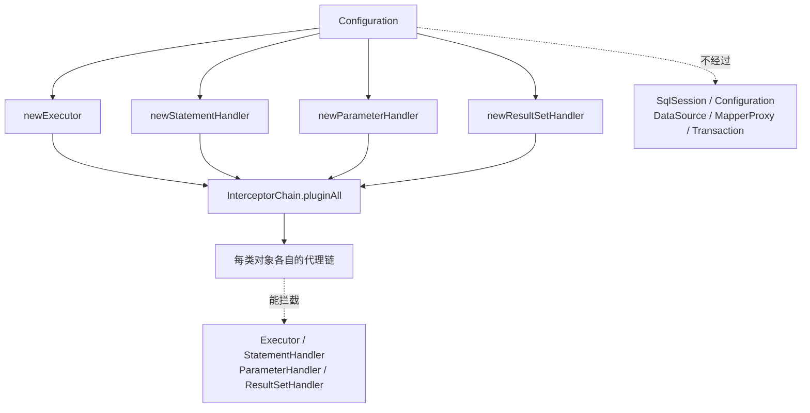
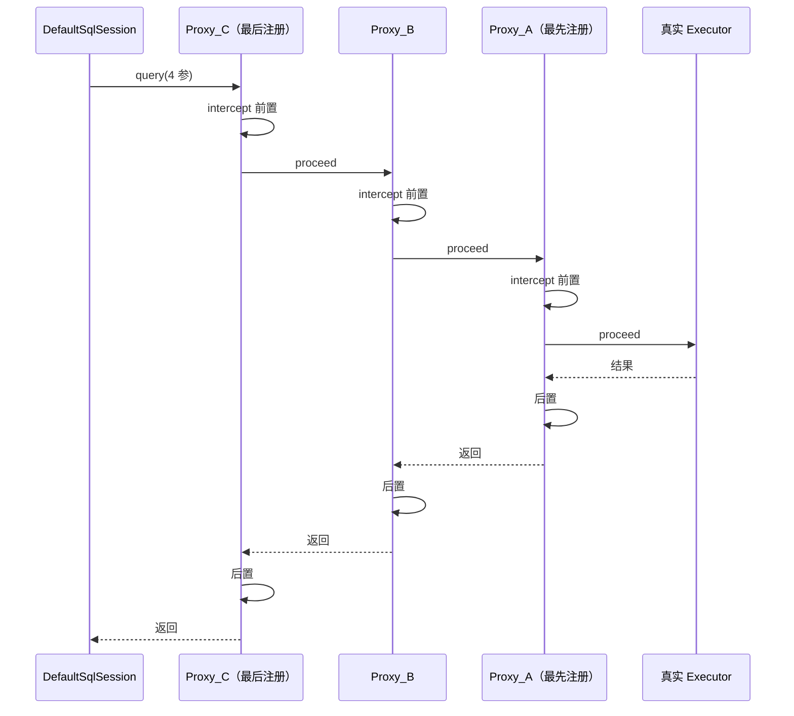
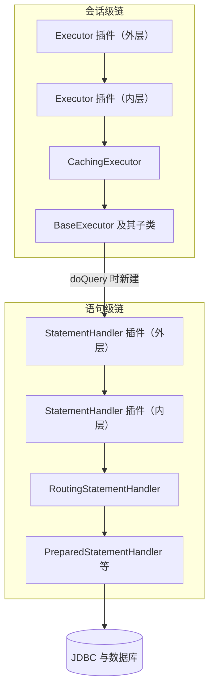
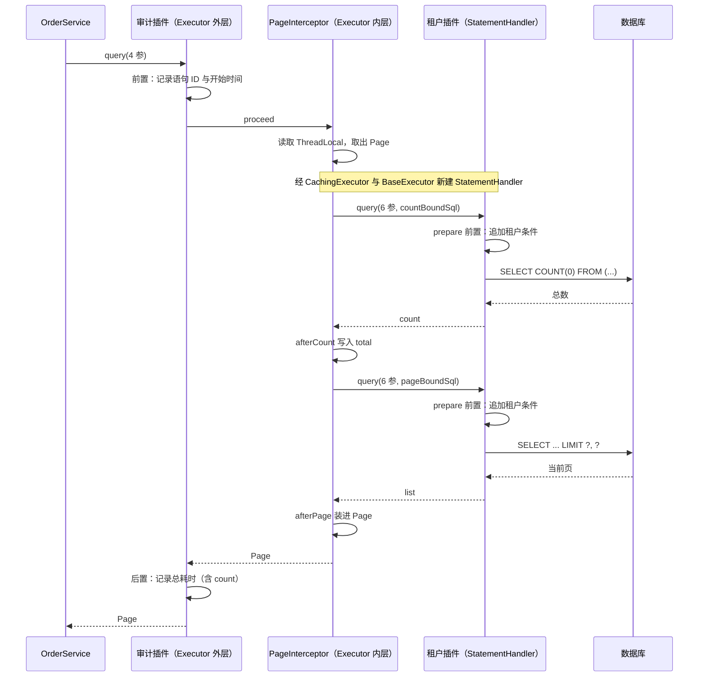
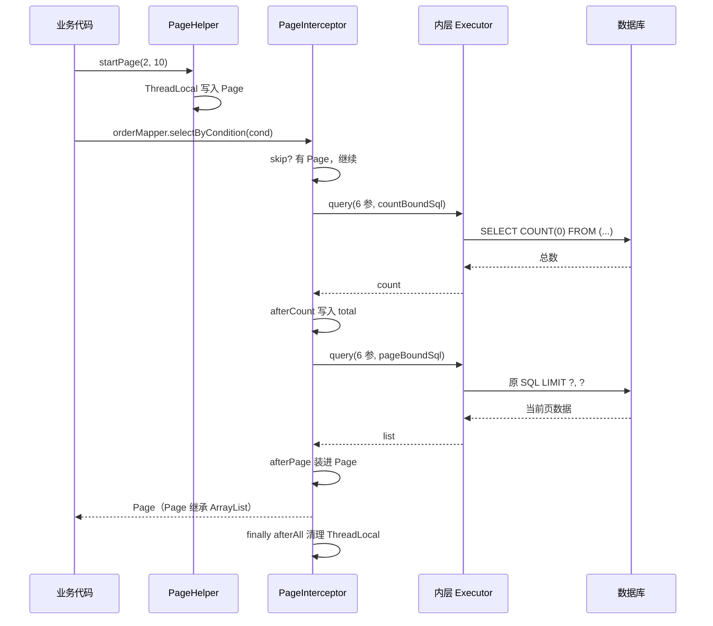
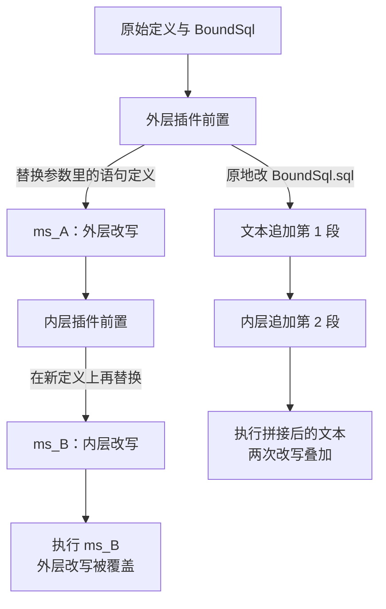

# 插件机制——Interceptor的责任链模式与分页插件原理

**摘要：**

插件的名声来自它能改 SQL，但它真正的边界由四个固定扩展点划出：`Configuration` 里只有四处代码把对象交给 `InterceptorChain`，于是 `Executor`、`StatementHandler`、`ParameterHandler`、`ResultSetHandler` 之外的一切都拦不到。本文从一次"插件写了却没生效"的现场切进去，先讲清 `@Signature` 的精确匹配为什么会在两种失败之间摇摆——参数类型解析不到时响亮地抛 `PluginException`，解析到了另一个重载则安静地什么都不做，把 `type` 写成实现类则连代理都不会创建；再把 `pluginAll` 的迭代包装拆开，确认后注册的插件位于最外层、前置逻辑最先执行，而"两个插件都改 SQL"的麻烦正从这里长出来——覆盖还是叠加，取决于改的是参数数组还是参数对象本身。随后以 PageHelper 5.x 的源码为准，还原一次 `startPage` 的完整时序，说明它改写 SQL 的方式是"用新的 `BoundSql` 再发一次 `query`"，而不是替换参数数组，这个细节决定了内层插件看到两次查询（count 与分页）、外层插件一条分页 SQL 也看不到。末尾用三组反例收束：签名写错、两个插件抢改同一条 SQL、异步上下文里分页参数串台。

---

## 第 1 章 四个扩展点的边界

### 1.1 一次没有生效的拦截

order-service 上线了一个数据库审计插件，目标是记录每条 SQL 的语句 ID 与耗时。上线第一天，列表接口一切正常，分页接口一条日志都没有；再查，分页接口的日志里也没有 `LIMIT` 字样，倒是租户隔离插件在分页查询上完全失效，同一条语句两个租户看到的总数一模一样。三个现象指向三个不同的原因，但它们落在同一个位置上：插件挂在哪里、那个位置能不能被调用到、调用到的时候别人已经做了什么。

追这类问题最常见的误区，是先从插件代码的 `intercept()` 里找 bug。实际上 `intercept()` 能不能被调用，取决于三件与它无关的事：`@Signature` 是否精确匹配到运行时真正被调用的那个方法、目标对象是不是被 `pluginAll` 包装过、以及外层的插件有没有把调用原样交给下一层。这三件事任意一件不成立，`intercept()` 里写得再好也是死代码。

### 1.2 pluginAll 是唯一入口

Mybatis 没有为插件设计事件总线，也没有开放"任意对象后置处理"。它只做了一件事：在 `Configuration` 的四个工厂方法末尾，把刚造出来的对象交给拦截器链包一层。

```java
// org.apache.ibatis.session.Configuration（3.5.x，节选）
public Executor newExecutor(Transaction transaction, ExecutorType executorType) {
    Executor executor;
    if (ExecutorType.BATCH == executorType) {
        executor = new BatchExecutor(this, transaction);
    } else if (ExecutorType.REUSE == executorType) {
        executor = new ReuseExecutor(this, transaction);
    } else {
        executor = new SimpleExecutor(this, transaction);
    }
    if (cacheEnabled) {
        executor = new CachingExecutor(executor);        // 二级缓存装饰
    }
    return (Executor) interceptorChain.pluginAll(executor);  // 插件装饰
}

public StatementHandler newStatementHandler(Executor executor, MappedStatement ms, Object parameterObject,
        RowBounds rowBounds, ResultHandler resultHandler, BoundSql boundSql) {
    StatementHandler handler = new RoutingStatementHandler(executor, ms, parameterObject,
            rowBounds, resultHandler, boundSql);
    return (StatementHandler) interceptorChain.pluginAll(handler);
}
// newParameterHandler 与 newResultSetHandler 结构相同，末尾各是一次 pluginAll
```

四处 `pluginAll` 就是全部扩展面，第五处并不存在。这个约束不是遗漏，而是"最小可改写集合"的取舍：`Executor` 决定一条语句怎么执行、走哪条缓存、要不要换实现；`StatementHandler` 决定发出去的语句长什么样；`ParameterHandler` 决定参数如何绑定；`ResultSetHandler` 决定结果如何映射。四类对象恰好把"执行决策、语句文本、入参、出参"四个可改动的截面占满，再往外扩就会与框架自己的职责边界重叠。

图 1-1 把这四个入口与它们不覆盖的对象画在一起，这张图是后面所有"插件不生效"判断的地图。



### 1.3 拦不到的对象，以及为什么绕不过去

插件要生效，得同时满足两个条件：对象由 `Configuration` 的工厂方法产出，且之后所有调用方持有的都是那层代理引用。`SqlSessionFactory` 持有一份原始 `Configuration` 引用，框架内部创建对象、查找 `MappedStatement`、构建 `MapperProxy` 全部直接用这份引用，即便你把一个 `Configuration` 代理交给外部代码，内部调用也不会经过它。这是"拦不到"的结构性原因——不是没有权限，是没有路由。把边界列成一张表，见表 1-1。

| 想拦的对象 | 是否经过 `pluginAll` | 拦不到的原因 | 可行替代 |
| --- | --- | --- | --- |
| `Configuration` | 否 | 类而非接口，JDK 代理无法实现；内部代码持有原始引用 | 自定义子类覆写四个工厂方法；Spring 的 `ConfigurationCustomizer` |
| `SqlSession` | 否 | `DefaultSqlSessionFactory` 直接 `new`，外界拿到的是实现类 | 包装实现（`SqlSessionTemplate` 的做法）；Mapper 接口上的 AOP |
| Mapper 接口与 `MapperProxy` | 否 | `MapperRegistry` 直接创建代理 | Spring AOP；替换 `MapperProxyFactory` |
| `DataSource` 与 `Connection` | 否 | 位于 Mybatis 之外，由连接池提供 | 包装 `DataSource`；JDBC 层代理（p6spy、连接池 filter） |
| `Transaction` | 否 | 由 `TransactionFactory` 创建后再注入 `Executor` | 自定义 `TransactionFactory` |
| `TypeHandler` | 否（走注册表） | 它是注册表条目，不在运行时对象链上 | `TypeHandlerRegistry` 注册 |
| `ObjectFactory` 等策略对象 | 否 | 是 `Configuration` 的字段 | 直接替换字段或注册表 |

表 1-1 的用法不是"记住哪些不行"，而是判断需求该不该走插件。想做字段级加解密，`TypeHandler` 比插件干净；想用容器创建结果对象，换 `ObjectFactory` 比插件干净；想做接口维度的埋点与异常翻译，Mapper 上的 AOP 能拿到业务语义，插件拿不到。

### 1.4 贯穿案例与路线

后文用同一个 order-service：`t_order` 表、`OrderMapper.selectByCondition` 一条带动态条件的分页查询、以及三个都挂在链上的插件——审计插件（想记 SQL）、租户插件（想给 WHERE 加 `tenant_id`）、分页插件（想加 `LIMIT` 并额外发一条 count）。三者的需求分别是"看"、"改语义"、"改语句并加查询"，恰好对应三个不同的拦截点，也恰好构成一组会互相干扰的组合。

四类对象各自的职责与调用链见 [[01 Mybatis全局架构——从SQL到结果映射的完整链路]]，`Executor` 的装配层次与缓存可见性见 [[02 SqlSession与Executor——命令执行的核心引擎]]；最终 SQL 的生成过程（`SqlSource`、`SqlNode`、`#{}` 到 `?` 的替换）见 [[03 动态SQL——OGNL表达式与SqlNode解析树]]；参数映射见 [[04 参数处理——ParameterHandler与TypeHandler的类型映射]]，结果映射见 [[05 结果映射——ResultMap的嵌套映射与延迟加载]]。本篇只处理三者的交叉面：同一个对象上叠了多个插件时，谁先谁后，谁能看见谁的改写。

---

## 第 2 章 签名：@Intercepts 与 @Signature 的精确匹配

### 2.1 注解解析发生在每一次 wrap

`Plugin.wrap` 的第一步不是创建代理，而是把拦截器上的注解翻译成一张"接口 → 方法集合"的表：

```java
// org.apache.ibatis.plugin.Plugin（3.5.x，节选）
private static Map<Class<?>, Set<Method>> getSignatureMap(Interceptor interceptor) {
    Intercepts interceptsAnnotation = interceptor.getClass().getAnnotation(Intercepts.class);
    if (interceptsAnnotation == null) {
        throw new PluginException("No @Intercepts annotation was found in interceptor "
                + interceptor.getClass().getName());
    }
    Map<Class<?>, Set<Method>> signatureMap = new HashMap<>();
    for (Signature sig : interceptsAnnotation.value()) {
        Set<Method> methods = MapUtil.computeIfAbsent(signatureMap, sig.type(), k -> new HashSet<>());
        try {
            methods.add(sig.type().getMethod(sig.method(), sig.args()));
        } catch (NoSuchMethodException e) {
            throw new PluginException("Could not find method on " + sig.type()
                    + " named " + sig.method() + ". Cause: " + e, e);
        }
    }
    return signatureMap;
}
```

这段代码有三处值得记住。第一，解析发生在每次 `wrap` 调用时，而 `wrap` 发生在每个被包装对象创建时——`StatementHandler`、`ParameterHandler`、`ResultSetHandler` 都是每条语句新建，所以注解解析与 `getMethod` 查找是每条语句都要付的固定成本，这一点在第 8 章会折算成量级。第二，`getMethod(sig.method(), sig.args())` 要求方法名与参数类型列表**精确匹配**，返回类型、异常声明、参数名都不参与匹配。第三，注解必须出现在拦截器的运行时类上，因为 `@Intercepts` 没有 `@Inherited`；把拦截器抽成公共父类、在每个子类上忘了重新标注，或者在拦截器 Bean 外面套了一层 Spring AOP 代理，`getClass()` 拿到的都不是原来那个类，等待你的是一句 `No @Intercepts annotation was found`。

### 2.2 两种失败：响亮与静默

签名匹配的门槛比想象中高，它要求的是门牌号精确到房间：方法名是街道，参数类型列表是房间号，街道对了、房间号不对，门敲不开；更麻烦的是敲开了相似的门——另一个重载——里面却不是你要找的人。这条比喻的边界在于，`@Signature` 只能声明"哪个方法"，声明不了"只在某条调用路径上生效"，所以当一个方法存在多个重载、多种触发路径时，"签名写全"与"签名正好命中"是两件事。

签名写对写错，结果分成两类，而这两类的排查难度差着一个数量级。

**响亮的一类**是"解析不到方法"。方法名拼错、参数类型少写一个、参数类型写成了父类，都会在 `getMethod` 这一步抛 `NoSuchMethodException`，被包装成 `PluginException`。典型场景是把老教程里的 `StatementHandler.prepare` 签名照搬到新工程：Mybatis 3.5.x 的接口是 `prepare(Connection, Integer)`，两个参数都要写；只写 `{Connection.class}`，第一次执行语句就会看到 `Could not find method on interface org.apache.ibatis.executor.statement.StatementHandler named prepare`。这种失败的好处是立刻暴露，坏处是它发生在第一次创建会话或执行语句时，而不是启动时——`SqlSessionFactory` 构建阶段不创建 `Executor`，很多工程要到第一个请求打进来才炸。

**静默的一类**要隐蔽得多，共有三种形态。

第一种是接口集合为空。`wrap` 拿 `target.getClass()` 逐层向上找它实现的接口，只在 `signatureMap` 的键里保留匹配项；一个都没匹配上就原样返回 `target`，代理压根没建：

```java
public static Object wrap(Object target, Interceptor interceptor) {
    Map<Class<?>, Set<Method>> signatureMap = getSignatureMap(interceptor);
    Class<?>[] interfaces = getAllInterfaces(target.getClass(), signatureMap);
    if (interfaces.length > 0) {
        return Proxy.newProxyInstance(target.getClass().getClassLoader(),
                interfaces, new Plugin(target, interceptor, signatureMap));
    }
    return target;   // 静默跳过
}
```

把 `type` 写成 `PreparedStatementHandler.class` 这类实现类，或者写成 `Configuration.class`、`SqlSession.class` 这类不经过 `pluginAll` 的类型，都属于这一种：配置全部合法、启动毫无异常、插件一次都不会执行。

第二种是"解析到了另一个重载"。`Executor.query` 有 4 参与 6 参两个版本，`StatementHandler` 有 `query` 与 `queryCursor` 两个入口，`ResultSetHandler` 有 `handleResultSets`、`handleCursorResultSets`、`handleOutputParameters` 三个方法。签名只写了其中一半，插件确实会生效，只是生效在你不关心的那次调用上。分页场景里这个问题尤其突出：正常调用是 `DefaultSqlSession` 发起的 4 参版本，可一旦外层有分页插件，它会用 6 参版本重新进入，只声明 4 参的插件在分页请求上完全收不到调用——第 6 章会把这个链条完整走一遍。

第三种是"签名对了，分支不走"。`ResultSetHandler.handleResultSets` 只在普通 `List` 结果上触发，Mapper 方法返回 `Cursor` 或流式 `Stream` 时走的是 `handleCursorResultSets`；`StatementHandler.query` 只在 `executeQuery` 路径上触发，`queryCursor` 是另一条路径。插件挂在一个不会走到的分支上，日志里连代理的痕迹都没有。

### 2.3 wrap 的接口匹配与代理的实际形状

`getAllInterfaces` 遍历目标类与所有父类实现的接口，只保留 `signatureMap` 中出现过的那些；`Proxy.newProxyInstance` 让代理类只实现这批接口，通常就是一个。这个形状带来两个直接后果。

其一，代理对象不是目标对象的实例。`(PreparedStatementHandler) invocation.getTarget()` 会直接抛 `ClassCastException`，因为那是一个实现了 `StatementHandler` 接口、但类型完全不同的对象。要访问具体实现的内部状态，只有两条路：走接口上已有的方法（`getBoundSql()`、`getParameterHandler()`），或者用 `MetaObject` 沿 `delegate.xxx` 逐层下钻。

其二，代理类由 JDK 缓存，实例不复用。`Proxy.newProxyInstance` 的字节码生成只发生在同一个类加载器、同一组接口第一次出现时，之后复用缓存，代价压到一次 `Plugin` 对象的分配上。对单条语句来说这几乎测不出来，但它是"每语句固定开销"的组成部分。

### 2.4 invoke 的分发与 Invocation

代理对象上的每次方法调用都进 `Plugin.invoke`：先按 `method.getDeclaringClass()` 去签名表里查，命中就交给拦截器，不命中就直接反射调用原方法。`equals`、`hashCode`、`toString` 不在签名表里，走的是后一条路。

```java
@Override
public Object invoke(Object proxy, Method method, Object[] args) throws Throwable {
    try {
        Set<Method> methods = signatureMap.get(method.getDeclaringClass());
        if (methods != null && methods.contains(method)) {
            return interceptor.intercept(new Invocation(target, method, args));
        }
        return method.invoke(target, args);
    } catch (Exception e) {
        throw ExceptionUtil.unwrapThrowable(e);   // 剥掉反射包装的 InvocationTargetException
    }
}
```

`Invocation` 把三样东西打包：`target`（被包装的内层对象，可能是下一层代理）、`method`、`args`。它的 `proceed()` 就是一次 `method.invoke(target, args)`。层层代理之所以能串起来，靠的正是 `target` 指向下一层这个约定，而不是某个中心调度器——这一点决定了第 3 章的顺序语义。

拦截器的 `plugin` 方法允许覆写，默认实现是 `Plugin.wrap(target, this)`，需要覆写的场合很少：一种是想按语句类型决定是否包装，另一种是给代理对象附加自己的 `InvocationHandler`。覆写时有两个约束不能破：返回对象必须实现与目标相同的接口，否则下游的强转会在运行时炸；新代理必须沿用 `Invocation(target, method, args)` 的约定把调用交给内层，否则链会在这一层断掉。`Interceptor` 接口把 `plugin` 与 `setProperties` 都做成了默认方法，本意是让实现者只关心 `intercept`；默认实现已经处理了"签名不匹配就原样返回"的逻辑，绝大多数场景不需要绕开它。

### 2.5 签名写法对照

| 写法 | 实际调用的路径 | 结果 | 判据 |
| --- | --- | --- | --- |
| `Executor.query`，4 参 | `DefaultSqlSession` 发起 | 正常触发；分页插件在外层时收不到分页请求 | 分页接口无日志、无耗时记录 |
| `Executor.query`，6 参 | 内层重入（分页、其他插件） | 只在 6 参调用出现时触发 | 普通接口无日志，分页接口有 |
| `Executor.query`，两个重载都写 | 两种路径都覆盖 | 分页请求一次逻辑调用可能记成两条 | 日志条数与接口调用数不一致 |
| `StatementHandler.prepare`，`{Connection}` | 与接口签名不符 | 首次执行即 `PluginException` | 异常信息含 `Could not find method` |
| `StatementHandler.prepare`，`{Connection, Integer}` | 每条语句一次 | 正常触发 | 能看到最终 SQL 文本 |
| `type = PreparedStatementHandler.class` | 接口集合为空 | 静默跳过 | 启动正常、插件永不执行 |
| `ResultSetHandler.handleResultSets` | 返回 `Cursor` 时走的是另一个方法 | 静默跳过 | 流式查询的结果没有被处理 |
| `type = Configuration.class` | 不经过 `pluginAll` | 静默跳过 | 同上 |

表 2-1 的第三列比第一列有用：判断"插件为什么不生效"时，先看签名，再看有没有别的插件挡在前面，最后才看 `intercept()` 里的逻辑。

---

## 第 3 章 包装顺序：后注册的在外层

### 3.1 pluginAll 的迭代构造

拦截器链的包装不是一次完成的，而是一个循环：

```java
// org.apache.ibatis.plugin.InterceptorChain（3.5.x）
public Object pluginAll(Object target) {
    for (Interceptor interceptor : interceptors) {
        target = interceptor.plugin(target);
    }
    return target;
}
```

`Interceptor.plugin` 的默认实现是 `Plugin.wrap(target, this)`。假设按 A、B、C 的顺序注册，包装过程是：A 包住原始 `Executor` 得到代理 A；B 包住代理 A 得到代理 B；C 包住代理 B 得到代理 C。最后交给 `SqlSession` 的是代理 C，因此**后注册的插件位于最外层**。把三层代理想成一只只套上去的盒子，后套的那只包在外面，最先被碰到、最后被放下；盒子的比喻只在同一个对象的链上成立，跨对象时并不存在一只总盒子，这一点见 3.4 节。

图 3-1 把三层代理的前置与后置按时间顺序画出来，这张图值得与"注册顺序"并排记。



### 3.2 前置与后置的执行序列

同一个对象上叠三个插件时，顺序可以精确写成一句话：后注册的插件前置逻辑最先执行、后置逻辑最后执行。外层的比喻是"离调用方最近"，内层的比喻是"离数据库最近"；一次调用的路径是"从外向内穿过所有前置，触底后再由内向外穿过所有后置"。

这个顺序最容易被记反的地方在后置阶段：注册得晚的插件，后置确实也执行得晚，于是"注册晚 = 执行晚"在后置上成立、在前置上不成立。很多事故就出在这个半对半错的记忆上——审计插件注册得最晚，作者以为它会"在最后记录最终 SQL"，实际上它是第一个进入 `intercept()` 的，它看到的参数还是原始参数。

| 注册顺序（A 先、C 后） | 前置顺序 | 后置顺序 | 谁最接近数据库 |
| --- | --- | --- | --- |
| A → B → C | C、B、A | A、B、C | A |
| C → B → A | A、B、C | C、B、A | C |
| 只有一个插件 | 该插件 | 该插件 | 该插件 |

表 3-1 的最后一列是排障时的锚点：SQL 文本被谁改过，看谁最靠近数据库；调用耗时被谁放大，看谁最靠近调用方。

### 3.3 参数数组的共享与改写可见性

`Plugin.invoke` 把 `args` 数组原样交给 `Invocation`，`proceed()` 又把这同一个数组交给下一层。数组对象只有一份，于是改写在层间的可见性有了方向：外层在前置阶段改动 `args`，内层能看到；内层在后置阶段改动返回值，外层能看到。反过来不成立——外层的前置看不到内层未来的改动，内层的后置也看不到外层已经做过的判断。

由此分出两种改写范式，它们对"别人看到什么"的影响完全不同。

第一种是**原地改写**。拿到 `args` 后直接替换其中的 `MappedStatement` 或 `BoundSql`，再 `proceed()`。这是大多数自制改 SQL 插件的写法。注意一个连带的坑：6 参路径里 `MappedStatement`、`BoundSql`、`CacheKey` 三者是配套的，只换 `MappedStatement` 而不同时换 `BoundSql` 与 `CacheKey`，下游会拿着旧的 `BoundSql` 去执行新的语句定义，`LIMIT` 不出现、条件不生效、缓存串页都可能由此而来。

第二种是**重发调用**：不 `proceed()`，用新参数自己再发一次调用。PageHelper 走的就是这条路：它不改 `args`，而是从 `invocation.getTarget()` 拿到内层对象，用 6 参的 `query` 重新发一次。两种范式在"外层看得到什么"上的差异是第 6 章的核心，这里先记住结论：原地改写的顺序是"外层先改、内层叠加"，重发调用的顺序是"外层只看到第一跳，内层看到全部重发"。

### 3.4 跨对象没有统一的顺序

`Executor` 的代理链在会话打开时构建一次，`StatementHandler` 的代理链在每条语句执行时构建一次。两条链各自遵守"后注册在外层"，但彼此之间不存在"谁在外层"的关系——它们是先后发生的两个阶段，顺序由调用路径固定：`Executor` 插件的前置先跑，然后是 `StatementHandler` 插件的前置，触底执行 JDBC，再由内向外返回。

图 3-2 把两条链并排画出来，中间的连接点是 `doQuery`，不是"外层包内层"。



图 3-2 解释了一个常见误判：把审计插件从 `Executor` 挪到 `StatementHandler` 之后，日志里突然多出一倍条数。多出来的不是"插件被调用了两次"，而是分页插件在 `Executor` 层发出的 count 查询与分页查询，各自都走了一遍完整的语句级链。

### 3.5 注入排序与插件顺序的语义反转

在 Spring 里注册插件时，顺序不是由 `@Bean` 方法的书写位置决定的，而是由 Spring 注入 `Interceptor[]` 时的排序决定的。Spring 自 4.0 起支持在集合注入时按 `@Order`/`Ordered`/`@Priority` 排序，值小的排在前面；`MybatisAutoConfiguration` 把这个数组原样传给 `SqlSessionFactoryBean.setPlugins`，随后逐个 `addInterceptor`，于是数组下标越大、入链越晚、越靠外层。

结论是：**`@Order` 值小的在内层**，值大的在外层；这与 Spring AOP 切面的直觉正好相反——切面里 `@Order` 值小意味着优先级高、更靠外。同一个工程里两种代理顺序语义反向，是"插件顺序混乱"最隐蔽的来源之一。稳妥的写法是给每个插件的 `@Order` 加注释写明它要的是"外层"还是"内层"，并把顺序断言写进测试。

```java
@Bean
@Order(1)   // 值小：先入链，位于内层；离数据库更近
public Interceptor tenantRewriteInterceptor() { ... }

@Bean
@Order(2)   // 值大：后入链，位于最外层；最先看到逻辑调用
public Interceptor sqlAuditInterceptor() { ... }
```

如果两个插件都没有标注顺序，它们的相对位置取决于 Bean 注册顺序；`@Component` 扫描与 `@Configuration` 类内 `@Bean` 方法的注册先后受扫描顺序、类路径资源的排列顺序、`@Import` 展开顺序影响，在不同构建、不同启动参数下都可能变化。顺序敏感的插件必须显式定序，这不是防御性编程，而是让"上次能跑、这次不能跑"这类问题从根上消失。

---

## 第 4 章 三个高频拦截点

### 4.1 Executor.query/update：能重算 SQL，但改不动最终 SQL

在 `Executor` 上拦截 `query`，拿到的是 `MappedStatement`、参数对象、`RowBounds`、`ResultHandler`；拦截 `update` 拿到 `MappedStatement` 与参数，返回值是影响行数。6 参重载还能拿到 `CacheKey` 与 `BoundSql`。

这里有一个流传很广的说法需要拆开看："`Executor` 层拿不到 SQL"。严格说，拿到的是语句定义，SQL 文本可以自己算出来：`ms.getBoundSql(parameter)` 会重新求值一遍动态 SQL，返回一份新的 `BoundSql`。但这份 `BoundSql` 有三个特点：它是新对象，与下游真正用于执行的不是同一份；重新求值有成本，动态标签越多、参数越复杂，代价越高；即便你改了它的 `sql` 字段，4 参路径下游的 `CachingExecutor`（关闭二级缓存时是 `BaseExecutor`）也会自己再调一次 `ms.getBoundSql(parameter)`，把你的改动丢掉。

```java
// 反例：在 Executor 层改 BoundSql 的 sql 字段，改动不会出现在最终语句里
@Intercepts(@Signature(type = Executor.class, method = "query",
        args = {MappedStatement.class, Object.class, RowBounds.class, ResultHandler.class}))
public class WrongRewriteInterceptor implements Interceptor {
    @Override
    public Object intercept(Invocation invocation) throws Throwable {
        Object[] args = invocation.getArgs();
        MappedStatement ms = (MappedStatement) args[0];
        BoundSql boundSql = ms.getBoundSql(args[1]);
        boundSql.setSql(boundSql.getSql() + " AND tenant_id = 42");  // 下游会重新生成 BoundSql，这行白写
        return invocation.proceed();
    }
}
```

要在 `Executor` 层真正改 SQL，只有两条合法路径：一是换掉 `args[0]` 里的 `MappedStatement`（构造一个新的、`SqlSource` 已改写的实例），让下游基于新定义重新生成 `BoundSql`；二是不 `proceed()`，自己用 6 参调用把新的 `BoundSql` 传下去，PageHelper 用的就是第二条。第一条的坑是 6 参路径下三件套要一起换，第二条的坑是原调用的 `proceed()` 被跳过，内层插件看到的是新调用而不是原调用。

那 `Executor` 层适合做什么？按语句 ID 埋点、统计耗时与命中率、读写分离路由（换 `DataSource` 对应的 `Transaction`）、控制缓存刷新、包装返回值（把 `List` 换成 `Page`）。这些都不需要改 SQL，也就绕开了上面那团麻烦。

### 4.2 StatementHandler.prepare：最终 SQL 的唯一改写窗口

`StatementHandler.prepare(Connection, Integer)` 的职责是"把 `BoundSql` 里的 SQL 文本交给驱动编译"，`PreparedStatementHandler` 在这一步调用 `connection.prepareStatement(sql, ...)`。所以在 `prepare` 的前置阶段，`BoundSql.getSql()` 就是最终要发出去的文本：动态标签已求值、`#{}` 已替换为 `?`、外层的分页或租户改写如果走的是 `Executor` 层，也已经体现在这份 `BoundSql` 里。

```java
@Intercepts(@Signature(type = StatementHandler.class, method = "prepare",
        args = {Connection.class, Integer.class}))
public class TenantRewriteInterceptor implements Interceptor {
    @Override
    public Object intercept(Invocation invocation) throws Throwable {
        StatementHandler handler = (StatementHandler) invocation.getTarget();
        // RoutingStatementHandler 实现了 getBoundSql()，不必用 MetaObject 沿 delegate.boundSql 下钻
        BoundSql boundSql = handler.getBoundSql();
        String rewritten = TenantSqlRewriter.rewrite(boundSql.getSql(), TenantContext.current());
        boundSql.setSql(rewritten);   // 同一个 BoundSql 对象，prepare 之后读取的就是新文本
        return invocation.proceed();
    }
}
```

这段代码能生效，靠的是"同一个对象"：`Configuration.newStatementHandler` 把 `BoundSql` 传给 `RoutingStatementHandler`，后者再传给具体的 `PreparedStatementHandler`，三层持有的是同一个引用，改 `sql` 字段等于改它们共同看到的那份文本。如果 SQL 里要带参数而不是字面量，就必须同时补一条 `ParameterMapping` 并把值塞进 `BoundSql` 的附加参数表；`parameterMappings` 是私有字段，得用 `MetaObject` 写回：

```java
List<ParameterMapping> mappings = new ArrayList<>(boundSql.getParameterMappings());
mappings.add(new ParameterMapping.Builder(ms.getConfiguration(), "tenantId", Long.class).build());
boundSql.setAdditionalParameter("tenantId", tenantId);
SystemMetaObject.forObject(boundSql).setValue("parameterMappings", mappings);
```

三个边界需要一并记住。第一，`prepare` 每条语句执行一次，批处理模式下只在每个语句组的第一条上调用，后续走 `parameterize` 与 `batch`，因此按"每条语句的 prepare 次数"统计执行量会漏掉批次里的其余条数。第二，`prepare` 拿不到参数值，参数绑定发生在下一步。第三，在这里做 SQL 解析的代价是每条语句一份，AST 解析比字符串替换贵得多，第 8 章会给出量级估算。

### 4.3 parameterize 与 query：参数与结果的改写

`ParameterHandler.setParameters(Statement)` 是参数绑定的入口，`DefaultParameterHandler` 在这里按 `ParameterMapping` 逐个取 `TypeHandler` 并 `setXxx`。想在绑定前加密、脱敏、补公共参数，这里是正确位置；但想改 SQL 就晚了——`PreparedStatement` 在 `prepare` 阶段已经编译完成，SQL 文本此后不再被读取。这就是"在 `parameterize` 里改 SQL 静默无效"的来源：代码不报错，语句照发，只是发的是旧文本。

`StatementHandler.query(Statement, ResultHandler)` 在语句执行之后、结果交给调用方之前触发，能拿到已映射的结果列表；`StatementHandler.queryCursor` 是流式路径的另一入口，返回 `Cursor` 时不会经过 `query`。想把结果集整体替换、加字段、做二次过滤，挂在这里比挂 `ResultSetHandler` 方便；想按列脱敏、按 `ResultMap` 处理类型，挂 `ResultSetHandler.handleResultSets` 更合适，因为那里才有 `ResultSetWrapper` 与 `ResultMap`。

需要注意结果改写与分页的先后：分页插件在 `Executor` 层把结果装进 `Page` 对象，而 `ResultSetHandler` 与 `StatementHandler.query` 的改写发生在装进 `Page` 之前。内层的改写会被外层分页对象包住，`PageInfo` 的总数统计不会因为内层删了几行而变化——这是一个不易察觉的口径不一致。

### 4.4 选点对照

| 拦截点 | 拿得到 | 拿不到 | 改写生效条件 | 典型用途 |
| --- | --- | --- | --- | --- |
| `Executor.query`/`update` | `MappedStatement`、参数、`RowBounds`；6 参时含 `CacheKey`、`BoundSql` | 连接、最终 SQL、参数绑定值 | 换 `MappedStatement`，或用 6 参重发 | 埋点、分页、读写路由、结果包装 |
| `StatementHandler.prepare` | `Connection`、最终 SQL、`MappedStatement`（经 `delegate`） | 参数值、执行结果 | 直接改 `BoundSql.sql` 或在 `prepare` 前重建 | 改 SQL、加 hint、设超时与只读 |
| `StatementHandler.parameterize` | `Statement`、参数对象、`BoundSql` | 最终 SQL 已定型 | 改 SQL 无效，只能改绑定值 | 参数加密、脱敏、补公共参数 |
| `StatementHandler.query` | 已映射的结果列表、`Statement` | 原始结果集（已被消费） | 返回替换后的列表 | 结果过滤、二次加工 |
| `ResultSetHandler.handleResultSets` | `Statement`、`MappedStatement`、`ResultMap` | 最终 SQL 文本（需反查 `BoundSql`） | 返回替换后的列表 | 按列脱敏、动态补字段 |

表 4-1 的第三列是选点的第一道筛子：需要连接与语句属性的，只能在 `StatementHandler`；需要语句定义与缓存信息的，只能在 `Executor`；两者都要，就得分两个插件并明确顺序。

### 4.5 一次分页请求的完整调用序列

把三个拦截点放进同一条时间线，能看到一件反直觉的事：一次业务上的"分页查询"，在框架内部是两条独立执行的语句，中间还夹着两次语句级代理链的构建。审计插件记一条还是两条、租户条件生效一次还是两次，取决于它站在哪个位置，而不是取决于它写了什么逻辑。图 4-1 是这条时间线的完整版本。



这条序列里有两个容易忽略的时点。其一，审计插件记录的总耗时包含了 count 查询与分页查询两条，如果它与分页插件的相对位置互换，计时的口径就从"一次逻辑调用的总代价"变成"一条物理语句的代价"，两个数字放在一起比较毫无意义。其二，语句级代理链被构建了两次，租户插件的 `prepare` 前置也被执行了两次，如果插件在实例字段里累计"已处理语句数"，一次分页请求会加二而不是加一——这类计数偏差在限流、采样、审计对账中都会变成错误的口径。

---

## 第 5 章 分页插件：一次 startPage 到底发生了什么

### 5.1 分页的三件事

数据库分页要同时解决三个问题：方言差异、总数、参数化。方言差异是语法层面的，同一句"取第 2 页、每页 10 条"在四种数据库上要写成四种形状，见表 5-1。

| 数据库 | 分页语法 | 备注 |
| --- | --- | --- |
| MySQL | `... LIMIT ?, ?` | 偏移量在前、条数在后；深偏移要扫描并丢弃前 offset 行 |
| PostgreSQL | `... LIMIT ? OFFSET ?` | 语义与 MySQL 等价，写法不同 |
| Oracle（12c 之前） | `... ROWNUM` 双层嵌套 | 需要在外层过滤行号，写法最繁琐 |
| SQL Server 2012+ | `... ORDER BY ... OFFSET ? ROWS FETCH NEXT ? ROWS ONLY` | 必须带 `ORDER BY` |

总数是第二个问题：分页组件要给前端"共 N 条、M 页"，就得额外执行一条 count。参数化是第三个问题：改写后的 SQL 里多出两个占位符，参数绑定必须同步补上，否则执行时报"参数个数不匹配"。

把这三件事交给业务代码，意味着每个分页查询手写一遍 count、一遍方言 SQL、一遍参数；交给插件，业务只需要一行 `startPage`。代价是这一行调用把状态藏进了线程上下文，第 5.7 节会详细拆这个代价。

### 5.2 拦截声明与两条重载

PageHelper 5.x 的 `PageInterceptor` 只拦 `Executor.query`，两个重载都声明：

```java
@Intercepts({
    @Signature(type = Executor.class, method = "query",
        args = {MappedStatement.class, Object.class, RowBounds.class, ResultHandler.class}),
    @Signature(type = Executor.class, method = "query",
        args = {MappedStatement.class, Object.class, RowBounds.class, ResultHandler.class,
                CacheKey.class, BoundSql.class})
})
public class PageInterceptor implements Interceptor { ... }
```

两个都写不是冗余。4 参版本是 `DefaultSqlSession` 发起的正常入口；6 参版本是"其他插件或框架内部以显式 `CacheKey`/`BoundSql` 重入"的入口，PageHelper 自己发 count 与分页查询用的也是 6 参。只写 4 参，在被别的插件包住时可能收不到调用；只写 6 参，正常业务调用根本触发不了。

### 5.3 时序：ThreadLocal、count、pageQuery、afterPage

`PageHelper.startPage(pageNum, pageSize)` 做了一件事：把 `Page` 对象放进当前线程的 `ThreadLocal`。之后的第一次 `Executor.query` 进入 `PageInterceptor`，读取 `ThreadLocal`，若为空则原样 `proceed()`，不为空则进入分页流程。图 5-1 把这条时序完整画出来。



图 5-1 里有两处细节值得停一下。count 查询用的是 `RowBounds.DEFAULT`，即不再叠加内存分页；它复用原查询的 `MappedStatement` 但新建一份 `BoundSql`，`SqlSource` 相同、SQL 文本不同。分页查询同样以 `RowBounds.DEFAULT` 重发，意味着 `LIMIT` 之后的"内存分页"路径被彻底绕开，物理分页成为唯一分页方式。

`afterCount` 的返回值还承担短路职责：总数为 0、页码小于等于 0、或者起始行已超过总数时，直接返回空列表，不再执行第二条查询。这条短路对"总数查询本身很贵"的场景是一点补偿，但也意味着业务方拿到的 `Page` 里 `total` 有值、数据为空。

### 5.4 count SQL 是怎么生成的

`getCountSql` 委托给 `countSqlParser.getSmartCountSql(sql)`，所谓"智能"体现在两类判断上：语句结构简单（没有 `DISTINCT`、没有 `GROUP BY`、没有集合运算、没有 `LIMIT`）时，把 `SELECT` 列表替换成 `COUNT(0)` 并去掉 `ORDER BY`；结构复杂时，简单地替换 `SELECT` 列表会算错行数，只能在外层再套一层 `SELECT COUNT(0) FROM (原 SQL) tmp_count`，代价是内层仍要执行完整查询。业务方也可以显式指定 count 列（`countColumn`），用于 `COUNT(DISTINCT user_id)` 这类语义。

count 用的 `MappedStatement` 是复制品：

```java
// com.github.pagehelper.util.MSUtils（节选）
MappedStatement.Builder builder = new MappedStatement.Builder(
        ms.getConfiguration(), newMsId, ms.getSqlSource(), ms.getSqlCommandType());
builder.resultMaps(Collections.singletonList(
        new ResultMap.Builder(ms.getConfiguration(), ms.getId(), Long.class, new ArrayList<>()).build()));
```

新 ID 是原 ID 加 `_COUNT` 后缀，`resultType` 换成 `Long`，其余属性从原语句复制。这么做的原因很实际：`Executor.query` 需要一个 `MappedStatement` 来定位语句、决定缓存与结果映射，count 语句在原语句里并不存在，只能造一个。

由此产生两个成本。第一，一次分页请求至少两次数据库往返，count 那条往往比数据那条更慢（大表全条件计数）；`startPage(pageNum, pageSize, false)` 可以关掉 count，代价是 `total` 为 -1、前端拿不到总页数。第二，count 的 `MappedStatement` 会被缓存起来复用（可配置 `msCountCache`），否则每个不同语句都要新建一次。

### 5.5 分页 SQL 与参数

分页 SQL 由方言生成，MySQL 的做法是在原 SQL 末尾追加 `LIMIT ?, ?`（第一页时只有 `LIMIT ?`），PostgreSQL 追加 `LIMIT ? OFFSET ?`，Oracle 用双层 `ROWNUM` 包装。追加占位符之后，还必须把对应的 `ParameterMapping` 补进 `BoundSql`，值与参数名由方言的 `processPageParameter` 写入参数表；同时这些值会并入 `CacheKey`，否则第 2 页会命中第 1 页的缓存。

`BoundSql` 的构造方式是"新对象 + 复用原参数映射列表"：

```java
String pageSql = dialect.getPageSql(ms, boundSql, parameter, rowBounds, pageKey);
BoundSql pageBoundSql = new BoundSql(ms.getConfiguration(), pageSql,
        boundSql.getParameterMappings(), parameter);
return executor.query(ms, parameter, RowBounds.DEFAULT, resultHandler, pageKey, pageBoundSql);
```

注意这里复用了 `ms`：分页不换 `MappedStatement`，因为语句 ID、缓存、结果映射都不变，换的只是这一次执行的 SQL 文本。这与"在 `Executor` 层改 SQL 要换 `MappedStatement`"并不矛盾——PageHelper 走的是 6 参路径，`BoundSql` 以参数形式显式传入，下游不会再重新生成。

返回值是 `Page` 而不是 `List`，这一点在边界上会露出两个尖角。`Page` 继承 `ArrayList`，额外的页码、总数、页大小等字段会跟着对象走；直接把它 JSON 序列化给前端，响应体里会多出一批前端没约定的字段，直接把它塞进服务间调用的响应，序列化器也必须能处理这些额外字段，否则两侧的 DTO 契约就对不上。规范做法是在服务层转换为 `PageInfo` 或自定义的分页视图对象，把"框架对象"挡在边界之内。另一个尖角是可变性：`Page` 是一个可变列表，同一个实例被多个调用方共享时，任何一处 `add`、`remove`、`clear` 都会影响其他读者；把 `Page` 当只读结果传递，或者干脆在返回前复制成普通列表，都能绕开这类隐式共享。

### 5.6 改写不是替换参数，而是再发一次查询

把第 5.3 节的时序与第 3 章的顺序放在一起，会得到一个对排障极重要的结论：PageHelper 没有修改 `args` 数组，也没有对原 4 参调用 `proceed()`。它是拿 `invocation.getTarget()`——也就是内层对象——用 6 参重新发起一次调用。这意味着：

- 只声明 4 参签名的内层插件，在分页请求上**完全收不到调用**，因为 4 参调用被 PageHelper 截住后根本没有往下传；
- 声明了 6 参签名的内层插件，会在一次分页请求里看到两次调用：一次 count，一次分页查询；
- 外层插件只看到一次 4 参调用，且这次调用的参数里没有任何 `LIMIT` 的痕迹；
- 无论内层还是外层，count 与分页两条查询都会走完整的 `StatementHandler` 链，所以挂在 `StatementHandler.prepare` 的改写对两条都生效，一致性最好。

| PageHelper 的位置 | 插件声明 | 分页请求中该插件观察到的调用 |
| --- | --- | --- |
| 外层 | 仅 4 参 | 一次原始调用，无 `LIMIT` |
| 外层 | 仅 6 参 | 无（分页 SQL 在它下面生成，它看不到） |
| 内层 | 仅 4 参 | 无（原调用被外层截住） |
| 内层 | 仅 6 参 | 两次：count 一次、分页一次 |
| 任意 | `StatementHandler.prepare` | 两次：count 一次、分页一次（都能看到最终文本） |

表 5-2 能解释大多数"分页插件加进来之后，另一个插件就不工作了"的工单。判断方法是看被影响插件声明的签名与它在链中的相对位置，两者组合只有四种可能，对上表即可定位。

### 5.7 ThreadLocal 的四个风险

分页参数通过 `ThreadLocal` 从业务方法传到拦截器，这条通道的好处是业务无侵入，代价是"参数属于线程，不属于请求"。可以用一张便条来理解它：便条贴在当前干活的工人身上，换一个工人来干活就看不见了；忘了撕下来，下一件货也会按这张便条处理。便条的载体是线程而不是调用栈，这个差别决定了下面四个风险。

| 场景 | 症状 | 判据 | 处置 |
| --- | --- | --- | --- |
| 异步或线程池执行查询 | 分页失效，返回全量数据 | 日志中 SQL 无 `LIMIT` | 把分页参数随任务显式传递，在目标线程内 `startPage` |
| `startPage` 后未发生查询 | 该参数被同线程的下一次查询消费，分页串台 | 分页结果与请求页码不符，且跨接口 | 确保 `startPage` 与目标查询紧邻；必要时 `clearPage()` |
| 结果映射阶段触发嵌套查询 | 嵌套查询可能被当作分页目标，关联数据被截断 | 分页条数异常、关联集合为空 | 改用 JOIN 或显式分页，避免边映射边查询（延迟加载、`association` 的嵌套 `select` 都会触发） |
| 请求线程复用 | 上一个请求残留的参数影响下一个请求 | 偶发、与并发量相关 | 升级到清理逻辑完整的版本；`debug=true` 打印堆栈辅助定位 |

表 5-3 的第二行最值得警惕，因为它与"内存泄漏"的直觉不同：`ThreadLocal` 在拦截器的 `finally` 里会被清理，漏掉的是"`startPage` 之后没有查询"这一种——没有查询就没有拦截器执行，也就没有清理时机，参数一直挂在请求线程上，直到该线程的下一条查询把它消费掉。PageHelper 提供了一个 `debug` 开关，开启后会在消费分页参数时打印触发时的调用堆栈，用来发现"上一个 `startPage` 没被消费、被下一条查询捡走"的不安全用法。

异步场景的风险还要更直接一些：分页参数写在线程 A 的 `ThreadLocal` 上，查询如果发生在线程 B，`PageInterceptor` 读到的就是空，于是既不 count 也不改写，业务拿到全量结果而不报错。这类缺陷不会在功能测试里暴露，只会在大数据量下表现为内存与响应时间异常。

---

## 第 6 章 顺序陷阱：两个插件都想改 SQL

### 6.1 三组叠加的结果

把审计、租户、分页三者的位置调换，会得到三组完全不同的结果，而这三种组合在真实工程里都很常见——多团队协作时，谁先注册往往取决于谁先提交代码。

| 组合 | 期望 | 实际 | 根因 |
| --- | --- | --- | --- |
| PageHelper 外层 + 审计（4 参）内层 | 分页请求有审计日志 | 分页请求零日志 | 原 4 参调用被 PageHelper 截住，未下传 |
| 审计外层 + PageHelper 内层 | 日志里有最终 SQL | 只有原始 SQL，无 `LIMIT` 也无 count | 审计在前置阶段看到的是改写前的参数 |
| 租户挂 `StatementHandler.prepare` + PageHelper 任意位置 | count 与数据都带租户条件 | 一致，总数正确 | 两条查询都走语句级链，改写对两者都生效 |

表 6-1 的第一行与第二行是同一枚硬币的两面：审计挂在 `Executor` 层，就只能看到"逻辑调用"这一层的事实；想看到**物理语句**，必须下移到 `StatementHandler`。第三行说明了为什么租户隔离推荐挂在 `prepare` 而不是 `Executor`：只要改写在语句级，count 与数据自动保持一致，不需要额外处理。

### 6.2 审计插件在分页插件内层：一条日志都没有

复现步骤很简单：先注册审计插件（只声明 4 参 `query`），再引入 PageHelper。普通查询的日志一切正常，分页查询一条都没有。原因在第 5.6 节：PageHelper 位于外层，4 参调用被它接住，它不 `proceed()`，而是用 6 参重新进入内层。审计插件只认 4 参，于是这条链上"审计插件从来没被调用过"。

修复有两条路，取决于审计要回答的问题。要回答"业务调用了哪条语句、耗时多少"，把审计留在 `Executor` 层、声明 4 参，并且排在 PageHelper 之后、即**注册在外层**，这样每次逻辑调用恰好记一条，且能看到用户传入的参数；要回答"数据库实际执行了什么"，把审计挂到 `StatementHandler.prepare`，一次分页请求会记两条（count 与分页），需要在日志里用语句 ID 的后缀区分。两种口径不能混在一张报表里看，否则条数与耗时都对不上。

### 6.3 租户插件与分页的三种相对位置

租户条件加在哪里，后果差别很大。挂在 `StatementHandler.prepare` 时，count 与分页查询都经过它，总数与数据一致，这是最省心的组合；但改写的**位置**必须正确，分页 SQL 末尾已经有 `LIMIT`，若用"在 SQL 末尾追加 `AND tenant_id = ?`"的字符串拼接，条件会落到 `LIMIT` 后面，数据库直接报语法错误：

```sql
-- 错误：条件拼在 LIMIT 之后
SELECT id, order_no FROM t_order WHERE status = 'PAID' LIMIT 0, 10 AND tenant_id = 42
```

挂在 `Executor` 层则要看签名与位置的组合。只声明 4 参而 PageHelper 在外层时，租户插件对分页请求完全失效——这与审计的表现相同，但危害大得多：这不是少了一条日志，而是多查了别的租户的数据。声明 6 参、位于 PageHelper 内层时，它能收到 count 与分页两次调用，此时直接改传入的 `BoundSql`（6 参路径下不会被重新生成）可以让两条查询都带上条件；位于 PageHelper 外层时，它在前置阶段改的是原始参数，PageHelper 基于改写后的定义生成 count，结果同样一致，但改写方式不能是"改 `BoundSql`"，而必须是"换 `MappedStatement`"。

把这三条收敛成一句可执行的规则：改 SQL 的插件只有三个安全位置——`StatementHandler.prepare` 上改 `BoundSql`；`Executor` 的 6 参路径上改传入的 `BoundSql`（它不会被下游重新生成）；`Executor` 的 4 参路径上换 `MappedStatement`（让下游基于新定义重新生成）。混用（在 4 参路径上改 `BoundSql`、在 `parameterize` 上改 SQL）得到的都是"看起来改了、其实没生效"，而且不报错。

### 6.4 两个 Executor 改写插件：覆盖还是叠加

两个插件都通过替换 `args[0]` 的 `MappedStatement` 改 SQL 时，结果是**覆盖**而不是叠加：外层先改出 `ms_A`，`proceed()` 后内层拿到 `ms_A` 再改出 `ms_B`，下游执行的是 `ms_B`，外层的改写被整体丢掉。两个插件都原地修改同一个 `BoundSql` 的 `sql` 字段时，结果是**叠加**：外层先追加一段，内层在追加后的文本上再追加一段，最终文本是两次改写的串联。图 6-1 用两条分支把这两种结果画出来。



这两种结果都不理想，但失败方式不同：覆盖的失败是"某一段改写神秘消失"，叠加的失败是"SQL 语法或语义错乱"，后者更常见于条件位置冲突（`WHERE` 被插进了 `ORDER BY` 之后、`LIMIT` 之后又追加了 `AND`）。避免的办法不是小心翼翼地调顺序，而是让"改 SQL"这件事只有一个责任方：分页归分页插件，租户归租户插件，两者各自只做自己那一段，并且各自用 AST 而非字符串拼接定位插入点。

### 6.5 让改写可追溯

改写叠加之后，最难回答的问题是"这条 SQL 到底被谁改过"。三个低成本手段可以留着：每个改写插件在 SQL 里留下固定标记（`/* tenant */`、`/* page */`），标记不含变量值，否则同一语句的文本会随参数变化，给数据库的语句缓存与审计带来噪声；启动时打印拦截器链顺序，与标记顺序互相印证；在日志里同时记录改写前后的 SQL 摘要，便于对同一请求做前后比对。

---

## 第 7 章 注册：Spring 下的三层入链时机

### 7.1 XML 与 addInterceptor

纯 Mybatis 工程在 `mybatis-config.xml` 里声明：

```xml
<plugins>
    <plugin interceptor="com.acme.order.plugin.TenantRewriteInterceptor"/>
    <plugin interceptor="com.github.pagehelper.PageInterceptor">
        <property name="helperDialect" value="mysql"/>
    </plugin>
</plugins>
```

`XMLConfigBuilder` 解析到 `<plugins>` 时逐个 `addInterceptor`，顺序就是声明顺序，因此 PageHelper 在这个例子里位于外层。`<property>` 会通过 `setProperties` 注入，插件可以在这一步读取配置，但要注意 `plugins` 的解析早于 `settings` 的实际应用，插件初始化阶段读到的是 `Configuration` 的默认值而非 XML 里配的值。这条次序差异会表现为"插件参数没生效"，与插件顺序无关。

### 7.2 自动配置的 Interceptor 数组

Spring Boot 下更常见的是把拦截器声明成 Bean。`MybatisAutoConfiguration` 的构造器直接注入 `Interceptor[]`，构建 `SqlSessionFactoryBean` 时原样传下去：

```java
public MybatisAutoConfiguration(MybatisProperties properties,
        ObjectProvider<Interceptor[]> interceptorsProvider, ...) {
    this.interceptors = interceptorsProvider.getIfAvailable();
}
// sqlSessionFactory 方法内
if (!ObjectUtils.isEmpty(this.interceptors)) {
    factory.setPlugins(this.interceptors);
}
```

`SqlSessionFactoryBean` 在 XML（如果配置了 `config-location`）解析完成之后，才把 `setPlugins` 传入的数组逐个 `addInterceptor`，因此 Bean 插件排在 XML 插件的后面，也就更靠外层。数组内部的顺序由 Spring 的排序决定：`@Order`/`Ordered`/`@Priority` 值小的在前，值相同的按 Bean 注册顺序，跨配置类的注册顺序受扫描与 `@Import` 顺序影响，不建议依赖。

有一处容易踩空：`SqlSessionFactory` 标了 `@ConditionalOnMissingBean`。工程里一旦自定义了 `SqlSessionFactory`，自动配置整体退让，`Interceptor` Bean 既不会被收集也不会被注册，插件静默失效。这类"插件不生效"与签名无关，排查时先看工厂是谁创建的。

### 7.3 PageHelper starter 的追加时机

`pagehelper-spring-boot-starter` 里的自动配置类实现了 `InitializingBean`，在 `afterPropertiesSet` 里把拦截器加进每一个已建好的 `SqlSessionFactory`：

```java
@Override
public void afterPropertiesSet() {
    PageInterceptor interceptor = new PageInterceptor();
    interceptor.setProperties(this.properties);
    for (SqlSessionFactory factory : sqlSessionFactoryList) {
        if (!containsInterceptor(factory.getConfiguration(), interceptor)) {
            factory.getConfiguration().addInterceptor(interceptor);
        }
    }
}
```

这个时机比 `MybatisAutoConfiguration` 更晚（后者负责创建工厂，前者拿现成的工厂往里加），所以 PageHelper 天然排在所有 Bean 插件之后，也就是位于最外层。第 6 章那个"审计插件零日志"的现场，正是这个默认顺序造成的。

如果工程里自己声明了 `PageInterceptor` Bean，starter 会通过 `containsInterceptor` 判断并跳过重复注册，此时顺序回到 Bean 数组的排序规则，外层还是内层取决于 `@Order`。这也是为什么"同一个分页版本在不同工程里表现不同"——差别不在分页插件，在注册路径。

### 7.4 三层顺序对照

| 注册来源 | 入链时机 | 相对位置 | 备注 |
| --- | --- | --- | --- |
| `mybatis-config.xml` 的 `<plugins>` | XML 解析阶段 | 最内层 | 顺序即声明顺序 |
| `ConfigurationCustomizer` 内 `addInterceptor` | 自动配置构建 `Configuration` 时 | 次内层 | 早于 `setPlugins` |
| `Interceptor` Bean 数组 | `SqlSessionFactoryBean` 构建工厂时 | 次外层 | 按 `@Order` 升序入链 |
| PageHelper starter | 工厂建好之后 | 最外层 | 自动配置追加，幂等去重 |

表 7-1 的第四列决定了排查方向：怀疑顺序问题，先看工厂与分页插件分别由谁装配，再看 `@Order`。

### 7.5 如何确认实际的链顺序

`Configuration.getInterceptors()`（3.2.2 起提供）返回不可变列表，直接打印即可得到真实顺序。把它塞进一个 `ApplicationRunner`，启动时打一行日志，比在代码里推演可靠得多：

```java
@Bean
public ApplicationRunner interceptorOrderPrinter(SqlSessionFactory sqlSessionFactory) {
    return args -> sqlSessionFactory.getConfiguration().getInterceptors()
            .forEach(i -> log.info("interceptor in chain: {}", i.getClass().getName()));
}
```

顺序确认之后，还有两个观察点：日志里出现 `LIMIT` 的位置（判断分页在外层还是内层）、租户条件是否同时出现在 count 与分页两条 SQL 上（判断改写挂在语句级还是会话级）。

---

## 第 8 章 三个代价

### 8.1 代理开销：量级与真正的成本

代理开销由四部分构成：每个被包装对象上多一次 `getSignatureMap`（注解反射加 `getMethod` 查找）、每个插件一层 `Plugin` 实例、每层一次 `method.invoke` 反射调用、以及 JDK 代理类首次生成后的缓存查找。前两项按语句计，`StatementHandler`、`ParameterHandler`、`ResultSetHandler` 每条语句各来一轮；第三项按调用计。

给一组**示例推算**，只用于建立量级感，不是实测值：假设一条语句上叠了 3 个插件，`StatementHandler`、`ParameterHandler`、`ResultSetHandler` 创建时各跑一遍 `pluginAll`，每个 `pluginAll` 又要对 3 个插件各调一次 `plugin()`，于是一条语句对应约 9 次 `getSignatureMap`；QPS 为 2000 时，每秒约 1.8 万次注解解析与反射查找，外加同样量级的代理对象分配。这个数字听上去不小，但折算到单次执行是微秒以下，与一次数据库往返（百微秒到毫秒）相比可以忽略；真正需要评估的是插件内部做了什么——一次 JSqlParser 解析、一次同步写日志、一次远程埋点，代价都远高于代理本身。

由此得到两条实践判断。第一，用"反射慢几倍"来否决插件方案是没有意义的，比较对象应该是"不用插件时你打算把这部分逻辑放在哪"，通常是多一次手写 count 或多一层 Mapper AOP，后者未必更便宜。第二，插件里做重活（SQL 解析、加解密、网络调用）时必须按每条语句的成本核算，而不是按接口调用的成本：一条 JOIN 十个表的语句与一条主键查询，走的插件次数一样，代价却差在解析时间上。

插件运行在发 SQL 的那个线程上，这一点决定了哪些事不该在 `intercept` 里做。同步写日志、调用远程埋点接口、加解密大字段，都会把耗时直接加到每条语句的响应时间里，而且是在连接被占用的状态下等的；审计类逻辑应当交给有界队列加异步线程，队列满时按策略丢弃并计数，而不是阻塞生产者。异步化本身也要付代价：线程上下文（`ThreadLocal`、MDC、事务同步器）在异步线程里不可见，日志里的追踪标识会断，写入顺序也不再与业务顺序一致。稳妥的做法是把插件降级成纯粹的采集点，只把事件放进内存队列，落盘与上报全部后置。

### 8.2 可维护性：谁的 SQL 被谁改了

插件越多，"这条 SQL 为什么长这样"越难回答。三个具体表现：改写规则散落在多个插件里，改一处不知道会不会破坏另一处；注册顺序依赖代码提交顺序，新人重构 `@Configuration` 就可能改变语义；同一个需求（如租户隔离）在不同工程里挂在不同的拦截点，经验无法复用。

可维护的写法有三条底线：一个语义只允许一个插件负责，两个插件都要改 SQL 时必须有一份书面的顺序约定与测试断言；每个改写插件都能被单独关闭（配置开关），排障时用二分法定位；改写规则与插件代码分离，规则做成配置或独立的 AST 处理器，插件只负责挂点。

### 8.3 调试：栈里全是代理

插件参与的调用栈有两个特征：栈帧里反复出现 `Plugin.invoke`、`Interceptor.intercept`、`Invocation.proceed`，真正的业务帧被压到很深；异常经过 `ExceptionUtil.unwrapThrowable` 解包，原始类型还在，但栈顶往往指向代理类，读起来像"框架自己抛的异常"。

三个具体的调试手段。断点加条件，例如 `method.getName().equals("query") && args.length == 4`，把断点从"每次调用都停"缩小到"只在目标路径停"。日志打标记而不是打全量 SQL，全量 SQL 在插件链里会重复出现多次，用语句 ID 加插件名做标签更容易对齐。需要确认物理 SQL 时，用 JDBC 层工具（p6spy、连接池的 SQL 日志）做交叉验证，它看到的是真正发出去的文本，与插件层的日志比对可以立刻分辨"改写在哪一层丢了"。

### 8.4 什么时候不该写插件

| 需求 | 更合适的位置 | 理由 |
| --- | --- | --- |
| 某个枚举按 code 落库 | 注册 `TypeHandler` | 注册表机制，无代理开销，作用域清晰 |
| 结果对象由容器创建 | 替换 `ObjectFactory` | 直接改 `Configuration` 字段，不经过代理 |
| 替换整个执行策略 | 自定义 `Configuration` 子类覆写工厂方法 | 插件只能增强行为，不能替换实现 |
| 接口维度的埋点与异常翻译 | Mapper 接口上的 Spring AOP | 能拿到业务语义，看不到 SQL 的代价可以接受 |
| 连接级加密、审计、限流 | 包装 `DataSource` 或 JDBC 层 | Mybatis 之外的关注点，插件拦不到 |

表 8-1 的判断标准只有一条：需求的作用域是否正好等于四类对象之一。是，用插件；不是，换通道。硬用插件兜，最后得到的是"改动很小、问题很多"的方案。

### 8.5 上线前的六项检查

| 检查项 | 通过标准 | 失败时的症状 |
| --- | --- | --- |
| 签名与调用路径 | 覆盖 4 参与 6 参，或证明路径唯一 | 某类接口零日志、零改写 |
| 链顺序 | 启动时打印的顺序与设计一致 | 分页、审计结果随环境变化 |
| 改写位置 | 改 SQL 只在 `prepare` 或"换 `MappedStatement`" | SQL 没变，但不报错 |
| count 一致性 | count 与数据语句的条件一致 | 总条数偏大、页数偏多 |
| 线程边界 | 不跨线程传递 `ThreadLocal` | 分页偶发失效、数据量随负载变化 |
| 独立开关 | 每个插件都能单独关闭 | 出问题时无法二分定位 |

表 8-2 的价值在于把"插件写得好不好"换成"插件是否可验证"。插件机制最麻烦的地方不是实现，而是它的效果藏在代理层与调用顺序里，没有断点就看不见；六项检查里有一半是"让看不见的东西可见"，剩下的才是设计约束。

---

## 第 9 章 反例与收束

### 9.1 反例一：签名对了，调用没经过

order-service 的审计插件声明了 4 参 `query`，测试环境一次调用能记一条日志，预发环境分页接口零日志。排查顺序应当是：先打印链顺序，确认 PageHelper 在外层；再看审计插件的签名，确认它只有 4 参；最后看 PageHelper 的实现，确认它不 `proceed()` 原调用。三步都能在十分钟内完成，而如果在 `intercept()` 里打日志、加断点，可能一天都找不到问题——因为它压根没被调用。

这个反例的通用形式是"插件生效范围与预期不符"，判据是"插件在某些接口上生效、在另一些接口上不生效"。这种不均匀分布本身就是线索：它说明触发条件与调用路径相关，而与插件代码无关。

### 9.2 反例二：两个插件改同一条 SQL

租户插件用字符串拼接在 SQL 末尾追加 `AND tenant_id = 42`，分页插件在 `Executor` 层改写。两者叠加后，分页 SQL 变成 `... LIMIT 0, 10 AND tenant_id = 42`，数据库报语法错误；若租户插件在 `StatementHandler` 层、分页在 `Executor` 层，则顺序反过来：分页先改写 `BoundSql`，租户插件在 `prepare` 阶段看到的已经是带 `LIMIT` 的文本，拼接位置同样错。两种顺序都错，说明问题不在顺序，而在改写方式——字符串拼接假设了"SQL 末尾就是条件的插入点"，而分页恰恰改变了末尾。

正确的做法是用 AST 定位插入点：把 SQL 解析成语法树，在 `WHERE` 节点上追加条件，再序列化回文本；`LIMIT` 与 `ORDER BY` 由解析器保持原位。代价是每条语句一次解析，与第 8.1 节的量级估算一致。

### 9.3 反例三：异步上下文里的分页

```java
@Async
public CompletableFuture<List<Order>> exportPage(int pageNum, int pageSize) {
    PageHelper.startPage(pageNum, pageSize);   // 参数写进当前线程
    return CompletableFuture.supplyAsync(() -> orderMapper.selectByCondition(cond));
    // 若这里发生线程切换，查询在另一个线程执行，ThreadLocal 里没有 Page
}
```

症状是导出接口返回全量数据，SQL 日志里没有 `LIMIT`，而同一个 Mapper 方法在同步接口里分页正常。判据很直接：看 SQL 文本，而不是看返回条数——返回条数可能因为数据量小恰好等于 `pageSize`，掩盖问题。处置方式是把分页参数随任务显式传递，在真正执行查询的线程里调用 `startPage`，或者干脆改用显式分页（`RowBounds`、手写 `LIMIT`、MP 的 `IPage`），把"参数藏在上下文里"这个前提去掉。

### 9.4 收束

插件机制的边界、签名、顺序，三者构成一组递进的约束。边界决定了"能不能拦"，签名决定了"拦不拦得到"，顺序决定了"拦住之后看到的是谁改过的什么"。三者都没有写在官方文档的显眼位置，却决定了绝大多数插件的实际行为。四个扩展点不是框架能力不足的结果，而是"可改写截面"的最小集合；JDK 动态代理不是唯一的选择，但它让"只代理接口、不入侵实现"成为可能，代价是每层一次反射与一份签名解析。

把分页插件当作案例而不是终点，会看到更一般的东西：所有通过上下文传递参数的旁路机制（`ThreadLocal`、`MDC`、`RequestContextHolder`）都有同一个软肋——参数属于线程而不属于调用，一旦执行发生在线程切换之后，语义就断了。所有通过代理叠加实现的横切机制都有同一个软肋——顺序是隐式接口，靠约定而非类型维持。理解这两条，比记住"后注册的在外层"更有用；后者只是前者在某一版本里的具体表现。

---

## 参考资料

1. MyBatis 3 官方文档，插件（Plugins）与 `@Intercepts`/`@Signature`：https://mybatis.org/mybatis-3/configuration.html#plugins
2. MyBatis 3 官方文档，Java API（`RowBounds` 与 `Executor` 的公开方法）：https://mybatis.org/mybatis-3/java-api.html
3. MyBatis 3.5.19 源码，`org.apache.ibatis.plugin.Plugin`：https://github.com/mybatis/mybatis-3/blob/mybatis-3.5.19/src/main/java/org/apache/ibatis/plugin/Plugin.java
4. MyBatis 3.5.19 源码，`org.apache.ibatis.plugin.InterceptorChain`：https://github.com/mybatis/mybatis-3/blob/mybatis-3.5.19/src/main/java/org/apache/ibatis/plugin/InterceptorChain.java
5. MyBatis 3.5.19 源码，`org.apache.ibatis.executor.statement.StatementHandler`（`prepare(Connection, Integer)` 签名）：https://github.com/mybatis/mybatis-3/blob/mybatis-3.5.19/src/main/java/org/apache/ibatis/executor/statement/StatementHandler.java
6. MyBatis 3.5.19 源码，`org.apache.ibatis.session.Configuration`（四个 `pluginAll` 调用点）：https://github.com/mybatis/mybatis-3/blob/mybatis-3.5.19/src/main/java/org/apache/ibatis/session/Configuration.java
7. PageHelper 源码，`com.github.pagehelper.PageInterceptor`：https://github.com/pagehelper/Mybatis-PageHelper/blob/master/src/main/java/com/github/pagehelper/PageInterceptor.java
8. PageHelper 源码，`com.github.pagehelper.util.ExecutorUtil`（count 与 pageQuery 的执行方式）：https://github.com/pagehelper/Mybatis-PageHelper/blob/master/src/main/java/com/github/pagehelper/util/ExecutorUtil.java
9. PageHelper 源码，`com.github.pagehelper.util.MSUtils`（count 用 `MappedStatement` 的构造）：https://github.com/pagehelper/Mybatis-PageHelper/blob/master/src/main/java/com/github/pagehelper/util/MSUtils.java
10. PageHelper 使用文档（`startPage` 的调用约定与 `PageInfo`）：https://pagehelper.github.io/docs/howtouse/
11. pagehelper-spring-boot 源码，`PageHelperAutoConfiguration`（`afterPropertiesSet` 中追加拦截器）：https://github.com/pagehelper/pagehelper-spring-boot/blob/master/pagehelper-spring-boot-autoconfigure/src/main/java/com/github/pagehelper/autoconfigure/PageHelperAutoConfiguration.java
12. mybatis-spring-boot 源码，`MybatisAutoConfiguration`（`Interceptor[]` 注入与 `setPlugins`）：https://github.com/mybatis/spring-boot-starter/blob/master/mybatis-spring-boot-autoconfigure/src/main/java/org/mybatis/spring/boot/autoconfigure/MybatisAutoConfiguration.java
13. mybatis-spring 源码，`org.mybatis.spring.SqlSessionFactoryBean`（插件在配置解析后追加）：https://github.com/mybatis/spring/blob/master/src/main/java/org/mybatis/spring/SqlSessionFactoryBean.java
14. Spring Framework API 文档，`@Order`（集合注入的排序语义）：https://docs.spring.io/spring-framework/docs/current/javadoc-api/org/springframework/core/annotation/Order.html

---

> [!note] 思考题
> 1. 一个插件的 `@Signature` 完全正确，却一次都没有被调用。列出三种可能的原因，并说明用哪一条观察（链顺序、实际调用重载、接口集合）可以最快区分它们。
> 2. 把审计插件从 `Executor` 的 4 参挪到 `StatementHandler.prepare` 之后，分页请求的日志从零条变成两条。这两条分别是什么查询，为什么这个变化能同时说明 PageHelper 的位置？
> 3. 两个插件都通过替换 `MappedStatement` 改 SQL，最终生效的是哪一个？如果两者都改成原地修改同一份 `BoundSql`，结果又是什么？
> 4. 租户隔离挂 `StatementHandler.prepare` 与挂 `Executor.query`，在分页场景下的总数是否一致？不一致时错的是哪一条查询？
> 5. `PageHelper.startPage` 之后业务方法提前返回、没有执行查询，分页参数会落在哪里，什么时候被消费？如何用日志与 `debug` 开关定位？
> 6. 深分页（offset 上百万）在插件层能否自动优化成游标分页？如果不能，是能力限制还是语义限制？
