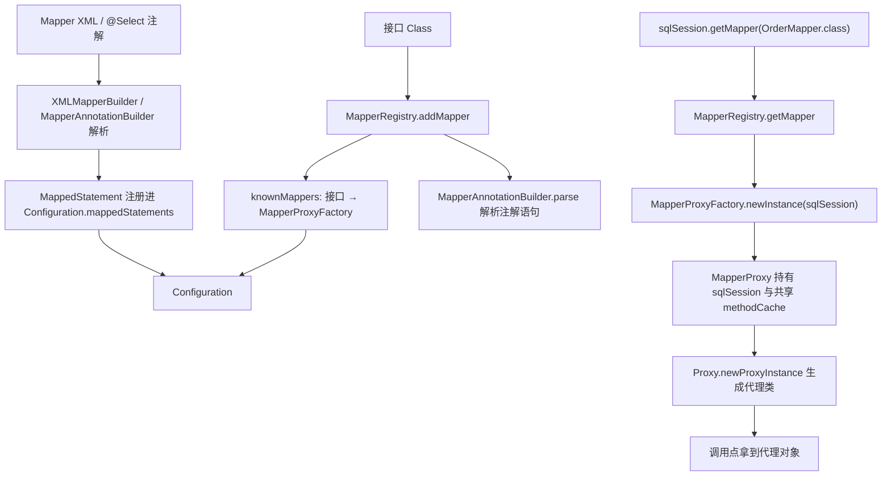
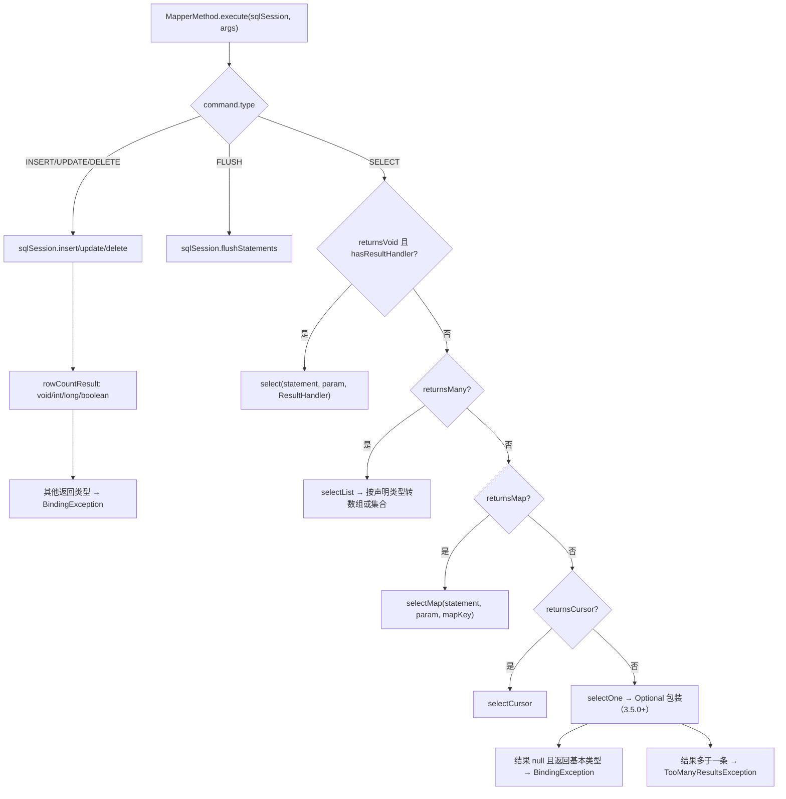
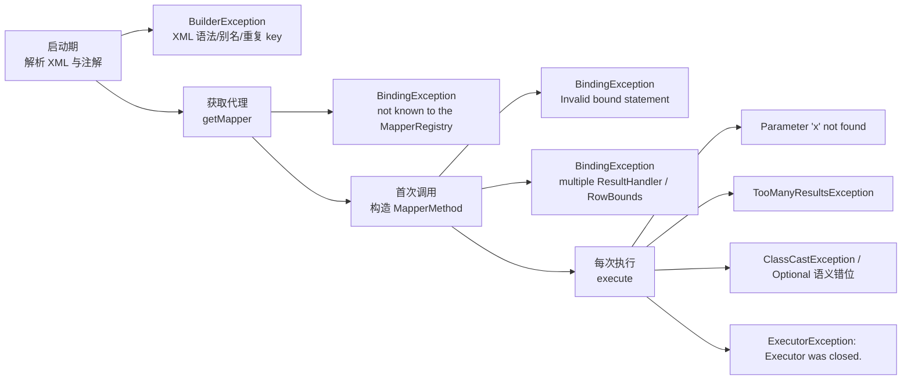
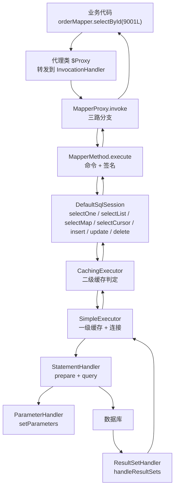

# Mapper接口的代理实现——MapperProxy与MapperMethod

**摘要：**

`orderMapper.selectById(9001L)` 这一行代码里没有实现类，接口的声明与 SQL 的文本分处两个文件，框架却能在运行期把它变成一个可调用对象。整个过程由三件东西接续完成：`MapperRegistry` 持有"接口到工厂"的注册表，`MapperProxyFactory` 用 JDK 动态代理生成实例，`MapperProxy` 作为调用处理器把方法调用分派给 `MapperMethod`，后者再用一段 `SqlCommand` 找出语句、一段 `MethodSignature` 决定怎么传参与怎么接返回值。本篇按四条线展开：代理的创建链（注册、绑定、生成、谁在什么时机创建）、`invoke` 的三个分支（`Object` 方法、`default` 方法、普通抽象方法）、`MapperMethod` 的"命令加执行"两段结构及其返回值分派表、以及这条链路的边界与故障形态。全文的判断建立在两个前提上：语句标识（statementId）只能由接口全限定名与方法名拼成，没有第二种指定方式；接口方法与语句的绑定发生在首次调用而不是启动期。这两条前提各自派生出几类故障，笔者用 MyBatis 3.5.19 与 JDK 17 写了探针逐条验证，文中的异常消息与判定结果均取自实际运行输出，凡涉及规模与耗时的数字都标明为估算。

---

## 第 1 章 一行调用背后的四个悬问

### 1.1 贯穿案例：订单服务的一次主键查询

订单服务 `order-service` 里有一张 `t_order` 表，Mapper 接口与 XML 都放在 `com.acme.order.mapper` 包下。接口只有声明，没有任何实现：

```java
public interface OrderMapper {
    Order selectById(@Param("id") Long id);                 // 无实现
    List<Order> selectByStatus(@Param("status") String status);
    int updateStatus(@Param("id") Long id, @Param("status") String status);
}
```

XML 里按"接口名做 namespace、方法名做 id"的方式把两边缝在一起：

```xml
<mapper namespace="com.acme.order.mapper.OrderMapper">
    <select id="selectById" resultType="com.acme.order.domain.Order">
        SELECT id, order_no, user_id, amount, status, created_at
        FROM t_order WHERE id = #{id}
    </select>
    <!-- selectByStatus、updateStatus 同理 -->
</mapper>
```

业务代码里注入接口，直接调用：

```java
@Service
public class OrderQueryService {
    private final OrderMapper orderMapper;      // 注入的是代理对象，不是实现类
    public OrderQueryService(OrderMapper orderMapper) { this.orderMapper = orderMapper; }
    public Order detail(Long id) { return orderMapper.selectById(id); }   // 这一行发生了什么
}
```

这行调用出问题的时候，报错往往出现在与它毫无字面关系的地方——有时是 `BindingException: Invalid bound statement (not found)`，有时是 `TooManyResultsException`，有时是 `ClassCastException`，有时干脆什么都不报、SQL 悄悄查了另一条。要能把这些现象归位，得先答出四个问题。

第一个问题：接口没有实现类，谁是它的实现。答案不是"Spring 生成了一个实现类"，而是 JDK 的 `Proxy.newProxyInstance` 在运行期生成了一个类，这个类实现了 `OrderMapper` 接口、把每个方法体都翻译成"转交给调用处理器"。真实类名形如 `jdk.proxy2.$Proxy4`，与接口同名的方法一个都没有真正的逻辑。

第二个问题：调用为什么能被拦住。因为生成的代理类持有 `MapperProxy` 这个 `InvocationHandler`，所有方法调用都会先进入它的 `invoke(Object proxy, Method method, Object[] args)`。也就是说，Mybatis 的"接口编程"不是语法糖，而是一次方法调用的重新路由。

第三个问题：返回值类型怎么被翻译成不同的 `SqlSession` 调用。同一个 `invoke` 出口，返回 `Order`、`List<Order>`、`Map<Long, Order>`、`Cursor<Order>`、`Optional<Order>`、`int`，走的都不是同一条路。决定这件事的是 `MapperMethod.MethodSignature`，它在第一次调用时把方法的返回类型与参数表扫一遍，存下五个布尔标志与两个参数下标。

第四个问题：边界在哪里。哪些写法看起来合理却根本不工作，哪些故障一定会在某个时刻爆出来，哪些问题会被推迟到线上第一次流量到达时才现形。这类问题无法从文档的用法示例里读出来，只能从"绑定规则的唯一性"与"绑定发生的时机"两处推。

### 1.2 为什么这件事值得单独拆开看

传统 DAO 里，接口与实现是两个文件，绑定关系由 Java 编译器保证，`UserDaoImpl` 里调错方法名编译就过不去。Mybatis 把**接口与 SQL 的绑定挪到了运行期**：字符串形式的语句标识代替了方法引用，XML 的 id 与人写的 Java 方法名靠人肉对齐。这个交易换来的是"零实现类"和"SQL 与代码分离"，代价是编译器不再替你检查两边的对应关系。

交易的成本分布得很不均匀：写的时候省事，出事的时候费事。所以本篇的重点不在于复述"接口加 XML 就能用"，而在于把"什么情况下这套约定会失效、失效时抛什么、为什么抛在这里而不是那里"讲清楚。下面这条链路是后文的骨架。



图里最容易被忽略的一条边是 `L → M`：代理对象每次取用都重新生成，而 `methodCache` 却在工厂里跨会话共享，这条不对称是第六篇要讨论的缓存问题，也是热更新为什么失效的根源。

### 1.3 本篇的边界

本篇只讲"接口方法如何变成语句执行"这一段：注册与创建、调用分派、签名解析、返回值分派、缓存位置、故障形态。至于 `Configuration` 如何组织元数据、`SqlSession` 与三种 `Executor` 的内部实现、参数如何落到 `?` 占位符、`ResultMap` 如何嵌套映射、两级缓存的命中条件、插件链如何包装四大对象、以及 Spring 如何代管会话，分别由 `[[01 Mybatis全局架构——从SQL到结果映射的完整链路]]`、`[[02 SqlSession与Executor——命令执行的核心引擎]]`、`[[04 参数处理——ParameterHandler与TypeHandler的类型映射]]`、`[[05 结果映射——ResultMap的嵌套映射与延迟加载]]`、`[[06 一级缓存与二级缓存——命中条件、失效场景与生产陷阱]]`、`[[07 插件机制——Interceptor的责任链模式与分页插件原理]]`、`[[09 Mybatis-Spring整合原理——SqlSessionTemplate与事务管理]]` 承担。这里提到它们时只交代一件事：在代理这条链上占据哪个位置。

---

## 第 2 章 代理的创建链

### 2.1 注册表里装的是什么

`MapperRegistry` 是 `Configuration` 的一个字段，结构极简，一张 Map 加两个方法。3.5.x 里这张表是 `ConcurrentHashMap`，key 是接口的 `Class`，value 是 `MapperProxyFactory`：

```java
public class MapperRegistry {
  private final Configuration config;
  // value 是工厂而不是代理：代理必须绑定某个 SqlSession，属于会话级对象，
  // 放进应用级的注册表既不合语义，也会让会话无法回收
  private final Map<Class<?>, MapperProxyFactory<?>> knownMappers = new ConcurrentHashMap<>();
  ...
}
```

这一点值得先钉住：**注册表里存的是工厂而不是代理**。工厂只持有接口的 `Class` 与一份方法缓存，是无状态且线程安全的；代理对象则持有 `SqlSession`，随会话生灭。把这两者分开，Spring 才能在应用级 Bean 与请求级会话之间搭桥，这是后话。

取代理的方法只有三步，失败信息也在其中：

```java
public <T> T getMapper(Class<T> type, SqlSession sqlSession) {
  final MapperProxyFactory<T> mapperProxyFactory = (MapperProxyFactory<T>) knownMappers.get(type);
  if (mapperProxyFactory == null) {
    // 这句是"没注册"的唯一判据，与"注册了但没绑定"是两码事，后文会分开
    throw new BindingException("Type " + type + " is not known to the MapperRegistry.");
  }
  try {
    return mapperProxyFactory.newInstance(sqlSession);
  } catch (Exception e) {
    throw new BindingException("Error getting mapper instance. Cause: " + e, e);
  }
}
```

### 2.2 addMapper 的三步与一个顺序陷阱

注册一个接口做三件事：判重、放工厂、解析注解语句。真正有意思的是顺序——先把工厂放进 Map，再跑解析器：

```java
public <T> void addMapper(Class<T> type) {
  if (type.isInterface()) {                       // 传进来不是接口就静默返回，不报错
    if (hasMapper(type)) {
      throw new BindingException("Type " + type + " is already known to the MapperRegistry.");
    }
    boolean loadCompleted = false;
    try {
      knownMappers.put(type, new MapperProxyFactory<>(type));
      // 源码注释交代了原因：必须先把类型放进去再解析，
      // 否则解析过程中若 XML 的 namespace 又指回这个接口，会再次触发绑定
      // 而第二次绑定看到接口已在表中，就会安静地跳过，不会抛"already known"
      MapperAnnotationBuilder parser = new MapperAnnotationBuilder(config, type);
      parser.parse();
      loadCompleted = true;
    } finally {
      if (!loadCompleted) {
        knownMappers.remove(type);              // 解析失败要把半初始化的登记撤回
      }
    }
  }
}
```

这段代码里有三个容易被忽略的行为，每一个都能在运维现场变成一条难查的现象。

其一，`if (type.isInterface())` 没有 `else`。把一个普通类交给 `addMapper`，什么也不会发生，不抛异常也不打日志；后续对该类型调用 `getMapper` 才会报 `Type ... is not known to the MapperRegistry.`。所以"错了却没有任何提示"这件事，在注册阶段就已经埋下。

其二，`finally` 里撤回登记，意味着解析失败之后注册表是干净的，但也意味着第二次尝试注册同一接口时报的会是原始解析错误的重新抛出而不是"already known"，而如果调用方把第一次的异常吞掉了，后续只会看到 `not known`——原始根因被这条清理逻辑掩盖。排查这类问题的正确切入点是启动日志里第一次出现的 `BuilderException`，不是最后那条 `BindingException`。

其三，重复注册直接抛 `BindingException`，没有幂等处理。这在手工装配时很容易踩到：既在 `mybatis-config.xml` 里写了 `<mapper class="..."/>`，又用 `<package>` 扫到了同一个接口，启动就会失败。Spring 集成里之所以不出这个问题，是因为 `MapperFactoryBean` 在 `checkDaoConfig` 里先做了 `hasMapper` 判断再决定是否注册，这一层的细节留给 `[[09 Mybatis-Spring整合原理——SqlSessionTemplate与事务管理]]`。

### 2.3 注册的五个入口

接口被登记进 `knownMappers` 的路径不止一条，理解它们的区别有助于判断"为什么我的 Mapper 没被扫描到"。

| 入口 | 写法 | 触发者 | 特点与常见坑 |
| --- | --- | --- | --- |
| 包扫描 | `<mappers><package name="com.acme.order.mapper"/></mappers>` | `MapperRegistry.addMappers` | 递归扫描包内所有接口，需要接口编译后在 classpath 上 |
| 逐个指定接口 | `<mapper class="com.acme.order.mapper.OrderMapper"/>` | `XMLConfigBuilder.mapperElement` | 只注册接口，不解析 XML；XML 要另配 |
| 只指定 XML | `<mapper resource="mapper/OrderMapper.xml"/>` | `XMLMapperBuilder.parse` | 解析 XML 时若 namespace 能解析成接口，会自动补注册 |
| 注解扫描 | `@MapperScan("com.acme.order.mapper")` | Spring 的 `ClassPathMapperScanner` | 生成 `MapperFactoryBean` 定义，接口成为 Bean |
| 单接口注解 | `@Mapper` 加包扫描 | Boot 的自动配置扫描器 | 与前一条的区别在扫描谓词，细节在 09 篇 |

第二行与第三行的区别经常被混淆：`<mapper class>` 只让接口进入注册表，语句仍要靠注解或者别处的 XML 提供；`<mapper resource>` 反过来，先解析语句，再"顺带"把接口注册进来。两者同时指向同一个接口时，后执行的那次会撞上 `already known`。

### 2.4 XML 侧的自动绑定

"只写 `<mapper resource>` 也能用 `getMapper`"这件事，靠的是 `XMLMapperBuilder` 在解析收尾时调用 `bindMapperForNamespace`：把 `namespace` 当作类名加载，若成功且是接口，就调 `configuration.addMapper`。笔者用一个探针验证了这条隐式路径——只解析一份 namespace 为 `demo.ChildMapper` 的 XML，随后 `hasMapper(ChildMapper.class)` 返回 `true`，而再手工 `addMapper` 同一接口则立刻抛 `already known`。

这条隐式绑定带来两个直接推论。第一，`namespace` 写错不只是"语句找不到"，还会让本该自动注册的接口彻底缺席，症状从 `Invalid bound statement` 变成 `not known to the MapperRegistry`，两者根因相同、报错位置却不同。第二，XML 与接口只要能被同一个类加载器看到，绑定就会自动发生，因此"接口和 XML 分处两个模块、只把其中一个打进包"这种打包事故，会表现为启动期一切正常、首次调用才炸。

### 2.5 工厂到代理：一行 newProxyInstance

`MapperProxyFactory` 的全部价值在于两件事：记住接口，持有方法缓存。

```java
public class MapperProxyFactory<T> {
  private final Class<T> mapperInterface;
  // 缓存放在工厂里而不是代理里：同一接口的所有代理、所有会话共用一份分析结果
  private final Map<Method, MapperMethodInvoker> methodCache = new ConcurrentHashMap<>();

  public T newInstance(SqlSession sqlSession) {
    final MapperProxy<T> mapperProxy = new MapperProxy<>(sqlSession, mapperInterface, methodCache);
    return newInstance(mapperProxy);
  }

  protected T newInstance(MapperProxy<T> mapperProxy) {
    // 类加载器取自接口而非当前线程：代理类由接口的加载器定义，
    // 这决定了容器、热部署、多模块场景下代理类能否被调用方看见
    return (T) Proxy.newProxyInstance(mapperInterface.getClassLoader(),
        new Class[] { mapperInterface }, mapperProxy);
  }
}
```

`Proxy.newProxyInstance` 的第三个参数是调用处理器，前两个参数决定了生成类的形状：它实现哪些接口、由哪个类加载器定义。Mybatis 只传了 `mapperInterface` 一个接口，因此代理类只实现 Mapper 接口本身，不继承任何具体类。这一点在第九篇要讨论的选型里是决定性的——接口本来就在，用 JDK 代理不需要目标对象，也不需要生成子类。

方法缓存的归属值得多说一句。它挂在工厂上，工厂挂在 `Configuration` 的注册表里，于是一份分析结果的生命周期等于整个 `Configuration`，跨越了无数个 `SqlSession`。第 6 章会把这条事实推到"热更新为什么不生效"的结论上。

### 2.6 每次 getMapper 都是新对象

一个常被误判的事实是代理对象的个数。譬如连续两次对同一会话取同一个接口的实例，看起来像是同一个对象，实际每次 `getMapper` 都走一遍 `newInstance`，也就每次生成一个新的代理实例与一个新的 `MapperProxy`；它们共享接口、共享方法缓存，但各自绑定自己的 `SqlSession`。探针里连续两次 `getMapper(OrderMapper.class)` 得到的两个引用用 `==` 比较为 `false`，各自的调用处理器也是不同对象。

这条事实解释了两个现象。一是"把代理对象当成标识用"注定失败，第 8 章的反例会展示它连 `equals` 都不可靠；二是 Spring 场景下注入到业务类里的 Mapper 之所以是单例，并不是因为代理天生单例，而是因为 `MapperFactoryBean` 把它们做成了 Bean，会话问题交给了 `SqlSessionTemplate` 处理。

---

## 第 3 章 MapperProxy 的三个分支

### 3.1 invoke 的整体形状

`MapperProxy` 实现 `InvocationHandler`，全部逻辑集中在一个方法里，骨架只有三层判断：

```java
@Override
public Object invoke(Object proxy, Method method, Object[] args) throws Throwable {
  try {
    if (Object.class.equals(method.getDeclaringClass())) {
      // 分支一：声明类是 Object 的三个方法，直接反射到处理器自身，不碰 SQL
      return method.invoke(this, args);
    }
    // 分支二与三分支都在 cachedInvoker 里区分：default 方法走 MethodHandle，其余走 MapperMethod
    return cachedInvoker(method).invoke(proxy, method, args, sqlSession);
  } catch (Throwable t) {
    // 反射与 MethodHandle 都会把目标异常包一层，这里剥掉，
    // 否则调用方看到的是 InvocationTargetException，异常类型匹配（如回滚规则）会失准
    throw ExceptionUtil.unwrapThrowable(t);
  }
}
```

三个分支的判定条件与后果差异很大，下面逐条拆。

### 3.2 分支一：Object 的三个方法

第一个分支的条件是 `Object.class.equals(method.getDeclaringClass())`，命中的只有 `toString`、`hashCode`、`equals`（以及 `clone`、`finalize` 这类受保护方法在特定调用下的场景）。命中之后执行的是 `method.invoke(this, args)`——注意这里的 `this` 是 `MapperProxy` 自己，不是代理对象。这一行代码决定了三个方法的语义全部落在"处理器"身上：

- `toString()` 返回的是处理器的 `Object.toString()`，输出形如 `org.apache.ibatis.binding.MapperProxy@63440df3`；
- `hashCode()` 返回的是处理器的身份哈希，与代理对象的身份哈希无关，探针里两者分别是 `1665404403` 与 `1295083508`；
- `equals()` 的接收者是处理器、参数是代理对象，二者永不相等，于是 `mapper.equals(mapper)` 恒为 `false`。

最后一条最容易伤人。`mapper.equals(mapper)` 返回 `false`，`Objects.equals(mapper, mapper)` 同样返回 `false`；把它放进 `HashSet` 时 `contains` 却能命中，是因为 `HashMap` 的查找先比引用再比 `equals`，引用相同就短路了。不过一旦某个中间层把同一对象复制、包装或用 `equals` 做断言（测试里的 `assertEquals`、以 Mapper 为 key 的缓存、按值去重的集合），行为就会与直觉相反。笔者的建议很直白：Mapper 代理不参与相等性语义，需要标识时用接口的 `Class` 或业务主键。

顺带记一个边界：在 Mapper 接口里重声明 `toString()` 不会改变分派结果。探针里 `RedeclareMapper` 显式声明了 `String toString();`，调用 `r.toString()` 拿到的仍是处理器的 `toString` 输出，而非 `Invalid bound statement`。原因是 JDK 生成的代理类自己 `final` 实现了 `toString` 并直连处理器，接口里的同名声明被遮蔽，调用点拿到的 `Method` 声明类仍是 `Object`。

### 3.3 分支二：default 方法与 MethodHandle

接口的 `default` 方法在代理类里没有对应的转发实现，JDK 代理不会自动调用它，Mybatis 得自己想办。3.5.x 的解决办法是用方法句柄（`MethodHandle`）把 default 方法"绑到代理实例上"再调用：

```java
private MapperMethodInvoker cachedInvoker(Method method) throws Throwable {
  try {
    return MapUtil.computeIfAbsent(methodCache, method, m -> {
      if (!m.isDefault()) {
        return new PlainMethodInvoker(new MapperMethod(mapperInterface, method, sqlSession.getConfiguration()));
      }
      try {
        // JDK 8 没有 privateLookupIn，只能靠私有构造器造 Lookup 再 unreflectSpecial；
        // JDK 9+ 走 privateLookupIn + findSpecial，两条路径在静态块里一次性择定
        if (privateLookupInMethod == null) {
          return new DefaultMethodInvoker(getMethodHandleJava8(method));
        }
        return new DefaultMethodInvoker(getMethodHandleJava9(method));
      } catch (IllegalAccessException | InstantiationException | InvocationTargetException
          | NoSuchMethodException e) {
        throw new RuntimeException(e);
      }
    });
  } catch (RuntimeException re) {
    // computeIfAbsent 把受检异常包成了 RuntimeException，这里剥回原始异常
    Throwable cause = re.getCause();
    throw cause == null ? re : cause;
  }
}
```

两个细节值得停下来看。第一，`MethodHandle` 是按 `Method` 缓存的，而 `bindTo(proxy)` 发生在每次调用时——`DefaultMethodInvoker.invoke` 里写着 `methodHandle.bindTo(proxy).invokeWithArguments(args)`。绑定产生新句柄，成本低于一次反射调用，但并非零，把它挪到"一次解析、多次复用"的缓存里是正确的取舍。第二，`getMethodHandleJava9` 里 `findSpecial` 的最后一个参数是 `declaringClass` 自身，等价于在接口内部执行 `invokespecial`，因此 default 方法体里的 `this` 就是传进来的代理对象。

第二条事实直接推翻了一个流传较广的说法：Mapper 的 default 方法里调用 `this.selectById(id)` **并不会绕过代理**。探针里 `default String callMapped() { return "mapped:" + selectById(1L); }` 执行后抛出的是数据源异常（驱动类不存在），说明这次内部调用已经穿透到 `Executor`；而调用未映射的 `selectUnmapped` 则抛出 `BindingException: Invalid bound statement (not found): demo.OrderMapper.selectUnmapped`。两种结果都证明控制流回到了 `MapperProxy.invoke`——如果自调用真的绕过了代理，非代理对象上调抽象方法只会得到 `AbstractMethodError`。

这与 Spring AOP 的自调用失效是两件不同的事。譬如 Spring 的代理背后有一个真实的目标对象，自调用打在目标对象上，横切逻辑自然被跳过；Mapper 没有目标对象，代理是唯一实例，方法体里的 `this` 只能是它，所以内部调用必然回到处理器。把 AOP 的经验平移过来，会得出错误结论，也会让人误以为"default 方法里调用抽象方法是安全的绑定方式"——它确实能跑，但每调一次就是一次独立的 SQL 往返，第 8 章会给出更值得警惕的代价。

### 3.4 分支三：普通抽象方法

除 Object 方法与 default 方法之外的调用，全部落到 `PlainMethodInvoker`。这个类只做一件事：

```java
private static class PlainMethodInvoker implements MapperMethodInvoker {
  private final MapperMethod mapperMethod;
  @Override
  public Object invoke(Object proxy, Method method, Object[] args, SqlSession sqlSession) {
    // 这里的 sqlSession 是 invoke 传进来的，也就是"创建代理时绑定的那个会话"，
    // 不是 ThreadLocal 里的当前会话；代理与会话的绑定关系由此固定
    return mapperMethod.execute(sqlSession, args);
  }
}
```

这段代码里藏着一条对使用方式有约束力的事实：代理绑定的是创建它时的 `SqlSession`，而非"当前线程的会话"。Spring 之所以必须用 `SqlSessionTemplate` 这层代理再套一层，就是因为它要保证每次调用都拿到当前线程绑定的会话；非 Spring 场景下把 Mapper 存成静态字段跨请求复用，等于把一个已关闭的会话焊死在代理上，症状是 `ExecutorException: Executor was closed.`。

`MapperMethod` 的构造是懒的：只有某个方法第一次被调用时，`computeIfAbsent` 的映射函数才执行，`MapperMethod` 才被造出来。这个"懒"字决定了本篇后面要反复提到的一件事：接口与语句的绑定校验、返回类型的解析、参数名表的构建，全部推迟到首次调用。启动期跑得干干净净、第一次流量打进来才抛异常，根源就在这里。

### 3.5 三类方法对照

把三个分支放在一起看，差异集中在"要不要 SQL""要不要方法句柄""异常从哪来"三处：

| 维度 | `Object` 的 `toString/hashCode/equals` | 接口 `default` 方法 | 普通抽象方法 |
| --- | --- | --- | --- |
| 判定条件 | 声明类为 `Object` | `Method.isDefault()` | 其余全部 |
| 执行载体 | `method.invoke(this, args)` | `MethodHandle` 加 `bindTo(proxy)` | `MapperMethod.execute` |
| 是否碰数据库 | 否 | 取决于方法体内部调了什么 | 是 |
| 是否进方法缓存 | 否 | 是（`DefaultMethodInvoker`） | 是（`PlainMethodInvoker`） |
| 典型异常 | 无 | 方法体内部抛出的原异常 | `BindingException` 及执行期异常 |
| 语义陷阱 | `equals` 恒 `false`、`hashCode` 不是代理的 | 内部调用照常走代理，逐条 SQL | 绑定推迟到首次调用 |

```mermaid
%%{init: {'theme': 'dracula'}}%%
flowchart TD
    A["proxy.method(args)"] --> B{"声明类是 Object?"}
    B -->|是| C["method.invoke(MapperProxy, args)"]
    C --> C1["toString → 处理器地址"]
    C --> C2["hashCode → 处理器身份哈希"]
    C --> C3["equals → 恒 false"]
    B -->|否| D{"在 methodCache 中?"}
    D -->|否| E{"Method.isDefault()?"}
    E -->|是| F["JDK 8: Lookup(Class,int) + unreflectSpecial<br/>JDK 9+: privateLookupIn + findSpecial"]
    E -->|否| G["new MapperMethod(接口, 方法, Configuration)<br/>构造 SqlCommand 与 MethodSignature"]
    F --> H["DefaultMethodInvoker 入缓存"]
    G --> I["PlainMethodInvoker 入缓存"]
    D -->|是| J["取出缓存的 invoker"]
    H --> K["bindTo(proxy).invokeWithArguments(args)"]
    I --> L["mapperMethod.execute(sqlSession, args)"]
    J --> K
    J --> L
```---

## 第 4 章 MapperMethod 的两段：命令与签名

### 4.1 两段的分工

`MapperMethod` 的构造函数只有两行，却把"方法调用"拆成了两个相互独立的问题：

```java
public MapperMethod(Class<?> mapperInterface, Method method, Configuration config) {
  this.command = new SqlCommand(config, mapperInterface, method);      // 这段 SQL 是哪一个语句
  this.method = new MethodSignature(config, mapperInterface, method);  // 参数怎么传、结果怎么接
}
```

`SqlCommand` 负责"找到语句"，产出语句标识 `name` 与命令类型 `type`（SELECT/INSERT/UPDATE/DELETE/FLUSH）；**语句标识只由接口全限定名与方法名拼成**，没有第三个来源。`MethodSignature` 负责"读懂方法"，产出五个布尔标志、`@MapKey` 的值、`RowBounds` 与 `ResultHandler` 在参数表里的下标，以及一个参数名解析器。`execute` 方法则是把两段结论合起来用：先按 `command.type` 走大分支，再按 `method` 的标志走子分支。

这个拆法不是美学偏好，而是两种信息的来源不同。命令信息来自 `Configuration` 里的元数据，会随 XML 与注解变化；签名信息来自 Java 反射，只与接口本身有关。两者分开之后，前者可以因为"找不到语句"而抛错，后者可以独立地被单元测试直接构造——第 5 章的实测表就是把 `MethodSignature` 单独拎出来逐项观测的结果。

### 4.2 SqlCommand：语句标识的唯一来源

`SqlCommand` 的构造逻辑不长，但每一行都在界定边界：

```java
public SqlCommand(Configuration configuration, Class<?> mapperInterface, Method method) {
  final String methodName = method.getName();
  final Class<?> declaringClass = method.getDeclaringClass();
  // 语句标识只由"接口全限定名 + 方法名"拼成，没有第二个入口
  MappedStatement ms = resolveMappedStatement(mapperInterface, methodName, declaringClass, configuration);
  if (ms == null) {
    if (method.getAnnotation(Flush.class) == null) {
      throw new BindingException(
          "Invalid bound statement (not found): " + mapperInterface.getName() + "." + methodName);
    }
    // @Flush 是没有语句的合法方法：它只要求冲刷批次，不需要 statementId
    name = null;
    type = SqlCommandType.FLUSH;
  } else {
    name = ms.getId();
    type = ms.getSqlCommandType();
    if (type == SqlCommandType.UNKNOWN) {
      throw new BindingException("Unknown execution method for: " + name);
    }
  }
}
```

这里有必要打断一个常见误解：`@Select`、`@Insert` 这类注解指定的不是语句标识，而是 SQL 文本。注解方式下语句的 id 仍然是"接口全限定名.方法名"，由 `MapperAnnotationBuilder` 自动拼出。笔者的探针里只给接口方法加了 `@Select`、没有写任何 XML，`hasStatement("demo.AnnMapper.findByAnno")` 为 `true`，`getMappedStatement(...).getId()` 也返回同一个字符串。也就是说，**接口一旦定型，语句标识就定型**，没有任何配置项可以覆盖它。这条唯一性既是"零配置"体验的来源，也是重载方法无法支持的根源，第 7 章会展开。

`resolveMappedStatement` 承担的是"接口继承"这一层的查找，逻辑是一个先子后父的递归：

```java
private MappedStatement resolveMappedStatement(Class<?> mapperInterface, String methodName,
    Class<?> declaringClass, Configuration configuration) {
  String statementId = mapperInterface.getName() + "." + methodName;
  if (configuration.hasStatement(statementId)) {
    return configuration.getMappedStatement(statementId);      // 先按传入接口的命名空间找
  }
  if (mapperInterface.equals(declaringClass)) {
    return null;                                              // 方法就声明在这里，不必再往上找
  }
  for (Class<?> superInterface : mapperInterface.getInterfaces()) {
    // 只往"方法声明所在的祖先接口"方向找，方向反了会误命中无关父接口的同名语句
    if (declaringClass.isAssignableFrom(superInterface)) {
      MappedStatement ms = resolveMappedStatement(superInterface, methodName, declaringClass, configuration);
      if (ms != null) {
        return ms;
      }
    }
  }
  return null;
}
```

这段递归解释了三种在真实项目里都能见到的布局，笔者的探针逐一验证过。

第一种，父接口方法、父接口命名空间：`ChildMapper extends BaseMapper`，`baseById` 只出现在 `demo.BaseMapper` 的 XML 里。调用 `child.baseById(1L)` 时先查 `demo.ChildMapper.baseById`（无），因为方法声明在 `BaseMapper` 且它不等于子接口，于是递归进 `BaseMapper` 查到 `demo.BaseMapper.baseById`，调用正常进入 `Executor`。

第二种，父接口声明、子接口命名空间：这正是 MyBatis-Plus 这类"通用 CRUD 注入"的做法。探针里把 `baseById` 的语句注册在 `demo.ChildMapper` 下，父命名空间里一条都没有，`child.baseById(1L)` 同样走通——因为第一次按子接口命名空间查找就命中了。反过来，若两处都注册，先命中的是子接口那份，父接口那份成了死配置。

第三种，两个都没有：抛 `Invalid bound statement`，消息里的前半段是"当前被代理的接口"，不是"方法声明的接口"。这一点在多层继承里会产生误导性的报错——报错说 `ChildMapper.xxx` 找不到，而修复位置其实在父接口的 XML 里。

### 4.3 为什么先 hasStatement 再 get

递归里第一句用的是 `configuration.hasStatement(statementId)`，而不是直接 `getMappedStatement`。原因是后者在缺失时抛异常而不是返回 `null`：`Configuration` 内部的 `mappedStatements` 是一个会做短名解析与歧义检测的 `StrictMap`，缺失直接抛 `IllegalArgumentException`，短名对应多条时抛歧义异常。若在这里用 `get`，"找不到就走父接口"这条分支根本没有机会执行。

顺带说一个后果：`StrictMap` 在写入时会同时登记全名与短名，因此 `hasStatement("findByAnno")` 这种不带命名空间的查询也会返回 `true`，短名唯一时才有效。`MapperMethod` 永远只用全名，短名能力主要服务于运行期人工调试与其他组件的宽松查找；在自己的代码里用短名做判断，会在跨包同名时得到歧义异常。

### 4.4 MethodSignature：五个布尔与三个下标

签名段要做的事比想象中多：它既要把返回类型归一化成"分派结论"，也要把参数表里的特殊参数挑出来。

```java
public MethodSignature(Configuration configuration, Class<?> mapperInterface, Method method) {
  // 泛型返回类型必须用 TypeParameterResolver 按接口实参解析，裸 Method.getReturnType 会擦成 Object
  Type resolvedReturnType = TypeParameterResolver.resolveReturnType(method, mapperInterface);
  if (resolvedReturnType instanceof Class<?>) {
    this.returnType = (Class<?>) resolvedReturnType;
  } else if (resolvedReturnType instanceof ParameterizedType) {
    this.returnType = (Class<?>) ((ParameterizedType) resolvedReturnType).getRawType();  // List<Order> → List
  } else {
    this.returnType = method.getReturnType();
  }
  this.returnsVoid = void.class.equals(this.returnType);
  // 集合判断交给 ObjectFactory：它认 Collection 家族与数组，不认 Map、Stream、CompletableFuture
  this.returnsMany = configuration.getObjectFactory().isCollection(this.returnType) || this.returnType.isArray();
  this.returnsCursor = Cursor.class.equals(this.returnType);
  this.returnsOptional = Optional.class.equals(this.returnType);
  this.mapKey = getMapKey(method);          // 只有返回 Map 且标了 @MapKey 才有值
  this.returnsMap = this.mapKey != null;
  // 这两个参数不参与 SQL 绑定，位置要单独记下来，执行时从 args 里取
  this.rowBoundsIndex = getUniqueParamIndex(method, RowBounds.class);
  this.resultHandlerIndex = getUniqueParamIndex(method, ResultHandler.class);
  this.paramNameResolver = new ParamNameResolver(configuration, method);
}
```

`TypeParameterResolver` 这一句经常被当成多余的防御性代码，其实它是分派正确性的前提。设想一个"通用仓储"接口：

```java
public interface BaseRepo<T> {
    T findAll();             // 泛型即返回类型，擦除后是 Object
    List<T> findList();
}
public interface OrderRepo extends BaseRepo<List<Order>> { }
```

`BaseRepo.findAll` 的 `method.getReturnType()` 是 `java.lang.Object`，`getGenericReturnType()` 是类型变量 `T`。若拿裸类型做判断，`returnsMany` 为 `false`，`execute` 会落进 `selectOne` 分支，而这条 SQL 实际返回多行，于是抛 `TooManyResultsException`——错误与"你想让方法返回列表"这个意图完全对不上。探针验证了正确结果：`resolveReturnType` 在 `OrderRepo` 这个实参下把 `T` 解析成 `List<Order>`，取其原始类型 `java.util.List`，`returnsMany` 为 `true`，方法走 `selectList`。同一份代码在加与不加 `TypeParameterResolver` 两种实现下，行为分叉在"通用接口 + 泛型返回"这一种布局上。

`getUniqueParamIndex` 则负责"特殊参数的唯一性"，它在构造期就会失败：

```java
private Integer getUniqueParamIndex(Method method, Class<?> paramType) {
  Integer index = null;
  for (int i = 0; i < method.getParameterTypes().length; i++) {
    if (paramType.isAssignableFrom(method.getParameterTypes()[i])) {
      if (index != null) {
        // 两个 ResultHandler 或两个 RowBounds 没有合理解释，直接在解析期拒掉
        throw new BindingException(method.getName() + " cannot have multiple " + paramType.getSimpleName() + " parameters");
      }
      index = i;
    }
  }
  return index;
}
```

探针里 `doWithTwoHandlers(ResultHandler, ResultHandler)` 与 `doWithTwoRowBounds(RowBounds, RowBounds)` 在构造 `MapperMethod` 时分别抛出 `doWithTwoHandlers cannot have multiple ResultHandler parameters` 与 `doWithTwoRowBounds cannot have multiple RowBounds parameters`。注意抛出时机——不是启动，而是首次调用时构造 `MapperMethod` 的那一刻；所以这类错误写在代码里能编译能启动，直到有人调它。

参数侧的完整规则（`@Param` 命名、单参数不加注解时的直传、集合参数的 `collection`/`list`/`array` 别名）属于 `[[04 参数处理——ParameterHandler与TypeHandler的类型映射]]` 的范围，这里只保留与分派相关的一句：签名段把参数表转成一个 `ParamMap`，缺键时报的是 `BindingException: Parameter 'xxx' not found. Available parameters are [...]`，这条消息比"SQL 少了参数"更准确地指向"方法签名与 SQL 占位符不一致"。

### 4.5 查找次序汇总

把 4.2 的递归与 4.3 的短名规则合起来，接口方法的语句查找按以下次序进行，任何一步命中即停：

| 次序 | 查找对象 | 命中条件 | 未命中的后果 |
| --- | --- | --- | --- |
| 1 | 被代理接口命名空间 + 方法名 | 语句存在 | 进入下一步 |
| 2 | 若方法声明类就是被代理接口 | — | 直接判定找不到，抛 `Invalid bound statement` |
| 3 | 逐个父接口递归 | 声明类可从该父接口赋值，且父命名空间中有同名语句 | 继续下一个父接口 |
| 4 | 全部落空且方法带 `@Flush` | — | 走 `flushStatements`，不需要语句 |
| 5 | 全部落空且无 `@Flush` | — | 抛 `Invalid bound statement (not found): 接口全名.方法名` |

这张表是第 7 章全部绑定类故障的索引：五行里有四行对应一种配置事故。

---

## 第 5 章 返回值分派表

### 5.1 实测口径

`MapperMethod.execute` 的分支很多，靠读代码容易记混。笔者写了一个探针，用 MyBatis 3.5.19 构造 `Configuration`，注册一个包含二十个方法的 `SigMapper`，再对每个 `Method` 直接 `new MapperMethod(SigMapper.class, m, cfg)`，用反射读出 `MethodSignature` 的五个布尔与两个下标。这样得到的是"框架自己的判定结果"，不是笔者的推断。

探针的环境与结论需要一并交代：JDK 17.0.17、MyBatis 3.5.19、数据源指向一个不存在的驱动。凡是通过绑定层的调用都会在取连接时失败，因此"抛的是数据源异常而不是 `BindingException`"本身就是"已越过绑定层"的证据。下文引用的消息均为运行输出的原文。

### 5.2 二十种返回类型的判定结果

| 方法返回类型 | 归一化后的 `returnType` | `returnsVoid` | `returnsMany` | `returnsMap` | `returnsCursor` | `returnsOptional` | 实际走向 |
| --- | --- | --- | --- | --- | --- | --- | --- |
| `void` | `void` | 是 | 否 | 否 | 否 | 否 | `selectOne`，结果丢弃 |
| `int` / `long` / `boolean` | 同名基本类型 | 否 | 否 | 否 | 否 | 否 | `selectOne` |
| `String` | `String` | 否 | 否 | 否 | 否 | 否 | `selectOne`，调用点强转失败 |
| `Order` | `Order` | 否 | 否 | 否 | 否 | 否 | `selectOne` |
| `List<Order>` | `List` | 否 | 是 | 否 | 否 | 否 | `selectList` |
| `Collection<Order>` | `Collection` | 否 | 是 | 否 | 否 | 否 | `selectList` 后转声明类型 |
| `Set<Order>` | `Set` | 否 | 是 | 否 | 否 | 否 | `selectList` 后转声明类型 |
| `Order[]` | `Order[]` | 否 | 是 | 否 | 否 | 否 | `selectList` 后转数组 |
| `Map<Long,Order>`（无 `@MapKey`） | `Map` | 否 | 否 | 否 | 否 | 否 | `selectOne` |
| `Map<Long,Order>`（有 `@MapKey`） | `Map` | 否 | 否 | 是 | 否 | 否 | `selectMap` |
| `Cursor<Order>` | `Cursor` | 否 | 否 | 否 | 是 | 否 | `selectCursor` |
| `Optional<Order>` | `Optional` | 否 | 否 | 否 | 否 | 是 | `selectOne` 后包装 |
| `Stream<Order>` | `Stream` | 否 | 否 | 否 | 否 | 否 | `selectOne` |
| `CompletableFuture<Order>` | `CompletableFuture` | 否 | 否 | 否 | 否 | 否 | `selectOne` |
| `void` + `ResultHandler` 参数 | `void` | 是 | 否 | 否 | 否 | 否 | `select(ResultHandler)` |
| 两个 `ResultHandler` | — | — | — | — | — | — | 构造期抛 `BindingException` |
| 两个 `RowBounds` | — | — | — | — | — | — | 构造期抛 `BindingException` |

这张表里有三行与直觉相反，值得单独说。

第一行是 `Map` 不带 `@MapKey`。很多人以为"返回 `Map` 就会走 `selectMap`"，实际**漏了注解就会落进 `selectOne`**，实际判定的是 `mapKey != null`，注解缺席时 `returnsMap` 为假，而 `Map` 不是 `Collection` 家族的成员（探针里 `ObjectFactory.isCollection(Map.class)` 返回 `false`），因此也不会走 `selectList`，最终落进 `selectOne`。若这条 SQL 只返回一行，`selectOne` 拿到的是行对象（`Order`）而不是 `Map`，调用点强转成 `Map` 时抛 `ClassCastException`；若返回多行，先在 `selectOne` 里抛 `TooManyResultsException`。

第二、三行是 `Stream` 与 `CompletableFuture`。两者都不在分派表里，`returnsMany` 为假，于是都走 `selectOne`。`Stream` 的支持被放在 `Cursor` 上：`Cursor` 接口本身没有 `stream()` 方法（探针确认其声明方法只有 `isOpen`、`isConsumed`、`getCurrentIndex`，加上继承来的 `Iterable` 与 `Closeable`），要拿到流得自己写 `StreamSupport.stream(cursor.spliterator(), false)`，而且必须在事务与会话未关闭期间消费完。异步包装在框架里没有任何挂钩点，`CompletableFuture<User>` 只能由调用方在 Mapper 之外自己套。

### 5.3 SELECT 的五条路与顺序

`execute` 里 SELECT 分支的判断顺序不是随手写的，改动任何一处都会改变一批方法的走向：

```java
case SELECT:
  if (method.returnsVoid() && method.hasResultHandler()) {
    executeWithResultHandler(sqlSession, args);       // 第一条：流式回调，必须最先判定
    result = null;
  } else if (method.returnsMany()) {
    result = executeForMany(sqlSession, args);        // 集合与数组
  } else if (method.returnsMap()) {
    result = executeForMap(sqlSession, args);         // 只在 @MapKey 存在时为真
  } else if (method.returnsCursor()) {
    result = executeForCursor(sqlSession, args);      // 游标，不一次性装载
  } else {
    Object param = method.convertArgsToSqlCommandParam(args);
    result = sqlSession.selectOne(command.getName(), param);
    if (method.returnsOptional() && (result == null || !method.getReturnType().equals(result.getClass()))) {
      result = Optional.ofNullable(result);           // 3.5.0 起支持，见 returnsOptional 的 @since
    }
  }
  break;
```

第一个判断必须同时看 `returnsVoid`：只判 `hasResultHandler`，一个返回 `List` 又恰好带了 `ResultHandler` 参数的方法就会被抢进回调分支，而它的语义应当是 `selectList`。中间三条的先后其实不影响结果，互斥性由 `MethodSignature` 的构造保证——集合与数组不会同时是 `Map`，`Map` 不会同时是 `Cursor`，四种标志最多只有一个为真。真正有约束力的是最后那个 `else`：所有没被前四种条件认领的返回类型都会落进 `selectOne`，5.2 节表里的 `Stream`、`CompletableFuture` 与漏写 `@MapKey` 的 `Map` 都是这么落进去的。

### 5.4 写操作：只认四个返回类型

INSERT、UPDATE、DELETE 三条路的骨架完全相同：取参数、调 `SqlSession`、把影响行数交给 `rowCountResult` 翻译成方法声明的类型。

```java
private Object rowCountResult(int rowCount) {
  final Object result;
  if (method.returnsVoid()) {
    result = null;                                   // void：只关心执行，不关心行数
  } else if (Integer.class.equals(method.getReturnType()) || Integer.TYPE.equals(method.getReturnType())) {
    result = rowCount;
  } else if (Long.class.equals(method.getReturnType()) || Long.TYPE.equals(method.getReturnType())) {
    result = (long) rowCount;
  } else if (Boolean.class.equals(method.getReturnType()) || Boolean.TYPE.equals(method.getReturnType())) {
    result = rowCount > 0;                           // boolean 的语义是"有没有影响到行"
  } else {
    // 返回 String、枚举或自定义类型都到这里，异常在调用期抛，不在启动期
    throw new BindingException(
        "Mapper method '" + command.getName() + "' has an unsupported return type: " + method.getReturnType());
  }
  return result;
}
```

四种合法返回类型之外全部抛 `BindingException`，消息里带方法名与具体返回类型。这条约束排除了"用写操作返回自增主键""返回更新后的实体"这类常见需求，那些能力要通过 `@Options(useGeneratedKeys = true, keyProperty = "id")` 回填到入参对象上，而不是靠返回值。

### 5.5 单对象的两个陷阱

单对象分支只有两行，但两个异常都从这里出。

`TooManyResultsException` 来自 `DefaultSqlSession.selectOne`：它内部调 `selectList`，然后检查列表大小，超过一条就抛 `Expected one result (or null) to be returned by selectOne(), but found: N`。这条异常的名字容易让人以为问题在 `selectOne`，实际根因在 SQL——少了唯一键条件、或者关联查询产生了重复行。修复位置在 SQL 或索引，不在方法签名。

另一个是基本类型返回 `null` 的保护。`execute` 收尾处有一段统一判断：结果为 `null`、方法返回类型是基本类型、又不是 `void`，就抛 `BindingException` 并说明方法试图用基本类型返回 null。它防的是自动拆箱的 `NullPointerException`——若放任 `selectOne` 返回 `null`，拆箱发生在调用点，NPE 堆栈落在业务代码里，看不出是查询没命中；把异常提前到 `MapperMethod` 里抛，消息里至少带着方法名。真正会踩到的是聚合查询：`SELECT sum(amount) FROM t_order WHERE status = #{status}` 在没有匹配行时返回一行 `NULL`，`selectOne` 得到 `null`，方法若声明为 `long` 就在这里失败。

### 5.6 Optional 的真实语义

`returnsOptional` 自 3.5.0 引入，源码里带着 `@since 3.5.0` 的注释。它的实现只有一行，但跟着一个费解的条件：

```java
if (method.returnsOptional() && (result == null || !method.getReturnType().equals(result.getClass()))) {
  result = Optional.ofNullable(result);
}
```

`result == null` 这一半好懂：查不到时包成 `Optional.empty()`。`!method.getReturnType().equals(result.getClass())` 这一半是为了避免重复包装——如果某个插件或自定义返回已经把结果变成了 `Optional`（此时 `result.getClass()` 就是 `Optional`），就不再套一层，否则会得到 `Optional<Optional<User>>`。这行代码只有在"结果类型恰好等于声明类型"时才跳过包装，说明作者假设的异常路径只有"插件返回了已包装对象"，而不是"返回了别的类型"。

使用上要记住两条边界。其一，`Optional` 不改变 SQL 的执行方式，底层仍是 `selectOne`，因此查不到是 `empty()`，查到多条仍然抛 `TooManyResultsException`。其二，`Optional` 作为返回类型时，`returnsMany` 与 `returnsMap` 都是假，若方法带了 `@MapKey` 想返回 `Optional<Map<...>>`，注解不会生效——`getMapKey` 只检查 `Map` 是否可赋值给返回类型，`Optional` 不满足。

### 5.7 Map 的两处静默

`@MapKey` 这条路本身很短，但有两处不报错的失效值得记住。

其一是注解值的语义：`@MapKey("id")` 的字符串是**结果对象的属性名**，不是列名。`selectMap` 内部把每一行的结果对象用 `MetaObject` 取该属性作为 key，属性名写错不会报错，得到的是以 `null` 为 key 的单条记录——`Map` 里只剩最后一行。其二是 key 冲突：同一个 key 出现多次时**后写覆盖先写，不报错**。用状态字段做 key 是典型场景，一个状态有多条订单时 `Map` 里只留下最后一条，业务侧看到"分组少了数据"却没有任何异常提示。

这两处的共同点是"静默"，而它们都发生在 `MethodSignature` 之后的执行段，靠日志无法发现；判据只能是"`Map` 的大小与你预期的分组数对不上"。

### 5.8 分派决策小结



---

## 第 6 章 方法缓存：位置、代价与失效边界

### 6.1 缓存挂在工厂上

`methodCache` 是 `MapperProxyFactory` 的字段，类型为 `ConcurrentHashMap<Method, MapperMethodInvoker>`。它的归属决定了三件事：**与接口同寿命、与会话解耦、跨代理实例共享**。

探针把这条归属关系测得很直白。同一个 `OrderMapper` 在两个不同的 `SqlSession` 里各取一次代理，代理对象与调用处理器都不同，但两边的 `MapperProxyFactory.methodCache` 是同一个 `Map` 实例；第一个会话里调用过的方法留下 5 个条目，第二个会话调用 `selectAll` 后变成 6 个。也就是说，缓存条目由"方法"在全局首次被调用时产生一次，之后所有会话、所有代理都复用。

这个设计的收益在于把"反射分析"从每次调用摊到每个方法一次。`MapperMethod` 的构造要做的活不少：`resolveMappedStatement` 至少一次 Map 查找、泛型解析一次、`@MapKey` 与 `@Flush` 两次注解查找、`ParamNameResolver` 扫一遍参数注解并排序。这些动作在 `selectById` 这种被调用几百万次的方法上，若每次重做，代价会从"可忽略"变成"可观"；缓存之后，热路径只剩一次 `ConcurrentHashMap.get` 与一次 `PlainMethodInvoker.invoke`。

### 6.2 key 为什么是 Method 而稳定

`Method` 的 `equals`/`hashCode` 由声明类、方法名、参数类型三者决定，其中声明类是**引用比较**的参与项。于是缓存的稳定性取决于"接口的 `Class` 对象是否始终是同一个"。

同一套类加载器下这没有问题：`OrderMapper.class` 是常量，`Method` 也是常量，缓存永远命中。但在以下场面里，同一个接口会被加载成不同的 `Class`：

- 开发期的热重启（Spring Boot DevTools 一类工具用新的类加载器重建应用），旧 `Configuration` 连同旧工厂一起被丢弃，新的一套缓存从零开始；
- 传统的容器热部署（Tomcat 重新部署 WAR），同理；
- 同一个 jar 出现在两个类加载器里（多模块、插件式架构），两份 `Class` 各自有一套 `Configuration` 与缓存，互相看不见。

由于 `Configuration` 是缓存的宿主，**任何重建 Configuration 的动作都会连带清空方法缓存**，而任何"在同一个 Configuration 上热改语句"的动作都不存在——`Configuration` 没有提供删除或替换 `MappedStatement` 的公共接口，同名注册会撞上 `already contains key`。这就把"热更新"的真实形态限定得很死：要么整体重建，要么毫无变化，没有中间态。

### 6.3 一次分析的代价

把构造 `MapperMethod` 的成本拆开看，可以估出缓存省下了什么。以一条方法为例，首次调用要做四件事：在 `mappedStatements` 上做一次（可能递归到父接口的）查找、用 `TypeParameterResolver` 解析返回类型、扫参数注解生成 `ParamNameResolver` 的名表、读取 `@MapKey` 与 `@Flush`。这四件事都是纯 CPU 与反射元数据操作，单次在微秒量级。

按一个中型项目估算：120 个 Mapper 接口、平均每个 12 个方法，合计约 1400 个 `Method` 条目；每个条目持有一个 `MapperMethod`（含语句标识字符串、`MethodSignature` 的字段、参数名表）。粗算这部分常驻内存是数百 KB 量级，相对一个 Spring 应用的堆不算什么；真正的收益在调用侧，热方法省掉的是"每次调用重新解析泛型与注解"的那部分开销。以上数字是对结构规模的估算，不是某次实测的测量值，实际量与接口数量、方法参数个数正相关。

### 6.4 失效与不失效

缓存本身没有淘汰策略，也没有失效回调，它对"语句变了"这件事完全无感。由此产生一组容易混淆的判断：

| 变更动作 | `methodCache` 是否受影响 | 原因 |
| --- | --- | --- |
| 修改 XML 里某条 SQL 的文本 | 否 | 缓存的是分发器与方法签名，不含 SQL 文本 |
| 修改某方法的返回类型并重新编译 | 是（整体重建 Configuration） | 类被重新加载，`Method` 与 `Class` 都是新对象 |
| 运行期新增一个 Mapper 接口 | 否，新接口有自己的工厂与缓存 | 注册表按接口分桶 |
| 在已有接口上新增方法 | 否，新方法首次调用时增量入缓存 | 缓存按 `Method` 增量填充 |
| 同一条语句被两个 Mapper 共用 | 两份缓存，互不共享 | key 含声明类 |
| 父接口方法与子接口方法签名相同 | 两份缓存，`MapperMethod` 各自解析 | 语句查找结果可能不同 |

最后两行值得留意：缓存粒度是"声明类 + 方法"，因此接口继承体系里同一段逻辑可能被分析多次，语句查找也可能得到不同结果（子接口命名空间里有一份时优先用子接口的）。这不影响正确性，但会让"为什么两个 Mapper 对同一条 SQL 表现不同"这个问题多出一种成因。

### 6.5 与其他几层缓存的位置对照

Mybatis 里叫"缓存"的东西有好几层，混淆它们的生命周期是排查失效问题的常见起点：

| 缓存 | 宿主 | 生命周期 | 淘汰方式 |
| --- | --- | --- | --- |
| `methodCache` | `MapperProxyFactory`（挂在 `Configuration`） | 与 `Configuration` 同寿 | 无，随 `Configuration` 丢弃 |
| `mappedStatements`、`resultMaps` 等注册表 | `Configuration` | 与 `Configuration` 同寿 | 启动后只增不改 |
| `Reflector` 元数据缓存 | `ReflectorFactory` | 与 `Configuration` 同寿 | 无 |
| 一级缓存 `localCache` | `BaseExecutor` | 单次会话，写操作即清 | `clearLocalCache`、提交、回滚 |
| 二级缓存 | `CachingExecutor` 与命名空间缓存 | 跨会话，随命名空间 | `flushCache`、事务提交、配置 |

前两层属于"元数据缓存"，目标是别重复解析；后两层属于"结果缓存"，目标是别重复查库。二者完全独立，把"我改了 SQL 但结果没变"归因到二级缓存，或者把"接口新增方法后报绑定失败"归因到 `methodCache`，都是把层搞错了。前者查 `mappedStatements` 是否被重建，后者查方法名与 XML 的 id 是否对得上。---

## 第 7 章 四个故障形态

### 7.1 故障的时间线

这类问题的排查之所以低效，很大程度上是因为"错误出现的时刻"与"错误的原因"不在一处。按前几章的机制，一次 Mapper 调用的生命周期被切成四段，每段各有自己的失败清单：



图中 A 段的失败在部署窗口暴露，修复窗口充足；C 段的失败要等到第一次真实调用，恰好是流量进来的那一刻；D 段的失败取决于数据，可能三个月不出现一次。**绑定失败发生在首次调用**，这是本篇最应该被记住的一句——它解释了为什么"本地跑通、预发正常、线上首个请求 500"这种三段式故障在 Mybatis 项目里格外常见。

### 7.2 Invalid bound statement 的四种成因

消息原文是 `Invalid bound statement (not found): 接口全限定名.方法名`，抛出点是 `SqlCommand` 的构造函数。同一句话背后至少有四种完全不同的配置事故，判据与处置各不相同。

| 成因 | 症状细节 | 判据 | 处置 |
| --- | --- | --- | --- |
| XML 未被加载 | 所有方法都报，不只一个 | 启动日志里没有该 XML 的解析记录；`Configuration` 中无对应命名空间的任意语句 | 检查 `mapper-locations` 的通配与 `classpath:` 前缀；确认 XML 在 `src/main/resources` 下或已在打包配置里 include |
| namespace 与接口全限定名不一致 | 该 XML 里的全部方法都报 | 报错消息中的接口名与 XML 的 `namespace` 对不上 | 两边改成同一个全限定名，重构包名时同步 |
| 语句 id 与方法名不一致 | 只有个别方法报 | 命名空间下的语句集合里没有该 id | 对齐方法名与 `id`；注意重载方法只有名字可用，见 7.5 |
| XML 与接口不在同一 classpath | 本地正常、打包后报 | 接口来自 A 模块、XML 只在 B 模块且未打进同一个包；或同名 XML 两份只有一份生效 | 把 XML 放进接口所在模块的 resources，或统一资源路径 |

第一种成因里有一个非常具体的工程陷阱值得单独点出：Maven 默认只把 `src/main/resources` 打进产物，把 XML 放在 `src/main/java` 下的写法在 IDE 里能跑（IDE 会把资源目录也放到 classpath），打包后 XML 不在 jar 里，于是本地一切正常、线上全量失败。修法是在 `build/resources` 里显式 include `**/*.xml`，或者干脆把 XML 移回 resources 目录。

第四种成因还有一个容易误判的变体：接口与 XML 都在 classpath 上，但**同名 XML 出现了两份**（同名依赖、同名资源打了两遍）。此时后解析的那份覆盖或撞键，症状可能是"某个方法的 SQL 变成了别人的版本"，而不是绑定失败。判据是启动日志里 `Mapped Statements collection already contains key` 一类的告警，或者直接用调试手段打印 `MappedStatement.getId()` 与资源路径。

还有一种特殊的"不在同一 classpath"：接口由模块 A 的类加载器定义，调用方在模块 B。此时 `Proxy.newProxyInstance` 用的是接口的类加载器，代理类对 B 可见但 `OrderMapper` 类型对 B 不可见，症状是 `ClassCastException: jdk.proxy2.$Proxy4 cannot be cast to com.acme.OrderMapper`——报错里出现的是代理类名，与绑定毫无关系的表象，根因却在依赖范围与打包。

### 7.3 BindingException 家族的全家福

`org.apache.ibatis.binding.BindingException` 是这个机制最常抛的异常类型，不同消息对应完全不同的病因。下表的消息均取自 3.5.19 的实际运行输出或类文件常量池原文。

| 消息（形如） | 抛出点 | 触发条件 |
| --- | --- | --- |
| `Type interface X is not known to the MapperRegistry.` | `MapperRegistry.getMapper` | 接口没注册就取代理，多因扫描范围、`@MapperScan` 包名写错、`addMapper` 传入的不是接口 |
| `Type interface X is already known to the MapperRegistry.` | `MapperRegistry.addMapper` | 同一接口注册两次：XML 的 namespace 自动绑定与手工配置叠加 |
| `Invalid bound statement (not found): X.y` | `MapperMethod.SqlCommand` | 语句查找落空，四种成因见 7.2 |
| `X cannot have multiple ResultHandler parameters` | `MethodSignature.getUniqueParamIndex` | 方法上有两个 `ResultHandler` 形参 |
| `X cannot have multiple RowBounds parameters` | 同上 | 方法上有两个 `RowBounds` 形参 |
| `Mapper method 'X.y' attempted to return null from a method with a primitive return type (int).` | `MapperMethod.execute` 收尾 | 结果为 null 而返回类型是基本类型 |
| `Mapper method 'X.y' has an unsupported return type: class java.lang.String` | `rowCountResult` | 写操作的返回值不是 void/int/long/boolean |
| `Unknown execution method for: X.y` | `SqlCommand`、`execute` | 语句的命令类型为 UNKNOWN，或分派落到 default 分支 |
| `Parameter 'status' not found. Available parameters are [id, param1]` | `MapperMethod.ParamMap.get` | SQL 占位符名不在参数名表里，常见于 `@Param` 缺失或重载 |
| `Error getting mapper instance. Cause: ...` | `MapperRegistry.getMapper` | 代理创建本身失败，`Cause` 才是真凶 |

这张表的使用方式是反过来的：先看消息落在哪一行，再回看第 2 至 5 章对应的机制段落，而不是从"我改了什么"开始猜。譬如看到 `not known` 就去查注册入口，看到 `Invalid bound statement` 就去查语句查找次序，看到 `Parameter ... not found` 就去查签名段的参数名表——三者的排查对象分别在注册表、`mappedStatements`、`ParamNameResolver`，互不重叠。

### 7.4 default 方法在受限环境下的失败

`default` 方法这条路依赖 `MethodHandles` 的私有查找能力，它对运行环境的假设比普通方法多一层。

JDK 8 的路径是"用私有构造器造 `Lookup`，再 `unreflectSpecial`"。这段代码在 JDK 9 之后依然存在但不会被走到（静态块已择定 9+ 路径），它的问题是依赖 `setAccessible(true)`——在启用了安全管理器的进程里会失败，失败被包成 `IllegalStateException`，消息里写着既没有 `privateLookupIn` 也没有 `Lookup(Class,int)` 构造器，实际根因是权限而不是缺方法。

JDK 9+ 的路径是 `MethodHandles.privateLookupIn(declaringClass, MethodHandles.lookup())`。它要求调用方模块能读到目标类所在模块，并且目标类对调用方可访问。在 classpath 模式（绝大多数 Spring Boot 应用）下这条总是成立；在模块化或者把 Mapper 接口放进强封装模块的场合，`privateLookupIn` 会抛 `IllegalAccessException`，被 `cachedInvoker` 包成 `RuntimeException` 后再由 `invoke` 的 catch 剥出——调用方看到的是一条与 SQL 毫无关系的访问异常，堆栈指向 `MapperProxy` 的静态初始化路径。

笔者的探针在 JDK 17.0.17 上运行正常，三个 default 方法都成功执行并进入缓存，说明默认配置下这条路是稳的。需要额外准备的是"被安全管理器或模块系统限制了反射"的部署形态——这类环境里 default 方法会成为唯一失败的方法类型，普通方法不受影响，这个不对称本身就是定位线索。

### 7.5 重载方法的诡异行为

Mybatis 的 Mapper 接口不支持方法重载，文档里只有一句话，但原因与后果值得推到底。

原因是 `statementId` 的构造方式：`mapperInterface.getName() + "." + methodName`。方法名相同、参数不同，拼出来的 id 完全相同。`MapperMethod` 的缓存 key 是 `Method`，两个重载是两个不同的 `Method`，因此各自会构造一份 `MapperMethod`，但两份的 `SqlCommand.name` 指向同一条语句。

笔者的探针把这件事测成了可见的数据。`OrderMapper` 里声明了 `selectById(Long)` 与 `selectById(Long, String)` 两个重载，XML 里只定义了一条 `selectById`。同一份探针里 `methodCache` 共有 5 个条目（其余三个来自 default 方法），其中两个 `Method` 分别是 `selectById/1` 与 `selectById/2`，两者解析出的命令名一模一样，都是 `demo.OrderMapper.selectById`，命令类型都是 `SELECT`。

于是重载带来三重后果。

第一重是静默执行错误的 SQL。双参重载调用时，参数被包成含 `id` 与 `status` 的 `ParamMap`，交给同一条只认 `#{id}` 的语句；若该 SQL 恰好不引用 `#{status}`，执行完全正常，只是用了单参的逻辑，多出来的条件被无声丢弃。

第二重是参数名不匹配的报错。若那条共用语句引用了 `#{status}`，而调用的是单参重载，`ParamMap` 里只有 `id` 与 `param1`，取值时抛 `Parameter 'status' not found. Available parameters are [id, param1]`。这条消息看起来像"漏了参数"，实际是重载撞了 id。

第三重是想给两个重载各写一条语句时直接失败。XML 里两条 `<select id="selectById">` 会在解析期撞键，探针里的输出是 `IllegalArgumentException: Mapped Statements collection already contains key demo.OrderMapper.selectById. please check DupMapper.xml and DupMapper.xml`，外层包着 `BuilderException: Error parsing Mapper XML`。

三重后果合起来说明一件事：**statementId 的唯一性把方法名当成了主键**，Java 层面的重载在这个主键下没有表达空间。需要"同名不同参"的语义时，只能改名，或者在单个方法里用可选参数与动态 SQL 表达。

### 7.6 一次从异常到定位的走法

把上述形态串成一个可执行的排查顺序，比记住若干条结论更实用。

第一步，读异常类型。`BindingException` 属于绑定层，`PersistenceException` 属于执行层，`BuilderException` 属于启动解析层，三者的排查对象完全不同；`ClassCastException` 要么是返回类型与分派不符，要么是类加载器可见性问题，看报错里出现的类名即可区分。

第二步，读异常消息里的那个 id。`Invalid bound statement` 的消息里带着接口全名与方法名，把它与 XML 的 `namespace + id` 逐字符比对，比在 IDE 里全局搜索方法名更快定位到"差一个字母""驼峰写法不一致""包名重构后只改了一边"。

第三步，确认语句是否真的在 `Configuration` 里。用断点或临时日志打印 `configuration.hasStatement("接口全名.方法名")`，`false` 说明解析这一侧的问题，`true` 说明注册与查找这一侧的问题——这一刀把"XML 没加载"与"接口名对不上"分开了。

第四步，看时机。启动期就失败的，问题在 XML 解析；首次调用才失败的，问题在绑定或签名；依数据而定的，问题在执行与结果映射。

这四步的价值在于它把"猜"换成了"二分"：每走一步都排除一类成因，而不是在 `mapper-locations`、`namespace`、`@MapperScan`、依赖范围之间反复试。

---

## 第 8 章 边界与反例

### 8.1 支持矩阵

把本篇验证过的写法收敛成一张表，可以当作接口设计时的检查单：

| 写法 | 是否可行 | 实际行为 | 备注 |
| --- | --- | --- | --- |
| 普通抽象方法 + XML 语句 | 可行 | `selectOne`/`selectList` 等按返回类型分派 | 最常用形态 |
| 普通抽象方法 + 注解 SQL | 可行 | 同上，语句 id 仍为接口名.方法名 | 注解不能自定义 id |
| `default` 方法组合多个查询 | 可行 | 走 `MethodHandle`，内部调用照常经代理 | 每次内部调用都是一次 SQL 往返 |
| 方法重载 | 不可行 | 两个 `Method` 指向同一语句 id | 三重后果见 7.5 |
| 返回 `List`/`Set`/`Collection`/数组 | 可行 | `selectList` 后按声明类型转换 | 转换依赖 `ObjectFactory` |
| 返回 `Map` 但不加 `@MapKey` | 不可行 | 落进 `selectOne` | 单行时强转失败，多行时 `TooManyResultsException` |
| 返回 `Map` 加 `@MapKey` | 可行 | `selectMap`，key 为结果对象属性 | key 重复时静默覆盖 |
| 返回 `Cursor` | 可行 | `selectCursor`，需在使用期内保持会话开启 | 大结果集的正解 |
| 返回 `Optional` | 可行（3.5.0+） | `selectOne` 后包装 | 不改变多行时的异常 |
| 返回 `Stream` | 不可行 | 落进 `selectOne` | 用 `Cursor` 自己转流 |
| 返回 `CompletableFuture` | 不可行 | 落进 `selectOne` | 异步包装只能在 Mapper 之外做 |
| 写操作返回 `void`/`int`/`long`/`boolean` | 可行 | `rowCountResult` 翻译 | 其他类型抛 `BindingException` |
| 方法带两个 `ResultHandler` 或 `RowBounds` | 不可行 | 构造 `MapperMethod` 时抛异常 | 首次调用才暴露 |
| 用 `@Flush` 方法冲刷批次 | 可行 | `flushStatements`，无 statementId | 配合 `BatchExecutor` 使用 |
| 把 Mapper 代理当值对象比较 | 不可行 | `equals` 恒 `false` | 需要标识时用接口 `Class` |

### 8.2 反例一：为"可读性"写重载

最常见的写法是把"按 id 查"和"按 id 加状态查"写成同名重载，理由是"语义一致"。这个写法在 Mybatis 上一定出问题，且失败方式不止一种：

```java
public interface OrderMapper {
    Order selectById(@Param("id") Long id);
    Order selectById(@Param("id") Long id, @Param("status") String status);   // 与上一行撞同一个 statementId
}
```

正确写法是把语义写进方法名，让 id 与方法名一一对应：

```java
public interface OrderMapper {
    Order selectById(@Param("id") Long id);
    Order selectByIdAndStatus(@Param("id") Long id, @Param("status") String status);
}
```

如果确实需要"可选条件"，应该收敛成一个方法加动态 SQL，让 `<if test="status != null">` 承担条件拼装，而不是靠 Java 的重载。这条建议在团队里要写成硬规则：**Mapper 接口禁止重载**，因为编译器不会报错，代码评审也看不出问题，只有运行期才暴露。

### 8.3 反例二：以为 `this.xxx()` 会绕过代理

这是一个流传很广的误判：把 Spring AOP 的"自调用失效"平移到 Mapper 的 default 方法上，进而得出"default 方法里不能调用本接口的抽象方法"的结论。实测结论相反——它会走代理。

```java
public interface OrderMapper {
    Order selectById(@Param("id") Long id);

    // this 是代理对象，内部调用会回到 MapperProxy.invoke，进而执行 SQL
    default String describe(Long id) {
        return "order:" + this.selectById(id);
    }
}
```

探针里 `describe` 的执行结果是一条数据源异常（驱动不存在），而非 `AbstractMethodError` 或 `Invalid bound statement`；若把内部调用换成未映射的方法，抛的是 `Invalid bound statement`。两种结果都说明控制流回到了处理器。差别在于 AOP：Spring 的代理背后有目标对象，自调用打在目标上所以横切失效；Mapper 没有目标对象，代理是唯一实例，`this` 只可能是它。

但这不意味着 default 方法可以随便用。它真正的代价有三条。其一，内部每次调用都是一次独立的 `SqlSession` 操作，一个 default 方法里调三次就是三次数据库往返，与"组合查询"的直觉相反；其二，default 方法拿不到 `SqlSession`（除非通过参数传入），无法自己控制批处理与刷新；其三，泛型与注解在 default 方法体里无法表达"这是一条语句"，SQL 的可检索性下降——按语句 id 搜索代码时，default 方法会成为一个盲区。

所以合理的用法是"纯计算与组合少量已映射方法"，并且绝不把事务边界、批量逻辑放进 default 方法。

### 8.4 反例三：把 Mapper 代理当普通对象

第三个反例是把接口代理当成普通值对象使用：比较相等、放进集合、跨线程共享、序列化传递。每一种都有具体的失败形态。

比较相等的问题在 3.2 已经测过，`mapper.equals(mapper)` 恒为 `false`，`hashCode` 取的是处理器的身份哈希。把它放进 `HashMap` 当 key 还能勉强工作（因为同一实例的引用比较会短路），但一旦经过一次包装或者跨实例比较，查找就必然失败。

跨线程共享的问题更隐蔽。代理绑定的是创建它时的 `SqlSession`，不是当前线程的会话。把一个从会话里取出的 Mapper 存进静态字段或者线程池的任务对象，等原会话关闭后再调用，抛的是 `PersistenceException` 包着 `ExecutorException: Executor was closed.`（探针实测）。症状看起来像"连接池坏了"，实际是"代理持有的会话早就关了"。

正确的做法只有一条：Mapper 的生命周期跟随会话，会话跟随请求或事务；要跨线程传递，传递的是 `SqlSessionFactory` 或 Spring 的 Mapper Bean（它的会话获取交给 `SqlSessionTemplate`），不是从会话里现取的代理。

```java
// 错误：把代理与会话一起逃逸出作用域
static OrderMapper leaked;
try (SqlSession session = factory.openSession()) {
    leaked = session.getMapper(OrderMapper.class);
}
// leaked.selectById(1L);  // PersistenceException → ExecutorException: Executor was closed.
```

另外，`MapperProxy` 虽然实现了 `Serializable`，但它持有的 `SqlSession` 不可序列化，把代理当作 RPC 参数或缓存值传出去，序列化阶段就会失败，与"能不能用"无关。

### 8.5 反例四：在 default 方法里做业务编排

`default` 方法提供了一个诱人的位置——它看得见接口里的其他方法，写起来像"仓储层的组合查询"。但它没有事务边界的概念，也不掌握 `SqlSession` 的刷新时机：

```java
default OrderSummary summary(Long id) {
    Order order = selectById(id);                 // 第 1 次往返
    List<OrderItem> items = selectItemsByOrderId(id);   // 第 2 次往返
    String status = selectStatusById(id);         // 第 3 次往返，本来可以合并进第 1 条 SQL
    return new OrderSummary(order, items, status);
}
```

这段代码在功能上成立，在代价上是三次独立查询加三次结果映射，而且三者在同一个会话里共享一级缓存与事务状态，一旦其中一次触发 flush（批量场景下 select 会强制冲刷），时序就变得难以推理。这类编排的正确位置是服务层的 `@Transactional` 方法，或者一条带 `JOIN` 的 SQL——回到"框架只管正确执行、不管 SQL 好不好"这条分工线上。

### 8.6 与本链路相关的配置项

有些配置看起来属于别的话题，实际会改变本篇机制的表现，列成一张对照表便于定位：

| 配置 | 影响本链路的方式 | 失效表现 |
| --- | --- | --- |
| `mybatis.mapper-locations` | 决定 XML 是否被解析，进而决定语句是否存在 | `Invalid bound statement` |
| `@MapperScan` 的 `basePackages` | 决定接口是否进 `knownMappers` | `not known to the MapperRegistry` |
| `@MapperScan` 的 `sqlSessionTemplateRef` | 决定代理背后用哪个模板取会话 | 会话不随事务、`Executor was closed` |
| `configuration.default-executor-type` | 决定 `@Flush` 方法是否有实际意义 | 批量不生效或批次被 select 打断 |
| `configuration.map-underscore-to-camel-case` | 影响结果映射，不影响分派 | 字段为 `null` 而非绑定失败 |
| `configuration.default-scripting-language` | 影响语句解析，间接影响语句能否建成 | 启动期 `BuilderException` |
| `ObjectFactory` 自定义 | 影响 `returnsMany` 判定与集合类型转换 | `List` 返回被当作单对象 |
| 自定义 `Configuration` 子类 | 可改变 `MappedStatement` 构建，影响 `command.type` | `Unknown execution method for:` |

最后一行的能力边界值得记一笔：`Configuration` 是开放的，可以覆写 `newExecutor`、`newStatementHandler` 之类的方法，也可以在建好之后追加 `MappedStatement`，但没有任何接口支持"删除一条语句"或"替换一条语句"。这条限制与第 6 章的缓存归属是同一个设计取向的两面——元数据被当成启动期一次成型的只读快照，运行期只读不写。---

## 第 9 章 设计取舍：为什么是 JDK 动态代理

### 9.1 三条可替代路线

把一个接口变成可调用对象，运行期有三条常见路线：JDK 自带的 `Proxy`、CGLIB 一类的字节码子类代理、以及在编译期或运行期生成真正的实现类。Mybatis 选了第一条，这个选择在当年是必然，在今天回看仍然合理。

| 维度 | JDK 动态代理 | CGLIB 子类代理 | 运行期生成实现类 |
| --- | --- | --- | --- |
| 前提 | 目标必须是接口 | 目标不能是 final 类，方法不能是 final | 需要编译器或字节码库参与 |
| 是否需要目标对象 | 不需要 | 需要（继承目标类） | 不需要，但要生成方法体 |
| 额外依赖 | 无 | 需要第三方库 | 需要 ASM/编译器 |
| 生成类数量 | 每个接口一个代理类，可复用 | 每个目标类一个子类 | 每个接口一个实现类 |
| 方法分派开销 | 一次调用处理器跳转 | 一次方法调用加拦截 | 接近直接调用 |
| 对 `default` 方法的支持 | 需用 `MethodHandle` 自行处理 | 子类可覆写，但语义不同 | 可显式生成 |
| 调试友好度 | 差，栈里出现 `$Proxy` | 中，栈里出现子类名 | 较好 |

选 JDK 代理的根本原因是"Mapper 只有接口"。CGLIB 的价值在于给已有类加拦截，而 Mybatis 面对的恰恰是没有实现的接口——用 CGLIB 等于先生成一个实现类再代理它，多一次间接。同样的道理，"运行期生成实现类"在功能上更彻底：可以直接把方法体生成为 `SqlSession` 调用，连反射都省了。它的代价是复杂度与可移植性——要自带字节码生成、要处理类加载、要在 JDK 版本变化时跟着修，而 Mybatis 选择的是把这条复杂性关进一个标准库 API 里。

**这一切换来的是零依赖**：JDK 代理不需要任何第三方包，`Proxy.newProxyInstance` 自 JDK 1.3 起就在标准库里。对一个要嵌入各种容器、各种 JDK 版本的持久层框架来说，少一个依赖就少一类类加载与版本冲突，这个收益在二十年的维护周期里会被反复兑现。

### 9.2 把绑定放到运行期的代价

代理只是手段，真正的设计决定是"接口方法与 SQL 语句如何绑定"。Mybatis 把这件事推迟到了运行期，用字符串 id 相连，**运行期绑定**的代价与收益都很清楚。

收益侧有三条。其一，接口零实现、零注解也能用，只要 XML 的 namespace 与 id 对得上；其二，SQL 与 Java 代码彻底分离，SQL 可以被 DBA 直接审阅与调优，也可以被外部工具生成与校验；其三，语句可以在不改代码的前提下变化——同一个接口在不同环境挂不同的 XML（多数据库方言、灰度 SQL）在工程上是可行的。

代价侧同样有三条，本篇反复出现的故障形态几乎都由它们派生。其一，编译器不再校验绑定关系，方法名与 id 的对应全靠人；其二，错误被推迟到首次调用，测试覆盖率不足的方法会把问题留到线上；其三，运行期需要一层反射解析，`MapperMethod` 的构造与缓存正是为这一层付的税。

这三条代价不是可以消除的缺陷，而是这条路线的固有属性。要消除它们，就得回到"手写实现类"或者"编译期生成"，那是另一条路线（Java 生态里确实有人这么做），代价是失掉上面三条收益。**选择哪一种，取决于团队对零样板与编译期安全的权重分配**，没有普适答案。

### 9.3 版本演进留下的痕迹

从 3.4 到 3.5，这套机制的外观没有大改，但几处细节留下了清晰的演进痕迹，读源码时能看出每一步在解决什么。

`Optional` 的支持是增量的：`MethodSignature.returnsOptional` 的注释写着 `@since 3.5.0`，实现方式是"沿用 `selectOne` 再包一层"，没有新增 `SqlSession` 方法。这种"在方法签名层做适配"的做法贯穿整个演进——不改变执行层，只改变解释层，因此兼容性极好，代价是某些语义只能近似表达（`Optional` 不能改变多行异常就是例子）。

`MapperMethodInvoker` 这层抽象是后来加的：早期版本的方法缓存直接存 `MapperMethod`，`default` 方法要靠 `invoke` 里的额外判断分流；引入 `MapperMethodInvoker` 之后，两种方法各自有一个 `invoke` 实现，缓存里存的是"会调用的东西"，`MapperProxy.invoke` 因此简化成一行。这类重构不改变行为，但它把"分支判断"从热路径挪到了缓存填充路径，属于典型的以抽象换可读性。

JDK 8 与 JDK 9+ 的双路径则是一段被迫的历史：`MethodHandles.Lookup` 的私有构造器在 JDK 9 被模块系统封死，才有了 `privateLookupIn` 这条正路。源码里两个方法并存的写法，是为了让同一个 jar 在 JDK 8 与 17 上都能跑，这种"在一个类里兼容两个时代的反射 API"的代码，在长期维护的基础库中会越来越多。

### 9.4 把链路合起来看

到这里可以把整条链路合成一张图，它同时也是本篇各章的索引：



图上每一段都有各自的专题：`MapperProxy` 与 `MapperMethod` 是本篇，`SqlSession` 与 `Executor` 是 `[[02 SqlSession与Executor——命令执行的核心引擎]]`，缓存判定是 `[[06 一级缓存与二级缓存——命中条件、失效场景与生产陷阱]]`，四大对象的包装是 `[[07 插件机制——Interceptor的责任链模式与分页插件原理]]`，会话的代管是 `[[09 Mybatis-Spring整合原理——SqlSessionTemplate与事务管理]]`。把这张图记住，再遇到任何一条"从接口调用到 SQL"的疑问，都能先定位到段，再翻到对应篇。

---

## 第 10 章 结语：复杂性被挪到了哪一层

回到最初的问题：接口没有实现类，为什么能调用。答案由四层构成——注册表把接口记成"可造代理的类型"，工厂用 JDK 动态代理生成实例，`MapperProxy` 把方法调用分成三路，`MapperMethod` 用语句标识与签名解析把调用翻译成具体的 `SqlSession` 操作。四层里没有任何一层"聪明"，每一层只做一件很小的事，组合起来就消掉了一整个实现类的层次。

但复杂性没有消失，它被挪到了运行期。编译期能查的东西现在要等到首次调用，方法名与语句 id 的对应关系由人维护，返回值类型的语义靠五个布尔标志近似表达，方法缓存让"改了配置什么时候生效"这个问题多出一种答案。理解了这些，也就理解了这套设计的性格：它用最小的机制换来最大的表述自由，代价是把一部分确定性交给了使用者的纪律。

纪律可以归纳成几条硬规则：Mapper 接口不写重载，方法名与语句 id 逐字一致，`Map` 返回必带 `@MapKey`，`Stream` 与异步包装放到 Mapper 之外，default 方法只做轻量组合，代理对象不参与相等性比较、不跨会话逃逸。这几条都不需要额外的工具支撑，只需要在评审时看一眼。

至于"要不要给这套机制加编译期校验"这个问题，目前仍然言之尚早。注解处理器与编译期 SQL 检查在生态里已有实践，但它们要么要求额外的构建步骤，要么把 XML 的可读性换成了注解的紧凑，取舍并不比 Mybatis 当年的选择更轻松。眼下更现实的做法是承认这条链路的运行期性格，把测试与日志放在首次调用这个时机上，让"绑定失败"尽早从线上回到流水线。

---

## 参考资料

1. MyBatis 3 官方文档（Java API，含 `getMapper` 与会话管理）：<https://mybatis.org/mybatis-3/java-api.html>
2. MyBatis 3 官方文档（Mapper XML 文件，namespace 与语句 id 的约定）：<https://mybatis.org/mybatis-3/sqlmap-xml.html>
3. MyBatis 3.5.19 源码 `MapperProxy`（三路分支与 MethodHandle 双路径）：<https://github.com/mybatis/mybatis-3/blob/mybatis-3.5.19/src/main/java/org/apache/ibatis/binding/MapperProxy.java>
4. MyBatis 3.5.19 源码 `MapperMethod`（`SqlCommand`、`MethodSignature`、`execute` 分派）：<https://github.com/mybatis/mybatis-3/blob/mybatis-3.5.19/src/main/java/org/apache/ibatis/binding/MapperMethod.java>
5. MyBatis 3.5.19 源码 `MapperProxyFactory`（`methodCache` 的归属）：<https://github.com/mybatis/mybatis-3/blob/mybatis-3.5.19/src/main/java/org/apache/ibatis/binding/MapperProxyFactory.java>
6. MyBatis 3.5.19 源码 `MapperRegistry`（`knownMappers` 与 `addMapper` 的顺序）：<https://github.com/mybatis/mybatis-3/blob/mybatis-3.5.19/src/main/java/org/apache/ibatis/binding/MapperRegistry.java>
7. Java SE 17 API：`java.lang.reflect.Proxy`（动态代理与类加载器约束）：<https://docs.oracle.com/en/java/javase/17/docs/api/java.base/java/lang/reflect/Proxy.html>
8. Java SE 17 API：`java.lang.reflect.InvocationHandler`：<https://docs.oracle.com/en/java/javase/17/docs/api/java.base/java/lang/reflect/InvocationHandler.html>
9. Java SE 17 API：`java.lang.invoke.MethodHandles.Lookup`（`privateLookupIn`、`findSpecial`）：<https://docs.oracle.com/en/java/javase/17/docs/api/java.base/java/lang/invoke/MethodHandles.Lookup.html>

---

> [!note] 思考题
> 1. `MapperMethod` 的构造被推迟到首次调用，如果要求"启动期就把所有接口方法与语句绑定校验一遍"，需要遍历哪些结构、会带来什么启动开销，又会让哪些运行期灵活性消失？
> 2. 如果给 Mapper 接口加一个 `default` 方法，其内部调用三次已映射方法，这三次调用是否共享同一个 `SqlSession` 与同一个一级缓存，事务边界由谁决定？
> 3. `TypeParameterResolver` 的存在说明擦除后的返回类型不可靠，那么一个返回 `T` 的通用仓储方法在子接口做了两次继承之后，`returnsMany` 的判定还能否被正确推导？
> 4. 假如同一个接口被两个类加载器各加载一次，方法缓存与 `knownMappers` 会分裂成几份，跨加载器传递代理对象时最先失败的环节在哪里？
> 5. 若要在不改动 `MapperProxy` 与 `MapperMethod` 的前提下，为某类方法统一加上"执行耗时统计"，可用的切入点有哪些，各自能拿到哪些上下文、缺哪些上下文？
