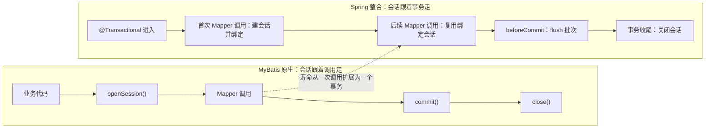
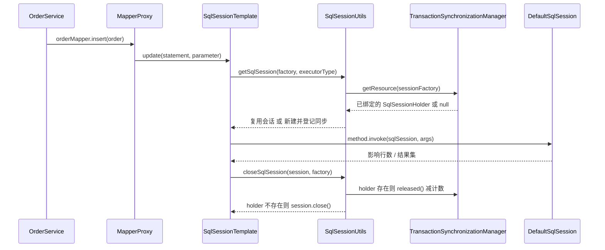
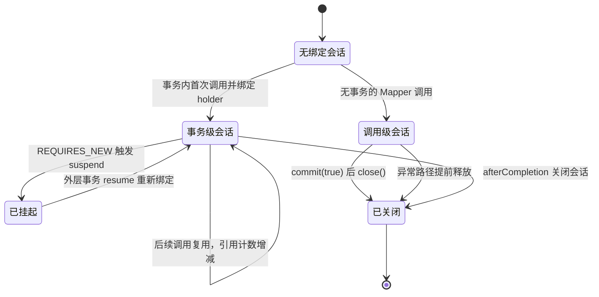
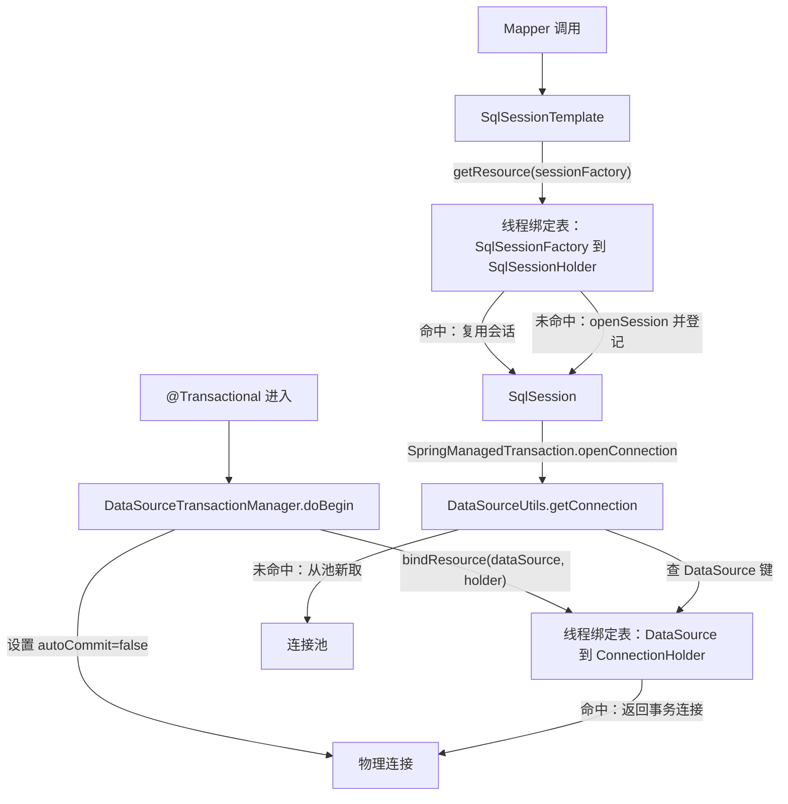
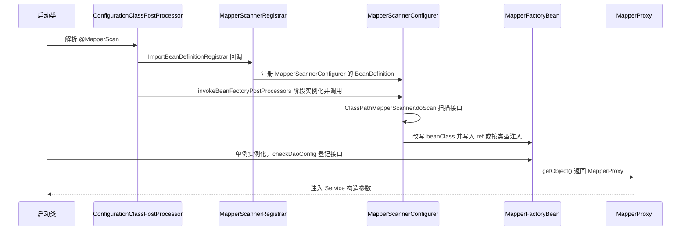

# Mybatis-Spring整合原理——SqlSessionTemplate与事务管理

**摘要：**

在 Spring 项目里检索 `openSession()`，多数代码库一次也搜不到，但 `SqlSession` 并没有消失——它被藏进 `SqlSessionTemplate` 的一层动态代理里，由框架按事务边界决定何时创建、何时关闭。这件事可以压缩成一句问话：Spring 里的 `SqlSession` 到底活多久。MyBatis 原生把会话交给调用方手工管理，一次工作单元一个会话，用完即关；Spring 的声明式事务把工作单元划在方法边界上，并要求同一事务内的所有数据库操作共用一条连接。两种时间尺度对不上，`mybatis-spring` 的全部设计都在弥合这道缝。本文以订单服务的下单链路为贯穿案例，先把矛盾拆成生命周期、所有权、线程归属三处冲突，再逐层拆开 `SqlSessionTemplate` 的三层作用：用 JDK 动态代理扮演 `SqlSession`、每次调用经 `SqlSessionUtils` 取当前线程绑定的会话、靠 `TransactionSynchronizationManager` 完成资源绑定与引用计数。随后给出会话的四种生命周期——无事务时一次调用一个会话、`@Transactional` 内一个事务一个会话、`SqlSessionTemplate` 加手动 `flushStatements`、`SqlSessionDaoSupport` 的旧写法——并说明每种寿命如何决定一级缓存的命中、批处理的厚度与连接借还的次数。再往下追问连接从哪来：`SpringManagedTransaction` 为什么必须借道 `DataSourceUtils`，以及为什么这决定了事务管理器只能是 `DataSourceTransactionManager`。最后落到 `@MapperScan` 与 `MapperFactoryBean` 的注册细节、多数据源下的 `sqlSessionTemplateRef`，以及四个可复现的故障形态。

---

## 第 1 章 一句设问：Spring 里的 SqlSession 活多久

### 1.1 搜不到的 openSession

在一个成规模的 Spring Boot 项目里检索 `openSession`，结果往往只有零星的测试代码，业务侧一次也搜不到。可是 `SqlSession` 并没有消失：`MapperProxy` 每次执行都要从它身上取一条 `MappedStatement`，`Executor` 由它创建、由它关闭，一级缓存挂在它下面，连接也由它代持。它只是不再由业务代码持有，而是被藏进了 `SqlSessionTemplate` 的一层动态代理里。

问题于是浮出水面：这个被藏起来的会话，从哪一刻开始活，到哪一刻算死。MyBatis 的答案写在官方文档开头——`SqlSession` 不是线程安全的，每次工作单元取一个，用完关闭；在原生写法里，"每次工作单元"就是一对 try-with-resources 括号的生存期。Spring 的答案写在 `@Transactional` 的语义里——同一个事务内的所有数据库操作共享一条连接，事务边界由代理对象的方法入口与出口划定；于是"工作单元"从一次调用扩大到了一个方法，甚至一次请求。

两套时间尺度并排放，矛盾立刻显形。MyBatis 期待调用方尽早关闭会话，因为会话背后是连接、连接背后是池里的有限资源；Spring 期待连接在方法结束前一直攥在手里，因为提交与回滚都发生在方法出口。一个催着结束，一个要求延续，而业务代码两边都不想看见。`mybatis-spring` 这个模块的全部存在理由，就是让两者在同一段时间轴上对齐，并且把对齐过程藏到业务代码看不见的地方。

### 1.2 MyBatis 原生的时间尺度：会话是一张借据

`SqlSession` 的对象图很轻，一次 `openSession()` 只做三件事：从 `Environment` 里取 `TransactionFactory` 造一个 `Transaction`，用 `Configuration#newExecutor` 造一个 `Executor`，再把两者塞进 `DefaultSqlSession`。真正重的资源是延迟到第一次执行 SQL 时才现取的：`Transaction` 调 `DataSource#getConnection`，连接这时才从池里借出来。

```java
// MyBatis 原生写法：会话的生存期由一对括号决定
try (SqlSession session = sqlSessionFactory.openSession()) {
    OrderMapper mapper = session.getMapper(OrderMapper.class);
    Order order = mapper.selectById(1L);   // 第一次执行时才取连接
    order.setStatus("PAID");
    mapper.update(order);
    session.commit();                      // 提交归调用方
}                                          // 关闭会话，连接归还
```

这段写法里，会话承担了三重角色：语句的翻译器（接口方法到 statementId）、执行器的持有者、以及事务边界的记账员。三重角色都要求它"独占一段时间"，不能跨线程共享，也不能在两次业务调用之间被复用——因为 `localCache` 是 `HashMap`，`dirty` 是一个普通 `boolean`，游标与延迟加载队列都建立在单线程调用栈的假设上。

`openSession()` 还有一个容易被忽略的参数：`autoCommit`。默认的 `openSession()` 等价于 `openSession(false)`，事务要显式提交；`openSession(true)` 则把每条语句抛给 JDBC 的自动提交，等于每条 SQL 一个事务。这个参数在整合层里被彻底接管了：`SqlSessionUtils` 一律用 `openSession(executorType)`，`autoCommit` 恒为 `false`，提交权交给 Spring。换句话说，进入 Spring 之后，`SqlSession` 的 `autoCommit` 位不再由应用决定，这是所有权转移的第一个痕迹。

### 1.3 Spring 的时间尺度：事务是方法边界上的批处理

Spring 的声明式事务把自己的工作单元定义在方法边界上。`@Transactional` 被 AOP 代理翻译成 `TransactionInterceptor` 的一次环绕调用：方法入口由 `PlatformTransactionManager` 取连接、关自动提交、绑定到当前线程；方法出口决定提交还是回滚，并释放绑定。DAO 在这段区间里只做一件事——借用已经绑好的连接，而不是自己去池里拿。

两套模型对齐之后，`SqlSession` 的理想寿命就确定了：一个事务一个会话，事务开始后的第一次数据库调用创建它，事务结束前的最后一次回调关闭它。这个寿命既不是"一次调用"（那会丢掉事务内的一级缓存与批次累积），也不是"一次请求"（那会把事务边界与请求边界混为一谈，长事务与连接泄漏随之而来）。**会话寿命是事务寿命的影子**，这句话可以作为整篇文章的纲领。

### 1.4 三处冲突，一条主线

把矛盾拆开，冲突落在三个具体位置。

**生命周期的冲突**：MyBatis 期望会话跟着调用走，一次调用一个工作单元；Spring 期望会话跟着事务走，一个事务一个工作单元。两种寿命的比值在无事务场景下是 1:1，在有事务场景下是 N:1。整合层要做的，是在运行时根据"当前线程有没有事务"动态选择比值。

**所有权的冲突**：MyBatis 期望调用方调 `commit()`、`rollback()`、`close()`；Spring 期望这三件事全部由事务管理器在方法出口统一执行。两边都去提交，就会在一个连接上提交两次；两边都不提交，写操作留在未提交的事务里，连接一还池就被驱动回滚。整合层的处理很干脆：把这三个方法全部禁用，抛出 `UnsupportedOperationException`。

**线程归属的冲突**：Mapper 接口被注册成单例 Bean，`MapperProxy` 也被缓存复用，一个实例要服务所有线程；而它记录的 `SqlSession` 引用只能是一个线程安全的替身。整合层用 JDK 动态代理解决了这一点——替身本身不持有连接与会话状态，只在每次调用时向当前线程要会话。

一条主线由此串起来：事务边界决定线程上的资源绑定，资源绑定决定会话的取用与释放，会话的取用方式又反过来决定缓存、批处理、异常翻译这些下游行为的表现。后面几章按这条主线逐层展开，顺序不按类名排列，而按"谁决定谁"排列。

### 1.5 不整合会怎样：一笔连接借还的账

反事实的推演比正面描述更有说服力。设想订单服务的下单链路一次要打十二条 SQL：查 SKU、查库存、插订单主表、插三条明细、扣库存、写两条流水、更新两条统计、写一条审计。如果每个 Mapper 调用各自持有独立会话、各自提交，会发生三件事。

连接借还的次数被放大十二倍。每次借还都要走池的锁、健康检查、可能的 TCP 往返（连接池预热不足时还要握手），按一次 0.05 到 0.2 毫秒做示例推算，单次下单多出 0.6 到 2.4 毫秒的纯开销；若峰值每秒一千单，就是每秒一万二千次借还，池的并发队列会成为新瓶颈。这些数字只是量级示意，具体取决于池实现、网络与数据库，但它说明了一个定性结论：会话粒度越细，池的压力越大。

事务的原子性彻底消失。插订单主表成功、插明细失败，主表那一行已经提交，业务上留下一条没有明细的孤儿订单；要修数据只能靠对账脚本，而脚本无法知道当时该补哪几条明细。

一级缓存与批处理同时失效。会话每次都换，`localCache` 随即被丢弃，同一个事务里两次相同的查询会发出两条 SQL；批处理会话攒不到第二批语句就关闭，批次厚度恒为一。

> [!warning] 这不是性能问题
> 会话不复用首先破坏的是语义：部分提交、重复查询、回滚不彻底。性能只是它的第二个症状。把整合层当成"省几次连接借还的优化"，会低估它真正在管的东西——事务边界与资源绑定的一致性。

### 1.6 整合层的位置：三个包，一条缝

`mybatis-spring` 把职责分成三块，与三个包名对应：`org.mybatis.spring` 放着 `SqlSessionTemplate` 与 `SqlSessionUtils`，管会话的取用与释放；`org.mybatis.spring.mapper` 放着 `MapperScannerConfigurer`、`ClassPathMapperScanner` 与 `MapperFactoryBean`，管接口到 Bean 的登记；`org.mybatis.spring.transaction` 放着 `SpringManagedTransaction` 与 `SpringManagedTransactionFactory`，管连接从哪里来。三块之间没有循环依赖，衔接点只有两个：`TransactionSynchronizationManager` 里的两个绑定，以及 `DataSourceUtils` 里的一次查表。

图 1-1 把两种时间尺度画在一起，差别不在"有没有会话"，而在"会话何时结束"。



---

## 第 2 章 SqlSessionTemplate 的三层作用

### 2.1 它为什么必须"是"一个 SqlSession

`SqlSessionTemplate` 的第一眼印象是"一个线程安全的 `SqlSession` 实现"，这个描述没错，但容易让人以为它只是包装了一层。真正的约束来自调用链的另一端：`MapperFactoryBean#getObject` 并不直接返回 Mapper 的代理，它返回的是 `getSqlSession().getMapper(mapperInterface)`；而 `SqlSession#getMapper` 在 `MapperRegistry` 里做的事，是 `new MapperProxy<>(sqlSession, mapperInterface, methodCache)`——把调用方传进来的这个 `SqlSession` 原样记进 `MapperProxy` 的字段。

```java
// 节选：MapperProxy 把构造时拿到的 SqlSession 记下来，每次执行都用它
public class MapperProxy<T> implements InvocationHandler, Serializable {
    private final SqlSession sqlSession;
    // ...
    @Override
    public Object invoke(Object proxy, Method method, Object[] args) throws Throwable {
        // ...
        return new PlainMethodInvoker(methodCache.computeIfAbsent(method, ...))
                .invoke(proxy, method, args, sqlSession);
    }
}
```

这条链决定了一件事：`MapperFactoryBean` 交给 `getMapper` 的那个对象，必须实现 `SqlSession` 接口；否则 `MapperRegistry` 根本没有办法把它记录成"执行语句的入口"。`SqlSessionTemplate` 于是把自己做成 `SqlSession` 的实现，让 `MapperProxy` 心满意足地记下它。记录的不是一个真正的会话，而是一个替身；替身在每次 `invoke` 时把控制权收回，去取真正的会话。

还有一处细节支撑这个结论：`SqlSessionTemplate#getMapper` 并没有走代理，它是 `getConfiguration().getMapper(type, this)`，把模板自己交给 `MapperRegistry`。于是 `MapperProxy` 里记下的 `SqlSession` 就是模板本身，`getMapper` 这一步不会创建会话，真正的取会话发生在第一次执行 SQL 时。这个"延迟到调用才取"的顺序，是"无事务时一次调用一个会话"能够成立的前提：如果 `getMapper` 就建会话，Mapper 注入的那一刻整个容器都会开始漏连接。

这就是整个整合设计的支点：**接口即插槽**。MyBatis 内核只认 `SqlSession` 这一个插槽，`mybatis-spring` 不修改内核，只往插槽里插一个能感知 Spring 事务的替代品。代理模式在这里的作用不是"增强功能"，而是"替换生命周期"。

### 2.2 第一层：代理，把横切逻辑收成一处

`SqlSessionTemplate` 的构造过程很短，重心全在最后一行创建代理上。

```java
// org.mybatis.spring.SqlSessionTemplate（节选，mybatis-spring 3.x）
public SqlSessionTemplate(SqlSessionFactory sqlSessionFactory) {
    this(sqlSessionFactory, sqlSessionFactory.getConfiguration().getDefaultExecutorType());
}

public SqlSessionTemplate(SqlSessionFactory sqlSessionFactory, ExecutorType executorType,
        PersistenceExceptionTranslator exceptionTranslator) {
    notNull(sqlSessionFactory, "Property 'sqlSessionFactory' is required");
    notNull(executorType, "Property 'executorType' is required");
    this.sqlSessionFactory = sqlSessionFactory;
    this.executorType = executorType;
    this.exceptionTranslator = exceptionTranslator;
    // 关键：代理的目的是把"取会话 / 提交 / 关会话"这段横切逻辑收进一个 InvocationHandler
    this.sqlSessionProxy = (SqlSession) Proxy.newProxyInstance(
            SqlSessionFactory.class.getClassLoader(),
            new Class<?>[] { SqlSession.class },
            new SqlSessionInterceptor());
}

@Override
public <T> T selectOne(String statement, Object parameter) {
    return this.sqlSessionProxy.selectOne(statement, parameter);   // 其余方法同此
}
```

为什么用动态代理，而不是在 `SqlSessionTemplate` 里写三十个方法，每个方法都"取会话—执行—关会话"？因为 `SqlSession` 接口的方法数量足以让手写版本成为维护负担，而且新增方法时容易漏掉一段收尾逻辑。代理把这些方法统一收进 `SqlSessionInterceptor#invoke`，横切逻辑只写一遍。

代价是每次调用多一次反射分派。这个开销在微秒级，相对一次数据库往返可以忽略；但它并非零，所以在一次请求里把 `SqlSessionTemplate#getMapper` 当成 mapper 工厂反复调用（譬如每个循环体里都 `getMapper`）是不划算的写法——`MapperProxy` 本身应当作为单例缓存，由容器注入即可。

`SqlSessionInterceptor` 的结构可以概括为**取、调、判、关**四步：

```java
// org.mybatis.spring.SqlSessionTemplate.SqlSessionInterceptor（节选）
@Override
public Object invoke(Object proxy, Method method, Object[] args) throws Throwable {
    // 取：有事务则取绑定的，无事务则新建（第三层的同步逻辑在这里被触发）
    SqlSession sqlSession = getSqlSession(SqlSessionTemplate.this.sqlSessionFactory,
            SqlSessionTemplate.this.executorType, SqlSessionTemplate.this.exceptionTranslator);
    try {
        Object result = method.invoke(sqlSession, args);
        // 判：不在事务里就强制提交一次
        // 有些数据库要求关闭连接前必须先 commit 或 rollback，否则驱动报错
        if (!isSqlSessionTransactional(sqlSession, SqlSessionTemplate.this.sqlSessionFactory)) {
            sqlSession.commit(true);
        }
        return result;
    } catch (Throwable t) {
        Throwable unwrapped = unwrapThrowable(t);
        if (SqlSessionTemplate.this.exceptionTranslator != null
                && unwrapped instanceof PersistenceException) {
            // 先把连接还掉，再翻译异常：否则翻译过程若访问数据库会死锁在池上
            closeSqlSession(sqlSession, SqlSessionTemplate.this.sqlSessionFactory);
            sqlSession = null;
            Throwable translated = SqlSessionTemplate.this.exceptionTranslator
                    .translateExceptionIfPossible((PersistenceException) unwrapped);
            if (translated != null) {
                unwrapped = translated;
            }
        }
        throw unwrapped;
    } finally {
        // 关：事务里只是引用计数减一，事务外才是真正的 close
        if (sqlSession != null) {
            closeSqlSession(sqlSession, SqlSessionTemplate.this.sqlSessionFactory);
        }
    }
}
```

这段代码里有两个细节值得停一下。第一个是 `commit(true)` 的 `true`：`DefaultSqlSession#commit(boolean force)` 会把 `force` 传给 `BaseExecutor#commit`，后者无论如何都会 `clearLocalCache()` 与 `flushStatements()`，只有 `required` 为真时才提交连接。传 `true` 的意思是"即使没有任何写操作也走一遍冲刷"，因为 `dirty` 标记为假时 `required` 会算成假，批次就不会被冲刷——无事务场景下的批处理会话会静默丢掉语句。

第二个细节是异常路径上提前 `closeSqlSession` 并置空引用。`MyBatisExceptionTranslator` 在翻译异常时需要判断连接是否可用，某些实现会从数据源现取一条连接做探测；如果原来的连接还挂在当前线程上没归还，池小的时候就会等待超时。置空引用是为了让 `finally` 不再重复关闭，这个模式在框架源码里反复出现，读的时候容易误以为多余。

### 2.3 第二层：取会话，两个分支加一个兜底

`getSqlSession` 的全部逻辑可以写成一句话：先问当前线程有没有绑定好的会话，有就返回，没有就新建一个并尝试绑定。

```java
// org.mybatis.spring.SqlSessionUtils（节选，mybatis-spring 3.x）
public static SqlSession getSqlSession(SqlSessionFactory sessionFactory, ExecutorType executorType,
        PersistenceExceptionTranslator exceptionTranslator) {
    notNull(sessionFactory, NO_SQL_SESSION_FACTORY_SPECIFIED);
    notNull(executorType, NO_EXECUTOR_TYPE_SPECIFIED);
    // 绑定键不是 DataSource，而是 SqlSessionFactory 实例本身
    SqlSessionHolder holder = (SqlSessionHolder) TransactionSynchronizationManager.getResource(sessionFactory);
    SqlSession session = sessionHolder(executorType, holder);
    if (session != null) {
        return session;                       // 分支一：事务内复用
    }
    LOGGER.debug(() -> "Creating a new SqlSession");
    session = sessionFactory.openSession(executorType);   // 分支二：新建
    registerSessionHolder(sessionFactory, executorType, exceptionTranslator, session);
    return session;
}

private static void registerSessionHolder(SqlSessionFactory sessionFactory, ExecutorType executorType,
        PersistenceExceptionTranslator exceptionTranslator, SqlSession session) {
    SqlSessionHolder holder;
    if (TransactionSynchronizationManager.isSynchronizationActive()) {   // 有活跃事务同步
        Environment environment = sessionFactory.getConfiguration().getEnvironment();
        if (environment.getTransactionFactory() instanceof SpringManagedTransactionFactory) {
            LOGGER.debug(() -> "Registering transaction synchronization for SqlSession [" + session + "]");
            holder = new SqlSessionHolder(session, executorType, exceptionTranslator);
            TransactionSynchronizationManager.bindResource(sessionFactory, holder);
            TransactionSynchronizationManager
                    .registerSynchronization(new SqlSessionSynchronization(holder, sessionFactory));
            holder.setSynchronizedWithTransaction(true);
            holder.requested();                        // 引用计数 +1
        } else if (TransactionSynchronizationManager.getResource(environment.getDataSource()) == null) {
            // 数据源本身没有事务同步，会话与 Spring 事务天然没有交集，只记日志
            LOGGER.debug(() -> "SqlSession [" + session
                    + "] was not registered for synchronization because DataSource is not transactional");
        } else {
            // 事务在、连接也在，唯独工厂不是 Spring 的：宁可报错，也不让会话与连接分裂
            throw new TransientDataAccessResourceException(
                    "SqlSessionFactory must be using a SpringManagedTransactionFactory in order to use Spring transaction synchronization");
        }
    } else {
        LOGGER.debug(() -> "SqlSession [" + session
                + "] was not registered for synchronization because synchronization is not active");
    }
}
```

三个判断条件构成三层过滤，每一层都对应一种运行形态。

`isSynchronizationActive()` 为假，说明当前线程没有 Spring 事务。此时什么也不绑定，会话交给拦截器用完即关。这是最常见的一条路径——项目里绝大多数查询方法并没有 `@Transactional`，它们走的都是这一支。

`isSynchronizationActive()` 为真，且事务工厂是 `SpringManagedTransactionFactory`，说明会话可以安全地登记进事务同步。注意 `SqlSessionFactoryBean` 在没有显式配置时会默认创建 `SpringManagedTransactionFactory`，所以这一支是正常业务的常态。绑定用的 key 是 `SqlSessionFactory` 实例，不是 `DataSource`：这个选择让"一个工厂一个会话"成立，也意味着多数据源场景下每个工厂各有一份会话，第 4 章会回到这一点。

最后一个分支最有意思：事务是活跃的，`DataSource` 上确实绑着一个 `ConnectionHolder`（说明有 `DataSourceTransactionManager` 在管），但 MyBatis 的工厂却用了原生的 `JdbcTransactionFactory`。这时框架不去猜，直接抛 `TransientDataAccessResourceException`，消息大意是"要使用 Spring 事务同步，工厂必须使用 SpringManagedTransactionFactory"。这条异常是第一类整合故障里最容易定位的一条，因为它在第一次数据库调用时就炸，堆栈里能直接看到工厂类型。

`sessionHolder(executorType, holder)` 里还有一处容易被忽略的校验，它专门针对混用模板：holder 存在时，如果它的 `executorType` 与当前模板要求的不同，框架不再新建会话，而是直接抛 `TransientDataAccessResourceException`，消息是 `Cannot change the ExecutorType when there is an existing transaction`。这一行把"一个事务一个会话"的约定钉死了——事务中途换执行器类型，等于要求会话同时具备两种批次账本语义，框架不给这种可能。实用结论是：批处理模板只应出现在批处理路径上；确实要让两种模板共存于一个方法，把批处理部分挪进独立事务（`REQUIRES_NEW`）里，让它在自己的会话中结束。

### 2.4 第三层：同步，引用计数加五个回调

资源绑上去之后，还需要有人在事务结束时把它摘下来。`SqlSessionSynchronization` 就是这份"遗嘱执行人"。

```java
// org.mybatis.spring.SqlSessionUtils.SqlSessionSynchronization（节选，mybatis-spring 3.x）
private static final class SqlSessionSynchronization implements TransactionSynchronization {
    private final SqlSessionHolder holder;
    private final SqlSessionFactory sessionFactory;
    private boolean holderActive = true;

    @Override
    public int getOrder() {
        // 比 DataSourceUtils 的连接同步回调早一步，保证"先关会话、后放连接"
        return DataSourceUtils.CONNECTION_SYNCHRONIZATION_ORDER - 1;
    }

    @Override
    public void suspend() {                       // 外层事务被挂起（如 REQUIRES_NEW）
        if (this.holderActive) {
            TransactionSynchronizationManager.unbindResource(this.sessionFactory);
        }
    }

    @Override
    public void resume() {                        // 外层事务恢复
        if (this.holderActive) {
            TransactionSynchronizationManager.bindResource(this.sessionFactory, this.holder);
        }
    }

    @Override
    public void beforeCommit(boolean readOnly) {  // 提交前冲刷批次
        if (TransactionSynchronizationManager.isActualTransactionActive()) {
            this.holder.getSqlSession().commit();
        }
    }

    @Override
    public void beforeCompletion() {              // 提交或回滚之前，抢在连接回调前面收尾
        // 引用计数已经归零（holder.isOpen() 为假）就提前关闭：
        // 源码注释写明原因是 afterCompletion 可能由另一个线程回调
        if (!this.holder.isOpen()) {
            TransactionSynchronizationManager.unbindResource(this.sessionFactory);
            this.holderActive = false;
            this.holder.getSqlSession().close();
        }
    }

    @Override
    public void afterCompletion(int status) {     // 兜底：跨线程或不满足提前关闭条件时
        if (this.holderActive) {
            this.holderActive = false;
            TransactionSynchronizationManager.unbindResourceIfPossible(this.sessionFactory);
            this.holder.getSqlSession().close();
        }
        this.holder.reset();                      // 清除同步标记与引用计数
    }
}
```

五个回调各管一件事，但 `getOrder()` 那个常数最容易读漏。`DataSourceUtils.CONNECTION_SYNCHRONIZATION_ORDER` 是 1000，这里返回 999，意味着本回调排在 Spring 为连接登记的那个同步回调之前。顺序不能反：会话关闭会经由 `SpringManagedTransaction#close` 调 `DataSourceUtils.releaseConnection`，如果连接一侧的清理已经走完、连接已经归还池中，这次调用就会落在一条可能属于别人的连接上；先关会话、后动连接，才能保证释放动作作用在正确的对象上。

`beforeCommit` 里调用 `session.commit()` 而不是 `flushStatements()`，是为了让 `BaseExecutor#commit` 一次性完成"清一级缓存 + 冲刷批次"；`readOnly` 参数在这里没有被使用，因为 `TransactionSynchronizationManager.isActualTransactionActive()` 已经足以判断"是否真的处在事务中"。只读事务里 `DefaultSqlSession#commit()` 的 `dirty` 为假，最终不会提交连接，只做冲刷与清缓存，语义上无害。

`SqlSessionHolder` 继承 Spring 的 `ResourceHolderSupport`，`requested()` 与 `released()` 维护一个引用计数。拦截器的每次调用都会在 `finally` 里调 `closeSqlSession`，事务上下文中它做的事只是 `holder.released()`，把计数减一；`sessionHolder` 命中时又会 `requested()` 加一。一来一往，计数在每次调用结束时都回到零，所以"归零"不能当作"事务结束"的信号——真正的信号是事务同步回调，`beforeCompletion` 在那里检查 `isOpen()` 并决定是否提前关闭。

这段设计的必要性在于线程边界：`afterCompletion` 可能由另一个线程回调（源码注释里引的是 issue #18），若把关闭会话的全部责任压给它，就会出现在错误的线程上解绑、关闭一个已经被别人用过的会话。提前在 `beforeCompletion` 关掉，`afterCompletion` 只做幂等兜底，线程切换就不会留下脏状态。

```java
// org.mybatis.spring.SqlSessionUtils（节选）
public static void closeSqlSession(SqlSession session, SqlSessionFactory sessionFactory) {
    SqlSessionHolder holder = (SqlSessionHolder) TransactionSynchronizationManager.getResource(sessionFactory);
    if ((holder != null) && (holder.getSqlSession() == session)) {
        // 事务内：只减计数，关闭权在事务同步回调手里
        holder.released();
    } else {
        session.close();      // 事务外：真正关闭，连接归还
    }
}
```

### 2.5 三个方法被禁用，一个方法被放行

`SqlSessionTemplate` 对 `SqlSession` 的三个生命周期方法做了硬拦截：

```java
@Override
public void commit() {
    throw new UnsupportedOperationException("Manual commit is not allowed over a Spring managed SqlSession");
}

@Override
public void rollback() {
    throw new UnsupportedOperationException("Manual rollback is not allowed over a Spring managed SqlSession");
}

@Override
public void close() {
    throw new UnsupportedOperationException("Manual close is not allowed over a Spring managed SqlSession");
}
```

这三行是所有权冲突的最终裁决：会话不是调用方的，调用方没有资格提交、回滚或关闭它。业务代码里如果出现 `sqlSessionTemplate.commit()`，编译能过、启动能过，直到运行到那一行才炸，异常消息已经把原因写得很清楚。

三个方法之外，类上还实现了 `DisposableBean`，`destroy()` 是空实现。这一笔不是冗余：Spring 推断销毁方法时会优先找 `close()`，而 `close()` 在这里恰好抛异常，实现 `DisposableBean` 是为了让容器用 `destroy()` 而不是 `close()` 来收尾。读源码时这行空方法容易被当成样板代码跳过，它其实是在给那个被禁用的 `close()` 兜底。

有意思的是 `flushStatements()` 没有被拦。它照常委托给代理，进入拦截器、取会话、执行冲刷。原因在于它的语义只到"把积累的语句发给数据库"为止，不涉及提交与连接归属；对批处理来说，这是事务中间唯一可用的手动干预点，第 3 章会用它构造第三种生命周期。

表 2-1 把三层的职责、失效条件与观察点列在一起。排障时从下行往上看，基本能定位到是哪一层断了。

| 层次 | 承载类 | 职责 | 断掉后的症状 | 观察点 |
| --- | --- | --- | --- | --- |
| 代理层 | `SqlSessionTemplate` / `SqlSessionInterceptor` | 把横切逻辑收进一处，做异常翻译 | 抛 `UnsupportedOperationException` 或异常类型未翻译 | 异常栈里是否出现 `MyBatisSystemException` |
| 取用层 | `SqlSessionUtils` / `SqlSessionHolder` | 按线程与事务边界取会话、登记同步 | 每次调用新建会话，缓存与批次失效 | DEBUG 日志出现 `Creating a new SqlSession` 的频率 |
| 同步层 | `TransactionSynchronizationManager` / `SqlSessionSynchronization` | 挂起、恢复、提交前冲刷、完成后关闭 | 会话不关（连接泄漏）或提前关闭（`Executor was closed.`） | `bindResource` 是否发生、回调是否执行 |

图 2-1 把一次 Mapper 调用经过的三层动作按时间顺序排开，可以看到"取会话"与"关会话"都不是对称操作：前者可能新建也可能复用，后者可能真关也可能只减计数。



---

## 第 3 章 会话的四种生命周期

会话寿命不是一个可以配置的参数，它是"当前线程有没有事务"与"你用哪种模板"两个条件共同算出来的结果。把常见的组合穷举一遍，落在四种形态上；四种形态的差别不在会话的构造过程，而在它被谁关闭、何时关闭。

### 3.1 寿命一：无事务，一次调用一个会话

这是默认形态，也是项目里出现频率最高的一种。方法上没有 `@Transactional`，事务同步未激活，`getSqlSession` 走"新建"分支，`registerSessionHolder` 落在 `else` 里，什么也不做。拦截器执行完 `method.invoke` 之后判断 `isSqlSessionTransactional` 为假，于是 `commit(true)`，再由 `closeSqlSession` 直接 `session.close()`。

一次调用的完整账单是：新建 `DefaultSqlSession` 与 `Executor`、取一条连接、准备 `PreparedStatement`、执行、冲刷、关闭会话、归还连接。会话的存活时间约等于一条 SQL 的执行时间，寿命短到没有任何状态能留下来。

三条后果都是这个寿命的直接推论。

**一级缓存等于没有**。一级缓存挂在 `BaseExecutor#localCache` 上，作用域就是会话。会话在方法返回前被关闭，`localCache` 随之被丢弃，下一次调用是一个全新的 `Executor`，缓存从空开始。项目里"明明文档说一级缓存默认开启，为什么日志里每条 SQL 都在发"的困惑，答案就在这里：默认开启的是缓存结构，不是缓存寿命。

批处理厚度恒为一。`commit(true)` 会冲刷语句，冲刷时批次里只剩当前这一条。配置了 `ExecutorType.BATCH` 的模板在这个形态下不但没有收益，还要额外付出会话创建与事务开启的成本，比 `SIMPLE` 更慢。批处理为什么必须依附事务、`flushStatements` 与 `commit` 的时序关系，在 [[Java/Mybatis/02 SqlSession与Executor——命令执行的核心引擎]] 里按 `BatchExecutor` 的内部结构讲透了，这里只取它的结论：**批次厚度与会话寿命成正比**，会话只活一条语句，批次就只可能有一条语句。

连接借还次数被放大。一次业务方法打十二条 SQL，就是十二次借还。连接池的价值在于复用，借还本身要过锁、过健康检查、过可能的超时判定；次数一多，池的并发队列先成为瓶颈，而不是数据库。示例推算一下：单次借还按 0.05 到 0.2 毫秒估算，十二条 SQL 的方法在无事务形态下多出 0.6 到 2.4 毫秒的纯池开销，峰值每秒千次调用就是每秒一万二千次借还。这个量级足以让一个配置合理的池开始排队，排查时却常常被误判成"数据库慢"。

还有一个不常被提到的后果：异常语义。无事务形态下每条语句各自提交，方法中途抛异常时，前面已经发出的写操作不会回滚。业务代码里加 `try/catch` 包住一段写操作并吞掉异常，看起来像"尽力而为"，实际留下的是部分提交的脏数据。

### 3.2 寿命二：一个事务一个会话

加上 `@Transactional` 之后，形态立刻改变。事务入口由 `TransactionInterceptor` 打开，`DataSourceTransactionManager#doBegin` 取一条连接、关闭自动提交、把 `ConnectionHolder` 绑到当前线程；随后第一次 Mapper 调用触发 `getSqlSession`，`isSynchronizationActive()` 为真，走到 `SpringManagedTransactionFactory` 分支，新建会话、绑定 `SqlSessionHolder`、注册 `SqlSessionSynchronization`、引用计数加一。

从第二次调用开始，`getSqlSession` 直接命中 holder，返回同一个会话。连接、`Executor`、`localCache`、批次账本全部延续。一级缓存这时才真正开始工作：同一事务内两次相同的查询只发一条 SQL，写操作会让 `localCache` 失效，于是"写后读"能读到自己的修改。批处理这时才真正开始累积，厚度取决于循环里插了多少条，以及中途有没有 `select` 把批次切断。

会话的结束由事务同步回调负责，与调用方无关。提交路径上的顺序是：`beforeCommit` 调 `session.commit()`，把批次冲刷出去并清掉一级缓存；`beforeCompletion` 发现引用计数已归零，提前解绑并关闭会话；随后事务管理器的 `doCommit` 提交连接，`doCleanupAfterCompletion` 归还连接；`afterCompletion` 只做幂等兜底与 `holder.reset()`。

回滚路径上的顺序不一样：`beforeCommit` 根本不会被触发，会话在 `beforeCompletion` 或 `afterCompletion` 里关闭，关闭过程走的是回滚分支，尚未冲刷的批次被直接丢弃而不发送；手动 `flushStatements()` 或循环里夹 `select` 已经发出去的那些语句仍在连接上，由 Spring 回滚连接时一并撤销。这也解释了"为什么回滚后数据没进去，但连接上确实执行过一批语句"这类日志形态。

会话寿命与事务传播行为是同一件事的两种说法，但落点不同。SpringCore 专栏已经把七种传播行为的语义、挂起方式与失效场景讲清楚了，此处只看会话这一侧：

`REQUIRED` 加入外层事务，全程一个会话一条连接；`REQUIRES_NEW` 挂起外层，`SqlSessionSynchronization#suspend` 解绑 holder，新事务重新建会话，内层结束时 `resume` 把外层 holder 绑回去，于是两个会话、两条连接、两份互不可见的一级缓存；`NESTED` 使用保存点，外层事务对象不变，会话也不变，一级缓存跨越内外层共享；`NOT_SUPPORTED` 挂起事务，MyBatis 既没有 holder 也没有绑定连接，退化成寿命一，每条调用各取一条新连接；`SUPPORTS`、`MANDATORY`、`NEVER` 的表现取决于外层有没有事务，有就是寿命二，没有就是寿命一。

`NESTED` 那一格值得单独说一句，因为它把一级缓存的语义风险暴露得最清楚。内层块通过保存点回滚时，会话没有关闭，`localCache` 也没有被清——`BaseExecutor` 的缓存清理发生在 `commit` 与 `rollback` 两个入口，保存点回滚不经过它们。于是"内层先写、再读、然后回滚到保存点、再读一次"这个序列里，第二次读会因为命中缓存而返回被撤销之前的值。脏读来自缓存，不来自数据库。要么给内层块单独开 `REQUIRES_NEW`，要么在回滚后避免依赖会话内缓存。

长事务的代价也落在这里。会话活着，`localCache` 就活着，而 `localCache` 里放的是查询结果的**快照**。一个跑了两分钟的事务，中间读了库存、读了订单状态，后面再读同一个 key 时拿到的是两分钟前的快照；并发事务已经把数据改过，本事务仍按旧值做判断。这不是框架缺陷，是"可重复读"语义在会话缓存上的投影。缩短事务、在长流程中主动清缓存（`sqlSession.clearCache()` 在模板上同样可用），都是常规解法。

### 3.3 寿命三：模板加手动 flushStatements

批处理需要一种比"事务结束"更细的节奏：批次攒到五百条就发出去，既控制内存，也让失败的范围可控，但事务不能在这时候提交。这个需求落在 `flushStatements()` 上，而它恰好是三个被禁用的生命周期方法之外那个被放行的方法。

```java
@Service
public class OrderImportService {
    private final SqlSessionTemplate batchTemplate;   // 构造时传入 ExecutorType.BATCH 的模板
    private final OrderMapper orderMapper;            // 必须由 sqlSessionTemplateRef 绑定到同一个模板

    @Transactional
    public void importOrders(List<Order> orders) {
        for (int i = 0; i < orders.size(); i++) {
            orderMapper.insert(orders.get(i));        // 进入批次队列，不访问数据库
            if ((i + 1) % 500 == 0) {
                // 只发送，不提交；事务边界仍在方法出口
                List<BatchResult> results = batchTemplate.flushStatements();
                backfillIds(orders, i, results);      // 需要自增主键时在这里回填
            }
        }
    }
}
```

这段代码能成立，依赖三个前提。第一，`orderMapper` 背后的会话与 `batchTemplate` 取到的是同一个会话；如果 Mapper 由 `@MapperScan` 的默认工厂注册，而模板是另一个 `ExecutorType`，那边 `addBatch` 攒的是一份账本，这边 `flushStatements` 冲刷的是另一份**空账本**，结果是一条语句都没发。第二，方法必须处在事务中，事务外调用 `flushStatements` 会走寿命一的路径，冲刷完立刻提交并关闭，等于把整批拆成一条。第三，`flushStatements` 之后的行在数据库里是已发送但未提交的状态，本事务可见，其他事务不可见，回滚时与后续批次一起撤销。

返回的 `List<BatchResult>` 里带着每组语句的影响行数与参数对象，自增主键的回填要靠它，而不是靠 `insert` 的返回值——批处理下 `insert` 的返回值不可信，这一点在 02 篇里已经交代过。

### 3.4 寿命四：SqlSessionDaoSupport 的旧写法

`mybatis-spring` 早期只有 DAO 基类这一种用法，`SqlSessionDaoSupport` 是它的入口。写法是先继承，再在方法里用 `getSqlSession()`：

```java
// org.mybatis.spring.support.SqlSessionDaoSupport（节选，mybatis-spring 3.x）
public abstract class SqlSessionDaoSupport extends DaoSupport {
    private SqlSessionTemplate sqlSessionTemplate;

    public void setSqlSessionFactory(SqlSessionFactory sqlSessionFactory) {
        if (this.sqlSessionTemplate == null
                || sqlSessionFactory != this.sqlSessionTemplate.getSqlSessionFactory()) {
            // 注意：这里新建的是模板，不是会话
            this.sqlSessionTemplate = createSqlSessionTemplate(sqlSessionFactory);
        }
    }

    public void setSqlSessionTemplate(SqlSessionTemplate sqlSessionTemplate) {
        this.sqlSessionTemplate = sqlSessionTemplate;
    }

    @Override
    protected void checkDaoConfig() {
        notNull(this.sqlSessionTemplate, "Property 'sqlSessionFactory' or 'sqlSessionTemplate' are required");
    }

    public SqlSession getSqlSession() {
        return this.sqlSessionTemplate;      // 返回模板：线程安全，但每次执行都重新取会话
    }
}

public class OrderDao extends SqlSessionDaoSupport {
    public Order findById(Long id) {
        return getSqlSession().selectOne("order.findById", id);
    }
}
```

这里有一个流传很广的误解：以为 `SqlSessionDaoSupport` 的 DAO 持有会话，因此"老写法不安全"。事实相反，它持有的是 `SqlSessionTemplate`，`getSqlSession()` 返回的也是模板，会话仍然由 `SqlSessionUtils` 按线程与事务边界取用，寿命依旧是寿命一或寿命二。老写法真正的问题是别的：每个 DAO 首次注入工厂时各自 `new` 一个模板（工厂换过还会再建一个），模板数量随 DAO 增长；DAO 与 Mapper 接口两套体系并存，事务与缓存的分析要多绕一层；`checkDaoConfig` 在属性没配齐时抛 `IllegalArgumentException`，消息大意是"`sqlSessionFactory` 与 `sqlSessionTemplate` 至少要有一个"，这类启动期错误在老项目升级时很常见。

迁移路径很直接：把 DAO 里的每个方法搬成 Mapper 接口方法，删掉基类继承，让 `MapperFactoryBean` 负责创建代理，共享一个容器里的模板。行为不变，少一层间接，异常翻译与缓存的观察点也更靠近调用现场。

表 3-1 把四种寿命并排放在一起。读这张表的正确方式是先看"会话数"列，再往下看每一列的后果，它们都是会话数的函数。

| 寿命 | 触发条件 | 会话与连接 | 一级缓存 | 批处理厚度 | 连接借还 | 主要代价 |
| --- | --- | --- | --- | --- | --- | --- |
| 寿命一 | 无事务的 Mapper 调用 | 每次调用一个会话、一条连接 | 每次调用从空开始 | 恒为 1 | 每次都借还 | 池压力、部分提交、重复查询 |
| 寿命二 | `@Transactional` 内 | 一个事务一个会话、一条连接 | 事务内有效，写后失效 | 累积到冲刷点 | 一个事务一次 | 长事务快照、`NESTED` 缓存风险 |
| 寿命三 | 事务内加手动 `flushStatements` | 同寿命二 | 同寿命二 | 按冲刷点分段 | 一个事务一次 | 需保证模板与会话一致 |
| 寿命四 | `SqlSessionDaoSupport` 子类 | 同寿命一或寿命二 | 同寿命一或寿命二 | 同寿命一或寿命二 | 同寿命一或寿命二 | 模板冗余、两套体系并存 |

图 3-1 把四种寿命收成一张状态机。注意"挂起"这个中间态：它只在传播行为要求新事务时出现，是会话数量从一变成二的那个岔口。



---

## 第 4 章 连接从哪来：一次查表决定的归属

会话寿命解决的是"什么时候建、什么时候关"，连接的归属解决的是"这条会话的事务算谁的"。两件事在同一条 `Connection` 上会合，而会合点只有一个：`SpringManagedTransaction#openConnection` 里那次 `DataSourceUtils.getConnection`。

### 4.1 SpringManagedTransaction 的四件事

`SqlSessionFactoryBean` 在没有显式配置事务工厂时，会创建 `SpringManagedTransactionFactory`，它造出来的 `Transaction` 就是这个类。它的全部职责可以拆成四件事：取连接、判断归属、按归属决定提交与回滚、按归属决定释放。

```java
// org.mybatis.spring.transaction.SpringManagedTransaction（节选，mybatis-spring 3.x）
public class SpringManagedTransaction implements Transaction {
    private final DataSource dataSource;
    private Connection connection;
    private boolean isConnectionTransactional;   // 这条连接是否由 Spring 事务持有
    private boolean autoCommit;

    @Override
    public Connection getConnection() throws SQLException {
        if (this.connection == null) {
            openConnection();
        }
        return this.connection;
    }

    private void openConnection() throws SQLException {
        // 关键：不直接调 dataSource.getConnection()，而是先问 Spring 事务有没有绑好的连接
        this.connection = DataSourceUtils.getConnection(this.dataSource);
        this.autoCommit = this.connection.getAutoCommit();
        this.isConnectionTransactional = DataSourceUtils.isConnectionTransactional(this.connection, this.dataSource);
        LOGGER.debug(() -> "JDBC Connection [" + this.connection + "] will"
                + (this.isConnectionTransactional ? " " : " not ") + "be managed by Spring");
    }

    @Override
    public void commit() throws SQLException {
        // 连接由 Spring 管时，这里什么都不做：提交权在事务管理器手里
        if (this.connection != null && !this.isConnectionTransactional && !this.autoCommit) {
            this.connection.commit();
        }
    }

    @Override
    public void rollback() throws SQLException {
        if (this.connection != null && !this.isConnectionTransactional && !this.autoCommit) {
            this.connection.rollback();
        }
    }

    @Override
    public void close() throws SQLException {
        // 由 Spring 管时，releaseConnection 只是引用计数减一，不真的还池
        DataSourceUtils.releaseConnection(this.connection, this.dataSource);
    }
}
```

这段代码的信息量集中在一个字段上：`isConnectionTransactional`。它为真，说明当前事务里已经有一条绑好的连接，`SpringManagedTransaction` 只是**借用者**，提交、回滚、释放全部不参与；它为假，说明没有事务在管这条连接，MyBatis 必须自己承担提交与释放的责任，而且只在 `autoCommit` 为假的条件下才提交。

一个具体的推论：在 `@Transactional` 方法里调用 `sqlSessionTemplate.flushStatements()`，冲刷用的是同一条已绑定连接，语句进入了数据库但事务未提交；如果此时用另一个没有事务的方法读同一张表，读到的是旧数据。隔离级别管的是事务之间，会话缓存管的是事务之内，两者不是一回事。

### 4.2 DataSourceTransactionManager 以 DataSource 为键

`DataSourceUtils.getConnection` 的查表动作极其简单，但它是整条链的地基：

```java
// org.springframework.jdbc.datasource.DataSourceUtils（节选，去掉了异常包装）
static Connection doGetConnection(DataSource dataSource) throws SQLException {
    ConnectionHolder conHolder = (ConnectionHolder) TransactionSynchronizationManager.getResource(dataSource);
    if (conHolder != null && (conHolder.hasConnection() || conHolder.isSynchronizedWithTransaction())) {
        conHolder.requested();
        // 复用事务连接：这是"同一个事务同一个连接"的全部秘密
        return conHolder.getConnection();
    }
    // 没有绑定：从池里新取一条，事务管理器管不到它
    return dataSource.getConnection();
}
```

`DataSourceTransactionManager#doBegin` 在事务开始时做的事，就是把 `ConnectionHolder` 以 `DataSource` 实例为键绑到当前线程。于是线程上一共挂着两张表：`DataSource -> ConnectionHolder` 由事务管理器维护，`SqlSessionFactory -> SqlSessionHolder` 由 MyBatis 维护。两张表的键不同，生命周期却必须同步：会话表由事务同步回调挂着，连接表由事务管理器挂着，任何一侧提前解绑都会造成不对称。

这解释了 `JdbcTemplate` 与 MyBatis 能在同一个事务里混用的原因，也解释了第 2 章兜底分支的判断依据——框架检查的是"`DataSource` 上有没有 `ConnectionHolder`"，有就说明有人管着连接，那么 MyBatis 的会话也必须走同一条路，否则宁可抛异常也不静默分裂。

### 4.3 为什么事务管理器必须是 DataSourceTransactionManager

`SpringManagedTransaction` 只认 Spring 的 JDBC 资源绑定机制。`isConnectionTransactional` 为真，说明这条连接已经挂在线程的同步体系上，提交权在别处，MyBatis 只管借用；为假才轮到它自己提交。判断的依据只有一处：`DataSourceUtils` 里那次查表。

`JtaTransactionManager` 是最典型的**脱钩**场景，而它的失败方式比"没绑连接"更绕一层。它管的是 JTA 的事务对象（`UserTransaction` 或 `TransactionManager`），确实不会为 `DataSource` 预先绑连接；但 `DataSourceUtils#doGetConnection` 在"没有 holder、同步又处于激活状态"时会做一件事：把刚取到的连接包成 `ConnectionHolder` 绑到线程上，并注册一个 `ConnectionSynchronization`。这个分支的本意是让 JTA 事务里的 JDBC 操作共享同一条连接，副作用是 `isConnectionTransactional` 于是返回真——MyBatis 认为连接由别人管，交出了提交权。

问题在于"绑上"不等于"有人提交"。JTA 事务管理器管的是全局事务，不会替这条普通连接执行 `commit()`；事务收尾时，`ConnectionSynchronization` 只是把连接解绑并释放回池。于是结局取决于池的自动提交配置：池默认开启自动提交时，每条 SQL 写完即落库，JTA 侧回滚追不回来，得到部分提交；池关闭自动提交时，没有任何人提交过这条连接，归还池时被驱动回滚，写操作静默消失。一个交出提交权、一个从不提交，中间那段空档就是数据不一致的来源。

自管连接是另一条脱钩路径：有人在 `SqlSessionFactoryBean` 上显式设了 `JdbcTransactionFactory`，或者绕开 `SqlSessionFactoryBean` 自己 `new SqlSessionFactoryBuilder().build(...)`。前一种会被第 2 章的兜底判断抓住——事务活跃、`DataSource` 上有绑定、事务工厂却不是 Spring 的，直接抛 `TransientDataAccessResourceException`；后一种更隐蔽，手工构建通常沿用默认的 `JdbcTransactionFactory`，没有事务时一切正常，第一次进入事务才撞上同一个异常，错误从启动期推迟到了业务调用期。若手工构建时连 `DataSource` 也换成了另一个实例，问题还会再退一步：连接取到了，事务却管不到，退化成"连接与事务各走各的"这种最难排查的形态。

表 4-1 把连接来源与结果并排。判断一行是否安全，只看两列：连接是否来自 `DataSourceUtils`，事务管理器是否在同一个 `DataSource` 键上绑了 `ConnectionHolder`。

| 组合 | 连接来源 | `isConnectionTransactional` | 提交由谁做 | 结果 |
| --- | --- | --- | --- | --- |
| `DataSourceTransactionManager` + 默认工厂 | `DataSourceUtils` | 真 | 事务管理器 | 同事务同连接，回滚有效 |
| `DataSourceTransactionManager` + `JdbcTransactionFactory` | 直接取池 | 假 | MyBatis | 首次调用即抛 `TransientDataAccessResourceException` |
| `JtaTransactionManager` + 默认工厂 | 首次取池，随后绑定 | 真 | 无人提交 | 自动提交时部分落库，非自动提交时写丢失 |
| 自建工厂 + 自管事务 | 直接取池 | 假 | MyBatis | 与 Spring 事务完全脱钩，原子性靠调用方 |
| 同一 `DataSource` 上两个工厂 | `DataSourceUtils` | 真 | 事务管理器 | 两个会话共用一条连接，缓存与批次互不可见 |

最后一行需要单独解释，它常被误认为"多数据源串台"，其实不是。两个 `SqlSessionFactory` 共用同一个 `DataSource` 时，会话表里有两个 holder，连接表里只有一个 `ConnectionHolder`；两个会话各自持有 `Executor` 与 `localCache`，却共用同一条物理连接。提交与回滚仍然是正确的，因为只有事务管理器在提交；但一级缓存变成两份，同一个事务里通过不同 factory 执行的相同查询会各发一条 SQL，批次账本也是两份，`flushStatements` 只冲刷自己那一份。这种配置通常出现在"一个库要同时提供普通模板与批处理模板"的项目里——更干净的替代方案是只建一个 factory，用两个不同 `executorType` 的模板，而不是两个 factory。

图 4-1 把两张绑定表画在一起。读图时留意两个键：`DataSource` 与 `SqlSessionFactory`，以及两条从键指向资源的箭头——它们决定了 `DataSourceUtils` 与 `getSqlSession` 各自能不能查到东西。



---

## 第 5 章 Mapper 接口如何变成 Bean

会话取用与连接归属解决了运行期问题，启动期还有一个前置问题：`UserMapper` 只是一个接口，容器凭什么能把它注入到 Service 的构造参数里。答案在 `BeanDefinition` 这一层，而这一层最容易在"多数据源必须显式指定"这类规则上翻车。

### 5.1 时机：赶在单例实例化之前

`MapperScannerConfigurer` 实现的是 `BeanDefinitionRegistryPostProcessor`，属于 `BeanFactoryPostProcessor` 的子接口，执行时机在所有普通 Bean 实例化之前。这个时机不是随意选的：接口没有构造函数，也没有实现类，`AbstractAutowireCapableBeanFactory` 拿到它无法实例化；唯一可行的路径是在注册阶段就把 `BeanDefinition` 里的 `beanClass` 换成一个能实例化的类，让后续的 `getBean` 走另一条路。

与 `@MapperScan` 的关系是两层：注解由 `MapperScannerRegistrar`（`ImportBeanDefinitionRegistrar`）在配置类解析期处理，它做的事只是往注册表里塞一个 `MapperScannerConfigurer` 的 `BeanDefinition`；真正的扫描发生在 `invokeBeanFactoryPostProcessors` 阶段，由刚注册进去的那个 `MapperScannerConfigurer` 完成。所以两者不是替代关系，注解是一个声明式的入口，扫描器是执行者。

### 5.2 改写 BeanDefinition：三件事

`ClassPathMapperScanner` 继承自 Spring 的 `ClassPathBeanDefinitionScanner`，它的 `doScan` 在父类扫完接口之后补了一段后处理：

```java
// org.mybatis.spring.mapper.ClassPathMapperScanner（节选，mybatis-spring 3.x）
private void processBeanDefinitions(Set<BeanDefinitionHolder> beanDefinitions) {
    for (BeanDefinitionHolder holder : beanDefinitions) {
        GenericBeanDefinition definition = (GenericBeanDefinition) holder.getBeanDefinition();
        String beanClassName = definition.getBeanClassName();
        // 一：把接口名作为构造参数传下去，MapperFactoryBean 靠它知道要代理哪个接口
        definition.getConstructorArgumentValues().addGenericArgumentValue(beanClassName);
        // 二：把 beanClass 从接口换成工厂，容器才有东西可实例化
        definition.setBeanClass(this.mapperFactoryBeanClass);   // 默认 MapperFactoryBean

        // 三：显式指定则用引用，否则留待按类型注入
        if (StringUtils.hasText(this.sqlSessionTemplateBeanName)) {
            definition.getPropertyValues().add("sqlSessionTemplate",
                    new RuntimeBeanReference(this.sqlSessionTemplateBeanName));
        } else if (StringUtils.hasText(this.sqlSessionFactoryBeanName)) {
            definition.getPropertyValues().add("sqlSessionFactory",
                    new RuntimeBeanReference(this.sqlSessionFactoryBeanName));
        } else {
            definition.setAutowireMode(AbstractBeanDefinition.AUTOWIRE_BY_TYPE);
        }
    }
}
```

三件事各有各的必要性。构造参数决定代理目标；`beanClass` 的替换让容器有类可创建，实际拿到的对象由 `FactoryBean#getObject` 产出，类型是 JDK 代理而不是 `MapperFactoryBean`；显式引用与按类型注入是两条互斥的绑定路径，前者精确，后者依赖容器里"恰好只有一个候选"。

`FactoryBean` 这一层还解决了一个类型匹配问题。当 Service 的构造参数声明为 `UserMapper` 时，容器做依赖解析看的是 `getObjectType()`，而 `MapperFactoryBean#getObjectType` 返回的正是 `mapperInterface`，于是注入能精确匹配。若没有这一层，容器只知道有个 `MapperFactoryBean` 类型的 Bean，类型推断会失败。

### 5.3 MapperFactoryBean 与两份 XML 的冲突

`MapperFactoryBean` 继承 `SqlSessionDaoSupport`，所以它同样不持有会话，只持有模板。它在初始化时做两件事：把接口登记进 `Configuration`，以及在 `getObject` 时创建代理。

```java
// org.mybatis.spring.mapper.MapperFactoryBean（节选）
public class MapperFactoryBean<T> extends SqlSessionDaoSupport implements FactoryBean<T> {
    private final Class<T> mapperInterface;
    private boolean addToConfig = true;

    @Override
    protected void checkDaoConfig() {
        super.checkDaoConfig();
        notNull(this.mapperInterface, "Property 'mapperInterface' is required");
        Configuration configuration = getSqlSession().getConfiguration();
        if (this.addToConfig && !configuration.hasMapper(this.mapperInterface)) {
            configuration.addMapper(this.mapperInterface);   // 解析注解，并尝试加载同名 XML
        }
    }

    @Override
    public T getObject() {
        return getSqlSession().getMapper(this.mapperInterface);   // 返回 MapperProxy，内部记录的是模板
    }
}
```

`addMapper` 的行为值得留意：它会把接口上的注解解析成 `MappedStatement`，同时按"接口全限定名对应的 XML 路径"去尝试加载映射文件。如果项目同时在 `mybatis.mapper-locations` 里配置了同一个 XML，就会出现同一组语句被解析两次，启动时抛 `IllegalArgumentException`，消息是 `Mapped Statements collection already contains value for com.example.OrderMapper.selectById`。这条错误的第一行几乎总被误认为"XML 写重复了"，实际原因是"XML 被两条路径各加载了一遍"：要么去掉 `mapper-locations`，让接口自动发现；要么保留 `mapper-locations`，把 `addToConfig` 置为假（`@MapperScan` 场景下不常用），二选一。

### 5.4 两个 ref 的语义差别

表 5-1 把 `@MapperScan` 的主要属性列了一遍。属性不多，但在多数据源项目里每一个都可能成为故障点。

| 属性 | 作用 | 缺省行为 | 多数据源时的要求 |
| --- | --- | --- | --- |
| `value` / `basePackages` | 扫描包路径 | 必填 | 每个数据源一个包，避免交叉 |
| `sqlSessionTemplateRef` | 指定模板 Bean 名 | 不指定，按类型注入 | 推荐显式指定，同时锁定 `executorType` |
| `sqlSessionFactoryRef` | 指定工厂 Bean 名 | 不指定，按类型注入 | 至少指定一个，否则依赖 `@Primary` |
| `annotationClass` | 只扫描带指定注解的接口 | 扫描包内所有接口 | 可用于同一包内区分数据源 |
| `markerInterface` | 只扫描继承指定标记接口的 Mapper | 不启用 | 老项目的兼容手段 |
| `lazyInitialization` | 是否延迟初始化 Mapper Bean | 跟随容器 | 启动慢时可开，但会把错误推迟到首次调用 |

两个 ref 的优先级是**模板优先**：只要 `sqlSessionTemplateRef` 有值，扫描器就只加 `sqlSessionTemplate` 属性，`sqlSessionFactoryRef` 被忽略。这个优先级带来一个容易忽略的差异——指定工厂时，`MapperFactoryBean` 会在 `setSqlSessionFactory` 里自己 `new` 一个 `SqlSessionTemplate`，于是每个 Mapper 一个模板；指定模板时，所有 Mapper 共享同一个模板。

每个 Mapper 一个模板听起来很浪费，实际无害：模板是无状态的，会话绑定用的键是 `SqlSessionFactory`，不是模板实例，所以复用行为完全一样。真正的差别在 `executorType`：共享模板意味着所有 Mapper 用同一种执行器，指定工厂则取工厂的 `defaultExecutorType`，批处理模板必须走 `sqlSessionTemplateRef` 才能落到具体 Mapper 上。这也是第 3 章那个"`flushStatements` 空刷"的前提条件——模板与 Mapper 必须指向同一个 `executorType` 与同一个工厂。

### 5.5 Spring Boot 自动装配里的三个条件

Spring Boot 的 starter 把上面所有手工配置收进了一个自动配置类，靠三个条件决定是否生效：

```java
// org.mybatis.spring.boot.autoconfigure.MybatisAutoConfiguration（节选，3.x）
@AutoConfiguration
@ConditionalOnClass({ SqlSessionFactory.class, SqlSessionFactoryBean.class })
@ConditionalOnSingleCandidate(DataSource.class)     // 条件二：只认唯一（或标了 @Primary）的数据源
@EnableConfigurationProperties(MybatisProperties.class)
@AutoConfigureAfter({ DataSourceAutoConfiguration.class, MybatisLanguageDriverAutoConfiguration.class })
public class MybatisAutoConfiguration {

    @Bean
    @ConditionalOnMissingBean                      // 条件一：用户没自己声明工厂才创建
    public SqlSessionFactory sqlSessionFactory(DataSource dataSource) throws Exception { /* ... */ }

    @Bean
    @ConditionalOnMissingBean
    public SqlSessionTemplate sqlSessionTemplate(SqlSessionFactory sqlSessionFactory) {
        ExecutorType executorType = this.properties.getExecutorType();
        return executorType != null ? new SqlSessionTemplate(sqlSessionFactory, executorType)
                : new SqlSessionTemplate(sqlSessionFactory);
    }

    @Configuration
    @Import(AutoConfiguredMapperScannerRegistrar.class)
    @ConditionalOnMissingBean({ MapperFactoryBean.class, MapperScannerConfigurer.class })
    public static class MapperScannerRegistrarNotFoundConfiguration { }
}
```

条件二在多数据源场景下的作用最直接：容器里出现两个 `DataSource` 且没有 `@Primary` 时，这整个自动配置类不生效，工厂、模板、扫描器都不会被创建，`@Mapper` 注解的接口没有任何人处理，注入时报 `NoSuchBeanDefinitionException`。很多"加了第二个数据源之后所有 Mapper 都不见了"的事故都出在这一条上——不是配置写错了，是自动配置整体退出了，需要手工补齐三个 Bean。

`MapperScannerRegistrarNotFoundConfiguration` 里的 `@ConditionalOnMissingBean` 还有一层连带效应：一旦项目里出现了任意一个 `MapperScannerConfigurer`（`@MapperScan` 就会创建），自动扫描器就退让，`@Mapper` 注解不再被处理。多数据源项目通常会在两个配置类上各写一个 `@MapperScan`，自动扫描器自然退让，此时遗漏的包不会被任何扫描器覆盖。

版本口径上有两处必须交代。第一，Spring Boot 3.x 的自动配置登记方式已从 `spring.factories` 改为 `META-INF/spring/org.springframework.boot.autoconfigure.AutoConfiguration.imports`，排查"自动配置为什么没生效"时要看的是这个文件，而不是老版本教程里的 `spring.factories`。第二，mybatis-spring 3.x 对应 Spring 6 与 Java 17 基线，Spring 6 移除了 `TransactionSynchronizationAdapter`，所以 `SqlSessionSynchronization` 改成直接实现 `TransactionSynchronization` 接口并自行提供 `getOrder()`，这正是第 2 章那段源码的样子；Jakarta EE 9 的命名空间变更对 MyBatis 本身影响有限，但 starter 的传递依赖已经整体迁移，混用 2.x 的 starter 与 3.x 的 Spring 会在启动期直接报类找不到。

图 5-1 把启动期到运行期的交接点标出来。扫描器产出的 `BeanDefinition` 只是图纸，代理对象要到单例实例化时才由工厂生成。



---

## 第 6 章 四个故障形态

前五章是机制，这一章是症状。四个故障形态的共同点是：它们都不报编译错误，单线程小数据量下也常常看不出来，只有在并发、批处理或换库时暴露。判断一个项目有没有踩过这些坑，看日志比看代码快。

### 6.1 故障一：事务没生效，会话不复用

`@Transactional` 没生效时，会话退回寿命一，`.class` 文件一字节没变，行为全变了：一级缓存消失、批处理退化、连接借还放大。三种常见诱因的机制在 [[Java/SpringCore/07 Spring事务管理——声明式事务的传播行为与失效场景]] 里有完整拆解，这里只讲它们在会话这一侧的痕迹。

自调用是最常见的一种。同类方法 `this.other()` 不经过代理，`TransactionInterceptor` 没有被调用，`isSynchronizationActive()` 返回假，`getSqlSession` 每次新建。判据是 DEBUG 日志：把 `logging.level.org.mybatis.spring=DEBUG` 打开，如果一次业务方法里出现多条 `Creating a new SqlSession`，说明会话根本没被复用；正常情况下，一个事务内只应该出现一次这条日志，后面全是复用。

非 public 方法要看代理类型。接口代理只拦截接口上声明的方法，实现类里非 public 的方法本来就不在接口里；CGLIB 也无法覆盖 private 方法。protected 与包级方法在基于类的代理下是否生效，不同版本给过不同答案，接口代理则始终要求 public。这条边界随代理类型与版本变动，稳妥的写法仍是只把 `@Transactional` 放在 public 方法上，把它当作团队规则而不是依赖框架的实现细节。

异常被吞是第三种，但它错在另一层，值得单独澄清。方法捕获异常后没有重新抛出，`TransactionInterceptor` 看到的是正常返回，于是一次正常提交发生；事务是生效的，会话也是复用的，错的是结果——前半段的写操作被提交，业务上认为"失败了"的那些行留在了库里。把它归到"会话不复用"里会误导排查方向：日志里会话创建次数正常，连接也正常，只有数据不对。判断方法是看 `TransactionSynchronizationManager` 的状态与方法的返回值，而不是看会话日志。

处置手段按侵入性排序：拆到另一个 Bean（最干净）、注入自身代理后通过代理调用（`AopContext.currentProxy()` 需要开启 `exposeProxy`）、用 `TransactionTemplate` 把边界写成代码（最直白，也最容易看出边界在哪）。

### 6.2 故障二：二级缓存与事务边界的三种失真

二级缓存挂在 namespace 上，不挂在会话上，因此它的失效逻辑与事务边界并不天然对齐。一级缓存的边界由会话寿命保证，会话一关缓存即失效；二级缓存要靠 `flushCache` 主动清理，清理动作发生在语句执行时，而语句执行只是事务的一部分。

第一种失真是绕过 MyBatis 的写。`JdbcTemplate`、批处理脚本、另一个服务直连同一个库，这些写操作不会触发 MyBatis 的 `flushCache`，对应 namespace 的二级缓存一直保留旧值，直到过期或被同 namespace 的写操作清掉。这是真正的脏读，与事务无关，只与"谁改的数据、谁负责清缓存"有关。

第二种失真是跨 namespace 的写。同一张表被两个 namespace 的 Mapper 操作（订单表既被 `OrderMapper` 写，也被 `ReportMapper` 的统计任务写），写操作只清自己 namespace 的缓存，另一个 namespace 的缓存照旧。判据是查询结果与直接 SQL 查询不一致，且重新部署后恢复正常。

第三种失真是缓存写入早于连接提交。`beforeCommit` 里那次 `session.commit()` 会先让 `CachingExecutor` 把 `TransactionalCache` 的暂存区写进二级缓存，然后才轮到事务管理器的 `doCommit` 提交连接——顺序是"缓存先更新、事务后落地"。若连接提交随后失败（死锁超时、延迟约束、磁盘错误），缓存里留下的就是一批没有提交的数据，其他会话会一直读到它们，直到某个写操作把缓存清掉。mybatis-spring 的源码在 `beforeCommit` 上留了一行 TODO 注释，原话大意是"这里会更新二级缓存，但事务稍后可能回滚"，框架作者自己把这条列为已知风险。

另一侧的担忧"回滚污染缓存"则基本不成立：正常回滚路径不触发 `beforeCommit`，`CachingExecutor` 走的是 `tcm.rollback()`，暂存区被直接丢弃，未提交的写不会进入二级缓存。所以二级缓存的危险不在"回滚"，而在"提交阶段失败"这个窄窗口，以及跨节点共享缓存时窗口被网络延迟放大。

处置上，二级缓存的收益与它的失效责任是绑定的：开启它的 namespace 必须独占它管理的表，任何绕过 MyBatis 的写都要有对应的清理手段。做不到这两点，关掉它比调参更省事。二级缓存的命中条件与 `TransactionalCache` 的内部结构在 [[Java/Mybatis/06 一级缓存与二级缓存——命中条件、失效场景与生产陷阱]] 里有完整分析，此处只保留事务边界这一层。

### 6.3 故障三：批处理与事务的三种错配

批处理的错配全部落在"会话够不够长"这一个问题上，恰好是本章前两章的交点。

第一种是没有事务。寿命一下批次恒为一，配置了 `BATCH` 反而更慢。这种错配的排查最简单：SQL 日志里 `Preparing` 与 `Updates` 逐条交替出现，就是没有攒起来。

第二种是冲刷时机错配。批处理语句在事务提交前只存在于会话的批次账本里，`select` 之前的 flush、`beforeCommit` 的 flush 都会把它送到数据库，但业务代码若在循环里回查刚插入的数据，回查会命中数据库（同一连接可见）还是空结果，取决于批次有没有被冲刷。循环里夹 `select` 会把批次切碎，这个代价在 02 篇里按 `BatchExecutor#doQuery` 的源码位置讲清楚了，这里补一条会话侧的判据：日志里 `executeBatch` 的调用次数接近循环次数，说明每次查询都在切断批次。

第三种是模板与会话错配。前面提过，Mapper 绑定的模板与手动 `flushStatements` 的模板不是同一个时，冲刷的是另一份空账本，一条语句都不会发出去，事务提交时剩余批次才被 `beforeCommit` 一次性发出。表现是"分批 flush 没生效，内存还是涨，最后还是超时"，但数据最终是完整的，所以容易被误判为"分批没起作用"而不是"冲刷错了对象"。

### 6.4 故障四：多数据源下的会话串台

多数据源的问题不是"会话混了"，而是"会话绑对了、连接绑错了"或者"Mapper 绑错了工厂"。三条路径。

第一条是扫描缺 ref。`@MapperScan` 不写 `sqlSessionFactoryRef` 也不写 `sqlSessionTemplateRef` 时，`MapperFactoryBean` 按类型注入，容器里有 `@Primary` 就注入主工厂，从库的 Mapper 于是拿到了主库的会话。症状是写入落到主库、或者报表查询报"表不存在"（因为表只在从库有）。判据很直接：把启动日志里每个 Mapper 依赖的 `SqlSessionFactory` 打出来，或者临时去掉 `@Primary` 让它启动失败——启动失败比**静默串台**好得多，这也是笔者建议从库工厂不要标 `@Primary` 的原因。

第二条是事务管理器与工厂不匹配。`@Transactional` 用主库的事务管理器，方法里却调了从库的 Mapper：从库 `DataSource` 上本来没有 `ConnectionHolder`，但 `DataSourceUtils` 取连接时会把新连接绑进同步体系并注册 `ConnectionSynchronization`，于是 `isConnectionTransactional` 看着为真，MyBatis 交出提交权；而主库的事务管理器只认主库那条连接，收尾时从库这条只会被解绑释放。两个结局都很糟：池默认自动提交时，从库的写即时落库，主库回滚追不回来；池关闭自动提交时，没人提交，连接归还时被回滚，写操作静默丢失。判据是回滚之后再去查从库——数据在，说明是部分提交；数据不在，连日志都不会有异常。

第三条是一个模板被两个包共用。两个数据源各建了工厂，但只有主库声明了模板 Bean，两个 `@MapperScan` 都指向它，从库 Mapper 于是拿到主库模板。这种写法在只加了一个数据源时不报错，加第二个时也不会报错，只有数据落错库才暴露。

表 6-1 把四个故障形态的判据收在一起。排查时先看"第一判据"列，它是区分故障形态的最快信号。

| 故障 | 第一判据 | 进一步证据 | 根因 | 处置 |
| --- | --- | --- | --- | --- |
| 事务未生效 | DEBUG 日志里 `Creating a new SqlSession` 反复出现 | `isActualTransactionActive()` 为假 | 自调用、非 public、代理未生效 | 拆 Bean、注入自身代理、`TransactionTemplate` |
| 异常被吞 | 会话日志正常，但数据部分提交 | 方法吞掉了异常 | 事务正常提交 | 重新抛出或显式回滚 |
| 二级缓存脏读 | 查询结果与直连 SQL 不一致 | 重启或清缓存后恢复 | 绕过 MyBatis 的写、跨 namespace 写 | 关闭二级缓存或收窄管理边界 |
| 批处理退化 | `Preparing` 与 `Updates` 逐条交替 | `executeBatch` 次数接近循环次数 | 无事务、循环夹 select、模板错配 | 加事务、批量查询、统一模板 |
| 多数据源串台 | 写入落错库或报表报"表不存在" | 启动日志里 Mapper 绑定的工厂 | 缺 ref、`@Primary` 兜底、事务管理器不匹配 | 每库一套工厂与模板、显式 ref、非主库不标 `@Primary` |

---

## 第 7 章 配置、反例与排查

### 7.1 三套可落地的配置

单数据源、单数据源加批处理、多数据源，是三种最常见的形态。表 7-1 按"谁负责创建什么"列出每套配置的最小集，缺任何一格都会退化成第 6 章的某个故障。

| 场景 | `SqlSessionFactory` | `SqlSessionTemplate` | `@MapperScan` | 事务管理器 |
| --- | --- | --- | --- | --- |
| 单数据源 | 自动配置创建 | 自动配置创建，`executorType` 跟随 `mybatis.executor-type` | 只写包名 | 自动配置的 `DataSourceTransactionManager` |
| 单数据源加批处理 | 自动配置创建 | 手工再声明一个 `ExecutorType.BATCH` 的模板 | 批处理包显式写 `sqlSessionTemplateRef` | 同上，批处理方法必须有事务 |
| 多数据源 | 每库一个，显式指定 `DataSource` 与 `mapperLocations` | 每库一个，从库不标 `@Primary` | 每库一个 `@MapperScan`，写对应的 `sqlSessionTemplateRef` | 每库一个 `DataSourceTransactionManager`，`@Transactional` 指定名字 |
| 读写分离 | 主库一个写工厂，从库一个读工厂 | 两个模板，读模板可设 `readOnly` 事务 | 读 Mapper 指从库模板，写 Mapper 指主库模板 | 主库事务管理器为主，读方法用 `readOnly = true` |

批处理那一行最常见的失败是只改了 `mybatis.executor-type: batch` 却没加事务，全局属性确实让自动配置的模板变成批处理模板，但寿命一下批次仍为一。多数据源那一行最常见的失败是把两个工厂都标了 `@Primary`，容器直接启动失败报 `NoUniqueBeanDefinitionException`——这比串台好，至少错误发生在启动期。

### 7.2 三个反例的写法与代价

第一个反例是把 `@Transactional` 写在私有方法上，或者写在同类方法上然后自调用。

```java
@Service
public class OrderService {
    @Autowired private OrderMapper orderMapper;

    public void create(Order order) {
        this.doCreate(order);          // 自调用：不经过代理，事务注解形同虚设
    }

    @Transactional
    private void doCreate(Order order) {   // private：CGLIB 无法覆盖，注解永远不会被读到
        orderMapper.insert(order);
    }
}
```

这段代码的代价不是"事务没开"这么简单。`insert` 在寿命一下执行，语句立刻提交；如果 `doCreate` 里还有第二条写操作并抛了异常，第一条已经落库。更隐蔽的是缓存：原本一个事务内可以命中的重复查询，现在每次都要回库，压测时数据库 QPS 会莫名升高，而代码看起来只改了一个访问修饰符。

第二个反例是多数据源不指定 ref。

```java
@Configuration
@MapperScan("com.example.mapper")          // 两个数据源的 Mapper 混在同一个包，且没有 ref
public class MapperConfig { }
```

容器里有两个工厂、主库那个标了 `@Primary`，于是所有 Mapper 都注入主库工厂；从库那张只在从库存在的表，一查就报 `Table doesn't exist`，而写操作则全部落到主库。正确写法是按库分包，每个包一个 `@MapperScan` 并写明 `sqlSessionTemplateRef`；**包的边界就是数据源的边界**，这条约定比任何注释都可靠。

第三个反例是把 `SqlSession` 注入到单例 Bean 里。这一条需要辨析，因为它的实际行为与直觉相反：

```java
@Service
public class OrderService {
    @Autowired private SqlSession sqlSession;   // 注入的其实是 SqlSessionTemplate，不是会话
}
```

容器里 `SqlSession` 类型的 Bean 就是 `SqlSessionTemplate`，注入能成功，而且它是线程安全的，所以这段代码不会像"单例持有会话"那样立刻出问题。危险恰恰来自"看起来没事"：开发者会以为手里有一个会话，于是写出三种错法。其一，在方法里调 `sqlSession.commit()`，运行到就抛 `UnsupportedOperationException`；其二，把 `selectOne` 与 `update` 拆成两个方法，以为会话状态会跟着这个字段走——没有事务时每次调用都是新会话，有事务时靠的是线程绑定，与这个字段无关；其三，把它传给异步线程，以为能延续事务，实际线程上没有绑定，退化成寿命一。

真正会把单例变成灾难的写法是另一种：自己声明一个会话 Bean。

```java
@Bean
public SqlSession sqlSession(SqlSessionFactory factory) {
    return factory.openSession();      // 单例裸会话：连接、缓存、事务状态全部被所有线程共享
}
```

这条 Bean 能让应用启动，单线程测试也全绿，压测时表现为事务串扰、结果错乱、连接永远不还。判断一个项目有没有这类隐患，搜 `openSession()` 的调用点比读代码更快——除了测试与框架内部，业务代码里不应该出现它。

### 7.3 排查手法

会话层的排查有现成的开关：把 `logging.level.org.mybatis.spring=DEBUG` 打开，日志里会出现五条关键消息，每条对应一个状态。

`Creating a new SqlSession` 出现一次是正常的（事务内首次调用），出现多次说明会话没有被复用，回到 6.1 节。`Registering transaction synchronization for SqlSession` 出现，说明会话成功登记进事务同步，这是寿命二的起点；没出现而事务确实开着，回到第 2 章那个兜底分支。`Releasing transactional SqlSession` 对应引用计数减一，出现次数应当与 Mapper 调用次数一致。`Closing non transactional SqlSession` 是寿命一的收尾。`JDBC Connection [...] will not be managed by Spring` 这条最关键——它说明 `SpringManagedTransaction` 拿到的连接不在事务里，事务管理器与数据源不匹配，回到 4.3 节。

代码里的探针比日志更直接：在疑似失效的方法里打印 `TransactionSynchronizationManager.isActualTransactionActive()` 与 `getResource(sqlSessionFactory)`，前者判断事务有没有开，后者判断会话有没有绑上。两个值加在一起足以定位绝大多数形态。连接池侧的指标也值得看，活跃连接数在事务方法执行期间应当稳定在一个较小值；如果随循环次数上涨，说明会话在循环里被反复创建而没有及时归还。

还有一个容易被忽略的检查点：事务结束后 `TransactionSynchronizationManager` 的绑定表应当是空的。若某个线程上残留 `SqlSessionHolder` 或 `ConnectionHolder`，说明某次事务没有正常走完 `afterCompletion`，Tomcat 线程复用会把残留资源带到下一个请求上，表现为"偶尔查询到别人的数据"。这类问题不会稳定复现，只能靠断言式检查发现。

### 7.4 收束

回到开篇那句问话：Spring 里的 `SqlSession` 到底活多久。答案是一个映射关系，不是一个固定时长——**会话寿命等于事务寿命**，没有事务时退化为一次调用。这个映射由三样东西共同保证：`SqlSessionTemplate` 用动态代理把"取会话"这件事从调用方剥离，`SqlSessionUtils` 用线程绑定表判断该复用还是新建，`SqlSessionSynchronization` 用事务回调在两端口收尾。

寿命不能更长。会话背后是连接，连接背后是有限的池；会话里还挂着 `localCache` 与批次账本，长时间存活会把数据库快照固化成业务判断的依据，也会让未提交的状态跨越多个业务动作。

寿命也不能更短。每一次缩短都同时丢掉三样东西：一级缓存的命中、批处理的厚度、以及"多条 SQL 一个原子单元"的语义。第 6 章的四个故障形态，本质上都是寿命被意外缩短或绑定被错配的结果。

这套机制的代价是把复杂度从业务代码搬到了绑定表上。开发者看不到会话，就看不到它的边界，于是自调用、私有方法、多数据源缺 ref 这类错误在代码评审时很难被指出，只能靠日志与探针兜底。理解了这两张绑定表——`DataSource` 到 `ConnectionHolder`、`SqlSessionFactory` 到 `SqlSessionHolder`——再去看那些"事务时灵时不灵"的现场，判断就会快很多。至于传播行为该选哪一种、事务失效还有哪些与 MyBatis 无关的成因，属于 Spring 事务体系自身的话题，留给 SpringCore 专栏展开。

---

## 参考资料

1. MyBatis 3 官方文档，作用域与生命周期（`SqlSessionFactory`、`SqlSession` 的存活范围）：https://mybatis.org/mybatis-3/getting-started.html
2. MyBatis 3 官方文档，Java API（`openSession(ExecutorType)`、`SqlSession#commit`、`flushStatements`）：https://mybatis.org/mybatis-3/java-api.html
3. MyBatis-Spring 官方文档，`SqlSessionTemplate` 与线程安全：https://mybatis.org/spring/sqlsession.html
4. MyBatis-Spring 官方文档，Mapper 扫描与 `MapperFactoryBean`：https://mybatis.org/spring/mappers.html
5. mybatis-spring 3.0.4 源码，`org.mybatis.spring.SqlSessionTemplate`：https://github.com/mybatis/spring/blob/mybatis-spring-3.0.4/src/main/java/org/mybatis/spring/SqlSessionTemplate.java
6. mybatis-spring 3.0.4 源码，`org.mybatis.spring.SqlSessionUtils` 与 `SqlSessionSynchronization`：https://github.com/mybatis/spring/blob/mybatis-spring-3.0.4/src/main/java/org/mybatis/spring/SqlSessionUtils.java
7. mybatis-spring 3.0.4 源码，`org.mybatis.spring.transaction.SpringManagedTransaction`：https://github.com/mybatis/spring/blob/mybatis-spring-3.0.4/src/main/java/org/mybatis/spring/transaction/SpringManagedTransaction.java
8. mybatis-spring 3.0.4 源码，`org.mybatis.spring.mapper` 包（`MapperScannerConfigurer`、`ClassPathMapperScanner`、`MapperFactoryBean`）：https://github.com/mybatis/spring/tree/mybatis-spring-3.0.4/src/main/java/org/mybatis/spring/mapper
9. Spring Framework 参考文档，数据访问与声明式事务管理：https://docs.spring.io/spring-framework/reference/data-access/transaction.html
10. Spring Framework Javadoc，`TransactionSynchronization` 与 `TransactionSynchronizationManager`：https://docs.spring.io/spring-framework/docs/current/javadoc-api/org/springframework/transaction/support/TransactionSynchronizationManager.html
11. Spring Framework Javadoc，`DataSourceUtils`：https://docs.spring.io/spring-framework/docs/current/javadoc-api/org/springframework/jdbc/datasource/DataSourceUtils.html
12. Spring Framework 6.x 升级说明（`TransactionSynchronizationAdapter` 的移除、AOT 与 Jakarta 基线）：https://github.com/spring-projects/spring-framework/wiki/Upgrading-to-Spring-Framework-6.x
13. Spring Boot 参考文档，自动配置与 `AutoConfiguration.imports`：https://docs.spring.io/spring-boot/reference/using/auto-configuration.html
14. mybatis-spring-boot-starter 自动配置文档（`MybatisAutoConfiguration` 与 `MybatisProperties`）：https://mybatis.org/spring-boot-starter/mybatis-spring-boot-autoconfigure/

---

> [!note] 思考题
> 1. 一个没有 `@Transactional` 的查询方法调用两次相同的 `selectById`，日志里会出现两条 SQL；把整个方法标上 `@Transactional` 后只剩一条。这中间变化的是哪一个对象的作用域，它由哪一行代码决定？
> 2. `REQUIRES_NEW` 让内层事务拿到独立会话与独立连接，代价是多占用一条连接。如果外层事务持有行锁，内层事务又去更新同一行，会看到什么现象？这个风险与传播行为的选择之间如何权衡？
> 3. 项目里同时存在 `SIMPLE` 模板与 `BATCH` 模板，某个方法在同一个事务里先后用两者执行了 Mapper 调用。第 2 章那条 `TransientDataAccessResourceException` 会在什么时点抛出，有没有比拆事务更轻的解法？
> 4. 从库工厂不标 `@Primary` 时，漏写 ref 会在启动期报错；标了 `@Primary` 则静默串台。这两种失败模式分别适合什么样的团队治理方式？
> 5. 二级缓存的写入发生在连接提交之前，提交阶段失败就会把未提交的数据留在缓存里。若业务绝不能读到这类值，是该关掉二级缓存，还是该把缓存写入推迟到提交之后？两种做法各自破坏了什么？
