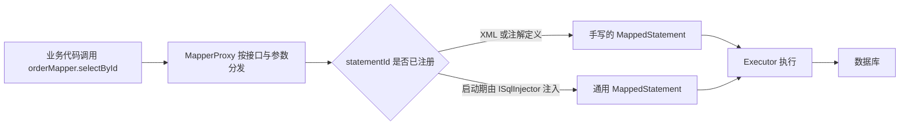
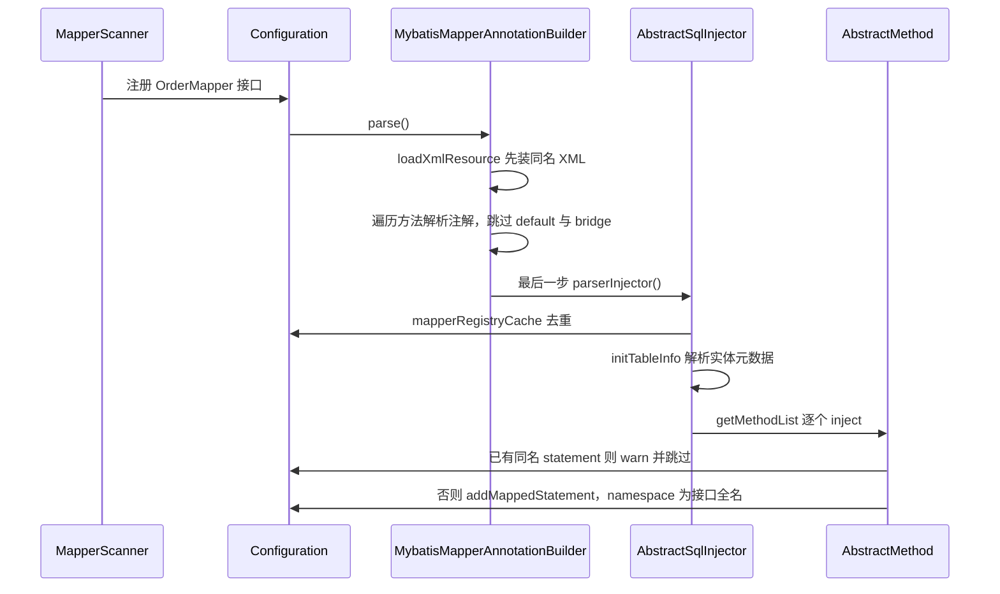
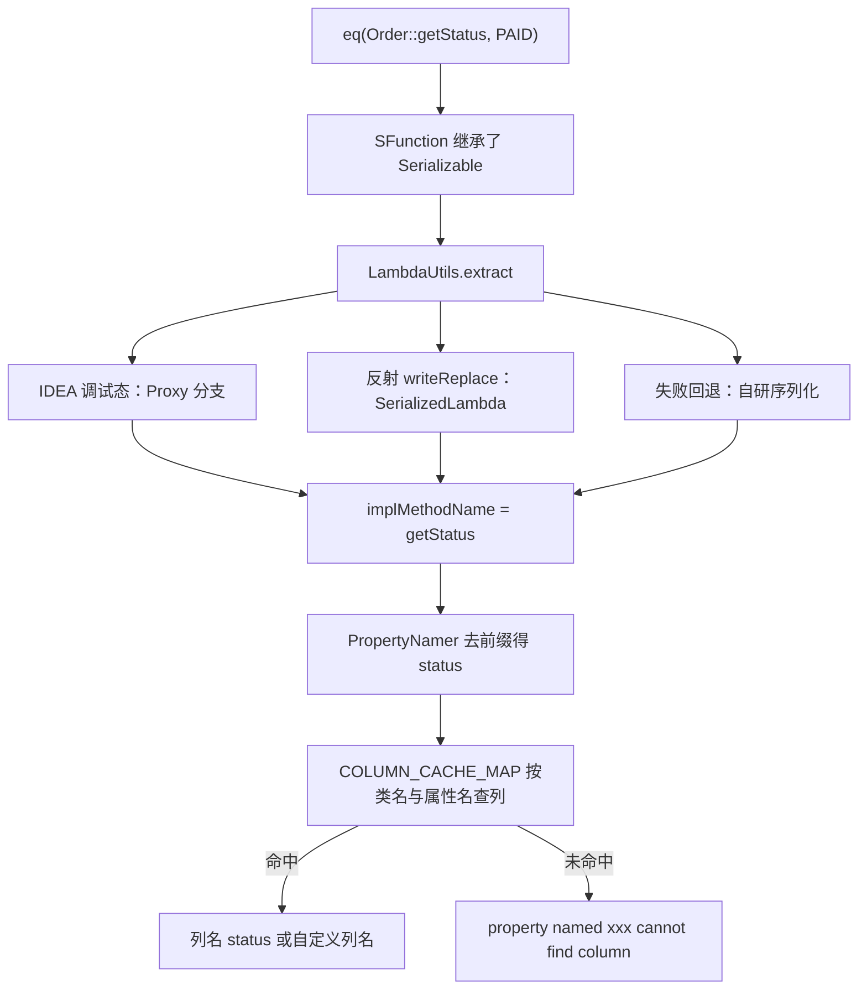
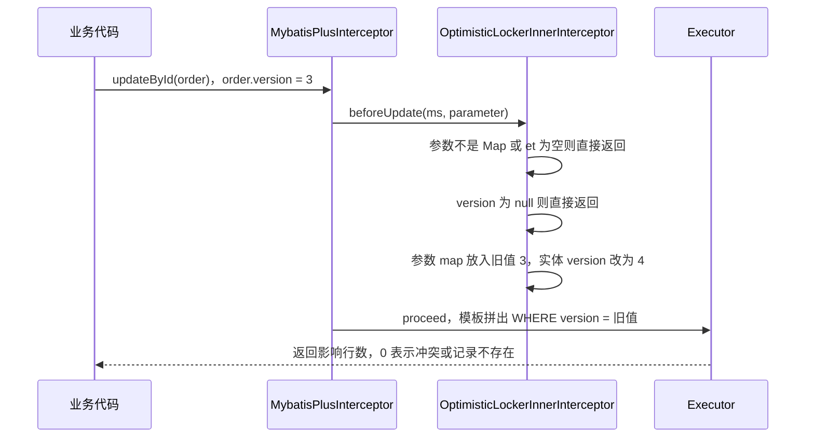
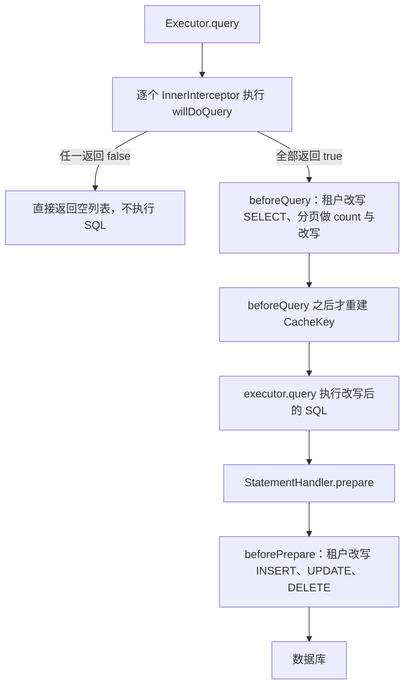
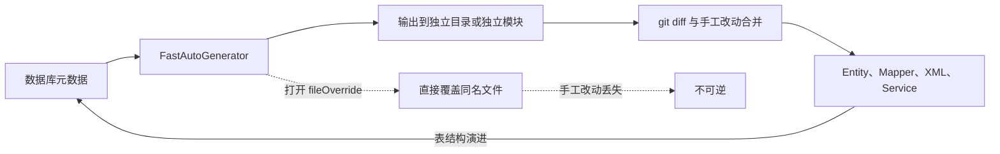

# Mybatis-Plus与代码生成——约定优于配置的实践

**摘要：**

MyBatis-Plus（下称 MP）在 MyBatis 之上加了三层东西：注入通用 CRUD 的 `BaseMapper`、以方法引用代替列名的条件构造器、以及按库表元数据生成骨架代码的生成器。这三层合起来是一个"约定层"——它假定表名与类名、属性与列、主键与 `id` 一一对应，并据此在启动期为每个 Mapper 注册一批看不见的 `MappedStatement`。本文不列功能清单，只回答两个问题：这层约定在什么前提下划算，以及它在哪里把人坑住。行文顺序对应"约定如何落地、又如何失效"：先说三层增强各替代了什么手工劳动、代价是什么；再拆 `ISqlInjector` 的注入时机，解释"接口里没有 SQL 也能查"的原理与同名 `statementId` 的静默冲突；然后沿着 `SerializedLambda` 把 `LambdaQueryWrapper` 的解析链走一遍，标出它不能越过的三条边界；接着逐一看四个约定打不过现实的场景——逻辑删除改写全部自动语句、自动填充与更新时 null 的不覆盖、`@Version` 只在能拿到实体参数时生效、租户拦截器把不该改的表也改了；再处理分页插件的显式配置、`maxLimit` 的静默截断与 PageHelper 不能共存；最后落到代码生成器的定位与一套选型判据、一份检查表。全篇以同一个订单服务的表结构承载例子，落点在"什么时候值得用、用错了会怎样"。

---

## 第 1 章 约定层站的位置

如果一张订单表只有主键、金额、状态、创建时间这几列，所有读写都是按主键取一条、按状态取一页、按主键改几个字段，那么为它手写一套 Mapper 究竟在写什么？答案是十六个 `statementId`，以及与之配套的一批 XML 片段。这些语句的内容与列名一一对应，彼此之间唯一的差别是表名、字段名和 `WHERE` 的形态；它们没有业务判断，没有算法，甚至没有需要讨论的设计取舍。手写它们不是工程，是誊抄。

约定优于配置（Convention over Configuration）正是针对这类誊抄提出的框架设计立场。Ruby on Rails 在 2004 年把它变成框架的默认姿态——类名 `User` 对应表 `users`，字段 `name` 对应列 `name`，开发者只写偏离约定的部分；Spring Data 的 `JpaRepository` 在 Java 侧给出了同一个答案，`findById`、`save`、`deleteAll` 不需要任何实现。而 MyBatis 从诞生起就站在另一边：它坚持 SQL 显式化，把"语句长什么样"留在开发者手里，代价是重复，收益是可预测、可优化、可交给 DBA 审阅。

MyBatis-Plus 没有去纠正这个立场，它另开了一条装载路径。`BaseMapper` 的源码注释写着 `@since 2016-01-23`，这个接口的做法是：把标准 CRUD 的语句在启动期算出来，注册进 MyBatis 的 `Configuration`，让接口方法凭空多出一批可调用的 SQL。理解这一层，后面所有的"坑"才有统一的解释——**它不是一套新的持久层，而是往既有解释器里预装了一批语句**。

### 1.1 三层增强各替代了什么

把 MP 的能力按"替代了什么手工劳动"重新归类，只剩三层。

| 层 | 提供者 | 替代的手工劳动 | 约定失效时的形态 |
| --- | --- | --- | --- |
| 通用 Mapper | `BaseMapper<T>` + `ISqlInjector` | 十六个固定语句的 XML 与注解 | 语句存在但语义不符（少了过滤条件、返回类型不对） |
| 条件构造器 | `QueryWrapper` / `LambdaQueryWrapper` | XML 里成片的 `<if test>` 与列名字符串 | 列名解析失败、条件被静默丢弃、`last()` 变成注入面 |
| 代码生成器 | `FastAutoGenerator` | Entity、Mapper、Service、Controller 的骨架 | 生成物与库表漂移，重跑覆盖手工改动 |

第一层的价值最容易量化：一个四十张表的服务，按每表十六个语句算，光是语句登记就有六百多条；这些语句在 MP 里不需要仓库里的任何一行 XML。第二层的价值在可维护性：列名从字符串变成方法引用，IDE 能重命名，编译期能查出拼写错误。第三层的价值在启动速度：新建一个模块不再需要从零敲 CRUD 骨架。

但三层共享同一个前提——**约定必须与库表一致**。表名不是类名的下划线形式，属性名不是列名的驼峰形式，主键不叫 `id`，逻辑删除字段不在实体上，约定就开始说谎，而且说得很安静。

### 1.2 约定的三种代价

第一种代价是隐式 SQL。语句不在仓库里，而在启动期的内存里。代码评审时看不到 `WHERE deleted = 0`，`grep` 搜不到 `tenant_id`，DBA 拿着 SQL 审核清单也翻不到这些语句。它们真实存在、真实执行，只是没有文本形态。排查线上问题时，你看到的 SQL 是 MP 在启动期拼好的字符串，不是某个人写的字符串；这也解释了为什么同一个 `selectById` 在两张表上的行为可以不同——差别在 `TableInfo` 里，不在代码里。

第二种代价是全局生效。一条 `@TableLogic` 注解改的不是某个方法，而是这个实体所有自动生成语句的形态；一个 `TenantLineInnerInterceptor` 改的不是某个查询，而是进程内所有 SQL。约定层的配置天然是广播式的，改一处、响一片，而广播的范围往往要翻源码才能确认。

第三种代价是版本耦合。SQL 模板随 MP 版本演进而变。3.5.9 起分页与多租户的拦截器被拆到 `mybatis-plus-jsqlparser` 依赖里，漏掉这个依赖不是编译错误而是运行期缺类；`FieldStrategy.IGNORED` 被官方 FAQ 记为 3.5.11 起移除、改用 `ALWAYS`，升级不会让代码编译失败，只会让"更新时带不带这个字段"的判断在某个版本之后悄悄改变。用约定层就等于把一部分 SQL 的最终形态交给了第三方库的发版节奏，这是设计使然，不是缺陷。

### 1.3 与原生 MyBatis 的关系

MP 不改 MyBatis 的解释器，只是在 `Configuration` 里加语句，所以两套写法可以长期共存：老 XML 原样保留，复杂查询照旧手写，新表直接用 `BaseMapper`。这种共存是迁移期最舒服的地方，也是最容易埋雷的地方。既有手写语句、又有注入语句时，同一张表的同一个操作会有两条实现路径，而调用方往往只看接口签名，不看背后是哪条路径在生效。

下图把两条装载路径并排画出来，后面第 2 章只展开其中右边那条。



两条路径在 `Configuration` 里是平等的，谁先进去谁就是实现；这一点在第 2 章末尾会变成一个具体的故障。

---

## 第 2 章 BaseMapper：接口里没有 SQL 为什么能查

运行期，`OrderMapper.selectById(1L)` 这一行代码最终要做的事很朴素：拼出 `com.example.mapper.OrderMapper.selectById` 这个字符串，去 `Configuration` 的 `mappedStatements` 里取 `MappedStatement`，再交给 `Executor`。取不到就抛 `Invalid bound statement (not found)`——这是 MP 官方常见问题文档里的头号条目，它的存在恰好证明了机制：接口方法本身不携带 SQL，SQL 必须先注册到"接口全名.方法名"这个 id 上。

所以 `BaseMapper` 的全部秘密可以压缩成一句：**让这十六个 id 在启动期就存在**。

### 2.1 注入发生的时刻

注册流程的入口是 Mapper 接口被注册进 `Configuration` 那一刻。MyBatis 原本的解析器是 `MapperAnnotationBuilder`，MP 提供了子类 `MybatisMapperAnnotationBuilder` 来替换它，`parse()` 被重写成一个固定顺序。

顺序里有两处值得停一下。第一处是 `loadXmlResource()` 排在最前——同名的 XML（`OrderMapper.xml`）在这一步就先被装入 `Configuration`；第二处是源码注释：CRUD 注入被刻意放在方法遍历之后，理由写得很直白："放在最后，because 可能会有人会用注解重写 sql"。这两处合起来决定了冲突时的胜负：**XML 与注解先到，注入后到，后到者让路**。

遍历接口方法时，`canHaveStatement` 会跳过 `bridge` 方法与 `default` 方法，所以 `selectOne`、`exists` 这类纯 Java 编排的默认方法不会产生 statement，也不该产生——它们内部只是转调 `selectList` 与 `selectCount`。这也解释了一个容易误会的现象：`BaseMapper` 上明明有十几个方法，注入器却只注册十六个，剩下的靠默认方法组合完成。

真正干活的是 `AbstractSqlInjector.inspectInject`：先按泛型实参拿到实体类（`ReflectionKit.getSuperClassGenericType`），再用 `GlobalConfig` 里的 `mapperRegistryCache` 做一次去重（同一个 Mapper 被重复注册时不重复注入），然后 `TableInfoHelper.initTableInfo` 解析实体元数据，最后遍历 `getMethodList` 返回的 `AbstractMethod` 列表逐个注入。



把这张图和 [[01 Mybatis全局架构——从SQL到结果映射的完整链路]] 里的启动期章节对起来看：Configuration 构建完成之后，这些 statement 就与手写 XML 注册的语句一样，进入同一张只读注册表；运行期不再区分来源，也再没有机会区分。

### 2.2 TableInfo：SQL 在启动期就被固化

`AbstractMethod` 的子类各自负责一个方法，它们的实现套路高度一致：从 `TableInfo` 取表名、主键列、字段列表、逻辑删除片段、版本列片段，套进 `SqlMethod` 枚举里的模板字符串，再交给 `LanguageDriver` 编译成 `SqlSource`。

`SqlMethod` 里的模板是可以直接读的，它们的形态决定了后续很多行为的边界：

```java
// SqlMethod 枚举中的模板原文（3.5.x）
INSERT_ONE("insert", ..., "<script>\nINSERT INTO %s %s VALUES %s\n</script>"),
SELECT_BY_ID("selectById", ..., "SELECT %s FROM %s WHERE %s=#{%s} %s"),
SELECT_LIST("selectList", ..., "<script>%s SELECT %s FROM %s %s %s %s\n</script>"),
UPDATE_BY_ID("updateById", ..., "<script>\nUPDATE %s %s WHERE %s=#{%s} %s\n</script>"),
LOGIC_DELETE_BY_ID("deleteById", ..., "<script>\nUPDATE %s %s WHERE %s=#{%s} %s\n</script>"),
```

对 `selectById` 来说，最后一个 `%s` 在逻辑删除开启时是 `AND deleted=0` 这样的文本，而这条语句用的是 `RawSqlSource`——静态 SQL，没有 `<if>`，条件在启动期就焊进文本。对 `selectList` 来说，最后的 `%s %s` 是 `<where>` 包裹的 `${ew.customSqlSegment}`，属于动态 SQL。同一张表的两个查询，一个静态一个动态，这个差异后面在分页与插件改写里会显形。

`TableInfo` 里还装了不少本文后面要用的东西：是否开启逻辑删除、逻辑删除的未删除值与已删除值、版本字段信息、每个字段的 `withInsertFill` 与 `withUpdateFill`、`select` 投影开关、`@OrderBy` 排序。它们都在 `TableInfoHelper.initTableInfo` 里读一次注解与全局配置后固化，之后不再变化。这带来一条很实际的纪律：改 `@TableLogic` 的 `delval`、改 `table-underline`、改 `logic-delete-field`，都必须**重启**；热更新配置不会生效，因为语句已经生成好了。

下表把常用方法、生成的语句形态与被约定改写的入口放在一处，便于对照。

| 方法 | 语句类型 | 逻辑删除的影响 | 乐观锁的影响 | 租户改写相位 |
| --- | --- | --- | --- | --- |
| `insert` | 动态，`<script>` | 无（插入不校验删除值） | 无 | `StatementHandler.prepare` 追加列与值 |
| `selectById` | 静态 `RawSqlSource` | 文本尾部固定拼 `AND deleted=0` | 无 | `Executor.query` 改写 WHERE |
| `selectList` | 动态，`${ew.customSqlSegment}` | `<where>` 内追加删除条件 | 无 | 同上 |
| `selectCount` | 动态 | 同上 | 无 | 同上，且分页的 count 也要过 |
| `updateById` | 动态 | WHERE 追加 `AND deleted=0` | WHERE 追加版本条件 | `StatementHandler.prepare` |
| `update(entity, wrapper)` | 动态 | WHERE 追加删除条件 | 拦截器把版本条件写入 wrapper | 同上 |
| `deleteById` | 逻辑删除时变 UPDATE | 整条语句换成 `LOGIC_DELETE_BY_ID` | 无 | 同上 |
| `selectPage` | 动态 | 同 `selectList` | 无 | 先租户、后分页 |

### 2.3 同名 statementId 的静默冲突

`AbstractMethod.addMappedStatement` 里有一道前置判断，把 statement 名（`mapperClass.getName() + "." + id`）拿去问 `configuration.hasStatement(name, false)`。如果已经存在，它打印一行 warn 就返回 null：

```text
[com.example.mapper.OrderMapper.selectById] Has been loaded by XML or SqlProvider or Mybatis's Annotation,
so ignoring this injection for [class com.baomidou.mybatisplus.core.injector.methods.SelectById]
```

这行日志是本文最值得记住的一处细节，因为它同时说明三件事。

其一，冲突不报错。应用照常启动，接口照常能调，只有一行 WARN 混在启动日志里——而多数团队的启动日志本来就有几百行。

其二，你的语句成了那个 id 的实现，但方法契约仍是 `BaseMapper` 的契约。如果你的 `selectById` 在 XML 里返回了 `List<Order>`，而调用方声明的返回类型是 `Order`，返回多行时会以 `TooManyResultsException` 这种风马牛不相及的形式出现；如果你的 XML 里参数名写的是 `orderId` 而不是主键参数的直接绑定，`Invalid bound statement` 或参数绑定异常也会跟着来。

其三，你手写的那条 SQL 不会带逻辑删除、版本、租户条件，而调用方以为带了。这条最危险：接口签名没变，调用点没变，评审也没变，只有行为变了。

什么时候会撞上？从原生 MyBatis 迁移到 MP 时保留了 XML 里的 `selectById`；为了加一个 `FOR UPDATE` 而在接口上写了 `@Select("select * from t_order where id = #{id} for update")` 并顺手叫了 `selectById`；把 `BaseMapper` 抽成公共子接口后被 `@MapperScan` 一并扫进来（官方 FAQ 里那条 `TypeVariableImpl cannot be cast to Class` 的启动异常就是这一步引起的）。处置办法很简单，但需要纪律：**要么换名，要么彻底接管并同步维护约定**；工程上更稳的做法是把这条 WARN 当作 CI 的启动日志检查项，命中即失败。

---

## 第 3 章 LambdaQueryWrapper：一次方法引用的三段解析

条件构造器要解决的问题出在列名上。`QueryWrapper` 的字段参数是字符串，官方文档对此有一句容易被略过的说明：当参数类型是 `String` 时，它表示的是数据库字段名，不是实体属性名。于是 `eq("user_name", name)` 能被编译，`eq("user_nmae", name)` 也能被编译，后者在运行期变成一条 `Unknown column` 的 SQL 异常，而字段改名时 IDE 不会帮你动那个字符串。

`LambdaQueryWrapper` 把列名换成了方法引用。`eq(Order::getStatus, "PAID")` 里的 `Order::getStatus` 是编译期可校验的，重命名 `status` 属性时引用会跟着改，拼写错误根本没有机会出现。代价是运行期多了一步解析：从方法引用里把列名反推出来。

### 3.1 解析链：从 Serializable 到列名

第一步是类型前提。`SFunction<T, R>` 继承了 `Function<T, R>` 与 `Serializable`，这个 `Serializable` 不是装饰，它是整条链的支点：只有可序列化的 lambda 才会在编译期生成 `writeReplace` 方法，从而能在运行期被反序列化成一个 `SerializedLambda` 对象。

第二步是 `LambdaUtils.extract`，它有三条路径，按环境依次尝试：

```java
// LambdaUtils.extract 的三段式实现（3.5.x）
public static <T> LambdaMeta extract(SFunction<T, ?> func) {
    // 1. IDEA 调试模式下，lambda 是一个代理对象
    if (func instanceof Proxy) {
        return new IdeaProxyLambdaMeta((Proxy) func);
    }
    // 2. 常规路径：反射调用 writeReplace，拿到 SerializedLambda
    try {
        Method method = func.getClass().getDeclaredMethod("writeReplace");
        return new ReflectLambdaMeta((SerializedLambda) ReflectionKit.setAccessible(method).invoke(func));
    } catch (Throwable e) {
        // 3. 反射失败时退回自研序列化实现
        return new ShadowLambdaMeta(SerializedLambda.extract(func));
    }
}
```

第三步是名字变换。`SerializedLambda.getImplMethodName()` 给出的是 `getStatus` 这样的方法名，`PropertyNamer.methodToProperty` 去掉 `get`/`is` 前缀并处理首字母大小写，得到属性名 `status`；再用属性名去 `COLUMN_CACHE_MAP` 里查列名。这张缓存以实体类全名为一级 key、以属性名的大写形式为二级 key，在 `TableInfo` 初始化时一次性建好，查不到就抛 `MybatisPlusException: Your property named "xxx" cannot find the corresponding database column name!`。



三条分支的存在本身就是一条运维知识：不同环境下 lambda 的形态不同，解析失败的报错也不同。3.3.2 之前的版本在分离打包部署时出现过 `ClassNotFoundException`，官方 FAQ 把它归因于反序列化时的类加载器问题，给出的方案是升级版本或调整打包方式。这提醒我们，这条链依赖的不只是 Java 语言特性，还有类加载与序列化的运行时细节。

### 3.2 边界一：方法引用只能是实体的 getter

解析链的输入是一个合法的方法引用，这是它唯一的入口条件，也是最容易被绕过的一条。

把属性访问写成 lambda 而非方法引用，例如 `o -> o.getStatus()`，编译出来的是合成方法（`lambda$findPaid$0`），`getImplMethodName` 拿到的是这个合成名，不是 `getStatus`，解析必然失败。在方法引用上套类型转换，例如 `((Order) o)::getStatus`，要么编译不过，要么指向了另一个实现类的方法，属性名反推出来的东西与实体无关。方法引用指向父类或接口的 getter，而列名缓存挂在具体实体类上，同样查不到。`this::getStatus`、构造器引用、双参数方法引用，一律不成立。

这些写法有一个共同的失败形态：编译期完全通过，运行期在第一次执行到那条条件时抛异常或拼出错误的列名。所以团队里如果允许两种写法混用，代码评审要盯的就不是"能不能跑"，而是"用的是不是方法引用"。这条边界没有运行期兜底，只有规范。

### 3.3 边界二：属性到列的映射是另一套开关

即使属性名解析正确，它能不能变成正确的列名，取决于 `TableInfo` 构建时的那几行逻辑。列名的来源顺序是：`@TableField(value = "...")` 显式指定优先；否则用属性名，在 `tableInfo.isUnderCamel()` 为真时做驼峰转下划线；再叠加 `capitalMode` 与 `column-format`。而 `isUnderCamel()` 来自全局配置 `db-config.table-underline`，默认开启。

这里有一处极容易混淆的地方。MyBatis 自己的 `mapUnderscoreToCamelCase` 管的是结果集列名到实体属性的自动映射，方向是"库到对象"；MP 的 `table-underline` 管的是生成 SQL 时属性名到列名的推断，方向是"对象到库"。两者默认都开着，看起来像同一个东西，关掉任意一个时的症状却完全不同：关掉 `table-underline`，生成的 SQL 里列名变成驼峰，数据库报 `Unknown column 'orderNo'`；关掉 `mapUnderscoreToCamelCase`，SQL 正常执行，但实体里 `orderNo` 是 null，因为 `order_no` 这列没有被映射回来。

判据很简单：SQL 报列不存在，问题在 MP 的**列名推断**；SQL 正常但字段为 null，问题在 MyBatis 的**结果映射**。这条判据能省掉大量翻源码的时间，因为两套开关的配置项、默认值、生效位置都不一样，而它们的表象都是"字段值不对"。

同一个机制还有两个附带边界。实体上只用于展示、不在表里的字段，必须用 `@TableField(exist = false)`、`transient` 或 `static` 排除，否则 `TableInfo` 会把它们当成列，注入的 `INSERT` 与 `SELECT` 都会带上它们。数据库关键字作为列名时，MP 不做自动转义，要么在 `@TableField` 的 value 里显式给列名加反引号，要么配 `column-format` 全局包裹——这一点在官方 FAQ 里写得很直接：设计阶段就别用关键字。

### 3.4 边界三：值是参数，不是文本

条件构造器常被误解成"把条件拼成字符串"。真实机制是：`Wrapper` 维护一棵条件片段树，最终通过 `${ew.customSqlSegment}` 这个属性把片段文本注入模板；而片段里的值不会变成文本，而是被塞进 `paramNameValuePairs`，键名以 `MPGENVAL` 开头，在 SQL 里表现为 `#{ew.paramNameValuePairs.MPGENVAL1}` 这样的占位符。文本部分是列名与运算符，值部分是 JDBC 参数——这个分工决定了 `eq`、`like`、`in` 不会引入注入风险。

真正把值变成文本的只有几个显式出口：`last()` 直接追加到语句末尾，不经任何过滤；`apply()` 接受带 `{0}` 占位的片段，占位参数仍是参数，但片段本身是文本；`setSql()` 同理；`orderByAsc/Desc` 传入字符串时是列名文本；`inSql()` 接受子查询文本。这些方法的共同点是"作者明确要求写 SQL"，所以风险要由调用方承担。官方文档对 `Wrapper` 的安全提示只有一句，分量很重：允许前端传入 SQL 片段会导致注入风险，必须校验。

还有一处语义退化值得单独提。文档说明：当条件方法的参数是 `Map` 或 `List` 且为空时，对应条件不会加入最终 SQL。`in(Order::getId, ids)` 在 `ids` 为空时不生成 `IN` 子句，于是"按 id 列表查"变成"无此条件"，如果这一层之上没有别的过滤，就成了一次全表查询。这种退化不报错、不留日志，只能靠调用方显式判断空集合。

```java
// 空集合会让条件整体消失，需要显式拦住
if (CollectionUtils.isEmpty(ids)) {
    return Collections.emptyList();
}
List<Order> orders = orderMapper.selectList(
    Wrappers.<Order>lambdaQuery()
        .in(Order::getId, ids)
        .orderByDesc(Order::getCreatedAt)
);
```

下表把四种条件表达方式放在同一组维度上对比，选择哪种取决于条件复杂度与可测性要求，不取决于个人偏好。

| 维度 | `QueryWrapper` | `LambdaQueryWrapper` | Mapper XML | `SqlSource` Provider |
| --- | --- | --- | --- | --- |
| 列名来源 | 字符串，写的是列名 | 方法引用，写的是属性 | 手写文本 | 手写文本 |
| 编译期保护 | 无 | 有（属性存在性） | 无 | 无 |
| 条件复杂度上限 | 中，适合条件组合 | 中，同上 | 高，可嵌套任意 `<if>` | 高，可用 Java 组织 |
| 可单元测试 | 需构造 Wrapper 断言 SQL | 同左 | 需起 SqlSession | 可直接测字符串生成 |
| 约定层是否生效 | 生效 | 生效 | 不生效 | 不生效 |
| 典型误用 | 列名拼错、前端传排序字段 | 用 lambda 而非方法引用、在引用里做转换 | 单表 CRUD 变体、漏过滤条件 | 把业务规则写进 SQL 拼装 |

---

## 第 4 章 约定打不过现实之一：逻辑删除

逻辑删除（logical delete）是把"删除"改写成"标记"的通用做法：数据行保留，用一个字段表示已删，查询时过滤掉。MP 把这件事做成了框架特性，也把它做成了最容易出事的一处约定——因为它改的不是某条语句，而是这个实体的所有自动语句。

### 4.1 机制：一条注解重写了语句模板

识别逻辑删除字段的地方在 `TableFieldInfo.initLogicDelete`：字段上标了 `@TableLogic` 就用注解上的值，没标就看全局配置 `db-config.logic-delete-field` 是否等于这个属性名，而且只在"类上还没有逻辑删除字段"时才看全局（方法参数 `existTableLogic` 控制）。这层优先级带来一个边界：同一个实体里注解与全局配置混用时，全局配置只在没有注解字段时接管，两套来源不会叠加，但也不会互相提醒。

识别之后，注入器在生成语句时改变模板形态。删除类方法从 `DELETE` 换成 `LOGIC_DELETE_*` 系列，例如 `LOGIC_DELETE_BY_ID` 的模板是 `UPDATE %s %s WHERE %s=#{%s} %s`，`SET` 部分是 `deleted=1`，末尾再拼一个 `AND deleted=0`；查询类与更新类方法在语句末尾拼 `tableInfo.getLogicDeleteSql(true, true)`，也就是 `AND deleted=0`。于是：

- `deleteById(id)` 变成 `UPDATE t_order SET deleted=1 WHERE id=? AND deleted=0`；
- `selectById(id)` 变成 `SELECT ... FROM t_order WHERE id=? AND deleted=0`，且这条 SQL 是静态的，条件在启动期就写死在文本里；
- `updateById(order)` 变成 `UPDATE t_order SET ... WHERE id=? AND deleted=0`，更新已删除记录会返回 0 行；
- `selectList(wrapper)`、`selectCount(wrapper)`、`selectPage(page, wrapper)` 都在 `<where>` 里带上删除条件。

最后一组里藏着一个排障难点：`updateById` 返回 0 行这件事，在开启逻辑删除之后有了三种解释——记录不存在、记录已删除、版本冲突（如果同时开了乐观锁）。这三种情况的处置完全不同，而接口只回一个整数。这就是为什么第 5 章强调要把行数保留到调用方：**0 行是一个歧义信号，不是结论**。

### 4.2 反例：逻辑删除上线了，手写 SQL 还记得条件吗

订单服务里有一个"按订单号查详情"的查询，因为要 join 订单明细，写在了 XML 里：

```xml
<!-- 开启了 @TableLogic 之后，这条 SQL 依然会返回已删除的订单 -->
<select id="selectDetailByOrderNo" resultMap="OrderDetailMap">
    SELECT o.id, o.order_no, o.amount, o.status, i.sku_id, i.quantity
    FROM t_order o
    LEFT JOIN t_order_item i ON i.order_id = o.id
    WHERE o.order_no = #{orderNo}
</select>
```

逻辑删除上线时，团队验证了 `selectById`、`selectList`、分页列表，全部正常；这条 XML 没有人动，因为它"不是 MP 管的"。结果是客服仍能查到三天前用户已经撤销的订单，而运营后台的列表里看不到它。同一个实体，两条路径，两种事实。

判据很干净：**同一实体，`selectById` 查不到、XML 查得到，差异就在约定上**。处置有两条路，选哪条取决于团队愿意付多少纪律成本。一条是把单表查询全部收进 `BaseMapper` 与 `Wrapper`，XML 只写多表查询并且在每条语句里显式写 `AND o.deleted = 0`，把这一条写进评审清单；另一条是把逻辑删除从"框架开关"降级为"业务状态"，用一个显式的 `status` 字段表达撤销、关闭、作废，让所有查询都必须面对这个字段——这样不会再有人忘记过滤，因为忘记过滤的语句根本读不出业务语义。后一条路的迁移成本高，但它把隐式约定变成了显式代码。

### 4.3 副作用清单

唯一索引是第一处必须提前设计的。`deleted` 只有 0 和 1 两个值时，同一个用户名删掉一次后再插入会成功，删掉两次就会撞唯一键——因为两条"已删除"的记录在 `(username, deleted)` 上完全相同。官方给出的做法是让已删除的值互不相同：把逻辑删除字段定义为数值列，`delval` 写成 `id`，删除时生成 `UPDATE user SET deleted=id WHERE id=? AND deleted=0`，每条已删记录的值等于自身主键，唯一约束自然不冲突；需要同时记录删除时间的，可以用 `UNIX_TIMESTAMP()` 这类函数作为 `delval`，但要接受同秒冲突的可能。这里还有一个反直觉的约束：官方明确建议未删除值不要用 `NULL`。理由是唯一索引允许多个 `NULL`，一旦未删除值取 `NULL`，未删除记录之间的唯一性就整体失守。

索引与数据膨胀是第二处。所有自动查询都多了一个过滤列，`deleted` 应该进联合索引的前缀而不是单独一列，多租户场景下通常是 `(tenant_id, deleted, ...)` 这样的顺序。已删除数据不会消失，分区、归档或定期物理清理要有明确策略，否则三五年后这张表的行数是真实业务量的数倍。

第三处是关联表。MP 的自动条件只作用于当前实体的主表，JOIN 进来的表要自己过滤。这一点在分页的 count 查询上会放大：如果子表的已删除数据不参与过滤，count 会偏大，页码与总数对不上，用户看到的是"最后一页是空的"。

### 4.4 一个容易忽略的用法

逻辑删除开启后，`deleteById` 本质是一次 UPDATE，于是它也会走更新填充那条路。`DeleteById` 的源码在逻辑删除分支里筛出所有 `withUpdateFill` 的字段（排除逻辑删除字段本身），把它们拼进 `SET`，条件是传入参数不是简单类型——只传一个 id 走 `deleteById(id)` 时不会填充。这意味着"谁删的、什么时候删的"可以借自动填充记录在删除语句里，不用额外写一条 update。

不过它仍受 `strictUpdateFill` 的规则约束：字段有值就不覆盖。如果调用方传的是一个刚 `new` 出来、只设了 id 的实体，填充会生效；如果传的是从数据库读出来的对象（字段已有值），填充不会覆盖——同一段代码在不同调用方式下行为不同，这也是自动填充在第 5 章要单独展开的原因。

---

## 第 5 章 约定打不过现实之二、之三：自动填充与乐观锁

自动填充与乐观锁常被归为"两个便利特性"，但它们的机制完全不同：自动填充是参数处理阶段的一次属性赋值，乐观锁是拦截器与 SQL 模板配合的一次参数改写。混淆这两者，就会写出"看起来有版本号、实际上没有并发保护"的代码。

### 5.1 自动填充：填充的是属性，不是列

填充的触发点不在 SQL 里。MP 用自己的参数处理器在把参数写入 `PreparedStatement` 之前，依据字段上的 `FieldFill` 与当前语句的命令类型，调用 `MetaObjectHandler` 的 `insertFill` 或 `updateFill`；处理器拿到的是包装实体对象的 `MetaObject`，写进去的操作等价于 `entity.setUpdatedAt(now())`。

默认策略有两条：字段已有值则不覆盖；填充值为 `null` 则不填。这解释了 `strictInsertFill` 与 `setFieldValByName` 的区别——前者受"null 才填"约束，后者强制覆盖。官方文档在注意事项里写得很清楚：自动填充是直接给实体属性设置值，如果属性没有值，入库时仍然是 `null`；而"如果属性有值则不覆盖，如果填充值为 `null` 则不填充"是默认方法策略。

```java
@Component
public class AuditMetaObjectHandler implements MetaObjectHandler {

    @Override
    public void insertFill(MetaObject metaObject) {
        // 只在字段为 null 时写入，避免覆盖业务代码显式设置的值
        this.strictInsertFill(metaObject, "createdAt", LocalDateTime.class, LocalDateTime.now());
        this.strictInsertFill(metaObject, "createdBy", Long.class, SecurityUtils.currentUserId());
    }

    @Override
    public void updateFill(MetaObject metaObject) {
        this.strictUpdateFill(metaObject, "updatedAt", LocalDateTime.class, LocalDateTime.now());
        this.strictUpdateFill(metaObject, "updatedBy", Long.class, SecurityUtils.currentUserId());
    }
}
```

有三种情况填充不生效，它们的表现都是"字段为 null"，排查时极易误判成配置没生效。

第一种是 `update(null, wrapper)` 或 `update(wrapper)`：参数里没有实体，`MetaObject` 无从谈起，填充直接不发生。这也是乐观锁失效的同一条线索，两个特性共用"实体参数"这个前提。第二种是 `update(entity, wrapper)` 里实体字段已有值：`strictUpdateFill` 不覆盖，于是"我希望更新时把 `updatedBy` 改成当前操作人"这个诉求落空——要改就得自己 `set`。第三种是自定义 Mapper 方法：填充逻辑从参数 map 里按 `Constants.ENTITY`（字符串 `"et"`）取实体，方法签名里如果不写 `@Param("et")`，取不到实体，填充不发生。官方文档的"无法填充示例"给的正是这个对照：参数名从 `user` 换成 `et` 才能正确填充。

### 5.2 更新时 null 不覆盖

第二个坑在更新语句的字段策略上。全局默认 `updateStrategy` 是 `NOT_NULL`（`DbConfig` 字段的初始值），含义是：实体字段为 `null` 时，这个字段不进 `SET` 子句。这条默认值保护了"部分更新"场景——只 `set` 想改的字段，其余字段不会被 `null` 冲掉；代价是"我想把某个字段置空"这件事不能靠 `set(null)` 完成。

三条可行路径：给字段加 `@TableField(updateStrategy = FieldStrategy.ALWAYS)`，让该字段无论是否 `null` 都进 `SET`；或者用 `UpdateWrapper.set(Order::getRemark, null)`；或者用 `setSql` 写表达式。三条路都在明示"我知道这里要写 null"，与隐式的"忘了 set"区分开，这正是它们的价值。

版本升级时要留一处心：`FieldStrategy.IGNORED` 被官方 FAQ 记为 3.5.11 起移除、改用 `ALWAYS`，以对应版本的枚举为准。枚举语义的变化不会让代码编译失败，只会让"这字段到底带不带"的判断在某次升级后翻转。这类变更只能靠升级前的 changelog 阅读来兜。

### 5.3 乐观锁：只在能拿到实体时生效

乐观锁的三件事分别在三个地方完成，缺一件就不成立。

第一件在启动期：`updateById` 的 SQL 模板末尾通过 `TableFieldInfo.getVersionOli` 预留了一个条件 `AND version = #{MP_OPTLOCK_VERSION_ORIGINAL}`，整段包在 `<if test="et != null and et.version != null">` 里。

第二件在拦截器：`OptimisticLockerInnerInterceptor.beforeUpdate` 只在 `SqlCommandType` 为 UPDATE、参数是 `Map`、且 `map.get("et")` 非空时动作。它从实体上读出版本号，读不到（为 `null`）就直接返回；读到了就按类型算出新值（`int`/`Integer` 加一，`long`/`Long` 加一，`Date`、`Timestamp`、`LocalDateTime` 取当前时间），把旧值放进参数 map 的 `MP_OPTLOCK_VERSION_ORIGINAL`，再把实体上的版本号改成新值。

第三件回到 SQL：`SET version = #{et.version}` 写下的正是被改过的新值，`WHERE version = #{MP_OPTLOCK_VERSION_ORIGINAL}` 比对的正是被保存下来的旧值。



把这三件事摊开，生效条件就清楚了：插件必须注册；调用必须是带实体的 UPDATE；实体上的版本字段必须非空；类型必须在支持列表内，否则 `getUpdatedVersionVal` 原样返回旧值，版本号永不递增；`update(entity, wrapper)` 时 `wrapper` 不能复用，因为拦截器是用 `apply` 往 wrapper 里追加版本条件的，第二次调用会把上一次的旧值也带上。

反例正是文章开头提到的那种写法。订单状态流转接口为了"只改状态一列"，写成：

```java
// 看起来有版本号，实际上乐观锁完全没有参与
orderMapper.update(null,
    Wrappers.<Order>lambdaUpdate()
        .set(Order::getStatus, "PAID")
        .eq(Order::getId, orderId));
```

这条语句参数里没有 `et`，拦截器第一道判断就返回了；SQL 模板里的版本条件因为 `<if>` 不成立而不出现；版本列不会变化。于是"我们有乐观锁"变成一句组织内部的错觉，直到某天两个支付回调同时把订单推到不同状态，才被发现。

冲突的处理也要靠行数。`BaseMapper.updateById` 返回 `int`，而 `IService.updateById` 返回 `boolean`，后者把行数抹成了真假。如果业务层拿不到行数，就无从区分"冲突重试"和"记录不存在"，常见的补救是冲突时再查一次，但那又引入了新的竞态窗口。工程上更稳的做法是：需要乐观锁的写路径直接用 Mapper 的行数判定，Service 层不封装掉返回值。

下表把四个特性的生效范围放在同一张矩阵里，这张表是后面检查表的依据。

| 调用方式 | 逻辑删除过滤 | 自动填充 | 乐观锁 | 租户条件 |
| --- | --- | --- | --- | --- |
| `insert(entity)` | 不校验 | 生效（`FieldFill.INSERT`） | 不涉及 | 需要自动填充补租户列 |
| `selectById(id)` | 生效，启动期固化 | 不涉及 | 不涉及 | 生效 |
| `selectList(wrapper)` | 生效 | 不涉及 | 不涉及 | 生效 |
| `updateById(entity)` | 生效，WHERE 带删除条件 | 生效（`FieldFill.UPDATE`） | 生效，需 entity 版本非空 | 生效 |
| `update(entity, wrapper)` | 生效 | entity 非空才生效 | 生效，wrapper 不可复用 | 生效 |
| `update(null, wrapper)` | 生效 | 不生效 | 不生效 | 生效 |
| `deleteById(id)` | 转 UPDATE，带填充字段 | 走更新填充 | 不涉及 | 生效 |
| XML 手写语句 | 不生效 | 不生效 | 不生效 | 生效（拦截器改写 SQL 文本） |

这张表的最后一行需要单独说明。多租户是唯一一个能作用到手写 SQL 的特性，因为它改的是 SQL 文本而不是生成模板——这正是下一章要展开的地方。

---

## 第 6 章 约定打不过现实之四：多租户

多租户（multi-tenancy）在数据层的实现有几种：独立库、独立 schema、共享表加租户列。MP 的 `TenantLineInnerInterceptor` 针对最后一种，做法是用 JSQLParser 把 SQL 解析成 AST，再按表逐个注入 `tenant_id` 条件。它的官方文档有一句提醒分量很足：启用多租户后，所有执行的 method 的 SQL 都会进行处理。这里的"所有"包括手写 XML，也包括你从别人仓库里抄来的那条统计语句。

### 6.1 改写面

拦截器挂两个相位。`beforeQuery` 处理 SELECT：它把 SQL 交给 `parserSingle` 解析，然后递归处理 select 列表里的子查询、`WHERE` 里的 `IN`、`EXISTS` 子查询、`FROM` 的子查询、`JOIN`、`UNION` 的各分支，最后用 `别名.tenant_id = ?` 或 `表名.tenant_id = ?` 与原有条件做 `AND`。当原条件是 `OR` 表达式时，它会先把原条件加括号再 `AND`，避免 `a OR b AND tenant_id = ?` 这种语义漂移。

`beforePrepare` 处理写语句，只对 INSERT、UPDATE、DELETE 动作：UPDATE 与 DELETE 加 `WHERE` 条件；INSERT 则往列表里追加 `tenant_id` 列与对应的值，如果是 `INSERT ... SELECT`，还要给内层 select 追加一列。整条链路依赖一个 `TenantLineHandler`，它提供三样东西：当前租户 ID（`getTenantId()`）、租户列名（`getTenantIdColumn()`，默认 `tenant_id`）、以及按表名判断是否跳过的白名单（`ignoreTable()`）。

下图把拦截器相位与 `MybatisPlusInterceptor` 的分发顺序画在一起，这张图同时解释了第 7 章的分页为什么必须排在后面。



### 6.2 三个反例

第一个反例是系统表被误伤。租户拦截器按表名判断，默认对每张表都加条件。订单服务里除了 `t_order`，还有 `t_dict`（数据字典）、`t_config`（配置）、`t_job_lock`（任务锁）这几张全局表，它们没有 `tenant_id` 列。上线后第一次查询就报 `Unknown column 'tenant_id' in 'where clause'`；如果撞上的是启动时的字典预加载，应用会直接起不来。更隐蔽的情形是某张表恰好有个同名但语义不同的列，查询结果全空。处置是给 `ignoreTable` 加白名单：按表名精确匹配，注意大小写与是否带 schema 前缀，因为传进来的是 AST 里的表名原文。另一条路是 `@InterceptorIgnore(tenantLine = "true")` 标在 Mapper 方法上，适合"只有这一条语句不该带租户条件"的场景。

第二个反例是无列名 INSERT。拦截器的 `processInsert` 在拿不到列名列表时直接返回，不追加任何东西：

```java
// 没有列名的 insert 不会被改写，tenant_id 落到默认值
// INSERT INTO t_order VALUES (1, 100.00, 'PAID')
```

数据写进去了，但租户列是表默认值，随后所有按当前租户的查询都查不到这条记录。官方注意事项里的对应建议是：插入时的租户列要靠自动填充补上，否则不会自动保存。这两条合起来才是完整做法——SQL 里写列名，租户列交给 `MetaObjectHandler` 填。另外，如果 SQL 里已经手写了 `tenant_id`，`ignoreInsert` 会让拦截器不再追加，此时值的正确性由你负责。

第三个反例是隐式连接与缺别名。`getAliasColumn` 的逻辑是：有别名用别名，没别名用表名。于是自连接、多表隐式连接、`INNER JOIN` 缩写成 `JOIN` 或逗号连接的 SQL，很容易生成出与 SQL 里实际可用限定符不一致的条件，表现为语法错误或条件落到错误的表上。官方注意事项说要"按规范书写，每个表都要给别名，特别是 inner join 要写标准的 inner join"，原因就在这里：**改写器不理解你的意图，它只认 AST 里的表节点**。

### 6.3 忽略策略是 ThreadLocal

需要临时绕过多租户时，`@InterceptorIgnore` 是静态方案，动态方案是 `InterceptorIgnoreHelper.handle(IgnoreStrategy.builder().tenantLine(true).build())`，用完必须 `clearIgnoreStrategy()`。官方文档给的建议是"尽量用 try finally 的方式保证能正确关闭"。

这条建议背后是线程池的现实：忽略状态存在 ThreadLocal 里，漏清理时，从线程池复用到的下一个请求会继承"忽略租户"这个状态，于是本该隔离的查询变成了跨租户读取。这类缺陷在测试环境几乎复现不出来，只有在并发压测或者线上流量高峰才偶发，而且日志上看不出异常——同一段代码，有的请求加了条件，有的没有。

最后要记住官方那句边界划分：多租户不等于权限过滤。租户隔离划的是"哪家公司的数据"，行级权限划的是"公司里谁能看哪些数据"，两者在数据层可以用同一种 AST 改写实现，但语义不同、生命周期不同、审计要求也不同。把两套规则塞进一个拦截器，会让 SQL 的最终形态同时依赖请求头、登录态与配置，排查时无从下手。

---

## 第 7 章 分页插件：必须显式配置，且不能有第二套

MP 的分页有一个与直觉相反的前提：`selectPage` 本身只是一个返回 `IPage` 的 Mapper 方法，它不负责分页。真正的分页由 `PaginationInnerInterceptor` 完成，而这个 InnerInterceptor 不会因为引入 MP 依赖就自动出现——必须显式地挂到 `MybatisPlusInterceptor` 上。

### 7.1 不配会怎样

不配分页插件时，`selectPage(page, wrapper)` 执行的仍是模板里那条普通查询语句：没有 count，没有 `LIMIT`，`Page` 对象的 `current` 与 `size` 被忽略，`records` 里塞着全表结果，`total` 保持初始值 0。这个错误在开发环境常常看不出来——测试数据只有几十行，分页看起来"能翻"；上线后一次请求就能把百万行拉进内存。

判据很明确：日志里 SQL 没有 `LIMIT`，返回对象 `total = 0` 而 `records` 有一大堆。看到这两个现象同时出现，先别怀疑 Wrapper，去看拦截器 Bean 有没有注册。

另一个版本相关的坑：从 3.5.9 起 `PaginationInnerInterceptor` 与多租户拦截器被拆到 `mybatis-plus-jsqlparser` 依赖里，只引 `mybatis-plus-boot-starter` 不引这个会缺类，表现是启动或首次分页时的 `NoClassDefFoundError` / `ClassNotFoundException`，异常栈里出现 `net.sf.jsqlparser` 的包名。

### 7.2 它做了什么

`PaginationInnerInterceptor` 实现了两个扩展点。`willDoQuery` 里做 count：它从参数里找出 `IPage`，如果 `page` 为空、`size` 小于 0 或者 `searchCount()` 为假，就直接返回 true 表示"照常查询"；否则构造 count 语句执行一次，把结果写进 `page.setTotal()`，再由 `continuePage` 判断是否继续——总数为 0 时返回 false，`MybatisPlusInterceptor` 收到 false 后直接返回空列表，列表查询根本不发出去。

`beforeQuery` 里做改写：先拼接 `OrderItem` 里的排序，再按方言把原 SQL 改写成带 `LIMIT` 的形式。它改的是 `BoundSql` 里的 SQL 文本与参数映射，而 `MybatisPlusInterceptor` 的调用顺序是"先 `beforeQuery`，再 `createCacheKey`，最后 `executor.query`"，所以改写后的 SQL 参与缓存键计算——不同的页不会互相命中缓存。这个顺序是分页能与一级、二级缓存共存的原因，也是它比 ThreadLocal 方案更难出错的地方。

几个配置项的行为值得逐条记住，它们的共同特点是不报错、只改变结果。

| 配置项 | 默认值 | 行为 | 误判风险 |
| --- | --- | --- | --- |
| `maxLimit` | 无限制 | `handlerLimit` 把超过上限的 `size` 直接改成上限 | 前端传 5000 被截成 100，翻页逻辑若按传入值算会错位 |
| `overflow` | `false` | 超过总页数时不再查询，返回空列表 | 前端"跳转末页"拿到空数据，看起来像数据丢失 |
| `optimizeCountSql` | `true` | 去掉 `ORDER BY`、按条件移除 `LEFT JOIN` | 一对多 join 的 `total` 本来就不准，优化后差异更大 |
| `optimizeJoinOfCountSql` | `true` | 是否移除不参与条件过滤的 join | 同上 |
| `searchCount` | `true` | 为假时不查 count，`total` 保持 0 | 前端分页器没有总数 |
| `countId` | 空 | 用指定的自定义 count 语句替代自动生成 | 写错 id 只在日志里 warn |

`maxLimit` 那条要多说一句。它的实现是 `page.setSize(limit)`，既不改返回值也不抛异常，所以调用方完全不知道自己的请求被削过。如果分页参数是从前端透传的，页面上"每页 500 条"的选项会永远显示 500，实际只返回 100 条，翻到第 N 页时的偏移量按 500 算，于是数据被跳过。判据是：`records.size()` 与请求的 `size` 不一致且恒等于某个整数——那个整数就是 `maxLimit`。

### 7.3 与 PageHelper 不能共存

两套分页方案的工作方式是同构的：都拦截 `Executor.query`，都改写 SQL 文本，都要区分 count 与数据两条语句。PageHelper 用 `startPage()` 把分页参数放在 ThreadLocal 里，MP 用 `IPage` 参数显式传递。它们各自的实现都没问题，问题出在同时装配。

同时存在时，两个拦截器会形成嵌套：PageHelper 在外层改写一次，MP 在里层再改写一次，最终 SQL 里出现两个 `LIMIT`（或者一个 `LIMIT` 一个 `OFFSET` 叠加），语法直接失败。MP 官方常见问题文档里恰好有一条"出现 2 个 limit 语句"，给出的原因就是"配了 2 个分页拦截器，只留一个"。这句话在迁移场景里几乎必然命中：老项目用 PageHelper，新代码用 MP，两套依赖都在 `pom.xml` 里，谁也没删。

迁移动作要按清单走：删掉 PageHelper 依赖与全部 `PageHelper.startPage(...)` 调用；确认 PageHelper 的自动配置不会再注册 `PageInterceptor`；确认 `MybatisPlusInterceptor` 里只有一个分页 InnerInterceptor；把返回类型从 `PageInfo` 迁到 `IPage` 或自定义分页对象。漏掉任何一步，症状都是同一个。

### 7.4 排序字段是注入面

`PaginationInnerInterceptor` 在拼接排序时，直接拿 `OrderItem.getColumn()` 构造 SQL 列对象，中间没有任何白名单。这意味着如果 Controller 把前端传来的 `sort` 字段原样塞进 `OrderItem`，攻击者可以用它构造出意料之外的排序表达式——排序位置通常是注入检测最容易漏掉的地方，因为多数人检查的是 `WHERE`。

官方在分页文档里对此有一句提示：排序对象的 `column` 建议不要让前端传入，如果允许，一定要做白名单验证。实现上就是一份字段映射表：前端传 `amount`，后端映射到实体属性，再用 `LambdaQueryWrapper` 的 `orderByDesc(Order::getAmount)`；映射表里没有的 key 直接拒绝，而不是回退到默认排序。

---

## 第 8 章 代码生成器：生成的是起点

代码生成器解决的是另一类重复：Entity 的字段与类型、Mapper 接口的骨架、Service 与 Controller 的空壳。它的输入是数据库元数据，输出是 Java 源码。问题恰恰出在这个方向上——**输入是会变的，输出是会被改的**，而多数团队只在第一次生成时把这条链路走通了。

### 8.1 生成能力的边界

3.5.1 起 MP 提供了新的生成器 `FastAutoGenerator`，官方明确说明它与 3.5.1 以下版本不兼容。模板引擎需要自行引入，支持 Velocity（默认）、Freemarker、Beetl、Enjoy 四种。数据来源有两种：元数据查询（`DefaultQuery`，读 JDBC 元数据）与 SQL 查询（`SQLQuery`，按数据库方言写查询语句）。官方文档对元数据方式的已知缺口写得很坦率：表注释读不到时要给连接串加 `remarks=true&useInformationSchema=true`；MySQL 的 `tinyint` 在长度为 1 时无法转成 `Boolean`，要用连接参数或自定义类型转换；PostgreSQL 的 `json`、`jsonb`、`uuid` 等类型处理不理想。

这些缺口合起来说明一件事：**生成的实体是"数据库类型的直译"，不是"业务模型的表达"**。金额该用 `BigDecimal` 还是分（`long`）、状态该用枚举还是 `Integer`、JSON 字段该映射成什么，元数据里没有答案。生成器给出的是可编译的起点，业务语义要人工补。

```java
// 生成器配置的关键几项（3.5.x 新 API）
FastAutoGenerator.create(url, username, password)
    .globalConfig(builder -> builder
        .author("order-team")
        .outputDir("./target/generated")   // 先落到临时目录，再 diff 合并
        .commentDate("yyyy-MM-dd")
        // .fileOverride()                  // 默认关闭；打开会覆盖同名文件
    )
    .packageConfig(builder -> builder
        .parent("com.example.order")
        .entity("domain")
        .mapper("mapper")
        .xml("mapper.xml")
    )
    .strategyConfig(builder -> builder
        .addInclude("t_order", "t_order_item")
        .addTablePrefix("t_")
        .entityBuilder()
            .enableLombok()
            .logicDeleteColumnName("deleted")
            .versionColumnName("version")
            .build()
    )
    .templateEngine(new FreemarkerTemplateEngine())
    .execute();
```

### 8.2 再生成与手工修改的冲突

生成器对已存在文件的默认行为是跳过，打开 `fileOverride` 后才是覆盖。两条路都不解决"手工改动怎么保留"这个问题，只是把矛盾推后。

现实里的循环通常是这样的：第一次生成，得到一套干净的骨架；开发过程中往 Service 里加业务方法，往 XML 里加多表查询，往 Entity 里加 `@TableField(exist = false)` 的展示字段；三个月后表结构变更，加了两列，有人重跑生成器，`fileOverride` 一开，Service 里的业务方法、XML 里的 join、Entity 上的注解全部回到初始形态。如果没有提交，损失是一次重写；如果提交了，损失是一次事故。



稳定的做法有三条。第一，让生成物分级：Entity 与基础 ResultMap 视为可再生（改动只通过注解与少量扩展完成），Mapper 接口视为可再生（业务方法一律不写在 Mapper 接口里，写到独立的扩展接口），Mapper XML、Service、Controller 视为一次性（生成后就不再重跑）。第二，把生成输出固定到一个独立目录或独立模块，重跑之后用 `git diff` 人工合并，而不是让生成器直接写进 `src/main/java`。第三，把生成器版本与模板一起纳入仓库，模板本身就是团队规范的一部分。

### 8.3 模板即规范

生成器支持自定义模板，模板里可以引用表名、列名、注释等元数据。团队常把统一响应结构、统一异常处理、统一的分页参数封装进模板，让新生成的代码天生符合规范。这个用法是对的，但它有一个副作用值得警惕：模板越厚，生成物越像最终代码，第二次生成时就越难分辨哪些行是人写的、哪些行是模板产的。所以模板里应该尽量少放"看起来像业务"的东西，把差异留在生成之后。

还有一层"起点"的含义在元数据本身。生成器读的是当下的数据库，而团队往往有多个环境：开发库上有一批实验列，测试库缺索引，生产库才是准的。同一份生成脚本在不同环境跑出来的实体不一样，这类漂移不会报错，只会在合并时表现为莫名其妙的字段增减。要避免它，就得规定生成只针对一个权威 schema——通常是从迁移脚本或生产库导出的结构，而不是任何一个开发者本地的库。

---

## 第 9 章 选型判据

前面八章讲的都是机制与边界，这一章回答最初的问题：什么时候值得用。

### 9.1 三个判据

第一个判据是表结构的规整度。MP 的通用方法建立在几条硬约定上：单一主键、主键可比较、列名与属性名可互相推导。复合主键是 MP 明确不支持的（官方 FAQ 有专门一节解释理由），如果系统里大量表是复合主键或业务键作主键，通用方法里带 `ById` 的那一半基本用不上，剩下的一半价值有限。列名如果有历史包袱（下划线、驼峰、大小写混用、保留字），每个实体都要加 `@TableField`，约定层的收益被注解成本抵消。

第二个判据是 SQL 复杂度的分布。可以把一个服务的查询按形态分三类：单表条件查询、多表关联查询、聚合与批处理。第一类的占比越高，MP 的收益越大；第二、三类占比高时，`Wrapper` 表达力不足的问题会很快暴露——子查询、窗口函数、`INSERT ... ON DUPLICATE KEY UPDATE`、递归 CTE，最后都得回到 XML 或 Provider，而那时你已经在两套体系之间来回切换了。

第三个判据是团队约定的成熟度。约定层的收益不是自动兑现的，它需要有人维护公共 `BaseMapper` 子接口、有人规定"单表 CRUD 不许写 XML"、有人盯启动日志里的 WARN、有人负责生成器的模板。缺了这些，约定层就退化成"每个人按自己的理解用"，收益变成负债。

| 判据 | 倾向使用 | 倾向不用 | 混合策略 |
| --- | --- | --- | --- |
| 表结构 | 单主键、命名规范、列名可推导 | 复合主键为主、命名历史包袱重 | 规范表用 MP，遗留表手写 |
| SQL 复杂度 | 单表条件查询占七成以上 | 多表 join 与聚合占主导 | MP 管主表 CRUD，XML 管复杂查询 |
| 团队约定 | 有公共基类与评审规则 | 无统一规范、多人并行改同一模块 | 先立规则再引入 |
| 库表控制权 | 本团队能决定 schema | schema 由外部系统或 DBA 统管 | 只对自有表启用约定 |

### 9.2 收益的量级

用订单服务做个粗算，全部数字都是示例推算，只用于判断量级。假设四十张表，其中八成的表结构规整、可以用 `BaseMapper`，也就是三十二张表乘以十六个通用方法，约五百个语句不必手写。按每条语句平均三到五行 XML 估算，节省的配置文本在两千行上下。启动期要为这三十二张表各解析一次 `TableInfo`、注册十六个 statement，量级在百毫秒，具体取决于实体数量与反射缓存是否预热，这个数字会随项目规模线性增长。运行期要额外付的是 count 查询与 SQL 解析：分页每次多一条 count，多租户与分页的 AST 解析在缓存命中后摊薄，未命中时会有一次 JSQLParser 解析开销。

这些数字的意义不在精确，而在比较：省下的是可以直接删掉的行数与不再需要维护的样板，付出的是启动期一次固定成本与运行期若干次解析。对中小规模的 CRUD 型服务，这笔账是划算的；对以复杂查询为主的服务，省下的样板本来就少，付出的解析与调试成本却照付。

### 9.3 混合策略的边界

混用不是妥协，而是默认答案，关键在于边界的划法。可以按下面这条线划：`BaseMapper` 与 `Wrapper` 负责"一张表、按主键或按单列条件、简单排序与分页"；XML 与 Provider 负责"多表、聚合、批量、方言相关"；**单表 CRUD 的变体一律不写进 XML**，因为那会同时失去约定层的过滤能力与手写 SQL 的可见性，得到两者的缺点。同样，业务规则不写进 `Wrapper` 的拼装逻辑里，那段代码既不可读也不可测，出问题时只能靠日志猜 SQL。

禁止清单还有一条：不要在 XML 里重写 `BaseMapper` 已有的方法名。第 2 章讲过它的后果——注入被跳过、约定失效、只剩一行 WARN。

### 9.4 什么时候约定层是负担

三种情形下，引入 MP 反而让代码更难维护。其一，服务以报表与多表关联为主，单表查询不到三成，`Wrapper` 能表达的过滤器覆盖不了一半场景，最后每条查询都是 XML，而 MP 只贡献了启动期的注入成本与一层需要理解的心智负担。其二，库表由外部系统或 DBA 统一管理，命名、主键、逻辑删除字段都不由团队决定，约定层的前提（命名可推导）不成立，每个实体都要靠注解把约定补回来。其三，团队规模小、模块边界模糊，没人负责公共基类与模板，约定层变成"每个人一份 `BaseMapper` 子接口"，重复代码换了形态继续存在。

---

## 第 10 章 配置与上线检查

前面九章拆开了机制，这一章把可执行的结论收拢成配置与清单。

### 10.1 一份可抄的配置

全局配置决定约定层的形状，尤其是与逻辑删除、主键、字段策略相关的三项，它们影响所有自动语句。

```yaml
mybatis-plus:
  mapper-locations: classpath*:/mapper/**/*.xml
  global-config:
    banner: false
    db-config:
      id-type: assign_id            # 与落库的雪花主键策略保持一致
      logic-delete-field: deleted   # 只在实体没标 @TableLogic 时生效
      logic-delete-value: 1
      logic-not-delete-value: 0
      update-strategy: not_null     # 默认即如此，写出来是为了显式
      table-underline: true         # 属性名到列名的驼峰转下划线
  configuration:
    map-underscore-to-camel-case: true  # 结果集列名回属性的映射
    log-impl: org.apache.ibatis.logging.slf4j.Slf4jImpl
```

两处容易踩的细节要写进注释之外的说明。第一，Spring Boot 下 MP 的 starter 读的是 `mybatis-plus` 前缀；从原生 MyBatis 迁移时，留在 `mybatis.*` 下的配置不会报错，只是不再生效，这类静默失效最难查。第二，`table-underline` 与 `map-underscore-to-camel-case` 是两套开关，前者管生成 SQL 的列名推断，后者管结果集映射，第 3 章给过区分它们的判据。

拦截器的注册顺序比配置项更容易出错，因为它不写在 yaml 里，而是写在 Bean 的方法体里。

```java
@Configuration
public class MybatisPlusConfig {

    @Bean
    public MybatisPlusInterceptor mybatisPlusInterceptor() {
        MybatisPlusInterceptor interceptor = new MybatisPlusInterceptor();
        // 顺序依据：先做单次 SQL 改造的插件，再做不改 SQL 的插件
        TenantLineInnerInterceptor tenant = new TenantLineInnerInterceptor();
        tenant.setTenantLineHandler(new OrderTenantLineHandler());
        interceptor.addInnerInterceptor(tenant);                  // 1. 改写面最广
        interceptor.addInnerInterceptor(new OptimisticLockerInnerInterceptor());  // 2. 改参数与 SET
        interceptor.addInnerInterceptor(new BlockAttackInnerInterceptor());       // 3. 不改 SQL 只拦截
        PaginationInnerInterceptor pagination = new PaginationInnerInterceptor(DbType.MYSQL);
        pagination.setMaxLimit(200L);                             // 防全表扫描的硬上限
        interceptor.addInnerInterceptor(pagination);              // 4. 必须看到最终 SQL，放最后
        return interceptor;
    }
}
```

顺序的道理在官方文档里有两句话：建议顺序是"多租户、动态表名 → 分页、乐观锁 → SQL 性能规范、防止全表更新与删除"，并且"对 SQL 进行单次改造的插件应优先放入，不对 SQL 改造的插件最后放入"；分页文档另外强调"如果配置多个插件，切记分页最后添加"。原因在第 6 章的相位图里已经画清：分页需要在 count 与改写时看到包含租户条件的最终 SQL，若它排在租户之前，count 会在未过滤的行集上统计，总数偏大、页码错乱；更严重的情形下，跨租户的总数本身就不该被算出来。插件链的代理层次与执行顺序见 [[07 插件机制——Interceptor的责任链模式与分页插件原理]]。

### 10.2 上线检查表

下面这张表按"先静态检查、再启动检查、再运行期验证"的顺序排，每一条都给出可观察的判据，避免写成"要注意 XX"这种无法执行的条目。

| 检查项 | 判据 | 不通过的处置 |
| --- | --- | --- |
| 启动日志无注入跳过 WARN | `Has been loaded by XML or SqlProvider` 零命中 | 找到同名 statement，改名或接管 |
| 拦截器顺序 | 租户在分页前，分页在最后 | 调整 `addInnerInterceptor` 顺序 |
| 分页插件已注册 | 日志 SQL 含 `LIMIT`，`total` 非 0 | 补 Bean，检查 jsqlparser 依赖 |
| 分页计数与前端一致 | `records.size()` 等于请求 `size` 或等于 `maxLimit` | 明确 `maxLimit` 语义并让前端感知 |
| 无第二套分页 | 全仓搜索 `PageHelper.startPage` 为零 | 删依赖、删调用、确认拦截器唯一 |
| 逻辑删除覆盖手写 SQL | 抽查五条 XML，每条都带删除条件 | 补条件或收进 Wrapper |
| 乐观锁真实生效 | 冲突场景下 `updateById` 返回 0 | 检查是否传了 `null` 实体、version 是否为空 |
| 自动填充覆盖各入口 | `insert`、`update`、自定义方法各验一次 | 补 `@Param("et")`、改用显式 `set` |
| 租户白名单 | 系统表、字典表查询不报 `Unknown column` | 补 `ignoreTable`，复核大小写 |
| 忽略策略无泄漏 | 并发压测后抽查租户条件是否都在 | `try/finally` 清理，禁用跨请求缓存 |
| 生成器输出可回滚 | 重跑生成后 `git status` 无意外改动 | 关 `fileOverride`，改输出到临时目录 |
| 空集合条件 | 抽查 `in()` 调用点均判空 | 补判空或改用别的条件 |

### 10.3 反例汇总

前面章节散落的反例在这里收拢成一张表，症状与根因一一对应，方便在排查时直接对号入座。

| 症状 | 根因 | 处置 |
| --- | --- | --- |
| 列表查不到已删数据，详情页却查得到 | 逻辑删除只作用于自动语句，手写 XML 漏了条件 | XML 显式写删除条件，或把查询收进 Wrapper |
| 订单有 version 字段，并发下仍然互相覆盖 | 更新走 `update(null, wrapper)`，参数里没有实体，拦截器直接返回 | 改为 `updateById` 并带实体版本号，或显式判断行数 |
| 应用启动报 `Unknown column 'tenant_id'` | 租户拦截器改写了系统表、字典表 | `ignoreTable` 白名单，或用 `@InterceptorIgnore` 局部关闭 |
| 表结构加列后重跑生成器，业务方法消失 | 打开了 `fileOverride`，生成器直接覆盖同名文件 | 关闭覆盖，输出到临时目录后 diff 合并 |
| SQL 里出现两个 `LIMIT` | 同时装配了 PageHelper 与 MP 分页 | 删掉其中一套，只保留一个分页拦截器 |
| 每页请求 500 条，实际返回 100 条 | `maxLimit` 静默截断 `size` | 让分页参数受 `maxLimit` 约束，前端按实际 `size` 计算偏移 |
| 同一实体在两张表上行为不同 | `TableInfo` 的注解与全局配置不一致 | 统一用注解，或统一用全局配置，避免混用 |
| 更新时字段没被写成 null | 默认 `updateStrategy` 为 `NOT_NULL` | 用 `ALWAYS` 或 `UpdateWrapper.set` |

### 10.4 选择的落点

把十章的结论压成一句：MP 是一层把重复劳动换成隐式行为的交易。它换掉的是几百上千行样板与一批容易写错的列名，换来的是启动期算好的语句、全局生效的开关、以及与版本绑定的 SQL 形态。这笔交易在"单表为主、结构规整、团队有约定"的前提下明显划算，在"多表关联、SQL 高度定制、库表不由自己掌握"的前提下明显不划算；两种前提在同一家公司、同一个部门里都可能同时成立，所以真正的答案通常不是"用"或"不用"，而是"哪些表用、哪些查询不用"。

约定层的风险从不在功能缺失，而在**它把失败做成静默的**：同名语句被跳过只留一行 WARN，租户列落默认值不报错，乐观锁在拿不到实体时静默退出，`maxLimit` 悄悄改写页大小，生成器覆盖文件不留备份。这些设计并不恶意，它们是"约定优于配置"的必然结果——约定越省事，偏离约定时的反馈就越少。既然反馈少，就要靠人为补上：把判据写进检查表，把启动日志纳入 CI，把"单表 CRUD 不写 XML"变成评审规则。

MyBatis 与 MP 的分歧，本质上不是"要不要偷懒"，而是把复杂度放在哪一侧：放在代码里，重复但可见；放在约定里，简洁但需要理解。理解了约定怎么落地、什么时候失效，选择才不会变成站队。

---

## 参考资料

1. [MyBatis-Plus 官网与文档入口](https://baomidou.com/)
2. [分页插件](https://baomidou.com/plugins/pagination/)：`PaginationInnerInterceptor` 的配置项、`maxLimit` 语义、多插件顺序与排序字段注入提醒
3. [乐观锁插件](https://baomidou.com/plugins/optimistic-locker/)：支持的方法范围、版本字段类型、`wrapper` 不可复用
4. [多租户插件](https://baomidou.com/plugins/tenant/)："所有 method 的 SQL 都会处理"、插入需配合自动填充、自定义 SQL 的别名要求
5. [逻辑删除支持](https://baomidou.com/guides/logic-delete/)：插入值处理、唯一索引与 `delval = id` 方案、未删除值不用 `NULL`
6. [自动填充字段](https://baomidou.com/guides/auto-fill-field/)：默认填充策略、`update(entity, wrapper)` 与 `update(wrapper)` 的差异、`@Param("et")` 要求
7. [条件构造器](https://baomidou.com/guides/wrapper/)：`String` 参数表示列名、空集合条件被丢弃、`RPC` 传输 `Wrapper` 的态度
8. [SQL 注入器](https://baomidou.com/guides/sql-injector/)：`ISqlInjector#inspectInject` 的"已注入不再注入"契约与自定义方法注入步骤
9. [持久层接口](https://baomidou.com/guides/data-interface/)：`BaseMapper` 与 `IService` 的方法语义，3.5.9 之后 `IRepository` 的语义重构
10. [代码生成器](https://baomidou.com/guides/new-code-generator/)：3.5.1 起的新 API、模板引擎、元数据查询的已知缺口
11. [常见问题](https://baomidou.com/reference/question/)：`Invalid bound statement`、两个 `limit` 语句、字段策略与关键字处理
12. MyBatis-Plus 源码（`master` 分支）：[`BaseMapper`](https://github.com/baomidou/mybatis-plus/blob/master/mybatis-plus-core/src/main/java/com/baomidou/mybatisplus/core/mapper/BaseMapper.java)、[`MybatisMapperAnnotationBuilder`](https://github.com/baomidou/mybatis-plus/blob/master/mybatis-plus-core/src/main/java/com/baomidou/mybatisplus/core/MybatisMapperAnnotationBuilder.java)、[`AbstractSqlInjector`](https://github.com/baomidou/mybatis-plus/blob/master/mybatis-plus-core/src/main/java/com/baomidou/mybatisplus/core/injector/AbstractSqlInjector.java)、[`AbstractMethod`](https://github.com/baomidou/mybatis-plus/blob/master/mybatis-plus-core/src/main/java/com/baomidou/mybatisplus/core/injector/AbstractMethod.java)、[`DefaultSqlInjector`](https://github.com/baomidou/mybatis-plus/blob/master/mybatis-plus-core/src/main/java/com/baomidou/mybatisplus/core/injector/DefaultSqlInjector.java)、[`SqlMethod`](https://github.com/baomidou/mybatis-plus/blob/master/mybatis-plus-core/src/main/java/com/baomidou/mybatisplus/core/enums/SqlMethod.java)、[`TableFieldInfo`](https://github.com/baomidou/mybatis-plus/blob/master/mybatis-plus-core/src/main/java/com/baomidou/mybatisplus/core/metadata/TableFieldInfo.java)、[`LambdaUtils`](https://github.com/baomidou/mybatis-plus/blob/master/mybatis-plus-core/src/main/java/com/baomidou/mybatisplus/core/toolkit/LambdaUtils.java)、[`MybatisPlusInterceptor`](https://github.com/baomidou/mybatis-plus/blob/master/mybatis-plus-extension/src/main/java/com/baomidou/mybatisplus/extension/plugins/MybatisPlusInterceptor.java)、[`OptimisticLockerInnerInterceptor`](https://github.com/baomidou/mybatis-plus/blob/master/mybatis-plus-extension/src/main/java/com/baomidou/mybatisplus/extension/plugins/inner/OptimisticLockerInnerInterceptor.java)、[`PaginationInnerInterceptor`](https://github.com/baomidou/mybatis-plus/blob/master/mybatis-plus-extension/src/main/java/com/baomidou/mybatisplus/extension/plugins/inner/PaginationInnerInterceptor.java)、[`TenantLineInnerInterceptor`](https://github.com/baomidou/mybatis-plus/blob/master/mybatis-plus-extension/src/main/java/com/baomidou/mybatisplus/extension/plugins/inner/TenantLineInnerInterceptor.java)
13. [MyBatis 3 配置文档](https://mybatis.org/mybatis-3/configuration.html)、[Java API](https://mybatis.org/mybatis-3/java-api.html)：`MappedStatement` 注册表、`mapUnderscoreToCamelCase` 等设置项

---

> [!note] 思考题
> 1. 如果把 `BaseMapper` 的十六个注入方法视为团队内部的公共 API，那么用 XML 覆盖其中某一个方法名时，如何保证调用方看到的语义（逻辑删除过滤、租户条件、字段策略）没有丢失？
> 2. 逻辑删除、唯一索引与多租户叠加时，索引应该怎么设计？`delval = id` 这种"已删除值互不相同"的方案，在分库分表与数据迁移场景下还成立吗？
> 3. `update(entity, wrapper)` 的 `wrapper` 不能复用，如果业务代码把 `wrapper` 缓存在对象字段或静态变量里，会在什么条件下出错，出错时的症状是什么？
> 4. 多租户用 AST 改写实现，行级权限也可以用 AST 改写实现。两者叠加时，条件组合的语义与你期望的一致吗？能否用一套规则同时表达数据边界与访问权限？
> 5. 代码生成器要在"表结构持续演进"的项目中长期使用，生成物应该放在哪一层（包、模块、分支）才能既享受自动化，又不必在每次重跑时人工合并？