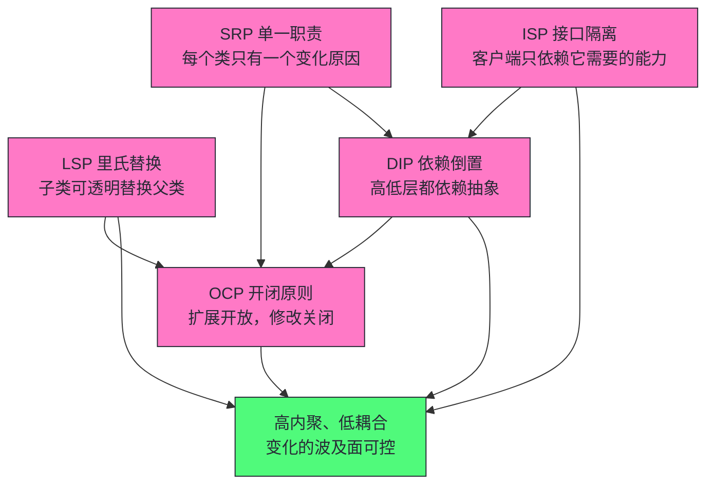
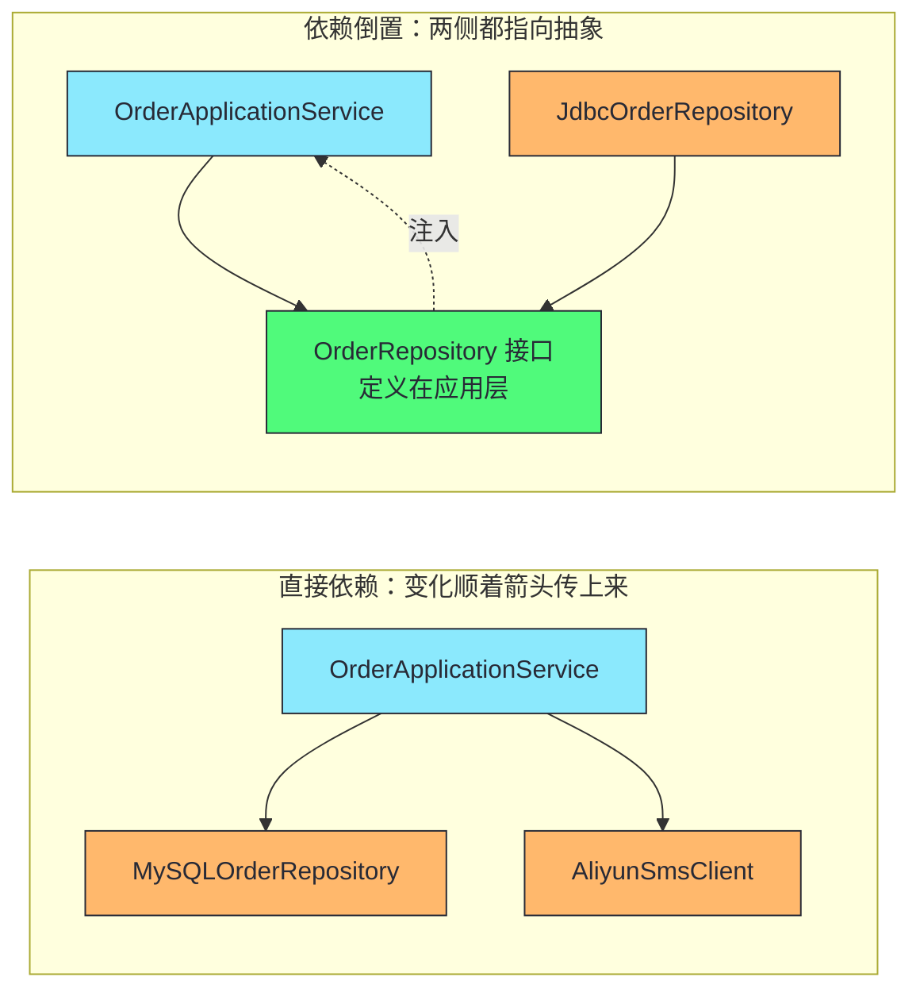
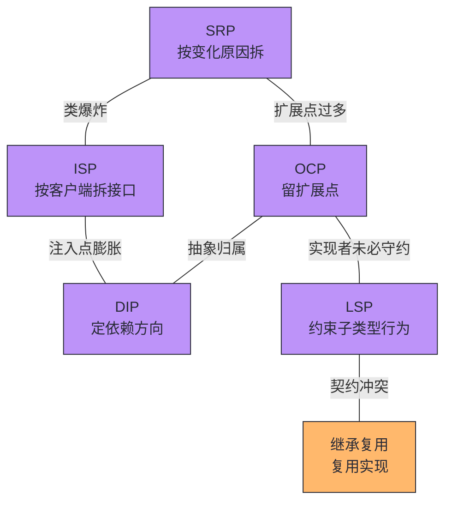
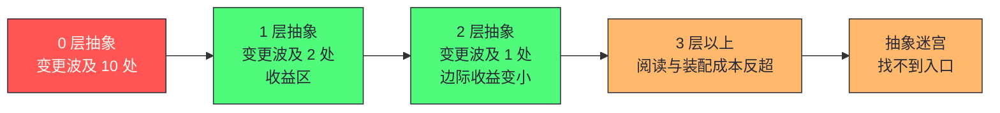
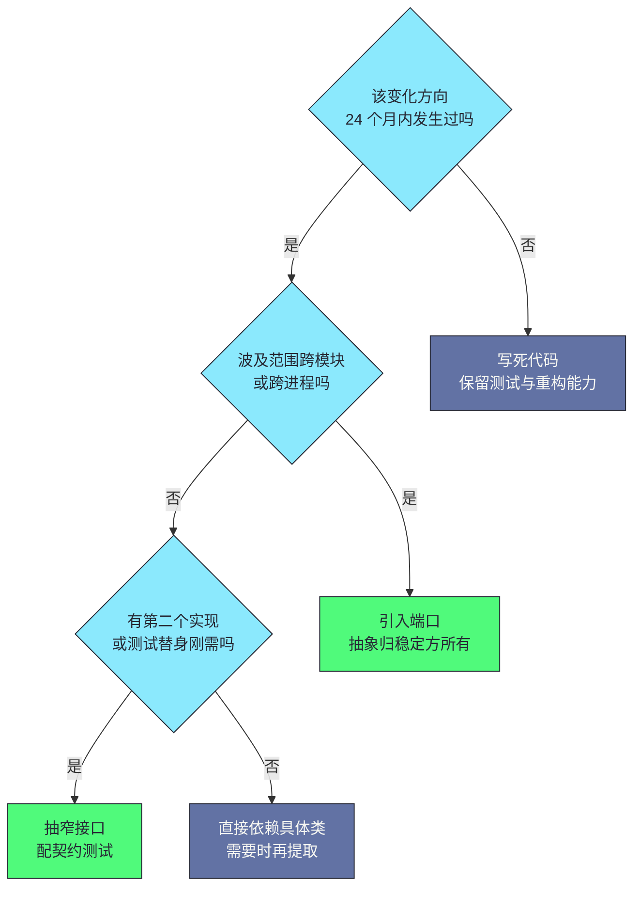

# SOLID原则——面向对象设计的五大基石

**摘要：**

SOLID 五条原则被讲了三十年，讲法大多停在"应该遵守"，很少讲"违反时长什么样、遵守到什么程度开始反噬"。本文换一个角度：以订单域为贯穿案例，为每条原则配一组三件套——违反形态、可观察症状、重构手法，具体到 SRP 的上帝类与类爆炸、OCP 的 if-else 类型分派链、LSP 的抛异常与前置后置条件、ISP 的胖接口迫使空实现、DIP 的高层直接 new 低层。然后讨论五条原则之间的张力，这是多数讲法跳过的一层：SRP 与 ISP 同时用力会把类拆成碎片，OCP 与 DIP 叠加时抽象层要放在变化已经发生过的那一侧，LSP 与"继承复用"天然冲突。在此基础上给出过度设计的四种形态，以及一个可以心算的判据：变化的概率乘以波及成本，再与抽象本身的成本比较。最后用 JDK 里的 Collection 家族、InputStream 的 mark/reset、Date 与 Timestamp 的 equals 对称性，看这套判据在标准库里怎么被用对、又怎么被用错。文章不提供"这样写就对了"的清单，只给三个可以拿来做判断的问题：变化从哪来、波及有多大、抽象要付多少。

---

## 第 1 章 SOLID 的来历，以及它被讲坏的三种方式

### 1.1 五条原则来自五个不同的年代

1988 年，Bertrand Meyer 在《Object-Oriented Software Construction》里提出开闭原则（Open-Closed Principle，OCP），他关心的是库的稳定性：一个被大量客户端引用的类，一旦被修改，所有客户端都要重新编译、重新验证，于是他主张用继承与抽象把变化挡在类的外部。1987 年，Barbara Liskov 在 OOPSLA 的主题演讲中给出后来被称为里氏替换原则（Liskov Substitution Principle，LSP）的表述，次年以《Data Abstraction and Hierarchy》成文，她关心的是类型系统在行为层面是否成立。再往后到 1990 年代中期，Robert C. Martin 在《C++ Report》的专栏里陆续写下单一职责原则（Single Responsibility Principle，SRP）、接口隔离原则（Interface Segregation Principle，ISP）与依赖倒置原则（Dependency Inversion Principle，DIP），并在 2000 年前后的《Design Principles and Design Patterns》里把这五条并在一起讨论。据 Martin 本人的说明，SOLID 这个缩写是 Michael Feathers 后来提议的，2002 年的《Agile Software Development: Principles, Patterns, and Practices》让它进入 Java 与 C# 社区的主流视野。

写这段年表不是为了掉书袋，而是要指出一件常被忽略的事：五条原则的出身并不相同。OCP 与 LSP 属于类型与契约的传统，问题意识来自静态类型语言的库设计；ISP 与 DIP 属于依赖与部署的传统，问题意识来自大型 C++ 项目的编译与发布成本；SRP 更接近组织协作的观察——一个类为什么会改，取决于谁有权提出这个需求。把五条当成同一套公理体系互相推导，是**教条化**的第一个来源。

Martin 在 2017 年的《Clean Architecture》里重述过 SRP，把它从"一个类只有一个变化原因"改写成"一个模块只对一个 actor 负责"。这次改写的意义在于把"原因"具体化成了"人"：变化原因不是一个抽象的哲学判断，而是某个提出需求、并且能决定优先级的人或组织。按 actor 来理解 SRP，很多争论会自然消解——财务要的报表口径与运营要的促销规则，哪怕都写在同一个类里只有几行，也属于两个 actor，该拆；同一个 actor 的增删改查哪怕有二十个方法，也仍然是一个职责，不必拆。

### 1.2 被讲坏的三种方式

第一种是抽掉了代价。原则只讲收益，不讲这份收益要付出什么。可是任何抽象都有成本：多一个文件、多一层跳转、多一次双改、多一份需要同步理解的映射。只讲收益的讲法会让读者以为抽象免费，于是把抽象当成默认动作。

第二种是抽掉了方向。OCP 说"对扩展开放，对修改关闭"，听起来像要在一个类上对所有方向都留好扩展口。但 Meyer 的原意是让库在特定变化方向上保持稳定，Martin 的版本同样依赖"预见到变化的方向"这个前提。没有方向的开放，最后会变成每个方法都套一层策略、每个分支都留一个钩子，扩展点比变化还多。

第三种是抽掉了语境。五条原则诞生在团队小、发布周期长、语言表达力有限的年代，要解决的是"改动一次要付多少协调成本"。到了微服务与持续交付的今天，很多协调成本已经转移到构建流水线与服务边界上，类级别的洁癖所节省的成本，往往小于它带来的阅读成本。语境一变，原则的权重就要跟着变。

### 1.3 本篇的写法

下面五节，每节给一组三件套：先看违反时的具体代码形态，再看这些形态会以什么症状表现出来，最后给重构手法。症状这一栏尤其重要，因为原则本身无法被验证，能被验证的只有症状——编译不过、测试要连真库、一个需求要开八个文件、子类上线后调用方开始出现空指针，这些才是可以拿来讨论的证据。

贯穿案例是一个订单系统：下单、计价、落库、通知、报表导出。它足够小，小到可以用几十行代码说明问题；也足够真实，真实到每一处抽象都能对应一个具体的变更来源。

五条原则之间的关系，可以先看一张图。图中箭头表示"支撑"：LSP 支撑 OCP，因为多态扩展的正确性依赖子类可替换；ISP 细化 DIP，因为依赖的抽象越窄，倒置的收益越干净；SRP 为其余四条提供变化轴的切分。



---

## 第 2 章 三件套：违反形态、症状、重构手法

### 2.0 一张总表

先把结论摆出来，后文逐条展开。表中"可观察症状"一列是可以拿来做 code review 证据的东西，而不是"代码不优雅"这类无法反驳的判断。

| 原则 | 典型违反形态 | 可观察症状 | 首选重构手法 |
| --- | --- | --- | --- |
| SRP | 一个类同时管持久化、计价、通知、报表 | 改一处要跑全类测试；两人改同一文件必冲突 | 按 actor 与变化原因拆，抽出仓储、领域服务、端口 |
| OCP | 字符串常量或枚举驱动的 if-else 分派链 | 新增分支要改旧方法；测试矩阵随分支组合膨胀 | 策略接口加注册表，把分派键从代码里挪到装配处 |
| LSP | 子类抛新异常、收紧入参、放宽出参 | 调用方按父类契约写的代码在特定子类下失效 | 组合替代继承，窄接口，契约测试覆盖全部实现 |
| ISP | 胖接口，实现类用空方法或抛异常占位 | 调用方被迫 try-catch 不该失败的调用；加方法要改全部实现 | 按客户端拆角色接口，多功能实现多接口 |
| DIP | 高层直接 new 低层实现，或在高层 import 具体实现 | 单测要连真库；换供应商要改业务代码 | 抽象归高层所有，构造器注入，SPI 或组合根装配 |

### 2.1 SRP：上帝类与类爆炸是两个极端

先看一个几乎每个项目都出现过的上帝类。下面这个 `OrderService` 把四条变化线拧在了一起：

```java
public class OrderService {
    private final DataSource dataSource;   // 连接池，持久化细节

    public void placeOrder(Order order) {
        // 变化原因一：促销规则。折扣分支每周都在加
        BigDecimal price = order.getOriginalPrice();
        if (order.getCoupon() != null) {
            price = price.subtract(order.getCoupon().getAmount());
        }
        if (order.isVip()) {
            price = price.multiply(new BigDecimal("0.9"));
        }
        order.setPayable(price.max(BigDecimal.ZERO));

        // 变化原因二：持久化。表结构、主键策略、分库分表都会变
        try (Connection conn = dataSource.getConnection()) {
            // 手写 SQL，字段名与 DDL 强绑定
        }

        // 变化原因三：通知渠道。短信、微信、邮件轮番上
        smsClient.send(order.getUser().getPhone(), "下单成功");

        // 变化原因四：报表口径。财务与运营对"成交额"的定义不同
        reportWriter.append(order);
    }
}
```

四条变化线各自对应一个 actor：促销规则对应运营，持久化对应 DBA 与架构组，通知对应增长团队，报表对应财务。它们的变化节奏完全不同，却被同一个类绑定在一起，于是出现几类症状。改促销规则要跑通整个类的测试，而测试需要真实数据源和短信桩；运营与财务同时提需求时，两人在同一个文件上产生合并冲突；一个只需要"下单成功后发通知"的模块想复用这段逻辑，却被迫把数据源依赖一起拖进来；发布粒度也被绑死，报表口径改一行字，整个服务重新打镜像。

重构的手法不是"按方法归类"，而是按变化原因拆，并且让抽象的方向正确：数据访问抽成仓储接口，计价成为独立的领域服务，通知抽成端口，报表导出交给独立组件。

```java
// 按变化原因切分，每个类只对一类改动负责
public interface OrderRepository {          // 变化来自存储选型与表结构
    void save(Order order);
    Optional<Order> findById(OrderId id);
}

public class PricingService {               // 变化来自促销政策
    private final List<PricingRule> rules;
    public Money price(Order order) { /* 规则链求和，与存储无关 */ }
}

public interface NotificationPort {         // 变化来自渠道供应商
    void orderPlaced(Order order);
}

public class OrderApplicationService {      // 只负责编排，不承载任何具体变化
    private final OrderRepository repository;
    private final PricingService pricing;
    private final NotificationPort notifier;

    public OrderApplicationService(OrderRepository repository,
                                   PricingService pricing,
                                   NotificationPort notifier) {
        this.repository = repository;
        this.pricing = pricing;
        this.notifier = notifier;
    }
}
```

拆完之后，`OrderApplicationService` 自己几乎没有变化原因，它的职责是编排顺序与事务边界。这个位置最稳定，也最适合承载跨用例的一致性逻辑。

另一端的违反形态是**类爆炸**，也就是过度遵守 SRP 的后果。一个校验逻辑本来只有三个条件，却被拆成 `OrderValidator` 接口、`OrderValidatorChain`、`OrderValidationContext`、`OrderValidatorFactory` 四件套；一个"计算应付金额"的方法被拆进 `AmountCalculator`、`DiscountResolver`、`RoundingPolicy` 三个类。症状是调用链变长、参数对象繁衍、阅读时必须来回跳转，改一个条件要开四个文件。这时候 SRP 没有带来隔离，只带来了碎片。

判断拆得对不对，有一条比"方法数量"可靠得多的依据：这两段代码是否会因为同一个需求同时被修改。会同时改，就放在一起；不会，才考虑拆。版本库的提交历史是现成的证据，同一个提交里反复同时出现的文件，通常属于同一个变化轴；而两个文件在半年里从不同时出现，却被人以"职责不同"为由拆开，往往是拆早了。

还有一条 actor 视角的判据：两类改动若由两个不能互相否决的人提出，代码再短也该拆；若总由同一人在同一迭代里提出，代码再长也可以先合着。这个判据只看变更来源，比数方法个数更接近 SRP 的原意。

### 2.2 OCP：if-else 类型分派链

违反 OCP 的代码有四种常见形态，它们的共同点是"用数据里的类型标记来决定走哪段代码"：字符串常量分派、枚举 switch、`instanceof` 链、以及把参数塞进 `Map<String, Object>` 之后再取出来判断。订单计价是最典型的现场：

```java
public class PriceCalculator {
    // 分派键是字符串，写错了编译期不会报，运行期静默走默认分支
    public BigDecimal calculate(Order order, String discountType) {
        BigDecimal price = order.getOriginalPrice();
        if ("COUPON".equals(discountType)) {
            price = price.subtract(order.getCouponAmount());
        } else if ("VIP".equals(discountType)) {
            price = price.multiply(new BigDecimal("0.9"));
        } else if ("DOUBLE_ELEVEN".equals(discountType)) {
            price = price.subtract(price.divideToIntegralValue(new BigDecimal("200"))
                                        .multiply(new BigDecimal("30")));
        } else if ("BIRTHDAY".equals(discountType)) {
            price = price.multiply(new BigDecimal("0.85"));
        }
        // 新增一种折扣，就要在这里插一段
        return price.max(BigDecimal.ZERO);
    }
}
```

这段代码的症状不是"不好看"，而是三条可量化的痛：新增折扣必须修改已上线的旧方法，改动面覆盖全部历史分支；测试矩阵随分支组合膨胀，折扣类型乘会员等级乘渠道，组合数很快超出人工覆盖范围；分支共享局部变量 `price`，后加的分支可能改变前面分支的语义，这种耦合只在特定入参组合下暴露。

重构的方向是把"分派"从方法体里搬到装配处，让新增行为变成新增类型：

```java
public interface DiscountPolicy {
    boolean supports(DiscountType type);   // 分派键的类型安全版本
    Money apply(Order order, Money price);
}

public class VipDiscountPolicy implements DiscountPolicy {
    public boolean supports(DiscountType type) { return type == DiscountType.VIP; }
    public Money apply(Order order, Money price) {
        return price.multiply(new BigDecimal("0.9"));
    }
}

public class PricingService {
    private final List<DiscountPolicy> policies;   // 由装配处注入，新增策略不改这里

    public PricingService(List<DiscountPolicy> policies) {
        this.policies = List.copyOf(policies);
    }

    public Money price(Order order) {
        Money price = order.originalPrice();
        for (DiscountPolicy policy : policies) {
            if (policy.supports(order.discountType())) {
                price = policy.apply(order, price);
            }
        }
        return price;
    }
}
```

改造之后，新增"生日折扣"是新建一个类并注册到装配处，`PricingService` 一行不动，已有策略的测试不受影响。

不过这里有一个容易被忽略的边界：OCP 只关闭了一半。策略接口稳定，但"注册"这件事仍然要改——要么改 Spring 的配置类，要么改 `META-INF/services` 文件，要么改数据库里的规则表。换句话说，OCP 把修改从"改算法"挪到了"改装配"，而**装配点**的变更成本决定了这条原则的实际收益。装配点是一个集中的配置文件，改动小、评审简单，收益就成立；装配点散落在十几个模块的启动代码里，收益就被抵消。判断一次 OCP 改造是否值得，除了看变化频率，还要看装配点是否收敛。

过度遵守 OCP 的形态同样常见：为只有两个分支的计价写策略接口、注册表、工厂、SPI 四层，再配上 `@ConditionalOnProperty` 决定加载哪些策略。两个分支的代码量从二十行涨到两百行，而分支数在两年里没有变过。这种改造把未来的不确定性提前变成了当下的确定性成本，属于第 4 章要算的账。

### 2.3 LSP：三种坏子类

LSP 的严格表述是行为子类型：如果 S 是 T 的子类型，那么所有针对 T 编写的程序，在把 T 的实例换成 S 的实例后行为不应改变。工程上把它拆成三条可检查的契约规则，来自 Meyer 的**契约式设计**：子类可以放宽前置条件、加强后置条件，但不能反过来；类不变量必须保持。Java 的编译器只兑现了其中很小一部分——它禁止子类把受检异常抛得比父类更宽，却完全不管非受检异常、入参约束和返回值语义。

第一种坏子类是抛出父类没有承诺的异常。下面的代码在编译期完全合法，因为 `IllegalStateException` 是非受检异常：

```java
public interface OrderRepository {
    // 契约：找不到时抛 OrderNotFoundException；不抛非受检异常
    Order findById(OrderId id) throws OrderNotFoundException;
}

public class CachedOrderRepository implements OrderRepository {
    private final Map<OrderId, Order> cache;

    @Override
    public Order findById(OrderId id) throws OrderNotFoundException {
        Order order = cache.get(id);
        if (order == null) {
            // 违反 LSP：用非受检异常替换了父类承诺的受检异常
            throw new IllegalStateException("cache miss: " + id);
        }
        return order;
    }
}
```

调用方按接口契约写了 `catch (OrderNotFoundException e)` 的降级逻辑，换用缓存实现之后，缓存未命中就变成 500。编译器没有报错，因为异常类型加宽只在受检异常上有约束；这类问题只能靠**契约测试**或代码评审发现。

第二种坏子类是加强前置条件，也就是子类要求父类没有要求的输入。父类 `Account.withdraw(BigDecimal amount)` 接受任意正数，子类 `PremiumAccount` 却要求金额不低于起提线；父类 `save(Order)` 允许某些字段为空，子类要求全字段非空。调用方合法地传入了父类承诺接受的参数，子类却拒绝，这就是把父类契约收窄了。

第三种坏子类是**削弱后置条件**，也就是子类没有兑现父类承诺的输出。父类保证"save 之后立即可查"，子类改成异步落库；父类保证"findById 不返回 null"，子类在缓存未命中时返回 null；父类保证"close 之后连接归还池"，子类只把标志位改成已关闭。后置条件一旦被削弱，所有依赖该保证的下游代码都会在不特定的时刻失效。

| 契约类型 | 父类的承诺 | 子类允许的调整 | 子类禁止的调整 |
| --- | --- | --- | --- |
| 前置条件 | 接受满足条件 P 的入参 | 放宽为 P 或更弱 | 收紧为 P 且额外条件 |
| 后置条件 | 保证结果满足 Q | 加强为 Q 且额外保证 | 削弱为 Q 的一部分 |
| 类不变量 | 任意可见状态满足 I | 增加新的不变量 | 破坏 I 或引入状态使 I 不成立 |
| 异常 | 只抛声明的异常 | 抛更窄的子类异常或不抛 | 抛更宽的受检异常或新的非受检异常 |

症状层面，LSP 违反最难排查：出错的代码和写错的代码不在一处。调用方完全正确，测试也通过——测试装配的是父类实现；只有在生产环境的某种组合下（缓存实现、代理实现、Mock 替身）才会触发。Spring 的事务代理会放大它：给 `OrderRepository` 加 `@Transactional` 后实际注入的是代理对象，子类语义的偏差更隐蔽。

重构手法有四条，按代价从低到高。其一，把契约写进文档与测试：为父类契约写一套抽象测试基类，所有实现继承它，这条做法能把大部分行为偏差挡在 CI 里。其二，能组合就不继承，把"想复用代码"和"想表达类型关系"分开。其三，收窄接口：读写分离成 `OrderReader` 与 `OrderWriter`，让每个实现只需要承诺它能做到的事。其四，用语言机制封死扩展：类与关键方法加 `final`，Java 17 起可以用 `sealed` 限定子类型集合，把"谁能继承我"从约定变成编译期约束。

过度遵守 LSP 的表现是"禁止继承"式的洁癖。团队规定所有类 `final`、所有复用走组合，短期看似干净，代价是模板方法这类正当的继承用法被一并禁掉——`HttpServlet` 的服务方法分派、`AbstractList` 的骨架实现、Spring 里大量 `*Support` 基类，都是靠继承提供扩展点。LSP 约束的是可观察行为，不是继承这个语法本身；把"不许继承"当成 LSP 的落地方式，是把原则读成了禁令。

最后要提一处 LSP 与 `equals` 契约的交叉，这是 JDK 里真实存在的坑。`Object.equals` 要求对称性：`a.equals(b)` 为真时 `b.equals(a)` 也必须为真。一旦子类增加了参与相等判断的字段，父类视角与子类视角就会给出不同答案。典型写法是父类按核心字段比较，子类在 `equals` 里要求对方也是子类类型并比较新增字段，于是 `parent.equals(child)` 为真而 `child.equals(parent)` 为假。这不是实现者的疏忽，而是"用继承表达类型层次、又用 `equals` 表达值语义"这两种意图互相冲突的必然结果。JDK 自身也掉进过这个坑，第 6 章会拿 `java.sql.Timestamp` 做实证。

### 2.4 ISP：胖接口迫使实现空方法

ISP 的缘起可以追溯到 Martin 在 1996 年那篇文章里叙述的一个咨询项目：施乐（Xerox）的打印机软件把打印、装订、传真等能力放进同一个类，结果是一个只需要打印的客户端，在装订逻辑变更后也必须重新编译、重新部署。这个故事的要点不是"接口要小"，而是"客户端的依赖面决定了改动的传播面"。

违反形态是**胖接口**加空实现。设想一个报表导出接口，把"导出"周边所有能力都塞进去：

```java
public interface OrderExporter {
    void exportPdf(Order order, Path target);
    void exportExcel(Order order, Path target);
    void exportCsv(Order order, Path target);
    void uploadToOss(Path file, String bucket);
    void mailTo(Path file, String address);
}

public class CsvOnlyExporter implements OrderExporter {
    @Override
    public void exportCsv(Order order, Path target) { /* 唯一真实实现 */ }

    @Override
    public void exportPdf(Order order, Path target) {
        throw new UnsupportedOperationException("仅支持 CSV");
    }
    // 另外三个方法同样只能抛异常
}
```

症状有四种，每一种都能在代码里找到证据。实现方被迫撒谎：接口声明能力，运行时拒绝，这与 2.3 节的**后置条件削弱**是同一个问题在接口层的投影。调用方被迫防御：所有调用点都要 `try-catch UnsupportedOperationException`，或者在使用前做 `instanceof` 判断，接口的静态类型承诺因此失效。接口演进被放大：给 `OrderExporter` 加一个 `exportJson`，全部实现类都要改，哪怕其中多数根本不支持 JSON；JDK 8 的 `default` 方法主要缓解这一条，但默认实现只能给出"抛异常"或"什么都不做"，反而把能力不确定性藏得更深。依赖噪音：只需要 CSV 的模块，因为引用接口而把 OSS SDK 与邮件客户端一起拖进编译依赖。

重构手法是按客户端拆**角色接口**，让每个接口只描述一类客户端真正需要的能力：

```java
public interface CsvExporter { void exportCsv(Order order, Path target); }
public interface OssUploader { void upload(Path file, String bucket); }
public interface MailSender { void send(Path attachment, String address); }

// 多功能实现按需组合多个窄接口，而不是被一个胖接口绑架
public class FullFeaturedExporter implements CsvExporter, OssUploader, MailSender {
    public void exportCsv(Order order, Path target) { /* ... */ }
    public void upload(Path file, String bucket) { /* ... */ }
    public void send(Path attachment, String address) { /* ... */ }
}

// 调用方只依赖它使用的那一个
public class CsvExportJob {
    private final CsvExporter exporter;
    public CsvExportJob(CsvExporter exporter) { this.exporter = exporter; }
}
```

这里有一个与 DIP 联动的技巧值得展开：接口应该由客户端拥有，而不是由实现方拥有。把 `CsvExporter` 定义在调用方所在的包里，实现方在自己的包里实现它，依赖方向就指向了调用方，接口的宽度也自然由客户端的需求决定。Spring 的 `ApplicationEventPublisher`、JDBC 的 `Connection` 都是这个思路：接口描述的是使用者要什么，不是实现者有什么。

过度遵守 ISP 的后果是接口碎片化。一个实体拆成 `OrderReader`、`OrderWriter`、`OrderDeleter`、`OrderCounter`，调用方要注入四个接口才能完成一次查询；更有甚者给每个方法配一个函数式接口，最后 `List` 会退化成 `Sized` 加 `Indexed` 加 `Mutable` 加 `Appendable` 的组合，组合数随能力数指数增长，装配代码比业务代码还长。判断拆分是否过头的依据是客户端的分化程度：只有当确实存在两组客户端、各自只用其中一部分方法时，拆接口才有收益；如果所有调用方都需要全部方法，拆开只是把依赖从一处搬到多处。

### 2.5 DIP：高层直接 new 低层

DIP 的两句话经常被并列引用，但第二句才是关键：抽象不应该依赖细节，细节应该依赖抽象。第一句讲依赖方向，第二句讲抽象的所有权——抽象由稳定的一方定义，不稳定的一方去实现它。很多号称"做了依赖倒置"的代码只做到了第一句的形式，把接口放在实现所在的模块里，包依赖仍然指向低层。

违反形态最常见的是高层直接构造低层：

```java
public class OrderApplicationService {
    // 高层把低层的构造细节写死在字段初始化里
    private final MySQLOrderRepository repository = new MySQLOrderRepository();
    private final AliyunSmsClient sms = new AliyunSmsClient("key", "secret");
    private final LocalFileExporter exporter = new LocalFileExporter();

    public void placeOrder(Order order) {
        repository.save(order);
        sms.send(order.phone(), "下单成功");
        exporter.export(order);
    }
}
```

更隐蔽的形态有几种：在高层里 `Class.forName("com.mysql.cj.jdbc.Driver")`；通过静态工厂取单例 `SmsClient.getInstance()`；把 JDBC URL 与账号写成业务类常量；在高层模块的 `pom.xml` 里依赖低层模块，低层换了数据库驱动，高层的构建产物也跟着变。

症状集中在三处。测试必须连真库：`OrderApplicationService` 的单元测试跑不起来，因为构造它就需要 MySQL 与短信网关，团队只好写集成测试，反馈很慢。切换成本落在业务代码上：从阿里云短信换到腾讯云，要改 `placeOrder` 所在的高层类，而这个类与短信供应商毫无关系。依赖传递失控：高层编译期依赖里出现了 MySQL 驱动、OSS SDK、邮件客户端，任何一个漏洞都要牵动高层重新发布。

重构手法是把抽象的所有权挪到高层，再用构造器注入把实现送进来：

```java
// 抽象定义在应用层（高层），描述高层需要什么
package order.application.port;

public interface OrderRepository {
    void save(Order order);
    Optional<Order> findById(OrderId id);
}

// 实现在基础设施层（低层），依赖方向指向应用层
package order.infrastructure.persistence;

public class JdbcOrderRepository implements OrderRepository {
    private final DataSource dataSource;
    public JdbcOrderRepository(DataSource dataSource) { this.dataSource = dataSource; }
    public void save(Order order) { /* 具体 SQL 在这里 */ }
    public Optional<Order> findById(OrderId id) { /* ... */ }
}

// 组合根：唯一知道"哪个实现配哪个接口"的地方
@Configuration
public class OrderConfiguration {
    @Bean
    OrderRepository orderRepository(DataSource dataSource) {
        return new JdbcOrderRepository(dataSource);
    }
}
```

这段结构就是六边形架构里的**端口与适配器**：端口是高层定义的接口，适配器是低层实现，组合根负责接线。它的收益不只是可测试，还包括把"换供应商"从业务改动降级为配置改动，把依赖收敛到一个可以审计的地方。

DIP 也有过度遵守的代价：边界要说清楚，否则容易滑向过度设计。JDK 的稳定类型不需要倒置：`String`、`BigDecimal`、`java.time` 的值类型、集合接口，它们的变更概率接近于零，为它们再包一层接口只会增加噪音。领域值对象不需要倒置：`Money`、`OrderId` 是领域语言的一部分，不是"低层实现"。工具类与纯函数不需要倒置：它们没有状态、没有外部依赖，抽象没有收益。DIP 真正针对的是会独立变化的边界——数据库、消息中间件、第三方 API、文件系统、时钟与随机源。判断依据是"这东西会不会因为外部原因而更换"，而不是"它是不是一个具体类"。

下面这张图把两种依赖结构放在一起对比。左边是高层指向低层，箭头方向与实际编译依赖一致，任何低层变化都会顺着箭头传到高层；右边是两侧都指向抽象，低层实现抽象，高层使用抽象，变化的传播被抽象层截断。



---

## 第 3 章 五条原则之间的张力

### 3.1 同一份预算：抽象不是免费的

把五条原则分开讲，每一条都自洽；放在一起用，它们争夺同一份预算。这份预算由三样东西构成：读者理解代码所需的跳转次数、每次变更要同步修改的文件数、装配与配置的复杂度。任何一条原则的落实都要从这份预算里支取，支取过多，另一条原则的收益就被抵消。

笔者见过一个团队，评审清单上写着五条原则，于是每个类都按 actor 拆、每个接口都按客户端拆、每个外部依赖都倒置、每个分支都策略化。三年后，一个"查询订单详情"的需求要改十二个文件，新人入职两周还找不到入口。团队没有违反任何一条原则，却把系统的可理解性做没了。这一章讨论的就是这种局面：五条原则两两组合时，在哪里互相拉扯，以及什么情况下该主动妥协。

### 3.2 SRP 与 ISP：两个"拆"的力叠在一起

SRP 按变化原因切类，ISP 按客户端切接口。两个切分的轴并不重合：一个类可能只有一个变化原因，却有三组客户端；也可能有多组变化原因，却只服务一组客户端。当两个轴同时作用时，代码会被切成网格。

一个真实形态是这样的：查询订单详情这个用例，先按 SRP 拆成 `OrderQueryService`（读）与 `OrderCommandService`（写），再按 ISP 拆出 `OrderDetailPort`（面向前端）与 `OrderExportPort`（面向报表），按 DIP 给两个端口各配实现与装配类，最后为复用字段映射抽出 `OrderViewAssembler`。一个字段的展示口径变化，要依次改端口、实现、装配器、DTO、前端适配，共八个文件。

症状可以量化：一是变更扩散比，即平均每个需求改动的文件数，这个数字超过五就该警惕；二是构造器参数数量，超过四个说明装配点没有收敛；三是**纯转发类**的数量，也就是方法体只有一行 `return delegate.xxx()` 的类，这类类的存在几乎总是拆过头的信号。

妥协的判据是三个问题，按顺序问。第一，是否真的存在两组客户端，它们的需求会朝不同方向演化？只有一组客户端时，ISP 没有作用对象，拆接口只是把依赖挪了个位置。第二，两类变化是否由不同 actor 提出，且彼此不能否决？不是的话，SRP 的拆分收益有限。第三，拆出来的类里有没有只做转发的？有的话把它合回去，保留接口即可。

这三问的顺序不能颠倒。先确认客户端分化，再确认 actor 分化，最后清理纯转发；反过来做，就会先制造碎片，再为碎片找理由。

### 3.3 OCP 与 DIP：抽象放在哪一侧

OCP 关心扩展点在哪里，DIP 关心依赖方向指向谁。两者都指向"引入抽象"，但抽象的归属不同：OCP 的抽象是为了让新增行为不改旧代码，DIP 的抽象是为了让高层不被低层拖住。当两者被机械地同时执行，最常见的错误是把接口放在低层，然后宣称完成了倒置。

```java
// 接口跟着实现走：包 order.infrastructure 里定义
package order.infrastructure;

public interface OrderRepository { ... }

// 高层 import 了基础设施包
package order.application;

import order.infrastructure.OrderRepository;   // 编译依赖仍然指向低层

public class OrderApplicationService {
    private final OrderRepository repository;
}
```

这段代码在形式上满足了 OCP：换实现不用改 `OrderApplicationService`。但它没有满足 DIP：高层模块的编译单元仍然依赖基础设施包，包依赖图上那条从应用层指向基础设施层的箭头还在，换掉整个基础设施包（譬如从 JDBC 换成 MyBatis 并重命名包）时，高层仍要改 import。判断倒置是否真的发生，看包依赖图而不是看有没有接口。

叠加使用时还有第二个问题：抽象层数。OCP 想在每个变化方向留口，DIP 想在每条外部边界设端口，两者的交集容易催生"双接口"——高层定义 `OrderRepository` 端口，低层又定义 `OrderStore` SPI，中间再放一个 `OrderRepositoryAdapter` 做适配。单进程应用里这三层通常只需要一层。只有跨进程、跨团队、或者需要防腐层隔离外部模型时，两侧各自定义接口才是合理的：外部模型的变更节奏不受你控制，翻译层是必要的成本。

妥协判据同样可以落成问句。抽象放在哪一侧？放在稳定的一侧，通常是使用方。需要几层抽象？一条外部边界一层，除非两侧的模型确实无法共用。什么时候升级抽象层？出现第二个实现、或者出现跨进程调用时。第二个实现已经在路上，说明变化的方向已经明确，此时抽象是投资；第二个实现只是"领导说将来可能要"，抽象是投机。

### 3.4 LSP 与"继承复用"：白盒复用的代价

LSP 管的是类型关系，继承提供的是代码复用，两者经常被同一行 `extends` 同时承担，冲突就在这里。为了复用父类的字段与方法而继承，子类就被迫承诺父类的全部契约，包括父类将来新增的方法；一旦子类只想复用实现、不愿承诺行为，违约就成了必然。

```java
// 为了复用 ArrayList 的存储与扩容，继承它并加去重
public class UniqueList<E> extends ArrayList<E> {
    @Override
    public boolean add(E e) {
        return contains(e) ? false : super.add(e);   // 违反 List.add 的契约
    }
}
```

`List.add` 的契约是"把元素追加到末尾并返回 true"，它不承诺去重。这段代码让 `add` 的返回值变成三态语义，任何依赖"add 之后 size 加一"或"add 之后 get(size-1) 等于该元素"的代码都会失效。更麻烦的是父类的方法还有一批：`addAll` 没有跟着改，`List.of` 风格的不可变视图、`subList` 的视图语义、序列化行为都与新语义不一致。子类只重写了一个方法，却有十几个方法处于"半违约"状态。

JDK 里两个著名的例子是 `Stack extends Vector` 与 `Properties extends Hashtable<Object,Object>`，第 6 章会展开。它们说明的问题是一样的：当复用动机压过类型关系，子类型就会带上它不该有的操作，而这些操作会公开破坏不变量。

重构与妥协的判据只有一条：子类是否愿意承诺父类的全部契约，包括未来新增的方法。愿意，继承就是合适的；只想复用实现，就用组合或抽出工具方法。框架提供的扩展点是例外，`HttpServlet` 的 `doGet`/`doPost`、`AbstractList` 的 `get`/`size`、Spring 的各类 `*Support` 基类，都是父类主动设计的白盒扩展点，契约由框架维护，这类继承不算违约。判断标准是有没有 `protected` 钩子、有没有写清楚的实现规范——`@implSpec` 标注的方法就是在告诉你"这里是给你覆写的，覆写时必须保持这些约束"。

### 3.5 其余三对张力

SRP 与 OCP 的拉扯在拆分粒度上：拆得越细，每个类越小、越容易扩展，扩展点也随之变多，装配处的协调成本上升，一个需求要新增三个类、改两处配置，便利被麻烦吃掉。稳妥的做法是让扩展点收敛到少数几个装配处，而不是让每个类都成为扩展点。

ISP 与 DIP 的拉扯在接口数量与注入数量上：窄接口让依赖更干净，但每多一个接口就多一个注入点、一个实现、一份配置，Spring 构造器参数列表的长度就是这两条原则叠加后的温度计，参数超过五个时该回头检查是否拆得过细。

OCP 与 LSP 的拉扯最隐蔽：扩展点依赖子类守约，开放之后未来的实现者却未必理解契约，没有契约测试的 OCP 改造等于把风险转移给下一个写实现的人。

| 组合 | 张力的表现 | 妥协判据 |
| --- | --- | --- |
| SRP × ISP | 类与接口双重拆分，出现纯转发类与八文件变更 | 先按变化原因拆类，只在客户端分化时拆接口 |
| OCP × DIP | 接口放在低层，形式倒置而依赖方向未变；双接口叠加 | 抽象归稳定方所有；一条边界一层抽象 |
| LSP × 继承复用 | 为复用而继承的子类半违约，父类方法大面积失效 | 只承诺全部契约才继承，否则组合 |
| SRP × OCP | 扩展点过多，装配成本吃掉扩展收益 | 扩展点收敛到少数装配处 |
| ISP × DIP | 注入点膨胀，构造器参数失控 | 接口数量与客户端分化程度对齐 |
| OCP × LSP | 扩展点开放但无契约测试，行为漂移潜伏 | 每个扩展点配契约测试再开放 |

下面这张图把六组张力画在一起。连线不代表因果，只表示"同时用力时会互相抵消"的方向；读图时把它当作一张检查表，而不是一张推导图。



---

## 第 4 章 过度设计的四种形态

### 4.1 成本付在今天，收益押在明天

过度设计与设计不足看起来是相反的错误，结构上却是同一种：都在为不确定的未来定价，只是一个押注"变化一定会来"，另一个押注"变化不会来"。过度设计的典型结构是确定的成本加不确定的收益——今天多写的四个类一定存在，明天要换数据库的概率却没人能给出估计。

这一节把四种最常见的形态摊开，每种都给出代码、成本清单和判据。四种形态的共同点不是"用了设计模式"，而是抽象的对象没有行为契约可守：没有多个实现，没有客户端分化，也没有变化方向。

### 4.2 形态一：为不会变的东西建抽象

导出格式是最常见的现场。系统要求导出 CSV，架构评审时有人说"以后可能要支持 Excel 和 PDF"，于是先建一套导出策略：

```java
public interface ExportStrategy { void export(Order order, Path target); }

public class CsvExportStrategy implements ExportStrategy { /* ... */ }
public class ExportStrategyFactory { /* 按枚举返回策略 */ }
public class ExportContext { /* 持有策略并转发调用 */ }
public class ExportFormatResolver { /* 从请求头解析格式 */ }
```

三年过去，`ExportStrategy` 仍然只有 `CsvExportStrategy` 一个实现，`ExportFormatResolver` 永远返回 `CSV`。这段代码的成本是明确的：四个文件、两层跳转、每次改导出逻辑要确认四个类的语义一致、新读者要花半小时理解为什么导出要分四层。收益是零，因为那个"以后"没有来。

判据要问事实而不是问可能性：这个变化方向在过去二十四个月里发生过吗？发生过，抽象是合理的；没发生过，先写死。变化来源也要分内外：外部驱动（供应商 API 变更、监管口径变化、协议升级）的时间表通常可查，内部驱动（"产品可能要做"）的时间表通常不可查，前者值得提前抽象，后者不值得。

还有一条工程上的前提常被忽略：不抽象的前提是重构能力。代码写得直白，但只要测试覆盖足够、CI 能在一小时内给出反馈、发布可以回滚，那么等到变化真的来临再重构，代价是可控的。相反，测试薄弱的代码库先做抽象，等于把不确定性从需求转移到了设计上，两头都没抓住。

### 4.3 形态二：单实现接口

```java
public interface OrderRepository {
    void save(Order order);
    Optional<Order> findById(OrderId id);
}

@Repository
public class JdbcOrderRepository implements OrderRepository { /* 唯一实现 */ }
```

这是被引用最多的"规范写法"，也是最容易被误用的写法。它的成本有四项：接口与实现双改；语义漂移，接口的 Javadoc 与实现的真实行为逐渐不一致，调用方按接口理解、被实现打脸；包结构多一层，`domain`、`application`、`infrastructure` 三个包里各有一个同名概念；测试里的 Mock 给出假成功，接口存在让团队倾向于 mock 掉依赖，而 mock 出来的行为与真实数据库行为不同，测试全绿、线上出错。

它也有真实的收益，集中在三种情况下。跨进程边界：实现是远程服务，接口是客户端桩，此时抽象不可避免。多模块编译隔离：接口在 API 模块、实现在实现模块，引用方只需要 API 模块，构建图更干净。测试替身确实昂贵：真实依赖是数据库、消息队列、第三方支付，构造一次要几十秒或需要网络，此时接口换来的可测试性是真金白银。

判据可以这样问：把接口删掉，测试还能不能写？能用 Testcontainers、内存数据库或契约测试替代 mock，说明接口的收益主要来自习惯；不能替代，接口就值得保留。这里说的是"值得保留"，不是"越早写越好"——接口可以在第一次需要测试替身时再提取，成本通常只是一次 IDE 重构。

### 4.4 形态三：为五行代码的类写工厂

```java
public class PriceFormatter {
    public String format(Money money) {
        return money.amount().setScale(2, RoundingMode.HALF_UP) + " " + money.currency();
    }
}

// 围绕这个五行类长出来的三件套
public class PriceFormatterFactory { public PriceFormatter create() { return new PriceFormatter(); } }
public class PriceFormatterProvider { /* 单例持有 factory */ }
public class PriceFormatterBuilder { /* 支持 withLocale/withScale */ }
```

工厂的正当用途有三类：创建过程需要选择实现（按配置、按参数、按环境）、创建过程有缓存或生命周期管理（连接池、线程池）、创建过程需要校验与默认值填充（构造参数多、必填项多）。五行无状态类三条都不满足，围绕它写工厂只是把 `new` 换了个地方，还多了一层间接。更值得留意的是双重工厂：Spring 的容器本身就是一个工厂，`@Bean` 方法就是工厂方法，在容器管理的对象外面再包一层静态工厂，等于让两个工厂争夺创建权。

判据很直接：构造参数超过三个且存在必填与可选的混合，考虑建造者；创建需要按条件选择实现或复用实例，考虑工厂；其余情况直接 `new`。`new` 不是坏味道，它是最诚实的创建方式，阅读者一眼就知道对象从哪来。

### 4.5 形态四：把 DTO 拆成接口与实现

```java
public interface OrderView {
    OrderId id();
    String customerName();
    Money payable();
}

public class OrderViewImpl implements OrderView { /* 三个字段的载体 */ }
```

DTO 是数据载体，没有行为契约，也没有多实现的可能：它的"实现"永远是字段的组合。把它拆成接口与实现，收益端是空的，成本端却有三处硬伤。序列化框架需要具体类型，Jackson 反序列化接口需要 `@JsonTypeInfo` 与子类型注册，配置复杂度陡增；`record` 无法实现带访问器的接口再保持值语义，`equals` 与 `hashCode` 退回对象标识；字段增删要双改，编译期的"忘记同步"不会被发现，因为接口允许实现多出字段、也允许实现少返回。

判据：抽象只给"有行为契约、可能有多个实现"的类型。DTO、值对象、配置类、枚举，都不属于这一类。真正需要抽象的数据边界是跨进程的契约（Protobuf、OpenAPI schema），那里的抽象由 IDL 承担，而不是 Java 接口。

### 4.6 四种形态的共同成本结构

| 形态 | 典型代码 | 付掉的成本 | 什么时候才值得 |
| --- | --- | --- | --- |
| 为不会变的东西建抽象 | 导出策略、可替换存储的端口 | 文件数、跳转、双改、认知映射 | 该方向 24 个月内变过，且有外部时间表 |
| 单实现接口 | Repository 接口加唯一实现 | 双改、语义漂移、mock 假成功 | 跨进程、多模块隔离、测试替身昂贵 |
| 为五行类写工厂 | Factory 加 Provider 加 Builder | 间接层、创建权分散 | 需要选择、缓存、生命周期或参数校验 |
| DTO 拆接口实现 | View 接口加 Impl | 序列化配置、值语义丢失、双改 | 几乎不值得；跨进程契约交给 IDL |

把这四种形态叠在一起看，它们共享同一条曲线：抽象层数从零到一，变更成本明显下降；从一到二，继续下降但边际收益变小；三层以上，阅读与装配成本反超，曲线掉头向上。下面这张图画的就是这三个区间，左端是改一处要动十处的"硬编码区"，右端是"每个类都只做转发"的"抽象迷宫区"，中间才是收益区。



---

## 第 5 章 判据：什么时候值得引入一层抽象

### 5.1 三个变量

把"要不要抽象"变成一个可讨论的问题，需要三个变量：变化发生的概率、变化波及的成本、抽象本身的成本。前者用 P 表示年频次，**波及成本**用 C 表示每次的代价，**抽象成本**用 A 表示一次性投入加每年的维护开销，值得做的条件可以写成 P × C > A。

P 不能凭感觉。可查的证据有三类：版本库历史，也就是过去两年同一模块的提交频率与提交意图；需求来源，外部供应商、协议与监管口径的变化通常有时间表，内部产品规划往往没有；故障记录，同一类线上问题反复出现，通常意味着某个变化点没有被隔离。三类证据里第一类最硬，第二类最容易自欺，因为"产品说以后要做"与"产品明年真的会做"之间的距离常常很远。

C 的估算方法是调用点数乘以每点的验证成本。一个计价规则变化要改 20 个调用点，每个调用点改代码、跑单测、回归、走一次发布评审合计半天，每次变化就是 10 人天。这里还要乘一个协调系数：跨模块的修改要等排期，跨团队的修改要对齐接口，跨进程的修改要处理版本兼容，协调成本往往高于代码改动本身。

A 的构成常被低估：接口定义与文档、每个实现类的适配、每次变更时接口与实现的双改、新人的阅读、装配与配置的维护、测试用例的翻倍。一个接口在生命周期里被改十次，维护成本是定义成本的好几倍。

把三个变量代进去，多数争论会收敛成算术题。假设某类变化每季度发生一次，每次波及 20 个调用点、每点半天验证，年成本约 40 人天；抽象的一次性投入约 3 人天，每年维护约 2 人天，第一年就回本。同样的抽象如果放在两年才变一次、每次只波及 2 个调用点的场景里，年成本不到 1 人天，投入 5 人天要十年才回本，答案显然是不做。

这些数字是示意推算，不是任何项目的基准数据，但它们说明了判据的性质：收益与变化的频率和波及面成正比，与抽象成本成反比。凡是给不出 P 与 C 的粗略估计的场合，"要不要抽象"本身就没有答案，正确动作不是猜，而是先把变化边界摸清楚。

### 5.2 值得与不值得的信号

| 信号 | 判读 | 动作 |
| --- | --- | --- |
| 同一变化方向在 24 个月内变过两次以上 | 概率已被事实证实 | 引入抽象，收益可估 |
| 第二个实现已进入路线图 | 变化方向确定 | 抽接口，先写契约测试 |
| 依赖跨进程或第三方服务 | 边界不可控 | 端口必做，与实现数量无关 |
| 测试替身构造需要网络或数据库 | 可测试性收益真实 | 抽接口，或用 Testcontainers 后重估 |
| 多个团队分别消费同一能力 | 客户端已分化 | 拆角色接口 |
| 只有一种实现且无迁移计划 | 收益只存在于想象 | 直接依赖具体类 |
| "将来可能要"且无时间表 | 概率不可估 | 写死代码，保留测试与重构能力 |
| 抽象后调用方没有任何使用差异 | 隔离没有对象 | 不拆 |
| 框架已经提供端口 | 重复抽象 | 直接用 JDBC、SLF4J 或 Spring 的抽象 |

### 5.3 三次法则与它的例外

**三次法则**（Rule of Three）说的是：第一次遇到直接写，第二次复制，第三次抽出共同结构。它把**变化概率**从猜测变成观察——等到第三次，你才看清变化的形状。前提是复制成本低、重构能力在。

例外有三种。第一种是第一次就跨边界：第三方支付、对象存储、消息中间件，第一次接入就该隔离在端口后面，这类依赖的变化来自外部世界，再观察一次也降不下不确定性。第二种是第一次就带合规或安全约束：加密、审计、脱敏，隔离本身就是需求。第三种是第一次就涉及多团队协作：接口是沟通契约，不是代码复用手段。

机械执行三次法则的反面同样有害：把三行重复代码抄三遍再抽象，中间那段时间里三份副本各自演化，第三次抽象时已经找不到共同结构。三次法则的准确含义是"等到能看清变化形状再抽象"，不是"必须忍受三次复制"。

### 5.4 边界优先于类

SOLID 是类级别的原则，工程上真正决定变化成本的是边界：模块、团队、进程、发布。跨进程的调用即使只有一种实现也值得定义契约，因为网络失败、序列化兼容、版本演进不会因为"只有一个实现"而消失；同进程内的类即使有三种实现也未必值得抽接口，重构它只需要一次 IDE 重命名，而把五条原则全部下沉到类级别、却在模块边界上直接共享数据库的代码库，往往既复杂又脆弱。

康威定律在这里起作用：系统的边界会向组织结构靠拢。两个团队共同维护一个模块，即便代码层面抽象得再干净，发布节奏也会被最慢的一方拖住；一个团队维护十个模块，即便模块之间没有接口，协作成本也低。判断抽象该放在哪里，先看组织边界，再看代码结构。

下面这张决策树把全章的判据收在一起。它不追求覆盖所有情况，只给出一个可以照着走一遍的顺序：先问变化是否发生过，再问波及是否跨边界，最后问是否有第二个实现或测试刚需。



---

## 第 6 章 Java 与 JDK 里的正反例

### 6.1 Collection 家族：宽接口加可选操作

`java.util.Collection` 的 Javadoc 里有一节叫 Optional Operations，明确列出 add、remove、clear、addAll、removeAll、retainAll 可能抛出 UnsupportedOperationException，因为有些集合实现不支持修改。`Arrays.asList` 返回定长列表，`List.of`（JDK 9 引入）返回不可变列表，`Collections.unmodifiableList` 返回只读视图，它们的写方法都会抛这个异常。

从纯 ISP 的角度看，这是典型的胖接口：调用方依赖了不需要的方法，实现方被迫提供会失败的方法。标准库没有按客户端拆分，原因在约束：Collection 的客户端是数百万开发者，JDK 无法协调他们同时升级，任何破坏二进制兼容的调整都不可行。于是它选择宽接口加**可选操作**，用运行时异常表达"这个实现不支持"。

JDK 8 的 default 方法缓解的是另一半问题——接口演进。给 Collection 加 stream()、removeIf() 时，default 实现让已有实现类不必修改；但 default 只能给出通用实现，无法表达"这个实现不支持该操作"。JDK 21 的 SequencedCollection（JEP 431）延续了同样的取舍：它给 List、Deque 等类型加上 addFirst、addLast、reversed，其中 addFirst 与 addLast 在接口上的默认实现就是抛 UnsupportedOperationException。

这段历史给出的判断是：宽接口不是坏设计，而是在无法协调升级的约束下的最优解。应用代码没有这个约束——调用方只有几个模块，发布可以同步，没有理由照抄。反过来说，写一个会被外部广泛实现的 SPI 时，可选操作与能力查询就是必须保留的逃生口。

### 6.2 InputStream：把契约降级为能力查询

`java.io.InputStream` 提供了 mark/reset 这套回退读取能力，但三个方法的契约强度不同：markSupported() 默认返回 false，mark(int) 默认什么也不做，reset() 默认抛 IOException。BufferedInputStream 覆写了它们并真正支持回退，FileInputStream 没有覆写，于是同样的调用在不同实现上行为不同。

```java
try (InputStream in = new FileInputStream(path)) {
    in.mark(1024);          // 默认实现是空操作，不报错
    int first = in.read();  // 读一个字节
    in.reset();             // 抛 IOException：mark/reset not supported
}
```

这段代码暴露了两个问题。对 ISP 而言，接口把"回退读取"放进了所有输入流的契约，而多数实现并不具备该能力；对 LSP 而言，reset 的后置条件（回到 mark 位置）在默认实现里被削弱成了抛异常。JDK 的补丁是 markSupported()：把行为契约降级为**能力查询**，调用方必须显式探测。这个补丁是诚实的，代价是每个调用点都要写分支，而且探测与使用之间仍存在不确定——探测之后的行为不保证不变。

close() 走的是另一条路。Closeable 的契约明确写了"对已关闭的流再次调用 close 没有副作用"，也就是把后置条件主动弱化成幂等。这不是违约，而是为了让装饰器链能安全地层层关闭：BufferedInputStream 关闭时会关闭底层流，调用方可能在外层再关一次。契约被有意设计得比直觉更弱，换取组合时的健壮性。

两处对比说明：接口无法修改时，JDK 用能力查询与弱化后置条件维持兼容，两种手段都把复杂度推给调用方。应用层能改接口，就不该继承这份复杂度，而应该在自己的端口上重新收紧契约，把"不支持"变成类型层面不可能出现的情况。

### 6.3 equals/hashCode 契约与 LSP

Object.equals 的契约有五条：自反、对称、传递、一致、与 null 比较返回 false；hashCode 要求相等的对象哈希值相等。这套契约本质上是值语义的 LSP：用子类替换父类之后，相等判断的结果不应改变。继承一旦引入新的相等维度，这条契约就危险。

JDK 里的实证是 java.sql.Timestamp 继承 java.util.Date。下面这段输出来自 Java 17 的实际运行：

```text
d.equals(t) = true    // Date 只比较毫秒
t.equals(d) = false   // Timestamp 要求对方也是 Timestamp，并比较纳秒
```

当纳秒为 0 且毫秒相同时，Date 视角认为两者相等，Timestamp 视角认为不等，对称性被打破；纳秒非零时，Timestamp 覆写的 getTime() 会把纳秒折算进毫秒，两侧的毫秒值也不再相同。Timestamp 的 Javadoc 直接写明了此方法不与 Date.equals 对称，这是一处被文档承认的契约破损，因为二进制兼容无法回收。

BigDecimal 是另一个方向的例子：equals 同时比较数值与标度，compareTo 只比较数值，于是 new BigDecimal("1.0").equals(new BigDecimal("1.00")) 为 false，而 compareTo 返回 0。Java 对 Comparable 的建议是 compareTo 返回 0 与 equals 为真保持一致，BigDecimal 违反了这条建议。后果是同一个值在 HashSet 与 TreeSet 里行为不同：前者认为两个对象不同，后者认为相同。URL.equals 更极端：它为了判断主机等价会做域名解析，把网络语义混进了值语义，调用一次 equals 可能触发一次 DNS 查询。

这些案例的共同结构是把多个语义维度塞进同一个相等判断，又用继承复用其中一个维度的实现。稳妥的做法是值类型不可变、不参与继承、相等维度唯一；需要多维度比较时用 Comparator 表达，而不是覆写 equals。

### 6.4 继承复用的两个历史包袱

Stack 继承 Vector，是 JDK 早期复用优先的产物。Vector 提供了按索引插入、按索引访问、在任意位置删除，Stack 全部继承了下来，于是"栈只能从栈顶进出"这个不变量在类型层面根本不成立：调用方可以对一个 Stack 调用 add(0, element)，把元素插到栈底。Stack 的 Javadoc 后来加了建议，让开发者改用 Deque 实现栈语义，但类本身因为兼容性无法重构。

Properties 继承 Hashtable<Object,Object> 是同一类问题。Properties 的语义是字符串键值对，但继承来的 put 接受任意对象，put("key", 42) 在编译期与运行期都合法，只有 getProperty 取不出来时才会暴露。类型契约在继承处失守，JDK 无法收回，只能在文档里提醒。

两个案例指向同一条判据：为复用而继承，代价由未来所有使用者承担，而且无法撤回。它们不是教科书里的假想，而是标准库里改不掉的代码。

### 6.5 正面例子：JDBC、Comparator 与骨架实现

JDBC 是 DIP 与 OCP 组合的工业级样本。应用代码只依赖 java.sql 包里的接口（Connection、Statement、ResultSet），具体驱动由厂商实现；DriverManager 通过 ServiceLoader 从 META-INF/services/java.sql.Driver 发现驱动，JDK 6 起支持自动加载。高层定义抽象、低层实现、装配点集中在驱动注册，三条都在。

Comparator 是策略模式在 JDK 里的落点：排序算法（Collections.sort、List.sort、Stream.sorted）对修改关闭，比较规则对扩展开放。给一个类写新的排序方式，不需要改排序算法。

AbstractCollection 与 AbstractList 提供的是骨架实现：把接口里能用通用逻辑实现的方法先实现好，把 get、size 这类必须由子类提供的方法留成抽象方法。这是模板方法的正当用法，也是 LSP 的正面案例——骨架类把契约写在了实现里，子类只需要兑现少数几个方法，契约由父类保证。

Spring 6.x 与 Boot 3.x 推荐构造器注入，官方文档从 4.0 起就建议优先使用它而非字段注入。这条建议与 DIP 直接相关：依赖显式化，对象构造完成即可用，测试不必启动容器。

| JDK 构件 | 现象 | 判读 |
| --- | --- | --- |
| Collection 与 List.of | 宽接口加可选操作，写方法抛 UnsupportedOperationException | 无法协调升级时的折中，不是应用代码的模板 |
| SequencedCollection | JDK 21 新增 addFirst/addLast，不可变实现默认抛异常 | 同样的取舍在接口演进中重复出现 |
| InputStream 的 mark/reset | 默认空实现与默认抛异常，由 markSupported 探测 | 契约降级为能力查询，复杂度推给调用方 |
| Date 与 Timestamp | equals 不对称，Javadoc 承认 | 继承复用与值语义冲突，兼容性导致无法修复 |
| BigDecimal | equals 比标度，compareTo 比数值 | 相等维度不唯一，集合行为分裂 |
| Stack 与 Properties | 继承带来不该有的操作 | 复用优先压过类型关系的历史包袱 |
| JDBC Driver | 高层定义接口，驱动实现，ServiceLoader 装配 | DIP 与 OCP 的正例 |
| Comparator | 排序算法关闭，比较规则开放 | 策略模式的教科书落点 |

---

## 第 7 章 反例：把 SOLID 当教条

### 7.1 为每条原则配一个目录

教条化最直观的表现是把原则写进目录结构。笔者见过按原则分包的工程：`srp/`、`ocp/`、`lsp/`、`isp/`、`dip/` 五个顶层包，每个包里的类都努力证明自己符合某条原则。

| 目录组织方式 | 典型症状 | 一次需求要碰的目录 |
| --- | --- | --- |
| 按原则分包 | 类归属靠猜，同一业务概念被拆到多个原则包 | 3 到 5 个 |
| 按模式分包 | 找业务逻辑先找设计模式，入口藏在 factory 背后 | 2 到 4 个 |
| 按技术层分包 | controller、service、repository 各管一段，领域概念被切碎 | 3 层以上 |
| 按业务能力分包 | 订单、计价、通知各自内聚，跨包依赖方向清楚 | 1 到 2 个 |

按原则或按模式分包的共同问题是包结构与变化边界不一致：一个需求改的是"订单计价"，代码却按"策略"与"工厂"散在两处；新人熟悉业务时找不到入口，熟悉设计模式时又对不上业务。包结构应当对齐变化边界与团队边界，让"改订单计价"在目录上可见。

### 7.2 原则当门禁

第二种教条化是把原则写成评审门禁：评审清单上写"是否使用了接口""是否存在 if-else""是否用了工厂"，评审者照着勾选。这种门禁的激励是扭曲的——它奖励形式，不奖励判断。作者为了让清单通过，会给一个单实现类套上接口，把三行 if 改成策略，把 `new` 改成工厂，代码更复杂，评审更容易通过。

原则能回答的是"这段代码将来会不会疼"，不是"这段代码是否符合规范"。把问句改成断言，就把诊断工具变成了验收标准，而验收标准总是可以被形式化地满足。

### 7.3 原则的两种正确用法

第一种是事后解释。一段代码为什么难改，可以用五条原则命名它的病症：变化原因太多是 SRP，分派链太长是 OCP，子类违约是 LSP，胖接口是 ISP，高层依赖低层是 DIP。命名的价值在于把直觉变成可以讨论、可以传递的判断，让"我觉得这里不好改"变成"这里有三条变化线被绑在一个类里"。

第二种是事前提问。设计一段代码之前问三个问题：这里的变化会从哪来，波及面有多大，抽象要付多少成本。三个问题的答案决定要不要引入抽象，而五条原则提供的是提问的角度，不是答案。

把这两种用法合起来，SOLID 才回到它该在的位置：一套描述代价的语言，而不是一套施工规范。语言用得好不好，取决于使用者对具体系统的了解，不取决于背得熟不熟。

---

## 第 8 章 从原则到模式：本专栏的路线

五条原则给出的是判断标准，具体到"这段代码该长成什么样"，还要靠模式。本专栏后续篇目按这条线展开：每个模式先讲它封装的**变化点**，再讲不这样写会退化成什么，最后讲什么时候不该用它。

| 篇目 | 主要承载的原则 | 读它的理由 |
| --- | --- | --- |
| [[02 创建型模式（上）——单例、工厂方法与抽象工厂]] | DIP、OCP | 创建过程本身也是变化点，工厂把选择从调用方挪到装配处 |
| [[03 创建型模式（下）——建造者与原型模式]] | SRP、OCP | 构造参数爆炸与对象复制，都是"创建复杂度"的具体形态 |
| [[04 结构型模式（上）——代理、适配器与装饰器]] | OCP、DIP、SRP | 代理隔离横切关注点，适配器转换接口，装饰器扩展行为 |
| [[05 结构型模式（下）——外观、桥接、组合与享元]] | SRP、ISP | 外观收窄入口，桥接分离抽象与实现，组合与享元控制结构成本 |
| [[06 行为型模式（上）——策略、模板方法与观察者]] | OCP、LSP | 策略是 OCP 的标准落地，模板方法依赖 LSP 的契约稳定 |
| [[07 行为型模式（中）——责任链、命令与迭代器]] | SRP、OCP | 责任链把分派链拆成可组合的处理器，命令把调用封装成对象 |
| [[08 行为型模式（下）——状态、中介者、备忘录与访问者]] | OCP、LSP | 状态与访问者都要求类型关系稳定，否则扩展即破坏 |
| [[09 设计模式在Spring中的应用全景]] | 全部 | 框架视角的收口：BeanFactory、AOP、事件机制如何把原则工程化 |
| [[10 设计模式在JDK源码中的应用全景]] | 全部 | 标准库视角的收口：IO 装饰器族、Iterator、Comparator 与 Executor |

读者如果只想带走一句话，可以带走这条路线本身：原则告诉你哪里该有边界，模式告诉你在边界上放什么结构。两者都不是目的，目的是下一次变化发生时有地方可改、改完知道影响范围。

---

## 结语

SOLID 五条原则真正的价值，不在于让人写出一套"符合原则"的代码，而在于让人能够**命名代价**。上帝类的代价是变化原因纠缠，if-else 分派链的代价是修改闭包扩大，坏子类的代价是调用方在不知情的情况下被违约，胖接口的代价是把能力不确定性推给所有实现，高层直接 new 低层的代价是把切换成本从装配处搬进了业务代码。这些代价一旦能被说清楚，讨论就从"风格偏好"变成了"成本核算"。

过度设计与设计不足是同一枚硬币。前者把成本付在今天，赌变化会来；后者把成本推给未来，赌变化不来。两者都没有回答"变化的概率、波及面、抽象成本"这三个问题。判据不复杂，难的是承认自己不知道答案，并且宁愿先写直白的代码、保留测试与重构能力，也不愿意用抽象来假装确定性。

五条原则之间存在张力，这种张力不会因为读得更认真而消失。SRP 与 ISP 叠加会碎，OCP 与 DIP 叠加会多一层，LSP 与继承复用天然冲突。所谓工程判断，就是在这些张力之间选一个当下代价最小的位置，并且在变化真的发生时，有能力把它挪到更合适的位置。因地制宜不是和稀泥，而是承认每个系统都有自己的变化曲线，没有任何一套原则可以替你做这条曲线上的取舍。

---

## 参考资料

1. Robert C. Martin，《Agile Software Development: Principles, Patterns, and Practices》，Prentice Hall，2002。
2. Robert C. Martin，《Clean Architecture: A Craftsman's Guide to Software Structure and Design》，Prentice Hall，2017。
3. Bertrand Meyer，《Object-Oriented Software Construction》，Prentice Hall，1988。
4. Barbara Liskov，《Data Abstraction and Hierarchy》，SIGPLAN Notices，1988（1987 年 OOPSLA 主题演讲整理稿）。
5. Robert C. Martin，"The Interface Segregation Principle" 与 "The Dependency Inversion Principle"，《C++ Report》，1996。
6. Martin Fowler，《Refactoring: Improving the Design of Existing Code》，2nd Edition，Addison-Wesley，2018。
7. Joshua Bloch，《Effective Java》，3rd Edition，Addison-Wesley，2018。
8. Java SE 21 API 文档：`java.util.Collection`、`java.util.SequencedCollection`、`java.io.InputStream`、`java.sql.Timestamp`，https://docs.oracle.com/en/java/javase/21/docs/api/ 。
9. JEP 431: Sequenced Collections，https://openjdk.org/jeps/431 。
10. Java SE 21 API 文档：`java.sql.Timestamp.equals`，https://docs.oracle.com/en/java/javase/21/docs/api/java.sql/java/sql/Timestamp.html 。

---

> [!note] 思考题
> 1. 如果团队只有一种存储实现，把仓储抽成接口的收益主要来自哪里？当收益只来自测试替身时，用 Testcontainers 替代接口是否更划算？
> 2. LSP 要求子类不加强前置条件，但参数校验通常被认为应该由实现方承担，这两条要求如何在代码里同时满足？
> 3. JDK 的 Collection 选择宽接口加可选操作，而应用代码通常应该拆窄接口，决定这个差异的关键约束是什么？
> 4. 用三因子判据估算你手上一个"将来可能换"的抽象：P、C 与 A 各大约是多少，结论与直觉一致吗？
> 5. 如果团队规定"禁止 extends"，会付出什么代价？哪些场景下继承仍然是正确选择？