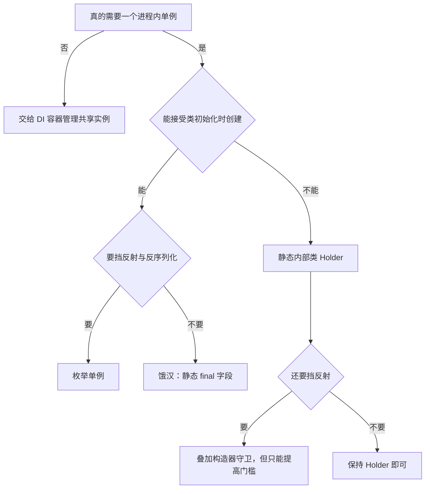
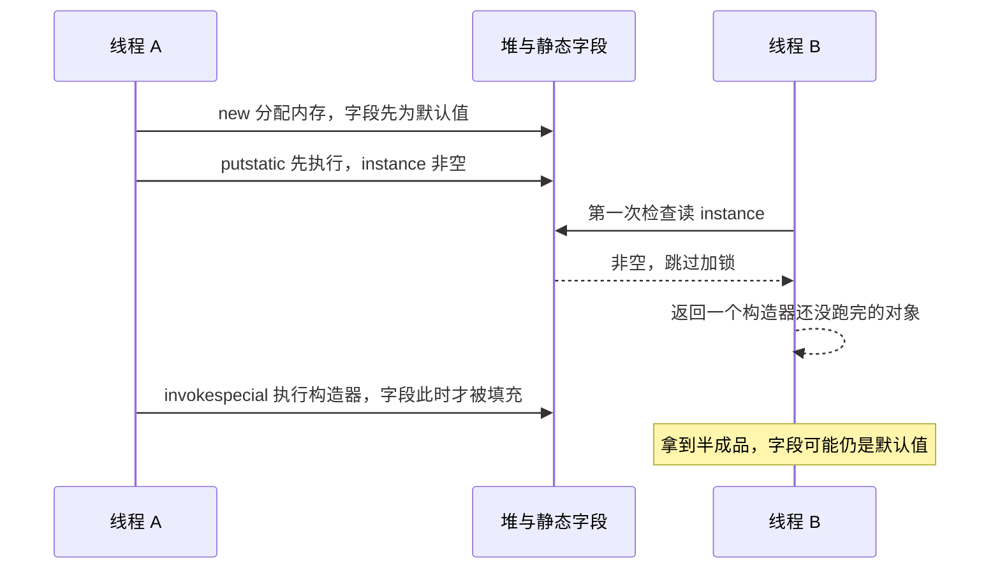
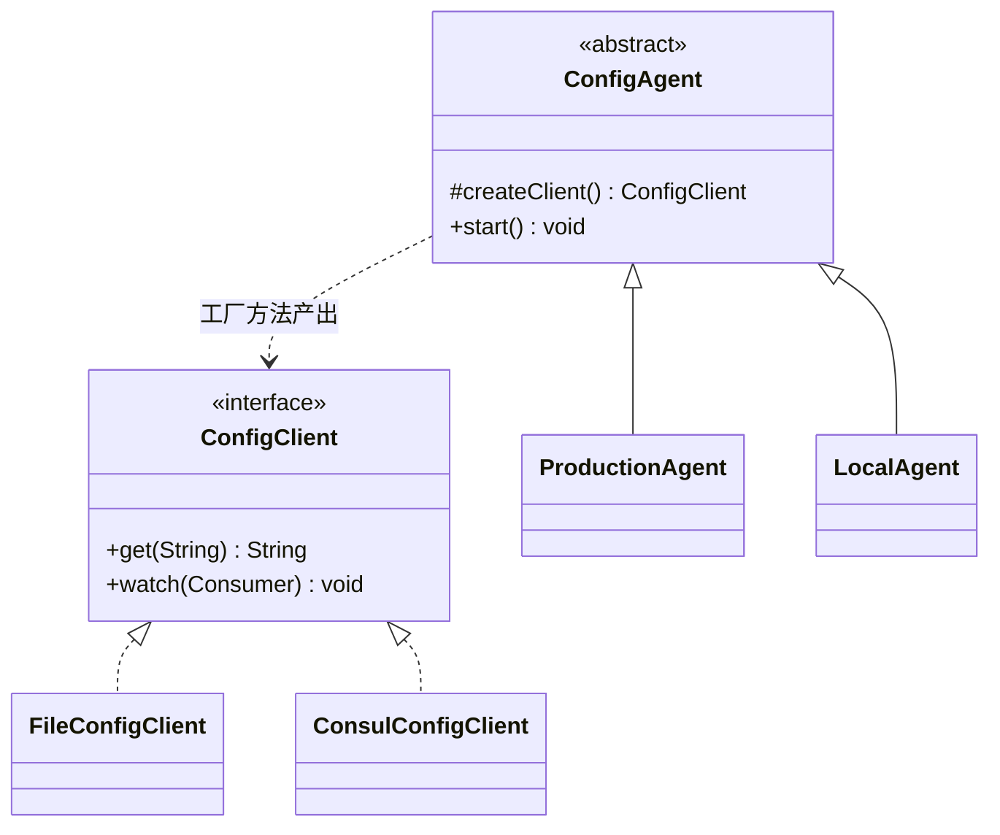
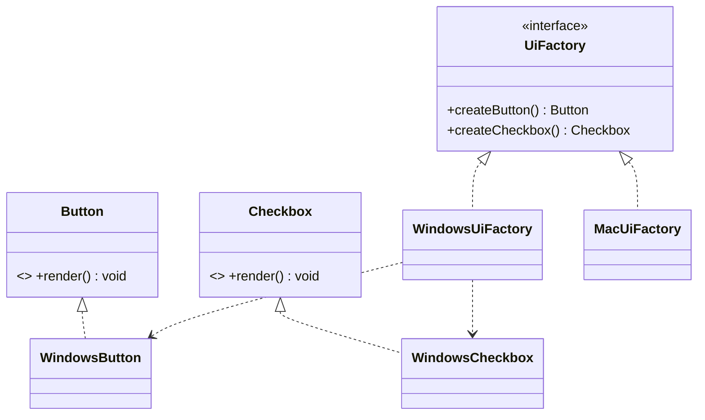
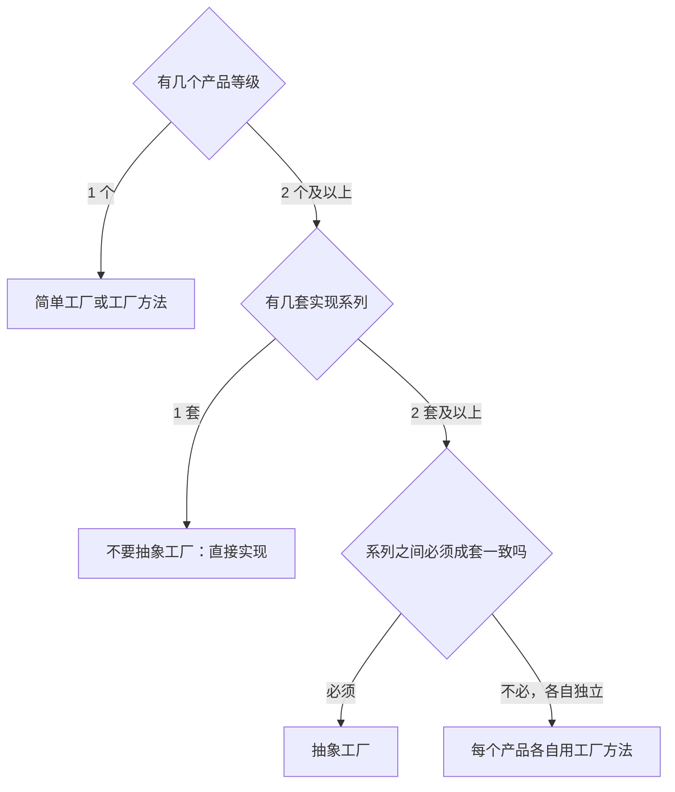
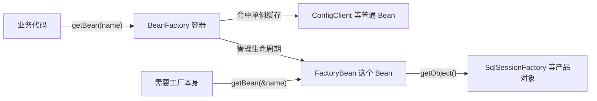

# 创建型模式（上）——单例、工厂方法与抽象工厂

**摘要：**

1994 年，GoF 把 23 个模式分成创建型、结构型、行为型三组，其中创建型只有五个，却占据了几乎所有框架的入口位置。原因不在设计趣味，而在 Java 的语法事实：`new` 是这门语言里少数几个无法被覆写的动作，目标类在编译期就被写进常量池，方法可以多态，创建不可以。要改变"创建什么、创建几个、什么时候创建"，唯一的路是在 `new` 外面垫一层间接层。

本文按两条主线推进。第一条是单例的五种写法与它们的攻防——饿汉、懒汉、双重检查、静态内部类、枚举，每一种都被放在反射、序列化、克隆、多类加载器四个攻击面上逐一检验，其中双重检查为什么必须写 `volatile`、枚举为什么能挡住反射，都追到 JDK 源码的判定语句；顺带澄清一个常被混淆的命题：单例保证的是实例唯一，而不是内部状态线程安全。第二条是工厂方法、抽象工厂与简单工厂的分工，判据只有一个——产品维度数：一个维度上的选择用工厂方法，两个及以上维度并且要求成套切换才轮到抽象工厂，简单工厂则是一维场景下的轻量替代，代价是分派集中与 OCP 失效。

读完应当能回答两个问题：为什么枚举单例在三个攻击面上封得很死却仍然不是万能解，以及什么时候抽象工厂只是给一个产品族造了一堆接口。

---

## 第 1 章 为什么"创建"值得单独立一组模式

### 1.1 new 是 Java 里少数不可覆写的动作

GoF 在 1994 年的书里把创建型模式单独立为一组，理由写得克制：对象的创建、组合与表示方式应当与使用它的系统分离。这句话成立的技术前提，藏在 Java 的语法里。方法可以覆写，字段可以隐藏，接口可以有任意多个实现，但 `new ConfigClient()` 这行代码一旦写下，目标类型就固定了——编译出来的字节码是 `new`、`dup`、`invokespecial <init>`，类名躺在常量池里，运行时没有任何多态点可以插入。想改"创建哪一个"，除了改源码，只剩下一个办法：让调用方不要去碰 `new`，而是调用一个能替它决定的方法。

创建型模式的全部工作，就是在这个句法事实上做文章。单例把"创建几个"收归一处，工厂把"创建哪一个"挪到别处，建造者把"怎么一步步组装"从调用方剥离，原型把"创建"换成"复制"。它们解决的都不是"如何写得更好看"，而是"当创建这个动作本身成为变化点时，代码该往哪里退"。

### 1.2 三笔账：为什么散落的 new 会变贵

第一笔账是创建知识与使用知识混在一处。一个配置中心客户端真正的构造过程远比一行 `new` 复杂：

```java
ConfigClient client = new ConfigClient(
        "https://config.internal:8848",
        Duration.ofSeconds(3),
        Duration.ofSeconds(10),
        3,
        new ExponentialBackoff(200, 2.0),
        event -> log.info("配置变更: {}", event.key()));
```

这六行只在 `main` 里出现一次还好，可一旦它出现在二十个需要读配置的地方，超时从三秒改成五秒就要改二十处，而其中三处可能是复制粘贴时忘了同步的历史遗留，于是同一套系统在不同路径上表现出不同的超时行为——这类不一致最难排查，因为它不报错，只是偶发地慢。

第二笔账是依赖方向被写死。`UserService` 里写 `new MySQLUserRepository()`，高层模块就反向依赖了低层实现，这正是 DIP 要防的东西。DIP 在 [[01 SOLID原则——面向对象设计的五大基石]] 里有完整讨论，此处只需记住它的代价：编译期耦合一旦形成，替换实现就要动业务代码，而业务代码是最不该为基础设施变化而改动的那一层。

第三笔账最隐蔽：生命周期失去控制。数据库连接池、线程池、配置快照这类对象，数量与时机本身就是语义的一部分——两个连接池不是"多创建了一个对象"，而是"系统同时向数据库要了两倍的连接，并且两个池互不知情，全局限流失效"。直接用 `new`，你没有任何位置可以拦住第二次创建。

### 1.3 两个坐标：几个，和哪个

把创建决策摊平，会发现所有创建型模式都在回答两个坐标上的问题。

| 决策 | 问题 | 承担的模式 | 典型代价 |
| :--- | :--- | :--- | :--- |
| 数量 | 这个类允许存在几个实例 | 单例 | 全局状态、测试困难 |
| 选择 | 这次该实例化哪个实现 | 工厂方法、抽象工厂、简单工厂 | 类数量膨胀、抽象层税 |
| 组装 | 一个复杂对象由哪些部件、按什么顺序拼成 | 建造者 | 多一个 Builder 类型 |
| 复制 | 已有实例如何派生新实例 | 原型 | 深拷贝语义、可变性风险 |

这张表里后两行只作定位，建造者与原型处理的是"组装"与"复制"，属于 [[03 创建型模式（下）——建造者与原型模式]] 的范围。本篇只处理前两行，而这两行的关系常被搞混：单例与工厂不是替代关系，面试里"单例和工厂哪个好"这种问法本身就问错了——一个管**数量**，一个管**选择**，Spring 里最常见的组合恰恰是"由工厂创建、由容器保证单例"。

### 1.4 一个贯穿全篇的案例

为了让抽象概念有落点，后面几章共用一个场景：某个系统需要一个配置中心客户端 `ConfigClient`，它要连接远端配置服务，缓存配置快照，订阅变更事件。

这个案例恰好覆盖两种变化。第一种是数量上的：整个进程只应有一份配置快照与一条长连接，多一份就意味着多一条连接、多一套监听、两份可能不同步的快照——这是单例要处理的变化。第二种是选择上的：配置源可能是本地文件、Consul、Apollo，甚至测试时的内存 Map，切换配置源不应该改动业务代码——这是工厂要处理的变化。同一个对象身上出现两种变化点，正说明模式的选择从来不由对象决定，而由"你想封住哪一处变化"决定。

---

## 第 2 章 单例：让实例唯一有多难

### 2.1 单例承诺的边界

单例模式（Singleton Pattern）的经典定义是两句：保证一个类只有一个实例，并提供一个全局访问点。定义很短，但"唯一"这个词必须先标定坐标系，否则后面每一条攻防讨论都会失焦。

| 唯一性的范围 | 谁在保证 | 越界后的后果 | 典型场景 |
| :--- | :--- | :--- | :--- |
| 同一个 ClassLoader 内 | 类初始化机制 | 同一份字节码被加载两次，出现两个"单例" | 热部署、插件化、OSGi |
| 同一个 JVM 进程内 | 类加载器层级 | 多 ClassLoader 场景下失效 | Tomcat 多应用、IDE 热替换 |
| 同一个容器内 | IoC 容器 | 多容器实例并存 | Spring 父子上下文、测试上下文 |
| 跨进程 | 外部协调（DB、Redis、ZK） | 进程内单例在多副本部署下毫无意义 | 分布式限流、分布式锁 |

这张表的实际用途，是让你在写下 `getInstance()` 之前先问一句：我说的唯一，是哪个范围内的唯一。一个在单机时代写下的配置单例，扩容到八个 Pod 之后，"唯一"就变成了八份，而代码不会给出任何提示。跨进程的那一层不属于设计模式的范畴，它属于分布式协调，笔者的建议是把单例限定在"进程内共享"的语义上，跨进程的唯一性用外部系统显式表达，不要指望一个 Java 类去承担。

### 2.2 五种写法总览

Java 里能拿得出手的单例写法有五种，它们不是同一件事的五种风格，而是在"懒加载""无锁""防攻击"三个目标上做了不同取舍的五个方案。

| 写法 | 懒加载 | 首次访问开销 | 后续访问开销 | 主要风险 |
| :--- | :--- | :--- | :--- | :--- |
| 饿汉 | 否，类初始化时创建 | 类初始化成本 | 字段读取 | 类初始化里做 I/O，失败后不可重试 |
| 懒汉加 `synchronized` | 是 | 加锁 | 每次加锁 | 热路径锁开销，仅防并发创建 |
| 双重检查（DCL） | 是 | 加锁一次 | 一次 `volatile` 读 | 漏写 `volatile` 即退化为不安全 |
| 静态内部类 | 是，Holder 首次使用时 | 类初始化成本 | 字段读取 | 反射、序列化无额外防护 |
| 枚举 | 否，类初始化时创建 | 类初始化成本 | 字段读取 | 无法继承、无法延迟注入依赖 |

选择路径可以画成一张决策图，但要注意图里只覆盖"正常使用"这一面，恶意代码那一面在 2.8 节单独处理。



### 2.3 饿汉：把唯一性交给类初始化

```java
public final class ConfigClient {
    // JVM 保证 <clinit> 只执行一次，且执行期间其它线程被阻塞
    private static final ConfigClient INSTANCE = new ConfigClient();

    private final ConfigStore store = new ConfigStore();

    private ConfigClient() {
        store.load();
    }

    public static ConfigClient getInstance() {
        return INSTANCE;
    }
}
```

饿汉的全部正确性来自 JLS 第 12.4.2 节：每个类或接口都有一把唯一的初始化锁，多个线程同时尝试初始化同一个类时，只有一个线程执行 `<clinit>`，其余线程阻塞等待，等它完成后才能继续。也就是说，"只创建一次"这件事的保证来自类加载机制，代码只是把创建动作放到了 `<clinit>` 里。

这里有一个普遍的误读需要纠正：饿汉并不等于"JVM 启动时就创建"。类的初始化发生在首次**主动使用**时——构造实例、访问静态字段或静态方法、反射 `Class.forName`、初始化子类，都会触发；如果整个进程从未碰过 `ConfigClient`，实例就一直不存在。真正的区别在于**它无法精确到"第一次调用 `getInstance()` 时"**，而是"第一次碰这个类时"。对一个构造函数要读配置文件的类来说，这个区别不小：任何一处 `ConfigClient.INSTANCE` 的静态引用都会提前触发 I/O，包括那些你本来只想读一个常量的地方。

JDK 里的 `Runtime` 就是饿汉的原型。JDK 17 的源码里，唯一实例是一个静态常量：

```java
public class Runtime {
    private static final Runtime currentRuntime = new Runtime();

    public static Runtime getRuntime() {
        return currentRuntime;
    }

    /** Don't let anyone else instantiate this class */
    private Runtime() {}
}
```

`Runtime` 代表的是"当前 JVM"这个本质上只有一个的东西，它没有懒加载的需求，也没有防反射的需求——私有构造器加上 Java 9 之后的模块强封装，应用代码即使 `setAccessible(true)` 也打不开 `java.base` 里的 `java.lang` 包，会直接抛 `InaccessibleObjectException`。这层保护只对 JDK 内部类有效，对你自己写的类无效，2.8 节会用到这个差别。

### 2.4 懒汉与 synchronized：正确，但只对了一半

最直觉的懒汉写法长这样：

```java
public final class ConfigClient {
    private static ConfigClient instance;

    private ConfigClient() {
        new ConfigStore().load();
    }

    public static ConfigClient getInstance() {
        if (instance == null) {                 // ① 检查
            instance = new ConfigClient();      // ② 创建
        }
        return instance;
    }
}
```

单线程下它完全正确，多线程下它有一个确定的失效交错：线程 A 在 ① 判断 `instance` 为空，尚未执行 ② 时被切走；线程 B 同样在 ① 判断为空，创建并发布了一个实例；线程 A 恢复执行，再创建一个并覆盖引用。两个线程各自持有不同的实例，其中一个从此成为孤儿——连接、监听、缓存全部泄漏，而调用方毫无察觉。

加 `synchronized` 能修掉这个交错：

```java
public static synchronized ConfigClient getInstance() {
    if (instance == null) {
        instance = new ConfigClient();
    }
    return instance;
}
```

代价是每次调用都要进入监视器。这里需要给一个更准确的说法，因为"锁很慢"这句话在 JDK 15 之后已经过时：JEP 374 在 JDK 15 废弃并默认禁用偏向锁，但无竞争的 `synchronized` 走的是轻量级锁路径，成本在纳秒级，绝大多数业务代码根本测不出来。真正的问题出在两点：其一，`getInstance()` 常常位于极高频路径上（每个请求、每次日志、每个配置读取），每秒百万次调用时纳秒也会累积成可观的 CPU；其二，一旦有竞争，监视器会把所有调用串行化，而这里本不需要串行——实例创建完成之后，读操作之间没有任何冲突。

更值得警惕的是另一个层面：`synchronized` 只防住了"并发创建"，反射、反序列化、克隆这三条路它一条都没防。很多团队把"加了锁"当成"单例安全了"，只堵住了五分之一的口子。

### 2.5 双重检查与 volatile：一次重排的代价

双重检查锁（Double-Checked Locking，DCL）的目的，是让实例创建之后的访问完全不加锁：

```java
public final class ConfigClient {
    // volatile 不是装饰，是这段代码正确性的一部分
    private static volatile ConfigClient instance;

    public static ConfigClient getInstance() {
        ConfigClient local = instance;          // ① 无锁快路径
        if (local == null) {
            synchronized (ConfigClient.class) {
                local = instance;               // ② 有锁二次检查
                if (local == null) {
                    local = new ConfigClient();
                    instance = local;
                }
            }
        }
        return local;
    }
}
```

两次检查各有分工：第一次检查是无锁快路径，实例发布之后所有调用直接返回，不再进监视器；第二次检查处理的是"多个线程同时通过第一次检查、排队等锁"的情况——第一个拿到锁的线程创建实例，后面的线程进锁后必须再判一次，否则会重复创建。

真正让这段代码出名的是那个 `volatile`。`instance = new ConfigClient()` 看起来是一个动作，在字节码层面却是四个指令：

```text
new           # 在堆上分配内存，所有字段为默认值（0、null、false）
dup           # 复制引用，一份用于调用构造器，一份用于赋值
invokespecial # 调用 <init>，执行构造器，字段被填上真实值
putstatic     # 把引用写入静态字段 instance
```

JMM 只要求单线程内的执行结果与这四步的书写顺序一致，不保证其它线程观察到的顺序与之相同。编译器与处理器可以在不改变单线程语义的前提下重排，把 `putstatic` 提到 `invokespecial` 之前——引用先可见，构造器后执行。两个线程的交错于是变成这样：



线程 B 没有任何同步动作，它只做了一次普通读，却读到了一个"已发布但未初始化"的对象。具体症状取决于字段的声明顺序：`store` 字段仍为 null 时，第一次调用 `get()` 就抛 `NullPointerException`，而栈顶指向一个与构造过程毫无关系的业务方法；某个 `int` 计数器仍是 0 时，故障表现为"配置偶尔读到空值"，连异常都没有。这类故障最难查，因为它不会稳定复现，取决于 JIT 的优化决策、CPU 的内存模型、以及运气。

`volatile` 的作用有两层。可见性那一层比较容易记：对 `volatile` 字段的写，happens-before 于后续对同一字段的读，读线程因此能看到写线程在写之前的所有动作。禁止重排那一层才是 DCL 真正需要的：`volatile` 写在语义上等价于在写之前插入一个 StoreStore 屏障、在写之后插入一个 StoreLoad 屏障，前者阻止 `putstatic` 被提到构造器之前，后者让发布对其他线程及时可见。二者合起来，才保证了"看到引用非空"就意味着"构造器已经执行完毕"。

这套语义不是 Java 一开始就有的。Java 5 之前，旧 JMM 允许 `volatile` 写与非 `volatile` 读写重排，DCL 在那个年代无论如何都是错的；JSR-133 在 2004 年随 Java 5 重写了内存模型，`volatile` 才获得了今天的语义，DCL 也才成为"写对了就正确"的方案。所以看到"Java 5 之前的 DCL 不可用"这句话，它说的是语言规范，不是某个实现的 bug。

关于"我这里跑了十年都没事"，需要给一个技术上的解释，而不是简单的否定。x86 是 TSO（Total Store Order）内存模型，处理器层面不会把 store 重排到另一个 store 之前，因此参考实现的那次重排在这类硬件上很少被观察到；但 JMM 是语言级合同，不承诺任何具体硬件的顺序，JIT 的优化决策、未来平台更弱的内存模型、以及 GC 与安全点带来的额外可见性边界，都可能把"很少"变成"某一天"。用"没有复现"替代"有保证"，在并发代码里是代价最高的一种乐观。

还有一个边角值得知道：如果单例类的所有实例字段都是 `final`，JLS 第 17.5 节的冻结动作（freeze）会保证构造器结束时 final 字段的值对读到该引用的线程可见，此时不写 `volatile` 的 DCL 在实践中不容易出错。但只要类里出现一个非 final 字段——哈希缓存、连接句柄、计数器——就会回到经典问题。这种"靠字段修饰符保住正确性"的写法，等于把并发正确性挂在一个随时会被别人改动的细节上。

DCL 也有更轻的现代写法：JDK 9 之后可以用 `VarHandle` 的 `getAcquire`/`setRelease` 表达同一套语义，读侧不带完整 `volatile` 语义，写侧只保证发布顺序。不过对单例这种"只写一次、读无数次"的场景，静态内部类往往比 DCL 更省心，下一节说明原因。

### 2.6 静态内部类：把同步交给类初始化

```java
public final class ConfigClient {
    private ConfigClient() {
        new ConfigStore().load();
    }

    // Holder 只有在第一次被主动使用时才初始化
    private static final class Holder {
        private static final ConfigClient INSTANCE = new ConfigClient();
    }

    public static ConfigClient getInstance() {
        return Holder.INSTANCE;
    }
}
```

这段代码没有一行同步，却是线程安全的，因为 `Holder.INSTANCE` 的初始化同样发生在 `Holder` 的 `<clinit>` 里，而类初始化由 JVM 串行化。与饿汉的唯一区别是延迟的粒度：外部类可以在不触发 `ConfigClient` 构造的前提下被使用（譬如它有其它静态常量或静态方法），只有真正调用 `getInstance()`、第一次访问 `Holder` 时，实例才被创建。

它的正确性依赖两条 JVM 保证，缺一不可：类初始化是线程安全的，**只发生一次**。后者还带来一个常被忽略的语义——**类初始化失败不会重试**。如果 `ConfigStore().load()` 在 `Holder` 初始化时抛出异常，`Holder` 会被标记为 erroneous 状态，第一次调用者拿到 `ExceptionInInitializerError`，此后的调用者拿到的是 `NoClassDefFoundError`，即使导致失败的外部条件（网络、配置文件）已经恢复，也不会有第二次尝试。这个语义对饿汉、静态内部类、枚举三者同样成立；反而是 2.4 节的懒汉与 2.5 节的 DCL 不受影响，因为它们的创建发生在普通方法调用里，失败了把异常抛给调用方，`instance` 仍为 null，下次调用还能重来。

这个差别在真实系统里不是纸面细节。配置中心客户端、连接池这类对象，初始化时必然涉及网络 I/O，第一次失败是常态；把它们的创建放进 `<clinit>`，等于把"可重试的启动失败"变成"必须重启进程的永久故障"。这也是很多团队最终选择 DCL 或懒汉的真实原因——不是为了省那次加锁，而是为了保留重试语义。

### 2.7 枚举：唯一一个由语言结构封住的写法

《Effective Java》第 3 版第 3 条的标题是"用私有构造器或者枚举类型强化 Singleton 属性"，正文的结论是：单元素枚举类型通常是实现单例的最佳方式。注意"通常"这个限定词，Bloch 并没有说它是唯一正确解，但这个写法在防攻击这件事上确实做到了另外四种写法做不到的事。

```java
public enum ConfigClient {
    INSTANCE;

    private final ConfigStore store = new ConfigStore();

    ConfigClient() {
        store.load();
    }

    public String get(String key) {
        return store.get(key);
    }
}
```

三行之内没有任何同步、没有任何序列化钩子、没有任何反射防御代码，而反射、反序列化、克隆三条路都被封住了。逐条看 JDK 源码里的判定。

第一条，反射。用私有构造器实现单例的类，攻击方式是标准的：拿到 `Constructor`，`setAccessible(true)`，再 `newInstance()`，得到一个全新的实例。枚举挡在 `Constructor.newInstance` 的入口处，JDK 17 的源码里写着：

```java
if ((clazz.getModifiers() & Modifier.ENUM) != 0)
    throw new IllegalArgumentException("Cannot reflectively create enum objects");
```

这段检查位于 `setAccessible` 生效之后、构造器调用之前，所以在应用代码里先 `setAccessible(true)` 也没有用，异常照抛。它的作用范围是"任何枚举类型"，不需要单例作者写一行防御代码。

第二条，反序列化。普通类实现 `Serializable` 之后，反序列化会经由 `ObjectInputStream` 走一遍"分配对象、填充字段"的流程，这条路径完全绕过构造器，因此必然产出新实例。常见的补救是在类里加一个 `readResolve()` 返回已有实例，`ObjectInputStream` 会用它的返回值替换反序列化结果。枚举根本不需要这个钩子：`ObjectOutputStream.writeEnum` 对枚举只写类描述符与常量名，`ObjectInputStream.readEnum` 反序列化时执行的是 `Enum.valueOf((Class) cl, name)`——按名字回查已有的常量，返回的必然是同一个对象。至于伪造一个"反序列化出枚举实例"的流，走不通，因为 `Enum` 自己的 `readObject` 直接抛异常：

```java
private void readObject(ObjectInputStream in) throws IOException, ClassNotFoundException {
    throw new InvalidObjectException("can't deserialize enum");
}
```

第三条，克隆。`Object.clone()` 是一个绕过构造器的 native 方法，只要类实现了 `Cloneable` 并且把 `clone()` 暴露出去，就能凭空造出第二个实例。枚举把这条路从类型层面堵死，`Enum.clone()` 是 `final` 的，且直接抛异常：

```java
protected final Object clone() throws CloneNotSupportedException {
    throw new CloneNotSupportedException();
}
```

`final` 意味着子类无法覆盖它，返回实例也不行、改成公开也不行，这是唯一一种"连自定义机会都不给"的封闭方式。

代价同样明确。枚举不能懒加载，常量在枚举类初始化时全部创建；枚举不能继承别的类（已经继承了 `Enum`），所以它无法扩展某个基类；枚举常量在类初始化时就固定，靠构造器参数注入依赖（连接、配置源）很别扭，通常只能通过静态初始化或外部注册表补上。把这几条与收益放在一起，结论是清楚的：枚举适合无依赖、无 I/O、**初始化必然成功**的单例，譬如无状态的工具、策略注册表、常量集合；一旦它的构造需要外部资源，"类初始化失败不可重试"这条代价就会盖过防攻击的收益。

### 2.8 四个攻击面的横向对照

把五种写法放进同一张表，能看出"防住"这件事有多局部。

| 攻击面 | 饿汉 | 懒汉加锁 | DCL | 静态内部类 | 枚举 |
| :--- | :--- | :--- | :--- | :--- | :--- |
| 反射 `setAccessible` | 破 | 破 | 破 | 破 | 挡住 |
| 反序列化产生新实例 | 破（需 `readResolve`） | 破 | 破 | 破 | 挡住 |
| `clone()` 复制实例 | 破（实现 `Cloneable` 时） | 破 | 破 | 破 | 挡住 |
| 多 ClassLoader 重复加载 | 破 | 破 | 破 | 破 | 破 |
| 构造失败后可否重试 | 否 | 是 | 是 | 否 | 否 |

#### 2.8.1 反射：门槛可以抬高，门关不上

对非枚举的单例，反射攻击只有四行：

```java
Constructor<ConfigClient> ctor = ConfigClient.class.getDeclaredConstructor();
ctor.setAccessible(true);
ConfigClient evil = ctor.newInstance();
System.out.println(evil == ConfigClient.getInstance());   // false
```

`private` 在 Java 里约束的是编译期可见性与运行期的访问检查，而 `setAccessible(true)` 的作用正是把 `Constructor` 的 `override` 标志置为真，跳过 `checkAccess`。应用类位于 unnamed module，没有模块边界拦它，所以这段代码在任何 JDK 17 应用里都能跑通。

常见的防御是在构造器里加一个"只能创建一次"的守卫：

```java
private static final AtomicBoolean CREATED = new AtomicBoolean();

private ConfigClient() {
    if (!CREATED.compareAndSet(false, true)) {
        throw new IllegalStateException("ConfigClient 已被创建，禁止再次实例化");
    }
    new ConfigStore().load();
}
```

它能挡住绝大多数误用与脚本式攻击，但它抬高的只是门槛：攻击者可以反射把 `CREATED` 改回 `false`，也可以直接用 `Unsafe.allocateInstance` 绕过构造器分配对象。想在进程内防住"有反射权限的恶意代码"这件事本身就不成立——能反射改你的静态字段，就能改你的任何不变量。所以更诚实的定位是：**单例防的是误用，不是恶意**；枚举的价值在于它把"防误用"做到了语言层面，顺带让脚本级攻击失去着力点。

#### 2.8.2 反序列化：`readResolve` 是补丁，不是免疫

普通单例一旦实现 `Serializable`，就必须自己处理这条旁路：

```java
private Object readResolve() {
    return INSTANCE;   // 反序列化结果被替换为已有实例
}
```

`readResolve` 会被 `ObjectInputStream` 在对象构造完成之后调用，返回值替换掉刚反序列化出来的对象，因此外界拿到的仍是那个唯一实例。更彻底的写法是 Bloch 的序列化代理（serialization proxy）：`writeReplace()` 返回一个只含必要数据的代理对象，`readResolve()` 在代理里重建实例，这样连"字段被篡改"的窗口都没有。枚举两种都不需要，原因见 2.7 节的源码。

#### 2.8.3 克隆：不实现 `Cloneable` 最省事

`Object.clone()` 不走构造器，浅拷贝出一个新对象，前提是类实现了 `Cloneable`，否则抛 `CloneNotSupportedException`。单例的防御因此异常简单：不实现 `Cloneable` 就封住了公开路径；如果因为继承体系不得不实现，就覆盖 `clone()`：

```java
@Override
protected Object clone() throws CloneNotSupportedException {
    throw new CloneNotSupportedException("单例不允许克隆");
}
```

私有构造器守卫对克隆无效，因为克隆压根不经过构造器——这也是为什么单例的防御要按"旁路"而不是按"入口"来设计。

#### 2.8.4 多类加载器：谁也挡不住的那一面

单例的唯一性以 `ClassLoader` 为界。同一份 `.class` 文件被两个类加载器各自加载，得到的是两个不同的 `Class` 对象，静态字段也各有一份，于是 `getInstance()` 返回两个实例，`instanceof` 互相为假，强转直接抛 `ClassCastException`。枚举在这件事上同样无能为力：两次加载得到两个枚举类型，`Enum.valueOf` 各自查各自的常量表，`INSTANCE` 依然是两个。

真实的触发场景比想象中多：Tomcat 为每个 Web 应用准备独立的 `WebappClassLoader`，两个应用各自打包同一份配置客户端 jar，就有两份静态单例；OSGi 的 bundle 各有类加载器；IDE 的热替换、Spring Boot DevTools 的重启、自定义插件框架，都会制造新的加载器。更麻烦的是第二层后果——静态单例持有 `Class` 引用、`ThreadLocal`、JDBC 驱动注册、定时器线程，都会阻止旧的 `ClassLoader` 被回收，Web 应用反复热部署之后，元空间（Metaspace）一路涨到 OOM，Tomcat 的日志里留下一条熟悉的告警：应用启动了一个线程却没有停止它。

这一面的正确应对不是找一种更"强"的单例写法，而是把唯一性的边界上移：让容器（Spring 的单例作用域、应用服务器的共享库目录）来保证一个加载器内只有一份，或者在关闭时显式清理静态引用（`ServletContextListener` 的 `contextDestroyed` 里把单例持有的线程与连接关掉）。指望一个 Java 类对抗类加载器隔离，是把责任放错了层。

### 2.9 单例不等于线程安全

这是本篇最需要澄清的一句：单例保证的是实例唯一，**唯一不等于线程安全**。两件事正交，而"单例"这个词里的"单"字太容易让人误读成"安全"。

```java
public enum MetricsRegistry {
    INSTANCE;

    private final Map<String, Long> counters = new HashMap<>();   // 可变状态

    public void increment(String name) {
        counters.merge(name, 1L, Long::sum);   // 并发下会丢更新
    }
}
```

这个枚举单例在防反射、防反序列化、防克隆三件事上都是满分，而 `increment` 在并发下是错的：`HashMap` 不是线程安全的，`merge` 的读-改-写不是原子动作，两个线程同时自增同一个计数器，结果少加一次。更常见的版本是单例里挂一个 `SimpleDateFormat`——它内部持有的 `Calendar` 在 `parse`/`format` 时会改写自身状态，多线程共用会导致解析出错误日期，或者抛出莫名其妙的 `NumberFormatException`。Java 8 之后应当换用不可变的 `DateTimeFormatter`，它本身线程安全。

判断自己写的单例是否天然安全，标准只有一条：它的状态是否不可变，或者所有可变状态是否被正确同步。无状态的服务（纯函数式的转换器）、初始化后不再修改的配置快照、内部用 `ConcurrentHashMap` 或 `LongAdder` 维护的注册表，都可以放心；一个持有 `HashMap`、`ArrayList`、`StringBuilder` 字段的单例，与普通对象一样需要并发设计。把"单例"当成"线程安全"的同义词，是并发 bug 的一大来源，而它偏偏很难在测试里暴露——单线程测试永远通过。

### 2.10 反例：单例最容易踩的四个坑

第一个坑是单例持有连接池。写法通常是这样：

```java
public enum Database {
    INSTANCE;

    private final HikariDataSource dataSource = new HikariDataSource();  // 谁负责 close

    public Connection getConnection() throws SQLException {
        return dataSource.getConnection();
    }
}
```

问题不在语法，在生命周期。数据源需要在应用关闭时 `close()`，而枚举单例没有任何"关闭"钩子，只能靠 JVM 退出时被动释放，容器化环境里进程被 `SIGTERM` 之后连接可能还挂在数据库侧；构造期做网络 I/O，一旦数据库暂时不可达，枚举类初始化失败，整个进程内所有引用它的代码都会拿到 `NoClassDefFoundError`，而且不可重试；测试时无法把它替换成内存数据库，只能连真库。正确的做法是让容器（Spring）管理数据源这个 Bean 的生命周期，单例只持有注入进来的引用，或者干脆不写单例，用依赖注入把 `DataSource` 传下去。

第二个坑是把业务服务写成手工单例。`OrderService` 里没有任何需要"唯一"的资源，写成单例的唯一后果是测试时必须准备完整依赖链，无法注入 Mock。Spring 的 Bean 默认就是单例作用域，但它是由容器创建、可以被替换的"共享实例"，与 GoF 意义上"私有构造器加静态访问点"的手工单例是两件事，后者连替换的机会都不给。

第三个坑是把单例当全局缓存。`private final Map<String, Object> cache = new HashMap<>()` 挂在单例上，用起来像免费的缓存，实际是无界增长的内存泄漏——单例的生命周期等于进程生命周期，它持有的每一个对象都活得和你一样久。缓存该交给带淘汰策略的组件（Caffeine、Guava Cache），而不是单例里的一个 `Map`。

第四个坑是热部署下的类加载器泄漏。前面 2.8.4 已经拆过，这里只补一句处置：凡是静态字段持有了线程、连接、`ThreadLocal`、`Class` 引用的单例，都必须提供显式的销毁入口，并在容器关闭时调用。

把这些坑摊开看，会发现它们共享一个根源：单例把生命周期拉长到了进程级，而进程级的东西一旦持有资源，就必须回答"谁来释放"。答不上来的时候，正确的动作往往是把生命周期交还给容器，而不是换一种单例写法。

---

## 第 3 章 简单工厂：三宗罪与它仍然合理的地方

### 3.1 一个 switch 的诞生

假设 `ConfigClient` 需要支持三种配置源：本地文件、Consul、Apollo。业务代码里如果按环境各写一段 `new`，很快就会出现这样的分派：

```java
if ("file".equals(source)) {
    client = new FileConfigClient(path);
} else if ("consul".equals(source)) {
    client = new ConsulConfigClient(host, port);
} else if ("apollo".equals(source)) {
    client = new ApolloConfigClient(appId, meta);
}
```

这段代码的问题不是丑，是它会被复制到每一个需要配置客户端的地方。简单工厂（Simple Factory）把它收拢到一个类里：

```java
public final class ConfigClientFactory {

    public static ConfigClient create(String source) {
        return switch (source) {
            case "file"   -> new FileConfigClient(Path.of("config/app.properties"));
            case "consul" -> new ConsulConfigClient("consul.internal", 8500);
            case "apollo" -> new ApolloConfigClient("order-service", "http://apollo.internal");
            default -> throw new IllegalArgumentException("未知配置源: " + source);
        };
    }
}
```

这个类确实解决了两件事：创建逻辑集中在一处，改默认参数只改这里；调用方只依赖 `ConfigClient` 接口，不再依赖三个具体类。它的价值是真实的，所以它在 JDK 与各类 SDK 里大量存在，`Executors`、`Integer.valueOf`、`EnumSet.of` 都是这个形态。但它有三宗罪，每一宗都有具体的失效方式。

### 3.2 三宗罪

第一宗罪是分派逻辑本身。`switch` 是**编译期分派**，没有多态点，新增一种配置源必须回到这个类里加一个分支；更麻烦的是分派的输入是一个字符串，拼写错误在编译期完全看不出来，要等到运行时才抛异常或返回错误结果。类型系统在这里帮不上忙，因为字符串把类型信息擦掉了——这正是工厂方法要解决的问题，它把"选择"从字符串比较换成了类型多态。

第二宗罪是违反 OCP。很多人对这条的理解停留在"改代码不好"，其实更准确的表述是：**扩展方向与稳定方向冲突**，产品应当是可扩展的（加一个 `EtcdConfigClient`），工厂却是一个稳定类，每次扩展都要改它。在多人协作的仓库里，这个代价会具体化为合并冲突：三个团队同时新增配置源，三份改动都要落在这一个文件的 `switch` 里。工厂方法把扩展点从"改一个类"换成"加一个类"，冲突自然消失，因为新代码不碰旧文件。

第三宗罪是返回 `null` 的隐患。早期代码里常见这样的写法：

```java
public static ConfigClient create(String source) {
    if ("file".equals(source)) return new FileConfigClient(...);
    if ("consul".equals(source)) return new ConsulConfigClient(...);
    return null;   // 未知类型
}
```

调用方拿到 `null` 之后通常不会立刻检查，而是在几层之后的某个 `client.get(key)` 上抛 `NullPointerException`，栈里找不到"配置源不认识"这个真正的原因。相比之下，直接抛 `IllegalArgumentException` 是更好的选择：它在错误发生的现场失败（fail fast），异常消息里带着那个非法的值，排查成本差一个数量级。JDK 里同类处理也是如此，`EnumSet.copyOf(Collection)` 遇到空集合会直接抛 `IllegalArgumentException("Collection is empty")`，而不是返回一个空集合让错误延后。

> [!warning] 空对象不是万能解
> 用 `UnknownConfigClient` 这类空对象替代 `null` 时，要确认它的语义真的可以静默：读配置返回空字符串可能导致下游用默认值继续跑，而"配置源配错了"这件事被永久掩盖。空对象的适用前提是"缺失即合理"，配错场景不属于这一类。

补充一个不属于"罪"但同样致命的细节：分派键用字符串时，配置文件的拼写、大小写、空格都会成为运行时炸弹。把键换成枚举或 `Class` 至少能让编译器参与检查，代价是新增类型要改枚举——这又回到了 OCP 的老问题，所以判据不是"用不用枚举"，而是"产品集合会不会变"。

### 3.3 它仍然合理的场景

简单工厂被批评得多，被理解得少。它在一维、低频、稳定的场景里是最经济的方案，判断标准可以写成一张表。

| 情形 | 判断 | 理由 |
| :--- | :--- | :--- |
| 产品集合由外部协议固定 | 合理 | HTTP 方法、JDBC 驱动名这类维度不会因业务需求增长 |
| 产品集合每个迭代都在加 | 不合理 | 每次扩展都改同一个稳定类，冲突成本随团队规模放大 |
| 创建需要统一的副作用 | 合理 | 缓存、计数、连接复用集中在一处比分散正确 |
| 需要向调用方隐藏实现类名 | 合理 | SDK 对外只暴露接口，实现类可以随时改名或移除 |
| 分派维度超过一个 | 不合理 | 两个维度应当考虑抽象工厂或注册表 |
| 未知输入应失败 | 必须 | 抛异常，不要返回 `null` |

除了表里的判断，还有一个常被忽略的合理理由：测试替身。工厂是唯一的创建入口，测试里把它换成返回 Mock 的版本，比在业务代码里到处注入要省事。这与"工厂让代码难测试"的流行说法相反——难测试的是手工单例，不是工厂。

### 3.4 JDK 里的简单工厂：Executors 的收益与代价

`java.util.concurrent.Executors` 是简单工厂在 JDK 里最典型的落点。`ThreadPoolExecutor` 的构造器有七个参数（核心线程数、最大线程数、空闲存活时间、时间单位、工作队列、线程工厂、拒绝策略），直接 `new` 需要调用方理解每一个参数的含义与相互约束，`Executors` 把常见组合固化成静态方法：

```java
ExecutorService pool = Executors.newFixedThreadPool(8);
ExecutorService single = Executors.newSingleThreadExecutor();
```

但这两个方法的返回值值得多看一眼。`newFixedThreadPool` 返回的是未经包装的 `ThreadPoolExecutor`，`newSingleThreadExecutor` 返回的却是一个包装对象，JDK 17 的源码是：

```java
public static ExecutorService newSingleThreadExecutor() {
    return new FinalizableDelegatedExecutorService
        (new ThreadPoolExecutor(1, 1, 0L, TimeUnit.MILLISECONDS,
                                new LinkedBlockingQueue<Runnable>()));
}
```

包装的目的是两件事：禁止调用方把单线程池"重新配置"成多线程（`setCorePoolSize` 等方法在包装层不暴露），以及在对象被 GC 时兜底调用 `shutdown`。这是工厂在返回值类型上做的语义加固，简单工厂完全可以承担这种职责，这也是它不该被一刀切否定的原因。

代价同样明显：工厂替你选了参数，包括你未必想要的那些。`newFixedThreadPool` 与 `newSingleThreadExecutor` 用的都是无界 `LinkedBlockingQueue`，任务堆积时队列会一直长，直到堆内存耗尽，而不是触发拒绝策略；`newCachedThreadPool` 的最大线程数是 `Integer.MAX_VALUE`，突发流量下可能创建出成千上万个线程。这正是《阿里巴巴 Java 开发手册》要求"线程池不允许使用 `Executors` 去创建，而要通过 `ThreadPoolExecutor` 的方式"的原因——工厂把配置决策从调用方手里拿走了，而它替你选的默认值在压力下是危险的。

这个案例给出一条一般性的判据：工厂隐藏的应该是怎么创建，**不应该是用什么参数**。当一个工厂方法替调用方决定了队列容量、超时、重试次数这类会显著影响运行时行为的参数时，要么把参数开放出来，要么让调用方拿到可配置的对象。隐藏实现类是收益，**隐藏配置是风险**。

JDK 21 给这个类加了 `newVirtualThreadPerTaskExecutor()`，这是工厂形态的一个正面样本：新增一种执行器只需加一个静态方法，调用方代码完全不用改，产品维度只有一个（`ExecutorService`），扩展频率低，简单工厂在这里恰到好处。

---

## 第 4 章 工厂方法：把"选哪个"下推到子类

### 4.1 结构：让创建成为一个可覆盖点

简单工厂把分派写死在一个方法里；工厂方法（Factory Method Pattern）换了个思路：定义一个创建对象的接口，但把"具体创建哪一个"留给子类决定。基类的业务骨架只依赖抽象产品，具体产品由子类在工厂方法里给出。

```java
public interface ConfigClient {
    String get(String key);
    void watch(Consumer<ConfigChange> listener);
}

public class FileConfigClient implements ConfigClient { /* ... */ }
public class ConsulConfigClient implements ConfigClient { /* ... */ }

public abstract class ConfigAgent {

    // 工厂方法：子类决定创建哪种客户端
    protected abstract ConfigClient createClient();

    // 模板方法：业务骨架只依赖抽象产品
    public final void start() {
        ConfigClient client = createClient();
        client.watch(change -> onConfigChanged(change));
        onStarted(client);
    }

    protected abstract void onStarted(ConfigClient client);
    protected abstract void onConfigChanged(ConfigChange change);
}

public class ProductionAgent extends ConfigAgent {
    @Override
    protected ConfigClient createClient() {
        return new ConsulConfigClient("consul.internal", 8500);
    }
    // ...
}
```

结构可以用类图看清：抽象产品在左侧，具体产品实现它；抽象创建者持有一条指向抽象产品的依赖；具体创建者负责在工厂方法里选出具体产品。



这张图里有一个容易漏掉的设计点：工厂方法几乎总是与模板方法结伴出现。`start()` 是稳定的业务骨架，`createClient()` 是骨架上的一个可替换插槽。如果只看"创建一个对象"这一件事，工厂方法就是"把 `new` 放进一个抽象方法"；但它真正的价值在于让**骨架与产品同时演进**——骨架的流程不变，产品可以随环境替换。GoF 原书把工厂方法归在创建型，却明确说它常用于框架让子类定制，原因就在这里。

### 4.2 不这样写会怎样

反过来说更清楚。假设不做这层抽象，三个环境（生产、预发、本地）需要三种配置客户端，业务代码里的写法只有一种可能——在调用点分派：

```java
ConfigClient client;
if (env.equals("prod")) {
    client = new ConsulConfigClient(...);
} else if (env.equals("staging")) {
    client = new ApolloConfigClient(...);
} else {
    client = new FileConfigClient(...);
}
```

于是每一个需要客户端的地方都要知道三种实现、三个地址、三套参数，并且这个判断会随着"某个环境临时改用另一种源"的需求散落到更多地方。更糟的是它把测试逼进死角：想用内存实现跑单元测试，就得在环境判断里再加一个分支，而测试代码的分支进入生产代码，是腐化的开始。

工厂方法把这段分派收进具体创建者，业务骨架一行判断都没有；测试时写一个 `InMemoryAgent`，工厂方法返回内存实现，其余逻辑完全复用。选择点被推到了组装层（`main` 或 Spring 配置），这不算缺点——创建决策本来就该由组装者做，而不是由使用者猜。

### 4.3 与简单工厂的判据

两种工厂的差别，从调用方视角看只有一句话：简单工厂传一个**类型标识**，工厂方法传一个**创建者实例**。前者在运行期做字符串或枚举比较，后者在编译期完成类型选择。

| 维度 | 简单工厂 | 工厂方法 |
| :--- | :--- | :--- |
| 扩展新产品 | 修改工厂类的分派（破坏 OCP） | 新增创建者子类（遵守 OCP） |
| 调用方依赖 | 一个静态方法加类型标识 | 一个创建者类型 |
| 分派发生的时刻 | 运行期 | 编译期（多态） |
| 选择点的位置 | 工厂内部 | 组装层 |
| 代码规模 | 一个类 | 产品数加创建者数 |
| 适合的变化频率 | 低（产品集合稳定） | 高（产品集合持续增长） |

判据由此而来：如果产品集合基本固定、**变化频率**低、创建需要集中副作用、或者你要对调用方隐藏实现类名，简单工厂更经济；如果产品集合会持续增长、每新增一种产品都不应触碰旧代码，工厂方法是正解。两者不是新旧关系，是"变化频率"这一个变量上的两个取值。

### 4.4 工厂方法的代价

工厂方法不是免费的，它的成本常被低估。

第一是类数量。每新增一种产品，通常要配一个具体创建者，`2N` 的增长在 N 变大时很快失控；如果产品之间的差异只在参数，创建者子类就是纯样板代码。

第二是选择点上移。调用方不再自己决定用哪个实现，就必须有人在更高层决定，这个"更高层"在小型项目里往往就是 `main` 或者某个配置类，那里会积累起一段与简单工厂类似的 `if-else`。分派没有消失，只是从产品旁边挪到了组装处——这是所有工厂模式的共同真相：它们不消灭分支，只把分支集中到少数几个允许出现分支的地方。

第三是单产品单实现时的纯负担。只有一个 `FileConfigClient`、并且短期内不会增加第二个时，抽象创建者、抽象产品、具体创建者三个类型只为了让一行 `new` 看起来更"设计"。判断是否值得的门槛很低但必须过：**存在第二个实现**，或者存在明确的替换预期。没有这个前提，工厂方法就是给未来的可能性提前付利息。

### 4.5 JDK 落点：Calendar.getInstance 与迭代器

`java.util.Calendar` 是工厂方法在 JDK 里最完整的一个样本。`Calendar` 是抽象类，具体产品有 `GregorianCalendar`（公历）、`BuddhistCalendar`（佛历）、`JapaneseImperialCalendar`（日本皇历）等；调用方只写 `Calendar.getInstance()`，拿到哪个子类由默认时区与区域设置决定。JDK 17 的创建逻辑是：

```java
public static Calendar getInstance() {
    return createCalendar(TimeZone.getDefault(), Locale.getDefault(Locale.Category.FORMAT));
}

private static Calendar createCalendar(TimeZone zone, Locale aLocale) {
    CalendarProvider provider = LocaleProviderAdapter
            .getAdapter(CalendarProvider.class, aLocale).getCalendarProvider();
    if (provider != null) {
        return provider.getInstance(zone, aLocale);   // 外部提供者优先
    }
    // 按 locale 的 "ca" 扩展选择子类
    String caltype = aLocale.getUnicodeLocaleType("ca");
    if (caltype == null) {
        return new GregorianCalendar(zone, aLocale);
    }
    return switch (caltype) {
        case "buddhist" -> new BuddhistCalendar(zone, aLocale);
        case "japanese" -> new JapaneseImperialCalendar(zone, aLocale);
        default         -> new GregorianCalendar(zone, aLocale);
    };
}
```

这个实现有两层值得注意。第一层，`getInstance()` 内部仍然是 `switch`——工厂方法并没有消灭分派，它只是把分派从"每个调用方"收拢到"框架内部的一个扩展点"，调用方从此不必知道有哪些日历类型。第二层，它在最前面还留了一个提供者入口：JDK 9 起的 `LocaleProviderAdapter` 按区域设置挑选 `CalendarProvider`，取到就交给提供者创建。提供者实现位于 `sun.util.spi` 这类内部包，应用代码无法像注册 JDBC 驱动那样插进去，但 JDK 自带的 CLDR 提供者与 JRE 提供者走的就是这条路径——创建者与产品被同时抽象，这是工厂方法加服务提供者接口的组合形态。

`Collection.iterator()` 是同类结构在更基础层面的体现。`Collection` 接口声明 `iterator()`，`ArrayList`、`LinkedList`、`HashSet` 各自返回与自己数据结构匹配的 `Iterator` 实现（`ArrayList` 返回内部的 `Itr`，`LinkedList` 返回 `ListItr`），而这些实现类都是包私有的，调用方永远拿不到具体类型。这正是工厂方法在框架设计里的标准用法：产品形态对外封闭，创建过程对外隐藏，调用方只面向接口编程。

需要提醒的是 `Calendar` 本身是可变对象且非线程安全，`SimpleDateFormat` 这类工具内部就持有一个 `Calendar`，把它放进单例或静态字段是经典事故（2.9 节）。Java 8 引入的 `java.time`（JSR-310）提供了不可变的 `LocalDate`、`ZonedDateTime` 与线程安全的 `DateTimeFormatter`，新代码不应再以 `Calendar` 为主。

---

## 第 5 章 抽象工厂：两个维度才配得上它

### 5.1 产品族与产品等级：两个维度

抽象工厂（Abstract Factory Pattern）要解决的是"一组相互关联的产品需要**成套创建**、**成套切换**"的问题。理解它的关键，是先把"两个维度"分清楚。

第一个维度是产品等级结构：同一类产品在不同实现下的多个版本，譬如按钮有 Windows 按钮、macOS 按钮、GTK 按钮。第二个维度是产品族：同一个实现系列下的所有产品，譬如 Windows 系列里同时有按钮、复选框、滚动条。抽象工厂锁定的正是第二个维度——它给出的工厂实例代表一个系列，系列内部的产品由它一并生产。

| | Windows 系列 | macOS 系列 | GTK 系列 |
| :--- | :--- | :--- | :--- |
| Button | WindowsButton | MacButton | GtkButton |
| Checkbox | WindowsCheckbox | MacCheckbox | GtkCheckbox |
| Scrollbar | WindowsScrollbar | MacScrollbar | GtkScrollbar |

这张二维表的每一行是一个产品等级，每一列是一个产品族。当需求是"整列切换"时，抽象工厂合适；当需求只是"某一行多一个实现"时，抽象工厂就过度了。很多团队正是在这里判断失误：他们把"每个产品都要有多个实现"误当成"需要抽象工厂"，结果为一个只存在单一系列的产品创建了两层接口。

### 5.2 结构与代码

```java
public interface Button { void render(); }
public interface Checkbox { void render(); boolean isChecked(); }

// 抽象工厂：一个系列的工厂，能生产该系列的全部产品
public interface UiFactory {
    Button createButton();
    Checkbox createCheckbox();
}

public class WindowsUiFactory implements UiFactory {
    @Override public Button createButton()     { return new WindowsButton(); }
    @Override public Checkbox createCheckbox() { return new WindowsCheckbox(); }
}

public class MacUiFactory implements UiFactory {
    @Override public Button createButton()     { return new MacButton(); }
    @Override public Checkbox createCheckbox() { return new MacCheckbox(); }
}

// 应用层只依赖抽象工厂与抽象产品
public final class Dialog {
    private final Button ok;
    private final Checkbox remember;

    public Dialog(UiFactory factory) {
        this.ok = factory.createButton();
        this.remember = factory.createCheckbox();
    }

    public void render() {
        ok.render();
        remember.render();
    }
}
```

结构上的关系是：应用层依赖一个工厂接口，工厂接口的每个实现对应一个产品族，工厂接口的每个方法对应一个产品等级。



这段代码真正保证的不是"创建方便"，而是**成套约束**：只要 `Dialog` 拿到的是同一个 `UiFactory`，它内部的按钮与复选框必然来自同一系列，混搭在类型层面不可能发生。这条约束才是抽象工厂的核心价值——在一组必须保持一致的产品上，它把"一致性"从代码评审的注意事项变成了结构保证。

### 5.3 判据：产品维度数

抽象工厂的适用判据可以压缩成一个数：**产品维度数**。

| 维度数 | 形态 | 推荐方案 | 理由 |
| :--- | :--- | :--- | :--- |
| 0（单实现） | 一个产品、一个实现 | 直接 `new` | 抽象层没有任何变化可挡 |
| 1（多实现） | 一个产品、多个实现 | 工厂方法或简单工厂 | 一个维度上的选择，抽象工厂只会多一层 |
| 1（多实现且需集中副作用） | 一个产品、多实现、创建有额外动作 | 简单工厂 | 缓存、计数、隐藏实现类名 |
| 2（多产品、多族） | 两个及以上产品等级，多个族 | 抽象工厂 | 成套切换是真实需求 |
| 2（多产品、单族） | 两个产品等级，只有一个族 | 不要抽象工厂 | 族的数量不增长，约束与切换都是伪需求 |

判断顺序也有讲究，先问产品维度，再问族的数量，最后问一致性约束是否真的存在。



这张图里最容易被跳过的是第三个问题。有的系统有两套实现系列，但产品之间并不要求一致，譬如同一个系统里既支持 MySQL 也支持 MongoDB，但事务管理器与 ID 生成器可以自由组合——此时把它们塞进一个工厂接口，只是人为制造了"必须一起换"的假约束，而真实的组合空间是笛卡尔积，工厂接口反而限制了解耦。

### 5.4 抽象工厂的 OCP 是单向的

抽象工厂有一个必须说清的性质：对"新增产品族"开放，对"新增产品等级"封闭。往 UI 工厂里加一个 `Scrollbar`，要动三处——`UiFactory` 接口加方法、`WindowsUiFactory` 加实现、`MacUiFactory` 加实现（GTK 系列同样），已有的稳定实现类全部被修改；而新增一个 `DarkModeUiFactory`，只需加一个实现类，接口一行不改。

这与工厂方法的方向恰好相反：工厂方法对"新增产品"开放，对"新增产品族"这个说法它压根没有概念（一个 Creator 子类就是一个产品）。所以两种工厂不是"小抽象"和"大抽象"的关系，而是把 OCP 的开放性放在了不同的轴上：

| 变化方向 | 工厂方法 | 抽象工厂 |
| :--- | :--- | :--- |
| 新增一个产品实现 | 加创建者子类，开放 | 改工厂接口与所有实现，封闭 |
| 新增一整个系列 | 不适用 | 加工厂实现，开放 |
| 一致性约束 | 不保证 | 结构保证 |

这条单向性决定了抽象工厂的适用前提：产品等级必须相对稳定，系列的个数会增长。反过来，如果产品等级本身在快速演进（今天加滚动条、明天加树形控件），抽象工厂会让每一次产品扩展都变成一次全局改动，接口迭代的速度会成为团队瓶颈。

### 5.5 反例：为一个产品族造一堆接口

抽象工厂最常见的误用，是给一个只有一个系列的系统预先造出整套接口。笔者见过的一个真实结构是这样的：

```text
DaoFactory                     接口
MySQLDaoFactory                唯一实现
UserDao / OrderDao / ProductDao    三个产品接口
MySQLUserDao / MySQLOrderDao / MySQLProductDao    三个实现
```

八个文件，服务的是"将来可能换数据库"这个假设。换数据库在现实中的概率有多高，取决于系统形态：自研产品换库的概率不低，内部系统换库的概率接近零，而真正换了库的团队往往发现，真正要改的不是 DAO 的创建方式，而是 SQL 方言、分页语法、类型映射、事务传播——抽象工厂只解决了"换一个工厂实例"这一小步。

代价却是即时支付的：每加一个实体要改四个地方（产品接口、MySQL 实现、工厂接口、工厂实现）；每加一个查询方法要在三个产品接口与三个实现里同步；`DaoFactory` 的接口方法数随实体数线性增长，很快变成一个又长又空的接口。这就是"接口税"：你为一次可能永远不会发生的切换，永久性地提高了所有改动的成本。

更轻的替代方案在 Java 生态里已经成熟：用一个 `DataSource` 抽象屏蔽连接来源，用 `JdbcTemplate` 之类的模板方法屏蔽资源管理，用方言枚举（`Dialect`）处理 SQL 差异。数据库切换的复杂度被分散到几个正交的抽象上，而不是堆在一个工厂接口里。这也是判断抽象工厂是否过度的实用标准：如果换族的差异能被拆成几个**正交抽象**，就不必用一个二维工厂把它们捆在一起。

另一个反例是抽象工厂里再嵌简单工厂。有些实现会在 `createButton()` 内部按 `os.name` 再做一次 `switch`，把两个维度的选择压进一个方法。这样做的后果是抽象工厂的"成套"保证消失了：同一个工厂实例在不同调用时刻可能返回不同系列的产品，二维约束退化成运行期偶然结果。工厂的实现里允许出现分派，但分派的选择依据必须是构造时确定的参数，不能是每次调用都可能变化的环境状态。

---

## 第 6 章 落点：Spring 与 JDK 里的三种工厂

### 6.1 BeanFactory 与 FactoryBean：一个管仓库，一个管模具

这两个名字只差一个词序，职责却完全不同，是 Spring 面试里出镜率最高的一组辨析。

`BeanFactory` 是 IoC 容器的根接口，负责管理容器内所有 Bean 的定义、创建、依赖注入与生命周期，核心方法是 `getBean(String name)`、`getBean(Class<T> type)`。调用方拿到的是一个"要什么给什么"的入口，具体创建过程藏在 `AbstractBeanFactory` 的 `doGetBean` 里：先查单例缓存，命中就返回，未命中再走 `createBean`。

`FactoryBean<T>` 是一个普通的 Bean，只是它的职责比较特殊——它本身是被容器管理的对象，而它通过 `getObject()` 生产出另一个对象。当你在配置里按名字取 Bean 时，容器返回的是 `getObject()` 的产物；想拿到 `FactoryBean` 本身，要在名字前加 `&`，写成 `getBean("&sqlSessionFactory")`。

| 维度 | BeanFactory | FactoryBean |
| :--- | :--- | :--- |
| 身份 | 容器本身（根接口） | 容器里的一个 Bean |
| 职责 | 管理所有 Bean 的定义与生命周期 | 生产某一个复杂对象 |
| 核心方法 | `getBean(name)`、`getBean(type)` | `getObject()`、`getObjectType()` |
| 取工厂本身 | 不适用 | `getBean("&name")` |
| 典型实现 | `DefaultListableBeanFactory` | `SqlSessionFactoryBean`、`ProxyFactoryBean` |
| 对应的模式形态 | 注册表驱动的工厂 | 工厂方法 |



两者的关系可以这样记：`BeanFactory` 是**仓库**，`FactoryBean` 是仓库里的**模具**。仓库负责存放与取用，模具负责生产；模具本身也是被仓库保管的一件物品，所以取模具要加 `&` 前缀。

Spring 里用 `FactoryBean` 的经典场景是创建过程复杂、需要一堆框架对象协作的产品，`SqlSessionFactoryBean`（MyBatis 与 Spring 的桥）就是范例：它把 `DataSource`、`Mapper` 位置、插件、类型处理器等一堆配置收进自己，`getObject()` 时才组装出 `SqlSessionFactory`。这比让业务代码直接 `new` 一个工厂再拼参数要干净得多，也让工厂的创建逻辑与容器的生命周期钩子（初始化、销毁）接上了。Spring 里其余模式的落点，包括模板方法、代理与事件机制，在 [[09 设计模式在Spring中的应用全景]] 中有系统梳理。

### 6.2 Spring 如何用元数据消灭工厂类的爆炸

如果按工厂方法模式老老实实写，每种产品都要一个 Creator 子类，Spring 里的产品数量会直接导致 Creator 类爆炸。Spring 的解法是把"创建"从类层次搬进元数据：容器支持三种实例化方式，全部由 `BeanDefinition` 描述，不需要为每种产品写一个工厂类。

| 实例化方式 | 元数据写法 | 适用场景 | 对应的模式 |
| :--- | :--- | :--- | :--- |
| 构造器 | `class` + 构造参数 | 普通 Bean | 直接 `new` |
| 静态工厂方法 | `factory-method` 指向静态方法 | 工具类或旧代码里的静态工厂 | 简单工厂 |
| 实例工厂方法 | `factory-bean` + `factory-method` | 产品需要工厂实例的状态 | 工厂方法 |

`@Bean` 方法本质上是第三种：配置类实例是 `factory-bean`，方法名是 `factory-method`。于是"每加一种产品就加一个创建者类"变成了"每加一种产品就加一个方法"，类数量不再线性膨胀，而 `@Conditional` 与 `@Profile` 又把"选择哪个实现"从代码里的 `if-else` 变成了声明式条件。抽象工厂在这里的对应物是 `@Configuration` 类加上一整套 `@Bean`：一个配置类声明一个系列的 Bean，切换系列靠 `@Profile` 或条件注解选择整份配置。

这也是为什么 Spring 项目里很少需要手写工厂：容器本身就是最通用的一层工厂，产品族的切换被 `@Profile` 承接，单例由作用域承接，连"创建多少个"都由 `singleton`/`prototype` 两个作用域显式回答。模式没有消失，它们下沉到了框架的实现里，业务代码只需要声明。

### 6.3 JDK 落点对照

把本篇讨论的形态放进一张表，可以看到同一个"工厂"念头在不同约束下的不同落点。

| JDK 落点 | 模式形态 | 为什么是这个形态 |
| :--- | :--- | :--- |
| `Runtime.getRuntime()` | 饿汉单例 | 进程唯一、无参数、无 I/O，且被模块封装保护 |
| `EnumSet.noneOf(Class)` | 工厂方法 | 一个产品等级（`EnumSet`），按元素数量选 `RegularEnumSet` 或 `JumboEnumSet` |
| `EnumSet.copyOf(Collection)` | 工厂方法加空集校验 | 空集合无法推断元素类型，直接抛 `IllegalArgumentException` |
| `Executors.newFixedThreadPool` | 简单工厂 | 七个构造参数需要固化默认组合 |
| `Calendar.getInstance()` | 工厂方法加提供者入口 | 产品由区域设置决定，创建者由内部提供者实现 |
| `Collection.iterator()` | 工厂方法 | 每个集合返回匹配自身结构的迭代器，实现类包私有 |
| `Integer.valueOf(int)` | 简单工厂加缓存 | 产品复用，`-128` 到 `127` 走缓存 |

其中 `EnumSet` 值得单独说一句。`EnumSet` 是抽象类，构造器包私有，两个实现类 `RegularEnumSet` 与 `JumboEnumSet` 也是包私有的，调用方只能通过 `noneOf`、`of`、`range`、`complementOf`、`copyOf` 这些静态方法获得实例，而且拿到的类型永远是 `EnumSet`。JDK 17 的 `noneOf` 用 `universe.length <= 64` 做分支：不超过 64 个元素时用单个 `long` 做位向量（`RegularEnumSet`），超过时改用 `long[]`（`JumboEnumSet`）。这是**工厂方法加包私有实现**的教科书案例：产品等级只有一个（`EnumSet`），实现有两个，选择依据是元素规模，调用方完全不需要知道有这两种实现。

JDK 里装饰器、命令、迭代器、策略等模式的落点，在 [[10 设计模式在JDK源码中的应用全景]] 中有逐条对照。

`Runtime` 则是饿汉单例的教科书：静态 final 字段、私有构造器、无参数的访问点。它在自己的场景里是完美的——JVM 本身就只有一个，构造不需要外部资源，模块封装又挡住了应用代码的反射。把它与 2.10 节那个"枚举单例持有连接池"的反例放在一起看，差别不在写法，在对象本身是否真的具备"无依赖、无资源、进程唯一"这三条性质。

### 6.4 三条落点判据

把 Spring 与 JDK 的经验压缩，可以给三条判据，用来在写代码时快速定位。

第一条，数量上的唯一性优先交给容器，而不是手工单例。容器管理的共享实例可以被替换、可以被代理、可以按需延迟，手工单例把这些可能性一次性关闭了；只有当对象必须存在于容器之外（`main` 方法启动前的引导代码、静态初始化块里的基础设施）时，才轮到手写单例。

第二条，选择上的分派优先交给类型系统，而不是字符串。简单工厂的字符串键是运行期契约，拼错才报错；工厂方法把选择换成类型，编译期就能发现遗漏；抽象工厂把"成套"换成接口约束，混搭不再可能。抽象层级越高，能表达的约束越强，代价是类数量与改动成本同步上升。

第三条，抽象层数不超过变化维度数。一个维度用一层，两个维度用两层，没有维度就不要抽象层。过度设计与缺失设计在工程上等价，都会让下一次改动变贵——只不过一个贵在理解成本，一个贵在修改成本。

---

## 结语

创建型模式处理的是一件事：把"创建"这个动作从语法事实变成设计决策。`new` 在 Java 里不可覆写，所以所有创建型模式都在 `new` 外面垫一层，区别只在于垫几层、垫在哪里。

单例这一侧的核心不在写法，在坐标系与攻击面。饿汉与静态内部类把唯一性交给类初始化，代价是构造失败不可重试；懒汉与 DCL 把创建留在方法里，代价是每次访问要付一点同步成本，或者承担漏写 `volatile` 的风险；枚举用语言结构封住了反射、反序列化与克隆三条旁路，代价是不能继承、不能懒加载、不能在构造期做可能失败的外部 I/O。多类加载器那一面谁也挡不住，只能把唯一性的边界上移到容器或进程外。至于"单例是不是线程安全"，答案取决于它的状态是否可变，与"单"字无关。

工厂这一侧的判据只有一个数：产品维度。一个维度用工厂方法或简单工厂，两个维度并且要求成套切换才用抽象工厂，零个维度就直接 `new`。简单工厂的三宗罪（集中分派、违反 OCP、返回 `null`）在一维且稳定的场景里可以接受，一旦产品集合持续增长就该换形态；抽象工厂的成立前提是产品等级稳定、系列会增长，用反了就是给一个产品族造一堆接口。

模式名只是索引，真正能复用的是判据与代价清单。把这套判据记住，遇到"这里要不要加个工厂"的具体问题时，答案通常不需要翻书。

---

## 参考资料

1. Gamma, E., Helm, R., Johnson, R., & Vlissides, J. (1994). *Design Patterns: Elements of Reusable Object-Oriented Software*. Addison-Wesley. 第 3 章创建型模式。
2. Bloch, J. (2018). *Effective Java* (3rd ed.). Addison-Wesley. Item 3: Enforce the singleton property with a private constructor or an enum type.
3. Gosling, J., Joy, B., Steele, G., Bracha, G., Buckley, A., et al. *The Java Language Specification, Java SE 17 Edition*. §12.4 类初始化；§17.5 final 字段语义。
4. Manson, J., Pugh, W., & Adve, S. (2005). The Java Memory Model. *POPL 2005*；JSR-133 规范与 FAQ，2004。
5. Pugh, W. The "Double-Checked Locking is Broken" Declaration. https://www.cs.umd.edu/~pugh/java/memoryModel/DoubleCheckedLocking.html
6. Goetz, B., et al. (2006). *Java Concurrency in Practice*. Addison-Wesley. 第 16 章 Java 内存模型。
7. OpenJDK 17 源码：`java.lang.reflect.Constructor#newInstance`、`java.lang.Enum`、`java.io.ObjectOutputStream#writeEnum`、`java.io.ObjectInputStream#readEnum`、`java.util.EnumSet`、`java.util.Calendar#createCalendar`、`java.util.concurrent.Executors`、`java.lang.Runtime`。
8. JEP 374: Deprecate and Disable Biased Locking. JDK 15. https://openjdk.org/jeps/374
9. JEP 444: Virtual Threads. JDK 21. https://openjdk.org/jeps/444
10. Spring Framework Reference Documentation 6.x: The IoC Container — BeanFactory 与 FactoryBean 章节。
11. 阿里巴巴集团.《Java 开发手册》. 并发处理章节，线程池创建规约。

---

> [!note] 思考题
> 1. 如果一个单例的构造过程需要连接远端配置中心，你会选枚举、静态内部类还是 DCL？把"类初始化失败不可重试"与"防反射"两个因素放在一起权衡，结论会不会随部署形态（单机常驻、容器频繁重启、函数计算）改变？
> 2. 双重检查锁在不写 `volatile` 时，如果单例类的所有字段都是 `final`，为什么在实践中不容易出错？JLS 第 17.5 节的冻结语义保证了什么、又没有保证什么？
> 3. 一个系统同时需要支持 MySQL 与 PostgreSQL，且事务管理器、ID 生成器、JSON 序列化器三者的实现必须来自同一套适配。这是几个产品维度？如果三者其实可以自由组合，抽象工厂的接口设计会带来什么错误约束？
> 4. `EnumSet` 把 `RegularEnumSet` 与 `JumboEnumSet` 都声明为包私有，调用方只能拿到 `EnumSet`。这种"产品等级只有一个、实现不止一个"的工厂方法，与 Spring 的 `FactoryBean` 在"隐藏创建细节"上有什么共同点与差别？
> 5. 在一个 Tomcat 里部署两个 Web 应用，各自打包了同一份配置客户端 jar，于是出现两个"单例"并各自与远端建立了长连接。你会从类加载器边界、容器作用域、外部状态外置三条路里选哪一条，判据是什么？